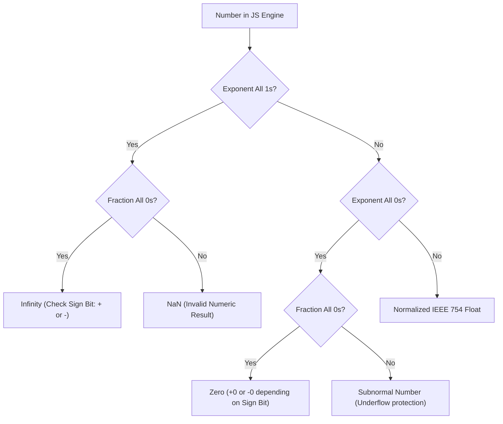

# Floating-Point Representation, IEEE 754 & Number Precision

> An exhaustive technical reference on JavaScript numerical precision: the IEEE 754 binary64 double-precision format, floating-point rounding errors (`0.1 + 0.2`), `Number.EPSILON`, safe integer boundaries, signed zeroes, and financial math engineering.

| Metadata | Details |
| :--- | :--- |
| **Level** | Intermediate |
| **Prerequisites** | [02_data-types.md](./02_data-types.md), [04_operators.md](./04_operators.md) |
| **Time to Read** | 25 minutes |
| **Status** | Complete |
| **ECMAScript Standard** | ES6 (ES2015) to Current (ES2024/ES2025) |

---

## Table of Contents
1. [What & Why](#1-what--why)
2. [Core Concepts](#2-core-concepts)
3. [How It Works: The IEEE 754 Binary64 Architecture](#3-how-it-works-the-ieee-754-binary64-architecture)
4. [Syntax & Numeric API Reference](#4-syntax--numeric-api-reference)
5. [Practical Examples](#5-practical-examples)
6. [Edge Cases & Gotchas](#6-edge-cases--gotchas)
7. [Common Mistakes & Anti-Patterns](#7-common-mistakes--anti-patterns)
8. [Performance Characteristics](#8-performance-characteristics)
9. [Engine Internals: V8 SMI vs HeapNumber & Float Conversions](#9-engine-internals-v8-smi-vs-heapnumber--float-conversions)
10. [Best Practices & Style Guide](#10-best-practices--style-guide)
11. [Real-World Applications & Case Studies](#11-real-world-applications--case-studies)
12. [Interview Questions & Deep Dives](#12-interview-questions--deep-dives)
13. [Exercises & Challenges](#13-exercises--challenges)

---

## 1. What & Why

In JavaScript, all numbers (with the explicit exception of `BigInt`) are implemented as **double-precision 64-bit binary floating-point values**, conforming to the international **IEEE 754** standard.

There is no separate `int`, `long`, `float`, or `double` primitive type in the ECMAScript language specification. Whether you write `42`, `-199`, or `3.14159`, the underlying runtime data structure is identical.

```
0.1 (Base 10)  ──► Binary: 0.000110011001100110011... (Infinite recurring binary fraction!)
0.2 (Base 10)  ──► Binary: 0.001100110011001100110... (Infinite recurring binary fraction!)
                       │
                       ▼ Truncated to 53 bits of precision in IEEE 754
0.1 + 0.2      ──► 0.300000000000000044408920985...
```

Because computers store numbers in base-2 (binary) rather than base-10 (decimal), common decimal fractions like $0.1$ ($\frac{1}{10}$) and $0.2$ ($\frac{1}{5}$) cannot be represented with finite precision in binary, just as $\frac{1}{3}$ cannot be represented with finite precision in decimal ($0.3333\dots$). This leads to the famous `0.1 + 0.2 !== 0.3` discrepancy.

Understanding the mechanics of IEEE 754 is essential to preventing rounding bugs in financial ledgers, scientific computing, graphics calculations, and integer ID hashing.

---

## 2. Core Concepts

### 2.1 The IEEE 754 Double-Precision Layout
A 64-bit float consists of three distinct fields:

```
┌──────┬──────────────────────┬────────────────────────────────────────────────────────┐
│ Sign │  Exponent (11 bits)  │                Fraction / Mantissa (52 bits)           │
│ 1 bit│     Bias = 1023      │           52 stored bits + 1 implicit hidden bit       │
└──────┴──────────────────────┴────────────────────────────────────────────────────────┘
Bit 63   Bit 62          Bit 52 Bit 51                                             Bit 0
```

1. **Sign Bit (1 bit)**: `0` denotes positive; `1` denotes negative.
2. **Exponent (11 bits)**: Stores the magnitude as an unsigned integer with a bias of $1023$, allowing exponents ranging from $2^{-1022}$ to $2^{1023}$.
3. **Fraction / Mantissa (52 bits)**: Represents the significant digits of the number. Normalized numbers have an implicit leading `1`, providing **53 bits of effective precision**.

The mathematical value is computed as:
$$\text{Value} = (-1)^{\text{sign}} \times (1 + \text{fraction}) \times 2^{\text{exponent} - 1023}$$

### 2.2 Safe Integer Limits
Because the mantissa provides 53 bits of precision ($1 \text{ implicit} + 52 \text{ explicit}$), JavaScript can represent integers exactly and without error up to $2^{53} - 1$:
- **`Number.MAX_SAFE_INTEGER`**: $2^{53} - 1 = 9,007,199,254,740,991$ (approx. 9 quadrillion).
- **`Number.MIN_SAFE_INTEGER`**: $-(2^{53} - 1) = -9,007,199,254,740,991$.
- Any integer arithmetic exceeding this range loses precision because adjacent integers map to the exact same 64-bit float bit pattern!

```javascript
console.log(9007199254740991 + 1); // 9007199254740992 (Safe)
console.log(9007199254740991 + 2); // 9007199254740992 (UNSAFE: Precision lost! Should be ...93)
```

### 2.3 Machine Epsilon (`Number.EPSILON`)
`Number.EPSILON` represents the difference between $1.0$ and the next smallest floating-point number representable in 64 bits:
$$\text{Number.EPSILON} = 2^{-52} \approx 2.220446049250313 \times 10^{-16}$$
It provides the standard mathematical tolerance for comparing floating-point numbers:
```javascript
function areNumbersApproximatelyEqual(a, b, tolerance = Number.EPSILON) {
  return Math.abs(a - b) < tolerance;
}

console.log(areNumbersApproximatelyEqual(0.1 + 0.2, 0.3)); // true!
```

---

## 3. How It Works: The IEEE 754 Binary64 Architecture

### Special Floating-Point Values

| Condition | Exponent Bits | Mantissa Bits | Represented Value |
| :--- | :--- | :--- | :--- |
| **Normalized Non-Zero** | `00000000001` to `11111111110` | Any bit pattern | Finite numbers ($\approx \pm 1.79 \times 10^{308}$) |
| **Positive Zero (`+0`)** | All `0`s (`00000000000`) | All `0`s | `+0` |
| **Negative Zero (`-0`)** | All `0`s, Sign bit = 1 | All `0`s | `-0` |
| **Subnormal Numbers** | All `0`s (`00000000000`) | Non-zero | Very tiny numbers near zero ($5 \times 10^{-324}$) |
| **Positive Infinity (`+Infinity`)** | All `1`s (`11111111111`), Sign = 0 | All `0`s | `Infinity` |
| **Negative Infinity (`-Infinity`)** | All `1`s (`11111111111`), Sign = 1 | All `0`s | `-Infinity` |
| **Not-a-Number (`NaN`)** | All `1`s (`11111111111`) | **Non-zero** | `NaN` (Quiet or Signaling) |



---

## 4. Syntax & Numeric API Reference

### Core Number Properties & Methods

```javascript
// Constants
Number.MAX_SAFE_INTEGER; //  9007199254740991 (2^53 - 1)
Number.MIN_SAFE_INTEGER; // -9007199254740991
Number.MAX_VALUE;        // ~1.7976931348623157e+308 (Largest finite float)
Number.MIN_VALUE;        //  5e-324 (Smallest positive subnormal float)
Number.EPSILON;          // ~2.220446049250313e-16
Number.POSITIVE_INFINITY;//  Infinity
Number.NEGATIVE_INFINITY;// -Infinity
Number.NaN;              //  NaN

// Introspection Methods (Strict, No Coercion)
Number.isFinite(value);     // True if value is a finite number
Number.isNaN(value);        // True only if value is type number AND is NaN
Number.isInteger(value);    // True if value is a finite number without fractional part
Number.isSafeInteger(val);  // True if isInteger AND within [MIN_SAFE, MAX_SAFE]

// Formatting
num.toFixed(digits);        // Returns string rounded to fixed decimals
num.toPrecision(precision); // Returns string rounded to significant digits
num.toString(radix);        // Converts to string in base 2, 8, 10, 16, 36
```

---

## 5. Practical Examples

### Example 1: Implementing a Robust Floating-Point Equality Guard

```javascript
/**
 * Safely compares two floating-point numbers within a mathematical epsilon tolerance.
 * @param {number} n1
 * @param {number} n2
 * @param {number} [epsilon]
 * @returns {boolean}
 */
function floatEquals(n1, n2, epsilon = Number.EPSILON) {
  return Math.abs(n1 - n2) < epsilon;
}

console.log(0.1 + 0.2 === 0.3);         // false
console.log(floatEquals(0.1 + 0.2, 0.3)); // true

// Scaling tolerance for large magnitudes:
function floatEqualsRelative(n1, n2) {
  const diff = Math.abs(n1 - n2);
  if (n1 === n2) return true; // Handles infinities
  return diff <= Math.max(Math.abs(n1), Math.abs(n2)) * Number.EPSILON;
}

console.log(floatEqualsRelative(10000.1 + 10000.2, 20000.3)); // true
```

### Example 2: Inspecting IEEE 754 Binary Representation in JavaScript

We can use `ArrayBuffer` and `DataView` to read the exact 64-bit IEEE binary layout of any number directly in memory:

```javascript
/**
 * Inspects the exact 64-bit IEEE 754 binary structure of a JavaScript number.
 * @param {number} num
 * @returns {{ sign: string, exponent: string, mantissa: string, fullBinary: string }}
 */
function inspectFloat64(num) {
  const buffer = new ArrayBuffer(8);
  const view = new DataView(buffer);
  view.setFloat64(0, num, false); // Big-endian write

  let binary = "";
  for (let i = 0; i < 8; i++) {
    binary += view.getUint8(i).toString(2).padStart(8, "0");
  }

  const sign = binary.slice(0, 1);
  const exponent = binary.slice(1, 12);
  const mantissa = binary.slice(12);

  return { sign, exponent, mantissa, fullBinary: binary };
}

console.log("IEEE 754 Breakdown for 0.1:");
console.log(inspectFloat64(0.1));
// Notice the infinitely repeating pattern '110011001100...' in the mantissa!
```

### Example 3: Precise Monetary Calculation Using Scaled Integer Arithmetic

```javascript
/**
 * Monetary transaction calculator storing amounts in cents (integers)
 * avoiding floating-point fractional rounding errors entirely.
 */
class Money {
  /**
   * @param {number} dollars
   * @param {string} [currency]
   */
  constructor(dollars, currency = "USD") {
    // Round to nearest integer cent immediately to discard float noise
    this.cents = Math.round(dollars * 100);
    this.currency = currency;
  }

  add(otherMoney) {
    if (this.currency !== otherMoney.currency) {
      throw new Error("Currency mismatch");
    }
    return Money.fromCents(this.cents + otherMoney.cents, this.currency);
  }

  multiply(factor) {
    return Money.fromCents(Math.round(this.cents * factor), this.currency);
  }

  format() {
    return `${this.currency} ${(this.cents / 100).toFixed(2)}`;
  }

  static fromCents(cents, currency = "USD") {
    const m = new Money(0, currency);
    m.cents = cents;
    return m;
  }
}

const item1 = new Money(19.99);
const item2 = new Money(9.99);
const taxRate = 0.0825; // 8.25%

const subtotal = item1.add(item2);
const tax = subtotal.multiply(taxRate);
const total = subtotal.add(tax);

console.log("Subtotal:", subtotal.format()); // USD 29.98
console.log("Tax:", tax.format());           // USD 2.47
console.log("Total:", total.format());       // USD 32.45
```

### Example 4: Validating High-Precision External 64-Bit IDs

```javascript
// Twitter/X snowflakes or database UUIDs frequently exceed 53 bits:
// Example Snowflake ID: 1541815603606036480 (61 bits)

const rawJson = '{"tweetId": 1541815603606036480}';

// DANGER: Standard JSON.parse parses numbers as Float64, destroying ID integrity!
const parsed = JSON.parse(rawJson);
console.log("Parsed as Number:", parsed.tweetId);
// Logs: 1541815603606036500 (CORRUPTED! Last 2 digits altered by IEEE 754 precision loss!)

// SOLUTION: Parse large IDs as strings or BigInt before JSON ingestion:
function safeParseSnowflakes(jsonString) {
  // Replace unquoted 16+ digit numbers with quoted strings
  const sanitized = jsonString.replace(/:\s*(\d{16,})\b/g, ': "$1"');
  return JSON.parse(sanitized);
}

const safeData = safeParseSnowflakes(rawJson);
console.log("Parsed Safely:", safeData.tweetId); // "1541815603606036480" (Preserved!)
```

### Example 5: Handling Signed Zero (`+0` vs `-0`)

```javascript
// In IEEE 754, zero has a sign bit:
const posZero = +0;
const negZero = -0;

console.log(posZero === negZero); // true (IEEE 754 specification rule)
console.log(Object.is(posZero, negZero)); // false (ECMAScript SameValue algorithm)

// Detecting negative zero:
function isNegativeZero(val) {
  return val === 0 && 1 / val === -Infinity;
}

console.log(isNegativeZero(-0)); // true
console.log(isNegativeZero(+0)); // false
console.log(isNegativeZero(0));  // false
```

---

## 6. Edge Cases & Gotchas

### 6.1 `Number.MAX_VALUE + 1` Does Not Equal `Infinity`
`Number.MAX_VALUE` is $\approx 1.79 \times 10^{308}$. Adding $1$ to it does nothing because $1$ is far below the least significant bit at that exponent magnitude:
```javascript
Number.MAX_VALUE + 1 === Number.MAX_VALUE; // true!
// To produce Infinity, you must exceed the representable range by at least half the gap:
Number.MAX_VALUE * 2 === Infinity; // true
```

### 6.2 Subnormal Numbers & Underflow
When a number is smaller than the minimum normalized float ($2^{-1022} \approx 2.22 \times 10^{-308}$), IEEE 754 turns off the implicit leading `1`. These are **subnormal numbers**.
- They allow graceful degradation towards zero down to $5 \times 10^{-324}$ (`Number.MIN_VALUE`).
- However, subnormal math is significantly slower on CPUs because processors often trap to microcode to perform denormalized arithmetic.

### 6.3 `Math.round` Ties Away From Zero Bug
In JavaScript, `Math.round(-0.5)` evaluates to `-0`, not `-1`:
```javascript
console.log(Math.round(1.5));  // 2
console.log(Math.round(-1.5)); // -1 (Rounds toward +Infinity on ties!)
console.log(Math.round(-0.5)); // -0
```

---

## 7. Common Mistakes & Anti-Patterns

| Anti-Pattern | Why It Fails | Correct Approach |
| :--- | :--- | :--- |
| **Using `==` or `===` for float comparisons** | `0.1 + 0.2 === 0.3` fails due to binary fractional truncation. | Compare absolute difference against `Number.EPSILON`. |
| **Parsing 64-bit database IDs as numbers** | Numbers $> 2^{53}-1$ suffer silent bit truncation in `JSON.parse`. | Transmit and parse 64-bit IDs as `string` or `bigint`. |
| **Doing currency math with raw floats** | Accumulates fractional cent errors over repeated additions. | Store currency in integer cents or use `BigInt` / Decimal libraries. |
| **Assuming `Number.isInteger` checks safety** | `Number.isInteger(2**60)` is `true`, but `2**60` is wildly unsafe. | Always check `Number.isSafeInteger(val)`. |
| **Using `Math.min()` with no arguments** | `Math.min()` returns `Infinity`, and `Math.max()` returns `-Infinity`. | Provide fallback bounds or check array length first. |
| **Relying on `parseInt` for scientific numbers** | `parseInt(0.0000001)` evaluates `parseInt("1e-7")`, returning `1`. | Use `Math.floor()` or `Number(val)`. |

---

## 8. Performance Characteristics

| Operation | CPU & Engine Execution Pipeline | Relative Latency |
| :--- | :--- | :--- |
| **Small Integer (SMI) Float Ops** | Direct 32/64-bit CPU ALU/FPU registers | **Fastest** (~0.2 ns) |
| **Normalized Float64 Addition (`+`)** | Inlined CPU FPU instruction (`ADDSD` in x86-64) | **Fastest** (~0.3 ns) |
| **Subnormal Floating-Point Math** | CPU pipeline stall (microcode exception trap) | **Slow** (~20–80 ns) |
| **Float to String Formatting (`toFixed`)** | Grisu3 / Dragonbox C++ algorithm | Moderate (~25–60 ns) |
| **`BigInt` Operations** | Dynamic arbitrary-precision heap allocation | Slower (~15–40 ns) |

---

## 9. Engine Internals: V8 SMI vs HeapNumber & Float Conversions

To maintain high execution speeds while strictly honoring the IEEE 754 specification:
1. **SMI Representation**: If a number is an integer fitting within 31 bits (on 64-bit architectures), V8 stores it directly inside pointer registers as a **Small Integer (SMI)** with bit-tag `00`.
2. **HeapNumber Allocation**: The instant a number gains a fractional component (e.g. `10.5`) or exceeds 31 bits, V8 must allocate a `HeapNumber` object on the V8 managed heap.
3. **TurboFan Float Register Allocation**: In optimized code, TurboFan unwraps `HeapNumber` instances and assigns their raw 64-bit IEEE double values directly to hardware SIMD/XMM registers, avoiding heap allocations within tight loops.

---

## 10. Best Practices & Style Guide

1. **Always Qualify Numeric Guards**: Write `Number.isFinite(x)` and `Number.isNaN(x)`, never the legacy global functions `isFinite` and `isNaN`.
2. **Never Use Floats for Financial Ledgers**: Always store monetary quantities as integer cents (`$19.99 -> 1999`) or use an arbitrary-precision decimal library like `decimal.js`.
3. **Guard All ID Ingestions**: Ensure your backend and frontend APIs serialize 64-bit integers (e.g. database sequence keys, Discord/Twitter IDs) as JSON strings.
4. **Use Number Literals with Numeric Separators**: Improve readability of large numbers using underscores:
   ```javascript
   const oneBillion = 1_000_000_000;
   const maxSafe = 9_007_199_254_740_991;
   ```

---

## 11. Real-World Applications & Case Studies

### Case Study: Vancouver Stock Exchange Index Truncation
In 1982, the Vancouver Stock Exchange created an index initialized at `1000.000`. With each transaction, the index was recalculated and truncated to three decimal places rather than properly rounded.
- **Result**: The index lost approximately 25 points per month. Within 22 months, the index had dropped from `1000` to `524`, even though the stock market had actually grown.
- **Lesson for JavaScript Developers**: Accumulating naive floating-point truncations (`Math.floor` or `toFixed`) across thousands of continuous updates creates systemic bias and significant data drift. Always use exact math or bankers' rounding (round half to even).

---

## 12. Interview Questions & Deep Dives

<details>
<summary><strong>1. Explain why `0.1 + 0.2 !== 0.3` in JavaScript.</strong></summary>

**Answer:**
JavaScript represents all numbers using IEEE 754 64-bit binary floating-point. In binary base-2, a fraction can only be represented with finite precision if its denominator is a power of 2.
- The numbers $0.1$ ($\frac{1}{10}$) and $0.2$ ($\frac{1}{5}$) result in infinite repeating binary fractions: $0.0001100110011\dots_2$.
- The engine must truncate these fractions at 53 bits of precision.
- When the two truncated binary approximations are added together, the resulting sum is $0.300000000000000044408920985\dots$, which does not equal the truncated binary representation of $0.3$.
</details>

<details>
<summary><strong>2. What is `Number.MAX_SAFE_INTEGER` and what determines its value?</strong></summary>

**Answer:**
`Number.MAX_SAFE_INTEGER` is $9,007,199,254,740,991$ ($2^{53} - 1$).

Its value is determined by the 52-bit mantissa field of the IEEE 754 binary64 format. Because normalized numbers have an implicit leading `1`, the total effective precision is 53 bits. In 53 bits, every integer from $-(2^{53}-1)$ to $2^{53}-1$ has a distinct, exact binary representation. Above $2^{53}$, there are not enough bits to represent all integers, so odd integers are dropped and map to adjacent even floats.
</details>

<details>
<summary><strong>3. What is the difference between `Number.isInteger()` and `Number.isSafeInteger()`?</strong></summary>

**Answer:**
- `Number.isInteger(val)` returns `true` if `val` is a finite number whose fractional part is zero (`val % 1 === 0`). It returns `true` even for numbers exceeding $2^{53}$, such as `2 ** 60`.
- `Number.isSafeInteger(val)` checks both that `val` is an integer AND that it lies within $[-(2^{53}-1), 2^{53}-1]$. It returns `false` for `2 ** 60` because that integer cannot be safely represented without precision loss.
</details>

<details>
<summary><strong>4. How does JavaScript distinguish `+0` and `-0`?</strong></summary>

**Answer:**
IEEE 754 reserves a dedicated sign bit (bit 63). When the exponent and mantissa bits are all zero, the sign bit determines whether the number is `+0` (sign bit 0) or `-0` (sign bit 1).

While `+0 === -0` evaluates to `true`, they can be distinguished by:
1. Division: `1 / +0` yields `Infinity`, whereas `1 / -0` yields `-Infinity`.
2. `Object.is(+0, -0)` evaluates to `false`.
</details>

<details>
<summary><strong>5. What is `Number.EPSILON` and how is it used in production?</strong></summary>

**Answer:**
`Number.EPSILON` is $2^{-52} \approx 2.22 \times 10^{-16}$. It represents the smallest difference between 1 and the next representable float. In production, it is used as a tolerance threshold when comparing floating-point calculation results:
```javascript
const areEqual = Math.abs(calculated - expected) < Number.EPSILON;
```
</details>

<details>
<summary><strong>6. What are Subnormal (Denormalized) numbers?</strong></summary>

**Answer:**
Subnormal numbers occur when the exponent bits in IEEE 754 are all zero, but the mantissa is non-zero. In this mode, the implicit leading `1` bit is disabled. This allows numbers smaller than the minimum normalized number ($2^{-1022}$) to be represented, providing gradual underflow down to $5 \times 10^{-324}$ (`Number.MIN_VALUE`). However, subnormal math is often executed in software microcode on CPUs, resulting in severe performance slowdowns.
</details>

<details>
<summary><strong>7. Why does `Math.min()` return `Infinity` and `Math.max()` return `-Infinity`?</strong></summary>

**Answer:**
`Math.min()` and `Math.max()` are designed to act as reduction identities. When finding the minimum of a list, the initial accumulator must be the highest possible mathematical value (`+Infinity`) so that any number compared against it will be smaller: `Math.min(Infinity, x) === x`. Conversely, the initial accumulator for maximum must be `-Infinity`.
</details>

<details>
<summary><strong>8. Why should you avoid `toFixed()` for rounding financial numbers?</strong></summary>

**Answer:**
`Number.prototype.toFixed()` converts a float to a string using "half away from zero" or bankers rounding, but because the underlying number already suffers from IEEE 754 binary truncation (e.g. `1.005` in memory is actually `1.004999999999999893...`), `(1.005).toFixed(2)` incorrectly rounds down to `"1.00"` instead of `"1.01"`.
</details>

---

## 13. Exercises & Challenges

### Exercise 1 (Easy): Safe Float Comparator with Custom Tolerance
**Task**: Write a function `isCloseEnough(actual, expected, maxDifference)` that safely returns `true` if two numbers are within `maxDifference` of each other, defaulting to `1e-9`.

<details>
<summary><strong>Solution</strong></summary>

```javascript
function isCloseEnough(actual, expected, maxDifference = 1e-9) {
  return Math.abs(actual - expected) <= maxDifference;
}

console.log(isCloseEnough(0.1 + 0.2, 0.3));     // true
console.log(isCloseEnough(10.0001, 10.0002, 0.001)); // true
console.log(isCloseEnough(10.0001, 10.0002, 0.00001)); // false
```
</details>

### Exercise 2 (Easy): Safe Integer Checker
**Task**: Author a function `assertSafeSum(a, b)` that adds two numbers together and verifies that the sum is guaranteed to be mathematically precise, throwing an error if precision is lost.

<details>
<summary><strong>Solution</strong></summary>

```javascript
function assertSafeSum(a, b) {
  if (!Number.isSafeInteger(a) || !Number.isSafeInteger(b)) {
    throw new RangeError("Operands must be safe integers");
  }

  const sum = a + b;
  if (!Number.isSafeInteger(sum)) {
    throw new RangeError(`Result ${sum} exceeds Number.MAX_SAFE_INTEGER bounds`);
  }

  return sum;
}

console.log(assertSafeSum(100, 200)); // 300
// assertSafeSum(Number.MAX_SAFE_INTEGER, 10); // Throws RangeError!
```
</details>

### Exercise 3 (Medium): Accurate Half-Up Decimal Rounding
**Task**: Build a function `roundToDecimals(num, decimals)` that rounds numbers accurately according to standard arithmetic "round half up" without suffering from the `(1.005).toFixed(2)` bug.

<details>
<summary><strong>Solution</strong></summary>

```javascript
function roundToDecimals(num, decimals = 2) {
  // Use exponential notation shifting to avoid intermediate binary rounding noise
  const factor = 10 ** decimals;
  return Math.round((num + Number.EPSILON) * factor) / factor;
}

console.log((1.005).toFixed(2));        // "1.00" (Buggy native behavior)
console.log(roundToDecimals(1.005, 2)); // 1.01 (Corrected!)
console.log(roundToDecimals(0.1 + 0.2, 1)); // 0.3
```
</details>

### Exercise 4 (Medium): Detect Floating-Point Sign Bit
**Task**: Write a function `getSignBit(num)` that inspects any JavaScript number and returns `"positive"` or `"negative"`, correctly differentiating `+0` from `-0` and `+Infinity` from `-Infinity`.

<details>
<summary><strong>Solution</strong></summary>

```javascript
function getSignBit(num) {
  if (num === 0) {
    return 1 / num === -Infinity ? "negative" : "positive";
  }
  return num < 0 || Object.is(num, -0) ? "negative" : "positive";
}

console.log(getSignBit(+0));        // "positive"
console.log(getSignBit(-0));        // "negative"
console.log(getSignBit(42));        // "positive"
console.log(getSignBit(-Infinity)); // "negative"
```
</details>

### Exercise 5 (Hard): High-Precision Decimal Accumulator
**Task**: Build an accumulator class `DecimalAccumulator` that sums arbitrary decimal numbers passed as strings (e.g. `"0.1"`, `"0.2"`, `"19.99"`) with 100% exact precision up to 10 decimal places without using external libraries.

<details>
<summary><strong>Solution</strong></summary>

```javascript
class DecimalAccumulator {
  constructor(decimalPlaces = 4) {
    this.decimalPlaces = decimalPlaces;
    this.multiplier = 10n ** BigInt(decimalPlaces);
    this.totalCents = 0n;
  }

  add(decimalString) {
    const parts = decimalString.trim().split(".");
    const whole = BigInt(parts[0] || "0");
    const fractionStr = (parts[1] || "").slice(0, this.decimalPlaces).padEnd(this.decimalPlaces, "0");
    const fraction = BigInt(fractionStr);

    const isNegative = whole < 0n || decimalString.startsWith("-");
    const sign = isNegative ? -1n : 1n;
    const valueInCents = whole * this.multiplier + sign * fraction;

    this.totalCents += valueInCents;
    return this;
  }

  toString() {
    const sign = this.totalCents < 0n ? "-" : "";
    const absVal = this.totalCents < 0n ? -this.totalCents : this.totalCents;
    const whole = absVal / this.multiplier;
    const frac = (absVal % this.multiplier).toString().padStart(this.decimalPlaces, "0");
    return `${sign}${whole}.${frac}`;
  }
}

const acc = new DecimalAccumulator(2);
acc.add("0.10").add("0.20").add("19.99");
console.log("Exact Decimal Sum:", acc.toString()); // "20.29"
```
</details>

### Exercise 6 (Hard): IEEE 754 Double Packer & Unpacker
**Task**: Implement a pair of functions `packFloat64(sign, exponent, mantissa)` and `unpackFloat64(num)` using `ArrayBuffer` and `BigInt64Array` that extracts and reconstructs raw IEEE 754 binary fields.

<details>
<summary><strong>Solution</strong></summary>

```javascript
function unpackFloat64(num) {
  const buf = new ArrayBuffer(8);
  new Float64Array(buf)[0] = num;
  const bits = new BigUint64Array(buf)[0];

  const sign = Number((bits >> 63n) & 1n);
  const exponent = Number((bits >> 52n) & 0x7ffn);
  const mantissa = bits & 0xfffffffffffffn;

  return { sign, exponent, mantissa: `0x${mantissa.toString(16)}` };
}

function packFloat64(sign, exponent, mantissaBigInt) {
  const buf = new ArrayBuffer(8);
  const signBit = BigInt(sign) << 63n;
  const expBits = (BigInt(exponent) & 0x7ffn) << 52n;
  const mantBits = mantissaBigInt & 0xfffffffffffffn;

  const totalBits = signBit | expBits | mantBits;
  new BigUint64Array(buf)[0] = totalBits;

  return new Float64Array(buf)[0];
}

// Verification with 1.5 (Sign 0, Exp 1023, Mantissa 0x8000000000000)
const unpacked = unpackFloat64(1.5);
console.log("Unpacked 1.5:", unpacked);

const repacked = packFloat64(unpacked.sign, unpacked.exponent, BigInt(unpacked.mantissa));
console.log("Repacked value:", repacked); // 1.5
console.log("Matches original:", Object.is(1.5, repacked)); // true
```
</details>
