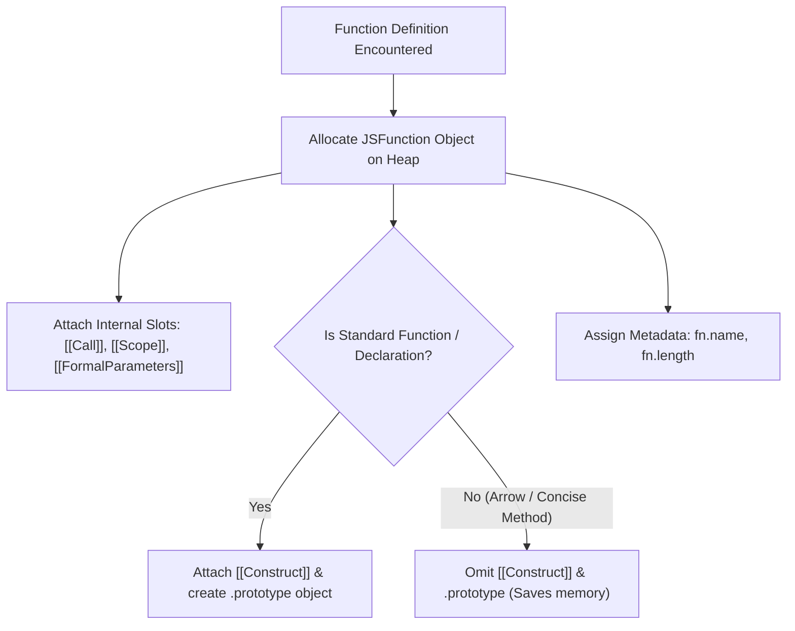

# Function Declarations, Expressions & Named Function Expressions (NFE)

> An exhaustive technical reference on JavaScript function definitions: declarations vs expressions, Named Function Expressions (NFE), first-class function mechanics, internal slots (`[[Call]]`, `[[Construct]]`), and V8 function representations.

| Metadata | Details |
| :--- | :--- |
| **Level** | Beginner to Intermediate |
| **Prerequisites** | [01_fundamentals/01_variables.md](../01_fundamentals/01_variables.md), [01_fundamentals/05_expressions-and-statements.md](../01_fundamentals/05_expressions-and-statements.md) |
| **Time to Read** | 25 minutes |
| **Status** | Complete |
| **ECMAScript Standard** | ES6 (ES2015) to Current (ES2024/ES2025) |

---

## Table of Contents
1. [What & Why](#1-what--why)
2. [Core Concepts](#2-core-concepts)
3. [How It Works: Function Object Creation & Internal Slots](#3-how-it-works-function-object-creation--internal-slots)
4. [Syntax & Form Comparison Reference](#4-syntax--form-comparison-reference)
5. [Practical Examples](#5-practical-examples)
6. [Edge Cases & Gotchas](#6-edge-cases--gotchas)
7. [Common Mistakes & Anti-Patterns](#7-common-mistakes--anti-patterns)
8. [Performance Characteristics](#8-performance-characteristics)
9. [Engine Internals: V8 `JSFunction` & `SharedFunctionInfo`](#9-engine-internals-v8-jsfunction--sharedfunctioninfo)
10. [Best Practices & Style Guide](#10-best-practices--style-guide)
11. [Real-World Applications & Case Studies](#11-real-world-applications--case-studies)
12. [Interview Questions & Deep Dives](#12-interview-questions--deep-dives)
13. [Exercises & Challenges](#13-exercises--challenges)

---

## 1. What & Why

In JavaScript, functions are **first-class citizens** (first-class objects). This means functions are not merely subroutines; they are runtime values that can be:
- Bound to variables and object properties.
- Passed as arguments into other functions (callbacks).
- Returned dynamically from functions (higher-order functions / closures).
- Augmented with custom properties and methods (`fn.cache = new Map()`).

```
┌─────────────────────────────────────────────────────────┐
│              Functions as First-Class Values            │
├────────────────────────────┬────────────────────────────┤
│ Function Declaration       │ Function Expression        │
│ (Statement Context)        │ (Expression Context)       │
├────────────────────────────┼────────────────────────────┤
│ function add(a, b) { ... } │ const add = (a, b) => ...  │
│ • Hoisted with full body   │ • Bound to variable (TDZ)  │
│ • Mandatory identifier     │ • Anonymous or Named (NFE) │
│ • Can be called anywhere   │ • Defined upon line eval   │
└────────────────────────────┴────────────────────────────┘
```

Selecting between function declarations, anonymous expressions, and Named Function Expressions (NFE) directly governs code organization, stack trace readability during debugging, and recursion safety when variable bindings are reassigned.

---

## 2. Core Concepts

### 2.1 Function Declarations (Hoisted Statements)
A function declaration begins with the `function` keyword at the statement level and requires an explicit identifier name:
```javascript
// Valid: can be invoked before its declaration statement in the source
console.log(multiply(4, 5)); // 20

function multiply(a, b) {
  return a * b;
}
```
During the creation phase of an execution context, the engine hoists both the function identifier and its complete executable body into the Environment Record.

### 2.2 Function Expressions (Evaluation-Time Assignment)
A function expression defines a function inside an expression context (such as an assignment or argument):
```javascript
// console.log(divide(20, 4)); // ReferenceError: Cannot access 'divide' before initialization
const divide = function (a, b) {
  return a / b;
};
console.log(divide(20, 4)); // 5
```
Function expressions follow the standard hoisting rules of the variable holding them. When declared with `const` or `let`, the variable remains uninitialized in the **Temporal Dead Zone** until execution reaches the assignment statement.

### 2.3 Named Function Expressions (NFE)
An anonymous function expression has no internal name (`const fn = function() {}`). A **Named Function Expression (NFE)** provides an internal identifier:
```javascript
const factorial = function fact(n) {
  if (n <= 1) return 1;
  return n * fact(n - 1); // Uses internal name 'fact' safely
};
```
Key properties of the internal NFE name (`fact`):
1. **Scope Isolation**: It is accessible **only** inside the function's own body. It does not exist in the outer enclosing scope (`console.log(fact)` throws `ReferenceError`).
2. **Immutable Binding**: Inside the function, the identifier is read-only. Assigning `fact = null` in strict mode throws a `TypeError`.
3. **Robust Recursion**: Even if the outer variable `factorial` is reassigned (`const old = factorial; factorial = null;`), `old(5)` continues to recurse without errors using `fact`.
4. **Descriptive Stack Traces**: Stack traces display `fact` instead of `anonymous`.

### 2.4 Method Definitions (ES6 Concise Methods)
Object literals support concise method syntax:
```javascript
const math = {
  add(a, b) { return a + b; } // Concise method
};
```
Concise methods differ fundamentally from standard functions:
- They lack the internal `[[Construct]]` slot; executing `new math.add()` throws a runtime `TypeError`.
- They possess an internal `[[HomeObject]]` slot, enabling the `super` keyword to invoke prototype methods.

---

## 3. How It Works: Function Object Creation & Internal Slots

When JavaScript creates a function, it constructs an object inheriting from `Function.prototype`.



### Essential Internal Slots:
- **`[[Call]]`**: Executes the function bytecode when invoked with parentheses `fn()`. Any object with this slot returns `"function"` under `typeof`.
- **`[[Construct]]`**: Executes constructor initialization when invoked via `new fn()`. Standard functions have this slot; arrow functions and concise methods omit it.
- **`[[Scope]]`**: Holds an internal reference pointer to the lexical environment record in which the function was declared, establishing the **closure chain**.

---

## 4. Syntax & Form Comparison Reference

### Complete Function Syntax Matrix

| Form | Syntax | Hoisted with Body? | Has `this` Binding? | Has `[[Construct]]` (`new`)? | Has `prototype` Object? |
| :--- | :--- | :---: | :---: | :---: | :---: |
| **Declaration** | `function foo() {}` | **Yes** | Yes | Yes | Yes |
| **Expression** | `const foo = function() {};` | No (in TDZ) | Yes | Yes | Yes |
| **Named Expression (NFE)** | `const foo = function bar() {};` | No (in TDZ) | Yes | Yes | Yes |
| **Arrow Function** | `const foo = () => {};` | No (in TDZ) | **No (Lexical)** | **No** | **No** |
| **Concise Method** | `{ foo() {} }` | No | Yes | **No** | **No** |
| **Async Function** | `async function foo() {}` | Yes | Yes | **No** | No |
| **Generator Function** | `function* foo() {}` | Yes | Yes | **No** | Yes |

---

## 5. Practical Examples

### Example 1: Robust Recursive Backtracking with NFE

```javascript
// Named Function Expression ensures recursion survives outer reference changes
const binarySearch = function search(arr, target, low = 0, high = arr.length - 1) {
  if (low > high) return -1;

  const mid = Math.floor((low + high) / 2);
  if (arr[mid] === target) return mid;

  if (arr[mid] > target) {
    return search(arr, target, low, mid - 1); // Recurses via internal NFE identifier
  } else {
    return search(arr, target, mid + 1, high);
  }
};

// Verify robustness against outer reassignment:
let searchRef = binarySearch;
// If someone overrides binarySearch, searchRef STILL functions because it recurses via 'search':
const testArray = [2, 4, 6, 8, 10, 12, 14];
console.log("Index of 10:", searchRef(testArray, 10)); // 4
```

### Example 2: Introspecting Function Metadata (Name & Arity)

```javascript
// Function length reports the formal arity EXCLUDING default and rest parameters
function connect(host, port = 8080, ...protocols) {}

console.log("Function Name:", connect.name);     // "connect"
console.log("Function Arity (length):", connect.length); // 1 (Only 'host' precedes defaults!)

// Automated Middleware Arity Validator:
function validateMiddleware(fn) {
  // Express-style middleware uses fn.length to differentiate standard vs error handlers:
  // standard: (req, res, next) -> length = 3
  // error: (err, req, res, next) -> length = 4
  if (fn.length === 4) {
    console.log(`Registered Error Middleware: ${fn.name || "anonymous"}`);
  } else if (fn.length === 3) {
    console.log(`Registered Standard Middleware: ${fn.name || "anonymous"}`);
  } else {
    console.warn(`Unusual middleware arity (${fn.length}) on ${fn.name}`);
  }
}

validateMiddleware(function auth(req, res, next) {});
validateMiddleware(function errorHandler(err, req, res, next) {});
```

### Example 3: Block-Scoped Function Declarations in Modern JavaScript

```javascript
"use strict";

const condition = true;

if (condition) {
  // In ES6 strict mode, function declarations are scoped strictly to the enclosing block!
  function blockScopedHelper() {
    return "Inside True Block";
  }
  console.log(blockScopedHelper()); // "Inside True Block"
}

try {
  // Attempting to call outside the block throws ReferenceError in strict mode
  // @ts-ignore
  blockScopedHelper();
} catch (err) {
  console.log("Caught expected error:", err.name); // ReferenceError
}
```

### Example 4: Polymorphic Method Invocations with `super` in Concise Methods

```javascript
const baseLogger = {
  log(message) {
    return `[BASE LOG]: ${message}`;
  }
};

const customLogger = {
  // Concise method possesses [[HomeObject]], allowing 'super' lookup
  log(message) {
    const baseOutput = super.log(message);
    return `[ALERT] ${baseOutput} (Processed at ${Date.now()})`;
  }
};

Object.setPrototypeOf(customLogger, baseLogger);
console.log(customLogger.log("Disk storage at 92%"));
```

### Example 5: High-Order Function Currying and Partial Application

```javascript
/**
 * Generic curry factory transforming f(a, b, c) into f(a)(b)(c)
 * @param {Function} fn
 * @returns {Function}
 */
function curry(fn) {
  return function curried(...args) {
    if (args.length >= fn.length) {
      return Reflect.apply(fn, this, args);
    }
    return function (...nextArgs) {
      return Reflect.apply(curried, this, args.concat(nextArgs));
    };
  };
}

function calculateVolume(length, width, height) {
  return length * width * height;
}

const curriedVolume = curry(calculateVolume);
const volumeWithLength10 = curriedVolume(10);
const volumeWithLength10AndWidth5 = volumeWithLength10(5);

console.log("Volume (10 * 5 * 2):", volumeWithLength10AndWidth5(2)); // 100
console.log("Volume in one call:", curriedVolume(10)(5)(4));         // 200
```

---

## 6. Edge Cases & Gotchas

### 6.1 NFE Internal Name is Read-Only
In non-strict mode, reassigning the internal NFE name inside the function is silently ignored. In strict mode, it throws a `TypeError`:
```javascript
const compute = function runner() {
  "use strict";
  try {
    // @ts-ignore
    runner = null; // TypeError: Assignment to constant variable
  } catch (e) {
    console.log("NFE re-assignment error:", e.message);
  }
};
compute();
```

### 6.2 Concise Methods Lack `[[Construct]]`
Attempting to instantiate an ES6 concise method with `new` produces an immediate runtime crash:
```javascript
const service = {
  start() { console.log("Starting..."); }
};

// new service.start(); // TypeError: service.start is not a constructor
```

### 6.3 Function Declarations in Non-Strict Blocks (ES6 Annex B)
Prior to ES6, declaring functions inside `if` or `for` blocks was undefined behavior across browser vendors. In ES6 Annex B (web compatibility), function declarations in blocks are hoisted out to the enclosing function in non-strict mode, but strictly block-scoped in strict mode. Always use `"use strict";` or ES modules to avoid this ambiguity.

---

## 7. Common Mistakes & Anti-Patterns

| Anti-Pattern | Why It Fails | Correct Approach |
| :--- | :--- | :--- |
| **Using `new Function(...)`** | Executes in global scope without closure access; incurs runtime parsing and security risks. | Use standard function expressions or arrow functions. |
| **Over-relying on declaration hoisting** | Calling functions hundreds of lines before their declaration harms readability. | Define utilities before callers or organize modules cleanly. |
| **Anonymous functions for complex recursion** | Uses `arguments.callee` (banned in strict mode) or fragile outer variable names. | Use Named Function Expressions (NFE). |
| **Assuming `fn.length` includes all parameters** | Rest parameters (`...args`) and default parameters are excluded from `fn.length`. | Inspect `arguments.length` or rest array length at call-time. |
| **Trying to use concise methods as constructors** | Concise methods omit the internal `[[Construct]]` slot and throw on `new`. | Use ES6 `class` syntax for constructors. |
| **Declaring functions in conditionals** | Cross-browser historical inconsistency in non-strict mode. | Assign a function expression to a `let` variable conditionally. |

---

## 8. Performance Characteristics

In modern V8:
- **Function Inlining**: For small functions (fewer than ~600 AST nodes), TurboFan completely eliminates function call overhead by inlining the bytecode directly into the caller.
- **Monomorphic Call Sites**: Calling a single function declaration repeatedly allows V8's Inline Cache (IC) to remain monomorphic, resulting in maximum CPU execution speed.
- **Closure Allocation Cost**: Every time a function containing an inner function expression executes, a new `JSFunction` heap object is allocated for the inner function to bind its new lexical context.

---

## 9. Engine Internals: V8 `JSFunction` & `SharedFunctionInfo`

V8 splits functions into two core structures to minimize memory usage across repeated closures:

```
┌────────────────────────────────────────────────────────┐
│             SharedFunctionInfo (SFI)                   │
│  (Allocated ONCE per function declaration)             │
│                                                        │
│  • Bytecode array generated by Ignition                │
│  • Formal parameter count                              │
│  • Source position & debug metadata                    │
│  • Optimized TurboFan machine code                     │
└──────────────────────────┬─────────────────────────────┘
                           │ Referenced by all instances
        ┌──────────────────┴──────────────────┐
        ▼                                     ▼
┌─────────────────────────────┐ ┌─────────────────────────────┐
│      JSFunction Instance    │ │      JSFunction Instance    │
│  (Closure 1 on Heap)        │ │  (Closure 2 on Heap)        │
│  • Pointer to Context (Env) │ │  • Pointer to Context (Env) │
│  • Inline FeedbackVector    │ │  • Inline FeedbackVector    │
└─────────────────────────────┘ └─────────────────────────────┘
```

1. **`SharedFunctionInfo` (SFI)**: Immutable representation of the function's static code. It holds the bytecode, name, and parameter counts.
2. **`JSFunction`**: The dynamic heap instance. When a function is called, V8 allocates a lightweight `JSFunction` pointing to the shared SFI and attaching the current execution context (closure bindings).

---

## 10. Best Practices & Style Guide

1. **Use Function Declarations for Top-Level Module API**: Function declarations make module utility functions readable and hoist predictably.
2. **Use NFEs for Complex Recursive Callbacks**: Always name function expressions passed into event listeners, recursion loops, or timers for clear stack traces.
3. **Use Arrow Functions for Inline Callbacks**: Cleanest syntax for non-method callbacks (`arr.map(x => x * 2)`).
4. **Never Use `eval()` or `new Function()`**: Completely ban dynamic code compilation via the ESLint rule `no-new-func`.

---

## 11. Real-World Applications & Case Studies

### Case Study: Production Memory Leak via Anonymous Event Listeners
A customer analytics dashboard experienced progressive browser memory growth over 8 hours of usage:
```javascript
// BUGGY: Anonymous function expression registered repeatedly
function setupLivePolling(socket) {
  socket.on("metric_update", function (data) {
    updateDashboardUI(data);
  });
}
```
- **Symptom**: When `setupLivePolling` was re-invoked on network reconnects, `socket.off("metric_update", ...)` could not remove the listener because the anonymous function reference was lost.
- **Memory Profiling**: Heap snapshots revealed 45,000 retained `JSFunction` instances and their associated closure contexts.
- **Resolution**: Refactored to a named function reference:
  ```javascript
  function handleMetricUpdate(data) { updateDashboardUI(data); }
  socket.off("metric_update", handleMetricUpdate);
  socket.on("metric_update", handleMetricUpdate);
  ```

---

## 12. Interview Questions & Deep Dives

<details>
<summary><strong>1. What is the fundamental difference between a Function Declaration and a Function Expression?</strong></summary>

**Answer:**
A **Function Declaration** is a statement evaluated during the creation phase of an execution context. It is hoisted completely with its executable body, allowing it to be invoked anywhere within its enclosing scope. It must have an explicit identifier.

A **Function Expression** is evaluated at runtime when execution reaches the statement containing it. The function is created and assigned to a variable or passed as an argument. If bound with `const` or `let`, it cannot be accessed prior to its declaration statement due to the Temporal Dead Zone.
</details>

<details>
<summary><strong>2. What is a Named Function Expression (NFE) and what advantages does it offer?</strong></summary>

**Answer:**
A Named Function Expression is a function expression that includes an explicit name: `const f = function helper() { ... };`.
Advantages:
1. **Recursion Safety**: The function can call itself via `helper` without relying on the outer variable `f`, preventing bugs if `f` is reassigned.
2. **Read-Only Binding**: The identifier `helper` is bound immutably inside the function's own body and is invisible to the outer scope.
3. **Stack Traces**: Crash reports and profilers display `helper` instead of `anonymous`, simplifying debugging.
</details>

<details>
<summary><strong>3. How does `fn.length` calculate formal arity?</strong></summary>

**Answer:**
`fn.length` returns the number of formal parameters declared in the function signature, **up to the first parameter with a default value**.
- It excludes the rest parameter (`...rest`).
- In `function(a, b = 1, c) {}`, `fn.length` is `1` because `b` has a default value, halting the arity count even though `c` follows it.
</details>

<details>
<summary><strong>4. Why does calling an ES6 concise method with `new` throw a TypeError?</strong></summary>

**Answer:**
In ECMAScript 2015 (ES6), concise method definitions (`const obj = { method() {} }`) were optimized to save memory and enforce proper object-oriented semantics. The engine deliberately omits the internal `[[Construct]]` slot and does not create an automatic `.prototype` object. When `new obj.method()` is evaluated, the engine checks for `[[Construct]]`; failing to find it, it throws `TypeError: obj.method is not a constructor`.
</details>

<details>
<summary><strong>5. How does V8 optimize function instances using `SharedFunctionInfo`?</strong></summary>

**Answer:**
When a function is declared inside a loop or parent function, compiling its source code and bytecode on every iteration would cause massive CPU and memory overhead. V8 compiles the function once into a `SharedFunctionInfo` (SFI) object containing the bytecode and AST metadata. Each execution of the parent function merely allocates a small `JSFunction` instance on the heap that points to the shared SFI while binding the unique local execution context (closure environment).
</details>

<details>
<summary><strong>6. What is the scope of the name identifier in a Named Function Expression?</strong></summary>

**Answer:**
The internal name of an NFE is added directly to a special intermediate declarative environment record created specifically for that function. It is accessible **exclusively inside the function body itself**. It does not pollute or exist in the outer enclosing scope. Inside the function, the identifier is an immutable binding that cannot be reassigned.
</details>

<details>
<summary><strong>7. What happens when a function declaration is placed inside a block in strict mode?</strong></summary>

**Answer:**
In strict mode (`"use strict";`), function declarations inside blocks (`{ ... }`) are block-scoped. They are hoisted to the top of that specific block, but cannot be accessed or invoked outside of that block (similar to `let` declarations). In non-strict mode, historical web compatibility rules (ES6 Annex B) hoist the identifier to the outer function scope, causing cross-browser inconsistencies.
</details>

<details>
<summary><strong>8. Why should `new Function()` be avoided in production systems?</strong></summary>

**Answer:**
1. **Security**: Like `eval()`, compiling strings into code opens applications to Remote Code Execution (RCE) and code injection vulnerabilities.
2. **Performance**: Bypasses V8 JIT pre-compilation; code must be parsed and compiled synchronously at runtime.
3. **Closure Loss**: Code executed via `new Function()` is always compiled in the global scope; it cannot close over local variables in its surrounding lexical environment.
</details>

---

## 13. Exercises & Challenges

### Exercise 1 (Easy): Identify Function Forms
**Task**: Identify whether each of the following definitions is a Function Declaration (FD), Anonymous Function Expression (AFE), or Named Function Expression (NFE):
1. `function parseInput(text) {}`
2. `const log = function(msg) {};`
3. `const traverse = function walk(node) {};`
4. `setTimeout(function() {}, 100);`

<details>
<summary><strong>Solution</strong></summary>

1. **FD** (Function Declaration)
2. **AFE** (Anonymous Function Expression)
3. **NFE** (Named Function Expression)
4. **AFE** (Anonymous Function Expression passed as argument)
</details>

### Exercise 2 (Easy): Safe Arity Inspector
**Task**: Write a function `getTrueArity(fn)` that inspects a function and returns an object detailing its formal parameter count (`length`), and whether it accepts rest parameters or defaults by inspecting `fn.toString()`.

<details>
<summary><strong>Solution</strong></summary>

```javascript
function getTrueArity(fn) {
  const source = fn.toString();
  const paramMatch = source.match(/\(([^)]*)\)/);
  const rawParams = paramMatch ? paramMatch[1].trim() : "";

  return {
    formalLength: fn.length,
    hasRest: rawParams.includes("..."),
    hasDefaults: rawParams.includes("=")
  };
}

function sample(a, b = 10, ...rest) {}
console.log(getTrueArity(sample));
// Output: { formalLength: 1, hasRest: true, hasDefaults: true }
```
</details>

### Exercise 3 (Medium): Self-Referencing Recursive Cache with NFE
**Task**: Implement a memoized Fibonacci calculator using a Named Function Expression where the cache is stored directly as a property on the function's internal NFE name.

<details>
<summary><strong>Solution</strong></summary>

```javascript
const fibonacci = function fib(n) {
  // Initialize cache on internal NFE identifier
  fib.cache ??= new Map([[0, 0], [1, 1]]);

  if (fib.cache.has(n)) {
    return fib.cache.get(n);
  }

  const result = fib(n - 1) + fib(n - 2);
  fib.cache.set(n, result);
  return result;
};

console.log("Fib(10):", fibonacci(10)); // 55
console.log("Fib(50):", fibonacci(50)); // 12586269025
```
</details>

### Exercise 4 (Medium): Conditional Function Selector Factory
**Task**: Write a function `createHasher(algorithm)` that returns a hashing function expression selected via a lookup dictionary, throwing a descriptive error if the algorithm is unsupported.

<details>
<summary><strong>Solution</strong></summary>

```javascript
import crypto from "node:crypto";

function createHasher(algorithm) {
  const algorithms = {
    sha256: function sha256(data) {
      return crypto.createHash("sha256").update(data).digest("hex");
    },
    md5: function md5(data) {
      return crypto.createHash("md5").update(data).digest("hex");
    }
  };

  const selected = algorithms[algorithm.toLowerCase()];
  if (!selected) {
    throw new TypeError(`Unsupported hashing algorithm: ${algorithm}`);
  }

  return selected;
}

const mySha = createHasher("sha256");
console.log("Hash:", mySha("hello")); // 2cf24dba5fb0a30e26e83b2ac5b9e29e1b161e5c1fa7425e73043362938b9824
```
</details>

### Exercise 5 (Hard): Method Binding Decorator with `super` Support
**Task**: Write an object factory `createPolymorphicProxy(parentObj, overrides)` that combines a prototype chain with custom concise methods, correctly invoking `super` methods using reflection.

<details>
<summary><strong>Solution</strong></summary>

```javascript
function createPolymorphicProxy(parentObj, overrides) {
  const instance = Object.create(parentObj);

  for (const [key, method] of Object.entries(overrides)) {
    if (typeof method === "function") {
      instance[key] = function (...args) {
        // Provide parent method as first argument
        const parentMethod = parentObj[key];
        const superCall = parentMethod ? (...superArgs) => Reflect.apply(parentMethod, instance, superArgs) : () => null;
        return Reflect.apply(method, instance, [superCall, ...args]);
      };
    }
  }

  return instance;
}

const baseService = {
  process(item) {
    return `Base: ${item}`;
  }
};

const customService = createPolymorphicProxy(baseService, {
  process(superCall, item) {
    const parentRes = superCall(item);
    return `Custom Wrapper -> ${parentRes}`;
  }
});

console.log(customService.process("Item_001"));
// Output: Custom Wrapper -> Base: Item_001
```
</details>

### Exercise 6 (Hard): Build an Exhaustive Function Inspector
**Task**: Build a comprehensive introspection utility `inspectFunction(fn)` that reports: name, length, whether it is a constructor (`[[Construct]]`), whether it is an arrow function, whether it is async, and whether it is a generator.

<details>
<summary><strong>Solution</strong></summary>

```javascript
function inspectFunction(fn) {
  if (typeof fn !== "function") {
    throw new TypeError("Argument must be a function");
  }

  let isConstructor = false;
  try {
    // Attempting to inspect prototype and construct
    // Arrow functions and concise methods lack .prototype
    if (fn.prototype && fn.prototype.constructor === fn) {
      // Proxied constructor probe
      new new Proxy(fn, {
        construct() { return {}; }
      })();
      isConstructor = true;
    }
  } catch {
    isConstructor = false;
  }

  const tag = Object.prototype.toString.call(fn);
  const source = fn.toString().trim();

  return {
    name: fn.name || "(anonymous)",
    length: fn.length,
    isConstructor,
    isArrow: !fn.prototype && !source.startsWith("function") && !source.startsWith("async function"),
    isAsync: tag === "[object AsyncFunction]",
    isGenerator: tag === "[object GeneratorFunction]"
  };
}

// Verification
console.log("Declaration:", inspectFunction(function myDecl() {}));
console.log("Arrow:", inspectFunction(() => {}));
console.log("Async:", inspectFunction(async function myAsync() {}));
```
</details>
