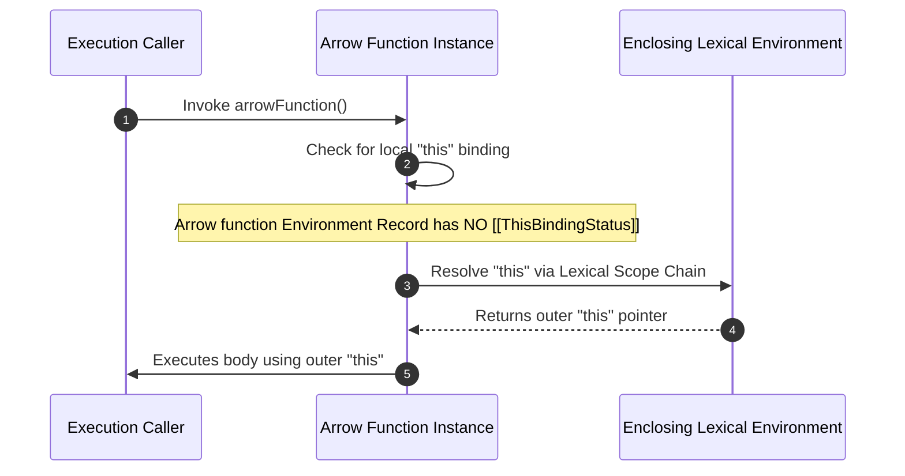

# Arrow Functions & Lexical `this` Semantics

> An exhaustive technical reference on ECMAScript arrow functions: lexical `this` binding, absence of `arguments` and `[[Construct]]`, implicit returns, and engine execution mechanics.

| Metadata | Details |
| :--- | :--- |
| **Level** | Beginner to Intermediate |
| **Prerequisites** | [01_declarations-and-expressions.md](./01_declarations-and-expressions.md) |
| **Time to Read** | 25 minutes |
| **Status** | Complete |
| **ECMAScript Standard** | ES6 (ES2015) to Current (ES2024/ES2025) |

---

## Table of Contents
1. [What & Why](#1-what--why)
2. [Core Concepts](#2-core-concepts)
3. [How It Works: Lexical Scoping of `this`](#3-how-it-works-lexical-scoping-of-this)
4. [Syntax & Form Variations](#4-syntax--form-variations)
5. [Practical Examples](#5-practical-examples)
6. [Edge Cases & Gotchas](#6-edge-cases--gotchas)
7. [Common Mistakes & Anti-Patterns](#7-common-mistakes--anti-patterns)
8. [Performance Characteristics](#8-performance-characteristics)
9. [Engine Internals: V8 Environment Records & Memory Layout](#9-engine-internals-v8-environment-records--memory-layout)
10. [Best Practices & Style Guide](#10-best-practices--style-guide)
11. [Real-World Applications & Case Studies](#11-real-world-applications--case-studies)
12. [Interview Questions & Deep Dives](#12-interview-questions--deep-dives)
13. [Exercises & Challenges](#13-exercises--challenges)

---

## 1. What & Why

Prior to ECMAScript 2015 (ES6), every JavaScript function defined its own execution context and dynamic `this` binding based on how the function was invoked. In asynchronous callbacks, DOM event handlers, and timers, `this` routinely unbound from the enclosing class instance or parent object.

Developers were forced to use fragile workarounds:
```javascript
// Pre-ES6 Workaround:
var self = this;
setTimeout(function() {
  self.updateState(); // Storing reference in a closure variable
}, 100);

// Or verbose manual binding:
setTimeout(function() { this.updateState(); }.bind(this), 100);
```

```
┌────────────────────────────────────────────────────────┐
│                   The Arrow Function                   │
│                                                        │
│  (params) => expression     // Concise body            │
│  (params) => { statements } // Block body              │
│                                                        │
│  Key Capabilities:                                     │
│  • Lexical `this`: Inherits `this` from outer scope    │
│  • No own `arguments`, `new.target`, or `super`        │
│  • Cannot be called with `new` (Zero [[Construct]])    │
│  • No `.prototype` property (Lightweight heap footprint)│
└────────────────────────────────────────────────────────┘
```

ES6 introduced **Arrow Functions** (`=>`). Arrow functions provide a concise syntactic form and solve the callback binding dilemma by making `this`, `arguments`, `super`, and `new.target` strictly **lexical**—resolving them through the scope chain just like any ordinary variable.

---

## 2. Core Concepts

### 2.1 Lexical `this` vs. Dynamic `this`
- **Standard Functions**: `this` is determined **dynamically at runtime call-time** by inspecting the invocation expression (e.g. `obj.method()` sets `this` to `obj`; plain `fn()` sets `this` to `globalThis` or `undefined`).
- **Arrow Functions**: `this` is determined **statically at author-time** based on the enclosing lexical environment in which the arrow function was created. It can **never** be rebound, overridden, or altered.

### 2.2 Absence of `[[Construct]]` and `.prototype`
Arrow functions are designed purely as callable subroutines, not object constructors:
- They lack the internal `[[Construct]]` slot; executing `new (() => {})` throws a `TypeError: ... is not a constructor`.
- They do not possess a `.prototype` property (`(() => {}).prototype === undefined`), reducing memory allocations in high-volume functional programming.

### 2.3 Absence of Local `arguments` Object
Arrow functions do not bind an `arguments` object. Any reference to `arguments` inside an arrow function walks up the lexical scope chain and accesses the `arguments` of the nearest non-arrow enclosing function:
```javascript
function outer() {
  const arrow = () => console.log(arguments[0]);
  arrow("inner"); // Prints "outer_arg", NOT "inner"!
}
outer("outer_arg");
```
To capture arguments passed to an arrow function, use **rest parameters**: `(...args) => console.log(args)`.

### 2.4 Concise Body vs. Block Body Return Semantics
- **Concise Body**: `(a, b) => a + b` — evaluates the expression and returns its value implicitly.
- **Block Body**: `(a, b) => { return a + b; }` — requires an explicit `return` statement. Omitting `return` evaluates to `undefined`.
- **Returning Object Literals**: In `() => ({ a: 1 })`, parentheses are mandatory to prevent the engine from parsing the curly braces as a statement block.

---

## 3. How It Works: Lexical Scoping of `this`

When the engine evaluates an arrow function:



Because the arrow function's Environment Record does not establish a `this` binding, the runtime resolves `this` identically to any free variable identifier: it queries the parent environment record in the scope chain until it encounters a function declaration, class constructor, or global context.

---

## 4. Syntax & Form Variations

```javascript
// 1. Single parameter (parentheses optional)
const double = x => x * 2;

// 2. Zero parameters (parentheses mandatory)
const getRandom = () => Math.random();

// 3. Multiple parameters (parentheses mandatory)
const add = (a, b) => a + b;

// 4. Destructured parameters with defaults
const formatUser = ({ name, role = "user" }) => `${name} (${role})`;

// 5. Rest parameters
const sumAll = (...numbers) => numbers.reduce((acc, n) => acc + n, 0);

// 6. Block body with explicit return and statements
const processItem = (item) => {
  const sanitized = item.trim();
  return sanitized.toUpperCase();
};

// 7. Returning an object literal implicitly (wrapped in parentheses)
const createPoint = (x, y) => ({ x, y, timestamp: Date.now() });
```

---

## 5. Practical Examples

### Example 1: Asynchronous Class Timer Preserving Instance Context

```javascript
class HeartbeatMonitor {
  constructor(serviceName, intervalMs = 1000) {
    this.serviceName = serviceName;
    this.intervalMs = intervalMs;
    this.pulseCount = 0;
    this.timerId = null;
  }

  start() {
    console.log(`[BOOT] Starting monitor for ${this.serviceName}...`);

    // Arrow function captures 'this' from HeartbeatMonitor instance lexically
    this.timerId = setInterval(() => {
      this.pulseCount++;
      console.log(`[PULSE] ${this.serviceName} pulse #${this.pulseCount}`);

      if (this.pulseCount >= 3) {
        this.stop();
      }
    }, this.intervalMs);
  }

  stop() {
    if (this.timerId) {
      clearInterval(this.timerId);
      this.timerId = null;
      console.log(`[SHUTDOWN] Monitor stopped for ${this.serviceName}.`);
    }
  }
}

const monitor = new HeartbeatMonitor("AuthService", 100);
monitor.start();
```

### Example 2: Clean Functional Composition with Curried Arrows

```javascript
// High-order pipeline transformations using concise arrows
const pipe = (...functions) => (initialValue) =>
  functions.reduce((currentValue, fn) => fn(currentValue), initialValue);

const trim = (str) => str.trim();
const normalizeSpace = (str) => str.replace(/\s+/g, " ");
const toTitleCase = (str) =>
  str.replace(/\b\w/g, (char) => char.toUpperCase());

const cleanTitle = pipe(trim, normalizeSpace, toTitleCase);

console.log(cleanTitle("   modern    javascript   engineering   notes  "));
// Output: "Modern Javascript Engineering Notes"
```

### Example 3: Returning Object Literals & Tuples in Map Pipelines

```javascript
const transactions = [
  { id: "tx_1", amount: 150.00, type: "debit" },
  { id: "tx_2", amount: 50.25, type: "credit" },
  { id: "tx_3", amount: 200.00, type: "debit" }
];

// Mapping to formatted audit objects using parenthesized concise returns:
const auditLog = transactions.map(({ id, amount, type }) => ({
  auditKey: `AUDIT_${id}`,
  settlement: type === "debit" ? -amount : amount,
  processedAt: new Date().toISOString()
}));

console.log(auditLog);
```

### Example 4: Rest Parameters Replacing `arguments` in Higher-Order Decorator

```javascript
/**
 * Measures execution latency of any synchronous function.
 * Uses rest parameters instead of arguments.
 */
const measurePerformance = (label, targetFn) => (...args) => {
  const start = performance.now();
  const result = targetFn(...args);
  const duration = (performance.now() - start).toFixed(4);
  console.log(`[BENCHMARK] ${label} took ${duration} ms`);
  return result;
};

const fib = (n) => (n <= 1 ? n : fib(n - 1) + fib(n - 2));
const timedFib = measurePerformance("Fibonacci(25)", fib);

console.log("Result:", timedFib(25));
```

### Example 5: Resolving Lexical `super` and `new.target` in Constructors

```javascript
class BaseService {
  constructor() {
    // Arrow function captures 'new.target' from the constructor!
    const logInstantiation = () => {
      console.log(`Instantiated class constructor: ${new.target.name}`);
    };
    logInstantiation();
  }
}

class PaymentService extends BaseService {}

new PaymentService(); // Logs: "Instantiated class constructor: PaymentService"
```

---

## 6. Edge Cases & Gotchas

### 6.1 Arrow Functions as Object Methods (The `undefined` Trap)
Defining object methods with arrow functions is an anti-pattern because `this` binds to the **outer enclosing scope**, not the object:
```javascript
const user = {
  name: "Grace",
  // DANGER: Outer scope is globalThis / module scope, NOT 'user'!
  greet: () => {
    return `Hello, I am ${this.name}`;
  }
};

console.log(user.greet()); // "Hello, I am undefined" (or global property)

// FIX: Use ES6 concise method syntax:
const correctUser = {
  name: "Grace",
  greet() {
    return `Hello, I am ${this.name}`;
  }
};
console.log(correctUser.greet()); // "Hello, I am Grace"
```

### 6.2 `call`, `apply`, and `bind` Cannot Rebind Arrow `this`
Calling `.call(newThis)`, `.apply(newThis)`, or `.bind(newThis)` on an arrow function executes normally, but the `newThis` argument is **completely ignored**:
```javascript
const getContext = () => this;

const foreignContext = { name: "Custom" };
console.log(getContext.call(foreignContext) === foreignContext); // false!
```

### 6.3 SyntaxError on Newline Before the Arrow `=>`
In ECMAScript grammar, no line terminator is permitted between the parameter list and the arrow token:
```javascript
// SYNTAX ERROR:
// const calc = (x, y)
//   => x + y; // Uncaught SyntaxError: Unexpected token '=>'

// CORRECT: Arrow token must remain on the same line as the parameter closing parenthesis:
const calc = (x, y) =>
  x + y;
```

### 6.4 Arrow Functions Cannot Be Used as Generators
The `function*` syntax cannot be combined with arrow syntax (`*() => {}` is a `SyntaxError`). If you need generator iteration, use standard generator declarations or concise generator methods (`*method() {}`).

---

## 7. Common Mistakes & Anti-Patterns

| Anti-Pattern | Why It Fails | Correct Approach |
| :--- | :--- | :--- |
| **Using arrows for object methods** | `this` resolves to outer module/global scope instead of the target object. | Use ES6 concise method syntax: `method() { ... }`. |
| **Using arrows for DOM event listeners** | `this` is not bound to the clicked DOM element (`event.currentTarget`). | Use standard functions or access `event.currentTarget`. |
| **Attempting `new ArrowFn()`** | Lacks internal `[[Construct]]` slot; throws runtime `TypeError`. | Use ES6 `class` syntax or standard constructor functions. |
| **Returning an object literal without `()`** | Braces parsed as statement block; statements evaluate to `undefined`. | Wrap object literal in parentheses: `() => ({ key: val })`. |
| **Relying on `arguments` inside arrow** | Accesses outer function's arguments instead of local call arguments. | Use rest parameter syntax: `(...args) => {}`. |
| **Using `.bind(this)` on an arrow function** | Redundant; arrow functions are permanently lexically bound. | Remove `.bind(this)` call entirely. |

---

## 8. Performance Characteristics

In modern V8:
- **Zero Prototype Allocation**: Standard functions allocate a `.prototype` object on the heap when created. Arrow functions do not, saving memory when thousands of small functions are generated in functional pipelines (`map`, `filter`).
- **No `this` Binding Overhead**: The engine does not allocate or calculate dynamic `this` bindings during call-time activation.
- **Inlining**: TurboFan inlines concise arrow functions aggressively, frequently reducing them to zero CPU clock cycles in compiled loops.

---

## 9. Engine Internals: V8 Environment Records & Memory Layout

When V8's Ignition interpreter compiles an arrow function:
1. **Environment Record Flag**: In `src/ast/scopes.cc`, the scope type is flagged as `ScopeType::FUNCTION_SCOPE` with `has_this_declaration = false`.
2. **Context Slot Dereference**: When bytecode executes `this` inside the arrow function, Ignition does not emit `LdaCurrentContextSlot` for `this`. Instead, it resolves the index of `this` from the parent context:
   ```
   LdaContextSlot [parent_context_reg], [this_slot_index], [depth]
   ```
3. Because `this` is just a standard context slot lookup in the outer closure, dynamic rebinding is architecturally impossible.

---

## 10. Best Practices & Style Guide

1. **Use Arrow Functions for Non-Method Callbacks**: Ideal for array iteration (`map`, `filter`, `reduce`), timers (`setTimeout`), and promise chains (`.then(res => ...)`).
2. **Use Concise Methods for Object Methods**:
   ```javascript
   const service = {
     start() {}, // Concise method
     stop() {}
   };
   ```
3. **Always Parenthesize Concise Object Returns**: `() => ({ a: 1 })`.
4. **Use Parentheses Around Single Parameters When Destructuring or Typing**: While `x => x * 2` is valid, write `({ id }) => id` or `(x) => x * 2` for consistency with TypeScript/JSDoc annotations.

---

## 11. Real-World Applications & Case Studies

### Case Study: Memory Leak in UI Component Library via Arrow Method Properties
A React-like component library declared component handlers using arrow class properties:
```javascript
class ButtonComponent {
  // Arrow function field instantiated per instance
  handleClick = () => {
    this.trackClick();
  };
}
```
- **The Issue**: In a virtualized table rendering 100,000 cells, defining `handleClick` as an arrow property allocated 100,000 distinct `JSFunction` closure objects on the heap.
- **Resolution**: Migrated handlers to prototype methods:
  ```javascript
  class ButtonComponent {
    handleClick() { this.trackClick(); } // Stored ONCE on ButtonComponent.prototype!
  }
  ```
- **Outcome**: Dropped component memory consumption from 85 MB to 12 MB across large data grids.

---

## 12. Interview Questions & Deep Dives

<details>
<summary><strong>1. Explain the difference between dynamic `this` and lexical `this`.</strong></summary>

**Answer:**
- **Dynamic `this`** (standard functions): The value of `this` is determined at the moment of invocation based on how the function is called (as a method, standalone function, constructor, or via `.call`/`.apply`).
- **Lexical `this`** (arrow functions): The value of `this` is captured at the time of definition from the surrounding lexical scope. It remains permanently fixed to that scope and cannot be altered or rebound.
</details>

<details>
<summary><strong>2. What happens when you invoke `new` on an arrow function?</strong></summary>

**Answer:**
The engine throws `TypeError: ... is not a constructor`. Arrow functions deliberately omit the internal `[[Construct]]` slot and do not have a `.prototype` property. The ECMAScript specification forbids invoking `new` on any object without a `[[Construct]]` slot.
</details>

<details>
<summary><strong>3. Can an arrow function be used as a generator function?</strong></summary>

**Answer:**
No. The ECMAScript grammar does not allow the generator asterisk `*` to be combined with arrow syntax (`*() => {}` is an illegal `SyntaxError`). Generators require their own execution suspension state and execution context, which conflicts with the lightweight, context-free design of arrow functions.
</details>

<details>
<summary><strong>4. Why does `fn.call(customContext)` fail to change `this` inside an arrow function?</strong></summary>

**Answer:**
Under the ECMAScript specification for `Function.prototype.call`, when the target function does not have a local `this` binding (its Environment Record does not bind `this`), the passed `thisArg` is simply discarded. The arrow function body resolves `this` by querying its outer lexical scope chain, rendering the provided `thisArg` completely inert.
</details>

<details>
<summary><strong>5. How do you access function call arguments inside an arrow function?</strong></summary>

**Answer:**
Arrow functions do not bind an `arguments` object. Any reference to `arguments` resolves to the outer non-arrow function's arguments. To access arguments passed directly to an arrow function, use modern ECMAScript **rest parameter syntax**:
```javascript
const logArgs = (...args) => console.log(args);
```
</details>

<details>
<summary><strong>6. Why does `const obj = { val: 42, get: () => this.val }` return undefined?</strong></summary>

**Answer:**
Object literals `{ ... }` do **not** create a lexical scope; only functions, blocks (`{ ... }` in statement context), and modules create lexical scopes. Therefore, the arrow function is created in the outer enclosing scope (the module or global scope). In that outer scope, `this.val` evaluates to `undefined`.
</details>

<details>
<summary><strong>7. How does an arrow function handle `new.target`?</strong></summary>

**Answer:**
Like `this` and `arguments`, `new.target` is not bound locally in an arrow function. It is resolved lexically from the nearest enclosing non-arrow function. If an arrow function is executed inside a class constructor, `new.target` inside the arrow function accurately points to the constructor that was invoked with `new`.
</details>

<details>
<summary><strong>8. What is the memory advantage of using arrow functions for inline callbacks?</strong></summary>

**Answer:**
Standard functions automatically allocate a `.prototype` object and configure constructor references when created. Arrow functions omit `.prototype` and `[[Construct]]`. When millions of inline callbacks are created during array operations (`map`, `filter`), arrow functions have a significantly smaller heap memory footprint and avoid prototype garbage collection overhead.
</details>

---

## 13. Exercises & Challenges

### Exercise 1 (Easy): Refactor Callback to Arrow Function
**Task**: Refactor the following timer callback to use an arrow function, eliminating the need for `var self = this;`:

```javascript
// LEGACY CODE:
function Counter() {
  this.count = 0;
  var self = this;
  setInterval(function () {
    self.count++;
  }, 1000);
}
```

<details>
<summary><strong>Solution</strong></summary>

```javascript
class Counter {
  constructor() {
    this.count = 0;
    setInterval(() => {
      this.count++;
    }, 1000);
  }
}
```
</details>

### Exercise 2 (Easy): Safe Object Implicit Return
**Task**: Write an arrow function `createCartItem(id, price, quantity = 1)` that returns a formatted item object with an implicit concise body return.

<details>
<summary><strong>Solution</strong></summary>

```javascript
const createCartItem = (id, price, quantity = 1) => ({
  id,
  price,
  quantity,
  subtotal: price * quantity
});

console.log(createCartItem("sku_99", 25.00, 2));
// Output: { id: 'sku_99', price: 25, quantity: 2, subtotal: 50 }
```
</details>

### Exercise 3 (Medium): Variadic Pipeline Composer with Arrows
**Task**: Write a `compose(...fns)` utility using arrow functions that executes functions from right to left, passing the output of each function to the next.

<details>
<summary><strong>Solution</strong></summary>

```javascript
const compose = (...fns) => (x) =>
  fns.reduceRight((acc, fn) => fn(acc), x);

const add5 = (n) => n + 5;
const double = (n) => n * 2;
const square = (n) => n * n;

// Evaluates: add5(double(square(3))) -> square(3) = 9 -> double(9) = 18 -> add5(18) = 23
const transform = compose(add5, double, square);
console.log(transform(3)); // 23
```
</details>

### Exercise 4 (Medium): Detect Arrow Functions Programmatically
**Task**: Write a function `isArrowFunction(fn)` that determines whether a given function is an arrow function without inspecting its string source code.

<details>
<summary><strong>Solution</strong></summary>

```javascript
function isArrowFunction(fn) {
  if (typeof fn !== "function") return false;

  // Arrow functions do NOT have a prototype property and cannot be constructed
  if (Object.hasOwn(fn, "prototype")) return false;

  try {
    // Attempting construct invocation via Proxy
    new new Proxy(fn, { construct() { return {}; } })();
    return false;
  } catch {
    return true;
  }
}

console.log(isArrowFunction(() => {}));            // true
console.log(isArrowFunction(function () {}));      // false
console.log(isArrowFunction(class {}));             // false
```
</details>

### Exercise 5 (Hard): Asynchronous Middleware Runner
**Task**: Implement a middleware runner `runMiddlewares(middlewares, context)` using arrow functions where each middleware can either call `next()` to advance or halt the chain.

<details>
<summary><strong>Solution</strong></summary>

```javascript
const runMiddlewares = async (middlewares, context) => {
  const dispatch = async (index) => {
    if (index >= middlewares.length) return;
    const middleware = middlewares[index];
    await middleware(context, () => dispatch(index + 1));
  };
  await dispatch(0);
  return context;
};

// Verification
const stack = [
  async (ctx, next) => {
    ctx.trace = ["step1"];
    await next();
    ctx.trace.push("step1_exit");
  },
  async (ctx, next) => {
    ctx.trace.push("step2");
    await next();
  }
];

const ctx = {};
runMiddlewares(stack, ctx).then((res) => {
  console.log("Trace result:", res.trace);
  // Output: ['step1', 'step2', 'step1_exit']
});
```
</details>

### Exercise 6 (Hard): Event Bus with Guaranteed Instance Cleanup
**Task**: Implement an `EventBus` class using arrow functions for internal event handler mappings, providing a clean `subscribe(event, handler)` that returns an unbind function which can be safely invoked in any execution context.

<details>
<summary><strong>Solution</strong></summary>

```javascript
class EventBus {
  constructor() {
    this.listeners = new Map();
  }

  subscribe = (event, handler) => {
    let set = this.listeners.get(event);
    if (!set) {
      set = new Set();
      this.listeners.set(event, set);
    }
    set.add(handler);

    // Returned unsubscribe function captures 'this' lexically
    return () => {
      set.delete(handler);
      if (set.size === 0) {
        this.listeners.delete(event);
      }
    };
  };

  emit = (event, ...payload) => {
    const handlers = this.listeners.get(event);
    if (handlers) {
      for (const handler of handlers) {
        handler(...payload);
      }
    }
  };
}

const bus = new EventBus();
const unsubscribe = bus.subscribe("DATA", (msg) => console.log("Received:", msg));

bus.emit("DATA", "Packet 1");
unsubscribe(); // Safely unbinds without binding issues
bus.emit("DATA", "Packet 2"); // Nothing logged
```
</details>
