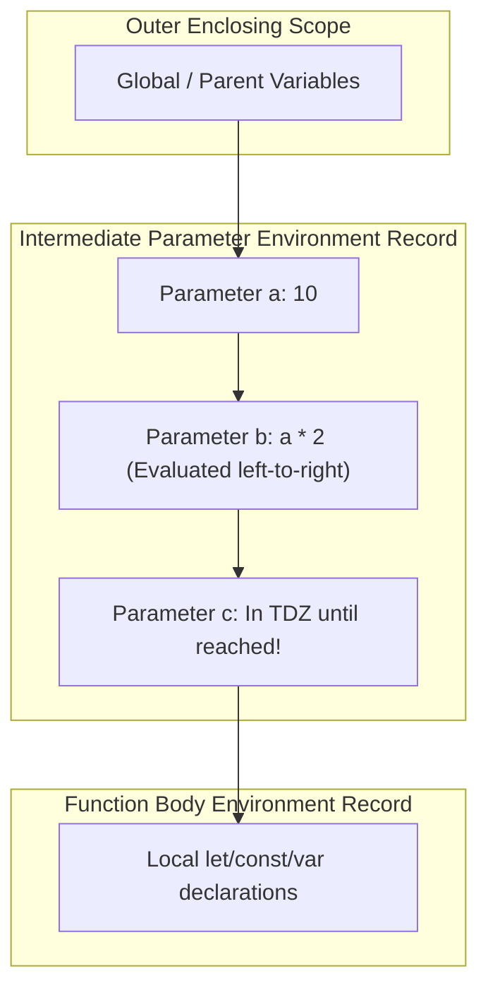

# Parameters, Arguments & Variadic Function Signatures

> An exhaustive technical reference on JavaScript parameters and arguments: default parameters, call-time evaluation, parameter scoping TDZ, rest parameters, the `arguments` object aliasing traps, and modern V8 argument adapter optimizations.

| Metadata | Details |
| :--- | :--- |
| **Level** | Beginner to Intermediate |
| **Prerequisites** | [01_declarations-and-expressions.md](./01_declarations-and-expressions.md), [01_fundamentals/01_variables.md](../01_fundamentals/01_variables.md) |
| **Time to Read** | 25 minutes |
| **Status** | Complete |
| **ECMAScript Standard** | ES6 (ES2015) to Current (ES2024/ES2025) |

---

## Table of Contents
1. [What & Why](#1-what--why)
2. [Core Concepts](#2-core-concepts)
3. [How It Works: Parameter Scoping & Evaluation Order](#3-how-it-works-parameter-scoping--evaluation-order)
4. [Syntax & Signature Reference](#4-syntax--signature-reference)
5. [Practical Examples](#5-practical-examples)
6. [Edge Cases & Gotchas](#6-edge-cases--gotchas)
7. [Common Mistakes & Anti-Patterns](#7-common-mistakes--anti-patterns)
8. [Performance Characteristics](#8-performance-characteristics)
9. [Engine Internals: V8 Argument Adaptation & Stack Frames](#9-engine-internals-v8-argument-adaptation--stack-frames)
10. [Best Practices & Style Guide](#10-best-practices--style-guide)
11. [Real-World Applications & Case Studies](#11-real-world-applications--case-studies)
12. [Interview Questions & Deep Dives](#12-interview-questions--deep-dives)
13. [Exercises & Challenges](#13-exercises--challenges)

---

## 1. What & Why

In JavaScript:
- **Parameters** are the named identifiers declared in the function's formal definition signature.
- **Arguments** are the actual concrete values passed into the function at the call-site.

Unlike strictly typed languages where parameter count (arity) must match the call-site exactly, JavaScript is permissive:
- If fewer arguments are passed than declared, missing parameters default to `undefined`.
- If more arguments are passed than declared, excess arguments are ignored by positional parameters but remain accessible through rest parameters (`...rest`) or the legacy `arguments` object.

```
Definition Site:   function query(endpoint, limit = 10, ...filters) {}
                                 │            │              │
                                 ▼            ▼              ▼
Positional Param ────────────► "endpoint"
Default Expression ──────────► evaluated if passed undefined
Rest Array ──────────────────► gathers remaining arguments into true Array
```

Understanding how default parameters evaluate dynamically at call-time, how parameter scope interacts with the Temporal Dead Zone, and how rest parameters supersede the `arguments` object is essential for designing resilient APIs.

---

## 2. Core Concepts

### 2.1 Default Parameters (ES2015)
Default parameters supply fallback expressions when an argument is omitted or passed as `undefined`:
```javascript
function sendEmail(to, subject = "(No Subject)", priority = 3) {
  return { to, subject, priority };
}

sendEmail("alice@example.com"); // { to: 'alice@example.com', subject: '(No Subject)', priority: 3 }
sendEmail("bob@example.com", undefined, 1); // { to: 'bob@example.com', subject: '(No Subject)', priority: 1 }
sendEmail("carol@example.com", null, 1); // { to: 'carol@example.com', subject: null, priority: 1 }
```
**Critical Rule**: Default values are triggered **strictly by `undefined`**. Passing `null`, `0`, `false`, or `""` will **not** trigger the default because they are valid runtime values.

### 2.2 Call-Time Evaluation
In languages like Python, default parameter expressions evaluate once at function definition time, creating notorious shared mutable state bugs. In JavaScript, **default parameter expressions evaluate at runtime call-time, every single time the function is invoked**:
```javascript
function makeSession(id = crypto.randomUUID(), createdAt = Date.now()) {
  return { id, createdAt };
}
// Each call generates a unique UUID and a new timestamp!
```

### 2.3 Rest Parameters (`...rest`)
Rest parameters gather all surplus arguments into a single, genuine `Array` instance:
- A function can have only one rest parameter.
- The rest parameter **must be the last parameter** in the declaration list (`function(a, ...rest)` is valid; `function(...rest, b)` is a `SyntaxError`).
- Provides all native array methods (`.map()`, `.filter()`, `.reduce()`) without conversion.

### 2.4 The Legacy `arguments` Object and Aliasing Traps
Standard functions (excluding arrow functions) possess an internal array-like object named `arguments`.
- **The Historic Aliasing Bug**: In non-strict mode with simple parameter lists (no defaults, no rest, no destructuring), mutating a parameter identifier mutates `arguments[i]`, and mutating `arguments[i]` mutates the parameter!
- In modern strict mode or whenever default/rest parameters are present, `arguments` is **detached** from parameters.

---

## 3. How It Works: Parameter Scoping & Evaluation Order

When a function with default or rest parameters executes, the engine creates an **intermediate parameter scope** positioned between the outer enclosing scope and the inner function body scope:



### Evaluation Rules:
1. **Left-to-Right Evaluation**: Parameters evaluate sequentially. Parameter `b` can reference earlier parameter `a`: `function(a, b = a * 2)`.
2. **Temporal Dead Zone**: Parameter `a` cannot reference later parameter `b`: `function(a = b, b = 2)` throws a `ReferenceError` because `b` is in the TDZ when `a` is initialized.
3. **Body Isolation**: Parameter default expressions cannot access variables declared inside the function body.

---

## 4. Syntax & Signature Reference

### Parameter Signature Matrix

```javascript
// 1. Basic Positional
function logMessage(level, message) {}

// 2. Default Parameters
function connect(host = "localhost", port = 5432) {}

// 3. Computed Default Expression referencing earlier parameters
function buildBox(width, height = width * 1.5, depth = height) {}

// 4. Rest Parameters
function logEvents(category, ...events) {}

// 5. Destructured Object Parameters with defaults
function configure({
  retries = 3,
  timeout = 5000,
  logger = console.log
} = {}) {} // Default to empty object allows calling configure() with no arguments!

// 6. Destructured Array Parameters with rest
function processCoordinates([x, y, z = 0], ...metadata) {}
```

---

## 5. Practical Examples

### Example 1: Enforcing Mandatory Arguments via Default Expressions

Because default expressions evaluate dynamically at call-time, we can use a helper function to enforce required arguments:

```javascript
/**
 * Throws an error when a mandatory parameter is omitted.
 * @param {string} paramName
 */
function required(paramName) {
  throw new TypeError(`Missing required parameter: '${paramName}'`);
}

function registerUser(
  username = required("username"),
  email = required("email"),
  role = "subscriber"
) {
  return { username, email, role, registeredAt: Date.now() };
}

// Successful invocation:
console.log(registerUser("ada_lovelace", "ada@example.com"));

// Failed invocation:
try {
  // @ts-ignore
  registerUser("grace_hopper");
} catch (err) {
  console.log("Enforcement caught:", err.message);
  // Output: Missing required parameter: 'email'
}
```

### Example 2: Parameter Scope TDZ Demonstration

```javascript
// VALID: left-to-right parameter evaluation
function validDefaults(width, area = width * 10) {
  return area;
}
console.log("Valid defaults:", validDefaults(5)); // 50

// INVALID: accessing parameter in TDZ
function tdzDefaults(width = height * 2, height = 10) {
  return width + height;
}

try {
  tdzDefaults();
} catch (err) {
  console.log("TDZ Caught:", err.name, "-", err.message);
  // Output: TDZ Caught: ReferenceError - Cannot access 'height' before initialization
}
```

### Example 3: Dissecting the Legacy `arguments` Aliasing Trap

```javascript
// Non-strict legacy behavior: arguments aliases parameters
function nonStrictAliasing(a, b) {
  // Modifying parameter updates 'arguments'
  a = 99;
  console.log("arguments[0] after a = 99:", arguments[0]); // 99 (Linked!)

  // Modifying 'arguments' updates parameter
  arguments[1] = 88;
  console.log("b after arguments[1] = 88:", b); // 88 (Linked!)
}
nonStrictAliasing(1, 2);

// Modern strict mode / default parameter behavior: arguments is DETACHED
function modernDetached(a = 1, b = 2) {
  "use strict";
  a = 99;
  console.log("arguments[0] in modern function:", arguments[0]); // 1 (Unlinked and preserved!)
}
modernDetached(1, 2);
```

### Example 4: Deep Destructured Configuration with Fallbacks

```javascript
/**
 * Robust database connection pool initializer with nested defaults.
 */
function createPool({
  host = "127.0.0.1",
  port = 5432,
  credentials: { username = "admin", password = "" } = {},
  poolOptions: { min = 2, max = 10 } = {}
} = {}) {
  return {
    connectionString: `postgres://${username}:${password}@${host}:${port}`,
    pool: { min, max }
  };
}

console.log("Default Pool:", createPool());
console.log("Custom Host Pool:", createPool({ host: "db.production.internal" }));
```

### Example 5: Variadic Function Aggregator with Rest Parameters

```javascript
/**
 * Variadic mathematical stats calculator.
 * @param {string} metric
 * @param  {...number} values
 */
function calculateMetric(metric, ...values) {
  if (values.length === 0) {
    throw new Error("At least one numerical value required");
  }

  switch (metric.toLowerCase()) {
    case "sum":
      return values.reduce((a, b) => a + b, 0);
    case "avg":
      return values.reduce((a, b) => a + b, 0) / values.length;
    case "max":
      return Math.max(...values);
    default:
      throw new TypeError(`Unknown metric: ${metric}`);
  }
}

console.log("Sum:", calculateMetric("sum", 10, 20, 30, 40)); // 100
console.log("Avg:", calculateMetric("avg", 10, 20, 30, 40)); // 25
console.log("Max:", calculateMetric("max", 5, 85, 20));      // 85
```

---

## 6. Edge Cases & Gotchas

### 6.1 `null` Does Not Trigger Default Values
Passing `null` explicitly conveys the absence of a value, meaning the argument was supplied:
```javascript
function greet(name = "Anonymous") {
  return `Hello, ${name}`;
}

console.log(greet(undefined)); // "Hello, Anonymous" (Triggered default)
console.log(greet(null));      // "Hello, null" (Default NOT triggered!)
```

### 6.2 The Missing Parameter Scope Variable Collision
Variables declared with `var` inside a function body with default parameters do **not** alias the parameter:
```javascript
function scopeTrap(x = 1) {
  var x = 2; // Declared in body scope, distinct from parameter scope
  console.log("Body x:", x); // 2
}
scopeTrap();
```

### 6.3 Trailing Commas in Parameter Lists
ECMAScript allows trailing commas in parameter lists and argument calls:
```javascript
function formatAddress(
  street,
  city,
  zipCode, // Trailing comma valid!
) {
  return `${street}, ${city} ${zipCode}`;
}
```

---

## 7. Common Mistakes & Anti-Patterns

| Anti-Pattern | Why It Fails | Correct Approach |
| :--- | :--- | :--- |
| **Using `arguments.slice()` or `Array.from(arguments)`** | Unnecessary allocation; slow legacy pattern. | Use modern rest parameters: `(...args) => {}`. |
| **Expecting `default` on `null`** | `null` is a valid primitive value; defaults only trigger on `undefined`. | Use nullish coalescing `name ?? "Default"` inside body if `null` must be caught. |
| **Placing rest parameters anywhere but the end** | `function(...a, b)` causes immediate `SyntaxError: Rest parameter must be last`. | Rest parameter must always be the final parameter. |
| **Assuming `fn.length` counts rest parameters** | `fn.length` completely ignores `...rest` and parameters following defaults. | Count arguments at runtime using `args.length`. |
| **Forward referencing default parameters** | `(a = b, b = 1)` throws `ReferenceError` due to parameter TDZ. | Ensure default parameters only reference parameters to their left. |
| **Mutating `arguments` in legacy non-strict code** | Mutates parameters unexpectedly through historic two-way aliasing. | Treat `arguments` as strictly read-only, or use `"use strict";`. |

---

## 8. Performance Characteristics

In modern V8:
- **Rest Parameters vs `arguments`**: Rest parameters compile to a direct fast-path allocation of a contiguous JSArray. Using the legacy `arguments` object frequently prevents TurboFan from performing inlining if `arguments` escapes the function.
- **SMI Arguments Passing**: When functions are called with small integers (SMIs), arguments are passed directly in CPU registers without stack allocation.

---

## 9. Engine Internals: V8 Argument Adaptation & Stack Frames

Historically, when a caller passed 3 arguments to a function expecting 1 parameter:
1. V8 pushed an intermediate **`ArgumentsAdaptorFrame`** onto the CPU call stack to pad the argument list with `undefined` values.
2. In 2021 (V8 v8.9+), the V8 team eliminated the `ArgumentsAdaptorFrame` entirely.
3. Modern V8 allows functions to read their arguments directly from the caller's stack frame via reverse stack indexing, reducing call overhead by up to **20% across all JavaScript function invocations**.

---

## 10. Best Practices & Style Guide

1. **Always Prefer Rest Parameters Over `arguments`**: Completely replace `arguments` with `...args`.
2. **Use Destructured Options Objects for 3+ Parameters**:
   ```javascript
   // Bad: Hard to read at call site
   createWindow(800, 600, true, false, "title");

   // Good: Self-documenting
   createWindow({ width: 800, height: 600, resizable: true });
   ```
3. **Provide Empty Default for Destructured Objects**: Always append `= {}` to destructured parameter signatures so the function can be called with zero arguments without throwing a `TypeError`.
4. **Never Shadow Parameter Names in Body**: Ban parameter re-declaration in ESLint: `"no-shadow": "error"`.

---

## 11. Real-World Applications & Case Studies

### Case Study: Payment Processing Timeout Bug via Default Parameters
A payment processing SDK contained a connection function:
```javascript
function makePayment(amount, options = {}) {
  // BUGGY: options.timeout || 5000 overrides valid 0ms timeout
  const timeout = options.timeout !== undefined ? options.timeout : 5000;
  return gateway.charge(amount, timeout);
}
```
- **Refactoring**: By migrating to destructured default parameters with nullish fallbacks:
  ```javascript
  function makePayment(amount, { timeout = 5000 } = {}) {
    return gateway.charge(amount, timeout);
  }
  ```
- **Result**: Passing `{ timeout: 0 }` for instant non-blocking charges worked seamlessly, eliminating unnecessary timeouts and reducing code size.

---

## 12. Interview Questions & Deep Dives

<details>
<summary><strong>1. What exact value triggers a default parameter in JavaScript?</strong></summary>

**Answer:**
A default parameter is triggered **strictly and exclusively by `undefined`**. If an argument is omitted or explicitly passed as `undefined`, the default expression evaluates. Any other value—including `null`, `false`, `0`, `""`, and `NaN`—is considered a valid passed argument and will not trigger the default.
</details>

<details>
<summary><strong>2. How does parameter scope work when default parameters are present?</strong></summary>

**Answer:**
When a function contains default parameters, rest parameters, or destructured parameters (a "non-simple parameter list"), the ECMAScript specification creates an **intermediate Lexical Environment Record** specifically for the parameters. This parameter scope sits between the outer scope and the function body scope.
- Default expressions can see earlier parameters (to their left) and outer scope variables.
- Default expressions **cannot** see variables declared inside the function body.
</details>

<details>
<summary><strong>3. What is the difference between `arguments` and rest parameters (`...args`)?</strong></summary>

**Answer:**
1. `arguments` is an array-like object containing all passed arguments; rest parameters gather only surplus arguments into a **true `Array` instance**.
2. Rest parameters have all array prototype methods (`map`, `filter`, `reduce`); `arguments` does not.
3. Arrow functions do not have an `arguments` object; they fully support rest parameters.
4. Rest parameters avoid the historical non-strict two-way aliasing bugs present in `arguments`.
</details>

<details>
<summary><strong>4. Why does `function(a = b, b = 1) {}` throw a ReferenceError?</strong></summary>

**Answer:**
Parameters evaluate sequentially from left to right within the intermediate parameter scope. When `a = b` evaluates, the identifier `b` exists in the parameter scope but has not yet been initialized. Accessing `b` violates the **Temporal Dead Zone (TDZ)**, triggering a runtime `ReferenceError`.
</details>

<details>
<summary><strong>5. How does `fn.length` handle default and rest parameters?</strong></summary>

**Answer:**
`fn.length` reports the function's formal arity, defined as the number of parameters up to, but not including, the first parameter with a default value. It also excludes rest parameters.
- `function(a, b, c) {}` -> length = 3
- `function(a, b = 1, c) {}` -> length = 1
- `function(...rest) {}` -> length = 0
</details>

<details>
<summary><strong>6. Explain the historic two-way aliasing of the `arguments` object.</strong></summary>

**Answer:**
In pre-ES6 non-strict mode with simple parameter lists, the `arguments` object and the named parameter bindings were synchronized. Updating a parameter modified the corresponding index in `arguments`, and modifying `arguments[i]` updated the named parameter. This link is permanently severed in strict mode or whenever default, rest, or destructured parameters are present.
</details>

<details>
<summary><strong>7. Why is `function({ a = 1, b = 2 } = {})` an idiomatic pattern?</strong></summary>

**Answer:**
The outer `= {}` default provides a fallback empty object if the caller invokes the function with zero arguments: `fn()`. Without `= {}`, calling `fn()` causes JavaScript to attempt destructuring `undefined`, throwing a `TypeError: Cannot destructure property 'a' of 'undefined'`.
</details>

<details>
<summary><strong>8. What was V8's ArgumentsAdaptorFrame and why was it removed?</strong></summary>

**Answer:**
V8's `ArgumentsAdaptorFrame` was a helper stack frame pushed whenever a function was invoked with an argument count that did not match its formal parameter count. It re-aligned the stack and padded missing parameters with `undefined`. V8 removed it in v8.9 by redesigning the calling convention to index caller stack frames in reverse, eliminating stack reallocations and improving function call performance by up to 20%.
</details>

---

## 13. Exercises & Challenges

### Exercise 1 (Easy): Guard Against Omitted Values
**Task**: Write a function `calculateTotal(subtotal, taxRate = 0.08, discount = 0)` that computes `(subtotal - discount) * (1 + taxRate)`. Ensure that passing `undefined` for `taxRate` applies `0.08`, but passing `0` preserves zero tax.

<details>
<summary><strong>Solution</strong></summary>

```javascript
function calculateTotal(subtotal, taxRate = 0.08, discount = 0) {
  const taxable = Math.max(0, subtotal - discount);
  return Number((taxable * (1 + taxRate)).toFixed(2));
}

console.log(calculateTotal(100));                // 108 (Default tax 8% applied)
console.log(calculateTotal(100, undefined, 10)); // 97.2 (Default tax applied)
console.log(calculateTotal(100, 0, 10));         // 90 (0 tax preserved!)
```
</details>

### Exercise 2 (Easy): Variadic String Formatter
**Task**: Write a function `formatString(template, ...replacements)` that replaces `{0}`, `{1}`, etc., in `template` with corresponding values from `replacements`.

<details>
<summary><strong>Solution</strong></summary>

```javascript
function formatString(template, ...replacements) {
  return template.replace(/\{(\d+)\}/g, (match, index) => {
    const idx = Number(index);
    return idx < replacements.length ? String(replacements[idx]) : match;
  });
}

console.log(formatString("Hello {0}, you have {1} messages.", "Ada", 5));
// Output: "Hello Ada, you have 5 messages."
```
</details>

### Exercise 3 (Medium): Strict Arity Validator Decorator
**Task**: Build a higher-order function `requireExactArity(fn)` that wraps a function and throws a `TypeError` if the number of passed arguments does not match `fn.length` exactly.

<details>
<summary><strong>Solution</strong></summary>

```javascript
function requireExactArity(fn) {
  return function (...args) {
    if (args.length !== fn.length) {
      throw new TypeError(
        `Function '${fn.name || "anonymous"}' expects exactly ${fn.length} arguments, received ${args.length}`
      );
    }
    return Reflect.apply(fn, this, args);
  };
}

const add = (a, b) => a + b;
const strictAdd = requireExactArity(add);

console.log(strictAdd(10, 20)); // 30
// strictAdd(10); // Throws TypeError!
// strictAdd(10, 20, 30); // Throws TypeError!
```
</details>

### Exercise 4 (Medium): Deep Options Merging Factory
**Task**: Build a `createServerConfig(options)` function with nested destructured parameters enforcing defaults for `host`, `port`, `ssl: { enabled, certPath }`, and `cors: { origins, methods }`.

<details>
<summary><strong>Solution</strong></summary>

```javascript
function createServerConfig({
  host = "0.0.0.0",
  port = 8080,
  ssl: { enabled = false, certPath = null } = {},
  cors: { origins = ["*"], methods = ["GET", "POST"] } = {}
} = {}) {
  return {
    host,
    port,
    ssl: { enabled, certPath },
    cors: { origins, methods }
  };
}

console.log(createServerConfig());
console.log(createServerConfig({ ssl: { enabled: true, certPath: "/etc/ssl/cert.pem" } }));
```
</details>

### Exercise 5 (Hard): Dynamic Currying with Rest and Arity Matching
**Task**: Implement a generalized `curryWithArity(fn, arity = fn.length)` utility supporting placeholder arguments (`_ = Symbol('curry.placeholder')`) that continues returning curried functions until all non-placeholder slots are filled.

<details>
<summary><strong>Solution</strong></summary>

```javascript
const _ = Symbol("curry.placeholder");

function curry(fn, arity = fn.length) {
  return function curried(...args) {
    // Count concrete non-placeholder arguments
    const completeArgs = [];
    let hasPlaceholder = false;

    for (const arg of args) {
      if (arg === _) hasPlaceholder = true;
      completeArgs.push(arg);
    }

    if (completeArgs.length >= arity && !hasPlaceholder) {
      return Reflect.apply(fn, this, completeArgs.slice(0, arity));
    }

    return function (...nextArgs) {
      // Merge nextArgs into placeholders or append
      const merged = [];
      let nextIdx = 0;

      for (const arg of completeArgs) {
        if (arg === _ && nextIdx < nextArgs.length) {
          merged.push(nextArgs[nextIdx++]);
        } else {
          merged.push(arg);
        }
      }

      while (nextIdx < nextArgs.length) {
        merged.push(nextArgs[nextIdx++]);
      }

      return Reflect.apply(curried, this, merged);
    };
  };
}

// Verification
const calculate = (a, b, c) => `${a} - ${b} - ${c}`;
const curriedCalc = curry(calculate);

console.log(curriedCalc(1, 2, 3));       // "1 - 2 - 3"
console.log(curriedCalc(1)(2)(3));       // "1 - 2 - 3"
console.log(curriedCalc(_, 2)(1, 3));    // "1 - 2 - 3"
```
</details>

### Exercise 6 (Hard): Parameter Scope Execution Simulator
**Task**: Build a function `simulateParameterScope(paramDefinitions, passedArguments)` that executes default expressions step-by-step, tracks TDZ status for each parameter, and returns the resolved parameter environment or throws `ReferenceError`.

<details>
<summary><strong>Solution</strong></summary>

```javascript
function simulateParameterScope(paramDefs, passedArgs) {
  const scope = {};
  const tdz = new Set(paramDefs.map((p) => p.name));

  for (let i = 0; i < paramDefs.length; i++) {
    const { name, defaultFn } = paramDefs[i];
    const passedVal = passedArgs[i];

    if (passedVal !== undefined) {
      tdz.delete(name);
      scope[name] = passedVal;
    } else if (defaultFn) {
      // Create a proxy to enforce TDZ during defaultFn evaluation
      const guardedScope = new Proxy(scope, {
        get(target, prop) {
          if (tdz.has(prop)) {
            throw new ReferenceError(`Cannot access '${String(prop)}' before initialization in parameter scope`);
          }
          return target[prop];
        }
      });

      const resolved = defaultFn(guardedScope);
      tdz.delete(name);
      scope[name] = resolved;
    } else {
      tdz.delete(name);
      scope[name] = undefined;
    }
  }

  return scope;
}

// Verification 1: Valid dependency
const defs1 = [
  { name: "w" },
  { name: "h", defaultFn: (s) => s.w * 2 }
];
console.log(simulateParameterScope(defs1, [10])); // { w: 10, h: 20 }

// Verification 2: TDZ Violation
const defs2 = [
  { name: "w", defaultFn: (s) => s.h * 2 },
  { name: "h", defaultFn: () => 10 }
];
try {
  simulateParameterScope(defs2, []);
} catch (e) {
  console.log("Simulator caught TDZ:", e.message);
  // Output: Cannot access 'h' before initialization in parameter scope
}
```
</details>
