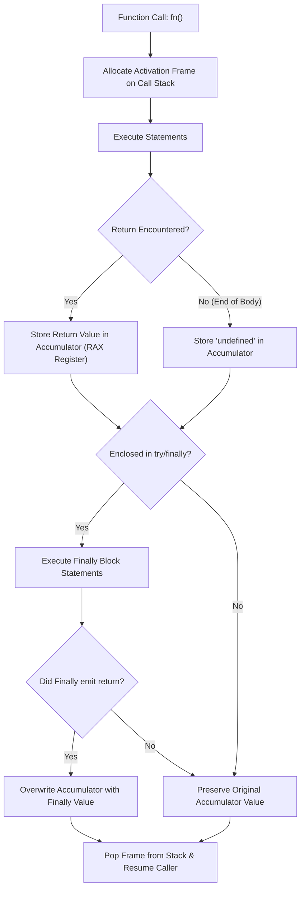

# Return Values, Constructor Overrides & Control Unwinding

> An exhaustive technical reference on JavaScript function return semantics: implicit `undefined`, constructor return overrides, the `finally` block hijacking quirk, tuple destructuring returns, and V8 stack unwinding.

| Metadata | Details |
| :--- | :--- |
| **Level** | Beginner to Intermediate |
| **Prerequisites** | [01_declarations-and-expressions.md](./01_declarations-and-expressions.md), [01_fundamentals/05_expressions-and-statements.md](../01_fundamentals/05_expressions-and-statements.md) |
| **Time to Read** | 25 minutes |
| **Status** | Complete |
| **ECMAScript Standard** | ES6 (ES2015) to Current (ES2024/ES2025) |

---

## Table of Contents
1. [What & Why](#1-what--why)
2. [Core Concepts](#2-core-concepts)
3. [How It Works: Call Stack Unwinding & Register Returns](#3-how-it-works-call-stack-unwinding--register-returns)
4. [Syntax & Return Mechanics Reference](#4-syntax--return-mechanics-reference)
5. [Practical Examples](#5-practical-examples)
6. [Edge Cases & Gotchas](#6-edge-cases--gotchas)
7. [Common Mistakes & Anti-Patterns](#7-common-mistakes--anti-patterns)
8. [Performance Characteristics](#8-performance-characteristics)
9. [Engine Internals: V8 `Return` Bytecode & Stack Popping](#9-engine-internals-v8-return-bytecode--stack-popping)
10. [Best Practices & Style Guide](#10-best-practices--style-guide)
11. [Real-World Applications & Case Studies](#11-real-world-applications--case-studies)
12. [Interview Questions & Deep Dives](#12-interview-questions--deep-dives)
13. [Exercises & Challenges](#13-exercises--challenges)

---

## 1. What & Why

In JavaScript, every function invocation is an expression that evaluates to a return value. If execution reaches the closing brace of a function without encountering an explicit `return` statement, the JavaScript runtime automatically returns the primitive `undefined`.

The `return` statement serves two synchronized roles:
1. **Value Emission**: Passes computed data back to the calling site.
2. **Control Flow Termination**: Immediately terminates function execution, unwinds the local activation stack frame, and transfers execution back to the caller.

```
Caller Frame ───► Call fn() ───► [ Push New Activation Stack Frame ]
                                          │
                                          ▼ Compute result
Caller Frame ◄─── RAX Register ◄─── [ Return statement encountered ]
                                          │
                                          ▼ Pop Stack Frame (Unwind)
```

However, JavaScript possesses several subtle and counter-intuitive return behaviors:
- Returning an object from a constructor completely discards the newly created instance (`this`).
- Returning a primitive from a constructor is completely ignored.
- A `return` inside a `try` block can be intercepted and overwritten by a `finally` block.
- Automatic Semicolon Insertion (ASI) truncates multi-line return statements.

---

## 2. Core Concepts

### 2.1 Implicit vs. Explicit Returns
A function returns `undefined` under three distinct scenarios:
1. The function completes its body without encountering a `return` statement.
2. An empty `return;` statement is evaluated.
3. An arrow function with a block body `{ ... }` omits an explicit `return` statement.

```javascript
function implicitUndefined() { const a = 10; }
function emptyReturn() { return; }
const arrowBlock = () => { 42; };

console.log(implicitUndefined()); // undefined
console.log(emptyReturn());       // undefined
console.log(arrowBlock());        // undefined
```

### 2.2 The Constructor Return Override Rule
When a function or class constructor is invoked using the `new` operator:
- **If the constructor returns an Object** (`{}`, `[]`, `new Date()`, function): The engine **discards** the newly instantiated `this` instance and returns that explicit object instead!
- **If the constructor returns a Primitive** (`number`, `string`, `boolean`, `null`, `undefined`): The engine **completely ignores** the return statement and returns the newly instantiated `this` instance!

```javascript
function ReturnObject() {
  this.value = "ignored";
  return { custom: "override" }; // Returns this object!
}
console.log(new ReturnObject()); // { custom: 'override' }

function ReturnPrimitive() {
  this.value = "preserved";
  return 42; // Ignored!
}
console.log(new ReturnPrimitive()); // ReturnPrimitive { value: 'preserved' }
```

### 2.3 The `finally` Hijacking Quirk
If a function evaluates a `return` statement inside a `try` or `catch` block, the engine **pauses execution, runs the `finally` block, and only then emits the return value**.
- If the `finally` block itself executes a `return` or `throw`, it **overwrites and cancels** the previous return value!

```javascript
function hijackedReturn() {
  try {
    return "try_value";
  } finally {
    return "finally_override"; // Completely replaces "try_value"!
  }
}
console.log(hijackedReturn()); // "finally_override"
```

### 2.4 Emulating Multiple Return Values
JavaScript functions can only return a single value. To return multiple distinct values, idiomatic code uses destructuring:
1. **Positional Tuple Destructuring** (`return [data, error]`): Popularized by Go-style error handling.
2. **Named Object Destructuring** (`return { data, error, metadata }`): Optimal for API calls with multiple optional outputs.

---

## 3. How It Works: Call Stack Unwinding & Register Returns



At the machine level, when a return executes:
1. The return value pointer is loaded into the CPU's primary accumulator register (`RAX` on x86-64, `X0` on ARM64).
2. The function epilogue restores the previous stack frame pointer (`RBP`) and executes the `RET` machine instruction.
3. The caller retrieves the result directly from the accumulator register.

---

## 4. Syntax & Return Mechanics Reference

### Return Forms Comparison

| Construct | Syntax | Returned Value |
| :--- | :--- | :--- |
| **Explicit Value** | `return expression;` | Evaluated expression value |
| **Early Exit** | `return;` | `undefined` |
| **Implicit Fall-through** | End of function reached | `undefined` |
| **Concise Arrow** | `(x) => x * 2` | Implicitly returns expression result |
| **Concise Object Arrow** | `(x) => ({ val: x })` | Implicitly returns object (parentheses required) |
| **Constructor + Object** | `new Fn()` with `return {}` | Explicit object (replaces `this`) |
| **Constructor + Primitive** | `new Fn()` with `return 42` | New instance (`this`, return ignored) |

---

## 5. Practical Examples

### Example 1: Go-Style Tuple Error Handling Pattern

```javascript
/**
 * Executes an asynchronous task and returns a [data, error] tuple
 * eliminating try/catch nesting at call-sites.
 * @template T
 * @param {Promise<T>} promise
 * @returns {Promise<[T, null] | [null, Error]>}
 */
async function to(promise) {
  try {
    const data = await promise;
    return [data, null];
  } catch (error) {
    return [null, error instanceof Error ? error : new Error(String(error))];
  }
}

// Consuming asynchronous operations cleanly:
async function fetchUserProfile(userId) {
  const fetchMock = (id) =>
    id === "valid" ? Promise.resolve({ name: "Ada" }) : Promise.reject(new Error("User not found"));

  const [user, err] = await to(fetchMock(userId));
  if (err) {
    console.error(`[ERROR]: ${err.message}`);
    return null;
  }

  return `User Profile: ${user.name}`;
}

fetchUserProfile("valid").then(console.log);
fetchUserProfile("invalid").then(console.log);
```

### Example 2: Constructor Return Override for Object Pooling / Singletons

```javascript
// Using the constructor return override rule to enforce an in-memory singleton
class DatabaseConnection {
  static instance = null;

  constructor(connectionString) {
    if (DatabaseConnection.instance) {
      // Returning an existing object overrides the new instance creation!
      return DatabaseConnection.instance;
    }

    this.connectionString = connectionString;
    this.connectedAt = Date.now();
    DatabaseConnection.instance = this;
  }
}

const db1 = new DatabaseConnection("postgres://localhost:5432/primary");
const db2 = new DatabaseConnection("postgres://localhost:5432/replica");

console.log(db1 === db2); // true! Both references point to identical singleton instance
console.log(db2.connectionString); // "postgres://localhost:5432/primary"
```

### Example 3: Dissecting the `finally` Return Hijacking Trap

```javascript
function complexAudit(shouldFail) {
  let executionLog = [];

  try {
    executionLog.push("try_entered");
    if (shouldFail) {
      throw new Error("Failure in computation");
    }
    return { status: "SUCCESS", log: executionLog };
  } catch (err) {
    executionLog.push("catch_entered");
    return { status: "FAILED", error: err.message, log: executionLog };
  } finally {
    executionLog.push("finally_entered");
    // DANGER: Overriding return in finally silently suppresses both return and throw!
    // Uncommenting the next line would force ALL executions to return 'ABORTED':
    // return { status: "ABORTED", log: executionLog };
  }
}

console.log(complexAudit(false));
// Status is SUCCESS, and log contains ['try_entered', 'finally_entered']
```

### Example 4: Guard Clauses for Flattened Validation Pipelines

```javascript
/**
 * Validates incoming e-commerce orders using early returns.
 * @param {Object} order
 */
function processOrder(order) {
  if (!order) return { ok: false, reason: "Order payload missing" };
  if (!order.items || order.items.length === 0) return { ok: false, reason: "Cart is empty" };
  if (order.totalAmount <= 0) return { ok: false, reason: "Total must be greater than zero" };
  if (!order.paymentToken) return { ok: false, reason: "Payment authorization required" };

  // Core execution flow is un-indented and clean:
  const orderId = `ORD_${Date.now()}`;
  return { ok: true, orderId, processedAt: new Date().toISOString() };
}

console.log(processOrder(null));
console.log(processOrder({ items: ["Book"], totalAmount: 29.99, paymentToken: "tok_123" }));
```

### Example 5: Multi-Value Named Return for Flexible Ingestion

```javascript
/**
 * Calculates mathematical distribution metrics.
 * @param {number[]} values
 */
function calculateDistribution(values) {
  if (values.length === 0) {
    return { mean: 0, variance: 0, stdDev: 0, count: 0 };
  }

  const count = values.length;
  const mean = values.reduce((a, b) => a + b, 0) / count;
  const variance = values.reduce((acc, val) => acc + (val - mean) ** 2, 0) / count;
  const stdDev = Math.sqrt(variance);

  return { mean, variance, stdDev, count };
}

// Caller can selectively destructure only the metrics needed:
const { mean, stdDev } = calculateDistribution([10, 12, 23, 23, 16, 23, 21, 16]);
console.log(`Mean: ${mean.toFixed(2)}, StdDev: ${stdDev.toFixed(2)}`);
```

---

## 6. Edge Cases & Gotchas

### 6.1 Returning in `finally` Discards Exceptions
If an unhandled error is thrown inside `try`, but `finally` evaluates a `return` statement, **the exception is completely swallowed and suppressed**:
```javascript
function silentExceptionSwallower() {
  try {
    throw new Error("Critical security alert!");
  } finally {
    return "Everything is fine"; // The thrown Error is destroyed!
  }
}

console.log(silentExceptionSwallower()); // "Everything is fine"
```
**Golden Rule**: Never write a `return` or `throw` statement inside a `finally` block.

### 6.2 The Multi-Line ASI Return Pitfall
```javascript
function fetchConfig() {
  return        // Semicolon inserted automatically by ASI!
  {
    theme: "dark"
  };
}
console.log(fetchConfig()); // undefined!
```

### 6.3 Returning Arrow Functions Returning Objects
When writing higher-order curried functions that return objects, forgetting grouping parentheses causes syntax errors:
```javascript
// SYNTAX ERROR:
// const makeHandler = (type) => (data) => { type: type, data: data };

// CORRECT:
const makeHandler = (type) => (data) => ({ type, data });
```

---

## 7. Common Mistakes & Anti-Patterns

| Anti-Pattern | Why It Fails | Correct Approach |
| :--- | :--- | :--- |
| **Using `return` inside `finally`** | Overwrites prior return values and silently swallows uncaught exceptions. | Restrict `finally` strictly to cleanup actions (closing sockets, freeing resources). |
| **Breaking lines after `return`** | ASI inserts a semicolon, making the function return `undefined`. | Keep returned expression or opening brace on the same line as `return`. |
| **Returning primitives from constructors** | Ignored by the engine; constructor returns `this` instead. | Never use `return` in constructors unless implementing a singleton object override. |
| **Using `return` inside `forEach`** | Only exits the current callback iteration, not the parent enclosing function. | Use standard `for...of` loop with `return`. |
| **Returning unparenthesized objects in arrows** | Braces parsed as statement blocks returning `undefined`. | Wrap object literals in parentheses: `() => ({ ... })`. |
| **Deeply nesting `else` statements** | Creates the "Pyramid of Doom" and obscures happy-path logic. | Use guard clauses with early returns. |

---

## 8. Performance Characteristics

In modern V8:
- **Escape Analysis**: If an object returned by a small inlined function never escapes the caller stack frame, TurboFan's escape analysis **scalar-replaces** the object, storing its fields in CPU registers and completely eliminating heap allocations.
- **Tail Call Optimization (TCO)**: In standard ECMAScript 2015, tail calls (`return fn()`) were specified for optimization. However, outside of Safari/WebKit, modern engines (V8, SpiderMonkey) **do not support tail call optimization** due to debugging and stack-trace preservation requirements.

---

## 9. Engine Internals: V8 `Return` Bytecode & Stack Popping

When Ignition generates bytecode for a return statement:
```
LdaNamedProperty a, [0]         ; Load property into accumulator
Return                          ; Return accumulator value to caller
```
1. Ignition's `Return` bytecode loads the current value of the interpreter's virtual accumulator register.
2. It executes internal cleanup routines, running any enclosing `finally` bytecodes recorded in the handler table.
3. It pops the current `BytecodeFrame` from the execution stack and jumps to the caller's return instruction address.

---

## 10. Best Practices & Style Guide

1. **Use Guard Clauses to Invert and Flatten Logic**: Check error conditions and exit early; keep happy-path code at root indentation.
2. **Never Return from `finally`**: Enforce the ESLint rule:
   ```json
   { "rules": { "no-unsafe-finally": "error" } }
   ```
3. **Always Parenthesize Multi-Line Return Expressions**:
   ```javascript
   return (
     <div>
       <h1>Standard React / JSX return idiom</h1>
     </div>
   );
   ```
4. **Use Tuple Returns for Failure-Prone IO**: `[result, error]` pattern makes error checking mandatory and ergonomic.

---

## 11. Real-World Applications & Case Studies

### Case Study: Silent Payment Failure via `finally` Return
A billing automation script failed to record declined credit card transactions:
```javascript
// BUGGY BILLING SERVICE:
async function chargeCustomer(customerId, amount) {
  try {
    const charge = await paymentGateway.charge(customerId, amount);
    return { success: true, chargeId: charge.id };
  } catch (err) {
    await auditLog.recordFailure(customerId, err);
    throw err; // Intended to trigger retry queue
  } finally {
    // DEVELOPER INTENDED TO CLEAN UP SESSIONS:
    await sessionManager.cleanup(customerId);
    return { cleanupDone: true }; // BUG: Completely swallowed 'throw err'!
  }
}
```
- **Consequence**: The retry queue never received the failure alert because the `finally` return suppressed the re-thrown error, causing thousands of declined customer accounts to remain active without billing.
- **Resolution**: Removed the `return` statement from `finally`.

---

## 12. Interview Questions & Deep Dives

<details>
<summary><strong>1. What happens when a constructor function explicitly returns a primitive value?</strong></summary>

**Answer:**
When a function is invoked with the `new` operator, the engine creates a new object instance bound to `this`. If the constructor explicitly returns a primitive value (e.g. `return 42;` or `return "hello";`), the engine **ignores the return value** and returns the newly instantiated `this` object instead.
</details>

<details>
<summary><strong>2. What happens when a constructor function explicitly returns an object?</strong></summary>

**Answer:**
If a constructor function explicitly returns an object (e.g. `return { custom: true };` or `return [1, 2];`), the engine **discards the newly created `this` instance** and returns the specified object. This behavior is used to implement singletons, object pooling, or factory proxies.
</details>

<details>
<summary><strong>3. Explain how a `finally` block interacts with a `return` in a `try` block.</strong></summary>

**Answer:**
When execution encounters a `return` inside a `try` block, the return expression is evaluated and stored in a temporary internal register. Before the function exits, the engine executes the `finally` block.
- If the `finally` block completes normally without a return or throw, the function emits the stored value.
- If the `finally` block executes its own `return` or `throw`, the original return value is discarded, and the `finally` statement takes precedence.
</details>

<details>
<summary><strong>4. What is the return value of an arrow function with a block body that has no return statement?</strong></summary>

**Answer:**
`undefined`. In an arrow function with a block body `() => { statements }`, curly braces denote a statement block, not a concise expression. Like a standard function, an explicit `return` statement is required to return a value. Without it, the function implicitly returns `undefined`.
</details>

<details>
<summary><strong>5. How does Automatic Semicolon Insertion (ASI) affect the `return` statement?</strong></summary>

**Answer:**
Under ECMAScript Restricted Production rules, a line terminator is strictly forbidden between the `return` keyword and its following expression. If a newline is present, the parser automatically injects a semicolon immediately after `return` (`return;`), causing the function to terminate early and return `undefined`.
</details>

<details>
<summary><strong>6. What is the difference between tuple destructuring returns and object destructuring returns?</strong></summary>

**Answer:**
- **Tuple returns** (`return [data, error]`): Callers can rename variables arbitrarily upon destructuring (`const [user, userErr] = fetch()`), which is ideal for repeated operations.
- **Object returns** (`return { data, error, count }`): Callers can omit properties they don't need and inspect self-documenting keys, but renaming requires explicit syntax (`const { data: user } = fetch()`).
</details>

<details>
<summary><strong>7. Why does returning an object literal from an arrow function require parentheses?</strong></summary>

**Answer:**
In JavaScript grammar, curly braces `{}` immediately following an arrow `=>` are ambiguous: they could represent a statement block or an object literal. The grammar specification resolves this ambiguity by parsing `{}` as a **statement body block**. To instruct the parser to interpret the braces as an object literal expression, the object must be wrapped in grouping parentheses: `() => ({ ... })`.
</details>

<details>
<summary><strong>8. Does JavaScript support Proper Tail Calls (Tail Call Optimization)?</strong></summary>

**Answer:**
Tail Call Optimization (TCO) was added to the ECMAScript 2015 specification for strict mode. However, WebKit (Safari) is the **only major engine that implemented it**. V8 (Chrome/Node.js) and SpiderMonkey (Firefox) chose not to implement TCO because it destroys stack trace frames during debugging, degrades error reporting, and can complicate runtime performance profiling.
</details>

---

## 13. Exercises & Challenges

### Exercise 1 (Easy): Fix the Semicolon-Inserted Return
**Task**: Fix the following function so that it returns the configuration object rather than `undefined`:

```javascript
// BUGGY:
function getThemeConfig() {
  return
  {
    theme: "solarized",
    fontSize: 14
  };
}
```

<details>
<summary><strong>Solution</strong></summary>

Move the opening brace to the same line as `return`:

```javascript
function getThemeConfig() {
  return {
    theme: "solarized",
    fontSize: 14
  };
}
console.log(getThemeConfig()); // { theme: 'solarized', fontSize: 14 }
```
</details>

### Exercise 2 (Easy): Safe Object Return Arrow Function
**Task**: Write a concise arrow function `createCoordinate(x, y)` that returns an object `{ x, y, magnitude }` where magnitude is $\sqrt{x^2 + y^2}$, using implicit return syntax.

<details>
<summary><strong>Solution</strong></summary>

```javascript
const createCoordinate = (x, y) => ({
  x,
  y,
  magnitude: Math.hypot(x, y)
});

console.log(createCoordinate(3, 4)); // { x: 3, y: 4, magnitude: 5 }
```
</details>

### Exercise 3 (Medium): Constructor Singleton with Return Override
**Task**: Build a `DatabaseSession` constructor that creates a connection object, but if an active connection already exists, returns the existing active connection instance using the constructor return override rule.

<details>
<summary><strong>Solution</strong></summary>

```javascript
class DatabaseSession {
  static activeSession = null;

  constructor(dbName) {
    if (DatabaseSession.activeSession) {
      return DatabaseSession.activeSession;
    }

    this.dbName = dbName;
    this.sessionId = `SES_${Math.random().toString(36).slice(2, 9)}`;
    DatabaseSession.activeSession = this;
  }
}

const s1 = new DatabaseSession("main_db");
const s2 = new DatabaseSession("secondary_db");

console.log(s1 === s2); // true
console.log(s2.dbName); // "main_db"
```
</details>

### Exercise 4 (Medium): Go-Style Result Wrapper
**Task**: Write a synchronous wrapper function `tryCatch(fn, ...args)` that executes `fn(...args)` and returns a `[result, error]` tuple, catching any thrown exceptions.

<details>
<summary><strong>Solution</strong></summary>

```javascript
function tryCatch(fn, ...args) {
  try {
    const result = fn(...args);
    return [result, null];
  } catch (error) {
    return [null, error instanceof Error ? error : new Error(String(error))];
  }
}

const safeJsonParse = (str) => tryCatch(JSON.parse, str);

const [data1, err1] = safeJsonParse('{"ok": true}');
console.log("Success:", data1); // { ok: true }

const [data2, err2] = safeJsonParse("invalid json string");
console.log("Error caught:", err2?.message); // Unexpected token...
```
</details>

### Exercise 5 (Hard): Transaction Runner with Protected Return
**Task**: Build a transaction runner `runTransaction(action)` that uses `try...catch...finally` to manage database lock lifecycles, ensuring the lock is released in `finally` without overwriting the result of `action()`.

<details>
<summary><strong>Solution</strong></summary>

```javascript
class LockManager {
  static isLocked = false;
  static acquire() {
    if (this.isLocked) throw new Error("Resource locked");
    this.isLocked = true;
    console.log("[LOCK] Acquired");
  }
  static release() {
    this.isLocked = false;
    console.log("[LOCK] Released");
  }
}

function runTransaction(action) {
  LockManager.acquire();
  try {
    const result = action();
    return { success: true, result };
  } catch (err) {
    return { success: false, error: err.message };
  } finally {
    // Strictly execute cleanup: DO NOT return here!
    LockManager.release();
  }
}

// Verification
const res = runTransaction(() => {
  return "Transaction payload data";
});

console.log("Transaction Output:", res);
// Output shows [LOCK] Acquired, [LOCK] Released, and preserves result!
```
</details>

### Exercise 6 (Hard): Early-Exit Flow Engine
**Task**: Implement a pipeline executor `executePipeline(initialData, ...steps)` where each step returns `{ continue: boolean, data: any }`. If any step returns `continue: false`, the pipeline exits immediately and returns that step's data.

<details>
<summary><strong>Solution</strong></summary>

```javascript
function executePipeline(initialData, ...steps) {
  let current = initialData;

  for (let i = 0; i < steps.length; i++) {
    const step = steps[i];
    const outcome = step(current);

    if (!outcome || typeof outcome !== "object" || !("continue" in outcome)) {
      throw new TypeError(`Step ${i} must return an object with a 'continue' boolean`);
    }

    current = outcome.data;
    if (outcome.continue === false) {
      return { completed: false, stoppedAtStep: i, data: current };
    }
  }

  return { completed: true, data: current };
}

// Steps
const step1 = (data) => ({ continue: true, data: data.trim() });
const step2 = (data) => data.length === 0 ? ({ continue: false, data: "Empty String Error" }) : ({ continue: true, data });
const step3 = (data) => ({ continue: true, data: data.toUpperCase() });

console.log(executePipeline("  hello world  ", step1, step2, step3));
// { completed: true, data: 'HELLO WORLD' }

console.log(executePipeline("    ", step1, step2, step3));
// { completed: false, stoppedAtStep: 1, data: 'Empty String Error' }
```
</details>
