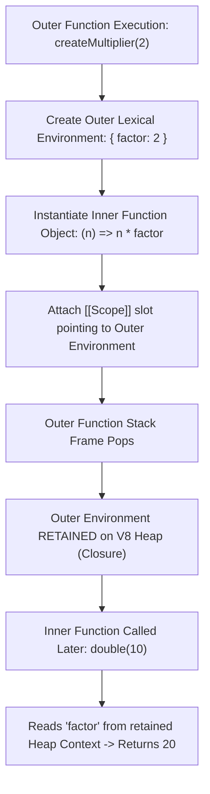

# Higher-Order Functions, Currying & Function Composition

> An exhaustive technical reference on Higher-Order Functions (HOFs) in JavaScript: function decorators, currying vs partial application, functional pipelines (`compose` / `pipe`), memoization, and V8 closure optimization.

| Metadata | Details |
| :--- | :--- |
| **Level** | Intermediate |
| **Prerequisites** | [01_declarations-and-expressions.md](./01_declarations-and-expressions.md), [05_callbacks.md](./05_callbacks.md) |
| **Time to Read** | 25 minutes |
| **Status** | Complete |
| **ECMAScript Standard** | ES6 (ES2015) to Current (ES2024/ES2025) |

---

## Table of Contents
1. [What & Why](#1-what--why)
2. [Core Concepts](#2-core-concepts)
3. [How It Works: Closures & Lexical Environments](#3-how-it-works-closures--lexical-environments)
4. [Syntax & Architectural Patterns Reference](#4-syntax--architectural-patterns-reference)
5. [Practical Examples](#5-practical-examples)
6. [Edge Cases & Gotchas](#6-edge-cases--gotchas)
7. [Common Mistakes & Anti-Patterns](#7-common-mistakes--anti-patterns)
8. [Performance Characteristics](#8-performance-characteristics)
9. [Engine Internals: V8 Context Allocations & Inlining](#9-engine-internals-v8-context-allocations--inlining)
10. [Best Practices & Style Guide](#10-best-practices--style-guide)
11. [Real-World Applications & Case Studies](#11-real-world-applications--case-studies)
12. [Interview Questions & Deep Dives](#12-interview-questions--deep-dives)
13. [Exercises & Challenges](#13-exercises--challenges)

---

## 1. What & Why

A **Higher-Order Function (HOF)** is a function that either:
1. **Accepts one or more functions as arguments** (e.g. `[].map(fn)`, `setTimeout(fn)`).
2. **Returns a function as its output result** (e.g. `const multiplyBy = factor => n => n * factor`).
3. Or performs both simultaneously (decorators, middleware, currying wrappers).

```
┌─────────────────────────────────────────────────────────┐
│                 Higher-Order Functions                  │
├────────────────────────────┬────────────────────────────┤
│ Function as Argument       │ Function as Return Value   │
├────────────────────────────┼────────────────────────────┤
│ users.filter(u => u.active)│ const makeLogger = tag =>  │
│ • Inversion of control     │       msg => log(tag, msg) │
│ • Declarative iteration    │ • Encapsulation / closures │
│ • Behavioral abstraction   │ • Partial configuration    │
└────────────────────────────┴────────────────────────────┘
```

Higher-Order Functions form the core mathematical foundation of functional programming in JavaScript. By abstracting control flow, looping mechanics, and state management into reusable combinators, HOFs eliminate boilerplate, improve testability, and enable declarative data transformation pipelines.

---

## 2. Core Concepts

### 2.1 Function Factories & Parameter Capture
A function factory is a function that returns a new specialized function, closing over configuration arguments:
```javascript
function createThresholdValidator(min, max) {
  // Returns a specialized predicate closing over 'min' and 'max'
  return function (value) {
    return value >= min && value <= max;
  };
}

const isValidPercentage = createThresholdValidator(0, 100);
console.log(isValidPercentage(45));  // true
console.log(isValidPercentage(105)); // false
```

### 2.2 Currying vs. Partial Application
- **Currying**: Translates a function taking $N$ arguments into a sequence of $N$ unary functions, each accepting exactly one argument:
  $$f(a, b, c) \longrightarrow f(a)(b)(c)$$
- **Partial Application**: Fixes a subset of a function's arguments upfront, returning a function that accepts the remaining arguments:
  $$f(a, b, c) \text{ with fixed } a \longrightarrow g(b, c)$$

### 2.3 Function Composition (`pipe` vs. `compose`)
Function composition combines multiple unary functions such that the output of each function feeds into the input of the next:
- **`compose(f, g, h)(x)`**: Evaluates from **right to left**: $f(g(h(x)))$ (traditional mathematical notation).
- **`pipe(f, g, h)(x)`**: Evaluates from **left to right**: $h(g(f(x)))$ (natural Unix pipeline flow).

### 2.4 Function Decorators
A decorator is an HOF that accepts a function, wraps it in additional behavior (caching, logging, rate-limiting, timing), and returns a function with the identical call signature.

---

## 3. How It Works: Closures & Lexical Environments

When a higher-order function returns an inner function:



Because the returned inner function retains an internal pointer (`[[Scope]]`) to the parent environment record, the JavaScript garbage collector cannot reclaim the variables allocated during the outer function's execution until all references to the inner function are cleared.

---

## 4. Syntax & Architectural Patterns Reference

### Common HOF Signatures

```javascript
// 1. Pipe (Left-to-Right Composition)
const pipe = (...fns) => (initial) =>
  fns.reduce((acc, fn) => fn(acc), initial);

// 2. Compose (Right-to-Left Composition)
const compose = (...fns) => (initial) =>
  fns.reduceRight((acc, fn) => fn(acc), initial);

// 3. Unary Decorator (Guards against extra arguments)
const unary = (fn) => (arg) => fn(arg);

// 4. Negate / Invert Predicate
const not = (predicate) => (...args) => !predicate(...args);

// 5. Logical Predicate Combinator (AND)
const and = (p1, p2) => (...args) => p1(...args) && p2(...args);
```

---

## 5. Practical Examples

### Example 1: Production `debounce` and `throttle` Utilities

```javascript
/**
 * Debounce: Delays execution until 'waitMs' has elapsed since the last invocation.
 * @param {Function} fn
 * @param {number} waitMs
 * @returns {Function}
 */
function debounce(fn, waitMs) {
  let timeoutId = null;

  function debounced(...args) {
    if (timeoutId !== null) {
      clearTimeout(timeoutId);
    }
    timeoutId = setTimeout(() => {
      timeoutId = null;
      Reflect.apply(fn, this, args);
    }, waitMs);
  }

  debounced.cancel = () => {
    if (timeoutId !== null) {
      clearTimeout(timeoutId);
      timeoutId = null;
    }
  };

  return debounced;
}

/**
 * Throttle: Guarantees execution at most once per 'limitMs' interval.
 * @param {Function} fn
 * @param {number} limitMs
 * @returns {Function}
 */
function throttle(fn, limitMs) {
  let inThrottle = false;
  let lastArgs = null;
  let lastThis = null;

  return function throttled(...args) {
    if (!inThrottle) {
      Reflect.apply(fn, this, args);
      inThrottle = true;
      setTimeout(() => {
        inThrottle = false;
        if (lastArgs) {
          throttled.apply(lastThis, lastArgs);
          lastArgs = null;
          lastThis = null;
        }
      }, limitMs);
    } else {
      lastArgs = args;
      lastThis = this;
    }
  };
}

// Verification
const logSearch = debounce((query) => console.log(`Search: ${query}`), 50);
logSearch("j");
logSearch("jav");
logSearch("javascript"); // Only 'javascript' executes after 50ms!
```

### Example 2: Generic Multi-Argument Memoization Decorator

```javascript
/**
 * Generic memoizer with custom serializer for complex argument caching.
 * @param {Function} fn
 * @param {Function} [keyResolver]
 */
function memoize(fn, keyResolver = (...args) => JSON.stringify(args)) {
  const cache = new Map();

  const memoized = function (...args) {
    const key = keyResolver(...args);
    if (cache.has(key)) {
      return cache.get(key);
    }

    const result = Reflect.apply(fn, this, args);
    cache.set(key, result);
    return result;
  };

  memoized.cache = cache;
  memoized.clear = () => cache.clear();

  return memoized;
}

// Expensive computational task
const computeTax = memoize((price, rate) => {
  console.log(`[EXPENSIVE CALCULATION] price: ${price}, rate: ${rate}`);
  return price * rate;
});

console.log(computeTax(100, 0.08)); // Prints [EXPENSIVE CALCULATION] -> 8
console.log(computeTax(100, 0.08)); // Instant cache hit (Nothing logged) -> 8
```

### Example 3: Declarative Predicate Combinator Architecture

```javascript
const isEven = (n) => n % 2 === 0;
const isPositive = (n) => n > 0;
const isUnderHundred = (n) => n < 100;

// Predicate Combinators:
const not = (predicate) => (...args) => !predicate(...args);
const and = (...predicates) => (...args) =>
  predicates.every((p) => p(...args));
const or = (...predicates) => (...args) =>
  predicates.some((p) => p(...args));

// Form compound business logic declaratively without nesting if statements:
const isOdd = not(isEven);
const isValidBatch = and(isPositive, isEven, isUnderHundred);

console.log("Is 7 odd:", isOdd(7));                     // true
console.log("Is 42 valid batch:", isValidBatch(42));   // true (positive, even, < 100)
console.log("Is 104 valid batch:", isValidBatch(104)); // false (>= 100)
```

### Example 4: Data Transformation Pipeline Using `pipe`

```javascript
const sanitizeInput = (str) => str.trim().toLowerCase();
const removePunctuation = (str) => str.replace(/[^\w\s]/g, "");
const splitWords = (str) => str.split(/\s+/).filter(Boolean);
const countFrequency = (words) =>
  words.reduce((acc, word) => {
    acc[word] = (acc[word] || 0) + 1;
    return acc;
  }, {});

const analyzeWordFrequency = pipe(
  sanitizeInput,
  removePunctuation,
  splitWords,
  countFrequency
);

const report = analyzeWordFrequency("  Hello World! Hello JavaScript, modern world.  ");
console.log(report);
// Output: { hello: 2, world: 2, javascript: 1, modern: 1 }
```

### Example 5: Asynchronous Retry Decorator

```javascript
/**
 * Wraps any Promise-returning function with automated retry logic.
 * @param {Function} asyncFn
 * @param {number} maxRetries
 * @param {number} delayMs
 */
function withRetry(asyncFn, maxRetries = 3, delayMs = 100) {
  return async function (...args) {
    let lastError;

    for (let attempt = 1; attempt <= maxRetries; attempt++) {
      try {
        return await Reflect.apply(asyncFn, this, args);
      } catch (err) {
        lastError = err;
        console.warn(`[RETRY] Attempt ${attempt}/${maxRetries} failed: ${err.message}`);
        if (attempt < maxRetries) {
          await new Promise((resolve) => setTimeout(resolve, delayMs * 2 ** (attempt - 1)));
        }
      }
    }

    throw new Error(`Execution failed after ${maxRetries} attempts. Cause: ${lastError.message}`);
  };
}

let counter = 0;
const flakyNetworkCall = withRetry(async (id) => {
  counter++;
  if (counter < 3) throw new Error("Connection reset by peer");
  return { id, status: "OK", payload: "Data Loaded" };
}, 3, 20);

flakyNetworkCall("res_100").then(console.log).catch(console.error);
```

---

## 6. Edge Cases & Gotchas

### 6.1 Preserving `this` Context Across Decorators
When decorating methods, using arrow functions or naked function calls severs the object's `this` context:
```javascript
// BUGGY DECORATOR:
function badLogDecorator(fn) {
  return function (...args) {
    return fn(...args); // DANGER: 'this' is lost!
  };
}

// CORRECT DECORATOR:
function safeLogDecorator(fn) {
  return function (...args) {
    // Reflect.apply forwards the caller's 'this' cleanly
    return Reflect.apply(fn, this, args);
  };
}
```

### 6.2 Preserving Function Arity (`fn.length`) and Names
Decorators return wrapper functions whose `length` is normally `0` (if using rest parameters `...args`) and whose `name` is `"wrapper"`:
```javascript
function decorate(fn) {
  const wrapped = function (...args) {
    return fn(...args);
  };
  // To preserve function introspection, copy metadata:
  Object.defineProperty(wrapped, "name", { value: fn.name });
  Object.defineProperty(wrapped, "length", { value: fn.length });
  return wrapped;
}
```

### 6.3 Memory Leaks in Long-Lived Closures
If an inner function captures a large outer object that it never actually references, some older JavaScript engines could hold the entire lexical environment in memory:
```javascript
function createLeakyHandler() {
  const massiveData = new ArrayBuffer(1024 * 1024 * 100); // 100 MB
  const id = "usr_1";

  return function getId() {
    // Modern V8 performs scope tree pruning and discards 'massiveData',
    // but in environments with eval() or debuggers active, the entire 100MB is retained!
    return id;
  };
}
```

---

## 7. Common Mistakes & Anti-Patterns

| Anti-Pattern | Why It Fails | Correct Approach |
| :--- | :--- | :--- |
| **Using `bind` inside render loops** | Creates a new function object and closure on every render cycle. | Pre-bind handlers in constructors or use stable callbacks. |
| **Omitting `this` forwarding in decorators** | Calling decorated object methods breaks `this.property` access. | Use `Reflect.apply(fn, this, args)`. |
| **Using `JSON.stringify` as a cache key for circular objects** | Throws `TypeError: Converting circular structure to JSON`. | Use specialized key serializers or `WeakMap`. |
| **Composing non-unary functions** | `pipe` and `compose` expect functions accepting exactly one argument. | Curry or partially apply functions before composing. |
| **Unbounded cache growth in `memoize`** | In-memory maps grow indefinitely, triggering heap memory exhaustion. | Implement LRU (Least Recently Used) cache eviction limits. |
| **Re-creating HOFs inside loops** | Allocates redundant closure contexts on every iteration. | Extract higher-order generators outside the loop. |

---

## 8. Performance Characteristics

In modern V8:
- **Function Inlining**: Simple HOFs like `map(x => x * 2)` are inlined by TurboFan into tight assembly loops, matching the execution speed of raw `for` loops.
- **Escape Analysis**: If the inner function returned by an HOF does not escape the current call stack, TurboFan allocates its closure variables in CPU registers rather than on the heap.
- **Polymorphism Penalties**: Passing different function signatures into the same HOF call-site makes the Inline Cache (IC) **megamorphic**, degrading execution speed by 3x–5x.

---

## 9. Engine Internals: V8 Context Allocations & Inlining

When V8 compiles an HOF returning an inner function:
1. **Scope Allocation**: V8's Parser examines variables declared in the outer function.
2. **Context vs Stack**:
   - Variables *not* referenced by the inner function remain on the CPU activation stack.
   - Variables referenced by the inner function are assigned to a **Heap `Context` object** (`ContextSlot`).
3. **Optimized Inlining**: When TurboFan optimizes `pipe(f, g)(x)`, it constructs a single control-flow graph (CFG) merging `f` and `g`, effectively compiling `f(g(x))` into a single continuous sequence of machine instructions.

---

## 10. Best Practices & Style Guide

1. **Keep Composed Functions Pure and Unary**: Functions inside `pipe` and `compose` should be pure (deterministic, zero side-effects) and accept a single input.
2. **Use Arrow Functions for Inline HOFs**: For simple one-line transformations, concise arrows are clean and idiomatic.
3. **Always Forward `this` in Decorators**: Use `Reflect.apply(fn, this, args)` rather than naked invocations.
4. **Implement Cache Limits on Memoization**: Always configure an LRU capacity or eviction strategy for long-running servers.

---

## 11. Real-World Applications & Case Studies

### Case Study: Node.js API Gateway Rate-Limiting Outage
An enterprise API gateway used a naive in-memory memoization decorator to cache user authentication tokens:
```javascript
// BUGGY GATEWAY CODE:
const verifyToken = memoize(async (authHeader) => {
  return jwt.verify(authHeader, SECRET_KEY);
});
```
- **Symptom**: During a DDoS attack with 500,000 distinct spoofed authorization headers, the `Map` inside `memoize` grew uncontrollably to 1.8 GB of memory.
- **Consequence**: Node.js triggered an Out-of-Memory (OOM) crash: `FATAL ERROR: Ineffective mark-compacts near heap limit Allocation failed - JavaScript heap out of memory`.
- **Resolution**: Replaced the naive `Map` with an LRU cache capped at 10,000 entries with a 5-minute Time-To-Live (TTL).

---

## 12. Interview Questions & Deep Dives

<details>
<summary><strong>1. What is the difference between Currying and Partial Application?</strong></summary>

**Answer:**
- **Currying** transforms a function of arity $N$ into a chain of $N$ unary functions, each taking strictly **one** argument: $f(a, b, c) \rightarrow f(a)(b)(c)$.
- **Partial Application** fixes a specific number of arguments upfront, returning a function that accepts all remaining arguments in one call: $f(a, b, c)$ with fixed $a$ becomes $g(b, c)$.
</details>

<details>
<summary><strong>2. How does `pipe` differ from `compose`?</strong></summary>

**Answer:**
Both perform mathematical function composition. The sole difference is evaluation order:
- `compose(f, g, h)(x)` evaluates from **right to left**: $f(g(h(x)))$, matching mathematical $(f \circ g \circ h)(x)$.
- `pipe(f, g, h)(x)` evaluates from **left to right**: $h(g(f(x)))$, matching Unix command-line pipes (`cat | grep | sort`).
</details>

<details>
<summary><strong>3. Why is `Reflect.apply` preferred over `Function.prototype.apply` in decorators?</strong></summary>

**Answer:**
`Reflect.apply(fn, thisArg, args)` is cleaner, faster, and more robust. If an object has a custom property or method named `apply` (e.g. `const obj = { apply: null }`), calling `fn.apply(...)` can fail or be shadowed. `Reflect.apply` guarantees direct, un-intercepted invocation of the internal `[[Call]]` method.
</details>

<details>
<summary><strong>4. How do closures retain variables without causing memory leaks?</strong></summary>

**Answer:**
Modern engines (V8, SpiderMonkey) perform static scope analysis during parsing. Variables that are never referenced by an inner closure are discarded and reclaimed when the stack frame pops. Only variables explicitly referenced across the closure boundary are moved to a heap-allocated `Context` object. As long as the inner function is reachable, the `Context` object is kept alive by the garbage collector.
</details>

<details>
<summary><strong>5. What is the purpose of the `unary` higher-order function?</strong></summary>

**Answer:**
The `unary` HOF wraps a multi-parameter function and enforces that only its first argument is forwarded:
`const unary = fn => arg => fn(arg);`
It is primarily used to prevent unintended arguments from corrupting functions in array iterations, most famously fixing `['1', '2', '3'].map(unary(parseInt))`.
</details>

<details>
<summary><strong>6. Can an arrow function be used to implement a method decorator?</strong></summary>

**Answer:**
Generally, no. Arrow functions capture `this` lexically from their author-time enclosing scope and ignore dynamic call-time `this`. If a decorator wraps an object method using an arrow function, the method loses access to the object instance (`this`). Decorators must use standard `function` declarations to receive and forward the caller's dynamic `this`.
</details>

<details>
<summary><strong>7. How does V8 optimize Higher-Order Array methods like `map` and `filter`?</strong></summary>

**Answer:**
TurboFan recognizes native array HOFs. If the callback passed to `map` is monomorphic (the same function is passed repeatedly), TurboFan inlines the callback directly into the array traversal loop, completely removing the overhead of function invocations, context allocations, and boundary checks.
</details>

<details>
<summary><strong>8. What is a predicate combinator and give two examples?</strong></summary>

**Answer:**
A predicate combinator is an HOF that accepts one or more predicate functions (functions returning booleans) and returns a new predicate function representing logical operations:
1. `not(p)`: Returns the logical negation `!p(x)`.
2. `and(p1, p2)`: Returns `p1(x) && p2(x)`.
</details>

---

## 13. Exercises & Challenges

### Exercise 1 (Easy): Create a Unary Function Decorator
**Task**: Write an HOF `unary(fn)` that ensures `fn` is called with strictly one argument, testing it with `parseInt` and `[1, 2, 3].map()`.

<details>
<summary><strong>Solution</strong></summary>

```javascript
const unary = (fn) => (arg) => fn(arg);

const result = ["1", "2", "3"].map(unary(parseInt));
console.log(result); // [1, 2, 3]
```
</details>

### Exercise 2 (Easy): Predicate Negation Combinator
**Task**: Implement a `not(predicate)` combinator and use it with `Array.prototype.filter` to filter out non-empty strings.

<details>
<summary><strong>Solution</strong></summary>

```javascript
const not = (predicate) => (...args) => !predicate(...args);

const isEmpty = (str) => str.trim().length === 0;
const isNotEmpty = not(isEmpty);

const words = ["hello", "", "   ", "world", "javascript"];
const filtered = words.filter(isNotEmpty);

console.log(filtered); // ['hello', 'world', 'javascript']
```
</details>

### Exercise 3 (Medium): Pipe Implementation with Error Boundary
**Task**: Build a `safePipe(...fns)` utility that passes data through a pipeline, but if any step throws an error, execution stops and returns `{ success: false, error, stepIndex }`.

<details>
<summary><strong>Solution</strong></summary>

```javascript
function safePipe(...fns) {
  return function (initialValue) {
    let current = initialValue;

    for (let i = 0; i < fns.length; i++) {
      try {
        current = fns[i](current);
      } catch (err) {
        return { success: false, error: err.message, stepIndex: i };
      }
    }

    return { success: true, data: current };
  };
}

const step1 = (x) => x * 2;
const step2 = (x) => {
  if (x > 10) throw new Error("Value exceeded 10");
  return x + 5;
};

const pipeline = safePipe(step1, step2);
console.log(pipeline(3));  // { success: true, data: 11 }
console.log(pipeline(10)); // { success: false, error: 'Value exceeded 10', stepIndex: 1 }
```
</details>

### Exercise 4 (Medium): Auto-Currying Function
**Task**: Implement an automated `curry(fn)` utility that checks `fn.length` and recursively returns curried functions until all formal parameters are satisfied.

<details>
<summary><strong>Solution</strong></summary>

```javascript
function curry(fn) {
  return function curried(...args) {
    if (args.length >= fn.length) {
      return Reflect.apply(fn, this, args);
    }
    return function (...nextArgs) {
      return Reflect.apply(curried, this, args.concat(nextArgs));
    };
  };
}

const sumThree = (a, b, c) => a + b + c;
const curriedSum = curry(sumThree);

console.log(curriedSum(1)(2)(3)); // 6
console.log(curriedSum(1, 2)(3)); // 6
console.log(curriedSum(1)(2, 3)); // 6
```
</details>

### Exercise 5 (Hard): LRU Memoization Decorator
**Task**: Build an HOF `memoizeLRU(fn, capacity = 3)` that caches function results but automatically evicts the least recently accessed cache entry when `capacity` is exceeded.

<details>
<summary><strong>Solution</strong></summary>

```javascript
function memoizeLRU(fn, capacity = 3) {
  // Map preserves key insertion order; re-inserting refreshes recency
  const cache = new Map();

  return function (...args) {
    const key = JSON.stringify(args);

    if (cache.has(key)) {
      const val = cache.get(key);
      // Refresh key order (delete and re-insert makes it newest)
      cache.delete(key);
      cache.set(key, val);
      return val;
    }

    const result = Reflect.apply(fn, this, args);

    if (cache.size >= capacity) {
      // First key in Map iterator is the oldest / least recently used
      const oldestKey = cache.keys().next().value;
      cache.delete(oldestKey);
    }

    cache.set(key, result);
    return result;
  };
}

// Verification
const calculate = memoizeLRU((x) => {
  console.log(`Computed for ${x}`);
  return x * 10;
}, 2);

calculate(1); // Computed for 1
calculate(2); // Computed for 2
calculate(1); // Cache hit (1 is refreshed)
calculate(3); // Evicts 2!
calculate(2); // Recomputed for 2!
```
</details>

### Exercise 6 (Hard): Asynchronous Circuit Breaker Decorator
**Task**: Build an HOF `circuitBreaker(asyncFn, failureThreshold = 3, resetTimeoutMs = 1000)` that tracks failures. After threshold failures, it opens the circuit and immediately rejects incoming calls without calling `asyncFn` until `resetTimeoutMs` elapses.

<details>
<summary><strong>Solution</strong></summary>

```javascript
function circuitBreaker(asyncFn, failureThreshold = 3, resetTimeoutMs = 500) {
  let state = "CLOSED"; // CLOSED (Normal), OPEN (Failing/Blocked), HALF-OPEN
  let failures = 0;
  let nextAttemptAt = 0;

  return async function (...args) {
    const now = Date.now();

    if (state === "OPEN") {
      if (now > nextAttemptAt) {
        state = "HALF-OPEN";
        console.log("[CIRCUIT] Half-Open: Testing service availability...");
      } else {
        throw new Error("[CIRCUIT OPEN] Service unavailable; calls rejected");
      }
    }

    try {
      const result = await Reflect.apply(asyncFn, this, args);
      // Success resets circuit
      failures = 0;
      state = "CLOSED";
      return result;
    } catch (err) {
      failures++;
      if (failures >= failureThreshold) {
        state = "OPEN";
        nextAttemptAt = Date.now() + resetTimeoutMs;
        console.error(`[CIRCUIT TRIPPED] ${failures} consecutive failures. Opening circuit for ${resetTimeoutMs}ms.`);
      }
      throw err;
    }
  };
}

// Verification
const failingApi = circuitBreaker(async () => {
  throw new Error("500 Server Down");
}, 2, 100);

(async () => {
  try { await failingApi(); } catch (e) { console.log("Attempt 1 failed"); }
  try { await failingApi(); } catch (e) { console.log("Attempt 2 failed (Tripped!)"); }
  try { await failingApi(); } catch (e) { console.log("Attempt 3 blocked by circuit:", e.message); }
})();
```
</details>
