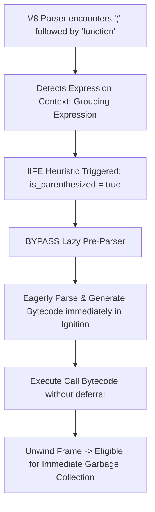

# IIFE, Function Objects & Metaprogramming Properties

> An exhaustive technical reference on Immediately Invoked Function Expressions (IIFE), functions as heap objects, property descriptors (`name`, `length`, `prototype`), restricted legacy properties, and V8 pre-parsing heuristics.

| Metadata | Details |
| :--- | :--- |
| **Level** | Intermediate |
| **Prerequisites** | [01_declarations-and-expressions.md](./01_declarations-and-expressions.md), [01_fundamentals/05_expressions-and-statements.md](../01_fundamentals/05_expressions-and-statements.md) |
| **Time to Read** | 25 minutes |
| **Status** | Complete |
| **ECMAScript Standard** | ES6 (ES2015) to Current (ES2024/ES2025) |

---

## Table of Contents
1. [What & Why](#1-what--why)
2. [Core Concepts](#2-core-concepts)
3. [How It Works: Grammar Parsing & V8 IIFE Eager Compilation](#3-how-it-works-grammar-parsing--v8-iife-eager-compilation)
4. [Syntax & Architectural Patterns Reference](#4-syntax--architectural-patterns-reference)
5. [Practical Examples](#5-practical-examples)
6. [Edge Cases & Gotchas](#6-edge-cases--gotchas)
7. [Common Mistakes & Anti-Patterns](#7-common-mistakes--anti-patterns)
8. [Performance Characteristics](#8-performance-characteristics)
9. [Engine Internals: V8 `PreParser` vs Eager Compilation](#9-engine-internals-v8-preparser-vs-eager-compilation)
10. [Best Practices & Style Guide](#10-best-practices--style-guide)
11. [Real-World Applications & Case Studies](#11-real-world-applications--case-studies)
12. [Interview Questions & Deep Dives](#12-interview-questions--deep-dives)
13. [Exercises & Challenges](#13-exercises--challenges)

---

## 1. What & Why

In JavaScript, functions are instances of `Object` (`fn instanceof Object === true`). As objects, functions possess properties, prototype chains, and method attachments.

An **Immediately Invoked Function Expression (IIFE)** is a function expression evaluated and executed immediately upon its definition:
```javascript
(function () {
  const isolated = "Private scope";
  console.log(isolated);
})();
```

Historically, IIFEs were the primary mechanism for preventing global namespace pollution and building modular software in browsers prior to ES6 block scoping (`let`/`const`) and ES Modules.

```
┌─────────────────────────────────────────────────────────┐
│                    The Evolution of IIFEs               │
├────────────────────────────┬────────────────────────────┤
│ Historical (Pre-ES6)       │ Modern ECMAScript          │
├────────────────────────────┼────────────────────────────┤
│ • Emulate block scoping    │ • Block scoping { let x; } │
│ • Module Pattern (closures)│ • Native ES Modules (ESM)  │
│ • Window pollution defense │ • Top-Level await          │
│ • Loop closure isolation   │ • for (let i = 0; ...)     │
└────────────────────────────┴────────────────────────────┘
```

Despite modern module syntax, IIFEs remain essential for:
- Self-executing asynchronous initialization in non-ESM environments (CommonJS).
- Complex computed property initialization without temporary variables polluting local scopes.
- Immediate configuration encapsulation in third-party embed scripts and Web Workers.

---

## 2. Core Concepts

### 2.1 Why the Grouping Parentheses are Mandatory
In JavaScript grammar, encountering the `function` keyword at the beginning of a statement causes the parser to treat it as a **Function Declaration**:
```javascript
// SYNTAX ERROR: Function declarations require a name and cannot be invoked immediately:
// function() { ... }(); // SyntaxError: Function statements require a function name
```
Wrapping the function in parentheses `(function() { ... })` forces the parser into an **Expression context**. Once parsed as a function expression, appending `()` immediately executes it.

### 2.2 Unary Operator IIFE Variations
Any operator that forces an expression context can construct an IIFE without wrapping parentheses:
```javascript
!function () { console.log("Bang IIFE"); }();
+function () { console.log("Unary plus IIFE"); }();
void function () { console.log("Void IIFE"); }();
```
*(Note: Using `void` or `!` is common in minifiers like Terser because it saves one byte compared to parentheses).*

### 2.3 Built-in Function Properties & Descriptors
Every JavaScript function instance has standard built-in properties:

| Property | Type | Writable? | Configurable? | Meaning |
| :--- | :--- | :---: | :---: | :--- |
| **`fn.name`** | `string` | **No** | **Yes** | Inferred or explicit identifier name |
| **`fn.length`** | `number` | **No** | **Yes** | Formal arity preceding default parameters |
| **`fn.prototype`** | `object` | Yes | No | Object instance prototype (standard functions only) |
| **`fn.caller`** | `Function` | Restricted | Restricted | **Banned in strict mode** (Throws `TypeError`) |
| **`fn.arguments`** | `Arguments` | Restricted | Restricted | **Banned in strict mode** (Throws `TypeError`) |

### 2.4 Attaching Custom Static Properties
Because functions are heap objects, you can attach custom metadata, memoization caches, and static sub-methods directly to the function identifier:
```javascript
function sendNotification(msg) {
  sendNotification.deliveredCount++;
  console.log(`[NOTIFY]: ${msg}`);
}
sendNotification.deliveredCount = 0; // State attached directly to function object!
```

---

## 3. How It Works: Grammar Parsing & V8 IIFE Eager Compilation



### The Parenthesis Heuristic in V8
Normally, V8 optimizes startup speed using a **PreParser** (lazy parsing). When V8 encounters a standard function declaration, it skips full syntax analysis and bytecode generation until the function is actually called.
- When V8 encounters an open parenthesis immediately preceding a function `(function...`, it infers that this function will be executed immediately.
- V8 switches from lazy parsing to **eager full parsing**, avoiding double-parsing overhead.

---

## 4. Syntax & Architectural Patterns Reference

### The Classic Revealing Module Pattern (IIFE Closure)

```javascript
const UserAuthModule = (function () {
  // Private variables (isolated inside IIFE scope)
  const tokenStore = new Map();
  let sessionTimeoutMs = 3600000;

  // Private helper function
  function hashToken(token) {
    return `HASH_${token}`;
  }

  // Public API returned to caller
  return {
    authenticate(user, token) {
      tokenStore.set(user, hashToken(token));
      return true;
    },
    hasSession(user) {
      return tokenStore.has(user);
    },
    get activeCount() {
      return tokenStore.size;
    }
  };
})();

UserAuthModule.authenticate("ada", "secret123");
console.log("Active sessions:", UserAuthModule.activeCount); // 1
// console.log(UserAuthModule.tokenStore); // undefined (Completely hidden private state!)
```

---

## 5. Practical Examples

### Example 1: Asynchronous IIFE for Top-Level Initialization in CommonJS

In non-module environments (e.g. standard CommonJS files where top-level `await` is forbidden), async IIFEs provide a clean asynchronous bootstrap pipeline:

```javascript
// Bootstrap script for database migration runner
(async function bootstrap() {
  console.log("[BOOT] Initializing system connections...");
  try {
    const config = await Promise.resolve({ dbHost: "localhost", port: 5432 });
    console.log(`[CONNECTED] Database ready at ${config.dbHost}:${config.port}`);
  } catch (err) {
    console.error("[FATAL] Bootstrap failure:", err);
    process.exit(1);
  }
})();
```

### Example 2: Complex Computed State Initialization Without Polluting Scope

```javascript
// Complex configuration derived once without leaving intermediate variables in scope
const serverOptions = (() => {
  const isProduction = process.env.NODE_ENV === "production";
  const defaultPort = isProduction ? 443 : 3000;
  const timeoutMs = isProduction ? 5000 : 30000;

  return Object.freeze({
    port: defaultPort,
    timeoutMs,
    environment: isProduction ? "prod" : "dev",
    workers: isProduction ? 8 : 1
  });
})();

console.log(serverOptions);
// isProduction, defaultPort, and timeoutMs are automatically garbage-collected!
```

### Example 3: Function Name Inference Mechanics

ECMAScript standardized sophisticated **name inference** rules across anonymous assignments:

```javascript
// 1. Inferred from variable declaration
const calculateTax = function () {};
console.log(calculateTax.name); // "calculateTax"

// 2. Inferred from object property key
const service = {
  processPayment: function () {}
};
console.log(service.processPayment.name); // "processPayment"

// 3. Getter / Setter prefix inference
const account = {
  get balance() { return 100; },
  set balance(val) {}
};
const descriptor = Object.getOwnPropertyDescriptor(account, "balance");
console.log(descriptor.get.name); // "get balance"
console.log(descriptor.set.name); // "set balance"

// 4. Bound function prefix inference
function multiply(x, y) { return x * y; }
const double = multiply.bind(null, 2);
console.log(double.name); // "bound multiply"
```

### Example 4: Stateful Self-Contained Function Object

```javascript
/**
 * Stateful function maintaining call metrics directly on its object instance.
 */
function queryDatabase(sql) {
  queryDatabase.totalQueries++;
  queryDatabase.lastQuery = sql;
  return `Results for: ${sql}`;
}

// Initializing static properties
queryDatabase.totalQueries = 0;
queryDatabase.lastQuery = null;
queryDatabase.resetStats = function () {
  this.totalQueries = 0;
  this.lastQuery = null;
};

queryDatabase("SELECT * FROM users");
queryDatabase("SELECT * FROM orders WHERE status = 'shipped'");

console.log("Total queries:", queryDatabase.totalQueries); // 2
console.log("Last query:", queryDatabase.lastQuery);
```

### Example 5: Unary Operator IIFEs and Return Value Differences

```javascript
// Parenthesized IIFE: returns function's return value
const res1 = (function () {
  return 42;
})();
console.log("Parenthesized result:", res1); // 42

// Void IIFE: ALWAYS evaluates to undefined
const res2 = void (function () {
  return 42;
})();
console.log("Void result:", res2); // undefined

// Bang (!) IIFE: coerces return value to inverted boolean
const res3 = !function () {
  return 42;
}();
console.log("Bang result:", res3); // false (because !42 is false)
```

---

## 6. Edge Cases & Gotchas

### 6.1 Semicolon Omission Before an IIFE (The Semicolon Collision)
If a previous statement lacks a semicolon, the parser treats the opening parenthesis of the IIFE as a **function invocation on the previous line**:
```javascript
// CRITICAL ASI BUG:
const prefix = "ID_"
(function () {
  console.log("Running IIFE");
})()

// HOW THE ENGINE PARSES IT:
// const prefix = "ID_"(function () { ... })();
// Throws: TypeError: "ID_" is not a function!

// DEFENSIVE RECOVERY: Always prepend defensive semicolon if omitting semicolons:
const safePrefix = "ID_"
;(function () {
  console.log("Safe IIFE");
})()
```

### 6.2 `fn.name` and `fn.length` are Non-Writable
Attempting to overwrite `fn.name` or `fn.length` by assignment fails silently in non-strict mode and throws in strict mode:
```javascript
"use strict";
function demo() {}

try {
  // @ts-ignore
  demo.name = "customName"; // TypeError: Cannot assign to read only property 'name'
} catch (e) {
  console.log("Assignment error:", e.message);
}

// To modify function name, use Object.defineProperty (since configurable: true):
Object.defineProperty(demo, "name", { value: "customName" });
console.log("Updated name:", demo.name); // "customName"
```

### 6.3 Restricted Properties in Strict Mode (`fn.caller`, `fn.arguments`)
Accessing `fn.caller` or `fn.arguments` in strict mode throws a `TypeError`:
```javascript
"use strict";
function inspect() {
  try {
    // @ts-ignore
    console.log(inspect.caller);
  } catch (err) {
    console.log("Caller access forbidden:", err.name); // TypeError
  }
}
inspect();
```

---

## 7. Common Mistakes & Anti-Patterns

| Anti-Pattern | Why It Fails | Correct Approach |
| :--- | :--- | :--- |
| **Omitted semicolon before leading `(`** | Evaluates as a function call on the previous statement, throwing `TypeError`. | Use explicit semicolons or prepend a defensive `;(` before the IIFE. |
| **Using IIFEs purely for variable scoping in ES6+** | Unnecessary function allocation and closure overhead. | Use block scoping `{ const x = 1; }`. |
| **Attempting to overwrite `fn.length` via `=`** | Property descriptor has `writable: false`; fails or throws `TypeError`. | Use `Object.defineProperty()` or rest parameters. |
| **Accessing `fn.caller` for recursion** | Banned by strict mode for security and optimization reasons. | Use Named Function Expressions (NFE). |
| **Using `new` on an IIFE constructor** | Creates redundant syntax: `new (function() {})()`. | Use standard object literals or ES6 `class`. |
| **Forgetting return in an async IIFE error handler** | Process continues execution after failure. | Call `process.exit(1)` or re-throw. |

---

## 8. Performance Characteristics

In modern V8:
- **Eager Compilation**: Wrapping a function in parentheses `(function ...` triggers V8's eager compilation pipeline, skipping lazy parsing overhead.
- **Short Lifetime Reclaim**: Uncaptured variables inside an IIFE are allocated on the stack frame and reclaimed immediately upon execution, reducing heap allocation pressure.
- **Megamorphic Call-Sites on Function Properties**: Storing dynamic properties on functions (e.g. `fn.customProp`) modifies the function's internal V8 Hidden Class (`Map`), deoptimizing inline caches if many different properties are attached.

---

## 9. Engine Internals: V8 `PreParser` vs Eager Compilation

During browser page load:
1. **The PreParser**: Scans JavaScript source code at ~200 MB/s. It verifies syntax and tracks variable scopes, but **does not generate Ignition bytecode or AST nodes**.
2. **The Parenthesis Trigger**: In `src/parsing/parser.cc`, when the scanner encounters `Token::LPAREN` immediately followed by `Token::FUNCTION`:
   - It sets `is_parenthesized = true`.
   - V8 assumes the author intends to execute the function immediately (IIFE).
   - The PreParser is skipped, and V8's **Full Parser** runs directly, generating bytecode in a single pass.

---

## 10. Best Practices & Style Guide

1. **Use ES Modules Instead of Global IIFEs**: For application files, prefer native ECMAScript Modules (`import` / `export`) over IIFE namespace wrappers.
2. **Use Async IIFE Only When Top-Level Await is Unavailable**: In CommonJS scripts or older Node versions, wrap asynchronous initialization in `(async () => { ... })()`.
3. **Use Arrow Syntax for Concise IIFEs**:
   ```javascript
   const value = (() => {
     // compute complex value
     return 42;
   })();
   ```
4. **Always End Statements with Semicolons When Using IIFEs**: Avoid leading-bracket invocation collisions.

---

## 11. Real-World Applications & Case Studies

### Case Study: Third-Party Widget Namespace Collisions
A customer feedback chat widget embedded on 20,000 external e-commerce sites suffered fatal crashes:
```javascript
// BUGGY WIDGET SCRIPT:
var config = { apiKey: "XYZ_123" };
var client = new ApiClient(config);
function init() { ... }
init();
```
- **The Defect**: Global variables `config`, `client`, and `init` collided with variables defined by the host website, corrupting both the chat widget and the customer's checkout cart.
- **The Fix**: Wrapped the entire bundle in an IIFE:
  ```javascript
  (function (window, document) {
    var config = { apiKey: "XYZ_123" };
    var client = new ApiClient(config);
    // 100% Isolated from host website's global scope!
  })(window, document);
  ```
- **Outcome**: Zero global namespace collisions across all host websites.

---

## 12. Interview Questions & Deep Dives

<details>
<summary><strong>1. Explain why `function foo() {}()` throws a SyntaxError, but `(function foo() {})()` works.</strong></summary>

**Answer:**
`function foo() {}` appears in statement context, so the parser interprets it as a **Function Declaration**. In JavaScript grammar, a function declaration requires an identifier and cannot be followed by an invocation operator `()` without an expression. When the parser encounters the trailing `()`, it interprets it as an invalid grouping operator without an expression, throwing a `SyntaxError`.

Wrapping the function in parentheses `(function foo() {})` forces the parser into an **Expression context**. The function is parsed as a Function Expression, which evaluates to a function object that can be immediately invoked with `()`.
</details>

<details>
<summary><strong>2. What is the difference between `(function() {}())` and `(function() {})()`?</strong></summary>

**Answer:**
Both syntaxes produce identical runtime behavior.
- `(function() {}())`: Syntactically places the invocation parentheses *inside* the grouping parentheses (advocated by Douglas Crockford to emphasize that the entire expression is being invoked).
- `(function() {})()`: Places the invocation parentheses *outside* the grouping parentheses (more common in modern ECMAScript).
</details>

<details>
<summary><strong>3. How does V8 optimize IIFEs differently from standard function declarations?</strong></summary>

**Answer:**
V8 normally uses lazy parsing: function declarations are pre-parsed for syntax errors without generating ASTs or bytecode until their first call. However, when V8 encounters `(function...`, its parser heuristic infers that the function is an IIFE intended for immediate execution. It bypasses lazy parsing and compiles the function eagerly, generating bytecode immediately and avoiding the performance penalty of parsing the source code twice.
</details>

<details>
<summary><strong>4. Why are `fn.caller` and `fn.arguments` forbidden in strict mode?</strong></summary>

**Answer:**
1. **Security / Encapsulation**: `fn.caller` allows a called function to inspect who called it and access the caller's arguments, breaking abstraction boundaries and capability security.
2. **Optimization**: Forcing the engine to maintain `caller` and call-stack pointers across every function invocation prevents optimizing compilers (like TurboFan) from inlining functions or performing tail call optimizations.
</details>

<details>
<summary><strong>5. How does JavaScript infer function names for anonymous functions?</strong></summary>

**Answer:**
Under ECMAScript 2015 name inference rules:
- Variable assignment: `const foo = function() {}` assigns `"foo"` to `fn.name`.
- Object property: `{ bar: function() {} }` assigns `"bar"` to `fn.name`.
- Default parameter: `function(fn = function() {})` assigns `"fn"` to `fn.name`.
- Method getter/setter: getters get prefix `"get "` and setters get prefix `"set "`.
- Bound functions: functions wrapped with `.bind()` get prefix `"bound "`.
</details>

<details>
<summary><strong>6. Can you modify `fn.length` on a function instance?</strong></summary>

**Answer:**
You cannot modify `fn.length` using standard assignment (`fn.length = 5`) because the property descriptor has `writable: false`. However, because `configurable: true` is set on the descriptor, you can alter it using `Object.defineProperty(fn, "length", { value: 5 })`.
</details>

<details>
<summary><strong>7. What is the Revealing Module Pattern and what problem did it solve?</strong></summary>

**Answer:**
The Revealing Module Pattern is an architectural design pattern utilizing an IIFE closure to define private state and helper functions, returning an object literal containing references (pointers) to only the functions and properties intended to be public. It solved the problem of global namespace pollution and encapsulation before native ES Modules were standardized.
</details>

<details>
<summary><strong>8. Why does `!function() {}()` evaluate to a boolean?</strong></summary>

**Answer:**
The logical NOT operator `!` forces an expression context, allowing the function to be immediately executed without grouping parentheses. Once the function returns (implicitly returning `undefined`), the `!` operator coerces `undefined` to boolean `false` and negates it, evaluating to `true`.
</details>

---

## 13. Exercises & Challenges

### Exercise 1 (Easy): Basic IIFE Isolation
**Task**: Use an arrow IIFE to compute the factorial of 5 and assign the result directly to `const fact5`, without leaving helper variables in the enclosing scope.

<details>
<summary><strong>Solution</strong></summary>

```javascript
const fact5 = (() => {
  let result = 1;
  for (let i = 2; i <= 5; i++) {
    result *= i;
  }
  return result;
})();

console.log("Factorial of 5:", fact5); // 120
```
</details>

### Exercise 2 (Easy): Modify Function Arity Metaprogramming
**Task**: Write a function `fakeArity(fn, arity)` that uses `Object.defineProperty` to modify the reported `fn.length` property to match `arity`.

<details>
<summary><strong>Solution</strong></summary>

```javascript
function fakeArity(fn, arity) {
  Object.defineProperty(fn, "length", {
    value: arity,
    configurable: true
  });
  return fn;
}

const noArgs = () => {};
console.log("Original length:", noArgs.length); // 0
fakeArity(noArgs, 4);
console.log("Modified length:", noArgs.length); // 4
```
</details>

### Exercise 3 (Medium): Self-Contained Stateful Counter Function
**Task**: Build a function `counter()` that increments and returns its count on every invocation, storing its state directly on itself as a property without using global variables.

<details>
<summary><strong>Solution</strong></summary>

```javascript
function counter() {
  counter.count ??= 0;
  return ++counter.count;
}
counter.reset = function () {
  this.count = 0;
};

console.log(counter()); // 1
console.log(counter()); // 2
console.log(counter()); // 3
counter.reset();
console.log(counter()); // 1
```
</details>

### Exercise 4 (Medium): Custom Revealing Module Store
**Task**: Implement a simple in-memory key-value cache using the Revealing Module Pattern inside an IIFE, exposing `get(key)`, `set(key, val)`, and `has(key)` while keeping the internal Map completely private.

<details>
<summary><strong>Solution</strong></summary>

```javascript
const MemoryStore = (function () {
  const store = new Map();

  function get(key) {
    return store.get(key) ?? null;
  }

  function set(key, value) {
    store.set(key, value);
  }

  function has(key) {
    return store.has(key);
  }

  return { get, set, has };
})();

MemoryStore.set("session_id", "ABC_999");
console.log(MemoryStore.get("session_id")); // "ABC_999"
console.log(MemoryStore.has("token"));      // false
```
</details>

### Exercise 5 (Hard): Async IIFE Sequential Task Runner
**Task**: Author an async IIFE that accepts an array of asynchronous tasks and executes them sequentially with a progress callback, reporting total elapsed time.

<details>
<summary><strong>Solution</strong></summary>

```javascript
(async function runBatch(tasks) {
  const start = performance.now();
  console.log(`[START] Running ${tasks.length} tasks sequentially...`);

  for (let i = 0; i < tasks.length; i++) {
    const res = await tasks[i]();
    console.log(`Task ${i + 1}/${tasks.length} complete: ${res}`);
  }

  const duration = (performance.now() - start).toFixed(2);
  console.log(`[DONE] All tasks completed in ${duration}ms`);
})([
  () => new Promise((res) => setTimeout(() => res("Task A"), 30)),
  () => new Promise((res) => setTimeout(() => res("Task B"), 20))
]);
```
</details>

### Exercise 6 (Hard): Introspection and Function Clone Utility
**Task**: Implement a function `cloneFunction(fn)` that creates a new function with identical behavior, copying all custom properties, function name, and formal arity (`length`).

<details>
<summary><strong>Solution</strong></summary>

```javascript
function cloneFunction(fn) {
  // Wrap target function
  const cloned = function (...args) {
    return Reflect.apply(fn, this, args);
  };

  // Copy standard descriptors
  Object.defineProperty(cloned, "name", {
    value: fn.name,
    configurable: true
  });
  Object.defineProperty(cloned, "length", {
    value: fn.length,
    configurable: true
  });

  // Copy custom static properties
  const keys = Reflect.ownKeys(fn);
  for (const key of keys) {
    if (!["length", "name", "prototype", "arguments", "caller"].includes(key)) {
      const desc = Object.getOwnPropertyDescriptor(fn, key);
      if (desc) {
        Object.defineProperty(cloned, key, desc);
      }
    }
  }

  return cloned;
}

// Verification
function original(a, b) { return a + b; }
original.version = "1.0.0";

const copy = cloneFunction(original);
console.log("Name:", copy.name);       // "original"
console.log("Length:", copy.length);   // 2
console.log("Version:", copy.version); // "1.0.0"
console.log("Execution:", copy(5, 7)); // 12
```
</details>
