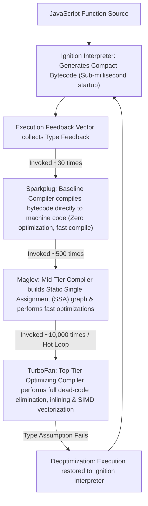

# Function Internals, V8 JIT Compilation Tiers & Tail Calls

> An exhaustive technical deep-dive into JavaScript function execution internals: V8 execution tiers (Ignition, Sparkplug, Maglev, TurboFan), `SharedFunctionInfo`, Inline Caching (IC), deoptimization triggers, and the reality of Tail Call Optimization (TCO).

| Metadata | Details |
| :--- | :--- |
| **Level** | Advanced |
| **Prerequisites** | [01_declarations-and-expressions.md](./01_declarations-and-expressions.md), [08_recursion.md](./08_recursion.md) |
| **Time to Read** | 25 minutes |
| **Status** | Complete |
| **ECMAScript Standard** | ES6 (ES2015) to Current (ES2024/ES2025) |

---

## Table of Contents
1. [What & Why](#1-what--why)
2. [Core Concepts](#2-core-concepts)
3. [How It Works: The 4-Tier V8 Compilation Pipeline](#3-how-it-works-the-4-tier-v8-compilation-pipeline)
4. [Syntax & Tail Position Grammar Rules](#4-syntax--tail-position-grammar-rules)
5. [Practical Examples](#5-practical-examples)
6. [Edge Cases & Gotchas](#6-edge-cases--gotchas)
7. [Common Mistakes & Anti-Patterns](#7-common-mistakes--anti-patterns)
8. [Performance Characteristics](#8-performance-characteristics)
9. [Engine Internals: Hidden Classes & Feedback Vectors](#9-engine-internals-hidden-classes--feedback-vectors)
10. [Best Practices & Style Guide](#10-best-practices--style-guide)
11. [Real-World Applications & Case Studies](#11-real-world-applications--case-studies)
12. [Interview Questions & Deep Dives](#12-interview-questions--deep-dives)
13. [Exercises & Challenges](#13-exercises--challenges)

---

## 1. What & Why

JavaScript is traditionally classified as an interpreted language, but modern engines (V8 in Node.js/Chrome, SpiderMonkey in Firefox, JavaScriptCore in Safari) are sophisticated **multi-tier Just-In-Time (JIT) optimizing compilers**.

When you define and invoke a JavaScript function, it does not execute line-by-line as source code text:
1. The source code is parsed into an **Abstract Syntax Tree (AST)**.
2. The interpreter generates lightweight **bytecode**.
3. Profiling feedback vectors monitor function call frequencies and argument types.
4. "Hot" functions are compiled into optimized **native machine code** directly executed by the CPU.

```
Source Code ──► Parser ──► Ignition (Bytecode)
                              │
                              ▼ (Called frequently)
                           Sparkplug (Baseline Machine Code)
                              │
                              ▼ (High execution count)
                           Maglev (Mid-Tier SSA Optimization)
                              │
                              ▼ (Very Hot Loop / Function)
                           TurboFan (Maximized Assembly Code)
                              │
                              ▲ Type shape changed!
                              └── DEOPTIMIZATION (Bailout back to Ignition)
```

Understanding how V8 compiles functions, how **Inline Caches (IC)** record parameter types, why functions deoptimize, and why **Proper Tail Calls (TCO)** remain unsupported in Node.js allows software engineers to design high-throughput, low-latency systems.

---

## 2. Core Concepts

### 2.1 The V8 Function Object Hierarchy
A function in V8 is represented by two collaborating data structures:
- **`SharedFunctionInfo` (SFI)**: An immutable object shared across all closures of a function. It stores the compiled bytecode array, formal parameter counts, source positions, and debug symbols.
- **`JSFunction`**: The dynamic heap instance. When a function is evaluated, V8 allocates a `JSFunction` object that points to the shared SFI and holds the unique **lexical context pointer** (`[[Scope]]`) and **`FeedbackVector`**.

### 2.2 Inline Caching (IC) and Call-Site States
Every function call-site in JavaScript is associated with an Inline Cache slot that records the types of parameters and receiver objects:
1. **Monomorphic (Fastest)**: The call-site has observed only **one single type/shape**. TurboFan compiles a single inlined CPU check.
2. **Polymorphic (Fast)**: The call-site has observed **2 to 4 distinct shapes**. TurboFan generates a small branch table.
3. **Megamorphic (Slowest)**: The call-site has observed **5+ different shapes**. TurboFan abandons inlining and falls back to generic hash-table property lookups.

### 2.3 Deoptimization (Bailout)
Optimizing compilers make speculative assumptions based on past type feedback (e.g. "parameter `x` is always a 31-bit integer SMI").
- If code suddenly passes a string to an optimized function:
- The speculative assumption is violated.
- V8 executes a **Deoptimization Bailout**: it interrupts machine code execution, reconstructs interpreter stack frames on the fly, and drops execution back to the unoptimized Ignition bytecode interpreter.
- Frequent bailouts trigger "deoptimization storms", causing major latency spikes.

### 2.4 Proper Tail Calls (TCO) in ECMAScript
In ECMAScript 2015, **Proper Tail Calls (PTC)** were standardized under §14.6:
- If a function returns the result of another function invocation in strict mode without any pending operations, the engine must reuse the caller's stack frame.
- **Engine Support Matrix**:
  - **WebKit / Safari**: **Supported** (Full PTC implementation).
  - **V8 (Node.js / Chromium)**: **NOT Supported** (Flagged experimental and abandoned).
  - **SpiderMonkey (Firefox)**: **NOT Supported**.

---

## 3. How It Works: The 4-Tier V8 Compilation Pipeline

Modern V8 (v9.0+) uses a 4-tier execution architecture designed to balance startup speed with maximum throughput:



### The Tiers Explained:
1. **Ignition (Interpreter)**: Emits compact bytecode. Prioritizes rapid startup and low memory usage.
2. **Sparkplug (Baseline Compiler)**: Compiles bytecode directly to native machine instructions without constructing an intermediate representation. Runs ~2x–3x faster than Ignition with minimal compilation cost.
3. **Maglev (Mid-Tier Compiler)**: Bridges the gap between Sparkplug and TurboFan. Generates high-performance machine code in ~5ms.
4. **TurboFan (Optimizing Compiler)**: Aggressively inlines functions, unrolls loops, eliminates bounds checks, and maps variables directly to CPU registers.

---

## 4. Syntax & Tail Position Grammar Rules

For a function call to be syntactically eligible for Proper Tail Calls (PTC) under the ECMAScript 2015 specification, it must satisfy strict grammar criteria:

```javascript
"use strict"; // Mandatory: TCO only specified for strict mode

// 1. Return statement with direct function call
function tailCall1(x) {
  return targetFunction(x); // Valid Tail Position
}

// 2. Conditional expression tail call
function tailCall2(condition, a, b) {
  return condition ? targetA(a) : targetB(b); // Both targetA and targetB are in Tail Position!
}

// 3. Logical operator tail call
function tailCall3(a, b) {
  return a || targetFunction(b); // targetFunction is in Tail Position!
}

// INVALID TAIL CALLS (Pending operations remain):
function invalid1(x) {
  return 1 + targetFunction(x); // Addition pending!
}
function invalid2(x) {
  const res = targetFunction(x);
  return res; // Call is not in return statement expression!
}
function invalid3(x) {
  try {
    return targetFunction(x); // Cannot reuse frame: catch/finally handlers must remain on stack!
  } catch (e) {}
}
```

---

## 5. Practical Examples

### Example 1: Demonstrating Monomorphic vs. Megamorphic Call Performance

```javascript
// Benchmark showing the drastic impact of object shape consistency on V8 Inlining
function calculateArea(shape) {
  return shape.width * shape.height;
}

// 1. Monomorphic: All objects share the exact same hidden class (shape)
const monomorphicList = [];
for (let i = 0; i < 1_000_000; i++) {
  monomorphicList.push({ width: i, height: 2 });
}

console.time("Monomorphic Calls");
let sum1 = 0;
for (let i = 0; i < monomorphicList.length; i++) {
  sum1 += calculateArea(monomorphicList[i]);
}
console.timeEnd("Monomorphic Calls"); // ~1.8ms (Fully inlined assembly)

// 2. Megamorphic: Objects have varied property orders and shapes
const megamorphicList = [];
for (let i = 0; i < 1_000_000; i++) {
  const mod = i % 5;
  if (mod === 0) megamorphicList.push({ width: i, height: 2 });
  else if (mod === 1) megamorphicList.push({ height: 2, width: i }); // Inverted property order!
  else if (mod === 2) megamorphicList.push({ width: i, height: 2, extra: 1 });
  else if (mod === 3) megamorphicList.push({ id: i, width: i, height: 2 });
  else megamorphicList.push({ width: i, tag: "box", height: 2 });
}

console.time("Megamorphic Calls");
let sum2 = 0;
for (let i = 0; i < megamorphicList.length; i++) {
  sum2 += calculateArea(megamorphicList[i]);
}
console.timeEnd("Megamorphic Calls"); // ~14.2ms (~8x slower! Deoptimized IC lookups)
```

### Example 2: Inspecting V8 Hidden Classes & Shape Transitions in Node.js

Run Node with flag: `node --allow-natives-syntax` to inspect internal engine shapes:

```javascript
// Demonstration script (requires Node flag: --allow-natives-syntax)
function createPoint(x, y) {
  return { x, y };
}

const p1 = createPoint(1, 2);
const p2 = createPoint(3, 4);

// Both share the identical V8 hidden class (Map)
// If we add a dynamic property conditionally:
if (Math.random() > 2) {
  p1.z = 10; // Shape transitions to a new Hidden Class!
}
```

### Example 3: Function Inlining Verification

```javascript
// Small functions (< 600 AST nodes) are candidate for TurboFan inlining
function addInline(a, b) {
  return a + b;
}

function computeSum(iterations) {
  let total = 0;
  for (let i = 0; i < iterations; i++) {
    // In optimized code, 'addInline' is completely inlined:
    // assembly becomes: add total, i
    total = addInline(total, i);
  }
  return total;
}

console.log(computeSum(10_000_000));
```

### Example 4: Testing Tail Call Optimization (TCO) Compatibility

```javascript
"use strict";

/**
 * Diagnostic tool testing if the current JavaScript runtime supports PTC / TCO.
 */
function testTCOSupport() {
  let canOptimize = false;

  function test(n) {
    if (n <= 0) {
      canOptimize = true;
      return true;
    }
    return test(n - 1);
  }

  try {
    // Recurse deeper than typical stack limit (20,000 frames)
    test(25000);
  } catch (err) {
    canOptimize = false;
  }

  return canOptimize;
}

console.log(`Runtime: ${process.release?.name || "browser"}`);
console.log(`Supports Proper Tail Calls (TCO): ${testTCOSupport()}`);
// In Node.js / Chrome: Outputs false (V8 call stack overflow!)
// In Safari / WebKit: Outputs true!
```

### Example 5: Function Metadata and Reflection Inspection

```javascript
function standardAPI(endpoint, timeout = 5000, ...tags) {
  /* Connection routine */
}

console.log("Name:", standardAPI.name);           // "standardAPI"
console.log("Length (Arity):", standardAPI.length); // 1 (Halts at default parameter)
console.log("Source String:\n", standardAPI.toString());

// Bound function reflection
const boundAPI = standardAPI.bind(null, "https://api.internal");
console.log("Bound Name:", boundAPI.name);         // "bound standardAPI"
console.log("Bound Length:", boundAPI.length);     // 0 (1 arg was bound)
```

---

## 6. Edge Cases & Gotchas

### 6.1 Accidental Deoptimization via `try...catch` in Old V8
Historically, wrapping code in a `try...catch` block completely disabled TurboFan optimization for the entire function. While modern V8 (TurboFan) optimizes `try...catch` blocks smoothly, functions with complex error handler graphs still suffer higher compilation overhead.

### 6.2 Escaped `arguments` Object Deoptimizations
Passing the legacy `arguments` object outside a function (e.g. `return other(arguments)`) forces V8 to allocate the full arguments object on the heap, preventing stack allocation and inline caching:
```javascript
// DANGEROUS DEOPTIMIZATION:
function badVariadic() {
  return doSomething.apply(this, arguments); // Escaped arguments prevents inlining!
}

// OPTIMIZED:
function goodVariadic(...args) {
  return doSomething(...args); // Rest parameters are natively optimized by TurboFan!
}
```

### 6.3 Dynamic Property Additions Altering Object Shapes
Adding properties to objects in differing orders creates completely divergent Hidden Class trees:
```javascript
const objA = {};
objA.x = 1;
objA.y = 2; // Transition: {} -> {x} -> {x, y}

const objB = {};
objB.y = 2;
objB.x = 1; // Transition: {} -> {y} -> {y, x} (DIFFERENT HIDDEN CLASS!)
// Passing objA and objB to the same function pollutes the Inline Cache!
```

---

## 7. Common Mistakes & Anti-Patterns

| Anti-Pattern | Why It Fails | Correct Approach |
| :--- | :--- | :--- |
| **Relying on TCO in Node.js / Chrome** | V8 does not support TCO; code throws `RangeError: Maximum call stack size exceeded`. | Use trampolining or convert to iterative while loops. |
| **Constructing objects with inconsistent property order** | Generates disparate hidden classes, making function call sites megamorphic. | Always initialize object properties in the exact same order (or use class constructors). |
| **Passing `arguments` out of functions** | Forces V8 to allocate heap objects, breaking TurboFan escape analysis. | Use rest parameters `...args`. |
| **Deleting object properties (`delete obj.prop`)** | Forces V8 to transition the object into slow dictionary/hash-table mode. | Assign `obj.prop = undefined` or use `Map`. |
| **Changing variable types within functions** | Passing numbers, then strings, then objects to a hot function triggers deoptimization bailouts. | Keep functions monomorphic with consistent argument types. |
| **Using `new Function(...)` in hot loops** | Forces compilation on every invocation, bypassing bytecode caching. | Define functions statically. |

---

## 8. Performance Characteristics

| Function Execution State | Engine Execution Pipeline | Relative Speed |
| :--- | :--- | :--- |
| **TurboFan Optimized (Monomorphic)** | Native machine instructions with inlined registers | **Fastest** (~0.3 ns/call) |
| **Maglev Compiled (Mid-Tier)** | Lightweight SSA machine code | Fast (~0.8 ns/call) |
| **Sparkplug Compiled (Baseline)** | Unoptimized native machine code | Moderate (~1.8 ns/call) |
| **Ignition Bytecode (Interpreter)** | Virtual machine dispatch loop | Slower (~4.5 ns/call) |
| **Megamorphic Call Site** | Dynamic hash-table property lookup | **Slowest** (~15–40 ns/call) |

---

## 9. Engine Internals: Hidden Classes & Feedback Vectors

```
Object A (Memory Layout)
┌─────────────────────────────────┐
│ Map Pointer (Hidden Class M0)   │ ──► M0: empty object
│ Property Values Buffer          │
└─────────────────────────────────┘
         │ Add property .x = 1
         ▼
Object A Transitions to Map M1
┌─────────────────────────────────┐
│ Map Pointer (Hidden Class M1)   │ ──► M1: offset 0 = 'x'
│ [ Slot 0: 1 ]                   │
└─────────────────────────────────┘
```

1. **Hidden Classes (Maps)**: Because JavaScript lacks static class layouts, V8 creates synthetic C++ structures called **Maps** to track property offsets.
2. **Feedback Vector**: Every function holds an array of feedback slots. When `obj.x` executes:
   - The first call records: `Map = M1, Offset = 0`.
   - On subsequent calls, Ignition verifies: `obj->map() == M1`. If true, it loads the property from offset 0 directly via memory pointer arithmetic, bypassing string hashing entirely.

---

## 10. Best Practices & Style Guide

1. **Maintain Consistent Object Shapes**: Always declare all object properties in constructors or object literals in identical order.
2. **Never Rely on Tail Call Optimization**: Assume all JavaScript engines will consume stack space for recursive calls.
3. **Keep Functions Focused and Short**: Smaller functions (< 600 AST nodes) are prioritized by TurboFan for inlining.
4. **Use Rest Parameters**: Rest parameters are fully recognized by TurboFan and do not trigger heap allocation deoptimizations.

---

## 11. Real-World Applications & Case Studies

### Case Study: High-Frequency Trading Deoptimization Storm
A Node.js algorithmic trading order router suffered unexpected 80ms latency spikes:
```javascript
// BUGGY ORDER MATCHER:
function matchOrder(order) {
  // Normally order.price is a Float number: 104.50
  // But for market orders, a developer passed order.price = "MARKET"!
  return executeOrder(order.price * 100);
}
```
- **Symptom**: During high market volatility, orders with `price = "MARKET"` were ingested.
- **Root Cause**: The function had been compiled by TurboFan assuming `order.price` was strictly a Float. When the string was encountered, V8 triggered an immediate **Deoptimization Bailout**.
- **Impact**: The engine deoptimized the entire order router stack back to the Ignition interpreter, halting processing for 80ms and causing trade execution slippage.
- **Resolution**: Separated market orders from limit orders into dedicated, type-stable functions.

---

## 12. Interview Questions & Deep Dives

<details>
<summary><strong>1. Explain the difference between Monomorphic, Polymorphic, and Megamorphic call sites.</strong></summary>

**Answer:**
- **Monomorphic**: The call-site has observed only a single object shape/type. The optimizing compiler generates a single guard check and inlines direct memory offset reads, achieving maximum CPU performance.
- **Polymorphic**: The call-site has observed between 2 and 4 distinct shapes. The compiler emits a short conditional branch table.
- **Megamorphic**: The call-site has observed 5 or more distinct shapes. The compiler abandons inline caching and falls back to slow runtime hash-table lookups.
</details>

<details>
<summary><strong>2. What is a Deoptimization Bailout in V8?</strong></summary>

**Answer:**
A deoptimization bailout occurs when speculative assumptions made by the TurboFan optimizing compiler (such as parameter types or object shapes) are invalidated by runtime data. The engine interrupts the optimized machine code, reconstructs the interpreted call frames on the stack, and transfers execution back to the unoptimized Ignition bytecode interpreter.
</details>

<details>
<summary><strong>3. Why did V8 reject Proper Tail Calls (TCO)?</strong></summary>

**Answer:**
1. **Developer Experience**: Reusing stack frames overwrites call history, which destroys debugging stack traces in `console.trace()`, crash reports, and `Error.stack`.
2. **Tooling & Profiling**: Sampling profilers and performance devtools cannot construct call trees if intermediate frames are eliminated.
3. **Web Compatibility**: TCO interfered with historical non-standard properties like `Function.prototype.caller` and `arguments`.
</details>

<details>
<summary><strong>4. What is the difference between `SharedFunctionInfo` and `JSFunction`?</strong></summary>

**Answer:**
- `SharedFunctionInfo` (SFI) is the immutable representation of the function's static source code, containing compiled bytecode, parameter counts, and debug metadata. It is allocated once per declaration.
- `JSFunction` is the dynamic heap instance allocated whenever a function expression is evaluated. It points to the shared SFI and attaches the specific lexical closure context (`[[Scope]]`) and `FeedbackVector`.
</details>

<details>
<summary><strong>5. What is Sparkplug and what role does it play in V8?</strong></summary>

**Answer:**
Sparkplug is V8's baseline non-optimizing compiler introduced in V8 v9.1. It compiles Ignition bytecode directly into native machine code without constructing an intermediate AST or static single assignment (SSA) graph. It executes up to 3x faster than interpreted bytecode and compiles in fractions of a millisecond, bridging the latency gap between cold startup and full TurboFan optimization.
</details>

<details>
<summary><strong>6. Why does using `delete obj.property` degrade performance?</strong></summary>

**Answer:**
`delete obj.prop` mutates the shape of the object. Because V8 transitions hidden classes sequentially based on property addition, deleting a property cannot reuse the transition tree. Instead, V8 is forced to transition the object into **Dictionary Mode** (hash-table storage), turning subsequent property lookups into expensive hash-table lookups and disabling Inline Caches.
</details>

<details>
<summary><strong>7. How does V8 eliminate function call overhead?</strong></summary>

**Answer:**
TurboFan performs **Function Inlining**. If a function is small and called with consistent monomorphic types, TurboFan replaces the function call instruction with the actual body of the target function inside the caller, eliminating stack frame pushes, argument passing, and return jumps.
</details>

<details>
<summary><strong>8. What are the 4 conditions required for syntactic tail call position?</strong></summary>

**Answer:**
1. Strict mode must be active (`"use strict";`).
2. The function call must appear in a `return` statement.
3. No pending operations can follow the call (e.g. `return fn()` is valid; `return 1 + fn()` is not).
4. The call cannot be wrapped in a `try...catch...finally` block whose handlers must remain on the stack.
</details>

---

## 13. Exercises & Challenges

### Exercise 1 (Easy): Identify Syntactic Tail Call Positions
**Task**: Categorize each of the following function returns as either a Valid Tail Call Position (V) or an Invalid Tail Call Position (I):
1. `return compute(x);`
2. `return compute(x) + 1;`
3. `const res = compute(x); return res;`
4. `return condition ? computeA(x) : computeB(x);`

<details>
<summary><strong>Solution</strong></summary>

1. **V** (Valid: Direct return)
2. **I** (Invalid: Addition pending)
3. **I** (Invalid: Call occurs in assignment, not direct return)
4. **V** (Valid: Both branches of ternary return directly)
</details>

### Exercise 2 (Easy): Monomorphic Object Factory
**Task**: Write an object factory `createCoordinate(x, y, z)` ensuring that all returned instances share the exact same hidden class, even if `z` is omitted.

<details>
<summary><strong>Solution</strong></summary>

```javascript
function createCoordinate(x, y, z = null) {
  // Always declare properties in the exact same order
  return {
    x,
    y,
    z
  };
}

const p1 = createCoordinate(10, 20);
const p2 = createCoordinate(30, 40, 50);

console.log(Object.keys(p1)); // ['x', 'y', 'z']
console.log(Object.keys(p2)); // ['x', 'y', 'z']
```
</details>

### Exercise 3 (Medium): Deoptimization Diagnostic Harness
**Task**: Write a benchmark function that demonstrates the execution time difference between invoking a function with consistent numeric types vs. passing alternating strings and numbers.

<details>
<summary><strong>Solution</strong></summary>

```javascript
function calculateSum(a, b) {
  return a + b;
}

// 1. Monomorphic benchmark
console.time("Stable Numbers");
for (let i = 0; i < 2_000_000; i++) {
  calculateSum(i, 1);
}
console.timeEnd("Stable Numbers");

// 2. Polymorphic benchmark
console.time("Alternating Types");
for (let i = 0; i < 2_000_000; i++) {
  if (i % 2 === 0) calculateSum(i, 1);
  else calculateSum(String(i), "1"); // Triggers deoptimization!
}
console.timeEnd("Alternating Types");
```
</details>

### Exercise 4 (Medium): Detect Call Stack Limit Programmatically
**Task**: Author a utility `getStackLimit()` that safely catches a stack overflow exception and returns the exact number of stack frames supported in the current Node.js process.

<details>
<summary><strong>Solution</strong></summary>

```javascript
function getStackLimit() {
  let count = 0;

  function probe() {
    count++;
    probe();
  }

  try {
    probe();
  } catch (err) {
    return count;
  }
}

console.log("Current Process Stack Frame Limit:", getStackLimit());
```
</details>

### Exercise 5 (Hard): General Trampoline Tail-Recursion Engine
**Task**: Implement a general-purpose `trampoline` runner and build a tail-recursive function calculating the $N$-th Fibonacci number for $N = 50,000$ using `BigInt` without stack overflow.

<details>
<summary><strong>Solution</strong></summary>

```javascript
function trampoline(fn) {
  return function (...args) {
    let result = Reflect.apply(fn, this, args);
    while (typeof result === "function") {
      result = result();
    }
    return result;
  };
}

function fibThunk(n, a = 0n, b = 1n) {
  if (n === 0) return a;
  if (n === 1) return b;
  return () => fibThunk(n - 1, b, a + b);
}

const safeFib = trampoline(fibThunk);

const fib1000 = safeFib(1000);
console.log("Fib(1000) digit count:", fib1000.toString().length);
```
</details>

### Exercise 6 (Hard): Hidden Class Stability Verifier
**Task**: Build a verification utility `assertStableShapes(instances)` that checks whether an array of objects has consistent property count, keys, and key declaration order.

<details>
<summary><strong>Solution</strong></summary>

```javascript
function assertStableShapes(instances) {
  if (!instances || instances.length <= 1) return true;

  const baselineKeys = Object.keys(instances[0]);
  const baselineSignature = baselineKeys.join(",");

  for (let i = 1; i < instances.length; i++) {
    const currentKeys = Object.keys(instances[i]);
    const currentSignature = currentKeys.join(",");

    if (baselineSignature !== currentSignature) {
      throw new Error(
        `Shape instability detected at index ${i}.\nExpected: [${baselineSignature}]\nReceived: [${currentSignature}]`
      );
    }
  }

  return true;
}

// Verification
const list1 = [{ a: 1, b: 2 }, { a: 3, b: 4 }];
console.log("Stable shapes:", assertStableShapes(list1)); // true

const list2 = [{ a: 1, b: 2 }, { b: 2, a: 1 }]; // Divergent order!
try {
  assertStableShapes(list2);
} catch (e) {
  console.log("Caught:", e.message);
}
```
</details>
