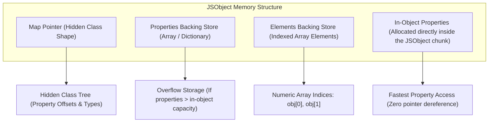

# Objects, Property Storage & Prototypal Foundations

> An exhaustive technical reference on JavaScript objects: literal syntax, bracket notation, computed property names, `Object.create(null)` dictionaries, `Object.hasOwn` vs `in`, and V8 in-object property layouts.

| Metadata | Details |
| :--- | :--- |
| **Level** | Beginner to Intermediate |
| **Prerequisites** | [01_fundamentals/02_data-types.md](../01_fundamentals/02_data-types.md), [01_fundamentals/04_operators.md](../01_fundamentals/04_operators.md) |
| **Time to Read** | 25 minutes |
| **Status** | Complete |
| **ECMAScript Standard** | ES6 (ES2015) to Current (ES2024/ES2025) |

---

## Table of Contents
1. [What & Why](#1-what--why)
2. [Core Concepts](#2-core-concepts)
3. [How It Works: V8 Object Storage & Hidden Classes](#3-how-it-works-v8-object-storage--hidden-classes)
4. [Syntax & API Reference](#4-syntax--api-reference)
5. [Practical Examples](#5-practical-examples)
6. [Edge Cases & Gotchas](#6-edge-cases--gotchas)
7. [Common Mistakes & Anti-Patterns](#7-common-mistakes--anti-patterns)
8. [Performance Characteristics](#8-performance-characteristics)
9. [Engine Internals: In-Object vs. Dictionary Properties](#9-engine-internals-in-object-vs-dictionary-properties)
10. [Best Practices & Style Guide](#10-best-practices--style-guide)
11. [Real-World Applications & Case Studies](#11-real-world-applications--case-studies)
12. [Interview Questions & Deep Dives](#12-interview-questions--deep-dives)
13. [Exercises & Challenges](#13-exercises--challenges)

---

## 1. What & Why

In JavaScript, nearly everything that is not an immutable primitive is an **Object**. An object is a mutable collection of keyed properties and methods stored on the heap and passed by memory reference pointer.

Object keys can only be of two types:
1. **Strings** (UTF-16 text).
2. **Symbols** (Unique primitive tokens).

```
┌────────────────────────────────────────────────────────┐
│                   JavaScript Object                    │
│                                                        │
│   Keys: Strings or Symbols                             │
│   Values: Any JavaScript value (primitives or objects) │
│                                                        │
│   Internal State:                                      │
│   • [[Prototype]] pointer (links to parent object)     │
│   • [[Extensible]] boolean (can add new keys?)         │
│   • Map pointer (V8 Hidden Class tracking layout)      │
└────────────────────────────────────────────────────────┘
```

Objects act as the primary structural abstraction in JavaScript, serving as records, hash maps, associative dictionaries, classes, and namespaces. Understanding object instantiation patterns, prototype resolution, and engine layout differences is critical for writing secure, leak-free, high-throughput software.

---

## 2. Core Concepts

### 2.1 Object Instantiation Mechanisms
1. **Object Literal (`{}`)**: The most concise and optimized syntax for constructing objects.
2. **`Object.create(proto)`**: Creates a new object inheriting directly from `proto`.
3. **`Object.create(null)`**: Creates a **bare dictionary** with **no prototype** (`Object.getPrototypeOf(obj) === null`). It lacks `toString`, `valueOf`, and `hasOwnProperty`, making it 100% immune to prototype pollution security exploits.
4. **Constructor Invocation (`new Constructor()`)**: Constructs an object whose prototype links to `Constructor.prototype`.

### 2.2 Dot Notation vs. Bracket Notation
- **Dot Notation (`obj.prop`)**: Requires the key to be a valid, unreserved JavaScript identifier known at author-time.
- **Bracket Notation (`obj[expression]`)**: Accepts arbitrary expressions. Any non-symbol value passed into the brackets is **automatically coerced to a string via `ToString`**:
  ```javascript
  const obj = {};
  obj[1] = "one";          // Coerces 1 -> "1"
  obj[{}] = "objectKey";   // Coerces {} -> "[object Object]"
  console.log(obj["1"]);   // "one"
  console.log(obj["[object Object]"]); // "objectKey"
  ```

### 2.3 Property Existence: `Object.hasOwn` vs. `in` vs. `hasOwnProperty`
- **`key in obj`**: Returns `true` if `key` exists as an **own property** on `obj` OR anywhere along its **prototype chain**.
- **`Object.hasOwn(obj, key)` (ES2022 Standard)**: Returns `true` **only** if `key` is an own property directly attached to `obj`. It works safely even on prototype-less `Object.create(null)` objects.
- **`obj.hasOwnProperty(key)` (Legacy)**: Fails if the object has no prototype (`Object.create(null)`) or if the property name `"hasOwnProperty"` was shadowed or overwritten on the object.

```javascript
const proto = { inheritedProp: "hello" };
const child = Object.create(proto);
child.ownProp = "world";

console.log("ownProp" in child);        // true
console.log("inheritedProp" in child);  // true (Found on prototype!)

console.log(Object.hasOwn(child, "ownProp"));        // true
console.log(Object.hasOwn(child, "inheritedProp"));  // false (Ignored!)
```

### 2.4 Property Deletion (`delete`)
The `delete obj.key` operator removes a property from an object.
- Returns `true` if the property was successfully removed, or if the property did not exist in the first place.
- Returns `false` (or throws `TypeError` in strict mode) if the property is **non-configurable**.
- **Engine Warning**: Deleting properties mutates the object's hidden class shape, converting it into a slower dictionary mode in V8.

---

## 3. How It Works: V8 Object Storage & Hidden Classes

At the engine level, V8 does not store objects as simple hash tables. To optimize memory usage and CPU caching, V8 divides property storage into three internal tiers:



1. **In-Object Properties**: Stored directly in the same contiguous memory chunk as the `JSObject` header. Accessing them requires zero pointer indirection (~0.3 ns).
2. **Fast Properties**: Stored in a separate contiguous array pointed to by the object header. Offsets are tracked by the object's Hidden Class.
3. **Slow Properties (Dictionary Mode)**: If properties are dynamically deleted (`delete obj.prop`) or excessive properties (>1,024) are added, V8 downgrades the object to a hash-table dictionary backing store, degrading lookup speeds.

---

## 4. Syntax & API Reference

### ES6+ Object Literal Enhancements

```javascript
const handle = "ada";
const roleKey = "user_role";

const user = {
  // 1. Shorthand Property Names (identifier matches variable)
  handle, // Equivalent to handle: handle

  // 2. Computed Property Names (evaluated expression in brackets)
  [roleKey]: "administrator",
  [`meta_${Date.now()}`]: true,

  // 3. Concise Method Definition
  greet(greeting) {
    return `${greeting}, ${this.handle}`;
  },

  // 4. Getter and Setter Accessors
  get uppercaseHandle() {
    return this.handle.toUpperCase();
  }
};
```

---

## 5. Practical Examples

### Example 1: Safe Prototype-Less Dictionary (Defending Prototype Pollution)

Standard object literals inherit from `Object.prototype`, which leaves them vulnerable to prototype pollution when parsing malicious JSON:

```javascript
// DANGEROUS: Standard object inherits Object.prototype
const insecureDict = {};
console.log("toString" in insecureDict); // true (Inherited from prototype!)

// SECURE: Prototype-less dictionary
const secureDict = Object.create(null);
console.log("toString" in secureDict); // false!
console.log(Object.getPrototypeOf(secureDict)); // null

// Storing arbitrary user keys safely:
secureDict["admin"] = true;
secureDict["__proto__"] = "harmless string"; // Treated as a plain string key, NOT a prototype mutation!

console.log(Object.hasOwn(secureDict, "admin")); // true
console.log(secureDict["__proto__"]); // "harmless string"
```

### Example 2: Dynamic Object Builder Using Computed Keys and Shorthand

```javascript
/**
 * Assembles dynamic query filter criteria.
 * @param {string} field
 * @param {"eq" | "gt" | "lt"} operator
 * @param {unknown} value
 */
function buildQueryFilter(field, operator, value) {
  const operatorMap = { eq: "$eq", gt: "$gt", lt: "$lt" };
  const mongoOp = operatorMap[operator] ?? "$eq";

  return {
    timestamp: Date.now(),
    filter: {
      [field]: {
        [mongoOp]: value
      }
    }
  };
}

console.log(JSON.stringify(buildQueryFilter("age", "gt", 21)));
// {"timestamp":1700000000000,"filter":{"age":{"$gt":21}}}
```

### Example 3: Property Existence Verification Comparison

```javascript
const base = { theme: "light" };
const settings = Object.create(base);
settings.timeout = 5000;
settings.retries = undefined; // Property EXISTS, but value is undefined!

// 1. Truthiness Check (FLAWED)
// Fails when property is falsy, and cannot detect keys holding 'undefined'
console.log("Truthiness check:", Boolean(settings.retries)); // false (Misleading!)

// 2. 'in' Operator (Checks Own + Prototype Chain)
console.log("'theme' in settings:", "theme" in settings);     // true (Found on base!)
console.log("'retries' in settings:", "retries" in settings); // true

// 3. Object.hasOwn (Checks ONLY Own Properties)
console.log("hasOwn 'theme':", Object.hasOwn(settings, "theme"));     // false (Inherited!)
console.log("hasOwn 'retries':", Object.hasOwn(settings, "retries")); // true (Own key exists!)
console.log("hasOwn 'missing':", Object.hasOwn(settings, "missing")); // false
```

### Example 4: Deep Property Sanitizer Without Triggering Slow Mode

Instead of using `delete obj.key` (which triggers V8 dictionary mode), build a clean sanitized object:

```javascript
/**
 * Omits specified keys from an object by creating a shallow projection.
 * @param {Record<string, unknown>} source
 * @param {string[]} keysToOmit
 */
function omitKeys(source, keysToOmit) {
  const omitSet = new Set(keysToOmit);
  const sanitized = {};

  for (const [key, value] of Object.entries(source)) {
    if (!omitSet.has(key)) {
      sanitized[key] = value;
    }
  }

  return sanitized;
}

const rawUser = { id: 101, username: "grace", passwordHash: "0xABC99", role: "admin" };
const safeUser = omitKeys(rawUser, ["passwordHash"]);

console.log(safeUser); // { id: 101, username: 'grace', role: 'admin' }
```

### Example 5: Symbol Property Metadata Attachment

Symbols allow attaching private or non-enumerable metadata to third-party objects without collision risks:

```javascript
const METADATA = Symbol("internal.metadata");

class ServiceRegistry {
  static attachMetadata(serviceInstance, meta) {
    serviceInstance[METADATA] = {
      registeredAt: Date.now(),
      ...meta
    };
  }

  static getMetadata(serviceInstance) {
    return serviceInstance[METADATA] ?? null;
  }
}

const myService = { execute() { return true; } };
ServiceRegistry.attachMetadata(myService, { version: "2.1.0", author: "DevOps" });

// Symbols are invisible to standard iteration:
console.log("Object.keys:", Object.keys(myService)); // ['execute'] (Symbol key hidden!)
console.log("Metadata:", ServiceRegistry.getMetadata(myService));
```

---

## 6. Edge Cases & Gotchas

### 6.1 Automatic Object Key Stringification
Passing an object as an object key coerces it via `ToString()`, resulting in `"[object Object]"`:
```javascript
const map = {};
const keyA = { id: 1 };
const keyB = { id: 2 };

map[keyA] = "Value A";
map[keyB] = "Value B"; // Overwrites keyA because String(keyB) === String(keyA) === "[object Object]"!

console.log(map[keyA]); // "Value B"
// SOLUTION: Use native ECMAScript Map when keys must be objects!
```

### 6.2 `delete` Returns `true` on Missing Properties
```javascript
const obj = { active: true };
console.log(delete obj.nonExistent); // true!
```
The `delete` operator returns `true` if the property is no longer present on the target object after evaluation, which is vacuously true for properties that never existed.

### 6.3 The Shadowed `hasOwnProperty` Bug
If an API response contains a JSON key named `"hasOwnProperty"`, invoking `obj.hasOwnProperty("key")` crashes:
```javascript
const apiPayload = {
  hasOwnProperty: false,
  user: "Alice"
};

// CRASH:
// apiPayload.hasOwnProperty("user"); // TypeError: apiPayload.hasOwnProperty is not a function

// DEFENSIVE SOLUTION:
console.log(Object.hasOwn(apiPayload, "user")); // true (Safe!)
```

---

## 7. Common Mistakes & Anti-Patterns

| Anti-Pattern | Why It Fails | Correct Approach |
| :--- | :--- | :--- |
| **Using `delete` in hot execution loops** | Deoptimizes V8 hidden classes, turning the object into dictionary mode. | Set property to `undefined` or project with `omitKeys()`. |
| **Using plain `{}` as a dictionary for user input** | Keys like `"__proto__"` can pollute prototypes; inherits `toString`. | Use `Object.create(null)` or native `Map`. |
| **Using `obj.hasOwnProperty()`** | Crashes on `Object.create(null)` or if the property is shadowed. | Use `Object.hasOwn(obj, key)`. |
| **Checking existence with `if (obj[key])`** | Evaluates to `false` if property exists with value `0`, `""`, `false`, or `null`. | Use `Object.hasOwn(obj, key)` or `key in obj`. |
| **Assuming object keys preserve numbers** | All numeric keys are coerced to strings (`obj[10]` creates string key `"10"`). | Use `Map` if numeric keys must remain true numbers. |
| **Using objects as keys in plain `{}`** | Coerces all objects to `"[object Object]"`, overwriting values. | Use native `Map` or `WeakMap`. |

---

## 8. Performance Characteristics

In modern V8:
- **In-Object Properties**: Accessing an in-object property is an inlined direct memory offset read (~0.3 ns), identical to reading a C++ struct field.
- **Fast Properties Backing Store**: Accessing properties beyond in-object capacity requires a single pointer dereference (~0.8 ns).
- **Dictionary Mode Properties**: Triggered by `delete` or frequent shape changes. Evaluates via hash table lookups (~15–30 ns), running up to **50x slower**.

---

## 9. Engine Internals: In-Object vs. Dictionary Properties

When V8 instantiates an object from an object literal:
1. **Initial Shape Allocation**: V8 reserves space for typically **4 in-object properties** directly inside the `JSObject` memory block.
2. **Transition Chains**: As you add properties (`obj.a = 1; obj.b = 2`), V8 creates a linked chain of Hidden Classes (`Map0 -> Map1 -> Map2`).
3. **Property Backing Store**: If you add a 5th property, V8 allocates a separate `NameDictionary` or `FixedArray` heap buffer to store the overflow properties.
4. **Dictionary Mode Trigger**: Calling `delete obj.a` breaks the transition chain. V8 converts the entire object into a `NameDictionary`, discarding the Hidden Class.

---

## 10. Best Practices & Style Guide

1. **Always Use `Object.hasOwn`**: Replace all calls to `hasOwnProperty` and `in` with `Object.hasOwn(obj, key)` when inspecting own properties.
2. **Use `Object.create(null)` for Dictionaries**: When mapping dynamic string keys (e.g. word counts, HTTP headers), use `Object.create(null)` to eliminate prototype inheritance bugs.
3. **Avoid `delete` on Long-Lived Objects**: Prefer constructing a new sanitized object or assigning `null`/`undefined`.
4. **Use ES6 Property Shorthand**: Keep declarations clean and readable: `{ name, email }`.

---

## 11. Real-World Applications & Case Studies

### Case Study: Node.js Prototype Pollution Vulnerability (CVE-2018-3721)
A popular deep-assignment utility library recursively assigned parsed query strings to objects:
```javascript
function unsafeMerge(target, source) {
  for (const key of Object.keys(source)) {
    if (typeof source[key] === "object") {
      target[key] = target[key] || {};
      unsafeMerge(target[key], source[key]);
    } else {
      target[key] = source[key];
    }
  }
}
```
- **Vulnerability**: An attacker sent JSON containing `{"__proto__": {"isAdmin": true}}`.
- **Exploitation**: `target["__proto__"]` accessed `Object.prototype`. The merge assigned `Object.prototype.isAdmin = true`.
- **Impact**: Every single object created across the entire Node.js server suddenly had `obj.isAdmin === true`, granting unauthorized root access to all unauthenticated requests.
- **Remediation**: Guard against prototype injection:
  ```javascript
  if (key === "__proto__" || key === "constructor" || key === "prototype") continue;
  ```

---

## 12. Interview Questions & Deep Dives

<details>
<summary><strong>1. What is the difference between `Object.hasOwn(obj, key)` and the `in` operator?</strong></summary>

**Answer:**
- `Object.hasOwn(obj, key)` (ES2022) checks **only** if the specified property exists directly on the object itself as an "own" property. It ignores properties that exist on the prototype chain.
- The `in` operator checks both the object itself **and its entire prototype chain** all the way up to `Object.prototype`. For example, `"toString" in {}` is `true`, whereas `Object.hasOwn({}, "toString")` is `false`.
</details>

<details>
<summary><strong>2. Why was `Object.hasOwn()` introduced to replace `obj.hasOwnProperty()`?</strong></summary>

**Answer:**
`obj.hasOwnProperty()` has two major structural flaws:
1. It fails with `TypeError: obj.hasOwnProperty is not a function` on prototype-less objects created via `Object.create(null)`.
2. It can be shadowed or overwritten if an object has a custom property named `"hasOwnProperty"` (e.g. from an API response).
`Object.hasOwn()` is a static method on the `Object` constructor that safely inspects any object without relying on methods on its prototype.
</details>

<details>
<summary><strong>3. What happens under the hood when a numeric key is added to an object?</strong></summary>

**Answer:**
In JavaScript, all object property keys are internally converted to strings or symbols. Writing `obj[10] = "val"` converts the number `10` to the string `"10"`.

However, inside V8, numeric index keys are stored in a separate internal buffer called the **Elements Backing Store**, while string keys are stored in the **Properties Backing Store**. This separation allows V8 to treat numeric keys as dense array indices for fast random access.
</details>

<details>
<summary><strong>4. Why is `Object.create(null)` used instead of `{}` for dictionaries?</strong></summary>

**Answer:**
Standard `{}` inherits from `Object.prototype`, meaning it contains built-in properties like `toString`, `valueOf`, and `__proto__`. If user-controlled input keys happen to match these names, lookups will return functions instead of `undefined`, and setting `__proto__` can lead to prototype pollution security vulnerabilities. `Object.create(null)` creates an object with a `null` prototype that contains zero inherited properties, providing a safe, clean dictionary.
</details>

<details>
<summary><strong>5. What is the difference between In-Object Properties and Fast Properties in V8?</strong></summary>

**Answer:**
- **In-Object Properties**: Properties stored directly inside the memory chunk of the `JSObject` itself (typically 4 properties). They require zero pointer dereference and are the fastest property reads in V8.
- **Fast Properties**: Overflow properties stored in a contiguous array pointed to by the object header. Accessing them requires one pointer dereference, and their offsets are tracked by the object's Hidden Class (Map).
</details>

<details>
<summary><strong>6. Why does `delete obj.prop` harm performance in V8?</strong></summary>

**Answer:**
V8 tracks object shapes using linear Hidden Class transitions as properties are added. When `delete obj.prop` is executed, V8 cannot easily step backwards in the transition tree. To avoid corruption, V8 transitions the object into **Dictionary Mode** (slow mode), turning all subsequent property lookups into hash-table searches and deoptimizing all inline caches that referenced the object.
</details>

<details>
<summary><strong>7. How do Computed Property Names work in ES6?</strong></summary>

**Answer:**
Computed Property Names allow bracketed expressions inside object literals: `const obj = { [expr]: value }`. The expression inside the brackets is evaluated at runtime, converted to a string (or symbol), and used as the property key during object instantiation.
</details>

<details>
<summary><strong>8. What happens when an object is used as a property key in another object?</strong></summary>

**Answer:**
The object is converted to a primitive string via `ToPrimitive(hint: "string")`, which calls `obj.toString()`. For standard objects, this returns `"[object Object]"`. Consequently, all plain objects map to the exact same string key `"[object Object]"`, causing them to overwrite each other. To use objects as distinct keys, use an ECMAScript `Map` or `WeakMap`.
</details>

---

## 13. Exercises & Challenges

### Exercise 1 (Easy): Prototype-Less Word Frequency Counter
**Task**: Write a function `countWords(text)` that splits text into words and returns a word-frequency dictionary created via `Object.create(null)` so that words like `"constructor"` or `"toString"` do not collide with prototype methods.

<details>
<summary><strong>Solution</strong></summary>

```javascript
function countWords(text) {
  const dict = Object.create(null);
  const words = text.toLowerCase().match(/\b\w+\b/g) || [];

  for (const word of words) {
    dict[word] = (dict[word] || 0) + 1;
  }

  return dict;
}

const stats = countWords("toString is a method, but toString is also a word");
console.log(stats["toString"]); // 2 (Safely counted as a number, not a function!)
```
</details>

### Exercise 2 (Easy): Safe Property Extraction
**Task**: Write a function `hasOwnProperties(obj, ...keys)` that returns `true` only if **every** provided key exists directly as an own property on `obj`, using `Object.hasOwn`.

<details>
<summary><strong>Solution</strong></summary>

```javascript
function hasOwnProperties(obj, ...keys) {
  if (obj == null) return false;
  return keys.every((key) => Object.hasOwn(obj, key));
}

const profile = { username: "ada", role: "admin" };
console.log(hasOwnProperties(profile, "username", "role")); // true
console.log(hasOwnProperties(profile, "username", "email")); // false
```
</details>

### Exercise 3 (Medium): Dynamic Prefix Filter Projector
**Task**: Build a function `filterByPrefix(obj, prefix)` that extracts all properties whose keys start with `prefix` and returns a new object with the prefix stripped from the keys.

<details>
<summary><strong>Solution</strong></summary>

```javascript
function filterByPrefix(obj, prefix) {
  const result = {};

  for (const [key, value] of Object.entries(obj)) {
    if (key.startsWith(prefix)) {
      const strippedKey = key.slice(prefix.length);
      result[strippedKey] = value;
    }
  }

  return result;
}

const config = {
  env_host: "localhost",
  env_port: 8080,
  ui_theme: "dark"
};

console.log(filterByPrefix(config, "env_"));
// Output: { host: 'localhost', port: 8080 }
```
</details>

### Exercise 4 (Medium): Prototype Pollution Defensive Sanitizer
**Task**: Write a recursive function `sanitizeJson(obj)` that deep-traverses a parsed JSON object and throws an error if any object contains forbidden prototype keys (`__proto__`, `constructor`, `prototype`).

<details>
<summary><strong>Solution</strong></summary>

```javascript
function sanitizeJson(obj) {
  if (obj === null || typeof obj !== "object") {
    return obj;
  }

  const forbiddenKeys = new Set(["__proto__", "constructor", "prototype"]);

  for (const key of Object.keys(obj)) {
    if (forbiddenKeys.has(key)) {
      throw new SecurityError(`Dangerous prototype property detected: '${key}'`);
    }
    sanitizeJson(obj[key]);
  }

  return obj;
}

// Verification
console.log(sanitizeJson({ user: { id: 1, role: "guest" } })); // Valid
try {
  sanitizeJson(JSON.parse('{"user": {"__proto__": {"admin": true}}}'));
} catch (e) {
  console.log("Security Alert:", e.message);
  // Dangerous prototype property detected: '__proto__'
}
```
</details>

### Exercise 5 (Hard): Inversion of Object Key-Value Pairs
**Task**: Write a function `invertObject(obj)` that inverts an object's keys and values. If multiple keys share the same value, group them into an array under that value.

<details>
<summary><strong>Solution</strong></summary>

```javascript
function invertObject(obj) {
  const inverted = {};

  for (const [key, val] of Object.entries(obj)) {
    const stringVal = String(val);

    if (Object.hasOwn(inverted, stringVal)) {
      if (Array.isArray(inverted[stringVal])) {
        inverted[stringVal].push(key);
      } else {
        inverted[stringVal] = [inverted[stringVal], key];
      }
    } else {
      inverted[stringVal] = key;
    }
  }

  return inverted;
}

const roles = {
  alice: "admin",
  bob: "editor",
  carol: "admin",
  dave: "viewer"
};

console.log(invertObject(roles));
// Output: { admin: ['alice', 'carol'], editor: 'bob', viewer: 'dave' }
```
</details>

### Exercise 6 (Hard): Property Access Tracker via Proxy
**Task**: Build a function `createAuditedObject(target)` using `Proxy` that tracks the access count of every property on an object, providing a `.getAuditMetrics()` method to inspect lookup frequencies.

<details>
<summary><strong>Solution</strong></summary>

```javascript
function createAuditedObject(target) {
  const metrics = new Map();

  return new Proxy(target, {
    get(obj, prop, receiver) {
      if (prop === "getAuditMetrics") {
        return () => Object.fromEntries(metrics.entries());
      }

      if (typeof prop === "string" && prop in obj) {
        metrics.set(prop, (metrics.get(prop) || 0) + 1);
      }

      return Reflect.get(obj, prop, receiver);
    }
  });
}

const monitored = createAuditedObject({ id: 100, name: "DataService", status: "online" });

monitored.id;
monitored.name;
monitored.name;
monitored.name;
monitored.status;

console.log("Audit Metrics:", monitored.getAuditMetrics());
// Output: { id: 1, name: 3, status: 1 }
```
</details>
