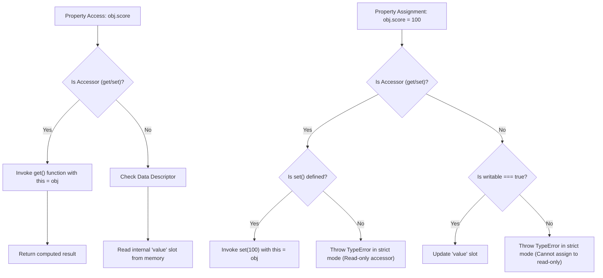

# Property Descriptors, Object Integrity & Immutability

> An exhaustive technical reference on ECMAScript property descriptors: data vs accessor descriptors, descriptor attribute defaults, `Object.defineProperty`, `Object.freeze` vs `seal`, and V8 `DescriptorArray` internals.

| Metadata | Details |
| :--- | :--- |
| **Level** | Intermediate |
| **Prerequisites** | [01_objects.md](./01_objects.md) |
| **Time to Read** | 25 minutes |
| **Status** | Complete |
| **ECMAScript Standard** | ES6 (ES2015) to Current (ES2024/ES2025) |

---

## Table of Contents
1. [What & Why](#1-what--why)
2. [Core Concepts](#2-core-concepts)
3. [How It Works: Data vs. Accessor Descriptors](#3-how-it-works-data-vs-accessor-descriptors)
4. [Syntax & Descriptor Method Reference](#4-syntax--descriptor-method-reference)
5. [Practical Examples](#5-practical-examples)
6. [Edge Cases & Gotchas](#6-edge-cases--gotchas)
7. [Common Mistakes & Anti-Patterns](#7-common-mistakes--anti-patterns)
8. [Performance Characteristics](#8-performance-characteristics)
9. [Engine Internals: V8 `DescriptorArray` & Shape Transitions](#9-engine-internals-v8-descriptorarray--shape-transitions)
10. [Best Practices & Style Guide](#10-best-practices--style-guide)
11. [Real-World Applications & Case Studies](#11-real-world-applications--case-studies)
12. [Interview Questions & Deep Dives](#12-interview-questions--deep-dives)
13. [Exercises & Challenges](#13-exercises--challenges)

---

## 1. What & Why

In JavaScript, properties are not merely static values stored in memory slots. Every property is governed by an internal record known as a **Property Descriptor**.

Property descriptors define the fundamental runtime rules for a property:
- Can this property be modified via assignment? (`writable`)
- Does this property appear in `for...in` loops, `Object.keys()`, and spread expressions? (`enumerable`)
- Can this property be deleted or its descriptor reconfigured? (`configurable`)
- Is this property backed by a stored primitive/object, or by dynamic getter/setter functions?

```
┌────────────────────────────────────────────────────────┐
│                   Property Descriptor                  │
├────────────────────────────┬────────────────────────────┤
│ Data Descriptor            │ Accessor Descriptor        │
├────────────────────────────┼────────────────────────────┤
│ • value: any value         │ • get: () => any           │
│ • writable: boolean        │ • set: (val) => void       │
│ • enumerable: boolean      │ • enumerable: boolean      │
│ • configurable: boolean    │ • configurable: boolean    │
└────────────────────────────┴────────────────────────────┘
```

Mastering property descriptors enables developers to build secure immutable data structures, hide internal library metadata, construct reactive data-binding proxies, and perform lossless object cloning.

---

## 2. Core Concepts

### 2.1 The Two Categories of Descriptors
1. **Data Descriptors**: Possess a concrete `value` property and an optional `writable` boolean flag.
2. **Accessor Descriptors**: Defined by a pair of getter (`get`) and setter (`set`) functions.
- **Mutual Exclusivity Rule**: A descriptor **cannot** contain both `value`/`writable` and `get`/`set`. Attempting to do so throws a runtime `TypeError`.

### 2.2 The Default Values Trap
The default attributes of a property depend entirely on **how** the property was declared:

| Attribute | Declared via Object Literal (`{ a: 1 }`) | Defined via `Object.defineProperty(obj, 'a', {})` |
| :--- | :---: | :---: |
| **`value`** | Assigned value | `undefined` |
| **`writable`** | **`true`** | **`false`** |
| **`enumerable`** | **`true`** | **`false`** |
| **`configurable`** | **`true`** | **`false`** |

When using `Object.defineProperty()`, any omitted boolean attribute defaults to **`false`**, resulting in an immutable, invisible, and permanent property by default.

### 2.3 The Non-Configurable Lockdown (`configurable: false`)
Setting `configurable: false` permanently locks down a property:
- You cannot delete the property (`delete obj.prop` returns `false` or throws `TypeError` in strict mode).
- You cannot change `enumerable` from `true` to `false` (or vice versa).
- You cannot change `configurable` back to `true`.
- You cannot convert between a Data descriptor and an Accessor descriptor.
- **The Only Exception**: If `writable: true`, you can change `value`, and you can flip `writable` from `true` to `false` (a one-way transition to total immutability).

### 2.4 Object Integrity Levels Compared

| Method | Can Add Props? | Can Delete Props? | Can Modify Values? | Modifies Descriptors |
| :--- | :---: | :---: | :---: | :--- |
| **Normal Object** | Yes | Yes | Yes | None |
| **`Object.preventExtensions(obj)`** | **No** | Yes | Yes | Sets internal `[[Extensible]] = false` |
| **`Object.seal(obj)`** | **No** | **No** | Yes | Sets `configurable: false` on all own keys |
| **`Object.freeze(obj)`** | **No** | **No** | **No** | Sets `configurable: false` and `writable: false` |

---

## 3. How It Works: Data vs. Accessor Descriptors



---

## 4. Syntax & Descriptor Method Reference

### Introspection & Mutation APIs

```javascript
// 1. Inspect single own property descriptor
const desc = Object.getOwnPropertyDescriptor(targetObject, "propertyName");

// 2. Inspect all own property descriptors simultaneously
const allDescriptors = Object.getOwnPropertyDescriptors(targetObject);

// 3. Define single property with explicit descriptor
Object.defineProperty(targetObject, "id", {
  value: "usr_991",
  writable: false,
  enumerable: true,
  configurable: false
});

// 4. Define multiple properties simultaneously
Object.defineProperties(targetObject, {
  name: { value: "Ada", writable: true, enumerable: true, configurable: true },
  role: { value: "admin", writable: false, enumerable: false, configurable: false }
});

// 5. Query Integrity States
Object.isExtensible(obj); // false if preventExtensions, seal, or freeze was applied
Object.isSealed(obj);     // true if non-extensible and all own props non-configurable
Object.isFrozen(obj);     // true if sealed and all data props non-writable
```

---

## 5. Practical Examples

### Example 1: Non-Enumerable Secret Keys That Survive JSON Serialization

```javascript
const userSession = {
  id: "session_001",
  username: "ada_lovelace"
};

// Attach non-enumerable secret token
Object.defineProperty(userSession, "internalToken", {
  value: "SECRET_HASH_991823",
  writable: false,
  enumerable: false, // Hidden from loops and serialization!
  configurable: false
});

// 1. Direct access works:
console.log("Direct token read:", userSession.internalToken); // "SECRET_HASH_991823"

// 2. Invisible in Object.keys():
console.log("Object.keys:", Object.keys(userSession)); // ['id', 'username']

// 3. Invisible in JSON serialization:
console.log("JSON:", JSON.stringify(userSession)); // {"id":"session_001","username":"ada_lovelace"}

// 4. Invisible in object spread:
console.log("Spread:", { ...userSession }); // { id: 'session_001', username: 'ada_lovelace' }
```

### Example 2: Perfect Object Cloning Preserving Getters, Setters & Attributes

`Object.assign()` and spread `{ ...obj }` evaluate getters and copy plain values, destroying accessor descriptors. To clone an object losslessly:

```javascript
const source = {
  firstName: "Grace",
  lastName: "Hopper",
  get fullName() {
    return `${this.firstName} ${this.lastName}`;
  }
};

// FLAWED CLONE:
const flawedClone = { ...source };
console.log(Object.getOwnPropertyDescriptor(flawedClone, "fullName"));
// { value: 'Grace Hopper', writable: true, enumerable: true, configurable: true }
// The getter was completely evaluated and collapsed into a static value!

// PERFECT CLONE:
const perfectClone = Object.create(
  Object.getPrototypeOf(source),
  Object.getOwnPropertyDescriptors(source)
);

console.log(Object.getOwnPropertyDescriptor(perfectClone, "fullName"));
// { get: [Function: get fullName], set: undefined, enumerable: true, configurable: true }
// Getters, setters, and descriptors are 100% preserved!
```

### Example 3: Dissecting `Object.freeze()` vs. `Object.seal()`

```javascript
// 1. Object.seal(): Values can change, but keys cannot be added or deleted
const sealedConfig = Object.seal({ timeout: 5000, port: 8080 });

sealedConfig.timeout = 10000; // VALID: existing values are still writable
console.log("Sealed timeout updated:", sealedConfig.timeout); // 10000

// sealedConfig.host = "localhost"; // TypeError in strict mode! Cannot add new keys.
// delete sealedConfig.port;        // TypeError in strict mode! Cannot delete keys.

// 2. Object.freeze(): Complete lockdown (seal + writable: false)
const frozenConfig = Object.freeze({ timeout: 5000, port: 8080 });

// frozenConfig.timeout = 9999; // TypeError in strict mode! Values cannot be modified.
console.log("Is sealed:", Object.isSealed(frozenConfig)); // true
console.log("Is frozen:", Object.isFrozen(frozenConfig)); // true
```

### Example 4: Creating a One-Way Lockdown Security Token

```javascript
function createSecurityContext(initialCredentials) {
  const context = {};

  // Initialize with writable: true, configurable: false
  Object.defineProperty(context, "token", {
    value: initialCredentials,
    writable: true,
    enumerable: true,
    configurable: false // Cannot be deleted or reconfigured
  });

  return {
    context,
    lockdown() {
      // The ONE permitted exception in non-configurable properties:
      // Flipping writable from true to false!
      Object.defineProperty(context, "token", {
        writable: false
      });
      console.log("[SECURITY] Token permanently locked down to read-only.");
    }
  };
}

const { context, lockdown } = createSecurityContext("INITIAL_AUTH_TOKEN");
context.token = "REFRESHED_AUTH_TOKEN"; // Works!
lockdown();

// Any future mutation fails in strict mode:
try {
  "use strict";
  context.token = "HACKED_TOKEN";
} catch (e) {
  console.log("Mutation blocked:", e.message);
  // Cannot assign to read only property 'token'
}
```

### Example 5: Reactive State Property Watcher via Descriptors

```javascript
/**
 * Intercepts property mutations and triggers change listeners.
 * @param {Object} target
 * @param {string} propKey
 * @param {Function} onChange
 */
function watchProperty(target, propKey, onChange) {
  let internalValue = target[propKey];

  Object.defineProperty(target, propKey, {
    get() {
      return internalValue;
    },
    set(newValue) {
      const oldValue = internalValue;
      if (oldValue !== newValue) {
        internalValue = newValue;
        onChange(newValue, oldValue);
      }
    },
    enumerable: true,
    configurable: true
  });
}

const state = { theme: "light" };
watchProperty(state, "theme", (newVal, oldVal) => {
  console.log(`[STATE CHANGE]: theme updated from '${oldVal}' to '${newVal}'`);
});

state.theme = "dark"; // Triggers change listener!
state.theme = "solarized";
```

---

## 6. Edge Cases & Gotchas

### 6.1 `Object.freeze` is Shallow
Freezing an object does **not** freeze nested objects:
```javascript
const user = Object.freeze({
  name: "Ada",
  preferences: { theme: "dark" }
});

// Mutating top-level fails:
// user.name = "Grace"; // TypeError in strict mode

// BUT mutating nested object SUCCEEDS:
user.preferences.theme = "light"; // Mutated without error!
console.log(user.preferences.theme); // "light"
```
**Defensive Fix**: Use recursive deep-freezing (`deepFreeze()`).

### 6.2 Descriptor Mutability Exception: `writable: true -> false`
When `configurable: false`, attempting to alter any attribute generally throws a `TypeError`. However, ECMAScript explicitly permits a single transition:
- You **can** change `writable: true` to `writable: false`.
- You **cannot** change `writable: false` back to `writable: true`.

### 6.3 Descriptors on Arrays (`length`)
Array instances possess a special property descriptor for `length`:
```javascript
console.log(Object.getOwnPropertyDescriptor([], "length"));
// { value: 0, writable: true, enumerable: false, configurable: false }
```
Because `length` is non-configurable, you cannot delete it. However, because it is `writable: true`, changing its value (`arr.length = 0`) truncates the array.

---

## 7. Common Mistakes & Anti-Patterns

| Anti-Pattern | Why It Fails | Correct Approach |
| :--- | :--- | :--- |
| **Assuming `Object.defineProperty` defaults to `true`** | Omitted attributes default to `false` (non-writable, non-enumerable). | Explicitly declare `writable: true, enumerable: true, configurable: true`. |
| **Assuming `Object.freeze()` is deep** | Nested object properties remain completely mutable. | Recursively freeze nested objects. |
| **Using `Object.assign` to clone accessors** | Evaluates getters and collapses them into plain static values. | Use `Object.create(proto, Object.getOwnPropertyDescriptors(src))`. |
| **Mixing data and accessor attributes** | Providing both `value` and `get` throws an immediate `TypeError`. | Use strictly data attributes (`value`, `writable`) OR accessors (`get`, `set`). |
| **Mutating frozen objects in non-strict mode** | Fails silently without warnings or errors, masking bugs. | Always enforce `"use strict";` or ES modules. |
| **Relying on `Object.seal()` to freeze values** | Sealed objects permit property modifications on existing keys. | Use `Object.freeze()` when value immutability is required. |

---

## 8. Performance Characteristics

In modern V8:
- **`DescriptorArray` Inlining**: Adding properties via object literals (`{ a: 1, b: 2 }`) creates shared V8 hidden classes with pre-compiled descriptor arrays.
- **`Object.defineProperty` Shape Transitions**: Dynamically invoking `Object.defineProperty` on instances after construction forces V8 to allocate distinct hidden classes, slowing down inline caching.
- **`Object.freeze()` Fast-Path**: V8 optimizes frozen objects. Once frozen, V8 transitions the hidden class to a dedicated frozen map and can elide write-barrier checks in compiled machine code.

---

## 9. Engine Internals: V8 `DescriptorArray` & Shape Transitions

When V8 constructs a Hidden Class (`Map`):
1. **The Descriptor Array**: The Map holds a pointer to a `DescriptorArray` containing metadata for all own properties (key name, offset, and descriptor flags).
2. **Flag Compression**: V8 packs `enumerable`, `writable`, and `configurable` into a single 3-bit bitmask inside the property details field.
3. **Immutability Transitions**: When `Object.freeze(obj)` is called, V8 creates a specialized Map marked with `elements_kind = PACKED_FROZEN_ELEMENTS`. Property write checks are removed from TurboFan machine code because the engine proves writes are impossible.

---

## 10. Best Practices & Style Guide

1. **Use `Object.getOwnPropertyDescriptors` for Accurate Cloning**: Always use this method when copying objects containing getters, setters, or non-enumerable properties.
2. **Explicitly Set All Descriptor Attributes**: When using `Object.defineProperty()`, never rely on implicit defaults; state `writable`, `enumerable`, and `configurable` explicitly.
3. **Deep Freeze Config Objects in Production**: Prevent configuration drift across enterprise services.
4. **Enforce Strict Mode**: Ensure unauthorized descriptor mutations throw loud errors rather than failing silently.

---

## 11. Real-World Applications & Case Studies

### Case Study: Node.js Framework Middleware Context Corruption
An open-source HTTP routing framework allowed plugins to attach data to the request context:
```javascript
// BUGGY FRAMEWORK CORE:
app.use((req, res, next) => {
  req.user = { id: 100, role: "admin" };
  next();
});
```
- **The Incident**: A third-party logging plugin contained an accidental assignment: `req.user = "admin_logged"`, completely overwriting the authentication object for downstream route handlers.
- **The Remediation**: The framework locked down core request properties using descriptors:
  ```javascript
  Object.defineProperty(req, "user", {
    value: Object.freeze({ id: 100, role: "admin" }),
    writable: false,
    configurable: false
  });
  ```
- **Outcome**: Downstream plugins could safely inspect `req.user` without any possibility of accidental reassignment or mutation.

---

## 12. Interview Questions & Deep Dives

<details>
<summary><strong>1. What are the 4 attributes of a Data Property Descriptor?</strong></summary>

**Answer:**
1. `value`: The actual JavaScript value stored in the property (defaults to `undefined`).
2. `writable`: A boolean indicating whether the property's value can be changed via assignment (defaults to `false` in `defineProperty`).
3. `enumerable`: A boolean indicating whether the property is enumerated in `for...in` loops, `Object.keys()`, and spread syntax (defaults to `false` in `defineProperty`).
4. `configurable`: A boolean indicating whether the property can be deleted and whether its descriptor attributes can be modified (defaults to `false` in `defineProperty`).
</details>

<details>
<summary><strong>2. What happens if you define both `value` and `get` in the same property descriptor?</strong></summary>

**Answer:**
The engine throws a `TypeError: Invalid property descriptor. Cannot both specify accessors and a value or writable attribute`. In ECMAScript, a property descriptor must strictly be either a **Data Descriptor** (`value`, `writable`) or an **Accessor Descriptor** (`get`, `set`). They are mutually exclusive.
</details>

<details>
<summary><strong>3. What is the difference between `Object.preventExtensions()`, `Object.seal()`, and `Object.freeze()`?</strong></summary>

**Answer:**
- `Object.preventExtensions(obj)`: Prevents new properties from being added to the object. Existing properties can still be deleted and modified.
- `Object.seal(obj)`: Prevents new properties from being added AND marks all existing own properties as `configurable: false`. Existing properties cannot be deleted, but writable values can still be changed.
- `Object.freeze(obj)`: Prevents new properties, marks all existing properties as `configurable: false`, AND marks all data properties as `writable: false`. The object becomes fully shallowly immutable.
</details>

<details>
<summary><strong>4. What is the one attribute modification allowed on a property with `configurable: false`?</strong></summary>

**Answer:**
If a property is non-configurable (`configurable: false`), you cannot alter `enumerable`, delete the property, or convert it to an accessor. However, if `writable` is currently `true`, you are permitted to change `value`, and you are permitted to transition `writable` from **`true` to `false`**. You cannot change `writable` from `false` back to `true`.
</details>

<details>
<summary><strong>5. Why does `{ ...obj }` fail to clone getter functions properly?</strong></summary>

**Answer:**
Object spread (`{ ...obj }`) and `Object.assign()` perform standard property retrieval (`[[Get]]`). When they encounter a getter property on `obj`, they invoke the getter function, retrieve its computed return value, and assign that value as a standard data property on the target object. To clone the actual getter function, you must copy descriptors using `Object.defineProperties(target, Object.getOwnPropertyDescriptors(source))`.
</details>

<details>
<summary><strong>6. Why do properties created via object literals default to `writable: true`, while properties created via `Object.defineProperty` default to `writable: false`?</strong></summary>

**Answer:**
Object literals (`{ a: 1 }`) are designed for everyday ergonomic programming where variables and properties are mutable by default. `Object.defineProperty` is an advanced metaprogramming API designed for fine-grained control; its specification mandates that any omitted boolean field defaults to `false`, providing maximum security and immutability unless explicitly overridden.
</details>

<details>
<summary><strong>7. How do you implement a true deep-freeze utility in JavaScript?</strong></summary>

**Answer:**
By recursively applying `Object.freeze()` to an object and all of its nested object properties:
```javascript
function deepFreeze(obj) {
  Object.freeze(obj);
  for (const key of Reflect.ownKeys(obj)) {
    const val = obj[key];
    if (val !== null && (typeof val === "object" || typeof val === "function") && !Object.isFrozen(val)) {
      deepFreeze(val);
    }
  }
  return obj;
}
```
</details>

<details>
<summary><strong>8. What is the descriptor for the `length` property of a function?</strong></summary>

**Answer:**
`{ value: N, writable: false, enumerable: false, configurable: true }`.
Because `writable` is `false`, `fn.length = 10` fails. But because `configurable` is `true`, its arity can be reconfigured using `Object.defineProperty(fn, "length", { value: 10 })`.
</details>

---

## 13. Exercises & Challenges

### Exercise 1 (Easy): Create a Read-Only Non-Enumerable Constant Property
**Task**: Use `Object.defineProperty` to add a property `"API_VERSION"` with value `"v2.4"` to `configObject` such that it cannot be modified, cannot be deleted, and does not show up in `Object.keys()`.

<details>
<summary><strong>Solution</strong></summary>

```javascript
const configObject = {};

Object.defineProperty(configObject, "API_VERSION", {
  value: "v2.4",
  writable: false,
  enumerable: false,
  configurable: false
});

console.log(configObject.API_VERSION); // "v2.4"
console.log(Object.keys(configObject)); // [] (Hidden!)
```
</details>

### Exercise 2 (Easy): Shallow Freeze Verification Guard
**Task**: Write a function `isShallowImmutable(obj)` that returns `true` if `obj` is non-extensible and all own properties are non-writable and non-configurable.

<details>
<summary><strong>Solution</strong></summary>

```javascript
function isShallowImmutable(obj) {
  return Object.isFrozen(obj);
}

const item = Object.freeze({ id: 10 });
console.log(isShallowImmutable(item)); // true
console.log(isShallowImmutable({ id: 10 })); // false
```
</details>

### Exercise 3 (Medium): Recursive Deep Freeze Utility
**Task**: Implement a robust `deepFreeze(obj)` function that recursively freezes an object, its nested objects, arrays, and handles circular references safely using a `WeakSet`.

<details>
<summary><strong>Solution</strong></summary>

```javascript
function deepFreeze(obj, visited = new WeakSet()) {
  if (obj === null || (typeof obj !== "object" && typeof obj !== "function")) {
    return obj;
  }

  if (visited.has(obj)) {
    return obj;
  }
  visited.add(obj);

  Object.freeze(obj);

  for (const key of Reflect.ownKeys(obj)) {
    const val = obj[key];
    if (val !== null && (typeof val === "object" || typeof val === "function")) {
      deepFreeze(val, visited);
    }
  }

  return obj;
}

const complex = {
  db: { host: "localhost", ports: [5432, 5433] }
};
deepFreeze(complex);

console.log(Object.isFrozen(complex)); // true
console.log(Object.isFrozen(complex.db)); // true
console.log(Object.isFrozen(complex.db.ports)); // true
```
</details>

### Exercise 4 (Medium): Lossless Object Cloner
**Task**: Write a function `cloneObjectWithDescriptors(target)` that creates an exact duplicate of an object, copying its prototype, all own data descriptors, accessor descriptors, and symbol properties.

<details>
<summary><strong>Solution</strong></summary>

```javascript
function cloneObjectWithDescriptors(source) {
  if (source === null || typeof source !== "object") {
    return source;
  }

  const proto = Object.getPrototypeOf(source);
  const descriptors = Object.getOwnPropertyDescriptors(source);

  return Object.create(proto, descriptors);
}

const original = {
  _val: 10,
  get val() { return this._val * 2; },
  set val(v) { this._val = v; }
};

const copy = cloneObjectWithDescriptors(original);
copy.val = 20;
console.log("Copy computed val:", copy.val); // 40 (Getters/setters preserved!)
console.log("Original _val unchanged:", original._val); // 10
```
</details>

### Exercise 5 (Hard): Secure Config Factory with Lockable Builder
**Task**: Build a `createConfigBuilder()` that allows setting properties in a fluent API (`.set(key, val)`), providing a `.lock()` method that returns a deeply frozen object whose properties are permanently non-configurable and non-writable.

<details>
<summary><strong>Solution</strong></summary>

```javascript
function createConfigBuilder() {
  const store = {};
  let locked = false;

  return {
    set(key, value) {
      if (locked) throw new Error("Cannot modify locked configuration builder");
      store[key] = value;
      return this;
    },
    lock() {
      locked = true;
      // Recursively freeze store
      const deepFreeze = (o) => {
        Object.freeze(o);
        for (const k of Reflect.ownKeys(o)) {
          if (o[k] && typeof o[k] === "object") deepFreeze(o[k]);
        }
        return o;
      };
      return deepFreeze(store);
    }
  };
}

const config = createConfigBuilder()
  .set("host", "127.0.0.1")
  .set("port", 3000)
  .set("endpoints", { auth: "/login", data: "/api" })
  .lock();

console.log("Config locked:", Object.isFrozen(config)); // true
console.log("Endpoints locked:", Object.isFrozen(config.endpoints)); // true
```
</details>

### Exercise 6 (Hard): Build a Virtual Property Model Engine
**Task**: Build an entity wrapper `defineEntity(schema, initialValues)` that validates property types upon assignment using accessor descriptors (`set`), rejecting invalid type assignments with descriptive errors.

<details>
<summary><strong>Solution</strong></summary>

```javascript
function defineEntity(schema, initialValues) {
  const entity = {};
  const values = {};

  for (const [propName, expectedType] of Object.entries(schema)) {
    Object.defineProperty(entity, propName, {
      get() {
        return values[propName];
      },
      set(newVal) {
        if (typeof newVal !== expectedType) {
          throw new TypeError(`Property '${propName}' must be of type '${expectedType}', received '${typeof newVal}'`);
        }
        values[propName] = newVal;
      },
      enumerable: true,
      configurable: false
    });

    if (propName in initialValues) {
      entity[propName] = initialValues[propName];
    }
  }

  return entity;
}

// Verification
const userSchema = {
  id: "number",
  name: "string",
  isActive: "boolean"
};

const user = defineEntity(userSchema, { id: 1, name: "Ada", isActive: true });
console.log("User name:", user.name); // "Ada"

user.name = "Grace Hopper"; // Works!
try {
  // @ts-ignore
  user.id = "not_a_number"; // Throws TypeError!
} catch (err) {
  console.log("Validation blocked:", err.message);
  // Property 'id' must be of type 'number', received 'string'
}
```
</details>
