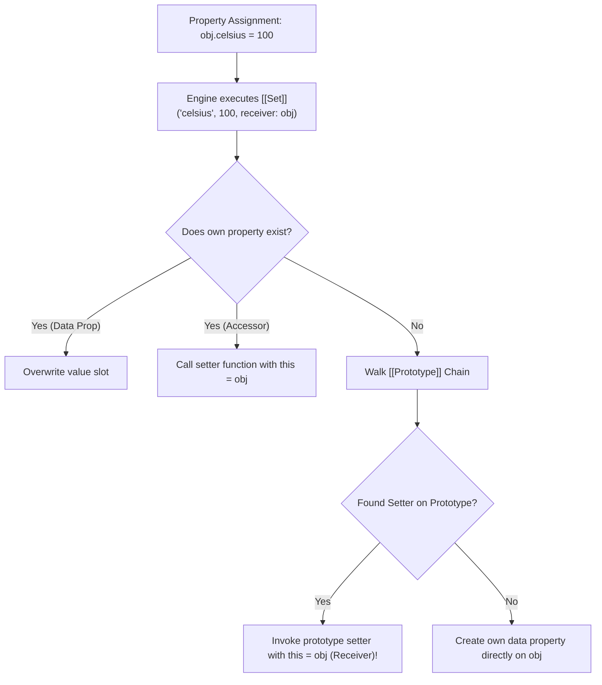

# Getters, Setters & Accessor Properties

> An exhaustive technical reference on ECMAScript accessor properties: `get` and `set` syntax, private backing fields (`#private`), lazy-evaluating memoized getters, inheritance traps, and V8 `AccessorPair` internals.

| Metadata | Details |
| :--- | :--- |
| **Level** | Intermediate |
| **Prerequisites** | [01_objects.md](./01_objects.md), [02_property-descriptors.md](./02_property-descriptors.md) |
| **Time to Read** | 25 minutes |
| **Status** | Complete |
| **ECMAScript Standard** | ES6 (ES2015) to Current (ES2024/ES2025) |

---

## Table of Contents
1. [What & Why](#1-what--why)
2. [Core Concepts](#2-core-concepts)
3. [How It Works: `[[Get]]` and `[[Set]]` Internal Slot Dispatch](#3-how-it-works-get-and-set-internal-slot-dispatch)
4. [Syntax & Implementation Reference](#4-syntax--implementation-reference)
5. [Practical Examples](#5-practical-examples)
6. [Edge Cases & Gotchas](#6-edge-cases--gotchas)
7. [Common Mistakes & Anti-Patterns](#7-common-mistakes--anti-patterns)
8. [Performance Characteristics](#8-performance-characteristics)
9. [Engine Internals: V8 `AccessorPair` & Inline Caching](#9-engine-internals-v8-accessorpair--inline-caching)
10. [Best Practices & Style Guide](#10-best-practices--style-guide)
11. [Real-World Applications & Case Studies](#11-real-world-applications--case-studies)
12. [Interview Questions & Deep Dives](#12-interview-questions--deep-dives)
13. [Exercises & Challenges](#13-exercises--challenges)

---

## 1. What & Why

In JavaScript, properties fall into two categories: **Data Properties** and **Accessor Properties**.

An **Accessor Property** executes a function when read (**getter**) or written (**setter**), while presenting the external syntactic appearance of an ordinary object field:
```javascript
const circle = {
  radius: 5,
  get area() {
    return Math.PI * this.radius ** 2;
  }
};
console.log(circle.area); // Read as a property, executed as a function! (~78.54)
```

Accessor properties provide:
- **Encapsulation & Validation**: Intercepting incoming assignments to enforce type and range boundaries.
- **Computed Virtual Fields**: Dynamically deriving state (e.g. `fullName` derived from `firstName` and `lastName`) without synchronizing stale cached values.
- **Lazy Evaluation**: Deferring heavy computational or initialization logic until the property is first accessed by consumers.
- **Reactivity**: Emitting events and notifying subscribers when state changes occur.

---

## 2. Core Concepts

### 2.1 The Getter / Setter Contract
- **Getter (`get name()`)**: Must accept **zero parameters**. Evaluated when the property is read (`obj.name`). Its return value becomes the value of the property access expression.
- **Setter (`set name(val)`)**: Must accept **exactly one parameter**. Evaluated when a value is assigned to the property (`obj.name = "val"`). Its return value is completely ignored by the engine.

### 2.2 Read-Only vs. Write-Only Properties
- **Read-Only Property**: Defined with a getter and **no setter**.
  - In non-strict mode: Assigning a new value fails silently (`obj.readOnly = 10` does nothing).
  - In strict mode: Throws a runtime `TypeError: Cannot set property X of #<Object> which has only a getter`.
- **Write-Only Property**: Defined with a setter and **no getter**. Reading the property returns `undefined`.

### 2.3 Private Backing Fields (`#field`)
To avoid infinite recursive loops when setting state, setters must store values in a separate private backing field or convention variable:
```javascript
class BankAccount {
  #balance = 0; // Private field

  get balance() {
    return this.#balance;
  }

  set balance(amount) {
    if (amount < 0) throw new RangeError("Balance cannot be negative");
    this.#balance = amount;
  }
}
```

### 2.4 Accessor Inheritance Mechanics
In JavaScript classes and prototypes, getters and setters reside on the **`prototype`**, not on individual instances.
- When `child.prop = val` is executed, the engine walks up the prototype chain, finds the setter on `Parent.prototype`, and invokes it.
- **Crucial Rule**: Inside the setter, **`this` is bound to the instance (`child`)**, not to the prototype where the setter was declared!

---

## 3. How It Works: `[[Get]]` and `[[Set]]` Internal Slot Dispatch



When an assignment occurs:
1. The engine checks the prototype chain for an accessor descriptor matching the property key.
2. If an accessor with a setter is found, the engine invokes that setter function with `this` bound to the calling object (`receiver`).
3. An assignment will **never** shadow a prototype accessor with an own data property unless `Object.defineProperty` is explicitly invoked.

---

## 4. Syntax & Implementation Reference

### Accessor Syntax Variations

```javascript
// 1. In Object Literals
const user = {
  first: "Ada",
  last: "Lovelace",
  get fullName() {
    return `${this.first} ${this.last}`;
  },
  set fullName(val) {
    [this.first, this.last] = val.split(" ");
  }
};

// 2. In ES6 Classes with Private Backing Fields
class Account {
  #status = "active";

  get status() { return this.#status; }
  set status(val) {
    if (!["active", "suspended"].includes(val)) throw new TypeError("Invalid status");
    this.#status = val;
  }

  // Static Class Accessor
  static get version() { return "3.2.0"; }
}

// 3. Via Object.defineProperty
const product = { price: 100 };
Object.defineProperty(product, "discountPrice", {
  get() { return this.price * 0.9; },
  enumerable: true,
  configurable: true
});

// 4. Computed Accessor Keys
const DYNAMIC_KEY = "computedVal";
const dynamicObj = {
  get [DYNAMIC_KEY]() { return 42; }
};
```

---

## 5. Practical Examples

### Example 1: Robust Temperature Converter with Range Validation

```javascript
class Temperature {
  #celsius;

  constructor(initialCelsius = 0) {
    this.celsius = initialCelsius; // Invokes setter validation
  }

  get celsius() {
    return this.#celsius;
  }

  set celsius(value) {
    if (typeof value !== "number" || Number.isNaN(value)) {
      throw new TypeError("Temperature must be a valid number");
    }
    if (value < -273.15) {
      throw new RangeError("Temperature cannot be below absolute zero (-273.15 °C)");
    }
    this.#celsius = value;
  }

  get fahrenheit() {
    return Number(((this.#celsius * 9) / 5 + 32).toFixed(2));
  }

  set fahrenheit(value) {
    this.celsius = ((value - 32) * 5) / 9;
  }

  get kelvin() {
    return Number((this.#celsius + 273.15).toFixed(2));
  }

  set kelvin(value) {
    this.celsius = value - 273.15;
  }
}

const boiling = new Temperature();
boiling.fahrenheit = 212;

console.log("Celsius:", boiling.celsius); // 100
console.log("Kelvin:", boiling.kelvin);   // 373.15

try {
  boiling.celsius = -300; // Below absolute zero
} catch (err) {
  console.log("Caught validation error:", err.message);
  // Temperature cannot be below absolute zero (-273.15 °C)
}
```

### Example 2: Self-Overwriting Lazy Getter (Memoization Pattern)

For expensive calculations, a getter can calculate the value once, delete itself, and re-define the property as a plain, static data value:

```javascript
class DatabaseReport {
  constructor(dataset) {
    this.dataset = dataset;
  }

  get heavySummary() {
    console.log("[EXPENSIVE COMPUTATION] Calculating statistical summary across 1M rows...");
    const total = this.dataset.reduce((a, b) => a + b, 0);
    const summaryResult = { total, avg: total / this.dataset.length };

    // Self-overwrite: Replace getter with static data property on instance!
    Object.defineProperty(this, "heavySummary", {
      value: summaryResult,
      writable: false,
      configurable: true,
      enumerable: true
    });

    return summaryResult;
  }
}

const report = new DatabaseReport([10, 20, 30, 40, 50]);

// First read: Triggers expensive calculation and rewires property:
console.log(report.heavySummary);
// Prints: [EXPENSIVE COMPUTATION] ... -> { total: 150, avg: 30 }

// Second read: Instant static data access! No function call!
console.log(report.heavySummary); // { total: 150, avg: 30 }
```

### Example 3: Inherited Accessors and the Instance `this` Binding

```javascript
class BaseEntity {
  #created = Date.now();

  get uptimeSeconds() {
    return Math.floor((Date.now() - this.#created) / 1000);
  }
}

class Microservice extends BaseEntity {
  constructor(name) {
    super();
    this.name = name;
  }
}

const service = new Microservice("AuthService");
console.log(`Service ${service.name} uptime: ${service.uptimeSeconds}s`);
// Getter lives on BaseEntity.prototype, but 'this' accurately resolves to 'service'!
```

### Example 4: DOM Style Attribute Synchronization Wrapper

```javascript
/**
 * Emulates high-level CSS style wrapper utilizing accessors.
 */
function createStyleWrapper(domElement) {
  return {
    get opacity() {
      return parseFloat(domElement.style.opacity || "1.0");
    },
    set opacity(val) {
      const num = Math.min(1.0, Math.max(0.0, val));
      domElement.style.opacity = String(num);
    },
    get isVisible() {
      return this.opacity > 0 && domElement.style.display !== "none";
    }
  };
}

// Mock DOM element
const mockElement = { style: {} };
const ui = createStyleWrapper(mockElement);

ui.opacity = 0.75;
console.log("DOM Style Opacity:", mockElement.style.opacity); // "0.75"
console.log("Is Visible:", ui.isVisible); // true
```

### Example 5: Reactive State Notifier Pattern

```javascript
/**
 * Constructs an observable state record that triggers listeners on mutation.
 */
function makeObservable(initialState, onStateChange) {
  const state = {};
  const backingStore = {};

  for (const [key, initialValue] of Object.entries(initialState)) {
    backingStore[key] = initialValue;

    Object.defineProperty(state, key, {
      get() {
        return backingStore[key];
      },
      set(newVal) {
        const oldVal = backingStore[key];
        if (oldVal !== newVal) {
          backingStore[key] = newVal;
          onStateChange(key, newVal, oldVal);
        }
      },
      enumerable: true,
      configurable: false
    });
  }

  return state;
}

const appState = makeObservable({ theme: "light", zoom: 100 }, (prop, next, prev) => {
  console.log(`[REACTIVE UPDATE] '${prop}' changed from ${prev} -> ${next}`);
});

appState.theme = "dark"; // [REACTIVE UPDATE] 'theme' changed from light -> dark
appState.zoom = 120;     // [REACTIVE UPDATE] 'zoom' changed from 100 -> 120
```

---

## 6. Edge Cases & Gotchas

### 6.1 The Recursive Setter Stack Overflow Trap
Assigning to the identical property name inside a setter causes infinite recursive invocation until crashing the stack:
```javascript
const broken = {
  // FATAL BUG:
  set name(val) {
    this.name = val; // Calls 'set name' recursively forever!
  }
};

// broken.name = "Ada"; // RangeError: Maximum call stack size exceeded!

// FIX: Use a backing property with a distinct name:
const fixed = {
  _name: "",
  set name(val) {
    this._name = val;
  }
};
```

### 6.2 Object Spread and `Object.assign` Flatten Accessors
Object spread (`{ ...obj }`) and `Object.assign()` evaluate getters and copy their static return value as a data property, stripping the accessor functionality entirely:
```javascript
const source = {
  get time() { return Date.now(); }
};

const copy = { ...source };
// 'copy.time' is now a fixed static number, not a live getter!
console.log(copy.time === copy.time); // true (Static data!)
console.log(source.time !== source.time); // true (Live getter re-evaluates!)
```

### 6.3 Async Setters Are Forbidden
Setters **cannot** be declared as `async`:
```javascript
// SYNTAX ERROR:
// class Model {
//   async set data(v) {} // SyntaxError: An accessor cannot be declared 'async'
// }
```
Setters must return synchronously. If asynchronous assignment is required, implement an explicit asynchronous method: `async setData(v)`.

---

## 7. Common Mistakes & Anti-Patterns

| Anti-Pattern | Why It Fails | Correct Approach |
| :--- | :--- | :--- |
| **Recursing in setters (`this.x = x`)** | Repeatedly triggers setter until throwing `RangeError: Maximum call stack size`. | Store state in a backing variable (`this._x` or `#x`). |
| **Expensive computations inside getters** | Callers assume property reads are cheap ($O(1)$) and call them inside loops. | Use methods (`calculateX()`) or lazy-overwriting getters. |
| **Declaring getters with parameters** | Getters take strictly zero parameters; triggers `SyntaxError`. | Use standard method syntax if parameters are required. |
| **Declaring setters with multiple parameters** | Setters accept strictly one value; triggers `SyntaxError`. | Pass an object/tuple or use standard methods. |
| **Assuming `{ ...obj }` clones accessors** | Object spread evaluates getters and flattens them to plain static data properties. | Clone using `Object.getOwnPropertyDescriptors`. |
| **Side-effects inside getters** | Reading a property should never mutate application state or trigger network I/O. | Restrict side-effects to setters or explicit methods. |

---

## 8. Performance Characteristics

In modern V8:
- **Accessor Inlining**: If a getter simply returns a private field (`get x() { return this.#x; }`), TurboFan inlines the getter into a direct assembly memory read (~0.3 ns), eliminating function call overhead.
- **Megamorphic Accessors**: If different classes define accessors with identical names at differing prototype depths, property reads can trigger deoptimizations in Inline Caches (~15 ns).
- **Lazy Getters**: Self-overwriting getters execute the slow computation once, then transition the instance to an in-object data property with raw memory read speeds.

---

## 9. Engine Internals: V8 `AccessorPair` & Inline Caching

Inside V8's heap memory:
1. **The `AccessorPair` Structure**: When an accessor property is created, V8 allocates a C++ internal `AccessorPair` object containing two heap pointers: `getter` and `setter`.
2. **Hidden Class Slot**: The Map's `DescriptorArray` stores the property key and flags it as `PropertyKind::kAccessor`, pointing to the `AccessorPair`.
3. **Inline Cache (IC) Handling**: When Ignition executes `LdaNamedProperty`:
   - It checks the IC slot.
   - If the Map has not changed, Ignition skips property dictionary searches and directly jumps to the compiled machine code address of the getter function.

---

## 10. Best Practices & Style Guide

1. **Keep Getters Pure and Fast**: Getters must be idempotent and return immediately without network latency or unexpected side-effects.
2. **Use Private Backing Fields (`#field`) in Classes**: Eliminate legacy underscore conventions (`_prop`) in favor of native ECMAScript `#` private fields.
3. **Always Pair Read-Write Properties**: If an object defines a setter, it should almost always define a matching getter.
4. **Use Explicit Methods for Async Actions**: Never attempt to run asynchronous workflows from inside setters.

---

## 11. Real-World Applications & Case Studies

### Case Study: Vue.js 2.x Reactivity System Architecture
Prior to ECMAScript Proxies in Vue 3, Vue 2 achieved fine-grained UI reactivity using `Object.defineProperty`:
```javascript
function defineReactive(obj, key, val) {
  const dep = new DependencyTracker();

  Object.defineProperty(obj, key, {
    enumerable: true,
    configurable: true,
    get() {
      // 1. Track which component relies on this property
      dep.depend();
      return val;
    },
    set(newVal) {
      if (newVal === val) return;
      val = newVal;
      // 2. Notify all dependent components to re-render!
      dep.notify();
    }
  });
}
```
- **Architectural Impact**: Whenever a developer read `this.message` in a template, the getter registered the component. Whenever `this.message = "Hello"` was assigned, the setter automatically re-rendered only the affected DOM nodes without requiring manual re-render commands.

---

## 12. Interview Questions & Deep Dives

<details>
<summary><strong>1. What happens when you assign a value to a property that only has a getter?</strong></summary>

**Answer:**
- In **non-strict mode**: The assignment fails silently. The property retains its previous value and no error is raised.
- In **strict mode** (`"use strict";` or ES Modules): The engine throws a runtime `TypeError: Cannot set property X of #<Object> which has only a getter`.
</details>

<details>
<summary><strong>2. Why can't a setter accept multiple arguments?</strong></summary>

**Answer:**
A setter is triggered by the assignment operator (`obj.prop = value`). Syntactically, the assignment operator evaluates a single right-hand expression. The ECMAScript grammar mandates that a setter declaration must accept **exactly one formal parameter**: `set name(val)`. Declaring zero or multiple parameters throws a `SyntaxError`.
</details>

<details>
<summary><strong>3. How does `this` behave when an inherited getter is accessed?</strong></summary>

**Answer:**
The getter function resides on the prototype object, but when accessed via an instance (`child.computedProp`), the ECMAScript `[[Get]]` algorithm passes the instance as the `receiver`. Consequently, inside the getter function, **`this` is bound strictly to the instance (`child`)**, not to the prototype where the getter was defined.
</details>

<details>
<summary><strong>4. What is the infinite recursion trap in setters and how do you avoid it?</strong></summary>

**Answer:**
If a setter assigns to its own property identifier (`set x(val) { this.x = val; }`), the assignment triggers the setter again, causing infinite recursive calls until the engine throws a `RangeError: Maximum call stack size exceeded`.

To avoid it, the setter must store the value in a distinct backing variable (e.g. `this.#x` or `this._x`).
</details>

<details>
<summary><strong>5. Can an accessor property be converted into a data property?</strong></summary>

**Answer:**
Yes, but **only if `configurable: true`** is set on the property descriptor. You can convert it using `Object.defineProperty`:
```javascript
Object.defineProperty(obj, "prop", {
  value: 42,
  writable: true
});
```
If `configurable: false`, attempting to convert between accessor and data descriptors throws a `TypeError`.
</details>

<details>
<summary><strong>6. How does a lazy-evaluating getter work?</strong></summary>

**Answer:**
A lazy-evaluating getter computes an expensive value upon its first read, and inside the getter body, uses `Object.defineProperty` to overwrite itself on the instance with a static data property containing the computed result. Subsequent reads access the raw cached value directly without re-invoking the getter function.
</details>

<details>
<summary><strong>7. Why can't an accessor be defined as an arrow function?</strong></summary>

**Answer:**
In object literal syntax, the `get` and `set` keywords require method definition syntax (`get prop() {}`). Arrow functions cannot be used with the `get` or `set` prefix keywords directly (`get prop: () => {}` is invalid syntax). When using `Object.defineProperty`, passing an arrow function as `get` binds `this` to the outer scope, breaking instance property access.
</details>

<details>
<summary><strong>8. What is the return value of a setter function?</strong></summary>

**Answer:**
The return value of a setter function is **completely ignored by the JavaScript engine**. An assignment expression `x = (obj.prop = 50)` always evaluates to the assigned value on the right-hand side (`50`), regardless of what the setter returns.
</details>

---

## 13. Exercises & Challenges

### Exercise 1 (Easy): Basic Full Name Accessor
**Task**: Create an object `employee` with `firstName` and `lastName` properties and an accessor `fullName` that allows reading the full name and setting it (splitting input strings by space).

<details>
<summary><strong>Solution</strong></summary>

```javascript
const employee = {
  firstName: "Grace",
  lastName: "Hopper",
  get fullName() {
    return `${this.firstName} ${this.lastName}`;
  },
  set fullName(val) {
    const parts = val.trim().split(/\s+/);
    this.firstName = parts[0] || "";
    this.lastName = parts.slice(1).join(" ") || "";
  }
};

console.log(employee.fullName); // "Grace Hopper"
employee.fullName = "Ada King Lovelace";
console.log(employee.firstName); // "Ada"
console.log(employee.lastName);  // "King Lovelace"
```
</details>

### Exercise 2 (Easy): Validated Age Setter
**Task**: Build a `User` class with a `#age` private field and an `age` accessor that ensures age is an integer between 0 and 150, throwing a `RangeError` otherwise.

<details>
<summary><strong>Solution</strong></summary>

```javascript
class User {
  #age = 0;

  get age() {
    return this.#age;
  }

  set age(value) {
    if (!Number.isInteger(value) || value < 0 || value > 150) {
      throw new RangeError("Age must be an integer between 0 and 150");
    }
    this.#age = value;
  }
}

const u = new User();
u.age = 25;
console.log("Valid age:", u.age); // 25
// u.age = -5; // Throws RangeError!
```
</details>

### Exercise 3 (Medium): Self-Overwriting Memoized Getter
**Task**: Write an object `apiClient` with a getter `authToken` that simulates an expensive authentication token fetch once, overwriting itself on the instance so subsequent reads are instant.

<details>
<summary><strong>Solution</strong></summary>

```javascript
const apiClient = {
  get authToken() {
    console.log("[AUTH] Requesting expensive crypto token from security vault...");
    const generatedToken = `TOKEN_${Date.now()}_${Math.random().toString(36).slice(2)}`;

    // Self-overwrite on instance
    Object.defineProperty(this, "authToken", {
      value: generatedToken,
      writable: false,
      configurable: true,
      enumerable: true
    });

    return generatedToken;
  }
};

console.log("Token 1:", apiClient.authToken); // Generates token & logs
console.log("Token 2:", apiClient.authToken); // Instant read, no log!
```
</details>

### Exercise 4 (Medium): Bounded Percentage Accessor
**Task**: Build an object `volumeControl` with a `level` setter that clamps any numerical assignment between `0` and `100`, ignoring non-numeric values.

<details>
<summary><strong>Solution</strong></summary>

```javascript
const volumeControl = {
  #level: 50,

  get level() {
    return this.#level;
  },

  set level(val) {
    if (typeof val !== "number" || Number.isNaN(val)) return;
    this.#level = Math.min(100, Math.max(0, val));
  }
};

volumeControl.level = 150;
console.log(volumeControl.level); // 100 (Clamped)
volumeControl.level = -20;
console.log(volumeControl.level); // 0 (Clamped)
volumeControl.level = "loud";
console.log(volumeControl.level); // 0 (Ignored non-number)
```
</details>

### Exercise 5 (Hard): Computed Multi-Unit Length Entity
**Task**: Implement a `Length` class that internally stores meters, providing synchronized accessors for `meters`, `kilometers`, `feet`, and `miles`, ensuring mutating any unit accurately updates all other units.

<details>
<summary><strong>Solution</strong></summary>

```javascript
class Length {
  #meters;

  constructor(meters = 0) {
    this.meters = meters;
  }

  get meters() {
    return this.#meters;
  }
  set meters(m) {
    if (typeof m !== "number" || m < 0) throw new TypeError("Distance must be a positive number");
    this.#meters = m;
  }

  get kilometers() {
    return this.#meters / 1000;
  }
  set kilometers(km) {
    this.meters = km * 1000;
  }

  get feet() {
    return Number((this.#meters * 3.28084).toFixed(4));
  }
  set feet(ft) {
    this.meters = ft / 3.28084;
  }

  get miles() {
    return Number((this.#meters * 0.000621371).toFixed(4));
  }
  set miles(mi) {
    this.meters = mi / 0.000621371;
  }
}

const race = new Length();
race.kilometers = 5; // 5K Run
console.log("Meters:", race.meters); // 5000
console.log("Miles:", race.miles);   // 3.1069
```
</details>

### Exercise 6 (Hard): Reactive View-Model Binder
**Task**: Build a `createViewModel(initialState, renderFn)` that defines getters and setters for all properties in `initialState`, automatically triggering `renderFn(state)` whenever any property is assigned a new value.

<details>
<summary><strong>Solution</strong></summary>

```javascript
function createViewModel(initialState, renderFn) {
  const viewModel = {};
  const data = {};

  for (const [key, value] of Object.entries(initialState)) {
    data[key] = value;

    Object.defineProperty(viewModel, key, {
      get() {
        return data[key];
      },
      set(newVal) {
        if (data[key] !== newVal) {
          data[key] = newVal;
          renderFn(viewModel);
        }
      },
      enumerable: true,
      configurable: false
    });
  }

  // Initial render
  renderFn(viewModel);
  return viewModel;
}

// Verification
let renderCount = 0;
const vm = createViewModel({ title: "Dashboard", unreadCount: 0 }, (state) => {
  renderCount++;
  console.log(`[RENDER #${renderCount}] ${state.title} (${state.unreadCount} unread)`);
});

vm.unreadCount = 5; // [RENDER #2] Dashboard (5 unread)
vm.title = "Inbox"; // [RENDER #3] Inbox (5 unread)
vm.title = "Inbox"; // No render triggered because value didn't change!
```
</details>
