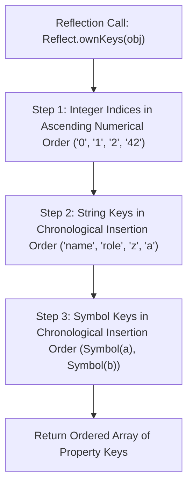

# Object Static Methods, Grouping & Metaprogramming APIs

> An exhaustive technical reference on ECMAScript static `Object` methods: `Object.groupBy` (ES2024), `fromEntries`, `assign`, reflection keys (`Reflect.ownKeys`), prototypal utilities, and performance anti-patterns.

| Metadata | Details |
| :--- | :--- |
| **Level** | Intermediate |
| **Prerequisites** | [01_objects.md](./01_objects.md), [02_property-descriptors.md](./02_property-descriptors.md) |
| **Time to Read** | 25 minutes |
| **Status** | Complete |
| **ECMAScript Standard** | ES6 (ES2015) to Current (ES2024/ES2025) |

---

## Table of Contents
1. [What & Why](#1-what--why)
2. [Core Concepts](#2-core-concepts)
3. [How It Works: Key Collection Algorithms & Property Enumeration](#3-how-it-works-key-collection-algorithms--property-enumeration)
4. [Syntax & Complete Static Methods Reference](#4-syntax--complete-static-methods-reference)
5. [Practical Examples](#5-practical-examples)
6. [Edge Cases & Gotchas](#6-edge-cases--gotchas)
7. [Common Mistakes & Anti-Patterns](#7-common-mistakes--anti-patterns)
8. [Performance Characteristics](#8-performance-characteristics)
9. [Engine Internals: Hidden Class Invalidation via `setPrototypeOf`](#9-engine-internals-hidden-class-invalidation-via-setprototypeof)
10. [Best Practices & Style Guide](#10-best-practices--style-guide)
11. [Real-World Applications & Case Studies](#11-real-world-applications--case-studies)
12. [Interview Questions & Deep Dives](#12-interview-questions--deep-dives)
13. [Exercises & Challenges](#13-exercises--challenges)

---

## 1. What & Why

The global `Object` constructor hosts a comprehensive suite of static utility and reflection methods. These methods enable metaprogramming, property introspection, functional transformations, prototype inspection, and data partitioning.

```
┌────────────────────────────────────────────────────────┐
│               Object Static Methods Suite              │
├────────────────────────────┬────────────────────────────┤
│ Inspection & Reflection    │ Mutation & Transformation  │
├────────────────────────────┼────────────────────────────┤
│ • Object.keys(obj)         │ • Object.assign(dst, ...src│
│ • Object.values(obj)       │ • Object.fromEntries(pairs)│
│ • Object.entries(obj)      │ • Object.groupBy(items, fn)│
│ • Object.hasOwn(obj, key)  │ • Object.create(proto)     │
│ • Reflect.ownKeys(obj)     │ • Object.freeze(obj)       │
└────────────────────────────┴────────────────────────────┘
```

Modern ECMAScript has continuously enhanced this suite:
- **ES2017**: Introduced `Object.values()` and `Object.entries()`.
- **ES2019**: Introduced `Object.fromEntries()`, allowing seamless round-trip functional transformations.
- **ES2022**: Introduced `Object.hasOwn()`, replacing the fragile `hasOwnProperty` prototype method.
- **ES2024**: Introduced `Object.groupBy()` and `Map.groupBy()`, eliminating third-party utility dependencies (like Lodash `groupBy`).

---

## 2. Core Concepts

### 2.1 The Inspection Methods Compared
Understanding which keys each inspection method extracts is critical:

| Method | Enumerable Strings | Non-Enumerable Strings | Symbols | Prototype Chain |
| :--- | :---: | :---: | :---: | :---: |
| **`Object.keys(obj)`** | **Yes** | No | No | No |
| **`Object.values(obj)`** | **Yes (Values)** | No | No | No |
| **`Object.entries(obj)`** | **Yes (`[k,v]`)** | No | No | No |
| **`Object.getOwnPropertyNames(obj)`** | **Yes** | **Yes** | No | No |
| **`Object.getOwnPropertySymbols(obj)`** | No | No | **Yes** | No |
| **`Reflect.ownKeys(obj)`** | **Yes** | **Yes** | **Yes** | No |
| **`for...in` loop** | **Yes** | No | No | **Yes (Walks Prototype)** |

### 2.2 `entries()` + `fromEntries()`: The Functional Round-Trip
Because plain objects lack array methods like `.map()` or `.filter()`, the canonical functional programming pattern in modern JavaScript is:
$$\text{Object} \xrightarrow{\text{Object.entries()}} \text{Array of } [k, v] \xrightarrow{\text{Array.prototype.map/filter}} \text{Transformed Array} \xrightarrow{\text{Object.fromEntries()}} \text{New Object}$$

### 2.3 Grouping Collections (`Object.groupBy` & `Map.groupBy` - ES2024)
Introduced in ECMAScript 2024, `Object.groupBy` partitions an iterable into groups based on a string or symbol grouping key returned by a callback:
```javascript
const inventory = [
  { name: "asparagus", type: "vegetables" },
  { name: "bananas", type: "fruit" },
  { name: "cherries", type: "fruit" }
];

const grouped = Object.groupBy(inventory, ({ type }) => type);
// Result is a NULL-PROTOTYPE object:
// { fruit: [{...}, {...}], vegetables: [{...}] }
```
- **Prototype Behavior**: `Object.groupBy()` creates an object with a **`null` prototype** (`Object.getPrototypeOf(res) === null`), preventing collisions with built-in properties like `"toString"` or `"constructor"`.
- **`Map.groupBy()`**: Identical to `Object.groupBy`, but returns a native `Map`, permitting arbitrary object or primitive references as keys.

### 2.4 Merging: `Object.assign` vs. Object Spread (`...`)
- `Object.assign(target, ...sources)`: Mutates `target` in-place, copies own enumerable properties from sources, and invokes setters on `target` and getters on `sources`.
- Object Spread `{ ...sourceA, ...sourceB }`: Constructs a brand-new object with prototype `Object.prototype`, without mutating any source.

---

## 3. How It Works: Key Collection Algorithms & Property Enumeration

Under the ECMAScript specification (§9.1.11 `[[OwnPropertyKeys]]`), all reflection methods follow a strictly deterministic ordering:



```javascript
const mixed = {};
mixed[Symbol("secondSym")] = 3;
mixed["beta"] = 2;
mixed[100] = 5;
mixed[1] = 4;
mixed["alpha"] = 1;
mixed[Symbol("firstSym")] = 6;

console.log(Reflect.ownKeys(mixed));
// Output: ['1', '100', 'beta', 'alpha', Symbol(secondSym), Symbol(firstSym)]
// 1. Integer keys sorted numerically: '1', '100'
// 2. String keys in insertion order: 'beta', 'alpha'
// 3. Symbol keys in insertion order: Symbol(secondSym), Symbol(firstSym)
```

---

## 4. Syntax & Complete Static Methods Reference

### Master Static API Reference

```javascript
// Inspection & Iteration
Object.keys(obj);                    // Returns string[] of own enumerable keys
Object.values(obj);                  // Returns any[] of own enumerable values
Object.entries(obj);                 // Returns [string, any][] of own enumerable entries
Object.getOwnPropertyNames(obj);     // Returns string[] of all own keys (incl. non-enumerable)
Object.getOwnPropertySymbols(obj);   // Returns symbol[] of all own symbol keys
Object.getOwnPropertyDescriptor(o,k);// Returns PropertyDescriptor of single property
Object.getOwnPropertyDescriptors(o); // Returns Record<string, PropertyDescriptor> of all props
Object.hasOwn(obj, key);             // Returns boolean (ES2022 own property check)

// Creation & Mutation
Object.assign(target, ...sources);   // Shallow copies sources into target (mutates target)
Object.fromEntries(iterablePairs);   // Creates object from [key, value] pairs or Map
Object.create(proto, descriptors);   // Creates object inheriting from proto
Object.groupBy(items, callbackFn);   // Groups iterable into null-prototype object (ES2024)

// Prototypal Reflection
Object.getPrototypeOf(obj);          // Retrieves [[Prototype]]
Object.setPrototypeOf(obj, proto);   // Modifies [[Prototype]] (PERFORMANCE DANGER!)

// Equality & Integrity
Object.is(val1, val2);               // SameValue equality check (NaN === NaN, +0 !== -0)
Object.preventExtensions(obj);       // Disallows adding new properties
Object.seal(obj);                    // Disallows add/delete; marks props non-configurable
Object.freeze(obj);                  // Disallows add/delete/mutation; shallow immutability
```

---

## 5. Practical Examples

### Example 1: ES2024 `Object.groupBy` and `Map.groupBy` in Action

```javascript
const transactions = [
  { id: "tx_1", category: "groceries", amount: 45.50 },
  { id: "tx_2", category: "utilities", amount: 120.00 },
  { id: "tx_3", category: "groceries", amount: 15.20 },
  { id: "tx_4", category: "entertainment", amount: 60.00 }
];

// 1. Object.groupBy: Group by string category
const byCategory = Object.groupBy(transactions, (tx) => tx.category);

console.log("Groceries count:", byCategory.groceries.length); // 2
console.log("Prototype check:", Object.getPrototypeOf(byCategory)); // null (Safe from collisions!)

// 2. Map.groupBy: Group by complex object ranges
const budgetRanges = {
  low: { label: "Under $50" },
  high: { label: "$50 and above" }
};

const byBudget = Map.groupBy(transactions, (tx) =>
  tx.amount < 50 ? budgetRanges.low : budgetRanges.high
);

console.log("Low spending count:", byBudget.get(budgetRanges.low).length); // 2
```

### Example 2: Filtering and Transforming Objects Functional Pipeline

```javascript
const rawInventory = {
  apples: 15,
  oranges: 0,
  bananas: 8,
  peaches: 0,
  watermelons: 3
};

// Filter out out-of-stock items and apply 20% price markup
const inStockWithMarkup = Object.fromEntries(
  Object.entries(rawInventory)
    .filter(([, stock]) => stock > 0)
    .map(([item, stock]) => [item, { quantity: stock, reorderAlert: stock < 5 }])
);

console.log(inStockWithMarkup);
// Output:
// {
//   apples: { quantity: 15, reorderAlert: false },
//   bananas: { quantity: 8, reorderAlert: false },
//   watermelons: { quantity: 3, reorderAlert: true }
// }
```

### Example 3: Converting URL Search Parameters & Maps to Objects

```javascript
// URLSearchParams -> Object
const searchParams = new URLSearchParams("page=2&sort=asc&filter=active");
const queryObj = Object.fromEntries(searchParams);
console.log("Query object:", queryObj); // { page: '2', sort: 'asc', filter: 'active' }

// Map -> Object
const configMap = new Map([
  ["host", "127.0.0.1"],
  ["port", 8080]
]);
const configObj = Object.fromEntries(configMap);
console.log("Config object:", configObj); // { host: '127.0.0.1', port: 8080 }
```

### Example 4: Complete Object Reflection Inspector

```javascript
const symId = Symbol("id");
const symTag = Symbol("tag");

const entity = Object.create({ inheritedRole: "guest" });
entity.name = "Ada";
entity[symId] = 1001;

Object.defineProperty(entity, "secretKey", {
  value: "0xFE99",
  enumerable: false
});

Object.defineProperty(entity, symTag, {
  value: "internal_tag",
  enumerable: false
});

// Comprehensive Inspector inspecting all reflection tiers:
function inspectAllKeys(target) {
  return {
    enumerableStrings: Object.keys(target),
    allStrings: Object.getOwnPropertyNames(target),
    allSymbols: Object.getOwnPropertySymbols(target),
    completeOwnKeys: Reflect.ownKeys(target)
  };
}

console.log(inspectAllKeys(entity));
// Output:
// {
//   enumerableStrings: [ 'name' ],
//   allStrings: [ 'name', 'secretKey' ],
//   allSymbols: [ Symbol(id), Symbol(tag) ],
//   completeOwnKeys: [ 'name', 'secretKey', Symbol(id), Symbol(tag) ]
// }
```

### Example 5: Safe Multi-Source Defaults Merging with `Object.assign`

```javascript
// IMPORTANT: Always pass an empty object {} as first argument to avoid mutating inputs!
function resolveApplicationSettings(userOptions) {
  const systemDefaults = {
    theme: "light",
    timeout: 3000,
    retryLimits: { attempts: 3 }
  };

  const environmentOverrides = {
    timeout: 5000
  };

  // Safe non-mutating shallow merge
  return Object.assign({}, systemDefaults, environmentOverrides, userOptions);
}

const customSettings = resolveApplicationSettings({ theme: "dark" });
console.log("Resolved Settings:", customSettings);
// { theme: 'dark', timeout: 5000, retryLimits: { attempts: 3 } }
```

---

## 6. Edge Cases & Gotchas

### 6.1 `Object.assign` Mutates the Target Argument
A classic developer mistake is omitting the target object `{}`:
```javascript
const defaults = { timeout: 1000 };
const options = { timeout: 5000 };

// DANGER: Mutates 'defaults' directly!
Object.assign(defaults, options);
console.log(defaults.timeout); // 5000 (Defaults corrupted!)

// FIX: Always pass {} as the first parameter:
// Object.assign({}, defaults, options);
```

### 6.2 `Object.groupBy` Returns a Prototype-Less Object
Because the result of `Object.groupBy()` has a `null` prototype, attempting to call methods like `.hasOwnProperty()` on it throws a `TypeError`:
```javascript
const grouped = Object.groupBy(["a", "b"], (x) => x);
// grouped.hasOwnProperty("a"); // TypeError: grouped.hasOwnProperty is not a function

// FIX: Use Object.hasOwn():
console.log(Object.hasOwn(grouped, "a")); // true (Safe!)
```

### 6.3 Primitive Coercion in Static Object Methods
In ES5, passing a primitive to `Object.keys(42)` threw a `TypeError`. In ES6+, primitives are automatically wrapped in object wrappers:
```javascript
Object.keys("hello"); // ['0', '1', '2', '3', '4'] (String indexed)
Object.keys(42);      // [] (Numbers have no own enumerable properties)
Object.keys(true);    // []
```

---

## 7. Common Mistakes & Anti-Patterns

| Anti-Pattern | Why It Fails | Correct Approach |
| :--- | :--- | :--- |
| **Mutating inputs via `Object.assign`** | Mutates the first object parameter passed to the call. | Always pass `{}` as the first target argument. |
| **Using `Object.setPrototypeOf()`** | Invalidates V8 inline caches and severely deoptimizes property lookups across the codebase. | Create objects with the desired prototype upfront via `Object.create(proto)`. |
| **Using `Object.keys()` to count all keys** | Completely omits non-enumerable properties and Symbol properties. | Use `Reflect.ownKeys(obj).length`. |
| **Checking `Object.groupBy` with `hasOwnProperty`** | Result has `null` prototype; method is missing, throwing `TypeError`. | Use `Object.hasOwn(result, key)`. |
| **Using `Object.assign` for deep merging** | Only performs shallow copying; nested objects are overwritten entirely. | Use recursive merging or `structuredClone()`. |
| **Using `fromEntries` with duplicate keys** | Later duplicate keys silently overwrite earlier ones without error. | Ensure unique keys or aggregate arrays beforehand. |

---

## 8. Performance Characteristics

In modern V8:
- **`Reflect.ownKeys` vs `Object.keys`**: `Object.keys` is heavily optimized in TurboFan; if an object is monomorphic, V8 extracts keys directly from the Hidden Class's `DescriptorArray`.
- **`Object.setPrototypeOf()` Penalty**: Known in the V8 team as a **catastrophic deoptimization trigger**. Mutating `[[Prototype]]` after object creation invalidates prototype chain Inline Caches across the entire execution isolate, degrading subsequent property lookups by up to **100x**.
- **`Object.assign` Inlining**: For 2 to 4 arguments, TurboFan inlines property copy bytecodes directly into CPU move instructions.

---

## 9. Engine Internals: Hidden Class Invalidation via `setPrototypeOf`

```
V8 Prototype Chain Inline Cache Validation:
┌─────────────────────────────┐
│ Fast Path: IC Shape Tree    │ ──► [ Cache hit: prototype offset is constant ]
└─────────────────────────────┘
               │ Object.setPrototypeOf(child, newProto) executed!
               ▼
┌─────────────────────────────┐
│ Prototype Chain Invalidated │ ──► Global IC tree flushed
│ Deoptimization Bailout      │ ──► Reverts all child lookups to slow runtime C++ calls!
└─────────────────────────────┘
```

When V8 optimizes a property lookup like `child.toString()`, it assumes the prototype chain structure is static and inlines the address of `Object.prototype.toString`. Calling `Object.setPrototypeOf()` invalidates this assumption, forcing V8 to throw away the optimized machine code for every function that ever interacted with that object hierarchy.

---

## 10. Best Practices & Style Guide

1. **Use `Object.groupBy` Over Third-Party Libraries**: Eliminate `lodash.groupBy` in favor of native `Object.groupBy` or `Map.groupBy`.
2. **Never Invoke `Object.setPrototypeOf` in Production**: Always initialize prototypes at object creation using `Object.create()` or ES6 `class extends`.
3. **Always Use `Object.hasOwn`**: Enforce the ESLint rule `prefer-object-has-own`.
4. **Use Spread for Simple Merging, `assign` for Dynamic Arrays**: Use `{ ...a, ...b }` for simple object creation; use `Object.assign({}, ...sources)` when merging a dynamic array of sources.

---

## 11. Real-World Applications & Case Studies

### Case Study: High-Volume Analytics Ingestion Degradation
A real-time telemetry processor suffered a 70% drop in event throughput:
```javascript
// BUGGY INGESTION PIPELINE:
function processTelemetryBatch(events) {
  const telemetryProto = {
    get isStale() { return Date.now() - this.timestamp > 60000; }
  };

  events.forEach((event) => {
    // DANGER: Dynamically attaching prototype to 100,000 raw JSON objects per second!
    Object.setPrototypeOf(event, telemetryProto);
  });
}
```
- **The Defect**: Invoking `Object.setPrototypeOf` 100,000 times per second continuously invalidated V8's prototype Inline Caches, trapping the entire Node.js server in a continuous deoptimization loop.
- **The Fix**: Replaced prototype reassignment with clean wrapper object instantiation using `Object.create(telemetryProto, ...)` or a class constructor `new TelemetryEvent(event)`.
- **Outcome**: Event processing throughput surged from 12,000 events/sec to 180,000 events/sec.

---

## 12. Interview Questions & Deep Dives

<details>
<summary><strong>1. Explain the difference between `Object.groupBy()` and `Map.groupBy()`.</strong></summary>

**Answer:**
Both methods were introduced in ECMAScript 2024 to partition iterables.
- `Object.groupBy(items, callback)` coerces the return value of the callback to a string or symbol property key and returns a **null-prototype object** (`Object.getPrototypeOf(res) === null`).
- `Map.groupBy(items, callback)` does not coerce keys. It preserves any arbitrary return value (including objects, numbers, booleans, or functions) as distinct keys in a native `Map`.
</details>

<details>
<summary><strong>2. In what exact order does `Reflect.ownKeys()` return property keys?</strong></summary>

**Answer:**
Per the ECMAScript specification (§9.1.11 `[[OwnPropertyKeys]]`), keys are returned strictly in three sequential tiers:
1. **Integer indices** in ascending numerical order (`"0"`, `"1"`, `"2"`).
2. **String keys** in the chronological order of their insertion.
3. **Symbol keys** in the chronological order of their insertion.
</details>

<details>
<summary><strong>3. Why is `Object.setPrototypeOf()` considered a major performance anti-pattern?</strong></summary>

**Answer:**
Modern JavaScript engines optimize property lookups by caching the structure of prototype chains in Inline Caches (ICs). Mutating an object's prototype via `Object.setPrototypeOf()` alters the internal Shape/Map tree, forcing the engine to invalidate cached prototype lookup addresses across all call sites that interact with that object family, dropping execution into slow runtime C++ routines.
</details>

<details>
<summary><strong>4. What is the difference between `Object.keys()` and `Object.getOwnPropertyNames()`?</strong></summary>

**Answer:**
- `Object.keys(obj)` returns an array of only the **own, enumerable string property keys** of an object.
- `Object.getOwnPropertyNames(obj)` returns an array of **all own string property keys**, including non-enumerable properties (such as hidden properties or non-enumerable methods). Neither method returns Symbol keys.
</details>

<details>
<summary><strong>5. How does `Object.fromEntries()` complement `Object.entries()`?</strong></summary>

**Answer:**
`Object.entries(obj)` serializes an object into an array of key-value tuples `[key, value]`. `Object.fromEntries(iterable)` performs the exact reverse transformation: it consumes an iterable of `[key, value]` pairs (such as from `Array.prototype.map()`, a `Map`, or a `URLSearchParams` instance) and constructs a brand-new plain object.
</details>

<details>
<summary><strong>6. Why does `Object.assign({}, source)` fail to perform a deep clone?</strong></summary>

**Answer:**
`Object.assign()` only performs shallow property copying. For each own enumerable key on `source`, it retrieves the value via `[[Get]]` and assigns it via `[[Set]]`. If the value is an object reference, it copies the memory pointer address, not the underlying object structure. Consequently, mutating nested objects on the cloned target will mutate the original source object.
</details>

<details>
<summary><strong>7. What happens when non-object values are passed to `Object.entries()`?</strong></summary>

**Answer:**
In ECMAScript 2015+, primitives passed to `Object.entries(val)` are automatically coerced to object wrappers.
- Strings are coerced to `String` objects, returning indices: `Object.entries("hi") -> [["0", "h"], ["1", "i"]]`.
- Numbers, booleans, and symbols return empty arrays `[]` because primitive wrappers have no own enumerable properties.
- Passing `null` or `undefined` throws a runtime `TypeError`.
</details>

<details>
<summary><strong>8. Why does `Object.groupBy()` return an object with a `null` prototype?</strong></summary>

**Answer:**
To prevent property collisions with built-in `Object.prototype` properties. If items were grouped by keys such as `"toString"`, `"valueOf"`, or `"constructor"` on an ordinary object, the grouped array would collide with or shadow existing prototype methods. A null-prototype object contains zero inherited properties, guaranteeing safe key lookups.
</details>

---

## 13. Exercises & Challenges

### Exercise 1 (Easy): Categorize Employees by Department with `Object.groupBy`
**Task**: Use ES2024 `Object.groupBy` to group an array of employee objects by their `department` field.

<details>
<summary><strong>Solution</strong></summary>

```javascript
const employees = [
  { id: 1, name: "Ada", department: "Engineering" },
  { id: 2, name: "Grace", department: "Engineering" },
  { id: 3, name: "Linus", department: "Operations" },
  { id: 4, name: "Alan", department: "Research" }
];

const grouped = Object.groupBy(employees, (emp) => emp.department);

console.log("Engineering Team:", grouped.Engineering.map((e) => e.name));
// ['Ada', 'Grace']
console.log("Operations Team:", grouped.Operations.map((e) => e.name));
// ['Linus']
```
</details>

### Exercise 2 (Easy): Safe Query String Decoder
**Task**: Write a function `parseQueryParams(queryString)` that parses a URL query string into a plain object using `URLSearchParams` and `Object.fromEntries()`.

<details>
<summary><strong>Solution</strong></summary>

```javascript
function parseQueryParams(queryString) {
  const cleanQuery = queryString.startsWith("?") ? queryString.slice(1) : queryString;
  return Object.fromEntries(new URLSearchParams(cleanQuery));
}

console.log(parseQueryParams("?sort=desc&page=3&limit=50"));
// Output: { sort: 'desc', page: '3', limit: '50' }
```
</details>

### Exercise 3 (Medium): Invert Object with Non-Destructive Key Arrays
**Task**: Build an `invertDictionary(obj)` function using `Object.entries()` and `Object.fromEntries()` that flips keys and values, grouping duplicate values into arrays.

<details>
<summary><strong>Solution</strong></summary>

```javascript
function invertDictionary(obj) {
  const grouped = {};

  for (const [key, val] of Object.entries(obj)) {
    const stringVal = String(val);
    grouped[stringVal] ??= [];
    grouped[stringVal].push(key);
  }

  // Simplify single-item arrays to single string values
  return Object.fromEntries(
    Object.entries(grouped).map(([val, keys]) => [
      val,
      keys.length === 1 ? keys[0] : keys
    ])
  );
}

const input = { a: 1, b: 2, c: 1, d: 3 };
console.log(invertDictionary(input));
// Output: { '1': ['a', 'c'], '2': 'b', '3': 'd' }
```
</details>

### Exercise 4 (Medium): Deep Defaults Fallback Merger
**Task**: Write a function `deepAssign(target, ...sources)` that recursively merges objects without mutating any source objects, correctly combining nested records.

<details>
<summary><strong>Solution</strong></summary>

```javascript
function deepAssign(target, ...sources) {
  const result = Object.assign({}, target);

  for (const source of sources) {
    if (!source || typeof source !== "object") continue;

    for (const key of Reflect.ownKeys(source)) {
      const srcVal = source[key];
      const targetVal = result[key];

      if (
        srcVal && typeof srcVal === "object" && !Array.isArray(srcVal) &&
        targetVal && typeof targetVal === "object" && !Array.isArray(targetVal)
      ) {
        result[key] = deepAssign(targetVal, srcVal);
      } else {
        result[key] = srcVal;
      }
    }
  }

  return result;
}

const defaults = { server: { host: "localhost", port: 8080 } };
const custom = { server: { port: 9000, ssl: true } };

console.log(deepAssign({}, defaults, custom));
// Output: { server: { host: 'localhost', port: 9000, ssl: true } }
```
</details>

### Exercise 5 (Hard): Map.groupBy with Custom Partitioning Buckets
**Task**: Group a collection of student exam scores into letter grades (`A: >=90`, `B: >=80`, `C: >=70`, `F: <70`) using `Map.groupBy` where keys are custom frozen grade metadata objects.

<details>
<summary><strong>Solution</strong></summary>

```javascript
const GRADES = {
  A: Object.freeze({ letter: "A", gpa: 4.0 }),
  B: Object.freeze({ letter: "B", gpa: 3.0 }),
  C: Object.freeze({ letter: "C", gpa: 2.0 }),
  F: Object.freeze({ letter: "F", gpa: 0.0 })
};

const students = [
  { name: "Alice", score: 95 },
  { name: "Bob", score: 82 },
  { name: "Carol", score: 68 },
  { name: "Dave", score: 91 },
  { name: "Eve", score: 74 }
];

const gradeMap = Map.groupBy(students, ({ score }) => {
  if (score >= 90) return GRADES.A;
  if (score >= 80) return GRADES.B;
  if (score >= 70) return GRADES.C;
  return GRADES.F;
});

console.log("Grade A Count:", gradeMap.get(GRADES.A).length); // 2
console.log("Grade A Students:", gradeMap.get(GRADES.A).map((s) => s.name)); // ['Alice', 'Dave']
```
</details>

### Exercise 6 (Hard): Universal Object Key-Type Classifier
**Task**: Build a comprehensive introspection utility `classifyObjectKeys(target)` that analyzes an object and returns all keys segmented into: `integerKeys`, `enumerableStringKeys`, `hiddenStringKeys`, `enumerableSymbolKeys`, and `hiddenSymbolKeys`.

<details>
<summary><strong>Solution</strong></summary>

```javascript
function classifyObjectKeys(target) {
  if (target == null || (typeof target !== "object" && typeof target !== "function")) {
    throw new TypeError("Target must be an object");
  }

  const allKeys = Reflect.ownKeys(target);
  const result = {
    integerKeys: [],
    enumerableStringKeys: [],
    hiddenStringKeys: [],
    enumerableSymbolKeys: [],
    hiddenSymbolKeys: []
  };

  for (const key of allKeys) {
    const desc = Object.getOwnPropertyDescriptor(target, key);

    if (typeof key === "string") {
      // Check if string is a 32-bit unsigned integer index
      if (/^(0|[1-9]\d*)$/.test(key) && Number(key) <= 2**32 - 2) {
        result.integerKeys.push(key);
      } else if (desc.enumerable) {
        result.enumerableStringKeys.push(key);
      } else {
        result.hiddenStringKeys.push(key);
      }
    } else if (typeof key === "symbol") {
      if (desc.enumerable) {
        result.enumerableSymbolKeys.push(key);
      } else {
        result.hiddenSymbolKeys.push(key);
      }
    }
  }

  return result;
}

// Verification
const sample = { 0: "zero", 10: "ten", visibleStr: "hi" };
Object.defineProperty(sample, "secretStr", { value: 123, enumerable: false });
sample[Symbol("publicSym")] = "pub";
Object.defineProperty(sample, Symbol("secretSym"), { value: 456, enumerable: false });

console.log(classifyObjectKeys(sample));
// Correctly partitions across all 5 tiers!
```
</details>
