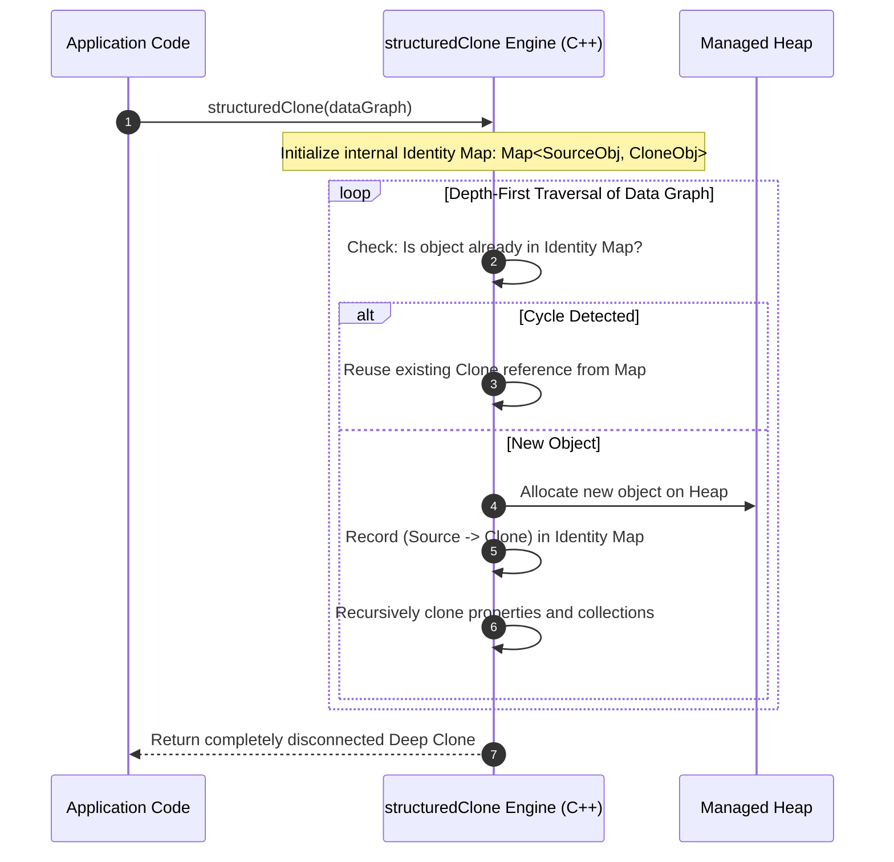

# Copying, Shallow Cloning & `structuredClone`

> An exhaustive technical reference on JavaScript copying and cloning: reference copying vs shallow cloning vs deep cloning, `structuredClone` capabilities and limitations, circular reference handling, and the JSON serialization pitfall.

| Metadata | Details |
| :--- | :--- |
| **Level** | Intermediate |
| **Prerequisites** | [01_objects.md](./01_objects.md), [02_property-descriptors.md](./02_property-descriptors.md) |
| **Time to Read** | 25 minutes |
| **Status** | Complete |
| **ECMAScript Standard** | ES6 (ES2015) to Current (ES2024/ES2025), HTML Living Standard |

---

## Table of Contents
1. [What & Why](#1-what--why)
2. [Core Concepts](#2-core-concepts)
3. [How It Works: The Structured Clone Algorithm](#3-how-it-works-the-structured-clone-algorithm)
4. [Syntax & Cloning Technique Reference](#4-syntax--cloning-technique-reference)
5. [Practical Examples](#5-practical-examples)
6. [Edge Cases & Gotchas](#6-edge-cases--gotchas)
7. [Common Mistakes & Anti-Patterns](#7-common-mistakes--anti-patterns)
8. [Performance Characteristics](#8-performance-characteristics)
9. [Engine Internals: Memory Allocation & Transferable Objects](#9-engine-internals-memory-allocation--transferable-objects)
10. [Best Practices & Style Guide](#10-best-practices--style-guide)
11. [Real-World Applications & Case Studies](#11-real-world-applications--case-studies)
12. [Interview Questions & Deep Dives](#12-interview-questions--deep-dives)
13. [Exercises & Challenges](#13-exercises--challenges)

---

## 1. What & Why

In JavaScript, primitive values are copied by **value** (creating an independent bitwise copy). In contrast, objects, arrays, and functions are copied by **reference pointer**.

When you assign an existing object to a new variable:
```javascript
const userA = { name: "Ada", tags: ["dev"] };
const userB = userA; // Reference copy!
userB.name = "Grace";
console.log(userA.name); // "Grace" (Both identifiers point to identical heap object!)
```

```
Reference Copy:
  userA ──┐
          ▼
  [ Heap Object: { name: 'Ada', tags: 0x7FFF } ] ◄── userB

Shallow Clone:
  clone ──► [ New Heap Object: { name: 'Ada', tags: 0x7FFF } ]
                                                   │
                                                   └── Points to original tags array!

Deep Clone (structuredClone):
  clone ──► [ New Heap Object: { name: 'Ada', tags: 0x9AAA } ]
                                                   │
                                                   └── Points to BRAND NEW tags array!
```

To prevent unexpected mutations, race conditions in state management, and shared-memory side effects, developers must create independent clones.

---

## 2. Core Concepts

### 2.1 The Three Tiers of Copying
1. **Reference Copy (`const b = a`)**: Zero data is copied. Only the 64-bit memory address pointer is duplicated.
2. **Shallow Clone (`{ ...a }`, `Object.assign({}, a)`)**: Duplicates the top-level object container. However, any nested objects, arrays, or dates within it **remain shared memory references**.
3. **Deep Clone (`structuredClone(a)`)**: Recursively duplicates the top-level object and all nested child structures, producing a 100% disconnected data graph.

### 2.2 The Fatal Flaws of `JSON.parse(JSON.stringify(obj))`
Historically, developers deep-cloned objects using JSON serialization. This hack possesses fatal flaws:
- **Drops Types**: `Date` objects are converted into ISO strings (`"2026-11-23T..."`).
- **Drops Values**: Properties with values of `undefined`, `Function`, or `Symbol` are **silently omitted**.
- **Corrupts Numbers**: `NaN`, `Infinity`, and `-Infinity` are converted to `null`.
- **Crashes on Cycles**: Circular references throw an immediate fatal `TypeError: Converting circular structure to JSON`.
- **Drops Collections**: `Map`, `Set`, `RegExp`, `Error`, and `ArrayBuffer` instances are collapsed into empty `{}` objects.

### 2.3 The Native `structuredClone()` Standard
Standardized in HTML and available globally in modern browsers and Node.js v17+:
- Native deep-cloning built into the C++ runtime.
- Accurately clones `Date`, `RegExp`, `Map`, `Set`, `ArrayBuffer`, `TypedArray`, `Error`, `Blob`.
- **Handles Circular References Automatically** without infinite loops.
- Supports **Transferable Objects** for zero-copy memory ownership transfers across Web Workers and threads.

---

## 3. How It Works: The Structured Clone Algorithm



The algorithm constructs an internal serialization graph. By maintaining an identity map during traversal, circular links (e.g. `node.parent.child === node`) are mirrored identically in the clone without recursing indefinitely.

---

## 4. Syntax & Cloning Technique Reference

### Feature Matrix Across Cloning Strategies

| Capability | Object Spread (`{ ...obj }`) | `Object.assign({}, obj)` | `JSON.parse(JSON.stringify(o))` | `structuredClone(obj)` |
| :--- | :---: | :---: | :---: | :---: |
| **Clone Depth** | Shallow | Shallow | Deep | **Deep** |
| **Copies Nested Objects** | No (Shared) | No (Shared) | Yes | **Yes** |
| **Preserves `Date` Objects** | Yes (Shared ref) | Yes (Shared ref) | No (Converts to String) | **Yes (New Date)** |
| **Preserves `Map` & `Set`** | Yes (Shared ref) | Yes (Shared ref) | No (Becomes `{}`) | **Yes (New Map/Set)** |
| **Handles Circular References** | Yes (Shared ref) | Yes (Shared ref) | **CRASHES (TypeError)** | **Yes (Preserves cycles)** |
| **Copies Functions** | Yes (Shared ref) | Yes (Shared ref) | No (Silently dropped) | **CRASHES (DataCloneError)** |
| **Copies Symbol Keys** | **Yes** | **Yes** | No (Silently dropped) | **No (Silently omitted)** |
| **Preserves Prototype Chain** | No (`Object.prototype`) | No (`Object.prototype`) | No (`Object.prototype`) | No (`Object.prototype`) |
| **Preserves Getters / Setters** | No (Evaluates values) | No (Evaluates values) | No (Evaluates values) | No (Evaluates values) |

---

## 5. Practical Examples

### Example 1: The Shallow Clone Mutation Trap

```javascript
const originalSettings = {
  theme: "dark",
  network: {
    timeoutMs: 3000,
    endpoints: ["/api/v1", "/api/v2"]
  }
};

// Shallow clone via object spread
const clonedSettings = { ...originalSettings };

// 1. Mutating top-level primitive is SAFE:
clonedSettings.theme = "light";
console.log("Original theme:", originalSettings.theme); // "dark" (Unchanged)

// 2. Mutating nested object CORRUPTS ORIGINAL:
clonedSettings.network.timeoutMs = 9999;
console.log("Original timeout:", originalSettings.network.timeoutMs); // 9999! (Shared reference corrupted!)

// 3. Mutating nested array CORRUPTS ORIGINAL:
clonedSettings.network.endpoints.push("/api/v3");
console.log("Original endpoints:", originalSettings.network.endpoints); // ['/api/v1', '/api/v2', '/api/v3']
```

### Example 2: Deep Cloning Complex State with `structuredClone`

```javascript
const complexState = {
  user: "Ada",
  created: new Date(1700000000000),
  regexPattern: /^user_[a-z0-9]+$/i,
  permissions: new Set(["read", "write", "admin"]),
  cache: new Map([["session_token", "ABC_9918"]]),
  intBuffer: new Int32Array([10, 20, 30])
};

// Circular reference
complexState.self = complexState;

const deepClone = structuredClone(complexState);

// Verify complete independence:
deepClone.permissions.add("delete");
deepClone.cache.set("session_token", "NEW_TOKEN");
deepClone.created.setFullYear(2099);

console.log("Original Permissions:", complexState.permissions); // Set(3) { 'read', 'write', 'admin' } (Untouched!)
console.log("Original Cache Token:", complexState.cache.get("session_token")); // "ABC_9918" (Untouched!)
console.log("Original Date:", complexState.created.getFullYear()); // 2023 (Untouched!)
console.log("Circular Reference Preserved:", deepClone.self === deepClone); // true
console.log("Circular Reference Disconnected:", deepClone.self !== complexState); // true
```

### Example 3: Zero-Copy Memory Transfers Using Transferable Objects

For high-performance graphics and worker threads, `structuredClone` supports transferring ownership of `ArrayBuffer` instances without duplicating memory bytes:

```javascript
// Allocate 16MB ArrayBuffer
const largeBuffer = new ArrayBuffer(1024 * 1024 * 16);
const view = new Uint8Array(largeBuffer);
view[0] = 42;

console.log("Byte length before transfer:", largeBuffer.byteLength); // 16777216

// Deep clone while transferring memory ownership:
const transferredClone = structuredClone(
  { buffer: largeBuffer, label: "Shared Payload" },
  { transfer: [largeBuffer] } // ArrayBuffer memory ownership transferred!
);

// The original ArrayBuffer is neutered (detached) in zero CPU cycles:
console.log("Byte length after transfer:", largeBuffer.byteLength); // 0 (Memory instantly freed!)
console.log("Clone buffer byte length:", transferredClone.buffer.byteLength); // 16777216
console.log("Clone data verified:", new Uint8Array(transferredClone.buffer)[0]); // 42
```

### Example 4: Lossless Deep Cloner Preserving Symbols and Custom Prototypes

Because `structuredClone` strips Symbols and drops custom prototypes, specialized domain models require an augmented recursive cloner:

```javascript
/**
 * Advanced recursive cloner preserving Symbol keys and prototypes.
 * @template T
 * @param {T} target
 * @param {WeakMap} [hash]
 * @returns {T}
 */
function losslessClone(target, hash = new WeakMap()) {
  if (target === null || typeof target !== "object") {
    return target;
  }

  if (target instanceof Date) return new Date(target.getTime());
  if (target instanceof RegExp) return new RegExp(target.source, target.flags);

  // Preserve circular references
  if (hash.has(target)) {
    return hash.get(target);
  }

  // Preserve original prototype
  const proto = Object.getPrototypeOf(target);
  const clone = Object.create(proto);
  hash.set(target, clone);

  // Reflect.ownKeys preserves both string and symbol keys
  for (const key of Reflect.ownKeys(target)) {
    const desc = Object.getOwnPropertyDescriptor(target, key);
    if (desc) {
      if (desc.value && typeof desc.value === "object") {
        desc.value = losslessClone(desc.value, hash);
      }
      Object.defineProperty(clone, key, desc);
    }
  }

  return clone;
}

const SYM_TAG = Symbol("tag");
class UserAccount {
  constructor(name) {
    this.name = name;
    this[SYM_TAG] = "verified_user";
  }
  greet() { return `Hello, ${this.name}`; }
}

const originalUser = new UserAccount("Ada");
const clonedUser = losslessClone(originalUser);

console.log("Prototype method works:", clonedUser.greet()); // "Hello, Ada"
console.log("Symbol key preserved:", clonedUser[SYM_TAG]);  // "verified_user"
console.log("Instance check:", clonedUser instanceof UserAccount); // true
```

### Example 5: Immutable State Update in Redux / State Trees

```javascript
// State modification via immutable nested spreading:
const initialAppState = {
  user: {
    profile: {
      firstName: "Ada",
      lastName: "Lovelace"
    },
    preferences: { theme: "light" }
  },
  session: { authenticated: true }
};

// Updating 'lastName' without mutating original state:
const nextAppState = {
  ...initialAppState,
  user: {
    ...initialAppState.user,
    profile: {
      ...initialAppState.user.profile,
      lastName: "Byron"
    }
  }
};

console.log("Original Last Name:", initialAppState.user.profile.lastName); // "Lovelace"
console.log("Updated Last Name:", nextAppState.user.profile.lastName);     // "Byron"
// Unaffected branches retain reference identity for fast equality checking:
console.log("Preferences unchanged:", initialAppState.user.preferences === nextAppState.user.preferences); // true!
```

---

## 6. Edge Cases & Gotchas

### 6.1 `structuredClone` Throws on Functions and DOM Elements
Attempting to deep-clone an object containing a function or DOM node throws a fatal `DOMException / DataCloneError`:
```javascript
const invalidPayload = {
  id: 101,
  calculate: () => 42
};

try {
  structuredClone(invalidPayload);
} catch (err) {
  console.log("Clone Error:", err.name, "-", err.message);
  // Clone Error: DataCloneError - () => 42 could not be cloned.
}
```

### 6.2 `structuredClone` Silently Drops Symbol Properties
Unlike functions which cause a thrown error, properties keyed by `Symbol` are **silently omitted** without warning:
```javascript
const ID = Symbol("id");
const data = { [ID]: 100, name: "Ada" };

const clone = structuredClone(data);
console.log(clone.name); // "Ada"
console.log(clone[ID]);  // undefined! (Silently stripped!)
```

### 6.3 Prototypes are Reset to `Object.prototype`
Instances of custom ES6 classes cloned via `structuredClone` lose their prototype methods:
```javascript
class Car {
  drive() { return "vroom"; }
}
const myCar = new Car();
const clonedCar = structuredClone(myCar);

console.log(clonedCar instanceof Car); // false!
console.log(Object.getPrototypeOf(clonedCar) === Object.prototype); // true!
// clonedCar.drive(); // TypeError: clonedCar.drive is not a function
```

---

## 7. Common Mistakes & Anti-Patterns

| Anti-Pattern | Why It Fails | Correct Approach |
| :--- | :--- | :--- |
| **Using `JSON.parse(JSON.stringify(o))`** | Destroys `Date`, `Map`, `Set`, `undefined`, `NaN`, and crashes on circular structures. | Use native `structuredClone()`. |
| **Assuming `{ ...obj }` deep-clones** | Nested arrays and objects remain shared memory references. | Use `structuredClone()` or manual nested spreading. |
| **Passing functions to `structuredClone()`** | Throws unhandled `DataCloneError`, crashing runtime. | Strip functions beforehand or use custom cloners. |
| **Expecting `structuredClone` to clone classes** | Prototype chain is lost; instance becomes a plain `{}` object. | Implement a custom `.clone()` method on the class. |
| **Deep-cloning entire state on single key update** | Incurs unnecessary CPU serialization overhead and breaks memoization. | Use shallow structural sharing (nested spread). |
| **Assuming `Array.prototype.slice()` deep-copies** | Only shallow-copies top-level array elements; nested objects stay shared. | Map with `structuredClone` or clone elements recursively. |

---

## 8. Performance Characteristics

| Operation | Latency (10,000 Property Object) | Memory Overhead | Handles Cycles? |
| :--- | :--- | :--- | :---: |
| **Shallow Spread (`{ ...obj }`)** | **~0.05 ms** (Inlined CPU memcpy) | Low (New top-level container only) | No |
| **`structuredClone(obj)`** | **~1.8 ms** (C++ serialization graph) | Moderate (Full recursive tree duplicate) | **Yes** |
| **`JSON.parse(JSON.stringify(o))`** | ~4.2 ms (UTF-16 string conversion) | High (Intermediate JSON text buffer) | **Crashes** |
| **Custom Recursive Cloner** | ~2.5 ms (JavaScript VM call overhead) | Moderate | Depends on implementation |

---

## 9. Engine Internals: Memory Allocation & Transferable Objects

The Structured Clone Algorithm is implemented natively in C++ inside V8's `ValueSerializer` (`src/objects/value-serializer.cc`):
1. **Serialization Phase**: Walks the JS heap graph. Object headers are tagged with binary type markers (`kDate`, `kTrueObject`, `kBeginDenseJSArray`).
2. **Cycle Resolution Table**: Pointers to previously seen objects are indexed by integer IDs. If an object is seen again, `ValueSerializer` emits an `ObjectReference(id)` tag instead of recursing.
3. **Transferable Arrays**: When `{ transfer: [buffer] }` is supplied:
   - The underlying C++ backing store pointer is detached from the source `v8::ArrayBuffer`.
   - The pointer is attached directly to the destination buffer on the receiving end.
   - **Zero byte copying occurs**, achieving instantaneous $O(1)$ transfer regardless of buffer size (even for multiple gigabytes of WebGL or audio buffers).

---

## 10. Best Practices & Style Guide

1. **Default to Native `structuredClone()` for Deep Copies**: Completely replace all legacy `JSON.parse(JSON.stringify())` calls.
2. **Use Shallow Spread for Unchanging Trees**: If data is purely flat (e.g. `{ id, name, age }`), use `{ ...obj }` for maximum speed.
3. **Preserve Reference Identity for Unchanged Branches**: In reactive systems (React, Redux), only clone the specific path of the state tree being modified, preserving reference equality (`===`) for unchanged sibling branches.
4. **Implement `.clone()` on Custom Domain Classes**: Since `structuredClone` discards prototypes, write dedicated `.clone()` instance methods for complex domain entities.

---

## 11. Real-World Applications & Case Studies

### Case Study: High-Frequency Worker Thread Data Serialization
A real-time financial charting dashboard processed 200MB market depth buffers per second across Web Workers:
```javascript
// BUGGY WORKER COMMUNICATION:
worker.postMessage(hugePriceArrayBuffer); // Implicit structuredClone duplicated 200MB per second!
```
- **Symptom**: Massive garbage collection pauses (120ms frame drops) and excessive browser RAM consumption (>2GB).
- **The Remedy**: Switched to Transferable Objects:
  ```javascript
  worker.postMessage(hugePriceArrayBuffer, [hugePriceArrayBuffer]);
  ```
- **Outcome**: Serialization time dropped from 85ms to **0.02ms** ($O(1)$ pointer handoff), completely eliminating UI jitter and GC pauses.

---

## 12. Interview Questions & Deep Dives

<details>
<summary><strong>1. Explain the difference between Shallow Copying and Deep Copying.</strong></summary>

**Answer:**
- A **Shallow Copy** duplicates only the top-level container object. Primitive properties are copied by value, but any nested objects or arrays are copied by reference pointer, meaning mutations to nested structures will affect both the original and the clone.
- A **Deep Copy** recursively duplicates all levels of the object hierarchy, creating entirely independent instances for all nested objects, arrays, maps, and sets. No memory references are shared between the original and the clone.
</details>

<details>
<summary><strong>2. What are the limitations of `structuredClone()`?</strong></summary>

**Answer:**
1. **Cannot clone functions**: Throws a `DOMException / DataCloneError`.
2. **Cannot clone DOM Nodes**: Throws a `DataCloneError`.
3. **Strips Symbol properties**: Properties keyed by `Symbol` are silently discarded.
4. **Discards prototype chains**: Custom class instances are cloned as plain objects with `Object.prototype`.
5. **Does not preserve property descriptors**: Getters/setters are evaluated as plain values, and `writable: false` or `enumerable: false` flags are lost.
</details>

<details>
<summary><strong>3. Why does `JSON.parse(JSON.stringify(obj))` fail on circular references?</strong></summary>

**Answer:**
The JSON specification has no concept of object identifiers, pointers, or cyclic graphs; it is strictly a tree-structured text serialization format. When `JSON.stringify()` encounters an object reference that has already been visited in the current call stack path, it has no way to represent the circular pointer in text, throwing an immediate `TypeError: Converting circular structure to JSON`.
</details>

<details>
<summary><strong>4. How do Transferable Objects work in `structuredClone`?</strong></summary>

**Answer:**
Transferable objects (such as `ArrayBuffer`, `MessagePort`, `ImageBitmap`) support transferring data ownership between execution contexts without copying bytes. The engine detaches the underlying allocated C++ memory buffer from the source object (setting its `byteLength` to 0) and attaches that identical memory buffer directly to the newly cloned target object in $O(1)$ time.
</details>

<details>
<summary><strong>5. What happens to `undefined` and `Symbol` values during JSON cloning?</strong></summary>

**Answer:**
In `JSON.stringify()`:
- In object properties, keys holding `undefined`, `Symbol`, or `Function` values are **silently omitted** from the serialized string.
- In arrays, elements holding `undefined`, `Symbol`, or `Function` values are converted to `null` to preserve index positions.
</details>

<details>
<summary><strong>6. How does `structuredClone` handle circular references without overflowing the call stack?</strong></summary>

**Answer:**
The Structured Clone Algorithm maintains an internal `IdentityMap` (mapping original object memory addresses to newly cloned instances). When traversing the object graph, before cloning an object, it checks if the pointer already exists in the `IdentityMap`. If found, it immediately links the clone to the previously created clone instance rather than recursing, resolving cycles in $O(N)$ time.
</details>

<details>
<summary><strong>7. Why is structural sharing preferred over full deep cloning in Redux / state stores?</strong></summary>

**Answer:**
Full deep cloning duplicates every single object in the application state on every minor action, incurring massive CPU serialization overhead and garbage collection pressure. Furthermore, it creates new reference pointers for every branch, breaking memoization checks (like React's `memo` or `useEffect` dependency arrays which rely on `prevProps.user === nextProps.user`). Structural sharing only clones the modified path, preserving reference equality for unchanged data.
</details>

<details>
<summary><strong>8. Does `Object.assign()` perform shallow or deep copying?</strong></summary>

**Answer:**
`Object.assign()` performs strictly **shallow copying**. It copies own enumerable property values from source objects to the target object using standard `[[Get]]` and `[[Set]]`. For properties holding object references, only the pointer address is copied.
</details>

---

## 13. Exercises & Challenges

### Exercise 1 (Easy): Shallow vs. Deep Copy Identifier
**Task**: Predict the output of the following operations:
```javascript
const original = { a: 1, b: { c: 2 } };
const shallow = { ...original };
const deep = structuredClone(original);

shallow.b.c = 99;
deep.b.c = 42;

console.log(original.b.c);
```

<details>
<summary><strong>Solution</strong></summary>

Output: `99`.
`shallow` shares the nested reference `b` with `original`, so mutating `shallow.b.c` alters `original.b.c` to `99`. `deep` is completely isolated, so mutating `deep.b.c` has zero impact on `original`.
</details>

### Exercise 2 (Easy): Safe Array of Objects Cloning
**Task**: Use `structuredClone` to clone an array of user objects, verify that mutating an inner user's property in the clone does not affect the original array.

<details>
<summary><strong>Solution</strong></summary>

```javascript
const users = [{ id: 1, name: "Ada" }, { id: 2, name: "Grace" }];
const clonedUsers = structuredClone(users);

clonedUsers[0].name = "Ada Lovelace";

console.log("Original name:", users[0].name); // "Ada" (Untouched!)
console.log("Cloned name:", clonedUsers[0].name); // "Ada Lovelace"
```
</details>

### Exercise 3 (Medium): Function-Tolerant Deep Cloner
**Task**: Build a function `cloneDataPayload(data)` that uses `structuredClone` for deep copying, but strips any function properties from objects before cloning to avoid throwing `DataCloneError`.

<details>
<summary><strong>Solution</strong></summary>

```javascript
function stripFunctions(val) {
  if (val === null || typeof val !== "object") {
    return val;
  }

  if (Array.isArray(val)) {
    return val.map(stripFunctions);
  }

  const clean = {};
  for (const [k, v] of Object.entries(val)) {
    if (typeof v !== "function") {
      clean[k] = stripFunctions(v);
    }
  }
  return clean;
}

function cloneDataPayload(payload) {
  return structuredClone(stripFunctions(payload));
}

const input = {
  id: 100,
  items: ["apple", "banana"],
  calc: () => 50
};

const cloned = cloneDataPayload(input);
console.log(cloned); // { id: 100, items: ['apple', 'banana'] }
```
</details>

### Exercise 4 (Medium): Circular Reference Graph Cloner
**Task**: Build a directed graph node class `GraphNode` and demonstrate cloning a 3-node cyclic graph using `structuredClone`, asserting that all cycle relationships are preserved.

<details>
<summary><strong>Solution</strong></summary>

```javascript
class GraphNode {
  constructor(id) {
    this.id = id;
    this.neighbors = [];
  }
}

const n1 = new GraphNode(1);
const n2 = new GraphNode(2);
const n3 = new GraphNode(3);

n1.neighbors.push(n2);
n2.neighbors.push(n3);
n3.neighbors.push(n1); // Cycle: 1 -> 2 -> 3 -> 1

const clonedGraph = structuredClone(n1);

console.log("Cloned node ID:", clonedGraph.id); // 1
console.log("Neighbor 1:", clonedGraph.neighbors[0].id); // 2
console.log("Cycle intact:", clonedGraph.neighbors[0].neighbors[0].neighbors[0] === clonedGraph); // true!
console.log("Distinct memory:", clonedGraph !== n1); // true
```
</details>

### Exercise 5 (Hard): Zero-Copy Transferable Benchmark
**Task**: Author a Node.js verification script that measures the time required to clone a 64MB `ArrayBuffer` using standard byte copying vs. using the `{ transfer: [buffer] }` option.

<details>
<summary><strong>Solution</strong></summary>

```javascript
const SIZE = 1024 * 1024 * 64; // 64 MB

// 1. Standard copying
const buf1 = new ArrayBuffer(SIZE);
const startCopy = performance.now();
const clone1 = structuredClone(buf1);
const timeCopy = (performance.now() - startCopy).toFixed(4);
console.log(`Standard Byte Copying (64MB): ${timeCopy} ms`);

// 2. Transferable ownership transfer
const buf2 = new ArrayBuffer(SIZE);
const startTransfer = performance.now();
const clone2 = structuredClone(buf2, { transfer: [buf2] });
const timeTransfer = (performance.now() - startTransfer).toFixed(4);
console.log(`Transferable Zero-Copy (64MB): ${timeTransfer} ms`);

console.log("Source buffer neutered:", buf2.byteLength === 0); // true
```
</details>

### Exercise 6 (Hard): Prototype-Preserving Deep Cloner
**Task**: Build a recursive cloner `deepCloneClasses(target)` that deep-clones nested data while preserving custom class prototypes, handling circular references via `WeakMap`.

<details>
<summary><strong>Solution</strong></summary>

```javascript
function deepCloneClasses(target, visited = new WeakMap()) {
  if (target === null || typeof target !== "object") {
    return target;
  }

  if (target instanceof Date) return new Date(target.getTime());
  if (target instanceof RegExp) return new RegExp(target.source, target.flags);
  if (target instanceof Map) {
    const mapClone = new Map();
    visited.set(target, mapClone);
    for (const [k, v] of target.entries()) {
      mapClone.set(deepCloneClasses(k, visited), deepCloneClasses(v, visited));
    }
    return mapClone;
  }
  if (target instanceof Set) {
    const setClone = new Set();
    visited.set(target, setClone);
    for (const v of target.values()) {
      setClone.add(deepCloneClasses(v, visited));
    }
    return setClone;
  }

  if (visited.has(target)) {
    return visited.get(target);
  }

  // Preserve exact prototype
  const proto = Object.getPrototypeOf(target);
  const clone = Object.create(proto);
  visited.set(target, clone);

  for (const key of Reflect.ownKeys(target)) {
    clone[key] = deepCloneClasses(target[key], visited);
  }

  return clone;
}

// Verification
class Order {
  constructor(id, total) {
    this.id = id;
    this.total = total;
  }
  format() { return `Order #${this.id}: $${this.total}`; }
}

const originalOrder = new Order(991, 149.50);
const clonedOrder = deepCloneClasses(originalOrder);

console.log("Method preserved:", clonedOrder.format()); // "Order #991: $149.5"
console.log("Prototype intact:", clonedOrder instanceof Order); // true
console.log("Distinct instances:", clonedOrder !== originalOrder); // true
```
</details>
