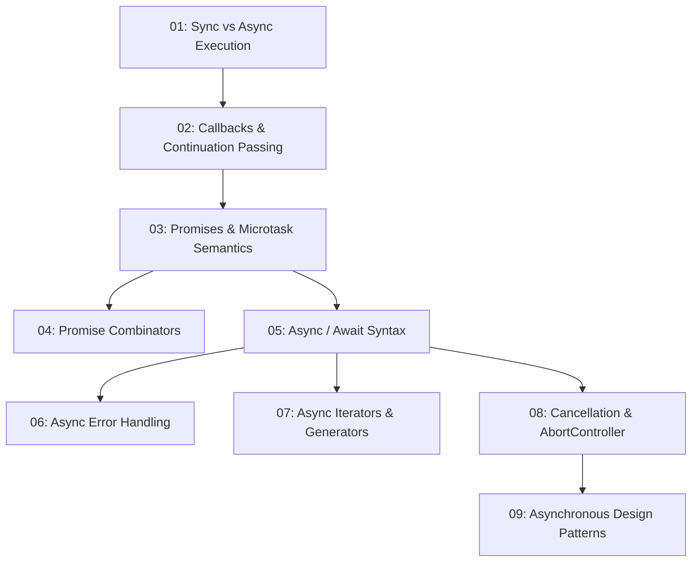

# Module 11: Asynchronous JavaScript

> Master asynchronous control flow in JavaScript: from foundational callback patterns and native Promises to async/await syntax, streaming async generators, universal cancellation with `AbortController`, and advanced concurrency orchestration patterns.

---

## Curriculum Overview

| File | Title | Summary | Standard |
| :--- | :--- | :--- | :--- |
| [01_sync-vs-async.md](./01_sync-vs-async.md) | Synchronous vs Asynchronous Execution | Execution models, single-threaded runtimes, non-blocking I/O, run-to-completion semantics | ECMAScript Baseline |
| [02_callbacks.md](./02_callbacks.md) | Callbacks & Continuation-Passing Style | Node error-first callbacks, callback hell, inversion of control, Zalgo hazards | Node.js / Core JS |
| [03_promises.md](./03_promises.md) | Promises & Microtask Semantics | Promise states, chaining, settlement, error handling, microtask scheduling | ECMAScript 2015 (ES6) |
| [04_promise-combinators.md](./04_promise-combinators.md) | Promise Combinators | `Promise.all`, `Promise.allSettled`, `Promise.race`, `Promise.any`, fast-fail vs aggregated rejections | ES2015–ES2021 |
| [05_async-await.md](./05_async-await.md) | Async / Await Syntax & Architecture | Syntactic sugar over generators & promises, return await subtleties, engine optimizations | ECMAScript 2017 (ES8) |
| [06_async-error-handling.md](./06_async-error-handling.md) | Asynchronous Error Handling & Propagation | Unhandled rejections, rejection tracking, try/catch with await, cross-boundary stacks | Node.js / Browser |
| [07_async-iterators-and-generators.md](./07_async-iterators-and-generators.md) | Async Iterators & Generators | `Symbol.asyncIterator`, `for await...of`, `async function*`, pull-based backpressure | ECMAScript 2018 (ES9) |
| [08_cancellation-and-abort.md](./08_cancellation-and-abort.md) | Cancellation & AbortController | `AbortController`, `AbortSignal`, `AbortSignal.timeout()`, `AbortSignal.any()`, cooperative cancellation | WHATWG / Node 15+ |
| [09_async-patterns.md](./09_async-patterns.md) | Asynchronous Design Patterns | Concurrency limiters (`p-limit`), queues, in-flight single-flight deduplication, retries with jitter | Modern ES / Node LTS |

---

## Recommended Learning Path

---

## Key Takeaways

1. **JavaScript is Single-Threaded with Non-Blocking I/O**: The JS engine executes one operation at a time on the call stack, offloading long-running network and file I/O to host platform threads.
2. **Microtasks Preempt Macrotasks**: Promise callbacks (`.then()`, `.catch()`, `.finally()`, and `await` resumptions) run in the microtask queue, which drains completely before any timers or I/O events run.
3. **Always Handle Cancellation Cooperatively**: Pass `AbortSignal` through asynchronous pipelines so callers can terminate operations cleanly and prevent resource leaks.
4. **Throttle Concurrency**: Never fire unbounded `Promise.all` over hundreds of items; apply concurrency limiters to protect downstream systems.
