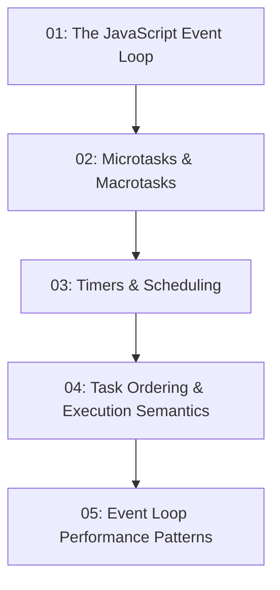

# Module 12: The JavaScript Event Loop & Task Scheduling

> In-depth exploration of the JavaScript concurrency model: call stack mechanics, microtask and macrotask queue prioritization, timer semantics, browser vs Node.js runtime architectures, and cooperative yielding patterns.

---

## Curriculum Overview

| File | Title | Summary | Standard |
| :--- | :--- | :--- | :--- |
| [01_event-loop.md](./01_event-loop.md) | The JavaScript Event Loop | Single-threaded execution, call stack, heap, host APIs, macrotask & microtask queues | HTML5 / libuv |
| [02_microtasks-and-macrotasks.md](./02_microtasks-and-macrotasks.md) | Microtasks & Macrotasks | Queue differences, microtask checkpoints, `queueMicrotask`, starvation hazards | HTML5 / ECMAScript |
| [03_timers.md](./03_timers.md) | Timers & Scheduling | `setTimeout`, `setInterval`, 4ms clamping standard, drift compensation, monotonic clocks | WHATWG / Node.js |
| [04_task-ordering.md](./04_task-ordering.md) | Task Ordering & Execution Semantics | Ordering puzzles, Node.js `process.nextTick` vs `setImmediate`, browser rendering loop | HTML5 / libuv |
| [05_event-loop-patterns.md](./05_event-loop-patterns.md) | Event Loop Performance Patterns | Time-slicing long tasks, `scheduler.yield()`, `isInputPending()`, INP optimization | W3C Prioritized Scheduling |

---

## Recommended Learning Path

---

## Key Takeaways

1. **JavaScript is Single-Threaded with Non-Blocking Coordination**: Synchronous code runs to completion on the call stack. Host APIs manage asynchronous waits externally and feed callbacks back via queues.
2. **Microtasks Always Preempt Macrotasks**: Before any timer callback, I/O event, or browser render frame executes, the runtime completely empties the microtask queue.
3. **Guard Against Starvation**: Infinite microtask or `process.nextTick` chains permanently block the event loop, freezing UI interaction and network handling.
4. **Cooperatively Yield CPU-Bound Work**: Break large loops into slices under 16ms using `scheduler.yield()` or `setTimeout(0)` to preserve 60 FPS responsiveness and optimize INP.
