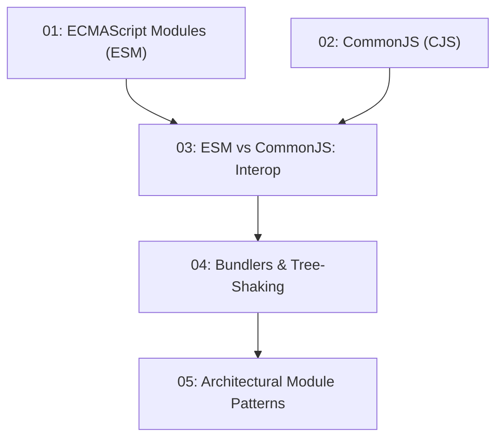

# Module 13: JavaScript Modules & Modular Architecture

> The complete guide to modern JavaScript modularity: ECMAScript Modules (ESM), CommonJS (CJS), runtime interoperability, bundler optimizations, tree-shaking, and enterprise architecture patterns.

---

## Curriculum Overview

| File | Title | Summary | Standard |
| :--- | :--- | :--- | :--- |
| [01_es-modules.md](./01_es-modules.md) | ECMAScript Modules (ESM) | Static module graph, live bindings, module records, top-level await, dynamic `import()`, `import.meta` | ECMAScript 2015+ |
| [02_commonjs.md](./02_commonjs.md) | CommonJS (CJS) | Node synchronous `require()`, module wrapper function, `module.exports` vs `exports`, `require.cache` | Node.js CommonJS |
| [03_esm-vs-commonjs.md](./03_esm-vs-commonjs.md) | ESM vs CommonJS: Interoperability | Node interop rules, synthetic module records, dual-package hazard, `package.json` conditional exports | Node.js Interop |
| [04_bundlers-and-tree-shaking.md](./04_bundlers-and-tree-shaking.md) | Bundlers & Tree-Shaking | Rollup, Webpack, esbuild, dead code elimination, pure annotations `/*#__PURE__*/`, sideEffects flag | Build Tooling |
| [05_module-patterns.md](./05_module-patterns.md) | Architectural Module Patterns | Barrel file hazards, dependency injection, circular dependency resolution, subpath exports | Architecture |

---

## Recommended Learning Path

---

## Key Takeaways

1. **ESM Uses Live Bindings, CommonJS Uses Value Copies**: In ESM, exported variables are live references; mutating them internally updates what importers read. In CJS, exported properties are evaluated objects copied at assignment time.
2. **Beware the Dual-Package Hazard**: When publishing an npm package supporting both CJS and ESM, anchor shared state singletons inside a shared CommonJS file that the ESM wrapper re-exports.
3. **Avoid Internal Barrel Files**: Avoid sprawling `index.js` barrel files within application source trees; direct imports and subpath exports dramatically improve build speed and tree-shaking efficiency.
4. **Annotate Pure Code**: Use `/*#__PURE__*/` on top-level constructor and factory calls and set `"sideEffects": false` in `package.json` to enable 100% dead-code elimination by bundlers.
