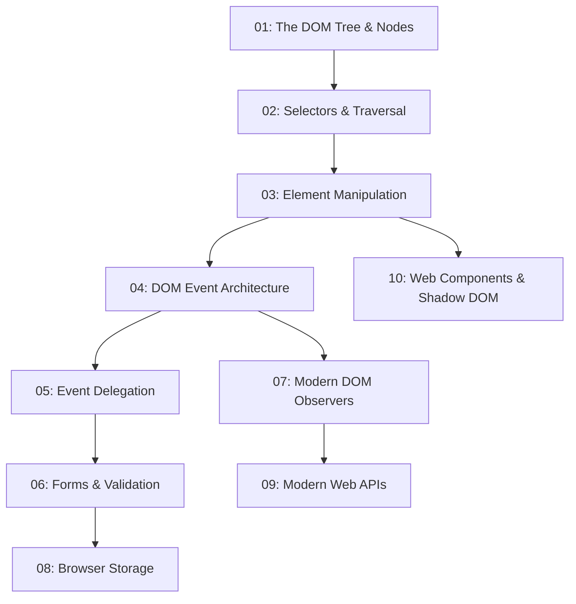

# Module 14: DOM & Browser Engineering

> Comprehensive engineering guide to the Document Object Model (DOM), CSS selector engines, element manipulation, event architecture, delegation patterns, form constraint validation, observers, client storage, Web APIs, and Web Components.

---

## Curriculum Overview

| File | Title | Summary | Standard |
| :--- | :--- | :--- | :--- |
| [01_dom.md](./01_dom.md) | The Document Object Model (DOM) | Node hierarchy, TreeWalker, live vs static collections, DocumentFragment, parsing pipelines | WHATWG DOM |
| [02_selectors.md](./02_selectors.md) | DOM Selectors & Traversal | `querySelector[All]`, right-to-left matching, `:has()`, `:is()`, `:scope`, `closest()`, `matches()` | CSS Selectors Level 4 |
| [03_element-manipulation.md](./03_element-manipulation.md) | DOM Element Manipulation | Content insertion, attributes vs properties, `classList`, styles, layout thrashing prevention | HTML / CSSOM |
| [04_events.md](./04_events.md) | The DOM Event Architecture | Event propagation, capture/target/bubble phases, passive listeners, AbortSignal teardown | UI Events / WHATWG |
| [05_event-delegation.md](./05_event-delegation.md) | Event Delegation | Centralized handling, `closest()` matching, boundary checking, delegating non-bubbling events | WHATWG DOM |
| [06_forms.md](./06_forms.md) | Forms & Constraint Validation | Native constraints, `validity`, `setCustomValidity`, `FormData`, `requestSubmit()`, File API | HTML Forms / File API |
| [07_observers.md](./07_observers.md) | Modern DOM Observers | `IntersectionObserver`, `ResizeObserver`, `MutationObserver`, microtask batching | W3C Observers |
| [08_browser-storage.md](./08_browser-storage.md) | Browser Storage & Offline State | `localStorage`, `sessionStorage`, `IndexedDB`, security cookies, `BroadcastChannel` | Web Storage / IDB 3.0 |
| [09_web-apis.md](./09_web-apis.md) | Modern Browser Web APIs | Page Visibility, Clipboard, Geolocation, Fullscreen, Web Share, Permissions API | W3C Web APIs |
| [10_web-components.md](./10_web-components.md) | Web Components & Shadow DOM | Custom Elements, Shadow DOM encapsulation, lifecycle hooks, `<template>`, slots | W3C Custom Elements |

---

## Recommended Learning Path

---

## Key Takeaways

1. **Avoid Layout Thrashing**: Never interleave reading layout geometry (`offsetHeight`) with DOM mutations; batch reads first, then execute writes.
2. **Delegate Events Efficiently**: Use `event.target.closest(selector)` on container listeners instead of attaching individual callbacks to thousands of child nodes.
3. **Use Passive Listeners on Scroll**: Add `{ passive: true }` to touch and wheel handlers to allow the browser compositor thread to scroll smoothly without waiting on JavaScript.
4. **Prefer `IntersectionObserver` over Scroll Event Listeners**: Offload visibility, lazy loading, and infinite scrolling checks to the browser engine.
