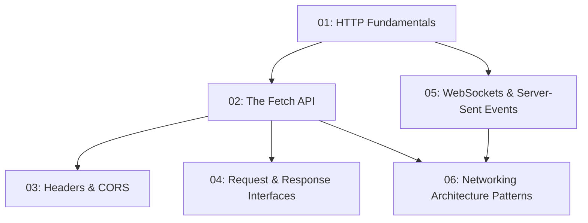

# Module 15: Networking & Web Protocols

> Production web networking in JavaScript: HTTP semantics, the WHATWG Fetch API, Headers & CORS security, Request & Response streaming architectures, WebSockets, Server-Sent Events, and resilient networking patterns.

---

## Curriculum Overview

| File | Title | Summary | Standard |
| :--- | :--- | :--- | :--- |
| [01_http-fundamentals.md](./01_http-fundamentals.md) | HTTP Fundamentals | HTTP/1.1 vs HTTP/2 vs HTTP/3 (QUIC), idempotency, status codes, keep-alive, TCP HoL blocking | RFC 9110 / 9114 |
| [02_fetch.md](./02_fetch.md) | The Fetch API | Two-step async resolution, body stream consumption, AbortSignal timeouts, credentials | WHATWG Fetch |
| [03_headers-and-cors.md](./03_headers-and-cors.md) | Headers & CORS | Same-Origin Policy, simple vs preflighted requests, OPTIONS, wildcard credentials trap | W3C CORS / Fetch |
| [04_request-and-response.md](./04_request-and-response.md) | Request & Response Interfaces | Constructible HTTP entities, stream teeing & cloning, Service Worker interception, Response.json() | WHATWG Fetch |
| [05_websockets-and-sse.md](./05_websockets-and-sse.md) | Real-Time Networking: WebSockets & SSE | Full-duplex WebSockets, Server-Sent Events, heartbeats, automatic reconnection, binary frames | RFC 6455 / HTML5 |
| [06_networking-patterns.md](./06_networking-patterns.md) | Networking Architecture Patterns | Circuit Breakers, Request Preemption, Single-Flight deduplication, Full Jitter, Offline Queues | Distributed Systems |

---

## Recommended Learning Path

---

## Key Takeaways

1. **`fetch()` Only Rejects on Network Errors**: `fetch()` resolves successfully on HTTP 404 and 500 status codes; always inspect `response.ok` before parsing response bodies.
2. **CORS is a Browser Enforcement**: Servers process the incoming request; the browser blocks JavaScript from reading the response if the server lacks valid `Access-Control-Allow-*` headers.
3. **Response Bodies Are Single-Use**: Because a `Response` body is a `ReadableStream`, you must call `response.clone()` before reading if multiple readers require the payload.
4. **Guard Distributed Services with Circuit Breakers**: Wrap external APIs in circuit breakers and pair retries with full jitter to avoid cascading outages and thundering herds.
