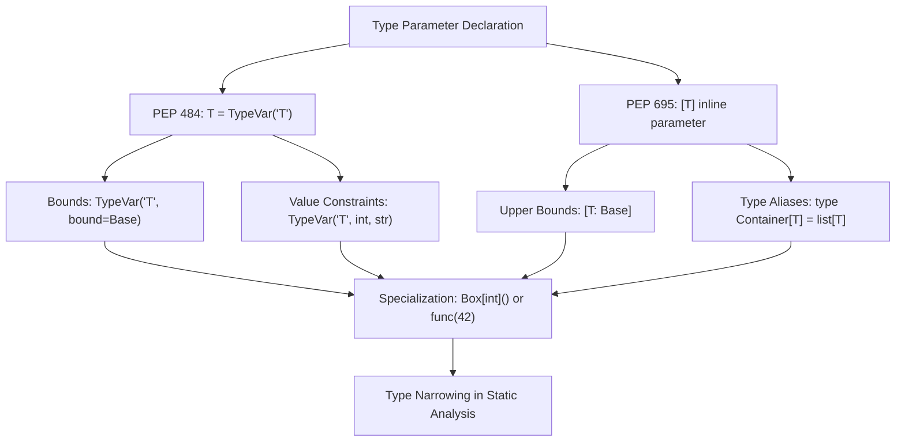
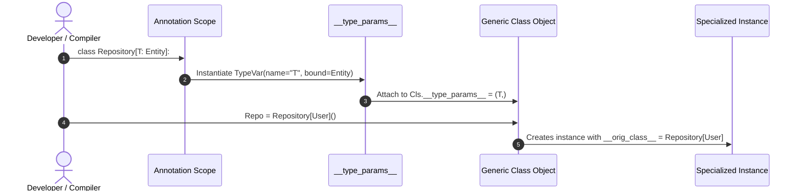

# Generics, TypeVar, and PEP 695 Type Parameter Syntax

Generic programming allows functions, classes, and type aliases to be parameterized over types without sacrificing static type safety. Python’s typing system transitioned from the traditional `TypeVar` and `Generic[T]` inheritance syntax (PEP 484) to native syntax first-class type parameters introduced in Python 3.12 (PEP 695) and extended with default type parameters in Python 3.13 (PEP 696).

---

## Table of Contents

1. [What & Why](#what--why)
2. [Core Concepts & Mental Model](#core-concepts--mental-model)
3. [How It Works Internally](#how-it-works-internally)
4. [Syntax & API Reference](#syntax--api-reference)
5. [Code Examples](#code-examples)
6. [Edge Cases, Pitfalls & Anti-Patterns](#edge-cases-pitfalls--anti-patterns)
7. [Performance & Memory Characteristics](#performance--memory-characteristics)
8. [CPython Internals & Bytecode](#cpython-internals--bytecode)
9. [Best Practices & Idiomatic Patterns](#best-practices--idiomatic-patterns)
10. [Real-World Case Study: Generic In-Memory Thread-Safe Event Broker](#real-world-case-study-generic-in-memory-thread-safe-event-broker)
11. [Interview Questions & Deep-Dive Scenarios](#interview-questions--deep-dive-scenarios)
12. [Practical Exercises & Code Katas](#practical-exercises--code-katas)

---

## What & Why

In dynamically typed Python, functions like `identity(x)` or classes like `Stack()` naturally operate over any arbitrary data type. However, standard static typing without generics produces two catastrophic extremes:
1. **Typing with `Any`**: Loses type tracking entirely. Returning `Any` forfeits IDE autocompletion, refactoring safety, and static error detection downstream.
2. **Over-specialization**: Re-implementing separate `IntStack`, `StrStack`, and `UserStack` classes violates DRY and fragments APIs.

Generics provide a rigorous bridge: expressing that a container holds a homogeneous type or that an output type correlates directly to an input argument type, verified statically at development time without runtime execution overhead.

With Python 3.12, PEP 695 introduced square-bracket type parameter lists (`def first[T](items: list[T]) -> T:` and `class Box[T]:`), eliminating boilerplate `TypeVar` declarations and aligning Python's syntax with modern typed languages like TypeScript, Rust, and Go.

---

## Core Concepts & Mental Model

### The Generic Typing Hierarchy

Static type checkers track type variables as placeholders representing concrete types substituted at invocation or instantiation sites:



### Key Differences: PEP 484 vs PEP 695

| Dimension | Legacy Syntax (PEP 484) | Modern Syntax (PEP 695 / Python 3.12+) |
|:---|:---|:---|
| **Declaration** | `T = TypeVar("T")` (global module scope) | `[T]` inline on class or function header |
| **Class Syntax** | `class Stack(Generic[T]):` | `class Stack[T]:` |
| **Upper Bound** | `T = TypeVar("T", bound=Numeric)` | `class Calculator[T: Numeric]:` |
| **Value Constraints** | `T = TypeVar("T", int, float)` | Not directly supported inline; use Union bounds |
| **Type Aliases** | `Vector = list[T]` (unbound variable risk) | `type Vector[T] = list[T]` (explicit scope) |
| **Variance** | `covariant=True`, `contravariant=True` | Inferred automatically by static type checkers |
| **Runtime Evaluation** | Evaluated immediately at module import | Evaluated lazily in separate annotation scope |

---

## How It Works Internally

### Runtime Representation of Generic Classes

When a class is defined using PEP 695 syntax (`class Container[T]:`), Python creates a `typing.TypeVar` internally and stores the type parameters in the `__type_params__` attribute of the class or function:



At runtime, `Repository[User]` evaluates via `__class_getitem__`, returning a `typing._GenericAlias` object wrapping the origin class and the concrete type arguments.

### Lazy Evaluation Scope (PEP 695)

PEP 695 isolates type parameter bounds and type aliases inside a dedicated compiler-generated annotation scope (similar to a hidden nested function). This means forward references inside bounds or type alias definitions are resolved lazily, eliminating NameError issues without requiring string quoting.

---

## Syntax & API Reference

### 1. Modern PEP 695 Generic Functions & Classes

```python
# Generic function
def get_first[T](items: list[T]) -> T:
    return items[0]

# Generic function with Upper Bound
def serialize_entity[T: BaseEntity](entity: T) -> dict[str, Any]:
    return entity.to_dict()

# Generic class
class Repository[T]:
    def __init__(self) -> None:
        self._storage: list[T] = []

    def add(self, item: T) -> None:
        self._storage.append(item)

    def get_all(self) -> list[T]:
        return list(self._storage)
```

### 2. Modern Type Alias Statements

```python
# Generic type alias
type Lookup[K, V] = dict[K, list[V]]

# Recursive generic type alias
type JSONValue = str | int | float | bool | None | list[JSONValue] | dict[str, JSONValue]
type Tree[T] = tuple[T, list[Tree[T]]]
```

### 3. Legacy PEP 484 Syntax (Backward Compatibility)

```python
from typing import TypeVar, Generic

T = TypeVar("T")
K = TypeVar("K")
V = TypeVar("V")
Num = TypeVar("Num", int, float)  # Constrained
EntityT = TypeVar("EntityT", bound=BaseEntity)  # Upper bound

class LegacyRepository(Generic[T]):
    def __init__(self) -> None:
        self.items: list[T] = []
```

---

## Code Examples

### Example 1: Basic Generic Function & Container Stack

```python
from typing import Any

class Stack[T]:
    """A thread-safe LIFO stack parameterized over element type T."""

    def __init__(self) -> None:
        self._elements: list[T] = []

    def push(self, item: T) -> None:
        self._elements.append(item)

    def pop(self) -> T:
        if not self._elements:
            raise IndexError("pop from empty stack")
        return self._elements.pop()

    def peek(self) -> T | None:
        return self._elements[-1] if self._elements else None

    def __len__(self) -> int:
        return len(self._elements)

# Type checker enforces type homogeneity:
int_stack: Stack[int] = Stack()
int_stack.push(10)
int_stack.push(20)
val = int_stack.pop()
print(f"Popped value: {val} (type: {type(val).__name__})")
# Output:
# Popped value: 20 (type: int)
```

### Example 2: Bounded Type Variables and Subtype Polymorphism

```python
from abc import ABC, abstractmethod

class Serializable(ABC):
    @abstractmethod
    def to_json(self) -> str:
        pass

class User(Serializable):
    def __init__(self, username: str) -> None:
        self.username = username

    def to_json(self) -> str:
        return f'{{"username": "{self.username}"}}'

class Product(Serializable):
    def __init__(self, sku: str, price: float) -> None:
        self.sku = sku
        self.price = price

    def to_json(self) -> str:
        return f'{{"sku": "{self.sku}", "price": {self.price}}}'

# Bound guarantees that T possesses .to_json() while preserving the exact input type T
def export_and_log[T: Serializable](entity: T) -> T:
    print(f"Exporting: {entity.to_json()}")
    return entity

u = export_and_log(User("alice"))
p = export_and_log(Product("SKU-992", 49.99))
print(f"Processed: {u.username} and {p.sku}")
# Output:
# Exporting: {"username": "alice"}
# Exporting: {"sku": "SKU-992", "price": 49.99}
# Processed: alice and SKU-992
```

### Example 3: Multiple Type Variables with Generic Key-Value Mapping

```python
class BiDirectionalMap[K, V]:
    """Two-way associative mapping between distinct unique keys and values."""

    def __init__(self) -> None:
        self._forward: dict[K, V] = {}
        self._backward: dict[V, K] = {}

    def put(self, key: K, val: V) -> None:
        self._forward[key] = val
        self._backward[val] = key

    def get_by_key(self, key: K) -> V | None:
        return self._forward.get(key)

    def get_by_value(self, val: V) -> K | None:
        return self._backward.get(val)

dns_cache: BiDirectionalMap[str, int] = BiDirectionalMap()
dns_cache.put("gateway.internal", 8080)
print(f"Port: {dns_cache.get_by_key('gateway.internal')}")
print(f"Host: {dns_cache.get_by_value(8080)}")
# Output:
# Port: 8080
# Host: gateway.internal
```

### Example 4: Generic Subclassing and Inheritance Patterns

```python
# Base generic interface
class Transformer[InT, OutT]:
    def transform(self, data: InT) -> OutT:
        raise NotImplementedError

# Specialized subclass (fixing input and output types)
class StringToIntParser(Transformer[str, int]):
    def transform(self, data: str) -> int:
        return int(data.strip())

# Partially generic subclass (retaining InT, fixing OutT to bool)
class FilterPredicate[InT](Transformer[InT, bool]):
    def __init__(self, threshold: int) -> None:
        self.threshold = threshold

    def transform(self, data: InT) -> bool:
        return len(str(data)) > self.threshold

parser = StringToIntParser()
print(f"Parsed: {parser.transform('  420  ')}")

pred: FilterPredicate[str] = FilterPredicate(threshold=3)
print(f"Is valid: {pred.transform('hello')}")
# Output:
# Parsed: 420
# Is valid: True
```

### Example 5: PEP 695 Type Aliases with Nested Generics

```python
# Modern type alias syntax with PEP 695
type Result[T, E] = tuple[bool, T | None, E | None]
type PipelineStep[Data] = Transformer[Data, Data]

def execute_step[D](step: PipelineStep[D], payload: D) -> Result[D, str]:
    try:
        res = step.transform(payload)
        return (True, res, None)
    except Exception as exc:
        return (False, None, str(exc))

class Capitalizer(Transformer[str, str]):
    def transform(self, data: str) -> str:
        return data.upper()

status, val, err = execute_step(Capitalizer(), "systems architecture")
print(f"Success: {status}, Result: {val}, Error: {err}")
# Output:
# Success: True, Result: SYSTEMS ARCHITECTURE, Error: None
```

---

## Edge Cases, Pitfalls & Anti-Patterns

### Common Mistakes Table

| Mistake | Bad Code | Correct Idiom | Why It Fails |
|:---|:---|:---|:---|
| **Using `isinstance` on generic aliases** | `isinstance(val, list[int])` | `isinstance(val, list)` | Generics are erased at runtime; parameterized generics raise `TypeError` with `isinstance`. |
| **Reusing TypeVar across independent functions** | Declaring global `T = TypeVar("T")` and using it in unrelated functions | Use PEP 695 `[T]` per function or define separate TypeVars | Shared global TypeVars can induce unintended cross-function constraints in complex stubs. |
| **Confusing bounds with value constraints** | `T = TypeVar("T", bound=(int, str))` | `T = TypeVar("T", int, str)` or `[T: (int \| str)]` | `bound` specifies single upper type limit; value constraints specify an exact closed set of types. |
| **Over-genericizing with single appearance** | `def print_item[T](x: T) -> None:` | `def print_item(x: object) -> None:` | A TypeVar appearing only once in arguments without appearing in the return type provides zero value over `object`. |
| **Instantiating a TypeVar directly** | `def factory[T]() -> T: return T()` | Pass `factory_fn: Callable[[], T]` | TypeVar is a static analyzer concept; it cannot be called as a constructor at runtime. |
| **Accessing class type parameters in class body** | `class Foo[T]: default_val: T = ...` | Use inside method annotations or `__init__` | Type parameters are scoped to method and attribute annotations, not class body runtime execution. |

---

## Performance & Memory Characteristics

### Runtime Overhead of PEP 695 vs Legacy Typing

1. **Zero Runtime Execution Cost in Functions**: In Python 3.12+, `def func[T](x: T) -> T:` executes at identical CPython bytecode speed to untyped functions. The type parameter is stored in `func.__type_params__` as a compact tuple.
2. **Import-Time Savings**: Legacy `TypeVar` declarations require instantiating Python objects at module execution time. PEP 695 compiles type variables directly into code objects, cutting import latency in large type-annotated codebases.
3. **Memory Footprint**:
   - `TypeVar('T')` creates a heap-allocated instance of `typing.TypeVar` (~152 bytes).
   - PEP 695 type parameter tuple is immutable and internalized in the code object.

---

## CPython Internals & Bytecode

Let us inspect the bytecode differences between standard functions and PEP 695 generic functions using the `dis` module:

```python
import dis

def untyped_id(x):
    return x

def generic_id[T](x: T) -> T:
    return x

print("Disassembly of generic_id:")
dis.dis(generic_id)
print("\nType params attribute:", generic_id.__type_params__)
```

Output:
```text
Disassembly of generic_id:
  1           0 RESUME                   0
  2           2 LOAD_FAST                0 (x)
              4 RETURN_VALUE

Type params attribute: (T,)
```

Notice that the function body instructions (`RESUME`, `LOAD_FAST`, `RETURN_VALUE`) are 100% identical! The type parameter `T` does not add a single bytecode instruction to function execution. Instead, the Python 3.12 compiler populates the code object's internal metadata, populating `__type_params__`.

---

## Best Practices & Idiomatic Patterns

1. **Prefer PEP 695 Syntax on Python 3.12+**: Use `def f[T](x: T) -> T:` and `class C[T]:` over manual `TypeVar` instantiation.
2. **Scope Type Parameters Properly**: Only declare type parameters at the scope where they are meaningfully constrained.
3. **Only Use TypeVar When Output Relates to Input**: If a function takes an argument and does not return it or tie it to another argument, use concrete classes, ABCs, or `object`.
4. **Preserve Subtype Information with Upper Bounds**: When accepting any subclass of `BaseModel` and returning that exact subclass, use `[T: BaseModel]`.

---

## Real-World Case Study: Generic In-Memory Thread-Safe Event Broker

Below is a production-grade generic pub-sub event broker dispatching strongly typed payloads to specialized handler callbacks:

```python
from typing import Callable, Any
from collections import defaultdict
import threading

class DomainEvent:
    """Base class for all domain events."""
    pass

class OrderCreated(DomainEvent):
    def __init__(self, order_id: str, total_amount: float) -> None:
        self.order_id = order_id
        self.total_amount = total_amount

class UserRegistered(DomainEvent):
    def __init__(self, user_id: str, email: str) -> None:
        self.user_id = user_id
        self.email = email

class EventBroker:
    """Generic event broker mapping event classes to strongly-typed subscribers."""

    def __init__(self) -> None:
        self._subscribers: dict[type[DomainEvent], list[Callable[[Any], None]]] = defaultdict(list)
        self._lock = threading.Lock()

    def subscribe[E: DomainEvent](self, event_cls: type[E], handler: Callable[[E], None]) -> None:
        """Register a handler strictly typed to the specific domain event subclass E."""
        with self._lock:
            self._subscribers[event_cls].append(handler)

    def publish[E: DomainEvent](self, event: E) -> None:
        """Publish an event instance to all registered handlers for its type."""
        with self._lock:
            handlers = list(self._subscribers.get(type(event), []))
        
        for handler in handlers:
            handler(event)

# Demonstration
broker = EventBroker()

def handle_order(event: OrderCreated) -> None:
    print(f"[Order Worker] Processing order #{event.order_id} totaling ${event.total_amount:.2f}")

def handle_user(event: UserRegistered) -> None:
    print(f"[Email Worker] Sending welcome email to {event.email} (ID: {event.user_id})")

broker.subscribe(OrderCreated, handle_order)
broker.subscribe(UserRegistered, handle_user)

broker.publish(OrderCreated("ORD-1001", 129.50))
broker.publish(UserRegistered("USR-42", "dev@example.com"))
# Output:
# [Order Worker] Processing order #ORD-1001 totaling $129.50
# [Email Worker] Sending welcome email to dev@example.com (ID: USR-42)
```

---

## Interview Questions & Deep-Dive Scenarios

<details>
<summary>1. What is the fundamental difference between an Upper Bound (bound=X) and a Constrained TypeVar (X, Y)?</summary>

An **Upper Bound** (`bound=Animal` or `[T: Animal]`) specifies that `T` can be `Animal` or any arbitrary subclass of `Animal` (e.g., `Dog`, `Cat`). If `Dog` is passed, static type checkers infer `T` as `Dog`, preserving all specialized `Dog` methods and attributes.

A **Constrained TypeVar** (`TypeVar('T', int, str)`) restricts `T` to *only* the explicitly listed types (`int` or `str`), not arbitrary subclasses. Subclasses are coerced to the matching listed base type.
</details>

<details>
<summary>2. Why does Python forbid calling or instantiating a TypeVar directly (e.g. `T()`)?</summary>

In Python, generics are primarily static analysis constructs erased at runtime (type erasure). At runtime, `T` is an instance of `typing.TypeVar` or a PEP 695 parameter token, not a reference to the concrete class passed at runtime. It has no access to the constructor of the concrete argument. To construct instances dynamically, an explicit factory callable `Callable[..., T]` or class `type[T]` must be passed as an argument.
</details>

<details>
<summary>3. What is the difference between `list[Animal]` and `list[T: Animal]`?</summary>

`list[Animal]` describes a heterogeneous list that can simultaneously hold `Dog`, `Cat`, and base `Animal` instances.

`list[T: Animal]` (when used in a generic function `def process[T: Animal](items: list[T])`) asserts that the list is homogeneous containing instances of a specific single subtype `T`.
</details>

<details>
<summary>4. What happens when you use `isinstance(obj, Box[int])` at runtime?</summary>

It raises a `TypeError: Subscripted generics cannot be used with class and instance checks`. Because Python does not maintain runtime generic type arguments for container elements, subscripted generics cannot verify the internal type parameters at runtime. You must use `isinstance(obj, Box)`.
</details>

<details>
<summary>5. How does PEP 695 resolve circular references in type definitions without string literals?</summary>

PEP 695 introduces isolated annotation scopes. The expressions within `type X = ...` or `class C[T: Bound]:` are compiled into a separate code block that is executed lazily only when `__type_params__` or `__value__` is accessed, allowing names defined later in the file to be resolved seamlessly without requiring `from __future__ import annotations` or string quotes.
</details>

<details>
<summary>6. How can you inspect a generic object's specialized type argument at runtime?</summary>

If an instance is created from a generic class, Python's `typing` module attaches `__orig_class__` to the instance during `__init__`. You can call `typing.get_args(instance.__orig_class__)` to retrieve the tuple of specialized type arguments (e.g., `(int,)`).
</details>

<details>
<summary>7. What are default type parameters introduced in Python 3.13 (PEP 696)?</summary>

PEP 696 allows type parameters to declare fallback defaults: `class Box[T = str]:`. If a user instantiates `Box()` without specifying a type argument, static type checkers assume `T` resolves to `str`, eliminating the need for boilerplate overloads.
</details>

<details>
<summary>8. Why should you avoid using a TypeVar that only appears once in a function's argument list?</summary>

A TypeVar serves to express *relationships* between two or more parameters, or between a parameter and the return value. If it appears only once as an input parameter, it establishes no relationship, making it semantically identical to `object` (or the bound type itself), while introducing unnecessary conceptual overhead.
</details>

---

## Practical Exercises & Code Katas

### Exercise 1: Implement a Generic Priority Queue
Implement a generic class `PriorityQueue[T]` using Python's `heapq` module that supports `push(priority: float, item: T)` and `pop() -> T`.

<details>
<summary>Solution</summary>

```python
import heapq
from dataclasses import dataclass, field

@dataclass(order=True)
class PrioritizedItem[T]:
    priority: float
    count: int
    item: T = field(compare=False)

class PriorityQueue[T]:
    def __init__(self) -> None:
        self._heap: list[PrioritizedItem[T]] = []
        self._counter: int = 0

    def push(self, priority: float, item: T) -> None:
        entry = PrioritizedItem(priority, self._counter, item)
        heapq.heappush(self._heap, entry)
        self._counter += 1

    def pop(self) -> T:
        if not self._heap:
            raise IndexError("pop from empty priority queue")
        return heapq.heappop(self._heap).item

    def __len__(self) -> int:
        return len(self._heap)

# Verification
pq: PriorityQueue[str] = PriorityQueue()
pq.push(2.5, "low priority job")
pq.push(0.1, "urgent security alert")
print(pq.pop())  # urgent security alert
```
</details>

### Exercise 2: Generic Linked List with Iteration Support
Create a singly-linked list `LinkedList[T]` featuring `Node[T]`. Support `prepend(item: T)`, `__iter__() -> Iterator[T]`, and `find(predicate: Callable[[T], bool]) -> T | None`.

<details>
<summary>Solution</summary>

```python
from collections.abc import Iterator, Callable

class Node[T]:
    def __init__(self, value: T, next_node: "Node[T] | None" = None) -> None:
        self.value: T = value
        self.next: Node[T] | None = next_node

class LinkedList[T]:
    def __init__(self) -> None:
        self.head: Node[T] | None = None

    def prepend(self, value: T) -> None:
        self.head = Node(value, self.head)

    def __iter__(self) -> Iterator[T]:
        curr = self.head
        while curr is not None:
            yield curr.value
            curr = curr.next

    def find(self, predicate: Callable[[T], bool]) -> T | None:
        for val in self:
            if predicate(val):
                return val
        return None

# Verification
nums: LinkedList[int] = LinkedList()
nums.prepend(10)
nums.prepend(25)
nums.prepend(7)
found = nums.find(lambda x: x > 20)
print(f"Found: {found}")  # Found: 25
```
</details>

### Exercise 3: Generic Result Monad
Implement a monadic `Result[T, E]` type where `Success[T]` wraps a successful computation and `Failure[E]` wraps an error. Include `map(f: Callable[[T], U]) -> Result[U, E]`.

<details>
<summary>Solution</summary>

```python
from abc import ABC, abstractmethod
from collections.abc import Callable

class Result[T, E](ABC):
    @abstractmethod
    def is_success(self) -> bool: ...

    @abstractmethod
    def map[U](self, func: Callable[[T], U]) -> "Result[U, E]": ...

class Success[T, E](Result[T, E]):
    def __init__(self, value: T) -> None:
        self.value: T = value

    def is_success(self) -> bool:
        return True

    def map[U](self, func: Callable[[T], U]) -> Result[U, E]:
        return Success(func(self.value))

class Failure[T, E](Result[T, E]):
    def __init__(self, error: E) -> None:
        self.error: E = error

    def is_success(self) -> bool:
        return False

    def map[U](self, func: Callable[[T], U]) -> Result[U, E]:
        return Failure(self.error)

# Verification
s: Result[int, str] = Success(10)
mapped = s.map(lambda x: f"Calculated: {x * 2}")
assert isinstance(mapped, Success)
print(mapped.value)  # Calculated: 20
```
</details>

### Exercise 4: Generic Cache Decorator with TTL
Implement a generic cache decorator `ttl_cache[**P, R](ttl_seconds: float)` that preserves the wrapped function's signature and caches output types.

<details>
<summary>Solution</summary>

```python
import time
from collections.abc import Callable
from functools import wraps
from typing import ParamSpec, TypeVar

P = ParamSpec("P")
R = TypeVar("R")

def ttl_cache(ttl_seconds: float) -> Callable[[Callable[P, R]], Callable[P, R]]:
    def decorator(fn: Callable[P, R]) -> Callable[P, R]:
        cache: dict[tuple[Any, ...], tuple[float, R]] = {}

        @wraps(fn)
        def wrapper(*args: P.args, **kwargs: P.kwargs) -> R:
            key = (args, tuple(sorted(kwargs.items())))
            now = time.time()
            if key in cache:
                timestamp, result = cache[key]
                if now - timestamp < ttl_seconds:
                    return result
            result = fn(*args, **kwargs)
            cache[key] = (now, result)
            return result
        return wrapper
    return decorator

@ttl_cache(ttl_seconds=60.0)
def fetch_user_data(user_id: int) -> dict[str, str]:
    return {"id": str(user_id), "status": "active"}

print(fetch_user_data(42))
```
</details>

### Exercise 5: Generic Tree Traversal
Write a generic tree node `TreeNode[T]` supporting breadth-first search (`bfs() -> list[T]`) and depth-first search (`dfs() -> list[T]`).

<details>
<summary>Solution</summary>

```python
from collections import deque

class TreeNode[T]:
    def __init__(self, value: T) -> None:
        self.value: T = value
        self.children: list[TreeNode[T]] = []

    def add_child(self, child: "TreeNode[T]") -> "TreeNode[T]":
        self.children.append(child)
        return child

    def bfs(self) -> list[T]:
        result: list[T] = []
        queue: deque[TreeNode[T]] = deque([self])
        while queue:
            node = queue.popleft()
            result.append(node.value)
            queue.extend(node.children)
        return result

    def dfs(self) -> list[T]:
        result: list[T] = []
        def _traverse(node: TreeNode[T]) -> None:
            result.append(node.value)
            for child in node.children:
                _traverse(child)
        _traverse(self)
        return result

root = TreeNode("root")
c1 = root.add_child(TreeNode("c1"))
c2 = root.add_child(TreeNode("c2"))
c1.add_child(TreeNode("leaf1"))
print("BFS:", root.bfs())
print("DFS:", root.dfs())
# Output:
# BFS: ['root', 'c1', 'c2', 'leaf1']
# DFS: ['root', 'c1', 'leaf1', 'c2']
```
</details>

### Exercise 6: Generic Batch Slicer
Write a generic batch generator function `batch_slice[T](items: list[T], batch_size: int) -> Iterator[list[T]]` with full type annotations.

<details>
<summary>Solution</summary>

```python
from collections.abc import Iterator

def batch_slice[T](items: list[T], batch_size: int) -> Iterator[list[T]]:
    """Yield successive batch_size chunks from items list."""
    if batch_size <= 0:
        raise ValueError("batch_size must be positive integer")
    for i in range(0, len(items), batch_size):
        yield items[i : i + batch_size]

records = [f"rec_{i}" for i in range(7)]
batches = list(batch_slice(records, 3))
print("Batches:", batches)
# Output:
# Batches: [['rec_0', 'rec_1', 'rec_2'], ['rec_3', 'rec_4', 'rec_5'], ['rec_6']]
```
</details>
