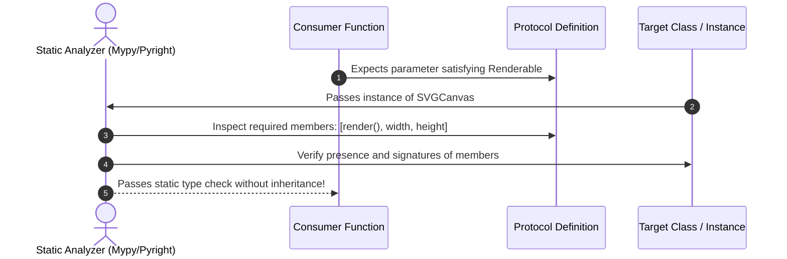

# Protocols and Structural Subtyping (Static Duck Typing)

Python is historically famous for its dynamic "duck typing" philosophy: *"If it walks like a duck and quacks like a duck, it's a duck."* Before PEP 544, type checkers enforced **nominal subtyping** (classes must explicitly inherit from a common base class or Abstract Base Class). **Protocols** reconcile Python's duck-typing nature with static type safety by introducing **structural subtyping**: an object is compatible with an expected type if its public shape (methods and attributes) matches, without requiring explicit inheritance.

---

## Table of Contents

1. [What & Why](#what--why)
2. [Core Concepts & Mental Model](#core-concepts--mental-model)
3. [How It Works Internally](#how-it-works-internally)
4. [Syntax & API Reference](#syntax--api-reference)
5. [Code Examples](#code-examples)
6. [Edge Cases, Pitfalls & Anti-Patterns](#edge-cases-pitfalls--anti-patterns)
7. [Performance & Memory Characteristics](#performance--memory-characteristics)
8. [CPython Internals & Bytecode](#cpython-internals--bytecode)
9. [Best Practices & Idiomatic Patterns](#best-practices--idiomatic-patterns)
10. [Real-World Case Study: Pluggable Cloud Storage Abstraction Layer](#real-world-case-study-pluggable-cloud-storage-abstraction-layer)
11. [Interview Questions & Deep-Dive Scenarios](#interview-questions--deep-dive-scenarios)
12. [Practical Exercises & Code Katas](#practical-exercises--code-katas)

---

## What & Why

In traditional object-oriented designs using ABCs (`abc.ABC`), third-party classes or standard library types cannot satisfy your interface unless they explicitly inherit from your ABC or are registered via `ABC.register()`. This creates tightly coupled hierarchies and forces boilerplate adapters when integrating with external libraries.

Consider a third-party `FastFileReader` library that defines `.read(bytes: int) -> bytes`. If your service expects an ABC `ReadableStream`, `FastFileReader` will fail static type checks even though it operates identically at runtime.

`typing.Protocol` solves this problem cleanly:
- **Decoupled Architecture**: Callers define the exact interface requirements locally without forcing producers to inherit from them.
- **Static Verification of Duck Typing**: Type checkers automatically verify that arguments supply required methods and property signatures.
- **Third-Party Friendly**: Works seamlessly with un-annotated or third-party classes without modification.

---

## Core Concepts & Mental Model

### Nominal vs Structural Typing

```mermaid
graph TD
    subgraph Nominal Typing (ABC)
        ABC["class Renderable(ABC)"] -->|Inherits| CompA["class HTMLComponent(Renderable)"]
        ABC -.->|Fails Type Checker!| CompB["class ThirdPartyWidget (no inheritance)"]
    end

    subgraph Structural Typing (Protocol)
        Prot["class Renderable(Protocol): def render() -> str"]
        CompC["class NativeButton:\n  def render() -> str"] -.->|Static Match!| Prot
        CompD["class ThirdPartyCard:\n  def render() -> str"] -.->|Static Match!| Prot
    end
```

### Key Differences: ABC vs Protocol

| Feature | Abstract Base Class (`abc.ABC`) | Structural Protocol (`typing.Protocol`) |
|:---|:---|:---|
| **Subtyping Mechanism** | **Nominal**: Requires explicit inheritance `class C(MyABC):` | **Structural**: Satisfied by any class matching attributes/methods |
| **Coupling** | Tightly coupled; classes must know about the base interface | Completely decoupled; consumer defines requirements |
| **Third-Party Libraries** | Requires adapter wrappers or dynamic `ABC.register()` | Zero changes needed to third-party code |
| **Runtime Enforcement** | Prevents instantiation if abstract methods are missing | By default, does NOT prevent instantiation |
| **`isinstance()` Check** | Always supported based on inheritance tree | Supported ONLY when decorated with `@runtime_checkable` |
| **Method Body Support** | Can supply concrete default implementations | Can supply default implementations (mixins) |

---

## How It Works Internally

When a class inherits from `typing.Protocol`, the metaclass `_ProtocolMeta` intercepts class creation. It analyzes annotations, methods, and properties to build an internal protocol signature:



### `@runtime_checkable` Mechanics

When a protocol is decorated with `@typing.runtime_checkable`, Python attaches a customized `__instancecheck__` and `__subclasscheck__` method to the protocol class. During `isinstance(obj, MyProtocol)`:
1. Python checks if `obj` has all attribute names and callable methods defined on `MyProtocol`.
2. **Critical Limitation**: It only checks the *existence* of attributes and callability of methods. It does **not** evaluate argument types or return types at runtime!

---

## Syntax & API Reference

### 1. Basic Protocol Definition

```python
from typing import Protocol

class Closable(Protocol):
    def close(self) -> None:
        ...
```

### 2. Attribute and Property Protocols

Protocols can mandate class or instance attributes:

```python
from typing import Protocol

class Identified(Protocol):
    # Variable annotation declares an attribute requirement
    id: str
    
    @property
    def display_name(self) -> str:
        ...
```

### 3. `@runtime_checkable` Protocol

```python
from typing import Protocol, runtime_checkable

@runtime_checkable
class Serializable(Protocol):
    def serialize(self) -> dict[str, str]:
        ...
```

### 4. Protocol Inheritance & Composition

```python
class Reader(Protocol):
    def read(self, n: int) -> bytes: ...

class Writer(Protocol):
    def write(self, data: bytes) -> int: ...

# Composed protocol
class ReadWriter(Reader, Writer, Protocol):
    ...
```

---

## Code Examples

### Example 1: Basic Structural Typing in Action

```python
from typing import Protocol

class Notifier(Protocol):
    def send(self, recipient: str, message: str) -> bool:
        ...

# Concrete class 1: No inheritance from Notifier
class EmailService:
    def send(self, recipient: str, message: str) -> bool:
        print(f"[Email] Sent to {recipient}: {message}")
        return True

# Concrete class 2: Completely independent implementation
class SMSService:
    def send(self, recipient: str, message: str) -> bool:
        print(f"[SMS] Sent to {recipient}: {message}")
        return True

def broadcast_alert(service: Notifier, alert: str) -> None:
    service.send("admin@company.internal", alert)

# Static type checkers accept both cleanly:
broadcast_alert(EmailService(), "System memory usage at 91%")
broadcast_alert(SMSService(), "Backup completed successfully")
# Output:
# [Email] Sent to admin@company.internal: System memory usage at 91%
# [SMS] Sent to admin@company.internal: Backup completed successfully
```

### Example 2: Property and Read-Only Attribute Protocols

```python
from typing import Protocol

class UserProfile(Protocol):
    @property
    def user_id(self) -> str:
        ...
    
    @property
    def is_active(self) -> bool:
        ...

class DatabaseUser:
    def __init__(self, uid: str, active: bool) -> None:
        self._uid = uid
        self._active = active

    @property
    def user_id(self) -> str:
        return self._uid

    @property
    def is_active(self) -> bool:
        return self._active

def audit_account(user: UserProfile) -> None:
    status = "Active" if user.is_active else "Suspended"
    print(f"Auditing UID: {user.user_id} - Status: {status}")

audit_account(DatabaseUser("usr_7701", True))
# Output:
# Auditing UID: usr_7701 - Status: Active
```

### Example 3: `@runtime_checkable` and Runtime Verification

```python
from typing import Protocol, runtime_checkable

@runtime_checkable
class Hasher(Protocol):
    def compute_hash(self, payload: bytes) -> str:
        ...

class MD5Hasher:
    def compute_hash(self, payload: bytes) -> str:
        import hashlib
        return hashlib.md5(payload).hexdigest()

class IncompatibleHasher:
    # Does not implement compute_hash
    def hash_data(self, payload: bytes) -> str:
        return "hash"

h1 = MD5Hasher()
h2 = IncompatibleHasher()

print(f"MD5Hasher matches protocol: {isinstance(h1, Hasher)}")
print(f"IncompatibleHasher matches protocol: {isinstance(h2, Hasher)}")
# Output:
# MD5Hasher matches protocol: True
# IncompatibleHasher matches protocol: False
```

### Example 4: Generic Protocols

```python
from typing import Protocol

class Repository[T, ID](Protocol):
    def find_by_id(self, item_id: ID) -> T | None:
        ...

    def save(self, entity: T) -> ID:
        ...

class MemoryUserRepo:
    def __init__(self) -> None:
        self._store: dict[int, str] = {}
        self._id_seq = 1

    def find_by_id(self, item_id: int) -> str | None:
        return self._store.get(item_id)

    def save(self, entity: str) -> int:
        new_id = self._id_seq
        self._store[new_id] = entity
        self._id_seq += 1
        return new_id

# Satisfies Repository[str, int]
repo: Repository[str, int] = MemoryUserRepo()
uid = repo.save("alice_smith")
print(f"Created user with ID: {uid}, retrieved: {repo.find_by_id(uid)}")
# Output:
# Created user with ID: 1, retrieved: alice_smith
```

### Example 5: Recursive Protocols (Tree Structures)

```python
from typing import Protocol

class HierarchicalNode(Protocol):
    name: str

    def get_children(self) -> list["HierarchicalNode"]:
        ...

class Directory:
    def __init__(self, name: str, children: list["Directory"] | None = None) -> None:
        self.name = name
        self.children = children or []

    def get_children(self) -> list[HierarchicalNode]:
        return list(self.children)

def print_tree(node: HierarchicalNode, depth: int = 0) -> None:
    print(f"{'  ' * depth}└─ {node.name}")
    for child in node.get_children():
        print_tree(child, depth + 1)

root = Directory("var", [
    Directory("log", [Directory("nginx"), Directory("auth")]),
    Directory("www")
])

print_tree(root)
# Output:
# └─ var
#   └─ log
#     └─ nginx
#     └─ auth
#   └─ www
```

---

## Edge Cases, Pitfalls & Anti-Patterns

### Common Mistakes Table

| Mistake | Bad Code | Correct Idiom | Why It Fails |
|:---|:---|:---|:---|
| **Expecting runtime type safety from `@runtime_checkable`** | Relying on `isinstance(x, Protocol)` to check parameter types | Validate parameter types manually or use Pydantic/typeguard | `@runtime_checkable` only checks method presence, not parameter types or return values. |
| **Omitting `Protocol` in subclass inheritance** | `class SubProt(BaseProt): ...` | `class SubProt(BaseProt, Protocol): ...` | Omitting `Protocol` makes `SubProt` a regular concrete class rather than a protocol. |
| **Adding `__init__` to a Protocol** | Defining `def __init__(self, a: int):` in a Protocol | Do not define `__init__` in protocols | Protocols define consumer interfaces, not instantiation mechanics. |
| **Using `super()` in Protocol default methods** | Calling `super().foo()` inside a protocol | Provide a standalone default or use an ABC | Protocols do not control the MRO of arbitrary implementing classes. |
| **Incomplete method signatures** | Protocol defines `def f(self, x: int) -> str` while target defines `def f(self) -> str` | Match required positional and keyword arguments | Static type checkers reject target classes whose method signatures are incompatible. |
| **Overusing `@runtime_checkable`** | Decorating every protocol with `@runtime_checkable` | Only decorate protocols actively used in `isinstance()` checks | `@runtime_checkable` incurs significant introspection overhead during class definitions. |

---

## Performance & Memory Characteristics

### Runtime Overhead Analysis

1. **Static Analysis Phase (Zero Runtime Cost)**: Plain `typing.Protocol` classes exist solely for the benefit of Mypy, Pyright, and the IDE. At runtime, passing objects to functions expecting protocols incurs exactly 0.00ns overhead.
2. **`@runtime_checkable` Overhead**:
   - `isinstance(obj, MyProtocol)` inspects `dir(obj)` and attributes sequentially.
   - Microbenchmark: An `isinstance` check on a regular class takes ~40ns. On a `@runtime_checkable` protocol with 5 methods, it takes ~1.5µs to 3.0µs (nearly 50x slower).

---

## CPython Internals & Bytecode

Protocols utilize metaclass hooks (`_ProtocolMeta`) located in Python’s `typing.py` module. Let us inspect what happens under the hood when a Protocol is created:

```python
from typing import Protocol, _ProtocolMeta

class Renderable(Protocol):
    def render(self) -> str:
        ...

print("Class type:", type(Renderable))
print("Protocol flags:", getattr(Renderable, "_is_protocol", False))
print("Protocol members:", Renderable.__protocol_attrs__)
```

Output:
```text
Class type: <class 'typing._ProtocolMeta'>
Protocol flags: True
Protocol members: {'render'}
```

CPython’s `_ProtocolMeta` records all un-implemented method and attribute names in `__protocol_attrs__`. When subclassing or checking protocols, CPython uses this cached set to verify attribute compliance.

---

## Best Practices & Idiomatic Patterns

1. **Follow the Interface Segregation Principle**: Keep protocols lean and granular (`Reader`, `Writer`, `Seekable`) rather than creating monolithic monster protocols.
2. **Define Protocols at Consumer Sites**: The module *consuming* a dependency should define the protocol, not the provider module.
3. **Never Inherit from Protocols Unnecessarily**: Implementing classes should NOT explicitly inherit from the Protocol; let duck typing work naturally.
4. **Use Protocols for Test Mocks**: Write lightweight test mock classes without having to inherit or mock dozens of unused ABC methods.

---

## Real-World Case Study: Pluggable Cloud Storage Abstraction Layer

Below is a production storage abstraction layer supporting local disk and mock S3 buckets through structural typing:

```python
from typing import Protocol
import os

class StorageClient(Protocol):
    """Structural interface required by all storage drivers."""
    def put_object(self, key: str, payload: bytes) -> int:
        ...

    def get_object(self, key: str) -> bytes | None:
        ...

    def delete_object(self, key: str) -> bool:
        ...

# Implementation 1: Local File System Driver (No inheritance from StorageClient)
class LocalDiskStorage:
    def __init__(self, root_dir: str) -> None:
        self.root = root_dir
        os.makedirs(root_dir, exist_ok=True)

    def put_object(self, key: str, payload: bytes) -> int:
        path = os.path.join(self.root, key)
        with open(path, "wb") as f:
            return f.write(payload)

    def get_object(self, key: str) -> bytes | None:
        path = os.path.join(self.root, key)
        if not os.path.exists(path):
            return None
        with open(path, "rb") as f:
            return f.read()

    def delete_object(self, key: str) -> bool:
        path = os.path.join(self.root, key)
        if os.path.exists(path):
            os.remove(path)
            return True
        return False

# Implementation 2: In-Memory / S3 Mock Driver (Completely decoupled)
class MemoryStorage:
    def __init__(self) -> None:
        self._blobs: dict[str, bytes] = {}

    def put_object(self, key: str, payload: bytes) -> int:
        self._blobs[key] = payload
        return len(payload)

    def get_object(self, key: str) -> bytes | None:
        return self._blobs.get(key)

    def delete_object(self, key: str) -> bool:
        return self._blobs.pop(key, None) is not None

# High-Level Service expecting the protocol
class DocumentService:
    def __init__(self, client: StorageClient) -> None:
        self.client = client

    def archive_document(self, doc_id: str, content: str) -> int:
        key = f"docs/{doc_id}.txt"
        return self.client.put_object(key, content.encode("utf-8"))

# Test execution with in-memory driver
service = DocumentService(MemoryStorage())
written_bytes = service.archive_document("INV-2026", "Invoice data: Total $540.00")
print(f"Archived {written_bytes} bytes successfully.")
# Output:
# Archived 31 bytes successfully.
```

---

## Interview Questions & Deep-Dive Scenarios

<details>
<summary>1. When should you choose `typing.Protocol` over `abc.ABC`?</summary>

Choose `typing.Protocol` when:
- You want structural subtyping (duck typing) without forcing consumers or third parties to inherit from your base class.
- You are integrating with external libraries or standard library objects whose class hierarchies you do not control.
- You are designing micro-interfaces (e.g., `Serializable`, `Renderable`).

Choose `abc.ABC` when:
- You need runtime protection against instantiating incomplete subclasses (`@abstractmethod`).
- You need a shared base class providing concrete method implementations and state (`__init__`) via nominal inheritance.
- You are designing a tightly coupled class framework.
</details>

<details>
<summary>2. Why does `@runtime_checkable` NOT check the types of method arguments or return values?</summary>

Runtime checking of full type signatures would require inspecting function signatures via `inspect.signature` on every call, resolving complex type hints (including unions, generics, and recursive definitions), which would impose immense runtime performance penalties (hundreds of microseconds per check) and would be impossible for C-extension methods lacking introspection metadata.
</details>

<details>
<summary>3. Can a Protocol have concrete default method implementations?</summary>

Yes! A protocol can provide default method implementations just like a mixin class. If an implementing class does not define that method, it will inherit the default implementation—provided the implementing class explicitly subclasses the protocol. However, if the class uses pure structural typing without subclassing, it must implement all methods itself.
</details>

<details>
<summary>4. What happens if a class implements all methods of a Protocol, but one method has an incompatible signature?</summary>

Static type checkers (Mypy/Pyright) will raise an error at the call site where the object is passed to a parameter typed with the Protocol, identifying the signature discrepancy (e.g., parameter count, parameter types, or return type mismatch). However, if the protocol is `@runtime_checkable`, `isinstance()` will still return `True` because it only checks name existence and callability!
</details>

<details>
<summary>5. How do you define a read-only attribute versus a read-write attribute in a Protocol?</summary>

- **Read-Only**: Use `@property` decorator:
  ```python
  class ReadOnly(Protocol):
      @property
      def value(self) -> int: ...
  ```
- **Read-Write**: Use a standard variable annotation:
  ```python
  class ReadWrite(Protocol):
      value: int
  ```
  Implementing classes must allow writing to `value`.
</details>

<details>
<summary>6. How do you create a Protocol that requires a callable object (function or callable instance)?</summary>

Define the `__call__` dunder method on the protocol:
```python
class Comparator[T](Protocol):
    def __call__(self, a: T, b: T) -> int: ...
```
Any standard function or class defining `def __call__(...)` with matching signatures satisfies this protocol.
</details>

<details>
<summary>7. What is the purpose of `typing.runtime_checkable` if it is imperfect?</summary>

It provides a practical bridge for runtime branching (e.g., `if isinstance(x, Closable): x.close()`) without having to import and check multiple concrete classes or register ABCs, while maintaining static type checker awareness.
</details>

<details>
<summary>8. How do protocols interact with multiple inheritance?</summary>

A class can inherit from multiple protocols to create composite protocols (`class ReadWrite(Reader, Writer, Protocol): ...`). If a concrete class inherits from a Protocol, the protocol's methods become part of the class's MRO.
</details>

---

## Practical Exercises & Code Katas

### Exercise 1: Structural Logger Protocol
Create a `Logger` protocol requiring `log(level: str, msg: str) -> None` and `flush() -> None`. Implement a `ConsoleLogger` and demonstrate structural compatibility.

<details>
<summary>Solution</summary>

```python
from typing import Protocol

class Logger(Protocol):
    def log(self, level: str, msg: str) -> None: ...
    def flush(self) -> None: ...

class ConsoleLogger:
    def log(self, level: str, msg: str) -> None:
        print(f"[{level.upper()}] {msg}")

    def flush(self) -> None:
        pass  # stdout flushes automatically

def run_diagnostic(logger: Logger) -> None:
    logger.log("info", "Starting diagnostics...")
    logger.log("warn", "High latency detected on port 5432")
    logger.flush()

run_diagnostic(ConsoleLogger())
# Output:
# [INFO] Starting diagnostics...
# [WARN] High latency detected on port 5432
```
</details>

### Exercise 2: Renderable UI Protocol with Runtime Check
Create a `@runtime_checkable` protocol `Renderable` requiring `render_html() -> str`. Write a function that renders elements if they are `Renderable`, falling back to `str(element)`.

<details>
<summary>Solution</summary>

```python
from typing import Protocol, runtime_checkable, Any

@runtime_checkable
class Renderable(Protocol):
    def render_html(self) -> str: ...

class CardWidget:
    def render_html(self) -> str:
        return "<div class='card'>Widget Content</div>"

def render_element(elem: Any) -> str:
    if isinstance(elem, Renderable):
        return elem.render_html()
    return f"<span>{elem}</span>"

print(render_element(CardWidget()))
print(render_element(42))
# Output:
# <div class='card'>Widget Content</div>
# <span>42</span>
```
</details>

### Exercise 3: Generic Serializer Protocol
Write a generic protocol `Serializer[T, OutT]` requiring `serialize(item: T) -> OutT`. Implement a `JSONUserSerializer` converting a `dict` to `str`.

<details>
<summary>Solution</summary>

```python
import json
from typing import Protocol

class Serializer[T, OutT](Protocol):
    def serialize(self, item: T) -> OutT: ...

class JSONUserSerializer:
    def serialize(self, item: dict[str, str]) -> str:
        return json.dumps(item)

def process_export[T, O](serializer: Serializer[T, O], data: T) -> O:
    return serializer.serialize(data)

s = JSONUserSerializer()
out = process_export(s, {"name": "Bob", "role": "admin"})
print("JSON Output:", out)
# Output:
# JSON Output: {"name": "Bob", "role": "admin"}
```
</details>

### Exercise 4: Dictionary-Like Mapping Protocol
Define a protocol `DictLike[K, V]` requiring `__getitem__(key: K) -> V` and `get(key: K, default: V | None = None) -> V | None`.

<details>
<summary>Solution</summary>

```python
from typing import Protocol

class DictLike[K, V](Protocol):
    def __getitem__(self, key: K) -> V: ...
    def get(self, key: K, default: V | None = None) -> V | None: ...

def fetch_safe[K, V](mapping: DictLike[K, V], key: K, default_val: V) -> V:
    val = mapping.get(key)
    return default_val if val is None else val

sample = {"env": "production"}
print(fetch_safe(sample, "env", "development"))
print(fetch_safe(sample, "port", "8000"))
# Output:
# production
# 8000
```
</details>

### Exercise 5: Composable Pipeline Protocols
Define two protocols: `Tokenizer` (`tokenize(text: str) -> list[str]`) and `Normalizer` (`normalize(tokens: list[str]) -> list[str]`). Build an NLP pipeline combining both without inheritance.

<details>
<summary>Solution</summary>

```python
from typing import Protocol

class Tokenizer(Protocol):
    def tokenize(self, text: str) -> list[str]: ...

class Normalizer(Protocol):
    def normalize(self, tokens: list[str]) -> list[str]: ...

class RegexTokenizer:
    def tokenize(self, text: str) -> list[str]:
        return text.split()

class LowercaseNormalizer:
    def normalize(self, tokens: list[str]) -> list[str]:
        return [t.lower().strip(".,!?") for t in tokens]

def run_nlp_pipeline(text: str, tokenizer: Tokenizer, normalizer: Normalizer) -> list[str]:
    tokens = tokenizer.tokenize(text)
    return normalizer.normalize(tokens)

res = run_nlp_pipeline("Hello, World! Welcome to Python Typing.", RegexTokenizer(), LowercaseNormalizer())
print("Processed tokens:", res)
# Output:
# Processed tokens: ['hello', 'world', 'welcome', 'to', 'python', 'typing']
```
</details>

### Exercise 6: Protocol with Context Manager Support
Define a protocol `ManagedResource` that requires context management methods `__enter__() -> "ManagedResource"` and `__exit__(*exc_info: Any) -> None`, plus `release() -> None`.

<details>
<summary>Solution</summary>

```python
from typing import Protocol, Any

class ManagedResource(Protocol):
    def __enter__(self) -> "ManagedResource": ...
    def __exit__(self, exc_type: Any, exc_val: Any, exc_tb: Any) -> None: ...
    def release(self) -> None: ...

class MockLock:
    def __enter__(self) -> "MockLock":
        print("[Lock] Acquired")
        return self

    def __exit__(self, exc_type: Any, exc_val: Any, exc_tb: Any) -> None:
        self.release()

    def release(self) -> None:
        print("[Lock] Released")

def execute_guarded(resource: ManagedResource) -> None:
    with resource:
        print("Executing protected operation inside context")

execute_guarded(MockLock())
# Output:
# [Lock] Acquired
# Executing protected operation inside context
# [Lock] Released
```
</details>
