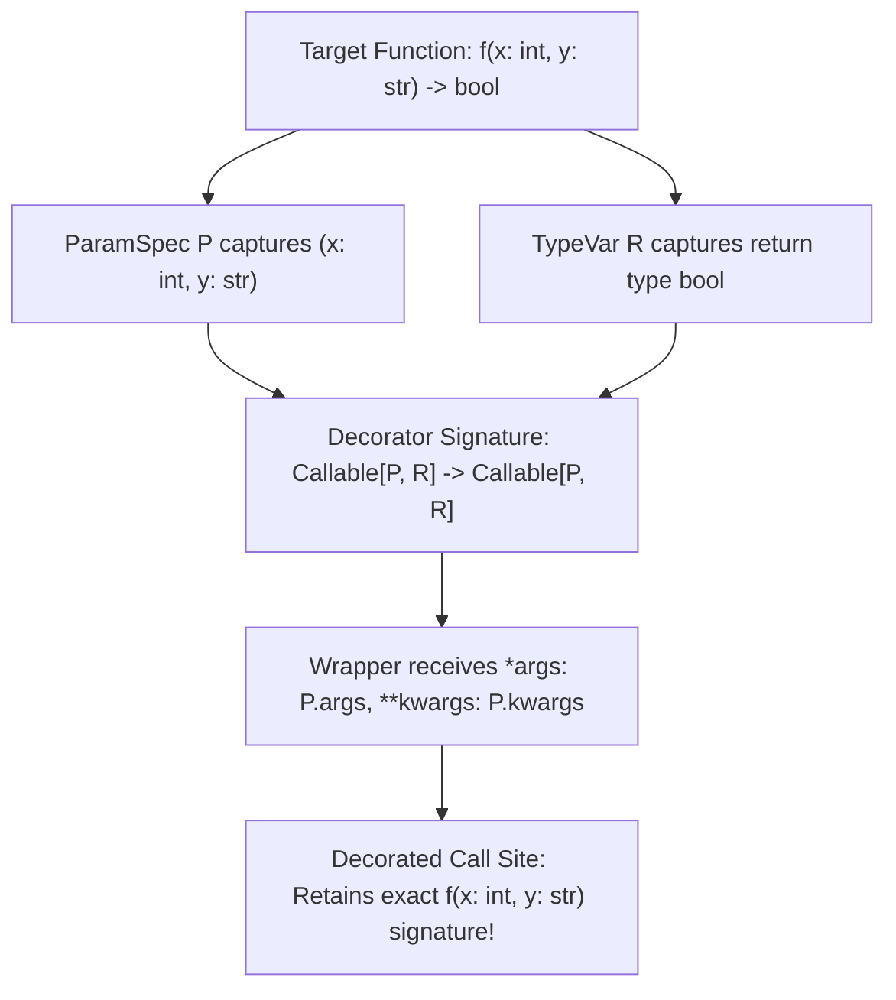

# ParamSpec, Concatenate, and Higher-Order Callable Typing

Python is renowned for first-class functions and powerful decorators. Prior to Python 3.10 and PEP 612, statically typing decorators was notoriously defective: wrapping a function with `Callable[..., R]` erased all parameter names, default arguments, and keyword arguments, rendering IDE autocompletion and static type checkers impotent at decorated call sites.

With **`ParamSpec`** and **`Concatenate`** (PEP 612), along with **`TypeVarTuple`** (PEP 646), Python's static type system can express complex higher-order functions, signature-preserving decorators, and parameter list modifications with precision.

---

## Table of Contents

1. [What & Why](#what--why)
2. [Core Concepts & Mental Model](#core-concepts--mental-model)
3. [How It Works Internally](#how-it-works-internally)
4. [Syntax & API Reference](#syntax--api-reference)
5. [Code Examples](#code-examples)
6. [Edge Cases, Pitfalls & Anti-Patterns](#edge-cases-pitfalls--anti-patterns)
7. [Performance & Memory Characteristics](#performance--memory-characteristics)
8. [CPython Internals & Bytecode](#cpython-internals--bytecode)
9. [Best Practices & Idiomatic Patterns](#best-practices--idiomatic-patterns)
10. [Real-World Case Study: Production Retry & Dependency-Injecting Transaction Decorator](#real-world-case-study-production-retry--dependency-injecting-transaction-decorator)
11. [Interview Questions & Deep-Dive Scenarios](#interview-questions--deep-dive-scenarios)
12. [Practical Exercises & Code Katas](#practical-exercises--code-katas)

---

## What & Why

Consider writing a simple logging or timing decorator:

```python
def logged(fn: Callable[..., R]) -> Callable[..., R]:
    ...
```

If `fn` originally had the signature `def calculate_interest(principal: float, rate: float, months: int = 12) -> float:`, wrapping it with `Callable[..., R]` causes static analyzers to see `calculate_interest(*args: Any, **kwargs: Any) -> float`.
- Callers passing wrong argument types (`calculate_interest("bad", "rate")`) will pass static analysis without warning!
- IDEs lose argument autocompletion and hover documentation.

`ParamSpec` captures the entire parameter signature of a callable—including positional, keyword-only, and default arguments—and conveys it intact to the wrapper function. `Concatenate` allows decorators to surgically prepend or strip parameters (such as injecting a database session or stripping `self`).

---

## Core Concepts & Mental Model

### ParamSpec Mechanics



### Concatenate Parameter Manipulation

`Concatenate[FirstArg, P]` represents an argument list where `FirstArg` precedes whatever parameters are captured by `P`:

```mermaid
graph LR
    subgraph Inside Function Implementation
        G["Method expects: (db: DatabaseSession, user_id: int) -> User"]
    end
    
    subgraph Decorated Consumer View
        H["Concatenate strips db: Consumer sees only (user_id: int) -> User"]
    end

    G -->|Concatenate[DatabaseSession, P] transformed to Callable[P, R]| H
```

---

## How It Works Internally

1. **`ParamSpec("P")`**: Represents a parameter list as a single type variable. It cannot be used alone as a variable type; it only appears inside `Callable` parameter lists or as `.args` and `.kwargs` attributes.
2. **`P.args`**: Special marker indicating positional arguments adhering to `P`.
3. **`P.kwargs`**: Special marker indicating keyword arguments adhering to `P`.
4. **`Concatenate[T1, T2, P]`**: Constructs a new parameter list starting with types `T1, T2` followed by the parameter list `P`.
5. **Python 3.12+ PEP 695 Syntax**: In Python 3.12, type parameter lists support `**P` syntax: `def decorator[**P, R](func: Callable[P, R]) -> Callable[P, R]:`.

---

## Syntax & API Reference

### 1. Modern PEP 695 Syntax (Python 3.12+)

```python
from collections.abc import Callable

# **P defines a ParamSpec, R defines a TypeVar
def logged[**P, R](func: Callable[P, R]) -> Callable[P, R]:
    def wrapper(*args: P.args, **kwargs: P.kwargs) -> R:
        print(f"Calling {func.__name__}")
        return func(*args, **kwargs)
    return wrapper
```

### 2. Legacy Syntax (Python 3.10 / 3.11)

```python
from typing import ParamSpec, TypeVar, Callable

P = ParamSpec("P")
R = TypeVar("R")

def logged(func: Callable[P, R]) -> Callable[P, R]:
    def wrapper(*args: P.args, **kwargs: P.kwargs) -> R:
        return func(*args, **kwargs)
    return wrapper
```

### 3. Parameter Manipulation with `Concatenate`

```python
from typing import Concatenate, Callable, ParamSpec, TypeVar

P = ParamSpec("P")
R = TypeVar("R")

# Accepts a function that requires a Connection as first arg, returns a function that does not
def with_connection(
    func: Callable[Concatenate[Connection, P], R]
) -> Callable[P, R]:
    def wrapper(*args: P.args, **kwargs: P.kwargs) -> R:
        conn = get_default_connection()
        return func(conn, *args, **kwargs)
    return wrapper
```

---

## Code Examples

### Example 1: Signature-Preserving Timing Decorator

```python
import time
from collections.abc import Callable
from functools import wraps

def timed[**P, R](func: Callable[P, R]) -> Callable[P, R]:
    """Decorator that measures execution time while preserving exact type signatures."""
    @wraps(func)
    def wrapper(*args: P.args, **kwargs: P.kwargs) -> R:
        t0 = time.perf_counter()
        result = func(*args, **kwargs)
        elapsed = (time.perf_counter() - t0) * 1000
        print(f"[{func.__name__}] took {elapsed:.2f}ms")
        return result
    return wrapper

@timed
def compute_sum(limit: int, step: int = 1) -> int:
    return sum(range(0, limit, step))

# Static type checkers verify:
# - limit must be int
# - step is optional int
# - returns int
total = compute_sum(100_000, step=2)
print("Total:", total)
# Output:
# [compute_sum] took ...ms
# Total: 2499950000
```

### Example 2: Parameter Injection via `Concatenate`

```python
from collections.abc import Callable
from typing import Concatenate
from functools import wraps

class RequestContext:
    def __init__(self, trace_id: str, client_ip: str) -> None:
        self.trace_id = trace_id
        self.client_ip = client_ip

def inject_context[**P, R](
    fn: Callable[Concatenate[RequestContext, P], R]
) -> Callable[P, R]:
    """Wraps a handler requiring RequestContext, supplying it automatically."""
    @wraps(fn)
    def wrapper(*args: P.args, **kwargs: P.kwargs) -> R:
        ctx = RequestContext(trace_id="req_98124", client_ip="192.168.1.100")
        return fn(ctx, *args, **kwargs)
    return wrapper

# Handlers take ctx as first parameter:
@inject_context
def create_order(ctx: RequestContext, order_id: str, amount: float) -> str:
    return f"Order {order_id} (${amount:.2f}) processed under trace {ctx.trace_id} from {ctx.client_ip}"

# Caller does NOT supply ctx! Type checker enforces (order_id: str, amount: float):
res = create_order("ORD-5541", 99.95)
print(res)
# Output:
# Order ORD-5541 ($99.95) processed under trace req_98124 from 192.168.1.100
```

### Example 3: Decorator Factory with Custom Configuration

```python
from collections.abc import Callable
from functools import wraps

def repeat(times: int) -> Callable[[Callable[**P, R]], Callable[P, R]]:
    """Decorator factory repeating function execution N times."""
    def decorator[**P, R](func: Callable[P, R]) -> Callable[P, R]:
        @wraps(func)
        def wrapper(*args: P.args, **kwargs: P.kwargs) -> R:
            result: R
            for _ in range(times):
                result = func(*args, **kwargs)
            return result
        return wrapper
    return decorator

@repeat(times=3)
def ping_service(host: str, port: int) -> str:
    print(f"Pinging {host}:{port}...")
    return f"ACK-{host}"

status = ping_service("redis.cluster.local", 6379)
print(f"Final status: {status}")
# Output:
# Pinging redis.cluster.local:6379...
# Pinging redis.cluster.local:6379...
# Pinging redis.cluster.local:6379...
# Final status: ACK-redis.cluster.local
```

### Example 4: Asynchronous Callable Wrapper

```python
import asyncio
from collections.abc import Callable, Coroutine
from functools import wraps
from typing import Any

def async_logger[**P, R](
    func: Callable[P, Coroutine[Any, Any, R]]
) -> Callable[P, Coroutine[Any, Any, R]]:
    @wraps(func)
    async def wrapper(*args: P.args, **kwargs: P.kwargs) -> R:
        print(f"[Async LOG] Invoking coroutine {func.__name__}")
        res = await func(*args, **kwargs)
        print(f"[Async LOG] Coroutine {func.__name__} completed")
        return res
    return wrapper

@async_logger
async def fetch_user_balance(user_id: int) -> float:
    await asyncio.sleep(0.01)
    return 1500.50

async def main() -> None:
    bal = await fetch_user_balance(42)
    print("Balance:", bal)

asyncio.run(main())
# Output:
# [Async LOG] Invoking coroutine fetch_user_balance
# [Async LOG] Coroutine fetch_user_balance completed
# Balance: 1500.5
```

### Example 5: TypeVarTuple (PEP 646) Variadic Generics

```python
from typing import TypeVarTuple, Generic

Ts = TypeVarTuple("Ts")

class Array(Generic[*Ts]):
    """Multi-dimensional tensor/array parameterized by dimension types or shapes."""
    def __init__(self, *shape: *Ts) -> None:
        self.shape: tuple[*Ts] = shape

    def get_shape(self) -> tuple[*Ts]:
        return self.shape

# Demonstrating shape-safe representations
tensor_2d: Array[int, int] = Array(1920, 1080)
tensor_3d: Array[int, int, int] = Array(3, 224, 224)

print("2D shape:", tensor_2d.get_shape())
print("3D shape:", tensor_3d.get_shape())
# Output:
# 2D shape: (1920, 1080)
# 3D shape: (3, 224, 224)
```

---

## Edge Cases, Pitfalls & Anti-Patterns

### Common Mistakes Table

| Mistake | Bad Code | Correct Idiom | Why It Fails |
|:---|:---|:---|:---|
| **Using `ParamSpec` outside Callable** | `def f(x: P): ...` | Only use `P` inside `Callable[P, R]` or as `P.args/P.kwargs` | `ParamSpec` represents an entire parameter list, not a single individual type. |
| **Separating `*args: P.args` and `**kwargs: P.kwargs`** | Passing only `*args: P.args` without `**kwargs` | Always pair `*args: P.args, **kwargs: P.kwargs` together | Incomplete parameter forwarding violates signature parity. |
| **Using `Callable[..., R]` in decorators** | `def dec(fn: Callable[..., R]) -> Callable[..., R]:` | `def dec[**P, R](fn: Callable[P, R]) -> Callable[P, R]:` | Destroys call-site type verification and parameter autocompletion. |
| **Wrong `Concatenate` ordering** | `Concatenate[P, int]` | `Concatenate[int, P]` | Fixed parameter types MUST precede `P` in `Concatenate`. |
| **Missing `@wraps`** | Wrapping function without `@functools.wraps` | Always apply `@wraps(func)` to wrapper | Breaks `__name__`, `__doc__`, and introspection tools. |
| **Ignoring return type parametrization** | `Callable[P, Any]` | `Callable[P, R]` with TypeVar `R` | Forfeits return type inference at call sites. |

---

## Performance & Memory Characteristics

- **Zero Runtime Overhead**: `ParamSpec` and `Concatenate` are purely static type-checking annotations. At runtime, they instantiate lightweight descriptor objects in the `typing` module without impacting execution speed.
- **Microbenchmarks**: Wrapper execution speed depends solely on Python's function invocation cost (~80ns) and any `@wraps` attribute copying overhead during module initialization.

---

## CPython Internals & Bytecode

Let us inspect how CPython creates and manages `ParamSpec` objects:

```python
from typing import ParamSpec, Concatenate, Callable

P = ParamSpec("P")
print("ParamSpec repr:", repr(P))
print("ParamSpec args:", repr(P.args))
print("ParamSpec kwargs:", repr(P.kwargs))

Sig = Callable[Concatenate[int, P], str]
print("Concatenate expression:", Sig)
```

Output:
```text
ParamSpec repr: ~P
ParamSpec args: ~P.args
ParamSpec kwargs: ~P.kwargs
Concatenate expression: typing.Callable[typing.Concatenate[int, ~P], str]
```

At the CPython AST and runtime level, `typing.ParamSpec` instances act as specialized markers that static analyzers (Pyright, Mypy) match against function symbol tables.

---

## Best Practices & Idiomatic Patterns

1. **Always Use PEP 695 `[**P, R]` in Python 3.12+**: Avoid manual `P = ParamSpec("P")` instantiation.
2. **Combine with `@wraps`**: Keep runtime metadata aligned with static signatures.
3. **Use `Concatenate` for Framework Middleware**: Ideal for authentication filters, database transaction managers, and telemetry injection.
4. **Distinguish Variadic Containers (`TypeVarTuple`) from Callables (`ParamSpec`)**: Use `ParamSpec` for functions; use `TypeVarTuple` for heterogeneous tuples and tensor shapes.

---

## Real-World Case Study: Production Retry & Dependency-Injecting Transaction Decorator

Below is a complete transaction and retry management decorator used in high-throughput database services:

```python
import time
from collections.abc import Callable
from typing import Concatenate
from functools import wraps

class DatabaseSession:
    """Mock database transaction session."""
    def __init__(self, dsn: str) -> None:
        self.dsn = dsn
        self.in_transaction = False

    def begin(self) -> None:
        self.in_transaction = True
        print(f"[DB] Began transaction on {self.dsn}")

    def commit(self) -> None:
        self.in_transaction = False
        print(f"[DB] Committed transaction on {self.dsn}")

    def rollback(self) -> None:
        self.in_transaction = False
        print(f"[DB] Rolled back transaction on {self.dsn}")

def transactional(max_retries: int = 3, dsn: str = "postgresql://localhost:5432/orders"):
    """
    Decorator factory that:
    1. Injects an active DatabaseSession into the function's first argument.
    2. Retries up to max_retries on transient failures.
    3. Commits on success, rolls back on error.
    """
    def decorator[**P, R](
        func: Callable[Concatenate[DatabaseSession, P], R]
    ) -> Callable[P, R]:
        @wraps(func)
        def wrapper(*args: P.args, **kwargs: P.kwargs) -> R:
            attempts = 0
            while True:
                attempts += 1
                session = DatabaseSession(dsn)
                session.begin()
                try:
                    result = func(session, *args, **kwargs)
                    session.commit()
                    return result
                except Exception as exc:
                    session.rollback()
                    if attempts >= max_retries:
                        print(f"[DB] Max retries ({max_retries}) exceeded.")
                        raise
                    print(f"[DB] Transient failure: {exc}. Retrying ({attempts}/{max_retries})...")
                    time.sleep(0.05)
        return wrapper
    return decorator

# Business logic function
@transactional(max_retries=2)
def process_payment(session: DatabaseSession, customer_id: str, amount: float) -> bool:
    print(f"Executing SQL: INSERT INTO payments VALUES ('{customer_id}', {amount}) via {session.dsn}")
    return True

# Call site: Note that callers do NOT pass `session`!
status = process_payment("cust_9981", 450.00)
print(f"Payment success: {status}")
# Output:
# [DB] Began transaction on postgresql://localhost:5432/orders
# Executing SQL: INSERT INTO payments VALUES ('cust_9981', 450.0) via postgresql://localhost:5432/orders
# [DB] Committed transaction on postgresql://localhost:5432/orders
# Payment success: True
```

---

## Interview Questions & Deep-Dive Scenarios

<details>
<summary>1. Why was `Callable[..., R]` insufficient for typing decorators before PEP 612?</summary>

`Callable[..., R]` only captures the return type `R`. The ellipsis `...` acts as an untyped wildcard for arguments. Consequently:
- Any call with invalid argument types or mismatched argument counts passes type checking without warning.
- IDEs cannot display parameter names, types, or docstrings at decorated call sites.
- Keyword arguments and optional parameters cannot be verified statically.
</details>

<details>
<summary>2. Can `Concatenate` be used to append an argument to the end of a parameter list?</summary>

No. Currently, `Concatenate` only supports prepending arguments to the beginning of a parameter list (e.g., `Concatenate[A, B, P]`). Appending arguments to the end is mathematically and semantically ambiguous due to Python's support for arbitrary keyword arguments (`**kwargs`) and variable positional arguments (`*args`).
</details>

<details>
<summary>3. What is the difference between `ParamSpec` and `TypeVarTuple`?</summary>

- **`ParamSpec` (PEP 612)**: Models the complex structure of a callable's argument list, including positional-only, keyword-only, default values, and variadic arguments.
- **`TypeVarTuple` (PEP 646)**: Models a variable-length sequence of arbitrary types, primarily designed for indexing variadic tuples and tensor shapes in linear algebra or scientific computing (e.g., `tuple[*Ts]`).
</details>

<details>
<summary>4. How does Python 3.12 PEP 695 simplify `ParamSpec` syntax?</summary>

Instead of importing `ParamSpec` and declaring `P = ParamSpec("P")` at module scope, Python 3.12 allows declaring it inline in type parameter brackets using double asterisks: `def decorator[**P, R](fn: Callable[P, R]) -> Callable[P, R]:`.
</details>

<details>
<summary>5. What happens if a wrapper decorated with `P.args` and `P.kwargs` modifies the arguments before passing them?</summary>

Static type checkers will flag an error if the modified arguments violate `P`'s inferred contract. If you unpack and alter `*args`, type checkers can no longer guarantee compatibility with `P.args`.
</details>

<details>
<summary>6. Can `Concatenate` be used with asynchronous functions?</summary>

Yes. The signature simply wraps the return type in a `Coroutine`:
```python
Callable[Concatenate[Session, P], Coroutine[Any, Any, R]]
```
</details>

<details>
<summary>7. Why must `*args: P.args` and `**kwargs: P.kwargs` always appear together in wrapper signatures?</summary>

`ParamSpec` represents the holistic parameter signature. Python’s type system enforces that `P.args` and `P.kwargs` originate from the same `ParamSpec` instance and must be passed together to preserve both positional and keyword argument contracts.
</details>

<details>
<summary>8. How do you type a decorator that adds a new keyword argument to a function?</summary>

Currently, standard Python typing does not support appending keyword-only arguments to a `ParamSpec`. To express this statically, developers typically define explicit `@overload` signatures or use Protocols.
</details>

---

## Practical Exercises & Code Katas

### Exercise 1: Signature-Preserving Memoization Decorator
Implement a generic `@memoize` decorator using `ParamSpec` and `TypeVar` that caches results based on arguments while preserving exact static typing.

<details>
<summary>Solution</summary>

```python
from collections.abc import Callable
from functools import wraps

def memoize[**P, R](func: Callable[P, R]) -> Callable[P, R]:
    cache: dict[tuple[object, ...], R] = {}

    @wraps(func)
    def wrapper(*args: P.args, **kwargs: P.kwargs) -> R:
        key = (args, tuple(sorted(kwargs.items())))
        if key not in cache:
            cache[key] = func(*args, **kwargs)
        return cache[key]
    return wrapper

@memoize
def fib(n: int) -> int:
    return n if n < 2 else fib(n - 1) + fib(n - 2)

print("Fib(10):", fib(10))  # 55
```
</details>

### Exercise 2: Authentication Context Injection with `Concatenate`
Build an `@authenticated` decorator that extracts a user token, constructs a `UserPrincipal`, and passes it as the first argument to the protected endpoint.

<details>
<summary>Solution</summary>

```python
from collections.abc import Callable
from typing import Concatenate
from functools import wraps

class UserPrincipal:
    def __init__(self, username: str, roles: list[str]) -> None:
        self.username = username
        self.roles = roles

def authenticated[**P, R](
    handler: Callable[Concatenate[UserPrincipal, P], R]
) -> Callable[P, R]:
    @wraps(handler)
    def wrapper(*args: P.args, **kwargs: P.kwargs) -> R:
        user = UserPrincipal(username="sysadmin", roles=["admin", "operator"])
        return handler(user, *args, **kwargs)
    return wrapper

@authenticated
def delete_cluster(user: UserPrincipal, cluster_id: str, force: bool = False) -> str:
    return f"User {user.username} deleted {cluster_id} (force={force})"

print(delete_cluster("k8s-prod-us-east", force=True))
# Output: User sysadmin deleted k8s-prod-us-east (force=True)
```
</details>

### Exercise 3: Typed Event Listener Registrar
Implement an event listener registry where callbacks can register for specific named events and accept typed arguments.

<details>
<summary>Solution</summary>

```python
from collections.abc import Callable

class EventRegistry[**P]:
    def __init__(self) -> None:
        self._handlers: list[Callable[P, None]] = []

    def subscribe(self, handler: Callable[P, None]) -> None:
        self._handlers.append(handler)

    def trigger(self, *args: P.args, **kwargs: P.kwargs) -> None:
        for handler in self._handlers:
            handler(*args, **kwargs)

click_events: EventRegistry[int, int] = EventRegistry()
click_events.subscribe(lambda x, y: print(f"Clicked at ({x}, {y})"))
click_events.trigger(100, 250)
# Output: Clicked at (100, 250)
```
</details>

### Exercise 4: Variadic Shape Verification with `TypeVarTuple`
Create a function that transposes the outer two dimensions of a tensor parameterized by `TypeVarTuple`.

<details>
<summary>Solution</summary>

```python
from typing import TypeVarTuple, Generic

Ts = TypeVarTuple("Ts")

class Tensor(Generic[*Ts]):
    def __init__(self, shape: tuple[*Ts]) -> None:
        self.shape = shape

def swap_first_two[D1, D2, *Rest](
    tensor: Tensor[D1, D2, *Rest]
) -> Tensor[D2, D1, *Rest]:
    d1, d2, *rest = tensor.shape
    new_shape = (d2, d1, *rest)
    return Tensor(new_shape)

t: Tensor[int, str, float] = Tensor((10, "channels", 3.14))
swapped = swap_first_two(t)
print("Swapped shape:", swapped.shape)
# Output: Swapped shape: ('channels', 10, 3.14)
```
</details>

### Exercise 5: Rate Limiter Decorator with Fallback Value
Create a rate-limiting decorator that returns a default fallback value if the function is invoked more than N times per second.

<details>
<summary>Solution</summary>

```python
import time
from collections.abc import Callable
from functools import wraps

def rate_limit[**P, R](max_per_sec: int, fallback: R) -> Callable[[Callable[P, R]], Callable[P, R]]:
    interval = 1.0 / max_per_sec
    last_called = 0.0

    def decorator(func: Callable[P, R]) -> Callable[P, R]:
        @wraps(func)
        def wrapper(*args: P.args, **kwargs: P.kwargs) -> R:
            nonlocal last_called
            now = time.time()
            if now - last_called < interval:
                return fallback
            last_called = now
            return func(*args, **kwargs)
        return wrapper
    return decorator

@rate_limit(max_per_sec=2, fallback="RATE_LIMITED")
def query_api(endpoint: str) -> str:
    return f"Response from {endpoint}"

print(query_api("/users"))
print(query_api("/users"))
# Output:
# Response from /users
# RATE_LIMITED
```
</details>

### Exercise 6: Synchronous Wrapper for Async Coroutines
Write a signature-preserving decorator that converts an asynchronous coroutine into a blocking synchronous callable using `asyncio.run`.

<details>
<summary>Solution</summary>

```python
import asyncio
from collections.abc import Callable, Coroutine
from functools import wraps
from typing import Any

def to_sync[**P, R](
    async_fn: Callable[P, Coroutine[Any, Any, R]]
) -> Callable[P, R]:
    @wraps(async_fn)
    def wrapper(*args: P.args, **kwargs: P.kwargs) -> R:
        return asyncio.run(async_fn(*args, **kwargs))
    return wrapper

@to_sync
async def async_fetch(url: str) -> dict[str, str]:
    await asyncio.sleep(0.01)
    return {"url": url, "status": "200 OK"}

# Synchronous call site:
result = async_fetch("https://api.internal/data")
print("Fetched synchronously:", result)
# Output:
# Fetched synchronously: {'url': 'https://api.internal/data', 'status': '200 OK'}
```
</details>
