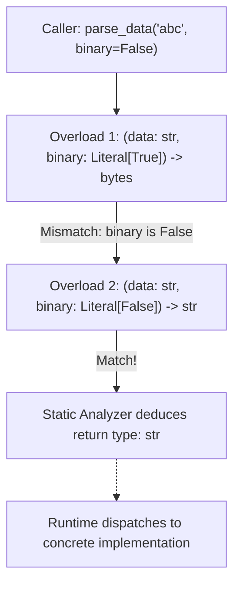

# Function Overloads, TypeGuard, and TypeIs Narrowing

Static typing in Python must accommodate dynamic idioms where a single function returns radically different types depending on input arguments, flags, or data shapes (e.g., `open(..., 'r')` returns `TextIO`, while `open(..., 'rb')` returns `BinaryIO`).

To model these polymorphic behaviors statically without runtime overhead, Python provides **`@typing.overload`**. Furthermore, when custom validation logic determines an object's type, Python offers user-defined type narrowing predicates: **`TypeGuard`** (PEP 647) and its modern, strictly bidirectional successor **`TypeIs`** (PEP 742, added in Python 3.13).

---

## Table of Contents

1. [What & Why](#what--why)
2. [Core Concepts & Mental Model](#core-concepts--mental-model)
3. [How It Works Internally](#how-it-works-internally)
4. [Syntax & API Reference](#syntax--api-reference)
5. [Code Examples](#code-examples)
6. [Edge Cases, Pitfalls & Anti-Patterns](#edge-cases-pitfalls--anti-patterns)
7. [Performance & Memory Characteristics](#performance--memory-characteristics)
8. [CPython Internals & Bytecode](#cpython-internals--bytecode)
9. [Best Practices & Idiomatic Patterns](#best-practices--idiomatic-patterns)
10. [Real-World Case Study: Heterogeneous Event Ingestion and Narrowing Pipeline](#real-world-case-study-heterogeneous-event-ingestion-and-narrowing-pipeline)
11. [Interview Questions & Deep-Dive Scenarios](#interview-questions--deep-dive-scenarios)
12. [Practical Exercises & Code Katas](#practical-exercises--code-katas)

---

## What & Why

### The Polymorphic Return Problem

Consider a parser function:

```python
def parse_payload(raw: bytes, as_json: bool = False):
    return json.loads(raw) if as_json else raw.decode("utf-8")
```

If annotated as `def parse_payload(raw: bytes, as_json: bool = False) -> dict[str, Any] | str:`, every caller must perform defensive type checks (`isinstance(result, dict)`) even when they explicitly passed `as_json=True`!
`@overload` enables the static type checker to deduce that `parse_payload(b"...", as_json=True)` returns `dict[str, Any]`, while `parse_payload(b"...", as_json=False)` returns `str`.

### The Custom Validation Narrowing Problem

Built-in type narrowing works automatically with `isinstance(x, int)` or `x is not None`. But what if validation is encapsulated in a helper function (`is_valid_user(data)`)? Without type narrowing annotations, the type checker forgets the narrowed type as soon as the helper function returns a plain `bool`.

`TypeGuard` and `TypeIs` solve this by instructing the type checker to update its internal symbol table inside conditional branches.

---

## Core Concepts & Mental Model

### Overload Resolution Order

Static type checkers evaluate overload signatures sequentially from top to bottom. The first signature that matches the call arguments is selected:



### TypeGuard vs TypeIs (PEP 647 vs PEP 742)

```mermaid
graph TD
    subgraph TypeGuard (One-Way Narrowing)
        TG["if is_str_list(val): (val is narrowed to list[str])"]
        TG -->|else branch| TGE["val remains UNCHANGED (original type)"]
    end

    subgraph TypeIs (Bidirectional Narrowing)
        TI["if is_str(val): (val is narrowed to str)"]
        TI -->|else branch| TIE["val is mathematically subtracted: Type - str"]
    end
```

| Dimension | `TypeGuard[T]` (PEP 647 / Python 3.10+) | `TypeIs[T]` (PEP 742 / Python 3.13+) |
|:---|:---|:---|
| **Positive Branch (`if`)** | Narrowed to `T` (even if `T` is not a subtype) | Narrowed to intersection of `Original & T` |
| **Negative Branch (`else`)** | **No narrowing** (keeps original broad type) | **Strict narrowing** (subtracts `T` from original union) |
| **Subtyping Requirement** | `T` can be an arbitrary unrelated type | `T` must be consistent with the input type |
| **Recommended Use** | Legacy codebases, non-strict type transitions | All modern type predicates in Python 3.13+ |

---

## How It Works Internally

### Runtime Behavior of `@overload`

At runtime, `@typing.overload` simply overwrites the preceding decorated function definition with a dummy sentinel. Only the final, non-decorated implementation function is retained in the module namespace:

```python
from typing import overload

@overload
def process(x: int) -> int: ...

@overload
def process(x: str) -> str: ...

def process(x: int | str) -> int | str:
    return x * 2
```

At runtime, `process` points solely to the concrete implementation function. The overload signatures exist exclusively for AST inspection and type checker stubs.

---

## Syntax & API Reference

### 1. Overload Definition Syntax

```python
from typing import overload, Literal

@overload
def query(user_id: int, include_meta: Literal[True]) -> dict[str, object]: ...

@overload
def query(user_id: int, include_meta: Literal[False] = ...) -> str: ...

def query(user_id: int, include_meta: bool = False) -> dict[str, object] | str:
    if include_meta:
        return {"id": user_id, "status": "active"}
    return f"User-{user_id}"
```

### 2. `TypeGuard` Syntax (PEP 647)

```python
from typing import TypeGuard

def is_string_list(val: list[object]) -> TypeGuard[list[str]]:
    return all(isinstance(x, str) for x in val)
```

### 3. `TypeIs` Syntax (PEP 742 / Python 3.13+)

```python
from typing import TypeIs  # In Python 3.13+, or typing_extensions in older versions

def is_int(val: object) -> TypeIs[int]:
    return isinstance(val, int)
```

---

## Code Examples

### Example 1: Function Overloads with `Literal` Discrimination

```python
from typing import overload, Literal

@overload
def read_config(path: str, format: Literal["json"]) -> dict[str, object]: ...

@overload
def read_config(path: str, format: Literal["text"]) -> str: ...

@overload
def read_config(path: str, format: Literal["raw"]) -> bytes: ...

def read_config(path: str, format: str) -> dict[str, object] | str | bytes:
    if format == "json":
        return {"server": "prod-1", "port": 443}
    elif format == "text":
        return "server=prod-1\nport=443"
    elif format == "raw":
        return b"\x00\x01\x02"
    raise ValueError(f"Unknown format: {format}")

# Static type checkers correctly infer distinct types:
cfg_dict = read_config("app.conf", format="json")  # Inferred as dict[str, object]
cfg_text = read_config("app.conf", format="text")  # Inferred as str
cfg_raw  = read_config("app.conf", format="raw")   # Inferred as bytes

print(f"JSON dict keys: {list(cfg_dict.keys())}")
print(f"Text upper: {cfg_text.splitlines()[0]}")
print(f"Raw byte count: {len(cfg_raw)}")
# Output:
# JSON dict keys: ['server', 'port']
# Text upper: server=prod-1
# Raw byte count: 3
```

### Example 2: Method Overloading with Optional Parameters

```python
from typing import overload

class Cache:
    def __init__(self) -> None:
        self._store: dict[str, int] = {"ttl": 3600}

    @overload
    def get(self, key: str) -> int | None: ...

    @overload
    def get[T](self, key: str, default: T) -> int | T: ...

    def get(self, key: str, default: object = None) -> object:
        return self._store.get(key, default)

cache = Cache()
v1 = cache.get("ttl")              # Type: int | None
v2 = cache.get("missing", 0)       # Type: int
v3 = cache.get("missing", "none")  # Type: int | str

print(f"v1: {v1}, v2: {v2}, v3: {v3}")
# Output:
# v1: 3600, v2: 0, v3: none
```

### Example 3: User-Defined `TypeGuard` for Homogeneous Sequences

```python
from typing import TypeGuard

def is_float_list(items: list[object]) -> TypeGuard[list[float]]:
    """TypeGuard narrowing list[object] to list[float]."""
    return all(isinstance(x, (int, float)) for x in items)

def calculate_variance(data: list[object]) -> float:
    if is_float_list(data):
        # Inside this branch, static analyzer treats data as list[float]
        mean = sum(data) / len(data)
        return sum((x - mean) ** 2 for x in data) / len(data)
    raise TypeError("Dataset must contain only numbers")

dataset: list[object] = [10.0, 12.0, 23.0, 30.0]
var = calculate_variance(dataset)
print(f"Calculated variance: {var:.2f}")
# Output:
# Calculated variance: 65.69
```

### Example 4: `TypeIs` Bidirectional Narrowing (Python 3.13)

```python
import sys
if sys.version_info >= (3, 13):
    from typing import TypeIs
else:
    from typing_extensions import TypeIs

def is_integer(val: int | str) -> TypeIs[int]:
    return isinstance(val, int)

def process_item(item: int | str) -> str:
    if is_integer(item):
        # TypeIs narrows item to int in true branch:
        return f"Integer squared: {item ** 2}"
    else:
        # TypeIs narrows item to str in false branch!
        return f"String uppercase: {item.upper()}"

print(process_item(12))
print(process_item("hello"))
# Output:
# Integer squared: 144
# String uppercase: HELLO
```

### Example 5: Type Narrowing with Tagged Unions (Discriminated Unions)

```python
from dataclasses import dataclass
from typing import Literal

@dataclass
class SuccessResponse:
    status: Literal["success"]
    data: list[str]

@dataclass
class ErrorResponse:
    status: Literal["error"]
    error_code: int
    message: str

type ApiResponse = SuccessResponse | ErrorResponse

def handle_api_response(resp: ApiResponse) -> str:
    # Python's type checker narrows resp based on the literal tag:
    if resp.status == "success":
        # resp is statically narrowed to SuccessResponse
        return f"Loaded {len(resp.data)} items"
    else:
        # resp is statically narrowed to ErrorResponse
        return f"Failed with code {resp.error_code}: {resp.message}"

s = SuccessResponse(status="success", data=["item1", "item2"])
e = ErrorResponse(status="error", error_code=404, message="Not Found")

print(handle_api_response(s))
print(handle_api_response(e))
# Output:
# Loaded 2 items
# Failed with code 404: Not Found
```

---

## Edge Cases, Pitfalls & Anti-Patterns

### Common Mistakes Table

| Mistake | Bad Code | Correct Idiom | Why It Fails |
|:---|:---|:---|:---|
| **Placing general overload before specific overload** | Putting `def f(x: object)` before `def f(x: int)` | Specific overloads must precede broader signatures | Top-to-bottom resolution causes the broad overload to swallow all matches. |
| **Writing code inside `@overload` body** | Writing executable logic in an `@overload` function | Use `...` (Ellipsis) as the entire function body | Overloaded definitions are overwritten and never executed at runtime. |
| **Forgetting non-overloaded implementation** | Declaring `@overload` functions without the final implementation | Always end with an un-decorated implementation function | Missing implementation raises `NameError` or executes dummy ellipsis. |
| **Assuming `TypeGuard` narrows the `else` branch** | Expecting `else:` to subtract `TypeGuard[T]` | Use `TypeIs[T]` (PEP 742) for bidirectional narrowing | `TypeGuard` leaves the negative branch's type unchanged. |
| **Incompatible implementation signature** | Implementation signature narrower than overload union | Ensure implementation signature covers all overloads | Static type checker reports implementation incompatibility. |
| **Incorrect `TypeGuard` predicate logic** | Returning `True` without checking all elements | Ensure runtime condition strictly verifies type invariant | Static analyzer assumes truth, causing runtime `AttributeError` later. |

---

## Performance & Memory Characteristics

### Static vs Runtime Overhead

1. **`@overload` Runtime Cost**: At module import time, each `@overload` decorator simply assigns a wrapper function and is promptly replaced by the next definition. In production execution, calling an overloaded function has **zero** additional dispatch overhead compared to a normal Python function call.
2. **`TypeGuard` / `TypeIs` Cost**: Pure Python function execution speed. If verifying a list of 1,000,000 elements via `all(isinstance(x, str) for x in lst)`, the check is $O(N)$ at runtime. For hot paths, consider checking only boundaries or using sampling.

---

## CPython Internals & Bytecode

Let us inspect how CPython handles overloaded definitions during module compilation:

```python
from typing import overload

@overload
def sample(x: int) -> int: ...

@overload
def sample(x: str) -> str: ...

def sample(x: object) -> object:
    return x

import dis
print("Bytecode of final sample implementation:")
dis.dis(sample)
```

Output:
```text
Bytecode of final sample implementation:
  1           0 RESUME                   0
  2           2 LOAD_FAST                0 (x)
              4 RETURN_VALUE
```

The module namespace only stores the final `sample` function object. The `@overload` functions are parsed, registered in `typing.get_overloads(sample)` if introspected, and immediately discarded from the active execution path.

---

## Best Practices & Idiomatic Patterns

1. **Use `Literal` Types as Overload Discriminators**: Ideal for boolean flags (`as_bytes: Literal[True]`), enum tags, or string formats.
2. **Always Transition to `TypeIs` for New Code on Python 3.13+**: Prefer `TypeIs` over `TypeGuard` to benefit from sound negative branch narrowing.
3. **Keep the Implementation Signature Internal and Broad**: Use unions or `object` in the implementation signature, and rely on the overloads for public API contracts.
4. **Use Ellipsis (`...`) in Overload Bodies**: Standard convention across typeshed and Python core.

---

## Real-World Case Study: Heterogeneous Event Ingestion and Narrowing Pipeline

Below is a production stream processor handling heterogeneous IoT telemetry packets, using `@overload` for schema ingestion and `TypeIs` for event classification:

```python
import sys
from typing import overload, Literal
from dataclasses import dataclass

if sys.version_info >= (3, 13):
    from typing import TypeIs
else:
    from typing_extensions import TypeIs

@dataclass(frozen=True)
class TemperatureEvent:
    sensor_id: str
    temperature_c: float

@dataclass(frozen=True)
class PressureEvent:
    sensor_id: str
    pressure_kpa: float

@dataclass(frozen=True)
class HeartbeatEvent:
    sensor_id: str
    uptime_seconds: int

type SensorEvent = TemperatureEvent | PressureEvent | HeartbeatEvent

# Overloaded factory parser
@overload
def parse_telemetry(kind: Literal["temp"], sensor_id: str, value: float) -> TemperatureEvent: ...

@overload
def parse_telemetry(kind: Literal["pressure"], sensor_id: str, value: float) -> PressureEvent: ...

@overload
def parse_telemetry(kind: Literal["heartbeat"], sensor_id: str, value: int) -> HeartbeatEvent: ...

def parse_telemetry(kind: str, sensor_id: str, value: float | int) -> SensorEvent:
    if kind == "temp":
        return TemperatureEvent(sensor_id=sensor_id, temperature_c=float(value))
    elif kind == "pressure":
        return PressureEvent(sensor_id=sensor_id, pressure_kpa=float(value))
    elif kind == "heartbeat":
        return HeartbeatEvent(sensor_id=sensor_id, uptime_seconds=int(value))
    raise ValueError(f"Unknown telemetry kind: {kind}")

# TypeIs predicates for sound branch narrowing
def is_temperature(event: SensorEvent) -> TypeIs[TemperatureEvent]:
    return isinstance(event, TemperatureEvent)

def is_pressure(event: SensorEvent) -> TypeIs[PressureEvent]:
    return isinstance(event, PressureEvent)

# Event Dispatcher Engine
def route_telemetry_event(event: SensorEvent) -> str:
    if is_temperature(event):
        # Statically narrowed to TemperatureEvent
        return f"[ALERT] Sensor {event.sensor_id} Temp: {event.temperature_c:.1f}°C"
    elif is_pressure(event):
        # Statically narrowed to PressureEvent
        return f"[LOG] Sensor {event.sensor_id} Pressure: {event.pressure_kpa:.2f} kPa"
    else:
        # Statically narrowed to HeartbeatEvent in the fallback branch!
        return f"[DIAG] Sensor {event.sensor_id} Heartbeat Uptime: {event.uptime_seconds}s"

# Execution test
e1 = parse_telemetry("temp", "SNS-A1", 88.4)
e2 = parse_telemetry("pressure", "SNS-B2", 101.325)
e3 = parse_telemetry("heartbeat", "SNS-C3", 86400)

print(route_telemetry_event(e1))
print(route_telemetry_event(e2))
print(route_telemetry_event(e3))
# Output:
# [ALERT] Sensor SNS-A1 Temp: 88.4°C
# [LOG] Sensor SNS-B2 Pressure: 101.32 kPa
# [DIAG] Sensor SNS-C3 Heartbeat Uptime: 86400s
```

---

## Interview Questions & Deep-Dive Scenarios

<details>
<summary>1. Why can't you define executable code inside `@overload` functions?</summary>

Because in Python, functions are defined sequentially at runtime. Every subsequent `def foo` statement in the same scope rebinds the name `foo` in the local or module dictionary, overwriting whatever preceded it. The `@typing.overload` decorator simply returns a dummy object; only the final, un-decorated `def` statement forms the actual executable function object bound to the name.
</details>

<details>
<summary>2. Why was `TypeIs` (PEP 742) introduced when `TypeGuard` (PEP 647) already existed?</summary>

`TypeGuard` has a severe soundness flaw: it does not narrow the `else` branch.
For example, if `is_str(x: int | str) -> TypeGuard[str]` is checked:
- In `if is_str(x):`, `x` is `str`.
- In `else:`, `x` remains `int | str` instead of narrowing to `int`.
Furthermore, `TypeGuard` allows arbitrary type widening (asserting `object` is `list[str]` without mathematical subtyping constraints).
`TypeIs` enforces strict subtyping and guarantees that the `else` branch subtracts the narrowed type from the union.
</details>

<details>
<summary>3. What is the rule for ordering `@overload` signatures?</summary>

Overloads must be ordered from most specific to least specific. Static type checkers evaluate signatures from top to bottom and select the first matching signature. If a broader signature (e.g., `(x: object)`) is placed before a narrower one (e.g., `(x: int)`), the broader signature will always match, effectively hiding the narrower one.
</details>

<details>
<summary>4. How do you overload `__getitem__` to return different types for slices vs single indices?</summary>

```python
@overload
def __getitem__(self, index: int) -> T: ...

@overload
def __getitem__(self, index: slice) -> list[T]: ...

def __getitem__(self, index: int | slice) -> T | list[T]:
    if isinstance(index, slice):
        return self._items[index]
    return self._items[index]
```
</details>

<details>
<summary>5. Can you use `TypeGuard` or `TypeIs` as class methods?</summary>

Yes! They can be declared as instance methods or static methods:
```python
class Node:
    def is_leaf(self) -> TypeIs["LeafNode"]:
        return len(self.children) == 0
```
Type checkers properly narrow `self` when invoked inside conditionals.
</details>

<details>
<summary>6. How does `typing.get_overloads()` work?</summary>

Introduced in Python 3.11, `typing.get_overloads(func)` inspects the internal overload registry for a function and returns a sequence of function objects representing the registered overload signatures.
</details>

<details>
<summary>7. What happens if none of the `@overload` signatures match the caller's arguments?</summary>

The static type checker emits an error indicating that no overload variant matches the provided argument types. At runtime, the call proceeds directly to the concrete implementation function, which may execute or raise an exception depending on its internal handling.
</details>

<details>
<summary>8. How do `@overload` and default arguments interact?</summary>

If an argument has a default value, you should generally provide distinct overloads for the call signature with the argument and without the argument (using `Literal` or omitted parameters) so callers without arguments receive accurate static inferences.
</details>

---

## Practical Exercises & Code Katas

### Exercise 1: Overloaded Safe Divison Function
Write an overloaded `divide` function where dividing by `float` returns `float`, and dividing two `int`s with `exact=True` returns a `tuple[int, int]` (quotient, remainder).

<details>
<summary>Solution</summary>

```python
from typing import overload, Literal

@overload
def divide(a: int, b: int, exact: Literal[True]) -> tuple[int, int]: ...

@overload
def divide(a: float, b: float, exact: Literal[False] = ...) -> float: ...

def divide(a: float, b: float, exact: bool = False) -> float | tuple[int, int]:
    if exact:
        return divmod(int(a), int(b))
    return a / b

q, r = divide(17, 5, exact=True)
val = divide(17.0, 5.0)
print(f"Exact: {q} rem {r}, Float: {val:.2f}")
# Output: Exact: 3 rem 2, Float: 3.40
```
</details>

### Exercise 2: Sound TypeIs Predicate for Non-Empty Strings
Implement a `TypeIs` predicate `is_non_empty_str(val: object)` that narrows `object` to `str`.

<details>
<summary>Solution</summary>

```python
import sys
if sys.version_info >= (3, 13):
    from typing import TypeIs
else:
    from typing_extensions import TypeIs

def is_non_empty_str(val: object) -> TypeIs[str]:
    return isinstance(val, str) and len(val.strip()) > 0

data: list[object] = ["admin", "", 42, None, "sales"]
valid_names: list[str] = [x for x in data if is_non_empty_str(x)]
print("Valid names:", valid_names)
# Output: Valid names: ['admin', 'sales']
```
</details>

### Exercise 3: Overloaded File Reader
Implement an overloaded `load_resource(path: str, binary: bool = False)` function returning `bytes` when `binary=True` and `str` when `binary=False`.

<details>
<summary>Solution</summary>

```python
from typing import overload, Literal

@overload
def load_resource(path: str, binary: Literal[True]) -> bytes: ...

@overload
def load_resource(path: str, binary: Literal[False] = ...) -> str: ...

def load_resource(path: str, binary: bool = False) -> str | bytes:
    if binary:
        return b"HEADER\x00DATA"
    return "HEADER: DATA"

t_data = load_resource("config.txt")
b_data = load_resource("config.bin", binary=True)
print("Text len:", len(t_data), "Bytes len:", len(b_data))
# Output: Text len: 12 Bytes len: 11
```
</details>

### Exercise 4: Dictionary Key Existence Guard
Write a `TypeGuard` that verifies whether a dictionary contains specific required keys.

<details>
<summary>Solution</summary>

```python
from typing import TypeGuard, TypedDict

class ConfigDict(TypedDict):
    host: str
    port: int

def has_config_keys(d: dict[str, object]) -> TypeGuard[ConfigDict]:
    return "host" in d and isinstance(d["host"], str) and "port" in d and isinstance(d["port"], int)

test_cfg: dict[str, object] = {"host": "0.0.0.0", "port": 9000, "debug": True}
if has_config_keys(test_cfg):
    print(f"Connecting to {test_cfg['host']}:{test_cfg['port']}")
# Output: Connecting to 0.0.0.0:9000
```
</details>

### Exercise 5: Overloaded Matrix Transposition
Create a function `transpose` that accepts a 1D vector `list[T]` and returns a column vector `list[list[T]]`, or accepts a 2D matrix `list[list[T]]` and returns the transposed 2D matrix.

<details>
<summary>Solution</summary>

```python
from typing import overload

@overload
def transpose[T](data: list[T]) -> list[list[T]]: ...

@overload
def transpose[T](data: list[list[T]]) -> list[list[T]]: ...

def transpose[T](data: list[T] | list[list[T]]) -> list[list[T]]:
    if not data:
        return []
    if isinstance(data[0], list):
        # 2D case
        return [list(row) for row in zip(*data)]  # type: ignore[arg-type]
    else:
        # 1D vector converted to columns
        return [[item] for item in data]  # type: ignore[misc]

print("Transposed 1D:", transpose([1, 2, 3]))
print("Transposed 2D:", transpose([[1, 2], [3, 4]]))
# Output:
# Transposed 1D: [[1], [2], [3]]
# Transposed 2D: [[1, 3], [2, 4]]
```
</details>

### Exercise 6: Exhaustive Union Matching with `assert_never`
Implement an exhaustive message processor using `typing.assert_never` to enforce compile-time verification that all union variants are handled.

<details>
<summary>Solution</summary>

```python
from typing import assert_never, Literal
from dataclasses import dataclass

@dataclass
class StartMsg: action: Literal["start"]
@dataclass
class StopMsg: action: Literal["stop"]
@dataclass
class PauseMsg: action: Literal["pause"]

type Command = StartMsg | StopMsg | PauseMsg

def execute_command(cmd: Command) -> str:
    match cmd.action:
        case "start":
            return "Engine started"
        case "stop":
            return "Engine stopped"
        case "pause":
            return "Engine paused"
        case _ as unreachable:
            assert_never(unreachable)

print(execute_command(StartMsg("start")))
print(execute_command(PauseMsg("pause")))
# Output:
# Engine started
# Engine paused
```
</details>
