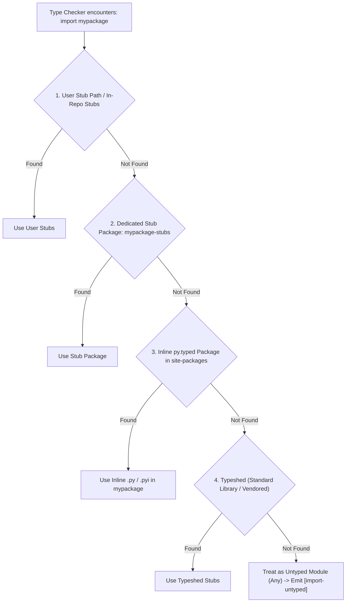

# Type Stubs, PEP 561 py.typed, and Typeshed Packaging

Even if you write impeccable type hints across your Python library, external static type checkers (Mypy, Pyright) will completely ignore them when downstream users install your package—unless your package explicitly conforms to **PEP 561** ("Distributing and Packaging Type Information").

Furthermore, when typing compiled C-extensions, legacy untyped dependencies, or separating interface signatures from complex runtime implementation code, **stub files (`.pyi`)** and the community **typeshed** repository provide the standard distribution mechanism.

---

## Table of Contents

1. [What & Why](#what--why)
2. [Core Concepts & Mental Model](#core-concepts--mental-model)
3. [How It Works Internally](#how-it-works-internally)
4. [Syntax & API Reference](#syntax--api-reference)
5. [Code Examples](#code-examples)
6. [Edge Cases, Pitfalls & Anti-Patterns](#edge-cases-pitfalls--anti-patterns)
7. [Performance & Memory Characteristics](#performance--memory-characteristics)
8. [CPython Internals & Bytecode](#cpython-internals--bytecode)
9. [Best Practices & Idiomatic Patterns](#best-practices--idiomatic-patterns)
10. [Real-World Case Study: Packaging a High-Performance C-Extension with Stubs and py.typed](#real-world-case-study-packaging-a-high-performance-c-extension-with-stubs-and-py-typed)
11. [Interview Questions & Deep-Dive Scenarios](#interview-questions--deep-dive-scenarios)
12. [Practical Exercises & Code Katas](#practical-exercises--code-katas)

---

## What & Why

Why did PEP 561 establish the `py.typed` marker?
In early Python typing history, many packages contained exploratory, partial, or broken type annotations. If Mypy automatically analyzed every installed dependency found in `site-packages`, user builds would explode with hundreds of third-party typing errors outside their control.

PEP 561 solved this by creating an opt-in contract:
1. **The `py.typed` Marker**: An empty file named `py.typed` placed inside a package directory signals to type checkers: *"This package guarantees intentional, verified static type annotations."*
2. **Stub Files (`.pyi`)**: Files containing only type signatures, class definitions, and ellipses (`...`), omitting executable method bodies. Essential for compiled C/Rust extensions or large libraries that prefer separating types from implementation.

---

## Core Concepts & Mental Model

### PEP 561 Package Resolution Precedence

When a type checker encounters `import mypackage.core`, it searches for type information in the following strict order of precedence:



### Three Ways to Distribute Type Hints

| Method | Where Types Live | Use Case |
|:---|:---|:---|
| **Inline Annotations** | Inside `.py` source files + `py.typed` marker | Pure Python packages written with modern type hints |
| **Sibling Stubs** | `.pyi` files sitting alongside `.py` files in the package | Separating complex types from code; typing C-extensions |
| **Stub-Only Package** | Standalone package named `foo-stubs` | Adding types to external third-party libraries without touching upstream source |

---

## How It Works Internally

### Anatomy of a `.pyi` Stub File

A `.pyi` (Python Interface) file uses standard Python syntax but contains zero implementation logic:
- Function and method bodies consist solely of `...` (Ellipsis).
- Default parameter values that are implementation details are written as `...`.
- Type variables and imports are defined at module level.
- Docstrings are typically omitted to maintain concise stub definitions.

```python
# math_utils.pyi
from typing import overload

def compute_mean(values: list[float]) -> float: ...

@overload
def scale(factor: int, matrix: list[int]) -> list[int]: ...
@overload
def scale(factor: float, matrix: list[float]) -> list[float]: ...
```

---

## Syntax & API Reference

### 1. Declaring `py.typed` in Packaging Tools

#### Hatch / Pyproject (`pyproject.toml`)
```toml
[tool.hatch.build.targets.wheel]
packages = ["src/mypackage"]

[tool.hatch.build.targets.wheel.force-include]
"src/mypackage/py.typed" = "mypackage/py.typed"
```

#### Poetry (`pyproject.toml`)
```toml
[tool.poetry]
name = "mypackage"
version = "1.0.0"
include = [
    { path = "mypackage/py.typed" }
]
```

#### Setuptools (`setup.cfg` or `pyproject.toml`)
```ini
[options.package_data]
mypackage = py.typed, *.pyi
```

---

## Code Examples

### Example 1: Creating and Verifying a Minimal `py.typed` Package

Directory layout:
```text
my_typed_lib/
├── pyproject.toml
└── src/
    └── my_typed_lib/
        ├── __init__.py
        ├── py.typed        <-- Zero-byte empty marker file!
        └── math_ops.py
```

`math_ops.py`:
```python
def multiply(a: float, b: float) -> float:
    return a * b
```

`__init__.py`:
```python
from .math_ops import multiply

__all__ = ["multiply"]
```

Downstream consumer code:
```python
# Consumer code imports without [import-untyped] warnings!
from my_typed_lib import multiply

val: float = multiply(4.5, 2.0)
print(f"Calculated: {val}")
# Output:
# Calculated: 9.0
```

### Example 2: Authoring a `.pyi` Stub for a Dynamic Module

Assume `legacy_calc.py` is untyped dynamic legacy code:
```python
# legacy_calc.py (runtime implementation)
def calculate_ratio(numerator, denominator, round_digits=2):
    if denominator == 0:
        raise ZeroDivisionError("denominator cannot be zero")
    return round(numerator / denominator, round_digits)
```

We author the companion stub file `legacy_calc.pyi` alongside it:
```python
# legacy_calc.pyi (static interface contract)
def calculate_ratio(
    numerator: float,
    denominator: float,
    round_digits: int = ...
) -> float: ...
```

Type checkers automatically bind `legacy_calc.pyi` when checking callers of `legacy_calc`.

### Example 3: Generating Stubs with `stubgen`

Mypy includes the `stubgen` CLI utility to generate initial stubs from existing Python modules:

```bash
# Generate stubs for a package into out/ directory:
stubgen -p my_untyped_pkg -o out/

# Generate stubs for a single Python file:
stubgen my_script.py -o ./stubs
```

The resulting `.pyi` files can be reviewed, refined, and bundled with the package.

### Example 4: Stub Only Packages (`foo-stubs`)

For packages not owned by you (e.g., `requests`), stub-only packages follow PEP 561 naming conventions:
- Package name on PyPI: `types-requests` or `requests-stubs`.
- Directory structure inside the wheel:
```text
requests-stubs/
├── __init__.pyi
├── api.pyi
├── METADATA.toml
└── py.typed
```

### Example 5: Stubbing Generic Protocols

```python
# protocols.pyi
from typing import Protocol, TypeVar

T = TypeVar("T")

class ResilientConnection[T](Protocol):
    def connect(self, timeout: float) -> bool: ...
    def execute(self, payload: T) -> T: ...
    def close(self) -> None: ...
```

---

## Edge Cases, Pitfalls & Anti-Patterns

### Common Mistakes Table

| Mistake | Bad Code | Correct Idiom | Why It Fails |
|:---|:---|:---|:---|
| **Forgetting `py.typed`** | Distributing typed package without `py.typed` | Add empty `py.typed` to package root | Type checkers ignore all inline annotations in site-packages. |
| **Omitting `py.typed` from build configuration** | Creating file on disk without adding to wheel manifest | Add to `package_data` or `include` in `pyproject.toml` | The build tool excludes `py.typed` from the `.whl` distribution. |
| **Putting actual code inside `.pyi` files** | Writing executable logic inside stub files | Use `...` for all function and method bodies | Code in `.pyi` is never executed; it wastes space and confuses tools. |
| **Signature drift between `.py` and `.pyi`** | Stub parameter names differ from `.py` implementation | Use tools like `stubtest` to enforce parity | Callers using keyword arguments fail at runtime. |
| **Writing concrete default values in stubs** | `def f(timeout: float = 30.0)` | `def f(timeout: float = ...)` | Default expressions can trigger imports or evaluate code; use `...`. |
| **Placing `py.typed` at project root instead of package dir** | `my_repo/py.typed` | `my_repo/src/my_package/py.typed` | Must reside inside the actual importable package subdirectory. |

---

## Performance & Memory Characteristics

### Static Analysis Speed with Stubs

- **Stubs Parse Faster than Code**: `.pyi` files omit function bodies, docstrings, and complex decorators. Parsing and analyzing a 2,000-line `.pyi` file is up to 5x faster than parsing the equivalent `.py` implementation file.
- **Packaging Size**: An empty `py.typed` file adds 0 bytes of content and < 100 bytes to the `.whl` archive overhead.

---

## CPython Internals & Bytecode

Because `.pyi` files exist purely for static analysis, CPython’s standard runtime importer (`importlib`) completely ignores `.pyi` files during normal script execution:

```python
import importlib.machinery

print("Standard Python source suffixes:")
print(importlib.machinery.SOURCE_SUFFIXES)
```

Output:
```text
Standard Python source suffixes:
['.py']
```

Notice that `.pyi` is **not** present in `SOURCE_SUFFIXES`. CPython will never load or compile a `.pyi` file into `.pyc` bytecode. Only static analyzers (Mypy, Pyright, PyCharm) inspect `.pyi` files.

---

## Best Practices & Idiomatic Patterns

1. **Always Verify Wheel Contents**: After building with `flit build`, `hatch build`, or `poetry build`, inspect the wheel using `unzip -l dist/*.whl` to confirm `my_package/py.typed` is present.
2. **Automate Signature Verification with `stubtest`**:
   Run `python -m mypy.stubtest my_package` in CI to detect signature divergence between stubs and runtime code.
3. **Keep Stubs Minimal**: Only expose public APIs in stubs; internal helper functions should remain un-stubbed.
4. **Prefer Inline Annotations When Possible**: For pure Python libraries, inline annotations inside `.py` files are easier to maintain than sibling `.pyi` files.

---

## Real-World Case Study: Packaging a High-Performance C-Extension with Stubs and py.typed

Below is the complete packaging configuration for a high-performance C-extension providing cryptographic hashing with complete PEP 561 stubs:

```text
fast_crypto/
├── pyproject.toml
├── src/
│   └── fast_crypto/
│       ├── __init__.py
│       ├── py.typed
│       ├── _native_hasher.c       # Compiled C-extension
│       ├── _native_hasher.pyi     # Stubs for C-extension functions
│       └── service.py
```

`_native_hasher.pyi`:
```python
# Stubs defining the C-extension module interface
from typing import Final

HASH_VERSION: Final[str]

def sha256_accelerated(payload: bytes) -> bytes: ...
def blake3_simd(payload: bytes, key: bytes | None = ...) -> bytes: ...
```

`src/fast_crypto/service.py`:
```python
from ._native_hasher import sha256_accelerated, blake3_simd

def hash_payload(data: str, algorithm: str = "sha256") -> str:
    raw = data.encode("utf-8")
    if algorithm == "blake3":
        digest = blake3_simd(raw)
    else:
        digest = sha256_accelerated(raw)
    return digest.hex()
```

`pyproject.toml`:
```toml
[build-system]
requires = ["setuptools>=68.0", "wheel"]
build-backend = "setuptools.build_meta"

[project]
name = "fast-crypto"
version = "2.1.0"
description = "Accelerated SIMD cryptographic hashing package"
readme = "README.md"
requires-python = ">=3.10"

[tool.setuptools.package-data]
fast_crypto = ["py.typed", "*.pyi"]
```

Verification command:
```bash
# Build wheel and verify py.typed inclusion
python -m build --wheel
python -c "
import zipfile, glob
whl = glob.glob('dist/*.whl')[0]
with zipfile.ZipFile(whl) as z:
    names = z.namelist()
    assert any('py.typed' in n for n in names), 'py.typed missing!'
    assert any('_native_hasher.pyi' in n for n in names), 'stubs missing!'
print('Verification Passed: py.typed and stubs present in wheel!')
"
```

---

## Interview Questions & Deep-Dive Scenarios

<details>
<summary>1. What happens when a library contains inline type annotations but omits the `py.typed` marker file?</summary>

When a user imports the library in their project, Mypy and Pyright treat the entire library as untyped (`Any`). Mypy will emit an `[import-untyped]` error (unless suppressed), and all types imported from the library will degrade to `Any`, losing all IDE autocompletion and static safety.
</details>

<details>
<summary>2. What is `stubtest` and why is it crucial for stub maintenance?</summary>

`stubtest` is a tool shipped with Mypy that imports runtime modules and compares their actual runtime objects (`inspect.signature`, attributes, docstrings) against corresponding `.pyi` stub files. It flags any signature drift, missing parameters, or renamed methods, preventing stubs from lying about runtime behavior.
</details>

<details>
<summary>3. Why are default values in `.pyi` files typically written as `...` rather than actual values?</summary>

1. **Avoid Runtime Evaluation**: Actual default expressions may require complex imports, object instantiation, or environment variables.
2. **Implementation Decoupling**: Default values are implementation details. Static analyzers only need to know whether an argument is optional (has a default) or required.
</details>

<details>
<summary>4. What is the difference between sibling stubs and a stub-only package?</summary>

- **Sibling Stubs**: Located inside the same package directory alongside the `.py` or `.so` files, shipped in the same wheel.
- **Stub-Only Package**: A completely separate pip package (e.g. `types-requests` or `foo-stubs`) providing types for an external third-party package without modifying the original package.
</details>

<details>
<summary>5. How does a type checker discover stubs for compiled C-extension modules (`.so` / `.pyd`)?</summary>

Because static analyzers cannot parse binary shared objects, they search for a `.pyi` file with the exact same base name as the binary module in the same directory (e.g., `_accel.pyi` matching `_accel.cpython-312-x86_64-linux-gnu.so`).
</details>

<details>
<summary>6. Can a `.pyi` stub file import from another `.pyi` stub file?</summary>

Yes. Import statements in `.pyi` files follow normal Python import semantics. Type checkers resolve imports against other `.pyi` stubs in the search path.
</details>

<details>
<summary>7. What is typeshed?</summary>

Typeshed is a community-maintained GitHub repository (`python/typeshed`) containing authoritative type stubs for the Python standard library and popular third-party PyPI packages that do not ship their own inline types or stubs. Mypy and Pyright vendor typeshed directly.
</details>

<details>
<summary>8. How do you re-export imported symbols in a `.pyi` stub file?</summary>

In `.pyi` stubs, imported symbols are considered private by default. To explicitly re-export an imported type, you must either:
1. Use an alias with the same name: `from .models import User as User`
2. Include it in `__all__`: `__all__ = ["User"]`
</details>

---

## Practical Exercises & Code Katas

### Exercise 1: Write a Complete Stub for a Math C-Extension
Write a `.pyi` stub file for an imaginary C-extension `fast_matrix` exposing `dot_product(a: list[float], b: list[float]) -> float` and a class `Matrix(rows: int, cols: int)`.

<details>
<summary>Solution</summary>

```python
# fast_matrix.pyi
from typing import Sequence

def dot_product(a: Sequence[float], b: Sequence[float]) -> float: ...

class Matrix:
    rows: int
    cols: int
    def __init__(self, rows: int, cols: int) -> None: ...
    def get(self, r: int, c: int) -> float: ...
    def set(self, r: int, c: int, val: float) -> None: ...
    def __matmul__(self, other: "Matrix") -> "Matrix": ...
```
</details>

### Exercise 2: Python Script to Verify Wheel py.typed
Write a Python script that accepts a `.whl` path as a command-line argument and verifies that `py.typed` is packaged correctly.

<details>
<summary>Solution</summary>

```python
import sys
import zipfile

def verify_wheel_typed(wheel_path: str) -> bool:
    with zipfile.ZipFile(wheel_path, "r") as z:
        for filename in z.namelist():
            if filename.endswith("py.typed"):
                print(f"[SUCCESS] Found marker: {filename}")
                return True
    print("[ERROR] py.typed NOT found in wheel archive!")
    return False

if __name__ == "__main__":
    if len(sys.argv) > 1:
        verify_wheel_typed(sys.argv[1])
```
</details>

### Exercise 3: Explicit Re-Export in `__init__.pyi`
Author an `__init__.pyi` stub that imports `Database`, `Session`, and `QueryError` from submodules and re-exports them using standard PEP 484 / PEP 561 conventions.

<details>
<summary>Solution</summary>

```python
# __init__.pyi
from .database import Database as Database
from .session import Session as Session
from .errors import QueryError as QueryError

__all__ = ["Database", "Session", "QueryError"]
```
</details>

### Exercise 4: Use `stubgen` Programmatically
Write a script that runs `stubgen` programmatically against a target package and outputs the generated stubs into `./typings`.

<details>
<summary>Solution</summary>

```python
import subprocess
import sys

def generate_stubs_for_package(pkg_name: str, out_dir: str = "./typings") -> None:
    cmd = [sys.executable, "-m", "mypy.stubgen", "-p", pkg_name, "-o", out_dir]
    print(f"Running: {' '.join(cmd)}")
    res = subprocess.run(cmd, capture_output=True, text=True)
    if res.returncode == 0:
        print(f"Successfully generated stubs in {out_dir}")
    else:
        print("Stubgen failed:\n", res.stderr)

# generate_stubs_for_package("json")
```
</details>

### Exercise 5: Flit Packaging with `py.typed`
Create a minimal `pyproject.toml` using `flit_core` that packages `my_api` containing `py.typed`.

<details>
<summary>Solution</summary>

```toml
[build-system]
requires = ["flit_core >=3.2,<4"]
build-backend = "flit_core.buildapi"

[project]
name = "my_api"
version = "0.1.0"
description = "Typed API client"
readme = "README.md"
requires-python = ">=3.11"

# flit automatically includes py.typed if located inside the package directory: src/my_api/py.typed
```
</details>

### Exercise 6: Stub Signature Parity Test
Write a test that verifies the arguments of a concrete function match the parameters declared in its companion stub file.

<details>
<summary>Solution</summary>

```python
import inspect

def real_add(a: int, b: int = 10) -> int:
    return a + b

def verify_parameters(func_obj: object, expected_params: list[str]) -> bool:
    sig = inspect.signature(func_obj)  # type: ignore[arg-type]
    actual_params = list(sig.parameters.keys())
    assert actual_params == expected_params, f"Mismatch: {actual_params} != {expected_params}"
    return True

assert verify_parameters(real_add, ["a", "b"])
print("Parameter parity verified successfully!")
```
</details>
