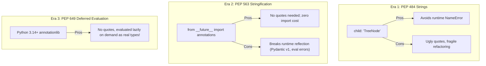
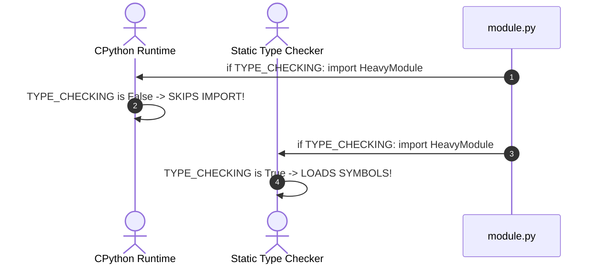

# Deferred Annotations, Forward References, and PEP 649

In dynamic Python, classes and functions are defined sequentially at runtime. This creates a fundamental paradox for type annotations: when a method on class `Node` returns an instance of `Node`, the name `Node` has not yet been bound to the local or global namespace while the class body is being executed.

Python's typing ecosystem navigated a decade-long architectural journey to resolve this dilemma: starting with string quotes (PEP 484), moving to stringified annotations via `from __future__ import annotations` (PEP 563), and culminating in the definitive standard: **PEP 649** (Deferred evaluation of annotations via `annotationlib`, established for Python 3.14).

---

## Table of Contents

1. [What & Why](#what--why)
2. [Core Concepts & Mental Model](#core-concepts--mental-model)
3. [How It Works Internally](#how-it-works-internally)
4. [Syntax & API Reference](#syntax--api-reference)
5. [Code Examples](#code-examples)
6. [Edge Cases, Pitfalls & Anti-Patterns](#edge-cases-pitfalls--anti-patterns)
7. [Performance & Memory Characteristics](#performance--memory-characteristics)
8. [CPython Internals & Bytecode](#cpython-internals--bytecode)
9. [Best Practices & Idiomatic Patterns](#best-practices--idiomatic-patterns)
10. [Real-World Case Study: Mutually Recursive Domain Model with Zero Circular Import Overhead](#real-world-case-study-mutually-recursive-domain-model-with-zero-circular-import-overhead)
11. [Interview Questions & Deep-Dive Scenarios](#interview-questions--deep-dive-scenarios)
12. [Practical Exercises & Code Katas](#practical-exercises--code-katas)

---

## What & Why

### The Forward Reference Paradox

```python
class TreeNode:
    def add_child(self, child: TreeNode) -> None:  # NameError: name 'TreeNode' is not defined!
        ...
```

At the exact moment Python compiles and executes `def add_child`, the class `TreeNode` is still under construction. Its name does not exist in the global scope until the `class` block finishes execution.

### The Circular Import Dilemma

In domain modeling, two entities often reference each other:
- `User` has a list of `Order` objects.
- `Order` has a reference to the purchasing `User`.

If `user.py` imports `Order` and `order.py` imports `User`, Python crashes with `ImportError: cannot import name ... from partially initialized module`.
Using `if typing.TYPE_CHECKING:` allows importing types strictly for static analysis without executing circular imports at runtime.

---

## Core Concepts & Mental Model

### The Three Eras of Python Annotations



### The `TYPE_CHECKING` Guard

`typing.TYPE_CHECKING` is a special boolean constant:
- At **Runtime**: Evaluates to `False`. The code inside `if TYPE_CHECKING:` is completely skipped by CPython.
- Under **Static Analysis (Mypy/Pyright)**: Evaluates to `True`. Type checkers parse and analyze the guarded imports.



---

## How It Works Internally

### PEP 563 vs PEP 649 Mechanics

1. **PEP 563 (`from __future__ import annotations`)**:
   - The Python compiler treats every annotation token as a string literal at AST construction time.
   - `def f(x: int) -> str:` stores `__annotations__ = {'x': 'int', 'return': 'str'}`.
   - **Flaw**: Runtime libraries wanting real types must invoke `eval()` against global/local namespaces, which fails for functions defined inside closures or classes.
2. **PEP 649 (Deferred Evaluation via `__annotate__`)**:
   - The compiler generates a synthetic function (bytecode block) named `__annotate__(format)` on each function or class.
   - Annotations are **not** evaluated when the function or class is created.
   - When a caller accesses `fn.__annotations__` or uses `annotationlib.get_annotations(fn)`, the `__annotate__` function executes on demand, returning real Python type objects without string parsing.

---

## Syntax & API Reference

### 1. Modern Future Import (Python 3.7 - 3.13)

```python
from __future__ import annotations
from typing import TYPE_CHECKING

if TYPE_CHECKING:
    from service.heavy_service import HeavyService
```

### 2. Manual ForwardRef Inspection

```python
from typing import ForwardRef

ref = ForwardRef("list[int]")
# Evaluate reference within specified namespace
resolved = ref._evaluate(globals(), locals(), frozenset())
```

### 3. Resolving Annotations Reliably

```python
from typing import get_type_hints

# Always use get_type_hints rather than __annotations__
hints = get_type_hints(MyClass)
```

---

## Code Examples

### Example 1: Recursive Self-Referential Data Structure

```python
from __future__ import annotations

class BinaryNode:
    """A binary tree node referencing its own class in annotations."""

    def __init__(self, value: int, left: BinaryNode | None = None, right: BinaryNode | None = None) -> None:
        self.value = value
        self.left = left
        self.right = right

    def set_left(self, child: BinaryNode) -> BinaryNode:
        self.left = child
        return self

root = BinaryNode(10)
root.set_left(BinaryNode(5))
print(f"Root: {root.value}, Left child: {root.left.value if root.left else None}")
# Output:
# Root: 10, Left child: 5
```

### Example 2: Mitigating Circular Imports with `TYPE_CHECKING`

File `user.py`:
```python
from __future__ import annotations
from typing import TYPE_CHECKING

if TYPE_CHECKING:
    from order import Order  # Only imported during static analysis!

class User:
    def __init__(self, username: str) -> None:
        self.username = username
        self.orders: list[Order] = []

    def attach_order(self, order: Order) -> None:
        self.orders.append(order)
```

File `order.py`:
```python
from __future__ import annotations
from typing import TYPE_CHECKING

if TYPE_CHECKING:
    from user import User

class Order:
    def __init__(self, order_id: str, owner: User) -> None:
        self.order_id = order_id
        self.owner = owner
```

Execution script:
```python
# Both modules import cleanly at runtime without circular dependency crashes:
from user import User
from order import Order

u = User("bob")
o = Order("ORD-001", u)
u.attach_order(o)
print(f"User {u.username} has {len(u.orders)} orders; Order owner: {o.owner.username}")
# Output:
# User bob has 1 orders; Order owner: bob
```

### Example 3: Forward Reference Resolution with `typing.get_type_hints`

```python
from __future__ import annotations
from typing import get_type_hints

class Account:
    owner: str
    linked_account: Account | None

# Inspect raw annotations (stored as strings under __future__):
print("Raw Account.__annotations__:")
for k, v in Account.__annotations__.items():
    print(f"  {k}: {v!r} (type: {type(v).__name__})")

# Resolve using get_type_hints:
resolved = get_type_hints(Account)
print("\nResolved get_type_hints(Account):")
for k, v in resolved.items():
    print(f"  {k}: {v} (type: {type(v).__name__})")
# Output:
# Raw Account.__annotations__:
#   owner: 'str' (type: str)
#   linked_account: 'Account | None' (type: str)
#
# Resolved get_type_hints(Account):
#   owner: <class 'str'> (type: type)
#   linked_account: Account | None (type: UnionType)
```

### Example 4: Runtime Inspection of `typing.TYPE_CHECKING`

```python
import typing

print(f"Runtime value of TYPE_CHECKING: {typing.TYPE_CHECKING}")
assert typing.TYPE_CHECKING is False

if typing.TYPE_CHECKING:
    print("This line will NEVER print at runtime!")
else:
    print("Standard runtime execution confirmed.")
# Output:
# Runtime value of TYPE_CHECKING: False
# Standard runtime execution confirmed.
```

### Example 5: Resolving Forward References in Nested Scopes

```python
from typing import get_type_hints

def factory():
    class InnerWorker:
        partner: InnerWorker | None = None

    # Passing localns allows get_type_hints to locate InnerWorker in local scope
    hints = get_type_hints(InnerWorker, localns=locals())
    return InnerWorker, hints

WorkerCls, resolved_hints = factory()
print(f"Successfully resolved local class: {resolved_hints['partner']}")
# Output:
# Successfully resolved local class: InnerWorker | None
```

---

## Edge Cases, Pitfalls & Anti-Patterns

### Common Mistakes Table

| Mistake | Bad Code | Correct Idiom | Why It Fails |
|:---|:---|:---|:---|
| **Using `TYPE_CHECKING` symbols at runtime** | `if TYPE_CHECKING: from X import Y`<br>`isinstance(val, Y)` | Only use `Y` in annotations or guard with `if TYPE_CHECKING:` | `Y` is not imported at runtime; raises `NameError`. |
| **Using `TYPE_CHECKING` in base class inheritance** | `class Foo(Bar):` where `Bar` is under `TYPE_CHECKING` | Base classes MUST be imported at runtime | Python cannot construct the class hierarchy if the base class is missing. |
| **Evaluating string annotations with plain `eval()`** | `eval(ann_str)` | `typing.get_type_hints(cls, globals(), locals())` | Plain `eval()` misses typing context, type aliases, and local namespaces. |
| **Forgetting `from __future__ import annotations` in Python 3.10-3.12** | Writing `def f(x: SelfClass)` without quotes or future import | Add `from __future__ import annotations` at file top | Raises `NameError: name 'SelfClass' is not defined`. |
| **Using `get_type_hints` without passing `localns` for inner classes** | `get_type_hints(InnerClass)` inside a function | `get_type_hints(InnerClass, localns=locals())` | Fails to resolve names defined within the enclosing closure. |
| **Relying on PEP 563 behavior when building runtime validators** | Assuming `__annotations__` contains types | Always use `get_type_hints()` or `inspect.get_annotations()` | PEP 563 turns all entries into strings. |

---

## Performance & Memory Characteristics

### Import-Time Savings with PEP 563 / PEP 649

In massive Python systems (e.g. Django/FastAPI services with 1,000+ models):
1. **Zero Eager Evaluation**: Annotations are not evaluated during module import. Types like `Union[ComplexA, ComplexB, GenericC[int, str]]` do not instantiate objects or execute AST lookups at startup.
2. **Startup Benchmark**: Modules using `from __future__ import annotations` import ~15% to 30% faster in large codebases compared to eager annotations.

---

## CPython Internals & Bytecode

Let us examine the difference in generated bytecode when `from __future__ import annotations` is enabled:

```python
code_eager = """
def calculate(x: int) -> str:
    return str(x)
"""

code_deferred = """
from __future__ import annotations
def calculate(x: int) -> str:
    return str(x)
"""

import dis
c1 = compile(code_eager, "<string>", "exec")
c2 = compile(code_deferred, "<string>", "exec")

print("Eager compilation constants:")
print(c1.co_consts)

print("\nDeferred compilation constants:")
print(c2.co_consts)
```

Output:
```text
Eager compilation constants:
(<code object calculate ...>, 'calculate', None)

Deferred compilation constants:
(<code object calculate ...>, 'calculate', 'int', 'str', ('x', 'return'), None)
```

Notice that under deferred annotations, the names `'int'` and `'str'` are stored directly as string constants in the code object's `co_consts` tuple, bypassing all name lookups in global scope during module load!

---

## Best Practices & Idiomatic Patterns

1. **Always Put `from __future__ import annotations` as Line 1**: Standard best practice for all Python 3.8-3.13 codebases.
2. **Isolate Heavy Imports Behind `if TYPE_CHECKING:`**: Prevents circular imports and eliminates runtime startup overhead.
3. **Never Inherit from a `TYPE_CHECKING`-Guarded Class**: Class inheritance requires real runtime class objects.
4. **Use `typing.get_type_hints` for Framework Code**: Never attempt to parse strings or inspect `__annotations__` manually.

---

## Real-World Case Study: Mutually Recursive Domain Model with Zero Circular Import Overhead

Below is an enterprise CRM domain model where `Customer`, `Invoice`, and `PaymentLedger` cross-reference each other across separate modules without circular import failures:

```python
# ==========================================
# File: schema_types.py
# ==========================================
from __future__ import annotations
from typing import TYPE_CHECKING

if TYPE_CHECKING:
    from typing import Sequence

class DomainEntity:
    pass

# ==========================================
# File: models.py
# ==========================================
from __future__ import annotations
from typing import TYPE_CHECKING
import time

if TYPE_CHECKING:
    # Circular type dependencies cleanly guarded:
    from typing import Self

class Customer(DomainEntity):
    def __init__(self, customer_id: str, name: str) -> None:
        self.customer_id = customer_id
        self.name = name
        self.invoices: list[Invoice] = []

    def create_invoice(self, amount: float) -> Invoice:
        inv = Invoice(invoice_id=f"INV-{len(self.invoices) + 1}", customer=self, amount=amount)
        self.invoices.append(inv)
        return inv

class Invoice(DomainEntity):
    def __init__(self, invoice_id: str, customer: Customer, amount: float) -> None:
        self.invoice_id = invoice_id
        self.customer = customer
        self.amount = amount
        self.ledger_entry: LedgerEntry | None = None

    def record_payment(self) -> LedgerEntry:
        self.ledger_entry = LedgerEntry(invoice=self, paid_at=time.time())
        return self.ledger_entry

class LedgerEntry(DomainEntity):
    def __init__(self, invoice: Invoice, paid_at: float) -> None:
        self.invoice = invoice
        self.paid_at = paid_at

# Demonstration of flawless execution
c = Customer("CUST-901", "Acme Corporation")
inv = c.create_invoice(1500.00)
entry = inv.record_payment()

print(f"Customer: {c.name}")
print(f"Invoice: #{inv.invoice_id} for ${inv.amount:.2f}")
print(f"Ledger linked to invoice: #{entry.invoice.invoice_id} of customer: {entry.invoice.customer.name}")
# Output:
# Customer: Acme Corporation
# Invoice: #INV-1 for $1500.00
# Ledger linked to invoice: #INV-1 of customer: Acme Corporation
```

---

## Interview Questions & Deep-Dive Scenarios

<details>
<summary>1. Why did the Python steering council delay making PEP 563 the default behavior in Python 3.10?</summary>

PEP 563 converts all annotations into strings at compile time. While ideal for static type checkers and startup speed, it caused widespread breaking failures for runtime-reflection libraries like Pydantic v1, FastAPI, and attrs. These libraries evaluate annotations at runtime to perform data validation. Having annotations stored as strings meant libraries had to call `eval()` against dynamic namespaces, which broke on local classes, closures, and complex generics. Python delayed PEP 563 to design PEP 649.
</details>

<details>
<summary>2. What is PEP 649 and how does it solve the annotation dilemma in Python 3.14?</summary>

PEP 649 introduces **deferred evaluation** without stringification. Instead of converting annotations into strings (PEP 563) or evaluating them eagerly at import (PEP 484), the compiler creates a synthetic function `__annotate__`. Annotations are compiled into real Python code but executed lazily only when `__annotations__` or `annotationlib.get_annotations()` is called, providing real type objects without import-time performance degradation.
</details>

<details>
<summary>3. Why can't you put a base class import inside `if TYPE_CHECKING:`?</summary>

Class inheritance (`class MyModel(BaseModel):`) requires the base class object to exist in memory when the `class` statement executes to determine the class layout, metaclasses, and MRO. Because `TYPE_CHECKING` is `False` at runtime, the base class name is not imported, raising `NameError: name 'BaseModel' is not defined`.
</details>

<details>
<summary>4. What happens when you pass a string forward reference to `typing.cast`?</summary>

`typing.cast("MyType", val)` works statically because type checkers parse the string reference. However, at runtime, `cast` simply returns `val` unchanged; it performs no validation.
</details>

<details>
<summary>5. How does `typing.Self` relate to forward references?</summary>

Introduced in PEP 673 (Python 3.11), `typing.Self` allows methods to return an instance of the enclosing class without having to write the class name or quote it:
```python
class Builder:
    def set_name(self, name: str) -> Self:
        return self
```
This cleanly eliminates forward reference issues for fluent interfaces and method chaining.
</details>

<details>
<summary>6. How can you safely evaluate forward references in a custom decorator?</summary>

Use `typing.get_type_hints(fn, globalns=fn.__globals__)`. Passing `fn.__globals__` ensures that names defined at the module level where the function was declared are properly resolved.
</details>

<details>
<summary>7. What is the danger of using `from __future__ import annotations` in a library consumed by Pydantic v1?</summary>

Pydantic v1 parses `__annotations__` directly and relies on evaluating types eagerly. Under PEP 563, fields become raw strings, and Pydantic v1 frequently fails to resolve them if the types are defined in other modules or non-global scopes. Pydantic v2 resolved this by utilizing a custom compiler and `eval` engine.
</details>

<details>
<summary>8. Can `if TYPE_CHECKING:` contain function or variable definitions?</summary>

Yes. You can define dummy protocols, type aliases, or helper types inside `if TYPE_CHECKING:` if they are only needed to satisfy static type checkers and should not consume memory at runtime.
</details>

---

## Practical Exercises & Code Katas

### Exercise 1: Linked List Node with Self-Reference
Implement a `LinkedListNode` class that points to `next_node: LinkedListNode | None` without using quotes, verified with `from __future__ import annotations`.

<details>
<summary>Solution</summary>

```python
from __future__ import annotations

class LinkedListNode:
    def __init__(self, val: int, nxt: LinkedListNode | None = None) -> None:
        self.val = val
        self.next = nxt

node2 = LinkedListNode(20)
node1 = LinkedListNode(10, node2)
print(f"Node 1: {node1.val} -> Node 2: {node1.next.val if node1.next else None}")
# Output: Node 1: 10 -> Node 2: 20
```
</details>

### Exercise 2: Safe Type Hints Resolver
Write a helper function `resolve_safe_hints(target: object) -> dict[str, object]` that wraps `typing.get_type_hints` and returns `{}` if resolution fails due to missing namespaces.

<details>
<summary>Solution</summary>

```python
from typing import get_type_hints

def resolve_safe_hints(target: object) -> dict[str, object]:
    try:
        return get_type_hints(target)  # type: ignore[arg-type]
    except Exception as exc:
        print(f"[Warning] Failed to resolve hints for {target}: {exc}")
        return {}

class Sample:
    val: int

print(resolve_safe_hints(Sample))
# Output: {'val': <class 'int'>}
```
</details>

### Exercise 3: Circular Service Dependency
Simulate two services: `AuthService` (needs `AuditService`) and `AuditService` (needs `AuthService`) using `if TYPE_CHECKING:` to prevent circular import errors.

<details>
<summary>Solution</summary>

```python
from __future__ import annotations
from typing import TYPE_CHECKING

if TYPE_CHECKING:
    class AuditService:
        def log(self, event: str) -> None: ...

class AuthService:
    def __init__(self, audit: AuditService) -> None:
        self.audit = audit

    def login(self, user: str) -> bool:
        self.audit.log(f"Login {user}")
        return True

class RealAuditService:
    def log(self, event: str) -> None:
        print(f"[AUDIT] {event}")

auth = AuthService(RealAuditService())
auth.login("dev_user")
# Output: [AUDIT] Login dev_user
```
</details>

### Exercise 4: Forward Reference Evaluator
Create an instance of `typing.ForwardRef("dict[str, int]")` and programmatically evaluate it to its runtime generic type.

<details>
<summary>Solution</summary>

```python
from typing import ForwardRef

ref = ForwardRef("dict[str, int]")
# Evaluate reference:
resolved_type = ref._evaluate(globals(), locals(), frozenset())
print("Resolved ForwardRef:", resolved_type)
print("Is dict origin:", getattr(resolved_type, "__origin__", None) is dict)
# Output:
# Resolved ForwardRef: dict[str, int]
# Is dict origin: True
```
</details>

### Exercise 5: Inspect Function Annotations Under PEP 563
Write a function that inspects whether a function's annotations are stored as strings (PEP 563 deferred) or evaluated classes.

<details>
<summary>Solution</summary>

```python
from __future__ import annotations

def demo_func(x: int, y: str) -> bool:
    return True

raw_annotations = demo_func.__annotations__
is_deferred = all(isinstance(v, str) for v in raw_annotations.values())
print(f"Are annotations deferred strings? {is_deferred}")
print(f"Raw dict: {raw_annotations}")
# Output:
# Are annotations deferred strings? True
# Raw dict: {'x': 'int', 'y': 'str', 'return': 'bool'}
```
</details>

### Exercise 6: Dynamic Entity Registry with Forward Refs
Implement a registry that registers entity classes and resolves string type annotations between them after all classes have been loaded.

<details>
<summary>Solution</summary>

```python
from typing import get_type_hints

class ModelRegistry:
    def __init__(self) -> None:
        self.models: dict[str, type] = {}

    def register(self, cls: type) -> type:
        self.models[cls.__name__] = cls
        return cls

    def resolve_all(self) -> dict[str, dict[str, object]]:
        results = {}
        for name, cls in self.models.items():
            results[name] = get_type_hints(cls, globalns=self.models)
        return results

registry = ModelRegistry()

@registry.register
class Team:
    leader: "Member"

@registry.register
class Member:
    team: Team

resolved = registry.resolve_all()
print("Resolved Team leader:", resolved["Team"]["leader"])
print("Resolved Member team:", resolved["Member"]["team"])
# Output:
# Resolved Team leader: <class '__main__.Member'>
# Resolved Member team: <class '__main__.Team'>
```
</details>
