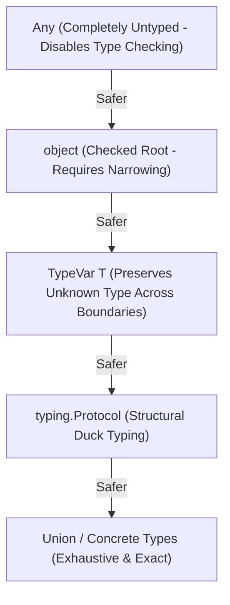

# Python Typing Best Practices and Idiomatic API Design

Type hints in Python are not merely decorative annotations or linting rules; they form an architectural blueprint that guides API design, refactoring velocity, and runtime reliability. However, poorly designed type hints can clutter code, introduce false senses of security, create fragile inheritance coupling, and degrade developer productivity.

This note crystallizes industry-standard best practices, architectural principles, and idiomatic design patterns for building robust, scalable typed Python applications.

---

## Table of Contents

1. [What & Why](#what--why)
2. [Core Principles & Mental Model](#core-principles--mental-model)
3. [Postel's Law in Type Design: Abstract Inputs, Concrete Outputs](#postels-law-in-type-design-abstract-inputs-concrete-outputs)
4. [Eliminating Any: The Hierarchy of Safety](#eliminating-any-the-hierarchy-of-safety)
5. [Syntax & API Reference](#syntax--api-reference)
6. [Code Examples](#code-examples)
7. [Edge Cases, Pitfalls & Anti-Patterns](#edge-cases-pitfalls--anti-patterns)
8. [Performance & Memory Characteristics](#performance--memory-characteristics)
9. [CPython Internals & Bytecode](#cpython-internals--bytecode)
10. [Real-World Case Study: Enterprise Payment Transaction Processing Engine](#real-world-case-study-enterprise-payment-transaction-processing-engine)
11. [Interview Questions & Deep-Dive Scenarios](#interview-questions--deep-dive-scenarios)
12. [Practical Exercises & Code Katas](#practical-exercises--code-katas)

---

## What & Why

Type hints are a communication mechanism between library authors, application developers, and static analyzers. The goal of static typing in Python is:
- **Zero Runtime Interference**: Typing should enhance safety without slowing down production bytecode execution.
- **Maximized Developer Velocity**: Autocompletion, hover docs, and instant refactoring in IDEs.
- **Fail-Fast Safety**: Catching bugs (e.g. `NoneType` attribute errors, mismatched dictionary keys, incorrect argument orders) in CI before code reaches staging or production.

Adhering to strict, idiomatic typing practices ensures that type signatures clarify code rather than obscuring it with bureaucratic clutter.

---

## Core Principles & Mental Model

### Postel's Law in Type Design

> *"Be conservative in what you send, be liberal in what you accept."* — Jon Postel

Applied to Python type signatures:
- **Input Parameters**: Accept the most abstract, general interface possible (`Iterable`, `Sequence`, `Mapping`, `Protocol`).
- **Return Values**: Return the most concrete, predictable type possible (`list`, `dict`, `tuple`, `dataclass`).

```mermaid
graph LR
    subgraph Function Inputs (Liberal / Abstract)
        In1["collections.abc.Iterable[T]"]
        In2["collections.abc.Mapping[K, V]"]
        In3["collections.abc.Sequence[T]"]
    end

    subgraph Function Execution
        Fn["def process_records(...) -> list[Record]:"]
    end

    subgraph Function Outputs (Conservative / Concrete)
        Out1["list[Record]"]
        Out2["dict[str, User]"]
        Out3["Concrete Dataclass / Model"]
    end

    In1 & In2 & In3 --> Fn --> Out1 & Out2 & Out3
```

---

## Eliminating Any: The Hierarchy of Safety

`typing.Any` is an escape hatch that disables all static type checking on a value and all downstream operations performed on it. Whenever tempted to write `Any`, consider moving up the safety ladder:



1. **`object`**: Tells the type checker: *"This can be anything, but you cannot assume it has any methods or attributes until you explicitly verify them with `isinstance()` or `match`."*
2. **`TypeVar` / Generic `[T]`**: Expresses: *"I don't care what type this is, as long as the output matches the input type."*
3. **`Protocol`**: Specifies: *"The object must have these specific methods/properties, regardless of its class hierarchy."*

---

## Syntax & API Reference

### 1. Modern PEP 695 Type Aliases

```python
# Modern clean type alias statements
type UserID = str
type Matrix[T] = list[list[T]]
type JSONPrimitive = str | int | float | bool | None
```

### 2. Immutability & Immutability Markers

```python
from typing import Final, final

MAX_CONNECTIONS: Final[int] = 100

@final
class SecureConnection:
    """Cannot be subclassed."""
    pass
```

### 3. Exhaustiveness Checking with `assert_never`

```python
from typing import assert_never

def handle_status(status: Literal["pending", "active"]) -> str:
    match status:
        case "pending": return "In Queue"
        case "active": return "Processing"
        case _ as unreachable:
            assert_never(unreachable)
```

---

## Code Examples

### Example 1: Applying Postel's Law to Sequence Processing

```python
from collections.abc import Iterable, Sequence

# BAD: Rigid input forces caller to construct an explicit list
def bad_average(numbers: list[float]) -> float:
    return sum(numbers) / len(numbers)

# GOOD: Liberal input accepts lists, tuples, generators, sets
def good_average(numbers: Iterable[float]) -> float:
    total = 0.0
    count = 0
    for n in numbers:
        total += n
        count += 1
    if count == 0:
        raise ValueError("Cannot average empty collection")
    return total / count

# Callers can pass any iterable without memory copying:
print("List avg:", good_average([1.0, 2.0, 3.0]))
print("Generator avg:", good_average(x * 1.5 for x in range(1, 4)))
print("Set avg:", good_average({10.0, 20.0}))
# Output:
# List avg: 2.0
# Generator avg: 3.0
# Set avg: 15.0
```

### Example 2: Replacing `Any` with `object` and Safe Type Narrowing

```python
# BAD: Using Any passes unchecked through everything
def bad_deserialize(raw: str) -> Any:
    import json
    return json.loads(raw)

# GOOD: Using object forces caller to validate the shape
def safe_deserialize(raw: str) -> object:
    import json
    return json.loads(raw)

def get_user_id(payload: str) -> str:
    data = safe_deserialize(payload)
    # data is 'object', so data["user_id"] is a static error!
    # Caller is FORCED to validate:
    if isinstance(data, dict) and "user_id" in data and isinstance(data["user_id"], str):
        return data["user_id"]
    raise ValueError("Invalid user payload structure")

print("User ID:", get_user_id('{"user_id": "usr_9981", "role": "admin"}'))
# Output:
# User ID: usr_9981
```

### Example 3: TypedDict vs Dataclass vs NamedTuple Decision Matrix

```python
from typing import TypedDict
from dataclasses import dataclass
from typing import NamedTuple

# 1. TypedDict: Ideal for JSON payloads, API requests/responses, database rows
class UserJSON(TypedDict):
    id: int
    email: str

# 2. NamedTuple: Ideal for immutable lightweight tuples with positional unpacking
class Point2D(NamedTuple):
    x: float
    y: float

# 3. Dataclass: Ideal for domain entities with business methods, lifecycle, validation
@dataclass
class CustomerEntity:
    customer_id: str
    balance: float

    def debit(self, amount: float) -> None:
        if amount > self.balance:
            raise ValueError("Insufficient funds")
        self.balance -= amount

pt = Point2D(10.5, 20.0)
x, y = pt  # Fast tuple unpacking
print(f"Point: ({x}, {y})")
# Output:
# Point: (10.5, 20.0)
```

### Example 4: Preventing Subclassing and Overriding with `@final`

```python
from typing import final

class BaseRepository:
    def get_by_id(self, item_id: int) -> str:
        return f"item_{item_id}"

    @final
    def audit_access(self, item_id: int) -> None:
        """Security invariant: this method must never be overridden by subclasses!"""
        print(f"[SECURITY AUDIT] Accessing record {item_id}")

class CustomRepo(BaseRepository):
    # Attempting to override audit_access will trigger a Mypy/Pyright error!
    pass

repo = CustomRepo()
repo.audit_access(42)
# Output:
# [SECURITY AUDIT] Accessing record 42
```

### Example 5: Exhaustive Pattern Matching with `Never` and `assert_never`

```python
from typing import Literal, assert_never
from dataclasses import dataclass

@dataclass(frozen=True)
class EmailAlert:
    kind: Literal["email"]
    recipient: str

@dataclass(frozen=True)
class SMSAlert:
    kind: Literal["sms"]
    phone_number: str

type Alert = EmailAlert | SMSAlert

def dispatch_notification(alert: Alert) -> str:
    match alert.kind:
        case "email":
            return f"Sending Email to {alert.recipient}"
        case "sms":
            return f"Sending SMS to {alert.phone_number}"
        case _ as unreachable:
            # If a new variant (e.g. WebhookAlert) is added to Alert union,
            # static type checkers immediately flag this line as a type error!
            assert_never(unreachable)

print(dispatch_notification(EmailAlert(kind="email", recipient="ops@cloud.internal")))
print(dispatch_notification(SMSAlert(kind="sms", phone_number="+1-555-0199")))
# Output:
# Sending Email to ops@cloud.internal
# Sending SMS to +1-555-0199
```

---

## Edge Cases, Pitfalls & Anti-Patterns

### Common Mistakes Table

| Mistake | Bad Code | Correct Idiom | Why It Fails |
|:---|:---|:---|:---|
| **Using `list` for input parameters** | `def f(items: list[str]):` | `def f(items: Sequence[str]):` or `Iterable` | Callers cannot pass tuples, sets, or generator expressions. |
| **Using `Dict[Any, Any]`** | `d: dict[Any, Any]` | `d: dict[str, object]` or `TypedDict` | Invalides key and value safety across the entire codebase. |
| **Over-genericizing with single TypeVar** | `def print_val[T](x: T) -> None:` | `def print_val(x: object) -> None:` | A TypeVar appearing only once provides no relational constraints. |
| **Importing collections from typing** | `from typing import List, Dict, Set` | Use built-in `list`, `dict`, `set` | PEP 585 deprecated capitalized collections in Python 3.9+. |
| **Mutable default arguments in typed signatures** | `def f(data: list[int] = []):` | `def f(data: list[int] | None = None):` | Classic Python mutable default bug; type hints do not protect against it. |
| **Catching `Exception` and returning `None` untyped** | `def f() -> str: try: ... except: return None` | Return `str | None` | Return value violates the declared `str` contract. |

---

## Performance & Memory Characteristics

- **Zero Runtime Overhead**: Idiomatic type hints are completely bypassed at runtime.
- **Collections Optimization**: Accepting `Iterable[T]` enables callers to pass generators, reducing memory consumption from $O(N)$ heap allocations to $O(1)$ streaming iterators.
- **IDE Speed**: Using explicit type aliases and granular protocols speeds up IDE language server indexing compared to deeply nested, unconstrained unions.

---

## CPython Internals & Bytecode

Let us inspect how type hints interact with class definition bytecode:

```python
import dis

class OrderManager:
    active_orders: list[str]
    max_capacity: int = 500

print("Disassembly of class OrderManager creation:")
dis.dis(compile("""
class OrderManager:
    active_orders: list[str]
    max_capacity: int = 500
""", "<string>", "exec"))
```

Output:
```text
  ...
  1           2 LOAD_BUILD_CLASS
              4 LOAD_CONST               0 (<code object OrderManager ...>)
              6 MAKE_FUNCTION            0
              8 LOAD_CONST               1 ('OrderManager')
             10 CALL                     2
             18 STORE_NAME               0 (OrderManager)
```

At runtime, variable annotations (`active_orders: list[str]`) simply populate the class's `__annotations__` dictionary via `SETUP_ANNOTATIONS`. They do not create instance variables or allocate attribute slots on instantiated objects.

---

## Real-World Case Study: Enterprise Payment Transaction Processing Engine

Below is a production payment gateway processing engine designed with strict adherence to typing best practices:

```python
from collections.abc import Iterable, Sequence
from typing import TypedDict, Literal, Final, final, assert_never
from dataclasses import dataclass
import uuid

# 1. TypedDict for wire JSON payloads
class PaymentRequestPayload(TypedDict):
    merchant_id: str
    amount_cents: int
    currency: Literal["USD", "EUR", "GBP"]
    customer_token: str

# 2. Immutable Value Object
@dataclass(frozen=True)
class Money:
    cents: int
    currency: Literal["USD", "EUR", "GBP"]

    def to_float(self) -> float:
        return self.cents / 100.0

# 3. Domain Entity
@dataclass
class TransactionResult:
    tx_id: str
    status: Literal["authorized", "declined", "review"]
    settled_amount: Money
    message: str

# 4. Interface Segregation: Structural Protocol for Processor Adapters
from typing import Protocol

class PaymentProcessorAdapter(Protocol):
    def process_charge(self, token: str, money: Money) -> tuple[bool, str]:
        ...

# 5. Concrete Service applying Postel's Law
class PaymentEngine:
    DEFAULT_CURRENCY: Final[Literal["USD"]] = "USD"

    def __init__(self, adapter: PaymentProcessorAdapter) -> None:
        self._adapter = adapter

    @final
    def batch_process(
        self,
        requests: Iterable[PaymentRequestPayload]  # Liberal input!
    ) -> list[TransactionResult]:                 # Conservative concrete return!
        results: list[TransactionResult] = []
        for req in requests:
            res = self._process_single(req)
            results.append(res)
        return results

    def _process_single(self, req: PaymentRequestPayload) -> TransactionResult:
        money = Money(cents=req["amount_cents"], currency=req["currency"])
        success, reason = self._adapter.process_charge(req["customer_token"], money)
        
        status: Literal["authorized", "declined"] = "authorized" if success else "declined"
        return TransactionResult(
            tx_id=f"TX-{uuid.uuid4().hex[:8].upper()}",
            status=status,
            settled_amount=money,
            message=reason
        )

# Mock Adapter Implementation (Satisfies PaymentProcessorAdapter without nominal inheritance)
class StripeMockAdapter:
    def process_charge(self, token: str, money: Money) -> tuple[bool, str]:
        if token.startswith("tok_valid"):
            return (True, "Charge authorized successfully")
        return (False, "Insufficient customer card balance")

# Test Execution
engine = PaymentEngine(StripeMockAdapter())
transactions: list[PaymentRequestPayload] = [
    {"merchant_id": "m_100", "amount_cents": 4999, "currency": "USD", "customer_token": "tok_valid_991"},
    {"merchant_id": "m_100", "amount_cents": 12000, "currency": "USD", "customer_token": "tok_invalid_002"},
]

outcomes = engine.batch_process(transactions)
for tx in outcomes:
    print(f"[{tx.status.upper()}] ID: {tx.tx_id} | Amount: ${tx.settled_amount.to_float():.2f} | Reason: {tx.message}")
# Output:
# [AUTHORIZED] ID: TX-... | Amount: $49.99 | Reason: Charge authorized successfully
# [DECLINED] ID: TX-... | Amount: $120.00 | Reason: Insufficient customer card balance
```

---

## Interview Questions & Deep-Dive Scenarios

<details>
<summary>1. Explain Postel's Law as applied to function signatures in Python.</summary>

In Python typing, Postel's Law dictates:
- **Accept broad, abstract types for arguments**: Use `Iterable[T]` instead of `list[T]`, `Sequence[T]` instead of `list[T]`, and `Mapping[K, V]` instead of `dict[K, V]`. This allows callers to pass generators, sets, tuples, or custom containers without converting them to a specific concrete type.
- **Return narrow, concrete types**: Return `list[T]`, `dict[K, V]`, or a concrete dataclass. Callers receive predictable objects with full attribute access, length checks, and slicing capabilities without having to cast or guess.
</details>

<details>
<summary>2. Why is `object` preferred over `Any` when dealing with untrusted or arbitrary data?</summary>

`Any` turns off static type checking completely; operations on `Any` propagate unchecked through the entire system.
`object` is the true static root of all Python classes. An expression typed as `object` is type-checked strictly: the analyzer forbids calling methods or reading attributes on it until the developer explicitly narrows its type using `isinstance()`, `is None`, or structural pattern matching.
</details>

<details>
<summary>3. When should you choose `TypedDict` over a `dataclass`?</summary>

- Choose **`TypedDict`** when modeling raw JSON payloads, interfacing with REST/GraphQL APIs, reading legacy dictionaries, or where zero object instantiation overhead is required.
- Choose **`dataclass`** when representing domain entities with business logic, methods, computed properties, validation invariants, or default factory initializers.
</details>

<details>
<summary>4. How does `typing.assert_never` enforce compile-time exhaustiveness?</summary>

`assert_never(arg)` expects an argument of type `typing.Never`. If an `if/elif` or `match/case` statement handles all possible variants of a union, the remaining fallback branch has a type narrowed to `Never`. If a developer introduces a new variant to the union without updating the pattern match, the fallback branch receives that new type, which is incompatible with `Never`, causing the static type checker to fail CI.
</details>

<details>
<summary>5. What is the difference between `collections.abc.Sequence` and `collections.abc.Iterable`?</summary>

- **`Iterable`**: Guarantees only that the object can be iterated over once using a `for` loop (`__iter__`). It does not support indexing, reverse iteration, or `len()`. Examples: generators, files, streaming sockets.
- **`Sequence`**: Subtype of `Iterable` that also guarantees deterministic indexing (`__getitem__`), reverse iteration (`__reversed__`), and a finite known length (`__len__`). Examples: `list`, `tuple`, `str`.
</details>

<details>
<summary>6. What does `@typing.final` do, and how is it enforced?</summary>

`@final` can decorate classes or methods. When decorating a class, it signals that the class cannot be inherited from. When decorating a method, it signals that subclasses cannot override that method. It is enforced purely at static analysis time by Mypy and Pyright; CPython does not raise an exception at runtime if violated.
</details>

<details>
<summary>7. Why should you avoid `typing.Union` in modern Python 3.10+ code?</summary>

PEP 604 introduced the pipe operator `|` for union types (`int | str` instead of `Union[int, str]`). The pipe syntax is significantly more readable, requires no imports from `typing`, and operates identically for both static analysis and runtime `isinstance(x, int | str)` checks.
</details>

<details>
<summary>8. How do type aliases improve codebase maintainability?</summary>

Using semantic type aliases (e.g. `type Coordinate = tuple[float, float]` or `type UserFilter = Callable[[User], bool]`) abstracts complex generic syntax into domain-meaningful terms. When the underlying type changes, updating the alias updates the entire codebase consistently.
</details>

---

## Practical Exercises & Code Katas

### Exercise 1: Refactor Concrete Function to Abstract Inputs
Refactor `def total_length(words: list[str]) -> int:` to accept any iterable of strings and return the total character count.

<details>
<summary>Solution</summary>

```python
from collections.abc import Iterable

def total_length(words: Iterable[str]) -> int:
    return sum(len(word) for word in words)

print("List len:", total_length(["alpha", "beta"]))
print("Generator len:", total_length(w.upper() for w in ("cat", "dog", "elephant")))
# Output:
# List len: 9
# Generator len: 14
```
</details>

### Exercise 2: Safe Object Downcaster
Write a function `extract_numeric_code(data: object) -> int` that safely extracts an integer code from an untrusted object, raising `TypeError` if invalid.

<details>
<summary>Solution</summary>

```python
def extract_numeric_code(data: object) -> int:
    if isinstance(data, int):
        return data
    elif isinstance(data, dict) and "code" in data and isinstance(data["code"], int):
        return data["code"]
    elif isinstance(data, str) and data.isdigit():
        return int(data)
    raise TypeError(f"Cannot extract integer code from: {data!r}")

print(extract_numeric_code(404))
print(extract_numeric_code({"code": 200}))
print(extract_numeric_code("503"))
# Output:
# 404
# 200
# 503
```
</details>

### Exercise 3: Exhaustive Enum Pattern Matcher
Create an enum `PaymentMethod` (CREDIT_CARD, CRYPTO, WIRE) and an exhaustive function using `assert_never`.

<details>
<summary>Solution</summary>

```python
from enum import Enum, auto
from typing import assert_never

class PaymentMethod(Enum):
    CREDIT_CARD = auto()
    CRYPTO = auto()
    WIRE = auto()

def fee_for_method(method: PaymentMethod) -> float:
    match method:
        case PaymentMethod.CREDIT_CARD:
            return 0.029
        case PaymentMethod.CRYPTO:
            return 0.005
        case PaymentMethod.WIRE:
            return 15.00
        case _ as unreachable:
            assert_never(unreachable)

print("Card fee:", fee_for_method(PaymentMethod.CREDIT_CARD))
# Output: Card fee: 0.029
```
</details>

### Exercise 4: Immutable Domain Model with `@final`
Define a `@final` class `APIKey` containing a string token and permissions list that cannot be subclassed.

<details>
<summary>Solution</summary>

```python
from typing import final
from dataclasses import dataclass

@final
@dataclass(frozen=True)
class APIKey:
    token: str
    permissions: tuple[str, ...]

key = APIKey(token="sk_live_990184", permissions=("read", "write"))
print(f"Key created: {key.token[:8]}... with {len(key.permissions)} permissions")
# Output: Key created: sk_live_... with 2 permissions
```
</details>

### Exercise 5: Generic Key-Value Extractor
Write a function `get_field[T](mapping: Mapping[str, object], key: str, expected_type: type[T]) -> T` that safely extracts and verifies a field.

<details>
<summary>Solution</summary>

```python
from collections.abc import Mapping

def get_field[T](mapping: Mapping[str, object], key: str, expected_type: type[T]) -> T:
    if key not in mapping:
        raise KeyError(f"Missing required key: {key}")
    val = mapping[key]
    if not isinstance(val, expected_type):
        raise TypeError(f"Key '{key}' expected {expected_type.__name__}, got {type(val).__name__}")
    return val

payload = {"host": "db.internal", "port": 5432}
host: str = get_field(payload, "host", str)
port: int = get_field(payload, "port", int)
print(f"Connected to {host}:{port}")
# Output: Connected to db.internal:5432
```
</details>

### Exercise 6: Complete CRUD Protocol
Define a minimal `CRUDRepository[T, ID]` protocol for database access.

<details>
<summary>Solution</summary>

```python
from typing import Protocol

class CRUDRepository[T, ID](Protocol):
    def get(self, entity_id: ID) -> T | None: ...
    def save(self, entity: T) -> ID: ...
    def delete(self, entity_id: ID) -> bool: ...

class MemoryRepo[T]:
    def __init__(self) -> None:
        self._data: dict[int, T] = {}
        self._seq = 1

    def get(self, entity_id: int) -> T | None:
        return self._data.get(entity_id)

    def save(self, entity: T) -> int:
        idx = self._seq
        self._data[idx] = entity
        self._seq += 1
        return idx

    def delete(self, entity_id: int) -> bool:
        return self._data.pop(entity_id, None) is not None

repo: CRUDRepository[str, int] = MemoryRepo()
eid = repo.save("Item Alpha")
print(f"Saved: {repo.get(eid)}")
# Output: Saved: Item Alpha
```
</details>
