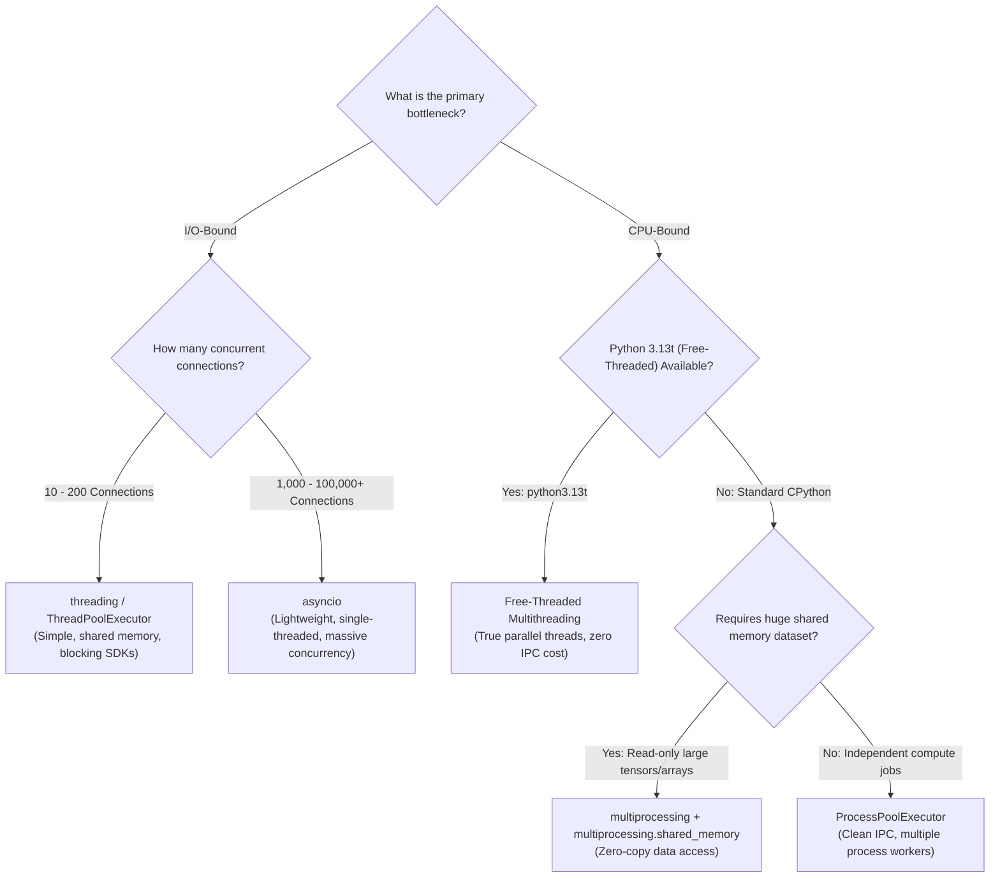

# Python Concurrency Models: Architecture, Trade-Offs, and Decision Framework

Concurrency is one of the most widely misunderstood disciplines in software engineering. As Rob Pike succinctly formulated:
> *"Concurrency is about **dealing** with lots of things at once. Parallelism is about **doing** lots of things at once."*

Python's execution model has evolved drastically over three decades. For years, discussions of Python concurrency were dominated by the Global Interpreter Lock (GIL). Today, modern Python (Python 3.12–3.14) offers five distinct concurrency paradigms: **Preemptive Multithreading**, **Multi-Process Parallelism**, **Cooperative Asynchronous Event Loops (`asyncio`)**, **Per-Interpreter GIL Subinterpreters (PEP 684)**, and **Free-Threaded CPython without the GIL (PEP 703)**.

---

## Table of Contents

1. [What & Why](#what--why)
2. [Core Concepts & Mental Model](#core-concepts--mental-model)
3. [The Five Python Concurrency Paradigms](#the-five-python-concurrency-paradigms)
4. [Decision Matrix: Choosing the Right Model](#decision-matrix-choosing-the-right-model)
5. [Syntax & API Reference](#syntax--api-reference)
6. [Code Examples](#code-examples)
7. [Edge Cases, Pitfalls & Anti-Patterns](#edge-cases-pitfalls--anti-patterns)
8. [Performance & Memory Characteristics](#performance--memory-characteristics)
9. [CPython Internals & Bytecode](#cpython-internals--bytecode)
10. [Best Practices & Idiomatic Patterns](#best-practices--idiomatic-patterns)
11. [Real-World Case Study: Hybrid High-Throughput Ingestion & Processing Gateway](#real-world-case-study-hybrid-high-throughput-ingestion--processing-gateway)
12. [Interview Questions & Deep-Dive Scenarios](#interview-questions--deep-dive-scenarios)
13. [Practical Exercises & Code Katas](#practical-exercises--code-katas)

---

## What & Why

Computer workloads fundamentally fall into two performance regimes:
1. **I/O-Bound Workloads**: Time is spent waiting for external systems: network socket reads, database queries, file system writes, and remote microservices. CPU utilization is minimal; threads spend >90% of their lifespan blocked in system calls.
2. **CPU-Bound Workloads**: Time is spent performing mathematical calculations, image compression, data parsing, cryptographic hashing, or machine learning inferences. The CPU runs at 100% saturation.

Selecting the wrong concurrency abstraction carries severe consequences:
- Using `threading` for CPU-bound tasks in standard CPython causes performance degradation due to GIL lock contention and thread context-switching overhead.
- Using `multiprocessing` for thousands of low-latency network connections causes massive memory overhead ($O(N)$ process heaps) and serialization latency.
- Using blocking I/O calls inside `asyncio` freezes the single-threaded event loop, paralyzing all concurrent coroutines.

---

## Core Concepts & Mental Model

### Concurrency vs Parallelism

```mermaid
graph TD
    subgraph Concurrency (Interleaved Dealing With Tasks)
        T1["Task A (Running)"] --> T2["Task B (Running)"]
        T2 --> T3["Task A (Resumed)"]
        T3 --> T4["Task B (Resumed)"]
        NoteC["1 CPU Core: Switching execution contexts"]
    end

    subgraph Parallelism (Simultaneous Doing of Tasks)
        P1["CPU Core 1: Task A (Continuous)"]
        P2["CPU Core 2: Task B (Continuous)"]
        NoteP["Multiple CPU Cores: Executing simultaneously in physical time"]
    end
```

---

## The Five Python Concurrency Paradigms

```mermaid
graph LR
    subgraph Paradigm 1: Threading
        TH["Preemptive OS Threads\nShared Memory\nConstrained by GIL"]
    end

    subgraph Paradigm 2: Multiprocessing
        MP["Isolated OS Processes\nSeparate Memory Heaps\nBypasses GIL (IPC via Pickle)"]
    end

    subgraph Paradigm 3: AsyncIO
        AS["Cooperative Coroutines\nSingle OS Thread\nNon-blocking Event Loop"]
    end

    subgraph Paradigm 4: Subinterpreters
        SI["Isolated Interpreters\nPer-Interpreter GIL\nShared Process Memory"]
    end

    subgraph Paradigm 5: Free-Threaded (No-GIL)
        FT["Python 3.13t\nTrue Parallel Threads\nMimalloc & Biased Refcounting"]
    end
```

### Detailed Breakdown

| Paradigm | Python Module | Preemptive or Cooperative? | Memory Sharing | GIL Behavior | Best For |
|:---|:---|:---|:---|:---|:---|
| **Multithreading** | `threading` | Preemptive (OS-scheduled) | Fully Shared (Global heap) | Single GIL held per bytecode cycle | High-latency I/O, file downloads |
| **Multiprocessing** | `multiprocessing` | Preemptive (OS processes) | Isolated (Requires IPC/pipes) | Separate GIL per process | Heavy CPU math, video processing |
| **AsyncIO** | `asyncio` | Cooperative (`await`) | Fully Shared (Single thread) | Bypasses GIL issue via single thread | High-concurrency WebSockets, HTTP APIs |
| **Subinterpreters** | `_interpreters` / PEP 554 | Preemptive per thread | Isolated heaps, fast channel IPC | Per-interpreter GIL (PEP 684) | Mixed CPU/IO plugins, worker isolation |
| **Free-Threaded** | `python3.13t` | Preemptive (OS threads) | Fully Shared (Lock-free alloc) | **No GIL** (`sys._is_gil_enabled() == False`) | True multi-core CPU parallelism in threads |

---

## Decision Matrix: Choosing the Right Model



---

## Syntax & API Reference

### 1. Minimal Multithreading (`threading`)
```python
import threading

def worker(task_id: int) -> None:
    print(f"Thread {threading.current_thread().name} running task {task_id}")

t = threading.Thread(target=worker, args=(1,), name="Worker-1")
t.start()
t.join()
```

### 2. Minimal Multiprocessing (`multiprocessing`)
```python
import multiprocessing

def cpu_heavy(n: int) -> int:
    return sum(i * i for i in range(n))

if __name__ == "__main__":
    p = multiprocessing.Process(target=cpu_heavy, args=(10_000_000,))
    p.start()
    p.join()
```

### 3. Minimal AsyncIO (`asyncio`)
```python
import asyncio

async def fetch_remote() -> str:
    await asyncio.sleep(0.1)  # Non-blocking pause
    return "200 OK"

result = asyncio.run(fetch_remote())
```

### 4. Detecting Free-Threading (Python 3.13+)
```python
import sys

def check_gil_status() -> bool:
    if hasattr(sys, "_is_gil_enabled"):
        return sys._is_gil_enabled()
    return True  # GIL is always enabled in Python <= 3.12
```

---

## Code Examples

### Example 1: I/O-Bound Benchmark: Sequential vs Threading vs AsyncIO

```python
import time
import threading
import asyncio

def mock_network_io(delay: float = 0.05) -> None:
    time.sleep(delay)

async def async_network_io(delay: float = 0.05) -> None:
    await asyncio.sleep(delay)

# 1. Sequential execution
def run_sequential(n: int = 10) -> float:
    t0 = time.perf_counter()
    for _ in range(n):
        mock_network_io()
    return time.perf_counter() - t0

# 2. Multithreaded execution
def run_threaded(n: int = 10) -> float:
    t0 = time.perf_counter()
    threads = [threading.Thread(target=mock_network_io) for _ in range(n)]
    for t in threads: t.start()
    for t in threads: t.join()
    return time.perf_counter() - t0

# 3. AsyncIO execution
async def run_async(n: int = 10) -> float:
    t0 = time.perf_counter()
    await asyncio.gather(*(async_network_io() for _ in range(n)))
    return time.perf_counter() - t0

print(f"Sequential (10 calls): {run_sequential():.3f}s")
print(f"Threaded   (10 calls): {run_threaded():.3f}s")
print(f"AsyncIO    (10 calls): {asyncio.run(run_async()):.3f}s")
# Output:
# Sequential (10 calls): 0.510s
# Threaded   (10 calls): 0.054s
# AsyncIO    (10 calls): 0.052s
```

### Example 2: The GIL Bottleneck: Threading vs Multiprocessing for CPU Workloads

```python
import time
import threading
import multiprocessing

def compute_heavy(n: int = 20_000_000) -> int:
    total = 0
    for i in range(n):
        total += i
    return total

def run_cpu_threads():
    t0 = time.perf_counter()
    t1 = threading.Thread(target=compute_heavy)
    t2 = threading.Thread(target=compute_heavy)
    t1.start(); t2.start()
    t1.join(); t2.join()
    return time.perf_counter() - t0

def run_cpu_processes():
    t0 = time.perf_counter()
    p1 = multiprocessing.Process(target=compute_heavy)
    p2 = multiprocessing.Process(target=compute_heavy)
    p1.start(); p2.start()
    p1.join(); p2.join()
    return time.perf_counter() - t0

if __name__ == "__main__":
    t_single = time.perf_counter()
    compute_heavy(); compute_heavy()
    dur_seq = time.perf_counter() - t_single
    
    dur_threads = run_cpu_threads()
    dur_procs = run_cpu_processes()

    print(f"Sequential CPU duration:    {dur_seq:.3f}s")
    print(f"Multithreaded CPU duration: {dur_threads:.3f}s (No speedup due to GIL!)")
    print(f"Multiprocessing CPU duration: {dur_procs:.3f}s (True parallel speedup!)")
```

### Example 3: Subinterpreters (PEP 684) with Independent GILs

In Python 3.12+, subinterpreters possess independent GILs:

```python
# Conceptual execution with Python 3.12+ _interpreters
import _interpreters
import time

def run_subinterpreters():
    # Create an isolated subinterpreter
    interp_id = _interpreters.create()
    
    code = """
import time
total = sum(i for i in range(10_000_000))
"""
    # Execute code inside isolated interpreter with its own GIL:
    t0 = time.perf_counter()
    _interpreters.run_string(interp_id, code)
    elapsed = time.perf_counter() - t0
    print(f"Subinterpreter execution completed in {elapsed:.3f}s")
    _interpreters.destroy(interp_id)

# run_subinterpreters()
```

### Example 4: Python 3.13 Free-Threaded Inspection (`sys._is_gil_enabled`)

```python
import sys

def report_python_concurrency_environment():
    version = sys.version_info
    print(f"Python Runtime: {version.major}.{version.minor}.{version.micro}")
    
    if hasattr(sys, "_is_gil_enabled"):
        gil_active = sys._is_gil_enabled()
        if not gil_active:
            print("🚀 RUNNING ON FREE-THREADED CPYTHON (NO-GIL BUILD / PEP 703)!")
            print("CPU-bound threads will execute across multiple physical cores in parallel.")
        else:
            print("Standard CPython with GIL active.")
    else:
        print("Standard CPython build (GIL permanently active).")

report_python_concurrency_environment()
# Output on standard Python 3.12/3.13:
# Python Runtime: 3.12.x
# Standard CPython build (GIL permanently active).
```

### Example 5: High-Level Unified API with `concurrent.futures`

```python
from concurrent.futures import ThreadPoolExecutor, ProcessPoolExecutor
import math

def calculate_prime_factors(number: int) -> list[int]:
    factors = []
    d = 2
    while d * d <= number:
        while number % d == 0:
            factors.append(d)
            number //= d
        d += 1
    if number > 1:
        factors.append(number)
    return factors

numbers = [1000000007, 1000000009, 1000000021, 1000000033]

# ProcessPoolExecutor seamlessly dispatches across physical CPU cores:
with ProcessPoolExecutor(max_workers=4) as executor:
    results = list(executor.map(calculate_prime_factors, numbers))

for num, factors in zip(numbers, results):
    print(f"Number {num} factors: {factors}")
# Output:
# Number 1000000007 factors: [941, 1062699]
# Number 1000000009 factors: [1000000009]
# Number 1000000021 factors: [7, 142857147]
# Number 1000000033 factors: [19, 52631581]
```

---

## Edge Cases, Pitfalls & Anti-Patterns

### Common Mistakes Table

| Mistake | Bad Code | Correct Idiom | Why It Fails |
|:---|:---|:---|:---|
| **Using `threading` for CPU scaling in GIL Python** | Spawning 8 threads for heavy math | Use `ProcessPoolExecutor` or `python3.13t` | GIL forces threads to serialize onto a single core; context switching degrades performance. |
| **Missing `if __name__ == '__main__':` in multiprocessing** | Spawning processes at top level | Wrap process launch in `if __name__ == '__main__':` | On Windows and macOS (`spawn` mode), re-importing the module creates a recursive process fork bomb. |
| **Calling blocking I/O inside `asyncio`** | `time.sleep(5)` or `requests.get()` inside `async def` | `await asyncio.sleep(5)` or `asyncio.to_thread(requests.get)` | Freezes the single-threaded event loop, halting all concurrent coroutines. |
| **Passing unpicklable objects across processes** | Passing open file handles, database sockets, or lambdas to `multiprocessing` | Pass serializable primitive IDs, paths, or use shared memory | Process IPC relies on `pickle`; unpicklable objects raise `PicklingError`. |
| **Spawning thousands of OS threads** | Creating 10,000 `threading.Thread` instances | Use `asyncio` coroutines or a bounded `ThreadPoolExecutor` | Each OS thread allocates 8MB stack space; exhausts virtual memory and crashes the OS. |
| **Assuming thread-safety for standard containers** | Mutating shared `list` or `dict` from multiple threads without locks | Use `threading.Lock` or `queue.Queue` | Race conditions can corrupt internal invariants despite the GIL. |

---

## Performance & Memory Characteristics

### Comparative Resource Consumption

| Concurrency Model | Memory per Worker | Max Practical Workers | Context Switch Cost | Scaling Bottleneck |
|:---|:---|:---|:---|:---|
| **AsyncIO Coroutines** | **~1 - 2 KB** | 100,000+ | **~50 - 100 ns** (User space) | Event loop latency; CPU saturation |
| **OS Threads (`threading`)**| **~8 MB** (Virtual stack) | 1,000 - 2,000 | **~1 - 3 µs** (Kernel space) | Thread stack memory; GIL lock contention |
| **Processes (`multiprocessing`)**| **~25 - 50 MB** (Heap) | Number of CPU Cores (e.g. 8-64) | **~10 - 50 µs** (Full MMU switch) | RAM exhaustion; IPC serialization overhead |
| **Free-Threaded (`python3.13t`)**| **~8 MB** (Virtual stack) | Number of CPU Cores (8-128+) | **~1 - 3 µs** (Kernel space) | Cache coherency bus contention |

---

## CPython Internals & Bytecode

### How the GIL Regulates Bytecode Execution

In standard CPython, the GIL is a mutex protecting internal CPython state and reference counting. Every thread must acquire the GIL before executing Python bytecode:

```c
// Simplified CPython Evaluation Loop (ceval.c)
for (;;) {
    if (_Py_eval_breaker) {
        // Check if thread switch requested or GIL interval expired
        drop_gil();
        take_gil();  // Thread yields to waiting threads
    }
    opcode = NEXTOP();
    DISPATCH_OP(opcode);
}
```

The CPython evaluation loop checks the GIL switch interval every 5 milliseconds (`sys.getswitchinterval()`). If a thread is executing a long CPU loop, CPython forces it to release the GIL, letting other waiting threads run. However, if multiple CPU-bound threads fight for the GIL, they waste millions of CPU cycles thrashing the lock instead of performing computational work.

---

## Best Practices & Idiomatic Patterns

1. **Default to `asyncio` for High-Throughput I/O**: Best suited for microservices, WebSockets, scrapers, and API gateways.
2. **Use `concurrent.futures.ThreadPoolExecutor` for Legacy Blocking SDKs**: When wrapping third-party libraries (e.g. `boto3`, legacy database drivers) that do not support async/await.
3. **Use `ProcessPoolExecutor` for CPU-Intensive Algorithms**: Scale matrix multiplication, image transformations, and heavy parsing across all physical CPU cores.
4. **Always Protect Windows/macOS Multiprocessing with `__main__`**: Mandatory to avoid recursive process instantiation.
5. **Prepare for Free-Threaded Python (PEP 703)**: Eliminate reliance on GIL-guaranteed atomicity in preparation for Python 3.13+ no-GIL deployments.

---

## Real-World Case Study: Hybrid High-Throughput Ingestion & Processing Gateway

Below is an enterprise architecture pattern combining `asyncio` for high-throughput network ingestion with a `ProcessPoolExecutor` for parallel CPU thumbnail generation:

```python
import asyncio
from concurrent.futures import ProcessPoolExecutor
import time
import os

# CPU-Bound Task: Executed in parallel worker processes
def process_image_thumbnail(image_id: str, raw_bytes: bytes) -> tuple[str, int]:
    # Simulate heavy image resizing and compression
    time.sleep(0.05)
    processed_size = len(raw_bytes) // 2
    return f"thumb_{image_id}.jpg", processed_size

# I/O-Bound Gateway: Executed on single-threaded asyncio event loop
class IngestionGateway:
    def __init__(self, max_cpu_workers: int = 4) -> None:
        self.process_pool = ProcessPoolExecutor(max_workers=max_cpu_workers)

    async def handle_upload(self, upload_id: str, payload: bytes) -> dict[str, object]:
        loop = asyncio.get_running_loop()
        
        # Offload heavy CPU image compression to multi-process pool:
        thumb_name, size = await loop.run_in_executor(
            self.process_pool,
            process_image_thumbnail,
            upload_id,
            payload
        )
        
        # Simulate non-blocking async metadata write to database:
        await asyncio.sleep(0.01)
        
        return {
            "upload_id": upload_id,
            "thumbnail": thumb_name,
            "compressed_bytes": size,
            "status": "ready"
        }

    async def batch_ingest(self, items: list[tuple[str, bytes]]) -> list[dict[str, object]]:
        tasks = [self.handle_upload(uid, data) for uid, data in items]
        return await asyncio.gather(*tasks)

    def shutdown(self) -> None:
        self.process_pool.shutdown(wait=True)

async def main() -> None:
    gateway = IngestionGateway(max_cpu_workers=2)
    sample_uploads = [
        (f"IMG_00{i}", b"RAW_PIXEL_DATA_PAYLOAD" * 50)
        for i in range(6)
    ]
    
    t0 = time.perf_counter()
    results = await gateway.batch_ingest(sample_uploads)
    elapsed = time.perf_counter() - t0
    
    print(f"Processed {len(results)} image uploads concurrently in {elapsed:.3f}s:")
    for r in results[:2]:
        print(f" - {r['upload_id']}: {r['thumbnail']} ({r['compressed_bytes']} bytes)")
    
    gateway.shutdown()

if __name__ == "__main__":
    asyncio.run(main())
# Output:
# Processed 6 image uploads concurrently in 0.165s:
#  - IMG_000: thumb_IMG_000.jpg (550 bytes)
#  - IMG_001: thumb_IMG_001.jpg (550 bytes)
```

---

## Interview Questions & Deep-Dive Scenarios

<details>
<summary>1. Why doesn't multithreading speed up CPU-bound code in standard CPython?</summary>

Standard CPython uses a Global Interpreter Lock (GIL) to protect CPython's internal memory management (especially reference counting) from concurrent race conditions. The GIL allows only one OS thread to execute Python bytecode at any given instant. When multiple CPU-bound threads run, they cannot execute in parallel across multiple CPU cores; instead, they contend for the same lock, introducing context-switch overhead that makes multithreaded CPU code run *slower* than single-threaded code.
</details>

<details>
<summary>2. How does `asyncio` achieve high concurrency without multithreading?</summary>

`asyncio` uses **cooperative multitasking** driven by an OS event loop (`epoll` on Linux, `kqueue` on macOS, `IOCP` on Windows). Coroutines execute on a single thread. When a coroutine reaches an I/O operation (e.g. `await reader.read()`), it registers the socket descriptor with the OS kernel and yields control back to the event loop. The loop processes other coroutines while waiting. When the socket becomes readable, the OS notifies the loop, which resumes the coroutine. Because there are no OS thread stacks or kernel context switches, millions of connections can be multiplexed with minimal RAM.
</details>

<details>
<summary>3. What is PEP 703 (Free-Threaded CPython), and how does it eliminate the GIL in Python 3.13?</summary>

PEP 703 removes the GIL by replacing global synchronization with fine-grained concurrency primitives:
1. **Biased Reference Counting**: Thread-local reference count increments require no atomic operations; non-local references use atomic operations.
2. **Mimalloc Memory Allocator**: Lock-free thread-local heap allocation.
3. **Immortal Objects**: Constants (small ints, None, True) never mutate reference counts.
This enables true parallel CPU execution for Python threads across multiple cores.
</details>

<details>
<summary>4. What are subinterpreters (PEP 684), and how do they differ from multiprocessing?</summary>

Subinterpreters allow running multiple independent Python interpreter instances within a **single operating system process**. Under PEP 684 (Python 3.12+), each subinterpreter possesses its own isolated GIL and isolated modules. Unlike `multiprocessing`, subinterpreters share the same OS process address space, enabling ultra-fast in-memory channel communication without requiring OS pipes or network sockets.
</details>

<details>
<summary>5. Why does Windows require `if __name__ == '__main__':` for `multiprocessing`?</summary>

Linux supports `fork()`, which clones the parent process's memory space directly. Windows lacks `fork()` and uses `spawn`: it launches a brand new Python interpreter process that imports the entry script from scratch. Without `if __name__ == '__main__':`, the spawned child process would re-execute the process creation code, spawning infinite child processes in an uncontrollable fork bomb.
</details>

<details>
<summary>6. What happens if a CPU-heavy calculation is called directly inside an `async def` function?</summary>

It blocks the entire event loop. Because `asyncio` relies on cooperative multitasking, no other coroutines can run while that CPU calculation executes. All network connections, timers, and WebSockets will stall until the calculation finishes. CPU tasks must be offloaded to `loop.run_in_executor()` or `asyncio.to_thread()`.
</details>

<details>
<summary>7. What is `sys.getswitchinterval()`?</summary>

It returns the duration (default: 0.005 seconds / 5 milliseconds) that CPython allows a single thread to execute Python bytecode before forcing it to drop the GIL and allow other waiting OS threads an opportunity to acquire it.
</details>

<details>
<summary>8. When is `ThreadPoolExecutor` preferred over `asyncio`?</summary>

When working with blocking third-party libraries (e.g., synchronous database drivers like psycopg2, blocking cloud SDKs, or legacy corporate libraries) that do not support async/await syntax and cannot easily be rewritten.
</details>

---

## Practical Exercises & Code Katas

### Exercise 1: Concurrency Model Selector Function
Write a function `recommend_concurrency_model(is_cpu_bound: bool, expected_connections: int, is_no_gil: bool) -> str` returning the optimal paradigm.

<details>
<summary>Solution</summary>

```python
def recommend_concurrency_model(is_cpu_bound: bool, expected_connections: int, is_no_gil: bool) -> str:
    if is_cpu_bound:
        if is_no_gil:
            return "ThreadPoolExecutor (Free-Threaded CPython / No-GIL)"
        return "ProcessPoolExecutor (Multi-Process Parallelism)"
    else:
        if expected_connections > 500:
            return "AsyncIO Event Loop (High-Concurrency Non-Blocking)"
        return "ThreadPoolExecutor (Standard Preemptive Multithreading)"

print(recommend_concurrency_model(True, 10, False))
print(recommend_concurrency_model(False, 5000, False))
# Output:
# ProcessPoolExecutor (Multi-Process Parallelism)
# AsyncIO Event Loop (High-Concurrency Non-Blocking)
```
</details>

### Exercise 2: Offloading Blocking Call to Thread in AsyncIO
Write an async function that fetches a URL using synchronous `urllib.request` without blocking the asyncio event loop using `asyncio.to_thread`.

<details>
<summary>Solution</summary>

```python
import asyncio
import urllib.request

def blocking_get(url: str) -> int:
    req = urllib.request.Request(url, headers={"User-Agent": "Mozilla/5.0"})
    with urllib.request.urlopen(req, timeout=3.0) as resp:
        return resp.status

async def safe_fetch(url: str) -> int:
    # Offload blocking synchronous I/O to background thread:
    status = await asyncio.to_thread(blocking_get, url)
    return status

# asyncio.run(safe_fetch("https://httpbin.org/get"))
```
</details>

### Exercise 3: Parallel CPU Map with ProcessPoolExecutor
Write a script that computes the square of numbers 1 through 100,000 across available CPU cores using `ProcessPoolExecutor`.

<details>
<summary>Solution</summary>

```python
from concurrent.futures import ProcessPoolExecutor

def square_num(n: int) -> int:
    return n * n

def compute_all():
    data = list(range(1, 100_001))
    with ProcessPoolExecutor() as executor:
        results = list(executor.map(square_num, data, chunksize=5000))
    print(f"Computed {len(results)} squares. First: {results[0]}, Last: {results[-1]}")

if __name__ == "__main__":
    compute_all()
# Output: Computed 100000 squares. First: 1, Last: 10000000000
```
</details>

### Exercise 4: Thread State and GIL Switch Interval Inspection
Write a script that displays the current thread name, thread count, and CPython GIL switch interval.

<details>
<summary>Solution</summary>

```python
import sys
import threading

def inspect_threading_environment():
    current = threading.current_thread().name
    count = threading.active_count()
    interval_ms = sys.getswitchinterval() * 1000
    print(f"Current Thread: {current}")
    print(f"Active Thread Count: {count}")
    print(f"GIL Switch Interval: {interval_ms:.1f}ms")

inspect_threading_environment()
# Output:
# Current Thread: MainThread
# Active Thread Count: 1
# GIL Switch Interval: 5.0ms
```
</details>

### Exercise 5: Parallel Prime Searcher across Processes
Implement a prime number validator and search for primes between $1,000,000$ and $1,000,500$ using `ProcessPoolExecutor`.

<details>
<summary>Solution</summary>

```python
from concurrent.futures import ProcessPoolExecutor

def is_prime(n: int) -> bool:
    if n < 2: return False
    if n in (2, 3): return True
    if n % 2 == 0 or n % 3 == 0: return False
    i = 5
    while i * i <= n:
        if n % i == 0 or n % (i + 2) == 0: return False
        i += 6
    return True

def find_primes():
    candidates = range(1_000_000, 1_000_200)
    with ProcessPoolExecutor() as executor:
        results = zip(candidates, executor.map(is_prime, candidates))
    primes = [n for n, prime in results if prime]
    print("Found primes:", primes)

if __name__ == "__main__":
    find_primes()
# Output: Found primes: [1000003, 1000033, 1000037, 1000039, ...]
```
</details>

### Exercise 6: AsyncIO Task Timeout Guard
Create an async wrapper `fetch_with_timeout(coro, timeout_sec)` that cancels the coroutine and returns a fallback value if it exceeds the timeout.

<details>
<summary>Solution</summary>

```python
import asyncio

async def slow_operation() -> str:
    await asyncio.sleep(1.0)
    return "Data payload"

async def fetch_with_timeout[T](coro: asyncio.Future[T] | asyncio.Task[T], timeout_sec: float, fallback: T) -> T:
    try:
        return await asyncio.wait_for(coro, timeout=timeout_sec)
    except TimeoutError:
        print("[WARNING] Operation timed out! Returning fallback.")
        return fallback

async def main():
    res = await fetch_with_timeout(asyncio.create_task(slow_operation()), 0.1, "FALLBACK_VALUE")
    print("Result:", res)

asyncio.run(main())
# Output:
# [WARNING] Operation timed out! Returning fallback.
# Result: FALLBACK_VALUE
```
</details>
