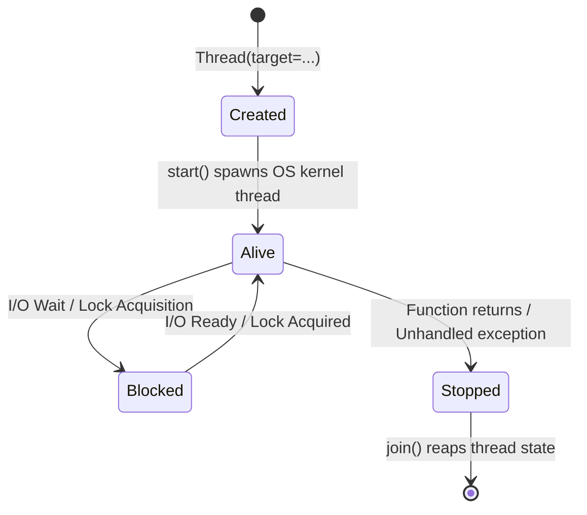

# Python Threading Basics: Lifecycle, Daemon Threads, and Thread-Local Storage

Python's **`threading` module** provides preemptively scheduled, operating system-level threads (POSIX pthreads on Linux/macOS, Windows threads on Windows). Each Python thread corresponds directly to a native kernel thread. While the Global Interpreter Lock (GIL) restricts Python bytecode execution to a single core in standard CPython, `threading` remains the premier abstraction for I/O-bound concurrency, background housekeeping workers, and non-blocking desktop or microservice tasks.

---

## Table of Contents

1. [What & Why](#what--why)
2. [Core Concepts & Mental Model](#core-concepts--mental-model)
3. [How It Works Internally](#how-it-works-internally)
4. [Syntax & API Reference](#syntax--api-reference)
5. [Code Examples](#code-examples)
6. [Edge Cases, Pitfalls & Anti-Patterns](#edge-cases-pitfalls--anti-patterns)
7. [Performance & Memory Characteristics](#performance--memory-characteristics)
8. [CPython Internals & Bytecode](#cpython-internals--bytecode)
9. [Best Practices & Idiomatic Patterns](#best-practices--idiomatic-patterns)
10. [Real-World Case Study: Resilient Multi-Threaded Background File Ingestion & Rotation Engine](#real-world-case-study-resilient-multi-threaded-background-file-ingestion--rotation-engine)
11. [Interview Questions & Deep-Dive Scenarios](#interview-questions--deep-dive-scenarios)
12. [Practical Exercises & Code Katas](#practical-exercises--code-katas)

---

## What & Why

Why use `threading` instead of `asyncio` or `multiprocessing`?
1. **Shared Memory Without IPC Overhead**: All threads within a process share the identical heap, global variables, and open file descriptors. Passing data between threads requires no serialization (`pickle`) or inter-process pipes.
2. **Compatibility with Synchronous Ecosystems**: Thousands of production libraries (e.g., standard `urllib`, database drivers, proprietary enterprise SDKs) are strictly synchronous and blocking. Multithreading enables concurrent execution of these libraries without rewriting them for async/await.
3. **Simplicity for Low-to-Medium Concurrency**: Running 10 to 100 concurrent I/O operations with `ThreadPoolExecutor` is vastly simpler to debug, trace, and reason about than complex async event loop cascades.

---

## Core Concepts & Mental Model

### OS Thread Mapping and Lifecycle



### Daemon vs Non-Daemon Threads

The primary distinction between thread types lies in **program shutdown behavior**:
- **Non-Daemon Threads (Default)**: Python **will not exit** until all non-daemon threads have completed. If a non-daemon thread runs an infinite loop, your Python process will hang forever upon script completion or SIGINT.
- **Daemon Threads (`daemon=True`)**: Background worker threads that are **abruptly terminated** the moment all non-daemon threads (including the main thread) finish execution.
  > [!CAUTION]
  > Daemon threads terminate abruptly! `finally` blocks, context manager `__exit__` methods, and open file buffers are **not** guaranteed to flush or execute when a daemon thread is killed during interpreter shutdown.

---

## How It Works Internally

### Thread-Local Storage (`threading.local`)

In multithreaded systems, global state introduces race conditions. However, passing state (such as user session context, database connection handles, or trace IDs) through every function argument pollutes signatures.

`threading.local()` provides an object whose attributes are strictly isolated per-thread:

```mermaid
graph TD
    TL["thread_data = threading.local()"]
    
    subgraph Thread 1 (Worker-A)
        T1["Thread 1 Stack"] -->|Writes| D1["thread_data.user_id = 'Alice'"]
        T1 -->|Reads| D1
    end

    subgraph Thread 2 (Worker-B)
        T2["Thread 2 Stack"] -->|Writes| D2["thread_data.user_id = 'Bob'"]
        T2 -->|Reads| D2
    end
    
    D1 -.->|Completely Isolated In Memory!| D2
```

Under the hood, `threading.local` maintains an internal dictionary mapping `threading.get_ident()` (the OS thread ID) to an instance attribute dictionary.

---

## Syntax & API Reference

### 1. Creating Threads

```python
import threading

# Functional target:
t = threading.Thread(
    target=worker_func,
    args=(arg1, arg2),
    kwargs={"key": val},
    name="WorkerThread-1",
    daemon=False
)
t.start()
t.join(timeout=5.0)  # Wait up to 5 seconds
```

### 2. Subclassing `threading.Thread`

```python
class WorkerThread(threading.Thread):
    def __init__(self, task_id: int) -> None:
        super().__init__(name=f"CustomWorker-{task_id}")
        self.task_id = task_id

    def run(self) -> None:
        # Override run() with execution logic
        print(f"{self.name} processing task {self.task_id}")
```

### 3. Global Thread Exception Hook (Python 3.8+)

```python
def custom_thread_excepthook(args: threading.ExceptHookArgs) -> None:
    print(f"Unhandled error in thread {args.thread.name}: {args.exc_value}")

threading.excepthook = custom_thread_excepthook
```

---

## Code Examples

### Example 1: Basic Thread Creation and Lifecycle Management

```python
import threading
import time

def background_worker(name: str, duration: float) -> None:
    print(f"[{threading.current_thread().name}] Worker '{name}' starting...")
    time.sleep(duration)
    print(f"[{threading.current_thread().name}] Worker '{name}' completed.")

threads: list[threading.Thread] = []
for i in range(3):
    t = threading.Thread(
        target=background_worker,
        args=(f"Job-{i}", 0.05 * (i + 1)),
        name=f"Thread-{i}"
    )
    threads.append(t)
    t.start()

print(f"Main thread waiting for {len(threads)} workers...")
for t in threads:
    t.join()  # Blocks main thread until t terminates

print("All worker threads joined cleanly. Exiting.")
# Output:
# [Thread-0] Worker 'Job-0' starting...
# [Thread-1] Worker 'Job-1' starting...
# [Thread-2] Worker 'Job-2' starting...
# Main thread waiting for 3 workers...
# [Thread-0] Worker 'Job-0' completed.
# [Thread-1] Worker 'Job-1' completed.
# [Thread-2] Worker 'Job-2' completed.
# All worker threads joined cleanly. Exiting.
```

### Example 2: Subclassing `Thread` for State Encapsulation

```python
import threading
import time

class APICheckerThread(threading.Thread):
    """Encapsulates polling logic and holds the computed result."""
    
    def __init__(self, endpoint: str) -> None:
        super().__init__()
        self.endpoint = endpoint
        self.status_code: int = 0
        self.latency_ms: float = 0.0

    def run(self) -> None:
        t0 = time.perf_counter()
        # Simulate network HTTP latency
        time.sleep(0.02)
        self.latency_ms = (time.perf_counter() - t0) * 1000
        self.status_code = 200

endpoints = ["/health", "/api/v1/users", "/metrics"]
workers = [APICheckerThread(ep) for ep in endpoints]

for w in workers: w.start()
for w in workers: w.join()

for w in workers:
    print(f"Endpoint '{w.endpoint}': HTTP {w.status_code} in {w.latency_ms:.1f}ms")
# Output:
# Endpoint '/health': HTTP 200 in ...ms
# Endpoint '/api/v1/users': HTTP 200 in ...ms
# Endpoint '/metrics': HTTP 200 in ...ms
```

### Example 3: Thread-Local Storage (`threading.local`)

```python
import threading
import time

thread_context = threading.local()

def log_with_context(message: str) -> None:
    # Retrieve thread-local metadata without passing context parameters:
    user = getattr(thread_context, "user", "ANONYMOUS")
    trace_id = getattr(thread_context, "trace_id", "NO_TRACE")
    print(f"[{threading.current_thread().name}] [Trace: {trace_id}] User: {user} -> {message}")

def request_handler(user_name: str, trace: str) -> None:
    # Set isolated context for current thread
    thread_context.user = user_name
    thread_context.trace_id = trace
    
    log_with_context("Authenticating request...")
    time.sleep(0.01)
    log_with_context("Executing SQL query...")

t1 = threading.Thread(target=request_handler, args=("alice", "TRC-101"), name="HTTP-Worker-1")
t2 = threading.Thread(target=request_handler, args=("bob", "TRC-202"), name="HTTP-Worker-2")

t1.start(); t2.start()
t1.join(); t2.join()
# Output:
# [HTTP-Worker-1] [Trace: TRC-101] User: alice -> Authenticating request...
# [HTTP-Worker-2] [Trace: TRC-202] User: bob -> Authenticating request...
# [HTTP-Worker-1] [Trace: TRC-101] User: alice -> Executing SQL query...
# [HTTP-Worker-2] [Trace: TRC-202] User: bob -> Executing SQL query...
```

### Example 4: Centralized Exception Handling with `threading.excepthook`

In standard Python, an exception inside a thread does not bubble up to the main thread or crash the process. Instead, it prints a traceback to `sys.stderr` and dies silently. `threading.excepthook` captures these errors centrally:

```python
import threading

def custom_error_handler(args: threading.ExceptHookArgs) -> None:
    print(f"\n[ALERT - Sentry Telemetry Hook]")
    print(f"Thread Name:      {args.thread.name}")
    print(f"Exception Type:   {args.exc_type.__name__}")
    print(f"Exception Reason: {args.exc_value}\n")

# Register hook globally
threading.excepthook = custom_error_handler

def faulty_worker() -> None:
    raise ValueError("Database connection pool exhausted!")

t = threading.Thread(target=faulty_worker, name="BillingWorker")
t.start()
t.join()
# Output:
# [ALERT - Sentry Telemetry Hook]
# Thread Name:      BillingWorker
# Exception Type:   ValueError
# Exception Reason: Database connection pool exhausted!
```

### Example 5: Graceful Shutdown of Long-Running Daemon Workers

```python
import threading
import time

class BackgroundPoller:
    def __init__(self) -> None:
        self._stop_event = threading.Event()
        self._thread = threading.Thread(target=self._run_loop, name="BackgroundPoller")

    def start(self) -> None:
        self._thread.start()

    def stop(self) -> None:
        print("[Poller] Signaling stop event...")
        self._stop_event.set()
        self._thread.join()
        print("[Poller] Worker stopped gracefully.")

    def _run_loop(self) -> None:
        while not self._stop_event.is_set():
            print("[Poller] Polling upstream metrics...")
            # Wait for 0.05s OR until stop_event is triggered:
            self._stop_event.wait(timeout=0.05)

poller = BackgroundPoller()
poller.start()
time.sleep(0.12)
poller.stop()
# Output:
# [Poller] Polling upstream metrics...
# [Poller] Polling upstream metrics...
# [Poller] Polling upstream metrics...
# [Poller] Signaling stop event...
# [Poller] Worker stopped gracefully.
```

---

## Edge Cases, Pitfalls & Anti-Patterns

### Common Mistakes Table

| Mistake | Bad Code | Correct Idiom | Why It Fails |
|:---|:---|:---|:---|
| **Calling `run()` instead of `start()`** | `t = Thread(target=f); t.run()` | `t = Thread(target=f); t.start()` | `run()` executes sequentially on the *calling thread*; it spawns no OS thread! |
| **Forgetting to `join()` worker threads** | Leaving non-daemon threads unjoined | Call `t.join()` before exiting main flow | Main thread may finish before workers complete; resources leak. |
| **Relying on daemon threads for state writes** | Writing to database or file in daemon thread | Use non-daemon thread or `Event` shutdown | Daemon threads are killed instantly at interpreter exit; files end up truncated. |
| **Passing single argument without trailing comma** | `Thread(target=f, args=(val))` | `Thread(target=f, args=(val,))` | `(val)` is an expression, not a tuple; raises `TypeError: args must be an iterable`. |
| **Catching thread exceptions with `try/except` in caller** | `try: t.start() except: ...` | Use `threading.excepthook` or wrapper queues | Exceptions in child threads do not bubble up to the caller thread's call stack. |
| **Re-starting a terminated thread** | `t.start(); t.join(); t.start()` | Instantiate a new `Thread` instance | In Python, threads can only be started **once**. Re-starting raises `RuntimeError`. |

---

## Performance & Memory Characteristics

### Thread Resource Consumption

1. **Memory Allocation**:
   - Every OS thread allocates a private execution stack. In 64-bit Linux/Windows, default virtual memory stack size is **8 MB** (though actual resident memory RSS starts at ~64 KB per thread until pages are touched).
   - Practical limit: Spawning > 2,000 threads will quickly exhaust process address space and trigger `RuntimeError: can't start new thread`.
2. **Context Switching Overhead**:
   - Switching between kernel threads costs ~1 to 3 microseconds ($1,000 - 3,000$ ns) of CPU time due to kernel privilege boundary crossing and CPU cache line invalidations.

---

## CPython Internals & Bytecode

### How `Thread.start()` Interacts with CPython

When `Thread.start()` is invoked, CPython executes the following internal sequence:
1. Allocates an internal `PyThreadState` struct tracking the thread's execution frame, recursion depth, and active exception pointers.
2. Calls the OS thread creation API: `pthread_create()` on POSIX or `_beginthreadex()` on Windows.
3. The new OS thread initializes its C stack, acquires the CPython GIL, and jumps into the C function `t_bootstrap()`.
4. `t_bootstrap()` executes the Python `run()` method inside the CPython bytecode interpreter loop.

---

## Best Practices & Idiomatic Patterns

1. **Always Name Your Threads**: `threading.Thread(target=..., name="PaymentProcessor-1")`. When debugging thread dumps or inspecting logs, thread names save hours of diagnostics.
2. **Use `threading.Event` for Graceful Termination**: Never attempt to forcefully kill threads (Python intentionally lacks a `thread.kill()` API to prevent deadlocks and memory corruption).
3. **Isolate Context with `threading.local()`**: Essential for multi-tenant web servers, request tracing, and database session pooling.
4. **Register `threading.excepthook` in Production**: Never let thread exceptions die silently without alerting monitoring tools like Datadog or Sentry.

---

## Real-World Case Study: Resilient Multi-Threaded Background File Ingestion & Rotation Engine

Below is a production-grade background file processor that watches a queue, processes log batches, and shuts down cleanly without losing records:

```python
import threading
import queue
import time

class LogRecord:
    def __init__(self, service: str, message: str) -> None:
        self.service = service
        self.message = message
        self.timestamp = time.time()

class BackgroundLogWriter:
    """Production thread-safe asynchronous disk log writer."""

    def __init__(self) -> None:
        self._queue: queue.Queue[LogRecord | None] = queue.Queue(maxsize=10_000)
        self._shutdown_event = threading.Event()
        self._worker_thread = threading.Thread(
            target=self._process_queue,
            name="DiskLogWriterWorker",
            daemon=False  # Non-daemon to guarantee all logs flush!
        )
        self._processed_count = 0

    def start(self) -> None:
        self._worker_thread.start()
        print(f"[{self._worker_thread.name}] Log writer worker thread started.")

    def log(self, service: str, message: str) -> None:
        """Producer method called from any application thread."""
        record = LogRecord(service, message)
        self._queue.put(record)

    def stop(self) -> None:
        """Gracefully flushes remaining queue records and shuts down."""
        print("[LogWriter] Shutdown initiated. Flusing queue...")
        # Sentinel None signals the worker thread to terminate:
        self._queue.put(None)
        self._worker_thread.join()
        print(f"[LogWriter] Shutdown complete. Total flushed: {self._processed_count} logs.")

    def _process_queue(self) -> None:
        """Consumer method running on dedicated background thread."""
        while True:
            record = self._queue.get()
            if record is None:
                # Sentinel reached: exit loop
                self._queue.task_done()
                break
            
            # Simulate disk append write
            self._processed_count += 1
            self._queue.task_done()

# Simulation: Multiple application threads generating logs
writer = BackgroundLogWriter()
writer.start()

def producer(thread_id: int):
    for i in range(5):
        writer.log(f"auth-service-{thread_id}", f"Successful login token for user_{i}")
        time.sleep(0.005)

threads = [threading.Thread(target=producer, args=(i,)) for i in range(3)]
for t in threads: t.start()
for t in threads: t.join()

writer.stop()
# Output:
# [DiskLogWriterWorker] Log writer worker thread started.
# [LogWriter] Shutdown initiated. Flusing queue...
# [LogWriter] Shutdown complete. Total flushed: 15 logs.
```

---

## Interview Questions & Deep-Dive Scenarios

<details>
<summary>1. Why doesn't Python provide a method to forcefully terminate or kill a running thread?</summary>

Forcefully killing a thread (e.g. `pthread_cancel`) is extremely dangerous. If a thread is killed while holding a mutex, file lock, or internal CPython heap lock, that lock is **never released**, causing instant deadlocks across the entire process. Furthermore, shared memory data structures under mutation are left in a corrupted, half-written state. Python mandates cooperative termination using signals like `threading.Event`.
</details>

<details>
<summary>2. What is the difference between `t.start()` and `t.run()`?</summary>

- `t.start()` invokes OS system calls to spawn a brand new native kernel thread, allocates CPython thread state, acquires the GIL, and executes `run()` inside that separate OS thread.
- `t.run()` simply executes the method synchronously in the **current calling thread**. It spawns zero new threads and provides zero concurrency.
</details>

<details>
<summary>3. What happens if an unhandled exception occurs inside a worker thread?</summary>

The exception prints a traceback to `sys.stderr`, the thread's execution frame is dismantled, and the thread terminates. However, the exception does **not** bubble up to the main thread or crash the process. Other threads continue running normally. In Python 3.8+, you can intercept these exceptions globally by defining `threading.excepthook`.
</details>

<details>
<summary>4. Why should you avoid performing file writes or network transactions in daemon threads?</summary>

When all non-daemon threads exit, CPython initiates immediate interpreter shutdown. Daemon threads are killed instantly without unwinding their call stacks. Python does not execute their `finally` blocks, context manager `__exit__` methods, or standard library cleanup handlers. Unflushed file buffers remain unwritten to disk, causing file corruption.
</details>

<details>
<summary>5. How does `threading.local()` isolate state between threads?</summary>

`threading.local` internally uses a dictionary keyed by the current OS thread identifier (`threading.get_ident()`). Whenever an attribute is accessed or assigned (`local_data.x = 10`), Python routes the lookup to the dictionary specific to the calling thread's ID, ensuring that different threads see independent memory values.
</details>

<details>
<summary>6. What does `t.join(timeout=2.0)` do if the thread does not finish within 2 seconds?</summary>

`join()` will unblock and return control to the caller after 2 seconds, regardless of whether the thread has finished. The worker thread **continues running in the background**; `join()` never aborts or kills a thread. Callers should check `t.is_alive()` to verify if the thread actually concluded.
</details>

<details>
<summary>7. How can you get the return value from a target function passed to `threading.Thread`?</summary>

`threading.Thread` does not return the target function's output. To retrieve return values:
1. Subclass `threading.Thread` and save the result to `self.result` inside `run()`.
2. Pass a thread-safe `queue.Queue` and put the result in the queue.
3. Use `concurrent.futures.ThreadPoolExecutor`, whose `Future.result()` captures return values and exceptions automatically.
</details>

<details>
<summary>8. Can you restart a thread after it has completed?</summary>

No. Once a thread finishes its `run()` method, it enters the `Stopped` state. Calling `start()` on an already-started thread raises `RuntimeError: threads can only be started once`. To execute the task again, instantiate a new `threading.Thread` object.
</details>

---

## Practical Exercises & Code Katas

### Exercise 1: Thread Safe Counter with Event Signaler
Create a thread that increments a counter until signaled to stop by a `threading.Event`, returning the final count.

<details>
<summary>Solution</summary>

```python
import threading
import time

class StoppableCounter(threading.Thread):
    def __init__(self) -> None:
        super().__init__()
        self.stop_event = threading.Event()
        self.count = 0

    def run(self) -> None:
        while not self.stop_event.is_set():
            self.count += 1
            time.sleep(0.001)

    def stop(self) -> int:
        self.stop_event.set()
        self.join()
        return self.count

counter = StoppableCounter()
counter.start()
time.sleep(0.05)
final_val = counter.stop()
print(f"Counter stopped at: {final_val}")
```
</details>

### Exercise 2: Dynamic Thread-Local Context Provider
Implement a context manager `with user_session("alice"):` that sets and tears down `threading.local` user state.

<details>
<summary>Solution</summary>

```python
import threading
from contextlib import contextmanager
from typing import Iterator

_session = threading.local()

@contextmanager
def user_session(username: str) -> Iterator[None]:
    old_user = getattr(_session, "user", None)
    _session.user = username
    try:
        yield
    finally:
        _session.user = old_user

def get_current_user() -> str | None:
    return getattr(_session, "user", None)

print("Before context:", get_current_user())
with user_session("john_doe"):
    print("Inside context:", get_current_user())
print("After context:", get_current_user())
# Output:
# Before context: None
# Inside context: john_doe
# After context: None
```
</details>

### Exercise 3: Global Thread Monitor Function
Write a function `dump_active_threads()` that prints the name, ident, and daemon status of all currently active threads in the process.

<details>
<summary>Solution</summary>

```python
import threading

def dump_active_threads() -> None:
    print(f"Total Active Threads: {threading.active_count()}")
    for t in threading.enumerate():
        daemon_str = "Daemon" if t.daemon else "Non-Daemon"
        print(f" - Thread '{t.name}' (ID: {t.ident}) [{daemon_str}, Alive={t.is_alive()}]")

dump_active_threads()
```
</details>

### Exercise 4: Threaded Port Ping Scanner
Implement a simple multithreaded TCP port scanner that checks if ports 80, 443, 8080 are reachable on `127.0.0.1`.

<details>
<summary>Solution</summary>

```python
import threading
import socket

def check_port(host: str, port: int, results: dict[int, bool]) -> None:
    s = socket.socket(socket.AF_INET, socket.SOCK_STREAM)
    s.settimeout(0.1)
    try:
        s.connect((host, port))
        results[port] = True
    except Exception:
        results[port] = False
    finally:
        s.close()

ports = [80, 443, 8080, 22]
scan_results: dict[int, bool] = {}
threads = [
    threading.Thread(target=check_port, args=("127.0.0.1", p, scan_results))
    for p in ports
]
for t in threads: t.start()
for t in threads: t.join()

print("Scan results on 127.0.0.1:", scan_results)
```
</details>

### Exercise 5: Capturing Exceptions via Subclassing
Write a `ResultThread` subclass that captures and re-raises worker exceptions in the main thread during `join()`.

<details>
<summary>Solution</summary>

```python
import threading
from typing import Any, Callable

class ResultThread(threading.Thread):
    def __init__(self, target: Callable[..., Any], args: tuple[Any, ...] = ()) -> None:
        super().__init__()
        self._target = target
        self._args = args
        self.result: Any = None
        self.exc: BaseException | None = None

    def run(self) -> None:
        try:
            self.result = self._target(*self._args)
        except BaseException as e:
            self.exc = e

    def get_result(self) -> Any:
        self.join()
        if self.exc:
            raise self.exc
        return self.result

t = ResultThread(target=lambda x, y: x / y, args=(10, 2))
t.start()
print("Computed result:", t.get_result())
# Output: Computed result: 5.0
```
</details>

### Exercise 6: Thread Barrier Synchronization
Use `threading.Barrier` to synchronize 3 worker threads so they all start their benchmark phase at the exact same instant.

<details>
<summary>Solution</summary>

```python
import threading
import time

barrier = threading.Barrier(3)

def synchronized_worker(worker_id: int) -> None:
    print(f"Worker {worker_id} initializing...")
    time.sleep(0.01 * worker_id)
    print(f"Worker {worker_id} waiting at barrier...")
    barrier.wait()  # Blocks until all 3 threads arrive
    print(f"Worker {worker_id} RELEASED! Executing work in lockstep.")

threads = [threading.Thread(target=synchronized_worker, args=(i,)) for i in range(3)]
for t in threads: t.start()
for t in threads: t.join()
```
</details>
