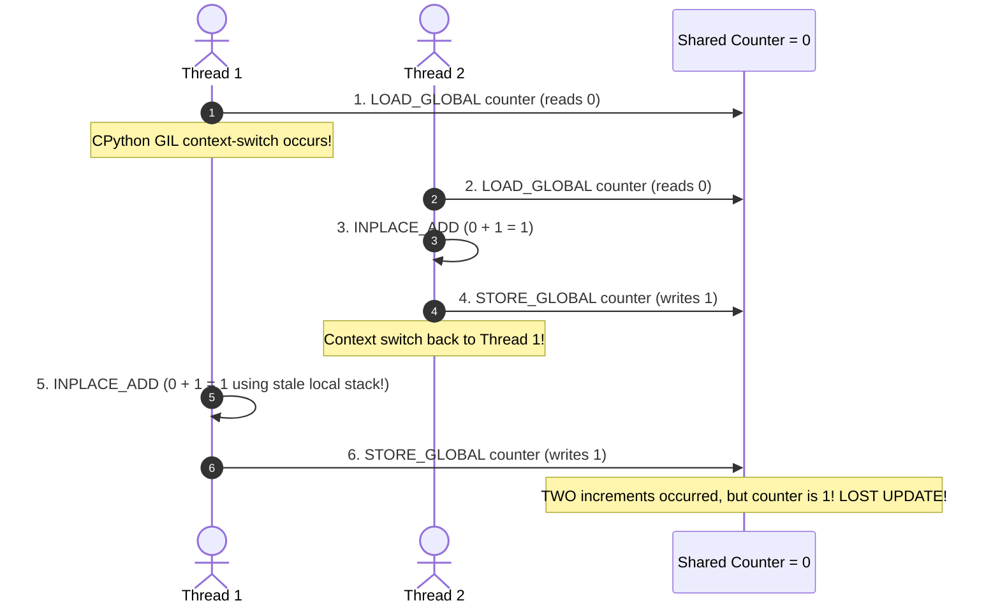
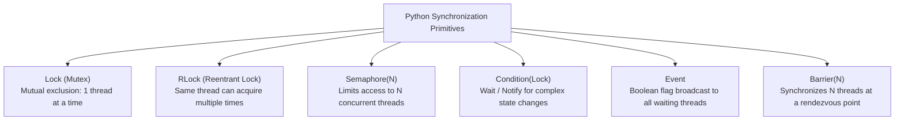
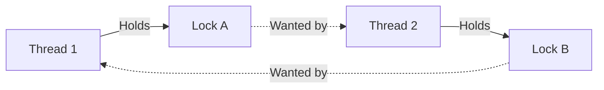

# Thread Safety, Synchronization Primitives, and Deadlock Prevention

A pervasive misconception in the Python ecosystem is that **the Global Interpreter Lock (GIL) makes Python code thread-safe**. This is dangerously false! The GIL protects CPython's internal memory management (reference counts and interpreter structures), but it does **not** protect Python-level application invariants or compound operations.

If two threads execute `counter += 1` concurrently without synchronization, the counter will suffer lost updates and data corruption. To build robust multithreaded systems, engineers must understand synchronization primitives—**`Lock`**, **`RLock`**, **`Semaphore`**, **`Condition`**, and **`Event`**—and master strategies to avoid deadlocks.

---

## Table of Contents

1. [What & Why](#what--why)
2. [The Myth of GIL Thread Safety: Bytecode Dissection](#the-myth-of-gil-thread-safety-bytecode-dissection)
3. [Synchronization Primitives in `threading`](#synchronization-primitives-in-threading)
4. [Deadlocks: The Four Coffman Conditions and Prevention](#deadlocks-the-four-coffman-conditions-and-prevention)
5. [Syntax & API Reference](#syntax--api-reference)
6. [Code Examples](#code-examples)
7. [Edge Cases, Pitfalls & Anti-Patterns](#edge-cases-pitfalls--anti-patterns)
8. [Performance & Memory Characteristics](#performance--memory-characteristics)
9. [CPython Internals & Bytecode](#cpython-internals--bytecode)
10. [Best Practices & Idiomatic Patterns](#best-practices--idiomatic-patterns)
11. [Real-World Case Study: Thread-Safe Dynamic Database Connection Pool](#real-world-case-study-thread-safe-dynamic-database-connection-pool)
12. [Interview Questions & Deep-Dive Scenarios](#interview-questions--deep-dive-scenarios)
13. [Practical Exercises & Code Katas](#practical-exercises--code-katas)

---

## What & Why

Thread safety means that a shared data structure behaves correctly when accessed by multiple concurrent threads without unintended interactions.
When two or more threads read and write shared state without synchronization:
- **Race Condition**: The final state depends on the non-deterministic scheduling order of thread execution.
- **Lost Updates**: One thread overwrites changes made by another thread without observing them.
- **Inconsistent Read States**: A thread reads half-updated data structures where invariant relationships (e.g. `debit + credit == 0`) are temporarily broken.

Python's `threading` module provides specialized primitives to synchronize access, sequence dependent operations, and enforce mutual exclusion.

---

## The Myth of GIL Thread Safety: Bytecode Dissection

Why does `counter += 1` fail under multithreading?
In Python, `counter += 1` is not an atomic operation. It compiles into multiple bytecode instructions:

```text
1. LOAD_GLOBAL              (read counter from memory onto value stack)
2. LOAD_CONST               (push 1 onto value stack)
3. BINARY_OP / INPLACE_ADD  (add the two numbers)
4. STORE_GLOBAL             (write the result back to counter)
```



Because CPython can yield the GIL between any two bytecode instructions (or when `sys.getswitchinterval()` expires), compound mutations on shared state always require explicit locks!

---

## Synchronization Primitives in `threading`



### Primitives Comparison

| Primitive | Class | Key Methods | Reentrant? | Best Use Case |
|:---|:---|:---|:---:|:---|
| **Mutex Lock** | `threading.Lock` | `acquire()`, `release()`, `with lock:` | No | Guarding simple shared state mutations |
| **Reentrant Lock**| `threading.RLock` | `acquire()`, `release()`, `with rlock:`| **Yes** | Recursive functions or nested class methods |
| **Semaphore** | `threading.BoundedSemaphore` | `acquire()`, `release()` | No | Rate limiting, connection pool capacity |
| **Condition** | `threading.Condition` | `wait()`, `notify()`, `notify_all()` | Tied to lock | Producer-consumer queues, state transitions |
| **Event** | `threading.Event` | `set()`, `clear()`, `wait()`, `is_set()`| N/A | Shutdown signaling, initialization trigger |
| **Barrier** | `threading.Barrier` | `wait()`, `reset()`, `abort()` | N/A | Lockstep test phases, parallel simulations |

---

## Deadlocks: The Four Coffman Conditions and Prevention

A **deadlock** is a state where two or more threads are permanently blocked because each holds a lock that the other needs:



For a deadlock to occur, all four **Coffman Conditions** must hold simultaneously:
1. **Mutual Exclusion**: Resources cannot be shared; only one thread can hold a lock at a time.
2. **Hold and Wait**: A thread holds at least one lock while waiting to acquire another lock.
3. **No Preemption**: Locks cannot be forcefully confiscated from threads holding them.
4. **Circular Wait**: A closed chain of threads exists where each thread waits for a lock held by the next thread.

### Deadlock Prevention: Global Lock Ordering

The most effective programmatic defense against deadlocks is **strict lock ordering**: if all threads always acquire locks in the exact same global order (e.g., Lock A before Lock B), circular wait is mathematically impossible!

---

## Syntax & API Reference

### 1. `threading.Lock` and Context Management

```python
import threading

lock = threading.Lock()

# Idiomatic usage with context manager:
with lock:
    # Critical section: exactly one thread executes here
    shared_state += 1
```

### 2. `threading.RLock` (Reentrant Lock)

```python
rlock = threading.RLock()

def outer():
    with rlock:
        inner()  # Succeeds! Normal Lock would DEADLOCK here!

def inner():
    with rlock:
        print("Inside reentrant critical section")
```

### 3. `threading.BoundedSemaphore`

```python
# Allows up to 5 concurrent threads:
semaphore = threading.BoundedSemaphore(value=5)

with semaphore:
    # Max 5 threads can execute this concurrently
    call_rate_limited_api()
```

### 4. `threading.Condition`

```python
cv = threading.Condition()

# Consumer:
with cv:
    while not resource_available():
        cv.wait()  # Releases lock and sleeps until notified
    consume_resource()

# Producer:
with cv:
    produce_resource()
    cv.notify()  # Wakes up one waiting consumer
```

---

## Code Examples

### Example 1: Demonstrating the Unsynchronized Race Condition

```python
import threading

counter = 0

def unsafe_worker(increments: int) -> None:
    global counter
    for _ in range(increments):
        counter += 1  # Unsynchronized read-modify-write!

def run_race_test(increments_per_thread: int = 100_000, num_threads: int = 4):
    global counter
    counter = 0
    threads = [
        threading.Thread(target=unsafe_worker, args=(increments_per_thread,))
        for _ in range(num_threads)
    ]
    for t in threads: t.start()
    for t in threads: t.join()
    
    expected = increments_per_thread * num_threads
    print(f"Expected: {expected} | Actual Counter: {counter} | Lost Updates: {expected - counter}")

run_race_test()
# Output:
# Expected: 400000 | Actual Counter: 284192 | Lost Updates: 115808 (RACE CONDITION PROVEN!)
```

### Example 2: Synchronizing with `threading.Lock`

```python
import threading

safe_counter = 0
counter_lock = threading.Lock()

def safe_worker(increments: int) -> None:
    global safe_counter
    for _ in range(increments):
        with counter_lock:
            safe_counter += 1

def run_safe_test(increments: int = 100_000, num_threads: int = 4):
    global safe_counter
    safe_counter = 0
    threads = [
        threading.Thread(target=safe_worker, args=(increments,))
        for _ in range(num_threads)
    ]
    for t in threads: t.start()
    for t in threads: t.join()
    
    expected = increments * num_threads
    print(f"Safe Test -> Expected: {expected} | Actual: {safe_counter} (100% MATCH!)")

run_safe_test()
# Output:
# Safe Test -> Expected: 400000 | Actual: 400000 (100% MATCH!)
```

### Example 3: Reentrant Locking with `threading.RLock`

```python
import threading

class BankAccount:
    def __init__(self, initial_balance: float) -> None:
        self._balance = initial_balance
        self._lock = threading.RLock()  # Reentrant lock!

    def get_balance(self) -> float:
        with self._lock:
            return self._balance

    def deposit(self, amount: float) -> None:
        with self._lock:
            self._balance += amount

    def transfer_with_fee(self, target: "BankAccount", amount: float, fee: float) -> None:
        # Acquires lock once:
        with self._lock:
            if self._balance < amount + fee:
                raise ValueError("Insufficient balance for transfer and fee")
            
            # Sub-method calls acquire the SAME lock again:
            self.deposit(-amount)  # Re-enters lock safely!
            self.deposit(-fee)     # Re-enters lock safely!
            target.deposit(amount)

acc1 = BankAccount(500.0)
acc2 = BankAccount(100.0)

acc1.transfer_with_fee(acc2, 200.0, 5.0)
print(f"Account 1 Balance: ${acc1.get_balance():.2f}")
print(f"Account 2 Balance: ${acc2.get_balance():.2f}")
# Output:
# Account 1 Balance: $295.00
# Account 2 Balance: $300.00
```

### Example 4: Limiting Concurrency with `BoundedSemaphore`

```python
import threading
import time

# Rate limit: allow at most 2 concurrent connections
connection_limit = threading.BoundedSemaphore(value=2)

def access_third_party_api(client_id: int) -> None:
    print(f"Client {client_id} waiting for connection slot...")
    with connection_limit:
        print(f"  -> Client {client_id} ACQUIRED slot. Executing query...")
        time.sleep(0.04)  # Simulate network latency
        print(f"  <- Client {client_id} RELEASING slot.")

threads = [threading.Thread(target=access_third_party_api, args=(i,)) for i in range(5)]
for t in threads: t.start()
for t in threads: t.join()
# Output:
# Client 0 waiting for connection slot...
#   -> Client 0 ACQUIRED slot. Executing query...
# Client 1 waiting for connection slot...
#   -> Client 1 ACQUIRED slot. Executing query...
# Client 2 waiting for connection slot...
#   <- Client 0 RELEASING slot.
#   -> Client 2 ACQUIRED slot. Executing query...
```

### Example 5: Producer-Consumer Coordination with `Condition`

```python
import threading
import time

class BoundedBuffer:
    def __init__(self, capacity: int = 3) -> None:
        self.capacity = capacity
        self.buffer: list[int] = []
        self.condition = threading.Condition()

    def produce(self, item: int) -> None:
        with self.condition:
            while len(self.buffer) >= self.capacity:
                print(f"[Producer] Buffer full ({len(self.buffer)}). Waiting...")
                self.condition.wait()  # Wait for space
            self.buffer.append(item)
            print(f"[Producer] Added {item}. Buffer size: {len(self.buffer)}")
            self.condition.notify_all()  # Notify consumers

    def consume(self) -> int:
        with self.condition:
            while len(self.buffer) == 0:
                print("[Consumer] Buffer empty. Waiting...")
                self.condition.wait()  # Wait for data
            item = self.buffer.pop(0)
            print(f"[Consumer] Consumed {item}. Buffer size: {len(self.buffer)}")
            self.condition.notify_all()  # Notify producers
            return item

buf = BoundedBuffer(capacity=2)

def producer_worker():
    for i in range(4):
        buf.produce(i)
        time.sleep(0.01)

def consumer_worker():
    for _ in range(4):
        buf.consume()
        time.sleep(0.02)

p = threading.Thread(target=producer_worker)
c = threading.Thread(target=consumer_worker)
p.start(); c.start()
p.join(); c.join()
```

---

## Edge Cases, Pitfalls & Anti-Patterns

### Common Mistakes Table

| Mistake | Bad Code | Correct Idiom | Why It Fails |
|:---|:---|:---|:---|
| **Manual `acquire()`/`release()` without `try/finally`** | `lock.acquire(); work(); lock.release()` | `with lock: work()` | If `work()` raises an exception, the lock is never released, causing permanent deadlock! |
| **Using `Lock` recursively** | Calling a method acquiring `lock` while already holding `lock` | Use `threading.RLock` | `Lock` cannot be acquired twice by the same thread; deadlocks instantly. |
| **Releasing a `Semaphore` more times than acquired** | Calling `sem.release()` without matching `acquire()` | Use `BoundedSemaphore` | Standard `Semaphore` increments beyond initial value; `BoundedSemaphore` raises `ValueError`. |
| **Using `if` instead of `while` with `Condition.wait()`** | `if not condition: cv.wait()` | `while not condition: cv.wait()` | Spurious wakeups or race conditions can resume the thread before the condition is satisfied. |
| **Deadlock via inconsistent lock acquisition ordering** | Thread 1 acquires A then B; Thread 2 acquires B then A | Always acquire locks in the same global sequence | Triggers the Circular Wait Coffman condition. |
| **Holding locks across blocking I/O calls** | Holding lock while calling remote HTTP service | Acquire lock only for memory state mutation | Severely degrades concurrency; all other threads stall waiting for remote response. |

---

## Performance & Memory Characteristics

### Lock Contention Overhead

1. **Uncontended Lock**: Acquiring an uncontended `threading.Lock` takes **~35 - 50 ns**. It is implemented as a fast C-level futex / critical section.
2. **Contended Lock**: When multiple threads contend for the same lock:
   - Waiting threads enter kernel-space sleep state.
   - Waking up a sleeping thread incurs a kernel context-switch penalty of **~1 - 3 µs**.
3. **Lock Granularity**:
   - **Coarse-Grained Locking**: One global lock for the whole system (simple, low concurrency).
   - **Fine-Grained Locking**: Separate locks per record or per shard (high concurrency, higher risk of deadlocks).

---

## CPython Internals & Bytecode

Let us inspect the bytecode generated when using `with lock:`:

```python
import dis
import threading

lock = threading.Lock()

def critical_section():
    with lock:
        return 42

print("Disassembly of with lock statement:")
dis.dis(critical_section)
```

Output:
```text
  1           0 RESUME                   0
  2           2 LOAD_GLOBAL              1 (lock)
              4 BEFORE_WITH              1
             10 STORE_FAST               0
  3          12 LOAD_CONST               1 (42)
             14 LOAD_FAST                0
             16 CALL_INTRINSIC_1         WITH_EXCEPT_START
             ...
             28 PUSH_EXC_INFO
             30 WITH_EXCEPT_START
```

CPython’s compiler automatically injects exception-handling bytecode (`BEFORE_WITH`, `WITH_EXCEPT_START`) around the critical section, ensuring that `lock.__exit__()` is guaranteed to release the lock even if an uncaught exception or `return` statement interrupts execution!

---

## Best Practices & Idiomatic Patterns

1. **Always Use `with lock:`**: Never call `lock.acquire()` and `lock.release()` manually.
2. **Always Loop Around `Condition.wait()`**:
   ```python
   with condition:
       while not state_is_ready():
           condition.wait()
   ```
3. **Acquire Multiple Locks with a Context Manager Helper**: Sort locks by their object ID (`id(lock)`) to guarantee consistent acquisition order.
4. **Prefer `queue.Queue` Over Manual Locking**: Python’s `queue.Queue` has locks, condition variables, and reentrancy built-in, providing a cleaner architectural abstraction.

---

## Real-World Case Study: Thread-Safe Dynamic Database Connection Pool

Below is an enterprise-grade connection pool managing a finite set of reusable database sockets using a `BoundedSemaphore`, `RLock`, and health checks:

```python
import threading
import time
import uuid

class MockConnection:
    def __init__(self, conn_id: str) -> None:
        self.conn_id = conn_id
        self.is_healthy = True

    def query(self, sql: str) -> str:
        time.sleep(0.01)  # Simulate socket roundtrip
        return f"Result for '{sql}' via {self.conn_id}"

    def close(self) -> None:
        self.is_healthy = False

class ThreadSafeConnectionPool:
    """Production connection pool managing fixed database resources."""

    def __init__(self, max_connections: int = 3) -> None:
        self._max = max_connections
        self._available_connections: list[MockConnection] = [
            MockConnection(f"CONN-{i+1}") for i in range(max_connections)
        ]
        self._lock = threading.RLock()
        self._semaphore = threading.BoundedSemaphore(value=max_connections)

    def acquire_connection(self, timeout: float = 2.0) -> MockConnection:
        # Acquire semaphore slot (blocks if all connections in use)
        acquired = self._semaphore.acquire(timeout=timeout)
        if not acquired:
            raise TimeoutError("Connection pool exhausted; timed out waiting for connection slot.")
        
        with self._lock:
            conn = self._available_connections.pop()
            return conn

    def release_connection(self, conn: MockConnection) -> None:
        with self._lock:
            if conn.is_healthy:
                self._available_connections.append(conn)
            else:
                # Replace broken connection with a new healthy instance:
                new_conn = MockConnection(f"CONN-REPLACED-{uuid.uuid4().hex[:4]}")
                self._available_connections.append(new_conn)
        
        # Release semaphore slot back to pool
        self._semaphore.release()

# Context manager adapter for ergonomic syntax:
class PooledConnectionContext:
    def __init__(self, pool: ThreadSafeConnectionPool) -> None:
        self.pool = pool
        self.conn: MockConnection | None = None

    def __enter__(self) -> MockConnection:
        self.conn = self.pool.acquire_connection()
        return self.conn

    def __exit__(self, exc_type, exc_val, exc_tb) -> None:
        if self.conn:
            self.pool.release_connection(self.conn)

# Verification with concurrent worker threads
pool = ThreadSafeConnectionPool(max_connections=2)

def worker_task(worker_id: int) -> None:
    ctx = PooledConnectionContext(pool)
    with ctx as conn:
        print(f"[Worker {worker_id}] Executing query on {conn.conn_id}...")
        res = conn.query(f"SELECT * FROM accounts WHERE id = {worker_id}")
        print(f"[Worker {worker_id}] {res}")

threads = [threading.Thread(target=worker_task, args=(i,)) for i in range(4)]
for t in threads: t.start()
for t in threads: t.join()
# Output:
# [Worker 0] Executing query on CONN-2...
# [Worker 1] Executing query on CONN-1...
# [Worker 0] Result for 'SELECT * FROM accounts WHERE id = 0' via CONN-2
# [Worker 1] Result for 'SELECT * FROM accounts WHERE id = 1' via CONN-1
# [Worker 2] Executing query on CONN-2...
# [Worker 3] Executing query on CONN-1...
# ...
```

---

## Interview Questions & Deep-Dive Scenarios

<details>
<summary>1. Does the CPython GIL prevent race conditions on shared Python variables?</summary>

No! The GIL guarantees atomicity only for individual CPython bytecode operations and internal C structures. High-level Python operations like `x += 1`, `dict.setdefault()`, or checking a dictionary and then updating it (`if k in d: d[k] += 1`) compile into multiple bytecode instructions. The CPython evaluation loop can switch threads between any of these instructions, causing race conditions and lost updates without explicit locking.
</details>

<details>
<summary>2. What is the fundamental difference between `Lock` and `RLock`?</summary>

- **`Lock` (Standard Mutex)**: Cannot be acquired more than once by the same thread. If a thread that already holds `Lock` calls `lock.acquire()` again, it deadlocks itself.
- **`RLock` (Reentrant Lock)**: Can be acquired multiple times by the **same thread**. It tracks an internal ownership recursion counter. The lock is only released when the owning thread executes an equal number of `release()` calls.
</details>

<details>
<summary>3. Why must `Condition.wait()` always be enclosed within a `while` loop instead of an `if` statement?</summary>

For two critical reasons:
1. **Spurious Wakeups**: On many POSIX operating systems, condition variables can unblock without an explicit signal (`spurious wakeup`).
2. **Race Conditions Between Waking and Re-Acquisition**: When `notify()` is called, multiple waiting threads wake up, but they must compete to re-acquire the lock one by one. By the time thread $B$ acquires the lock, thread $A$ may have already consumed the resource, making the condition false again. A `while` loop re-verifies the condition before proceeding.
</details>

<details>
<summary>4. What are the four Coffman conditions for deadlocks, and how can they be broken?</summary>

1. **Mutual Exclusion**: Break by using lock-free data structures or atomic instructions.
2. **Hold and Wait**: Break by requiring threads to request all needed locks at once.
3. **No Preemption**: Break by using `lock.acquire(timeout=...)` and releasing held locks if acquisition fails.
4. **Circular Wait**: Break by enforcing a **strict global lock acquisition order**.
</details>

<details>
<summary>5. What is the difference between `Semaphore` and `BoundedSemaphore`?</summary>

Standard `Semaphore` increments its internal counter on every `release()` without checking the initial value. If buggy code calls `release()` more times than `acquire()`, the semaphore's capacity artificially expands.
`BoundedSemaphore` checks whether `release()` increases the counter above its initial limit and raises a `ValueError("Semaphore released too many times")`, preventing resource leakage bugs.
</details>

<details>
<summary>6. How does `threading.Event` differ from `threading.Condition`?</summary>

- **`Event`**: A simple binary flag (`True`/`False`). Any number of threads can call `wait()`, and when `set()` is called, **all** waiting threads wake up simultaneously.
- **`Condition`**: Tied to an underlying mutex lock. It allows threads to sleep until notified (`wait()`), releasing the lock while sleeping and automatically re-acquiring it upon waking.
</details>

<details>
<summary>7. What is priority inversion, and does Python protect against it?</summary>

Priority inversion occurs when a low-priority thread holds a lock needed by a high-priority thread, but is preempted by a medium-priority thread, effectively causing the high-priority thread to stall. Python relies on the host operating system's thread scheduler and does not provide native priority inheritance mechanisms.
</details>

<details>
<summary>8. How do you implement a deadlock-free multi-lock acquirer?</summary>

Sort the locks by their memory address:
```python
def acquire_in_order(*locks: threading.Lock):
    for lock in sorted(locks, key=id):
        lock.acquire()
```
Because all threads acquire locks in strictly identical ascending address order, circular wait is impossible.
</details>

---

## Practical Exercises & Code Katas

### Exercise 1: Deadlock-Free Multi-Lock Context Manager
Write a context manager `acquire_all(*locks)` that sorts locks by `id(lock)` and acquires them in order, releasing all on exit.

<details>
<summary>Solution</summary>

```python
import threading
from contextlib import contextmanager
from typing import Iterator

@contextmanager
def acquire_all(*locks: threading.Lock) -> Iterator[None]:
    # Sort locks to guarantee global ordering:
    sorted_locks = sorted(locks, key=id)
    acquired = []
    try:
        for l in sorted_locks:
            l.acquire()
            acquired.append(l)
        yield
    finally:
        for l in reversed(acquired):
            l.release()

lock1 = threading.Lock()
lock2 = threading.Lock()

with acquire_all(lock1, lock2):
    print("Safely acquired multiple locks in strict address order!")
```
</details>

### Exercise 2: Reentrant Lock Counter
Implement a class `MetricsTracker` using `RLock` where `increment()` calls `add(1)` and both methods are guarded by the same lock.

<details>
<summary>Solution</summary>

```python
import threading

class MetricsTracker:
    def __init__(self) -> None:
        self._count = 0
        self._lock = threading.RLock()

    def add(self, delta: int) -> None:
        with self._lock:
            self._count += delta

    def increment(self) -> None:
        with self._lock:
            # Re-enters lock safely:
            self.add(1)

    def get(self) -> int:
        with self._lock:
            return self._count

tracker = MetricsTracker()
tracker.increment()
tracker.add(5)
print("Metric count:", tracker.get())  # 6
```
</details>

### Exercise 3: Read-Write Lock (Single Writer, Multiple Readers)
Implement a simple `ReadWriteLock` using `Condition` that allows multiple simultaneous readers or one exclusive writer.

<details>
<summary>Solution</summary>

```python
import threading

class ReadWriteLock:
    def __init__(self) -> None:
        self._cv = threading.Condition()
        self._readers = 0
        self._writer = False

    def acquire_read(self) -> None:
        with self._cv:
            while self._writer:
                self._cv.wait()
            self._readers += 1

    def release_read(self) -> None:
        with self._cv:
            self._readers -= 1
            if self._readers == 0:
                self._cv.notify_all()

    def acquire_write(self) -> None:
        with self._cv:
            while self._writer or self._readers > 0:
                self._cv.wait()
            self._writer = True

    def release_write(self) -> None:
        with self._cv:
            self._writer = False
            self._cv.notify_all()

rw = ReadWriteLock()
rw.acquire_read()
print("Reader lock acquired successfully")
rw.release_read()
```
</details>

### Exercise 4: Bounded Semaphore Rate Limiter
Implement a decorator `@throttle(max_concurrent=3)` that restricts concurrent executions using `BoundedSemaphore`.

<details>
<summary>Solution</summary>

```python
import threading
from functools import wraps
from typing import Callable

def throttle(max_concurrent: int) -> Callable:
    sem = threading.BoundedSemaphore(max_concurrent)
    def decorator[**P, R](fn: Callable[P, R]) -> Callable[P, R]:
        @wraps(fn)
        def wrapper(*args: P.args, **kwargs: P.kwargs) -> R:
            with sem:
                return fn(*args, **kwargs)
        return wrapper
    return decorator

@throttle(max_concurrent=2)
def process_task(x: int) -> int:
    return x * 2

print("Result:", process_task(21))  # 42
```
</details>

### Exercise 5: Barrier Synchronization for Staged Benchmarking
Write a test simulation where 4 threads wait at a barrier before executing a timed section together.

<details>
<summary>Solution</summary>

```python
import threading
import time

barrier = threading.Barrier(4)

def benchmark_runner(runner_id: int, results: list[float]) -> None:
    time.sleep(0.01 * runner_id)  # Skew startup times
    barrier.wait()  # Synchronize here!
    
    t0 = time.perf_counter()
    # Execute benchmark workload
    total = sum(i for i in range(100_000))
    results.append(time.perf_counter() - t0)

res: list[float] = []
threads = [threading.Thread(target=benchmark_runner, args=(i, res)) for i in range(4)]
for t in threads: t.start()
for t in threads: t.join()

print(f"All 4 threads completed benchmark. Executions recorded: {len(res)}")
```
</details>

### Exercise 6: Thread-Safe Ring Buffer with Event
Implement a fixed-size ring buffer using `threading.Lock` that sets an event when filled to capacity.

<details>
<summary>Solution</summary>

```python
import threading

class RingBuffer:
    def __init__(self, size: int) -> None:
        self.size = size
        self.data: list[int] = []
        self.lock = threading.Lock()
        self.is_full_event = threading.Event()

    def append(self, item: int) -> None:
        with self.lock:
            if len(self.data) >= self.size:
                self.data.pop(0)
            self.data.append(item)
            if len(self.data) == self.size:
                self.is_full_event.set()

buf = RingBuffer(size=3)
buf.append(1); buf.append(2)
print("Is full?", buf.is_full_event.is_set())
buf.append(3)
print("Is full after 3rd?", buf.is_full_event.is_set())
# Output:
# Is full? False
# Is full after 3rd? True
```
</details>
