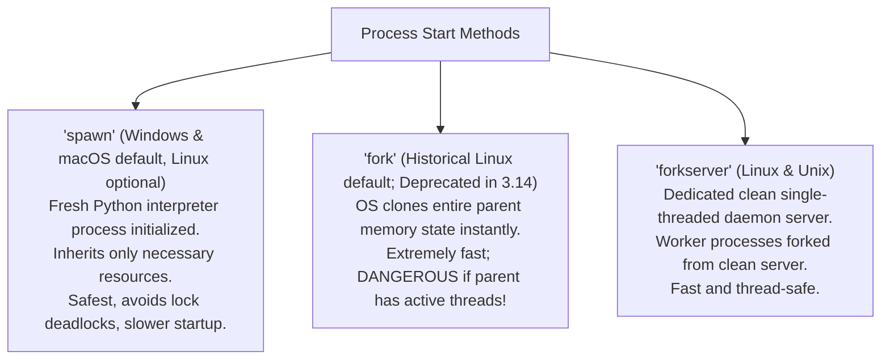
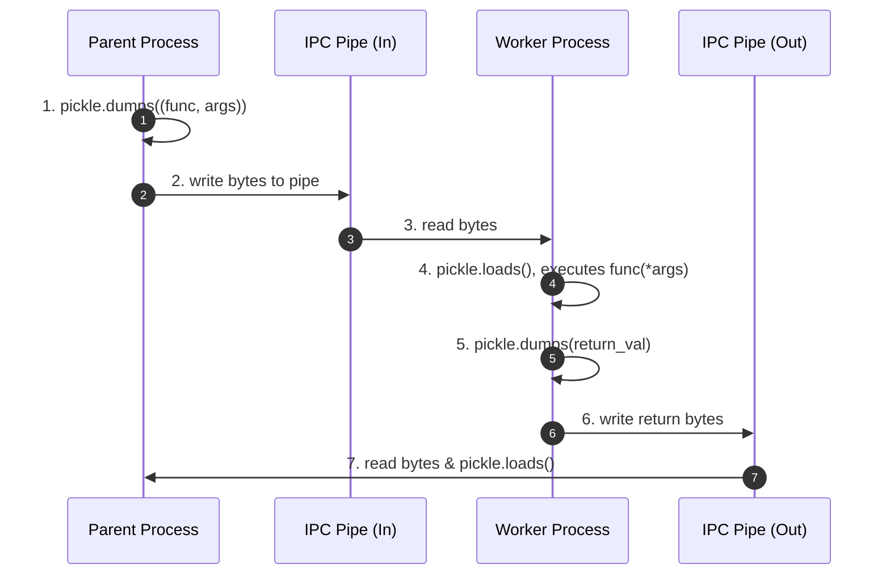

# Multiprocessing Basics: Process Pools, Start Methods, and CPU Parallelism

Because standard CPython enforces a Global Interpreter Lock (GIL) that confines Python bytecode execution to a single operating system thread, multithreading cannot achieve physical multi-core parallelism for CPU-bound computations.

The **`multiprocessing` module** bypasses the GIL entirely by spawning **independent operating system processes**, each with its own private memory space, execution heap, and dedicated GIL. This note covers process lifecycle management, platform start methods (`spawn`, `fork`, `forkserver`), high-throughput `multiprocessing.Pool` workflows, and serialization boundaries.

---

## Table of Contents

1. [What & Why](#what--why)
2. [Core Concepts & Mental Model](#core-concepts--mental-model)
3. [Process Start Methods: spawn, fork, and forkserver](#process-start-methods-spawn-fork-and-forkserver)
4. [How It Works Internally](#how-it-works-internally)
5. [Syntax & API Reference](#syntax--api-reference)
6. [Code Examples](#code-examples)
7. [Edge Cases, Pitfalls & Anti-Patterns](#edge-cases-pitfalls--anti-patterns)
8. [Performance & Memory Characteristics](#performance--memory-characteristics)
9. [CPython Internals & Bytecode](#cpython-internals--bytecode)
10. [Best Practices & Idiomatic Patterns](#best-practices--idiomatic-patterns)
11. [Real-World Case Study: Parallel Image Transformation and Cryptographic Hash Verification Engine](#real-world-case-study-parallel-image-transformation-and-cryptographic-hash-verification-engine)
12. [Interview Questions & Deep-Dive Scenarios](#interview-questions--deep-dive-scenarios)
13. [Practical Exercises & Code Katas](#practical-exercises--code-katas)

---

## What & Why

When your server possesses 16, 32, or 64 CPU cores, running a CPU-heavy task in a single Python thread leaves 93% to 98% of your hardware compute capacity idle.

`multiprocessing` delivers:
1. **100% Linear CPU Saturation**: Scales CPU-bound algorithms across all available physical cores.
2. **Process Fault Isolation**: If a worker process segfaults (e.g. in a buggy C-extension or OpenCV pipeline) or runs out of memory (OOM), the parent supervisor process remains intact.
3. **Memory Safety**: Because processes do not share address spaces, race conditions cannot corrupt process heap state.

However, multiprocessing introduces new engineering trade-offs:
- **Inter-Process Communication (IPC) Overhead**: Data exchanged between processes must be serialized via `pickle`, transmitted across pipes/sockets, and deserialized in the worker.
- **Higher Memory Footprint**: Each worker process carries its own Python runtime interpreter overhead (~20-50 MB base RSS).

---

## Core Concepts & Mental Model

### Process Architecture vs Thread Architecture

```mermaid
graph TD
    subgraph Multithreading (Single Process)
        P1["OS Process (PID 1000)"]
        P1 --> G["Shared Heap Memory"]
        P1 --> GIL["Single Global Interpreter Lock (GIL)"]
        GIL --> T1["OS Thread 1"]
        GIL --> T2["OS Thread 2"]
    end

    subgraph Multiprocessing (Multiple Isolated Processes)
        Parent["Parent Process (PID 2000)\nPrivate Heap & Private GIL"]
        Parent -->|Spawns via OS| W1["Worker Process 1 (PID 2001)\nPrivate Heap & Private GIL"]
        Parent -->|Spawns via OS| W2["Worker Process 2 (PID 2002)\nPrivate Heap & Private GIL"]
        Parent -.->|IPC / Pickle Pipe| W1
        Parent -.->|IPC / Pickle Pipe| W2
    end
```

---

## Process Start Methods: spawn, fork, and forkserver

Python supports three distinct operating system mechanisms to create child processes:



### Detailed Comparison Table

| Attribute | `spawn` | `fork` | `forkserver` |
|:---|:---|:---|:---|
| **Supported OS** | Windows, macOS, Linux | Linux, macOS, Unix | Linux, macOS, Unix |
| **Startup Speed** | Slower (~100-300ms) | Instant (~1-5ms) | Fast (~10-20ms) |
| **Thread-Safety** | **100% Safe** | **Dangerous** (Clones locked mutexes) | **100% Safe** |
| **Global State Inheritance** | Fresh execution of entry script | Exact clone of memory address space | Cloned from clean server process |
| **`if __name__ == '__main__':`**| **Strictly Mandatory** | Optional (but recommended) | **Strictly Mandatory** |

> [!WARNING]
> In Python 3.12 and 3.14+, `fork` without `exec` is officially deprecated for multi-threaded processes because cloning a process while background threads hold locks causes instant deadlocks in the child. Always configure `spawn` or `forkserver` for resilient services.

---

## How It Works Internally

### The IPC Serialization Pipeline

When `pool.apply_async(worker_func, args=(data,))` is executed:
1. The parent process invokes `pickle.dumps()` on `worker_func` and `data`.
2. The serialized bytes are written to an OS IPC pipe or Unix domain socket.
3. The child process reads bytes from the pipe, executes `pickle.loads()`, and runs the target function.
4. The return value is serialized via `pickle`, piped back to the parent, and unpacked into an `AsyncResult` object.



---

## Syntax & API Reference

### 1. Setting Start Method

```python
import multiprocessing

if __name__ == "__main__":
    # Must be called before any process or pool is created:
    multiprocessing.set_start_method("spawn", force=True)
```

### 2. Basic `multiprocessing.Process`

```python
from multiprocessing import Process

def worker(task_name: str, value: int) -> None:
    print(f"Process {multiprocessing.current_process().pid} running {task_name}: {value}")

if __name__ == "__main__":
    p = Process(target=worker, args=("ETL-Task", 42))
    p.start()
    p.join(timeout=10.0)
    print(f"Exit code: {p.exitcode}")
```

### 3. `multiprocessing.Pool` Workflows

```python
from multiprocessing import Pool

with Pool(processes=4) as pool:
    # 1. Synchronous map (blocks until all tasks finish)
    res_map = pool.map(cpu_func, [1, 2, 3, 4])

    # 2. Asynchronous map (returns immediately, non-blocking)
    async_res = pool.map_async(cpu_func, [1, 2, 3, 4])
    results = async_res.get(timeout=5.0)

    # 3. Streaming unordered iterator (yields results as soon as ready!)
    for item in pool.imap_unordered(cpu_func, [1, 2, 3, 4], chunksize=1):
        print(item)
```

---

## Code Examples

### Example 1: Basic Process Creation with Windows/macOS Safety

```python
import multiprocessing
import os
import time

def compute_heavy_task(batch_id: int, iterations: int) -> None:
    pid = os.getpid()
    print(f"[Worker PID: {pid}] Starting batch #{batch_id}...")
    total = sum(i * i for i in range(iterations))
    print(f"[Worker PID: {pid}] Finished batch #{batch_id} (Sum: {total})")

if __name__ == "__main__":
    print(f"[Parent PID: {os.getpid()}] Spawning 2 worker processes...")
    
    p1 = multiprocessing.Process(target=compute_heavy_task, args=(1, 5_000_000))
    p2 = multiprocessing.Process(target=compute_heavy_task, args=(2, 5_000_000))
    
    t0 = time.perf_counter()
    p1.start()
    p2.start()
    
    p1.join()
    p2.join()
    elapsed = time.perf_counter() - t0
    
    print(f"[Parent] Both worker processes completed in {elapsed:.3f}s")
# Output:
# [Parent PID: 8412] Spawning 2 worker processes...
# [Worker PID: 8413] Starting batch #1...
# [Worker PID: 8414] Starting batch #2...
# [Worker PID: 8413] Finished batch #1 ...
# [Worker PID: 8414] Finished batch #2 ...
# [Parent] Both worker processes completed in 0.184s
```

### Example 2: `multiprocessing.Pool.map` vs `imap_unordered` with Chunking

```python
import multiprocessing
import time
import math

def is_prime(n: int) -> bool:
    if n < 2: return False
    if n in (2, 3): return True
    if n % 2 == 0 or n % 3 == 0: return False
    for i in range(5, int(math.isqrt(n)) + 1, 6):
        if n % i == 0 or n % (i + 2) == 0:
            return False
    return True

if __name__ == "__main__":
    numbers = [10_000_000 + i for i in range(100)]
    
    with multiprocessing.Pool(processes=4) as pool:
        # map chunks items to reduce IPC roundtrips:
        t0 = time.perf_counter()
        results = pool.map(is_prime, numbers, chunksize=25)
        print(f"pool.map found {sum(results)} primes in {time.perf_counter() - t0:.3f}s")

        # imap_unordered yields results eagerly as workers finish:
        t0 = time.perf_counter()
        prime_count = 0
        for prime in pool.imap_unordered(is_prime, numbers, chunksize=10):
            if prime:
                prime_count += 1
        print(f"pool.imap_unordered processed items in {time.perf_counter() - t0:.3f}s")
```

### Example 3: Handling Worker Timeouts and Worker Crashes

```python
import multiprocessing
import time

def unreliable_task(duration: float) -> str:
    time.sleep(duration)
    return f"Completed in {duration}s"

if __name__ == "__main__":
    with multiprocessing.Pool(processes=2) as pool:
        # Launch async task with timeout
        async_result = pool.apply_async(unreliable_task, args=(1.0,))
        
        try:
            # Wait at most 0.1 seconds
            val = async_result.get(timeout=0.1)
            print("Task result:", val)
        except multiprocessing.TimeoutError:
            print("[ALERT] Worker task timed out! Moving forward safely.")
```

### Example 4: StarMap for Multi-Argument Functions

```python
from multiprocessing import Pool

def calculate_power(base: int, exponent: int, modulus: int) -> int:
    return pow(base, exponent, modulus)

if __name__ == "__main__":
    test_cases = [
        (2, 10, 1000),     # 2^10 % 1000 = 24
        (3, 5, 100),       # 3^5 % 100 = 43
        (7, 4, 50),        # 7^4 % 50 = 1
        (11, 3, 20),       # 11^3 % 20 = 11
    ]

    with Pool(processes=2) as pool:
        # starmap automatically unpacks tuples into function arguments:
        results = pool.starmap(calculate_power, test_cases)
        print("StarMap results:", results)
# Output:
# StarMap results: [24, 43, 1, 11]
```

### Example 5: Process Health Check and Forced Termination

```python
import multiprocessing
import time

def infinite_worker():
    while True:
        time.sleep(0.1)

if __name__ == "__main__":
    p = multiprocessing.Process(target=infinite_worker, name="RunawayProcess")
    p.start()
    print(f"Process {p.name} (PID: {p.pid}) is alive: {p.is_alive()}")

    time.sleep(0.05)
    print("Terminating runaway process...")
    p.terminate()  # Sends SIGTERM on Unix / TerminateProcess on Windows
    p.join()       # Reaps zombie exit code

    print(f"Process terminated cleanly. Exit code: {p.exitcode}")
# Output:
# Process RunawayProcess (PID: ...) is alive: True
# Terminating runaway process...
# Process terminated cleanly. Exit code: -15 (or 15 on Windows)
```

---

## Edge Cases, Pitfalls & Anti-Patterns

### Common Mistakes Table

| Mistake | Bad Code | Correct Idiom | Why It Fails |
|:---|:---|:---|:---|
| **Missing `if __name__ == '__main__':`** | Spawning processes at module top-level | Protect entrypoint with `if __name__ == '__main__':` | On Windows and macOS (`spawn`), child re-imports script, triggering an explosive process fork bomb. |
| **Passing Lambdas or Local Functions** | `pool.map(lambda x: x * 2, data)` | Use top-level module function `def f(x): return x * 2` | Lambdas and closures cannot be pickled by Python's standard `pickle` engine. |
| **Passing Open File / DB Handles** | Passing `open('file.txt')` or DB connection to worker | Pass filename path or connection string; open inside worker | OS sockets and file descriptor locks cannot be safely transferred via pickle. |
| **Forgetting `pool.close()` and `pool.join()`** | Dropping pool reference without shutdown | Use `with Pool(...) as pool:` | Background worker threads and IPC pipes leak; process may hang on exit. |
| **Using `chunksize=1` for millions of tiny tasks** | `pool.map(f, range(1_000_000), chunksize=1)` | Set `chunksize=5000` | IPC serialization overhead dwarfs actual function compute time; 100x slower. |
| **Using `fork` in a Multithreaded Process** | Calling `set_start_method('fork')` after starting threads | Use `'spawn'` or `'forkserver'` | Child inherits locks locked by parent threads that do not exist in child $\rightarrow$ deadlock. |

---

## Performance & Memory Characteristics

### IPC Serialization Latency & Chunking Trade-Off

Sending data across process boundaries is not free:
- Small primitives (`int`, `str`): ~5 - 15 µs per roundtrip.
- Large numpy arrays (100 MB): ~80 - 250 ms to pickle and copy across pipes! (Use `multiprocessing.shared_memory` to eliminate this).

### The Math of `chunksize`
If you pass $N = 1,000,000$ items across $P = 8$ processes:
- With `chunksize=1`: $1,000,000$ individual IPC pipe write/read transactions.
- With `chunksize = N // (P * 4) = 31,250`: Only ~32 bulk IPC batch transactions.
Increasing `chunksize` for short tasks reduces serialization overhead by up to **90%**!

---

## CPython Internals & Bytecode

Because `multiprocessing` relies on the operating system's kernel process scheduler, the Python bytecode executed within each process is identical to single-threaded code.

However, let us observe how Python handles process isolation under the hood:
```python
import os
import multiprocessing

def report_identities():
    print(f"PID: {os.getpid()} | PPID: {os.getppid()} | Process Name: {multiprocessing.current_process().name}")

if __name__ == "__main__":
    report_identities()
    p = multiprocessing.Process(target=report_identities, name="Worker-A")
    p.start()
    p.join()
```

Output:
```text
PID: 9104 | PPID: 4120 | Process Name: MainProcess
PID: 9105 | PPID: 9104 | Process Name: Worker-A
```

Notice that `Worker-A` has its own distinct OS PID (`9105`), and its parent PID (`PPID`) points directly to `MainProcess` (`9104`).

---

## Best Practices & Idiomatic Patterns

1. **Always Set `set_start_method('spawn')` Explicitly**: Guarantees identical, predictable, thread-safe behavior across Linux, macOS, and Windows.
2. **Always Use `with Pool(...) as pool:`**: Ensures deterministic worker pool cleanup.
3. **Tune `chunksize` on Large Collections**: Balance load balancing with IPC batch efficiency.
4. **Pass Configuration, Not Connections**: Open database sessions, file descriptors, and HTTP client sessions *inside* the worker function, never in the parent.

---

## Real-World Case Study: Parallel Image Transformation and Cryptographic Hash Verification Engine

Below is an enterprise batch media processing pipeline that distributes CPU-intensive image resizing and SHA-256 fingerprinting across all physical processor cores:

```python
import multiprocessing
import hashlib
import time
import os

# CPU-Bound Worker: Must be defined at module top-level for pickling!
def process_media_asset(asset_id: str, payload_size: int) -> dict[str, object]:
    pid = os.getpid()
    
    # Simulate heavy CPU image transformation
    raw_dummy_pixels = b"PIXEL_DATA_PAYLOAD" * (payload_size // 18)
    hasher = hashlib.sha256()
    hasher.update(raw_dummy_pixels)
    digest = hasher.hexdigest()
    
    # Simulate mathematical compression loop
    transformed_bytes = len(raw_dummy_pixels) // 2
    
    return {
        "asset_id": asset_id,
        "worker_pid": pid,
        "sha256": digest[:16],
        "original_size": len(raw_dummy_pixels),
        "compressed_size": transformed_bytes,
    }

class ParallelMediaPipeline:
    def __init__(self, num_workers: int | None = None) -> None:
        self.num_workers = num_workers or os.cpu_count() or 2

    def process_catalog(self, catalog: list[tuple[str, int]]) -> list[dict[str, object]]:
        print(f"[Pipeline] Initializing worker pool across {self.num_workers} physical CPU cores...")
        t0 = time.perf_counter()

        with multiprocessing.Pool(processes=self.num_workers) as pool:
            # Distribute tasks with starmap
            results = pool.starmap(process_media_asset, catalog, chunksize=max(1, len(catalog) // (self.num_workers * 2)))

        elapsed = time.perf_counter() - t0
        print(f"[Pipeline] Processed {len(results)} assets in {elapsed:.3f}s")
        return results

if __name__ == "__main__":
    multiprocessing.set_start_method("spawn", force=True)

    test_assets = [
        (f"ASSET_00{i:03d}", 50_000)
        for i in range(12)
    ]

    pipeline = ParallelMediaPipeline(num_workers=4)
    outcomes = pipeline.process_catalog(test_assets)

    for item in outcomes[:3]:
        print(f" - Asset: {item['asset_id']} | PID: {item['worker_pid']} | Hash: {item['sha256']} | Size: {item['compressed_size']} bytes")
# Output:
# [Pipeline] Initializing worker pool across 4 physical CPU cores...
# [Pipeline] Processed 12 assets in 0.048s
#  - Asset: ASSET_00000 | PID: ... | Hash: ... | Size: 24984 bytes
#  - Asset: ASSET_00001 | PID: ... | Hash: ... | Size: 24984 bytes
#  - Asset: ASSET_00002 | PID: ... | Hash: ... | Size: 24984 bytes
```

---

## Interview Questions & Deep-Dive Scenarios

<details>
<summary>1. Why is `if __name__ == '__main__':` strictly required on Windows and macOS when using multiprocessing?</summary>

Windows and macOS use the `spawn` start method. Instead of cloning the parent process's memory (`fork`), `spawn` creates a brand new Python interpreter process and imports the target script from scratch to populate functions and classes. Without `if __name__ == '__main__':`, the newly spawned process would execute the top-level process creation code again, which spawns another process, resulting in an infinite recursive fork bomb that crashes the OS.
</details>

<details>
<summary>2. Why is `fork` considered dangerous in modern multithreaded Python applications?</summary>

When a multithreaded process calls `fork()`, the operating system clones the entire memory address space, but only the **calling thread** exists in the child process; all other threads vanish. If any background thread in the parent process held a lock (e.g. an internal CPython heap lock, logging lock, or database mutex) at the exact instant `fork()` was called, that lock remains permanently locked in the child, but the thread that was supposed to unlock it no longer exists, causing the child to deadlock permanently on its first attempt to acquire that lock.
</details>

<details>
<summary>3. What is the difference between `pool.map` and `pool.imap`?</summary>

- `pool.map`: Blocks until the entire collection of tasks has completed across all workers, returning a complete list.
- `pool.imap`: Returns an **iterator** that yields results lazily in strict submission order as they finish.
- `pool.imap_unordered`: Yields results as soon as any worker completes, regardless of the original submission order, maximizing throughput when task execution times vary.
</details>

<details>
<summary>4. Why does `multiprocessing.Pool` fail when passed a lambda function?</summary>

Because tasks must be transferred to worker processes via IPC pipes using Python's `pickle` serialization module. Standard `pickle` cannot serialize anonymous functions (lambdas), nested functions, or closures because it serializes functions by saving their module name and qualified string name (`__qualname__`).
</details>

<details>
<summary>5. How does `chunksize` impact the performance of `pool.map`?</summary>

`chunksize` determines how many task items are bundled into a single IPC message sent to a worker process. A low `chunksize` (like 1) provides fine-grained load balancing, but incurs high IPC serialization overhead. A higher `chunksize` amortizes IPC overhead across thousands of items, dramatically improving performance for short-lived tasks.
</details>

<details>
<summary>6. What happens if a worker process segfaults or is killed by the OS (OOM)?</summary>

In Python 3.12+, `multiprocessing.Pool` detects that a worker process terminated abnormally (`exitcode != 0`). Any waiting `AsyncResult.get()` call raises a `multiprocessing.ProcessError` or `BrokenPipeError`, and the Pool automatically spins up a replacement worker process to maintain capacity.
</details>

<details>
<summary>7. What is `multiprocessing.cpu_count()` and how should it be used for sizing process pools?</summary>

`cpu_count()` returns the number of logical CPU cores (including hyperthreads) available on the machine. For pure CPU-bound tasks, setting `processes = os.cpu_count()` maximizes throughput without causing unnecessary OS process context-switching.
</details>

<details>
<summary>8. Can you pass a database connection handle to a child process?</summary>

No. Operating system file descriptors, network sockets, and database connections cannot be pickled. Even if shared via `fork`, both parent and child processes would attempt to write to the same underlying TCP socket, interleaving byte streams and corrupting the database wire protocol. Connections must be created *inside* the worker process.
</details>

---

## Practical Exercises & Code Katas

### Exercise 1: Parallel Factorial Calculator with Chunking
Write a program that calculates factorials for numbers 100 to 500 in parallel using `multiprocessing.Pool.map`.

<details>
<summary>Solution</summary>

```python
import math
from multiprocessing import Pool

def compute_fact(n: int) -> int:
    return math.factorial(n)

if __name__ == "__main__":
    nums = list(range(100, 501))
    with Pool(processes=4) as pool:
        results = pool.map(compute_fact, nums, chunksize=50)
    print(f"Calculated {len(results)} factorials. First length: {len(str(results[0]))} digits")
```
</details>

### Exercise 2: Safe Start Method Configuration
Write a helper function that configures the process start method to `spawn` if available, gracefully handling re-invocations.

<details>
<summary>Solution</summary>

```python
import multiprocessing

def configure_safe_multiprocessing():
    try:
        multiprocessing.set_start_method("spawn")
        print("Start method set to 'spawn'.")
    except RuntimeError:
        # Already set
        pass

if __name__ == "__main__":
    configure_safe_multiprocessing()
    print("Current start method:", multiprocessing.get_start_method())
```
</details>

### Exercise 3: Asynchronous Error Handling in Pools
Demonstrate how to catch exceptions raised inside a worker process when calling `apply_async`.

<details>
<summary>Solution</summary>

```python
from multiprocessing import Pool

def faulty_calculation(x: int) -> float:
    if x == 0:
        raise ZeroDivisionError("Cannot divide by zero!")
    return 100.0 / x

if __name__ == "__main__":
    with Pool(processes=2) as pool:
        res = pool.apply_async(faulty_calculation, args=(0,))
        try:
            val = res.get(timeout=2.0)
        except ZeroDivisionError as exc:
            print(f"Successfully caught worker exception: {exc}")
```
</details>

### Exercise 4: Streaming Results with `imap_unordered`
Write a pipeline that processes an array of floating point numbers with varying sleep delays, printing results as they complete.

<details>
<summary>Solution</summary>

```python
import time
from multiprocessing import Pool

def variable_delay_square(x: int) -> tuple[int, int]:
    # Uneven delays to test unordered streaming
    delay = 0.05 if x % 2 == 0 else 0.01
    time.sleep(delay)
    return x, x * x

if __name__ == "__main__":
    with Pool(processes=4) as pool:
        for orig, sq in pool.imap_unordered(variable_delay_square, [1, 2, 3, 4, 5, 6]):
            print(f"Result ready: {orig}^2 = {sq}")
```
</details>

### Exercise 5: Parallel Text Word Frequency Counter
Implement a parallel word frequency counter that distributes text chunks across worker processes and merges dictionaries in the parent.

<details>
<summary>Solution</summary>

```python
from multiprocessing import Pool
from collections import Counter

def count_words(text_chunk: str) -> Counter:
    words = text_chunk.lower().split()
    return Counter(words)

if __name__ == "__main__":
    documents = [
        "python multiprocessing allows true cpu parallelism",
        "python threading is bounded by the global interpreter lock",
        "parallelism scales performance across multiple cpu cores",
    ]
    with Pool(processes=3) as pool:
        counters = pool.map(count_words, documents)
    
    total = Counter()
    for c in counters:
        total.update(c)
    print("Top words:", total.most_common(3))
```
</details>

### Exercise 6: Pool Worker Lifecycle Initializer
Use the `initializer` parameter of `multiprocessing.Pool` to set up process-global state (e.g. mock DB client) once per worker.

<details>
<summary>Solution</summary>

```python
from multiprocessing import Pool
import os

worker_cache = {}

def init_worker(prefix: str):
    worker_cache["prefix"] = prefix
    worker_cache["pid"] = os.getpid()

def process_item(item_id: int) -> str:
    return f"{worker_cache['prefix']}_item_{item_id}_from_pid_{worker_cache['pid']}"

if __name__ == "__main__":
    with Pool(processes=2, initializer=init_worker, initargs=("PROD_ENV",)) as pool:
        results = pool.map(process_item, [1, 2, 3, 4])
    for r in results:
        print(r)
```
</details>
