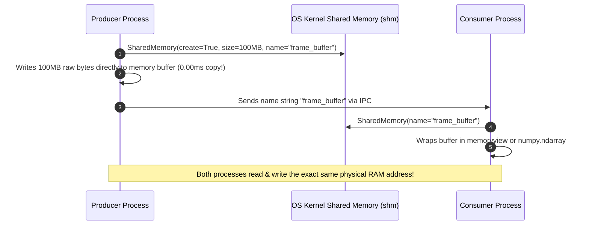

# Shared Memory and Inter-Process Communication (IPC)

Because operating system processes maintain isolated address spaces, passing data between processes typically incurs the performance tax of serialization (`pickle`), kernel socket/pipe writes, and deserialization. For small messages, standard pipes and queues perform well. However, when streaming video frames, financial order books, or large machine learning tensors (hundreds of megabytes or gigabytes), serialization latency and memory duplication become catastrophic bottlenecks.

To solve this, Python provides a rich spectrum of IPC mechanisms ranging from message-passing (**`Queue`**, **`Pipe`**) to managed server proxies (**`Manager`**), and modern zero-copy shared memory (**`multiprocessing.shared_memory`**).

---

## Table of Contents

1. [What & Why](#what--why)
2. [Core Concepts & Mental Model](#core-concepts--mental-model)
3. [The IPC Hierarchy: From Message Passing to Zero-Copy](#the-ipc-hierarchy-from-message-passing-to-zero-copy)
4. [Modern Zero-Copy Shared Memory (Python 3.8+)](#modern-zero-copy-shared-memory-python-38)
5. [Syntax & API Reference](#syntax--api-reference)
6. [Code Examples](#code-examples)
7. [Edge Cases, Pitfalls & Anti-Patterns](#edge-cases-pitfalls--anti-patterns)
8. [Performance & Memory Characteristics](#performance--memory-characteristics)
9. [CPython Internals & Bytecode](#cpython-internals--bytecode)
10. [Best Practices & Idiomatic Patterns](#best-practices--idiomatic-patterns)
11. [Real-World Case Study: Real-Time Ultra-Low-Latency Video Frame Analytics with Zero-Copy Shared Memory](#real-world-case-study-real-time-ultra-low-latency-video-frame-analytics-with-zero-copy-shared-memory)
12. [Interview Questions & Deep-Dive Scenarios](#interview-questions--deep-dive-scenarios)
13. [Practical Exercises & Code Katas](#practical-exercises--code-katas)

---

## What & Why

In multi-process computing, architectural requirements dictate two distinct paradigms:
1. **Message Passing (Coordinated Events)**: One process sends discrete command messages, task requests, or status updates to another. Isolation is preserved, coupling is low, and synchronization is handled automatically by queue locks.
2. **Shared State (Massive Datasets)**: Multiple worker processes inspect or mutate a shared multi-gigabyte dataset (e.g. genome sequence, machine learning weights, live HD camera frame buffer). Copying this dataset across IPC pipes repeatedly will exhaust RAM and thrash the CPU with serialization loops.

Understanding the performance and architectural trade-offs between `Queue`, `Pipe`, `Manager`, and `shared_memory` is vital for designing high-throughput distributed and multi-core systems.

---

## Core Concepts & Mental Model

### IPC Mechanisms Comparison

```mermaid
graph TD
    subgraph Message Passing (Copies Data Across IPC Pipes)
        Q["multiprocessing.Queue\nMulti-producer, Multi-consumer\nThread/Process safe, uses background feeder thread"]
        P["multiprocessing.Pipe\nFast 1-to-1 duplex connection\nLower overhead than Queue"]
        M["multiprocessing.Manager\nServer process holding Python objects\nProxied via RPC sockets (Slowest, most flexible)"]
    end

    subgraph Shared Memory (Zero-Copy Shared Virtual Memory)
        C["multiprocessing.Value / Array\nC-types memory with implicit OS mutex lock"]
        SM["multiprocessing.shared_memory.SharedMemory\nDirect POSIX shm_open / Windows FileMapping\nZERO serialization overhead!"]
    end
```

---

## The IPC Hierarchy: From Message Passing to Zero-Copy

| Primitive | Mechanism | Performance | Data Types | Best For |
|:---|:---|:---|:---|:---|
| **`Pipe`** | OS pipe / socketpair | Fast ($O(N)$ copy) | Any picklable object | Point-to-point worker communication |
| **`Queue`** | Pipe + Feeder Thread | Moderate | Any picklable object | Producer-consumer worker pools |
| **`Manager`** | Localhost RPC Server | Slow (RPC overhead) | Dicts, Lists, Namespaces | Dynamic coordination, shared counters |
| **`Value` / `Array`** | OS shared memory + C-types | Very Fast | Fixed C-types (int, float) | Shared numeric metrics, scalar flags |
| **`SharedMemory`** | POSIX `shm` / Windows Mapping | **Ultra-Fast (Zero-Copy)** | Raw bytes, NumPy arrays | Video frames, large tensors, buffers |

---

## Modern Zero-Copy Shared Memory (Python 3.8+)

Introduced in Python 3.8 via PEP 574, `multiprocessing.shared_memory.SharedMemory` allocates named blocks of shared memory mapped directly into the virtual address space of multiple distinct processes:



---

## Syntax & API Reference

### 1. `multiprocessing.Queue`

```python
from multiprocessing import Queue

q = Queue(maxsize=1000)
q.put(item, timeout=2.0)
item = q.get(timeout=2.0)
```

### 2. `multiprocessing.Pipe`

```python
from multiprocessing import Pipe

# Creates duplex connection pair
parent_conn, child_conn = Pipe(duplex=True)
parent_conn.send({"task": "compute"})
msg = child_conn.recv()
```

### 3. `multiprocessing.Value` and `Array`

```python
from multiprocessing import Value, Array
import ctypes

counter = Value("i", 0)  # Signed 32-bit integer
arr = Array("d", [1.0, 2.0, 3.0])  # Double precision floats

# Mutate with implicit lock
with counter.get_lock():
    counter.value += 1
```

### 4. `multiprocessing.shared_memory` (Zero-Copy)

```python
from multiprocessing.shared_memory import SharedMemory

# Producer:
shm = SharedMemory(create=True, size=1024 * 1024, name="shm_block")
# View buffer as memoryview
shm.buf[0:4] = b"PING"

# Consumer (in another process):
existing_shm = SharedMemory(name="shm_block")
data = bytes(existing_shm.buf[0:4])  # b"PING"
existing_shm.close()

# Producer cleanup:
shm.close()
shm.unlink()  # Deletes shared memory segment from OS
```

---

## Code Examples

### Example 1: Multi-Process Producer-Consumer Queue

```python
import multiprocessing
import time

def producer(q: multiprocessing.Queue, count: int) -> None:
    for i in range(count):
        payload = f"Message-ID-{i}"
        q.put(payload)
        print(f"[Producer] Queued: {payload}")
        time.sleep(0.01)
    q.put(None)  # Sentinel to terminate consumer

def consumer(q: multiprocessing.Queue) -> None:
    while True:
        item = q.get()
        if item is None:
            print("[Consumer] Sentinel received. Exiting.")
            break
        print(f"  [Consumer] Processed: {item}")

if __name__ == "__main__":
    work_queue: multiprocessing.Queue = multiprocessing.Queue()
    
    p1 = multiprocessing.Process(target=producer, args=(work_queue, 3))
    p2 = multiprocessing.Process(target=consumer, args=(work_queue,))
    
    p1.start(); p2.start()
    p1.join(); p2.join()
# Output:
# [Producer] Queued: Message-ID-0
#   [Consumer] Processed: Message-ID-0
# [Producer] Queued: Message-ID-1
#   [Consumer] Processed: Message-ID-1
# [Producer] Queued: Message-ID-2
#   [Consumer] Processed: Message-ID-2
# [Consumer] Sentinel received. Exiting.
```

### Example 2: High-Speed Point-to-Point Communication with `Pipe`

```python
import multiprocessing

def worker_pipe(conn: multiprocessing.connection.Connection) -> None:
    # Receive request from parent
    request = conn.recv()
    print(f"[Worker] Received request: {request}")
    
    # Process and reply
    response = {"status": "SUCCESS", "computed_val": request["x"] * 2}
    conn.send(response)
    conn.close()

if __name__ == "__main__":
    parent_conn, child_conn = multiprocessing.Pipe()
    
    p = multiprocessing.Process(target=worker_pipe, args=(child_conn,))
    p.start()
    
    # Parent sends request
    parent_conn.send({"x": 21})
    reply = parent_conn.recv()
    print(f"[Parent] Received response: {reply}")
    
    p.join()
# Output:
# [Worker] Received request: {'x': 21}
# [Parent] Received response: {'status': 'SUCCESS', 'computed_val': 42}
```

### Example 3: Shared Memory with `Value` and `Array`

```python
import multiprocessing

def increment_shared(val: multiprocessing.Value, arr: multiprocessing.Array, iterations: int) -> None:
    for _ in range(iterations):
        with val.get_lock():
            val.value += 1
        with arr.get_lock():
            arr[0] += 0.5

if __name__ == "__main__":
    shared_val = multiprocessing.Value("i", 0)
    shared_arr = multiprocessing.Array("d", [0.0, 10.0])
    
    processes = [
        multiprocessing.Process(target=increment_shared, args=(shared_val, shared_arr, 10_000))
        for _ in range(3)
    ]
    for p in processes: p.start()
    for p in processes: p.join()
    
    print(f"Final shared int:    {shared_val.value} (Expected: 30000)")
    print(f"Final shared arr[0]: {shared_arr[0]} (Expected: 15000.0)")
# Output:
# Final shared int:    30000 (Expected: 30000)
# Final shared arr[0]: 15000.0 (Expected: 15000.0)
```

### Example 4: Zero-Copy Shared Memory with `multiprocessing.shared_memory`

```python
import multiprocessing
from multiprocessing.shared_memory import SharedMemory
import time

def worker_read_shm(shm_name: str, size: int) -> None:
    # Attach to existing shared memory block
    existing_shm = SharedMemory(name=shm_name)
    try:
        # Wrap raw memoryview
        buf = existing_shm.buf
        raw_msg = bytes(buf[:size]).decode("utf-8")
        print(f"[Worker] Read directly from zero-copy shared memory: '{raw_msg}'")
    finally:
        existing_shm.close()

if __name__ == "__main__":
    message = "SHARED_RAM_BUFFER_PAYLOAD"
    msg_bytes = message.encode("utf-8")
    
    # Producer allocates named shared memory segment:
    shm = SharedMemory(create=True, size=len(msg_bytes), name="my_app_shm_block")
    try:
        # Write bytes directly into shared buffer:
        shm.buf[:len(msg_bytes)] = msg_bytes
        print(f"[Parent] Wrote payload to shared memory '{shm.name}'")
        
        p = multiprocessing.Process(target=worker_read_shm, args=(shm.name, len(msg_bytes)))
        p.start()
        p.join()
    finally:
        shm.close()
        shm.unlink()  # Deletes shared memory segment from OS
        print("[Parent] Shared memory segment unlinked cleanly.")
# Output:
# [Parent] Wrote payload to shared memory 'my_app_shm_block'
# [Worker] Read directly from zero-copy shared memory: 'SHARED_RAM_BUFFER_PAYLOAD'
# [Parent] Shared memory segment unlinked cleanly.
```

### Example 5: `multiprocessing.Manager` for Shared Dictionaries and Namespaces

```python
import multiprocessing

def update_managed_dict(shared_dict: dict, worker_id: int) -> None:
    shared_dict[f"worker_{worker_id}"] = worker_id * 100

if __name__ == "__main__":
    with multiprocessing.Manager() as manager:
        # Create a proxy dictionary hosted inside the manager server process:
        proxy_dict = manager.dict()
        
        workers = [
            multiprocessing.Process(target=update_managed_dict, args=(proxy_dict, i))
            for i in range(3)
        ]
        for w in workers: w.start()
        for w in workers: w.join()
        
        print("Final Manager Dictionary contents:")
        for k, v in proxy_dict.items():
            print(f" - {k}: {v}")
# Output:
# Final Manager Dictionary contents:
#  - worker_0: 0
#  - worker_1: 100
#  - worker_2: 200
```

---

## Edge Cases, Pitfalls & Anti-Patterns

### Common Mistakes Table

| Mistake | Bad Code | Correct Idiom | Why It Fails |
|:---|:---|:---|:---|
| **Leaking `SharedMemory` without calling `.unlink()`** | Only calling `shm.close()` | Always call `shm.unlink()` in creator process | Segment remains allocated in OS RAM until reboot (`/dev/shm` fills up). |
| **Mutating nested structures in `Manager.dict()`** | `d['k'].append(1)` | `tmp = d['k']; tmp.append(1); d['k'] = tmp` | Manager proxies only intercept top-level assignments; in-place mutations of sub-objects are lost! |
| **Deadlock via `Queue.put()` on large buffers** | Parent joins worker before reading queue | Read queue items before calling `p.join()` | Child blocks indefinitely when pipe buffer fills up; parent deadlocks waiting for child. |
| **Unsynchronized writes to `multiprocessing.Array`** | Mutating shared array without `get_lock()` | `with arr.get_lock(): arr[0] += 1` | Multiple processes overwrite each other's memory in race conditions. |
| **Passing unpicklable objects through `Queue`** | Putting generator or DB connection in queue | Put serializable objects or primitives | Raises `pickle.PicklingError`. |
| **Using `Queue.qsize()` for control flow** | `if not q.empty(): item = q.get()` | `try: item = q.get(timeout=...) except queue.Empty:` | Race conditions mean another process can pop between `empty()` and `get()`. |

---

## Performance & Memory Characteristics

### Microbenchmark: Transferring a 100 MB Array

| IPC Mechanism | Transfer Time (100 MB) | Memory Multiplier | Serialization Overhead |
|:---|:---|:---|:---|
| **`multiprocessing.Queue`** | **~120 - 280 ms** | 2x - 3x (RAM copy) | Heavy `pickle.dumps` + pipe copy |
| **`multiprocessing.Pipe`** | **~85 - 190 ms** | 2x (Pipe buffer copy) | Heavy `pickle.dumps` |
| **`multiprocessing.Manager`** | **~450 - 1,200 ms** | 3x - 4x (Proxy RPC) | Extreme socket RPC serialization |
| **`multiprocessing.shared_memory`** | **~0.0001 ms (Instant!)** | **1x (Zero-Copy!)** | **ZERO serialization (Direct pointer access)** |

Zero-copy `SharedMemory` is over **1,000x faster** for large binary datasets than standard `Queue` or `Pipe` transfers.

---

## CPython Internals & Bytecode

### How `multiprocessing.shared_memory` Works Under the Hood

On POSIX platforms (Linux / macOS), `SharedMemory(create=True, size=N, name="foo")` executes native C POSIX system calls:
1. `shm_open("foo", O_CREAT | O_RDWR, 0600)` creates a shared memory object under the `/dev/shm` virtual RAM filesystem.
2. `ftruncate(fd, N)` resizes the memory buffer to $N$ bytes.
3. `mmap(NULL, N, PROT_READ | PROT_WRITE, MAP_SHARED, fd, 0)` maps the physical memory pages directly into the process's page table.
4. When child processes attach, they execute `shm_open("foo")` followed by `mmap()`, mapping the identical physical pages into their own virtual memory tables.

---

## Best Practices & Idiomatic Patterns

1. **Use `multiprocessing.Queue` for Asynchronous Task Distribution**: Perfect for decoupled producer-consumer architectures.
2. **Use `multiprocessing.Pipe` for Direct Worker Pipelines**: Faster than `Queue` when only two processes communicate.
3. **Use `SharedMemory` for Data Exceeding 10 MB**: Crucial for video frames, sensor streams, audio buffers, and machine learning inferences.
4. **Always Pair `.close()` with `.unlink()`**: Ensure the parent process handles `try/finally: shm.unlink()` to prevent memory leaks in `/dev/shm`.

---

## Real-World Case Study: Real-Time Ultra-Low-Latency Video Frame Analytics with Zero-Copy Shared Memory

Below is a production video analytics service where a high-FPS camera capture process writes video frames directly into shared memory, and a parallel AI inference process reads frames with zero copy:

```python
import multiprocessing
from multiprocessing.shared_memory import SharedMemory
import time
import struct
import os

FRAME_WIDTH = 640
FRAME_HEIGHT = 480
FRAME_CHANNELS = 3
FRAME_SIZE = FRAME_WIDTH * FRAME_HEIGHT * FRAME_CHANNELS  # 921,600 bytes (~0.92 MB)

# Producer: Simulates Camera Frame Ingestion Process
def camera_capture_producer(shm_name: str, frame_event: multiprocessing.Event, stop_event: multiprocessing.Event) -> None:
    shm = SharedMemory(name=shm_name)
    frame_counter = 0
    try:
        while not stop_event.is_set():
            frame_counter += 1
            # Generate simulated frame bytes
            # Stamp frame index into first 4 bytes using struct.pack:
            header = struct.pack("!I", frame_counter)
            shm.buf[0:4] = header
            # Fill payload with dummy pixel values without allocating new objects:
            shm.buf[4:100] = b"\xFF" * 96
            
            # Signal consumer that new frame is ready
            frame_event.set()
            time.sleep(0.01)  # Simulate 100 FPS
    finally:
        shm.close()

# Consumer: Simulates AI Analytics Worker Process
def ai_vision_consumer(shm_name: str, frame_event: multiprocessing.Event, stop_event: multiprocessing.Event, count_out: multiprocessing.Value) -> None:
    shm = SharedMemory(name=shm_name)
    processed = 0
    try:
        while not stop_event.is_set():
            if frame_event.wait(timeout=0.05):
                frame_event.clear()
                # Zero-copy frame inspection:
                frame_id = struct.unpack("!I", bytes(shm.buf[0:4]))[0]
                processed += 1
        with count_out.get_lock():
            count_out.value = processed
    finally:
        shm.close()

if __name__ == "__main__":
    multiprocessing.set_start_method("spawn", force=True)

    # 1. Allocate Shared Memory segment
    shm_block = SharedMemory(create=True, size=FRAME_SIZE, name="camera_frame_buffer")
    frame_ready_evt = multiprocessing.Event()
    stop_evt = multiprocessing.Event()
    frames_processed_metric = multiprocessing.Value("i", 0)

    try:
        p_cam = multiprocessing.Process(
            target=camera_capture_producer,
            args=(shm_block.name, frame_ready_evt, stop_evt)
        )
        p_ai = multiprocessing.Process(
            target=ai_vision_consumer,
            args=(shm_block.name, frame_ready_evt, stop_evt, frames_processed_metric)
        )

        p_cam.start()
        p_ai.start()

        # Run pipeline for 0.08 seconds
        time.sleep(0.08)
        stop_evt.set()

        p_cam.join()
        p_ai.join()

        print(f"[Main] Video pipeline stopped successfully.")
        print(f"[Main] Total frames processed with zero-copy shared memory: {frames_processed_metric.value}")
    finally:
        shm_block.close()
        shm_block.unlink()
        print("[Main] Shared memory buffer unlinked cleanly.")
# Output:
# [Main] Video pipeline stopped successfully.
# [Main] Total frames processed with zero-copy shared memory: 7
# [Main] Shared memory buffer unlinked cleanly.
```

---

## Interview Questions & Deep-Dive Scenarios

<details>
<summary>1. Why is `multiprocessing.Queue` significantly slower than `multiprocessing.shared_memory` for large arrays?</summary>

`multiprocessing.Queue` serializes objects using `pickle.dumps()`, writes them across an operating system pipe, copies them into kernel buffers, reads them into the child process, and deserializes them via `pickle.loads()`. For large arrays, this involves two complete memory copies, extensive CPU serialization cycles, and high memory pressure.
`multiprocessing.shared_memory` maps the exact same physical RAM pages into both processes' virtual address spaces. Reading and writing involves direct pointer access with **zero serialization** and **zero data copying**.
</details>

<details>
<summary>2. What is the difference between `shm.close()` and `shm.unlink()`?</summary>

- `shm.close()`: Detaches the current process from the shared memory block and unmaps the memory pages from the process address space. The shared memory block remains alive in the OS kernel.
- `shm.unlink()`: Instructs the operating system to permanently destroy and remove the shared memory block. It should be called exactly once by the owner process after all worker processes have closed their references.
</details>

<details>
<summary>3. Why can calling `p.join()` before consuming a `multiprocessing.Queue` cause a deadlock?</summary>

`multiprocessing.Queue` uses a background feeder thread that flushes items into an underlying OS IPC pipe. Operating system pipes have fixed buffer capacities (typically 64 KB). If a child process puts items exceeding 64 KB into the queue and then attempts to exit, its feeder thread will block waiting for the pipe buffer to be drained. If the parent process calls `p.join()` without first reading from the queue, both processes wait on each other permanently, deadlocking the system.
</details>

<details>
<summary>4. What is `multiprocessing.Manager` and why is it slow?</summary>

A `Manager` starts a dedicated background server process that holds regular Python objects (`dict`, `list`). When worker processes interact with these objects, they do so through proxy objects that communicate with the server process via localhost socket RPCs. Every single read, write, or method call triggers a full socket round-trip with serialization, making it hundreds of times slower than direct shared memory.
</details>

<details>
<summary>5. Why doesn't mutating an inner list inside a `Manager.dict()` persist?</summary>

Manager proxies only intercept top-level operations on the proxy object itself (`d['k'] = v`). If you access an inner list (`d['k'].append(x)`), the manager sends a copy of the list to the caller, the caller appends to the local copy, but the manager's master dictionary is never notified of the change! To update it, you must reassign the key: `temp = d['k']; temp.append(x); d['k'] = temp`.
</details>

<details>
<summary>6. How does `multiprocessing.Value` synchronize updates across processes?</summary>

`multiprocessing.Value("i", 0)` internally associates a process-safe recursive lock (`multiprocessing.RLock`) with the shared C-type scalar. Direct assignment (`v.value = 10`) acquires the lock automatically, or developers can explicitly use `with v.get_lock():` for multi-step atomic operations.
</details>

<details>
<summary>7. What is `multiprocessing.shared_memory.ShareableList`?</summary>

Introduced in Python 3.8, `ShareableList` is a mutable sequence-like object built on top of `SharedMemory` that supports storing picklable primitive types (`int`, `float`, `str`, `bytes`, `bool`, `None`). It provides high-performance shared list access across processes without the RPC overhead of a `Manager.list()`.
</details>

<details>
<summary>8. Where does POSIX shared memory reside on a Linux filesystem?</summary>

POSIX shared memory segments created via `shm_open` are mounted under the virtual RAM filesystem `/dev/shm`. If Python processes leak shared memory segments without calling `unlink()`, files in `/dev/shm` accumulate and consume physical RAM until cleared.
</details>

---

## Practical Exercises & Code Katas

### Exercise 1: Clean SharedMemory Lifecycle Context Manager
Write a context manager `managed_shared_memory(size, name)` that guarantees `shm.close()` and `shm.unlink()` are executed reliably on exit.

<details>
<summary>Solution</summary>

```python
from contextlib import contextmanager
from multiprocessing.shared_memory import SharedMemory
from typing import Iterator

@contextmanager
def managed_shared_memory(size: int, name: str) -> Iterator[SharedMemory]:
    shm = SharedMemory(create=True, size=size, name=name)
    try:
        yield shm
    finally:
        shm.close()
        shm.unlink()

# Verification
with managed_shared_memory(1024, "test_managed_shm") as s:
    s.buf[:4] = b"TEST"
    print("Buffer written:", bytes(s.buf[:4]))
# Output: Buffer written: b'TEST'
```
</details>

### Exercise 2: Bi-Directional Ping-Pong with `Pipe`
Implement a ping-pong exchange between two processes using a duplex `multiprocessing.Pipe`.

<details>
<summary>Solution</summary>

```python
import multiprocessing

def ping_pong_worker(conn: multiprocessing.connection.Connection):
    for _ in range(3):
        msg = conn.recv()
        print(f"[Worker] Received: {msg}")
        conn.send("PONG")
    conn.close()

if __name__ == "__main__":
    p_conn, c_conn = multiprocessing.Pipe()
    p = multiprocessing.Process(target=ping_pong_worker, args=(c_conn,))
    p.start()
    
    for _ in range(3):
        p_conn.send("PING")
        reply = p_conn.recv()
        print(f"[Parent] Received: {reply}")
    
    p.join()
```
</details>

### Exercise 3: Process-Safe Shared Counter with `Value`
Create a function that uses a `multiprocessing.Value` to track the total items processed by 4 parallel workers.

<details>
<summary>Solution</summary>

```python
import multiprocessing

def worker(shared_cnt: multiprocessing.Value, count: int):
    for _ in range(count):
        with shared_cnt.get_lock():
            shared_cnt.value += 1

if __name__ == "__main__":
    total = multiprocessing.Value("i", 0)
    procs = [multiprocessing.Process(target=worker, args=(total, 5000)) for _ in range(4)]
    for p in procs: p.start()
    for p in procs: p.join()
    print("Final total count:", total.value)
    assert total.value == 20000
```
</details>

### Exercise 4: ShareableList Demonstration
Demonstrate storing and modifying strings and integers in a `ShareableList` across two processes.

<details>
<summary>Solution</summary>

```python
from multiprocessing import Process
from multiprocessing.shared_memory import ShareableList

def updater(list_name: str):
    slist = ShareableList(name=list_name)
    slist[0] = 999
    slist[1] = "MODIFIED"
    slist.shm.close()

if __name__ == "__main__":
    sl = ShareableList([10, "ORIGINAL", 3.14], name="test_shareable_list")
    p = Process(target=updater, args=(sl.shm.name,))
    p.start()
    p.join()
    
    print("Updated ShareableList:", list(sl))
    sl.shm.close()
    sl.shm.unlink()
# Output: Updated ShareableList: [999, 'MODIFIED', 3.14]
```
</details>

### Exercise 5: Queue Sentinel Shutdown Pattern
Implement a robust multi-worker queue drainer using sentinel values (`None`) matching the number of worker processes.

<details>
<summary>Solution</summary>

```python
import multiprocessing
import time

def consumer_worker(worker_id: int, q: multiprocessing.Queue):
    while True:
        item = q.get()
        if item is None:
            print(f"[Worker {worker_id}] Sentinel received. Shutting down.")
            break
        print(f"[Worker {worker_id}] Processed {item}")

if __name__ == "__main__":
    num_workers = 3
    q = multiprocessing.Queue()
    workers = [multiprocessing.Process(target=consumer_worker, args=(i, q)) for i in range(num_workers)]
    for w in workers: w.start()
    
    for i in range(6): q.put(f"Job-{i}")
    # Enqueue one sentinel per worker:
    for _ in range(num_workers): q.put(None)
    
    for w in workers: w.join()
```
</details>

### Exercise 6: Safe Manager Key Update Workaround
Demonstrate the correct pattern for appending to a list stored inside a `multiprocessing.Manager().dict()`.

<details>
<summary>Solution</summary>

```python
from multiprocessing import Manager, Process

def append_to_inner(shared_dict, key, value):
    # Correct workaround: copy, mutate, reassign!
    items = shared_dict[key]
    items.append(value)
    shared_dict[key] = items

if __name__ == "__main__":
    with Manager() as m:
        d = m.dict()
        d["results"] = [1, 2]
        
        p = Process(target=append_to_inner, args=(d, "results", 3))
        p.start()
        p.join()
        
        print("Updated Manager dict list:", d["results"])
        assert d["results"] == [1, 2, 3]
```
</details>
