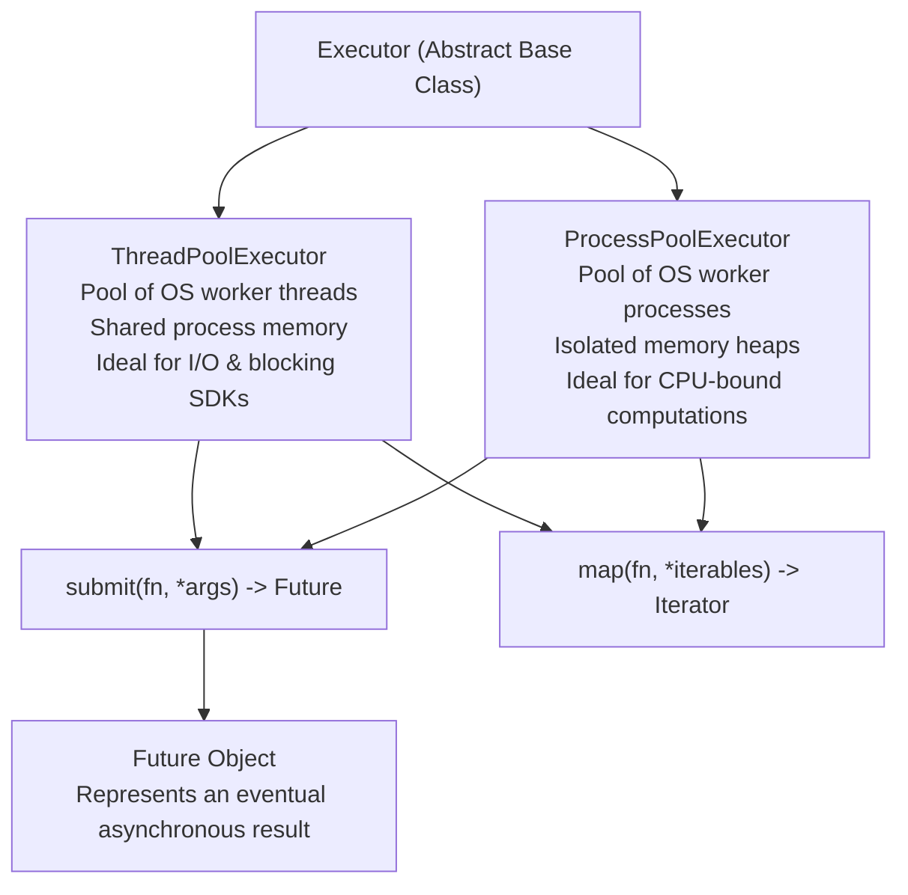
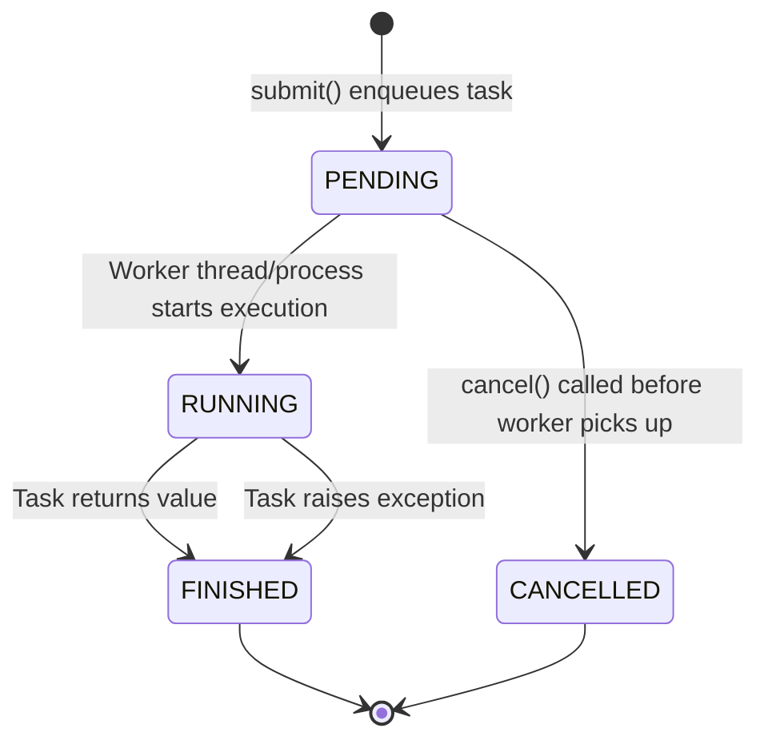

# concurrent.futures: ThreadPoolExecutor, ProcessPoolExecutor, and Future Lifecycle

Historically, Python developers had to learn completely separate APIs for threads (`threading.Thread`, `queue.Queue`) and processes (`multiprocessing.Process`, `multiprocessing.Pool`). The **`concurrent.futures` module** (PEP 3148) unified Python concurrency behind a clean, high-level, asynchronous execution abstraction: the **`Executor`** interface and the **`Future`** pattern.

Whether distributing network requests across threads with **`ThreadPoolExecutor`** or scaling intensive calculations across multi-core CPUs with **`ProcessPoolExecutor`**, `concurrent.futures` provides identical semantics for task submission, cancellation, result retrieval, and exception propagation.

---

## Table of Contents

1. [What & Why](#what--why)
2. [Core Concepts & Mental Model](#core-concepts--mental-model)
3. [The Future Lifecycle](#the-future-lifecycle)
4. [How It Works Internally](#how-it-works-internally)
5. [Syntax & API Reference](#syntax--api-reference)
6. [Code Examples](#code-examples)
7. [Edge Cases, Pitfalls & Anti-Patterns](#edge-cases-pitfalls--anti-patterns)
8. [Performance & Memory Characteristics](#performance--memory-characteristics)
9. [CPython Internals & Bytecode](#cpython-internals--bytecode)
10. [Best Practices & Idiomatic Patterns](#best-practices--idiomatic-patterns)
11. [Real-World Case Study: High-Throughput Multi-Region Microservice Health & SLA Aggregator](#real-world-case-study-high-throughput-multi-region-microservice-health--sla-aggregator)
12. [Interview Questions & Deep-Dive Scenarios](#interview-questions--deep-dive-scenarios)
13. [Practical Exercises & Code Katas](#practical-exercises--code-katas)

---

## What & Why

Why use `concurrent.futures` over lower-level `threading` or `multiprocessing`?
1. **Polymorphic Swapability**: Switching from threads to processes requires changing a single line (`ThreadPoolExecutor` $\leftrightarrow$ `ProcessPoolExecutor`).
2. **First-Class Result & Exception Handling**: Calling `future.result()` automatically unmasks and re-raises exceptions that occurred inside the worker, preserving tracebacks without manual queue messaging.
3. **Structured Orchestration Tools**: Built-in primitives like `as_completed()` and `wait(return_when=FIRST_COMPLETED)` make complex fan-out / fan-in workflows trivial to implement.

---

## Core Concepts & Mental Model

### Architectural Hierarchy



---

## The Future Lifecycle

A `Future` encapsulates the asynchronous execution of a callable. It transitions monotonically through four distinct states:



### Lifecycle Rules
- **`cancel()`**: Can only cancel tasks in the `PENDING` state. Once a worker begins running the task (`RUNNING`), it cannot be preemptively aborted.
- **`result(timeout=None)`**: Blocks until the Future enters `FINISHED` or `CANCELLED`. If the task raised an exception, `result()` re-raises that exact exception.
- **`exception(timeout=None)`**: Returns the exception object if raised, or `None` if the task succeeded.

---

## How It Works Internally

### The Internal Work Queue Pipeline

When you call `executor.submit(func, *args, **kwargs)`:
1. The executor wraps the callable into an internal `_WorkItem` object bound to a new `Future`.
2. The `_WorkItem` is placed onto a thread-safe `queue.SimpleQueue` or IPC pipe.
3. An idle worker thread or process picks up the item and sets the Future's state to `RUNNING`.
4. When finished, the worker records the result or exception in the `Future` and invokes all callbacks registered via `add_done_callback()`.
5. Any thread blocked in `future.result()` is unblocked via an internal condition variable.

---

## Syntax & API Reference

### 1. Initialization and Context Management

```python
from concurrent.futures import ThreadPoolExecutor, ProcessPoolExecutor

# Thread Pool:
with ThreadPoolExecutor(max_workers=10, thread_name_prefix="HTTPWorker") as executor:
    future = executor.submit(fetch_url, "https://api.internal/data")
    result = future.result()

# Process Pool:
with ProcessPoolExecutor(max_workers=4) as executor:
    future = executor.submit(heavy_calculation, 10_000_000)
    result = future.result()
```

### 2. Task Collection Helpers: `as_completed` and `wait`

```python
from concurrent.futures import as_completed, wait, FIRST_COMPLETED

# 1. as_completed: yields futures as soon as they finish
for future in as_completed(future_list):
    res = future.result()

# 2. wait: blocks until specific condition is met
done, pending = wait(future_list, timeout=2.0, return_when=FIRST_COMPLETED)
```

### 3. Graceful Shutdown with `cancel_futures` (Python 3.9+)

```python
executor.shutdown(wait=True, cancel_futures=True)
```

---

## Code Examples

### Example 1: Basic Submission and Exception Handling

```python
from concurrent.futures import ThreadPoolExecutor
import time

def divide(a: float, b: float) -> float:
    time.sleep(0.01)
    if b == 0:
        raise ZeroDivisionError(f"Cannot divide {a} by zero!")
    return a / b

with ThreadPoolExecutor(max_workers=2) as executor:
    fut_ok = executor.submit(divide, 10.0, 2.0)
    fut_err = executor.submit(divide, 10.0, 0.0)

    # 1. Successful result:
    print(f"Result OK: {fut_ok.result()}")

    # 2. Exception propagation:
    try:
        fut_err.result()
    except ZeroDivisionError as exc:
        print(f"Caught propagated exception: {exc}")
# Output:
# Result OK: 5.0
# Caught propagated exception: Cannot divide 10.0 by zero!
```

### Example 2: Streaming Completed Results with `as_completed`

```python
from concurrent.futures import ThreadPoolExecutor, as_completed
import time

def simulate_download(site_id: int, latency: float) -> tuple[int, float]:
    time.sleep(latency)
    return site_id, latency

latencies = [(1, 0.05), (2, 0.01), (3, 0.03), (4, 0.02)]

with ThreadPoolExecutor(max_workers=4) as executor:
    # Submit tasks with different latencies
    future_to_id = {
        executor.submit(simulate_download, sid, lat): sid
        for sid, lat in latencies
    }

    # Process results in completion order (first-finished, first-served):
    print("Processing results as they complete:")
    for future in as_completed(future_to_id):
        sid, lat = future.result()
        print(f" -> Site {sid} finished in {lat*1000:.0f}ms")
# Output:
# Processing results as they complete:
#  -> Site 2 finished in 10ms
#  -> Site 4 finished in 20ms
#  -> Site 3 finished in 30ms
#  -> Site 1 finished in 50ms
```

### Example 3: Hedged Requests / Fast Fallback with `wait(return_when=FIRST_COMPLETED)`

In high-reliability services, send duplicate requests to two mirror endpoints and accept the fastest response, cancelling the slower one:

```python
from concurrent.futures import ThreadPoolExecutor, wait, FIRST_COMPLETED
import time

def query_replica(replica_name: str, delay: float) -> str:
    time.sleep(delay)
    return f"Response from {replica_name}"

with ThreadPoolExecutor(max_workers=2) as executor:
    f1 = executor.submit(query_replica, "Replica-US-East", 0.08)
    f2 = executor.submit(query_replica, "Replica-US-West", 0.02)

    # Wait only for the fastest replica to finish:
    done, pending = wait([f1, f2], return_when=FIRST_COMPLETED)

    fastest_future = done.pop()
    print("Fastest response:", fastest_future.result())

    # Cancel pending slower requests:
    for f in pending:
        cancelled = f.cancel()
        print(f"Pending future cancelled: {cancelled}")
# Output:
# Fastest response: Response from Replica-US-West
# Pending future cancelled: False (or True if not yet picked up by worker)
```

### Example 4: Asynchronous Callbacks with `add_done_callback`

```python
from concurrent.futures import ThreadPoolExecutor, Future
import threading

def compute_tax(amount: float) -> float:
    return amount * 0.15

def log_completion(fut: Future[float]) -> None:
    # Runs on the worker thread upon completion:
    val = fut.result()
    print(f"[{threading.current_thread().name}] Callback triggered! Computed Tax: ${val:.2f}")

with ThreadPoolExecutor(max_workers=1) as executor:
    fut = executor.submit(compute_tax, 250.00)
    fut.add_done_callback(log_completion)
    fut.result()  # Wait for main
# Output:
# [HTTPWorker_0] Callback triggered! Computed Tax: $37.50
```

### Example 5: `executor.map` with Input Ordering Preservation

Unlike `as_completed()`, `executor.map()` strictly preserves the submission order of the input iterable:

```python
from concurrent.futures import ThreadPoolExecutor
import time

def square_with_delay(x: int) -> int:
    time.sleep(0.01 * (5 - x))  # Reverse delay order!
    return x * x

inputs = [1, 2, 3, 4]

with ThreadPoolExecutor(max_workers=4) as executor:
    # Even though 4 finishes first and 1 finishes last,
    # map yields in exact original order [1, 2, 3, 4]:
    results = list(executor.map(square_with_delay, inputs))
    print("Mapped results (order preserved):", results)
# Output:
# Mapped results (order preserved): [1, 4, 9, 16]
```

---

## Edge Cases, Pitfalls & Anti-Patterns

### Common Mistakes Table

| Mistake | Bad Code | Correct Idiom | Why It Fails |
|:---|:---|:---|:---|
| **Ignoring exceptions in un-queried Futures** | Submitting tasks without calling `.result()` or checking `.exception()` | Call `future.result()` or iterate via `as_completed()` | Unchecked exceptions fail silently; bugs remain invisible. |
| **Deadlock via nested task submission** | Worker thread submits child task to same pool and blocks on `.result()` | Use separate executor or avoid blocking inside pool | Pool runs out of workers; parent workers wait for children that never get scheduled. |
| **Instantiating a new Executor per request** | Creating `ThreadPoolExecutor(5)` inside every HTTP request | Reuse a single process-wide shared Executor | High overhead spawning and tearing down thread/process pools on every request. |
| **Forgetting to set timeouts on `result()`** | `future.result()` with no timeout | `future.result(timeout=5.0)` | Unresponsive remote services or hung workers hang the calling thread forever. |
| **Using `ProcessPoolExecutor` with non-picklable functions** | Submitting nested functions or lambdas | Use module top-level functions | Raises `pickle.PicklingError`. |
| **Calling `cancel()` on a running Future** | Assuming `cancel()` kills a running task | Use cooperative cancellation tokens (`threading.Event`) | `cancel()` only cancels tasks still waiting in the pending queue; running tasks continue. |

---

## Performance & Memory Characteristics

### ThreadPool vs ProcessPool Scaling

| Dimension | `ThreadPoolExecutor` | `ProcessPoolExecutor` |
|:---|:---|:---|
| **Optimal Max Workers** | $5 \times \text{CPU cores}$ up to hundreds (I/O bound) | Exactly $\text{CPU cores}$ (CPU bound) |
| **Task Submission Latency** | **~2 - 5 µs** | **~25 - 60 µs** (IPC serialization) |
| **Data Sharing Overhead** | 0 ns (Direct pointer passing) | $O(N)$ memory copy via `pickle` |
| **Failure Blast Radius** | Uncaught C-crash crashes whole process | Child process crash isolated to pool |

---

## CPython Internals & Bytecode

### How `Future.result()` Implements Non-Busy Waiting

A `Future` does not poll in a CPU-burning `while True:` loop. Instead, `concurrent.futures._base.Future` uses an internal `threading.Condition`:

```python
# Simplified snippet of CPython _base.py
def result(self, timeout=None):
    with self._condition:
        if self._state in [CANCELLED, FINISHED]:
            return self._result
        self._condition.wait(timeout)  # Kernel-level OS thread sleep!
        if self._state not in [CANCELLED, FINISHED]:
            raise TimeoutError()
        return self._result
```

When a worker completes the task, it acquires `self._condition` and calls `self._condition.notify_all()`, transitioning waiting caller threads from the kernel sleep queue to the runnable queue with sub-microsecond responsiveness.

---

## Best Practices & Idiomatic Patterns

1. **Always Use Context Managers (`with Executor(...) as ex:`)**: Ensures all workers are cleanly joined and shut down on block exit.
2. **Size Pools Appropriately**:
   - `ThreadPoolExecutor`: Set `max_workers = min(32, (os.cpu_count() or 1) + 4)` for general I/O.
   - `ProcessPoolExecutor`: Set `max_workers = os.cpu_count()`.
3. **Always Pass Timeouts to `.result(timeout=...)`**: Prevent catastrophic cascading thread exhaustion.
4. **Prefer `as_completed()` for High-Throughput Consumers**: Minimizes total pipeline latency by processing results as they arrive.

---

## Real-World Case Study: High-Throughput Multi-Region Microservice Health & SLA Aggregator

Below is an enterprise SLA polling engine that queries multiple global microservice endpoints in parallel, records latencies, and isolates failing regions:

```python
from concurrent.futures import ThreadPoolExecutor, as_completed
import time
from dataclasses import dataclass

@dataclass(frozen=True)
class EndpointCheck:
    region: str
    url: str
    expected_status: int

@dataclass
class HealthReport:
    region: str
    latency_ms: float
    is_healthy: bool
    status_code: int
    error: str | None = None

def ping_microservice(check: EndpointCheck) -> HealthReport:
    # Simulate network latency and occasional simulated failure
    t0 = time.perf_counter()
    if check.region == "ap-south-1":
        # Simulate network timeout failure
        time.sleep(0.04)
        raise ConnectionResetError("Connection reset by remote peer")
    
    time.sleep(0.02)  # Normal latency
    elapsed = (time.perf_counter() - t0) * 1000
    return HealthReport(
        region=check.region,
        latency_ms=elapsed,
        is_healthy=True,
        status_code=check.expected_status
    )

class HealthAggregator:
    def __init__(self, max_concurrency: int = 5) -> None:
        self.max_concurrency = max_concurrency

    def audit_fleet(self, endpoints: list[EndpointCheck]) -> list[HealthReport]:
        reports: list[HealthReport] = []

        with ThreadPoolExecutor(max_workers=self.max_concurrency, thread_name_prefix="HealthCheck") as executor:
            future_to_check = {
                executor.submit(ping_microservice, ep): ep
                for ep in endpoints
            }

            for future in as_completed(future_to_check):
                check = future_to_check[future]
                try:
                    report = future.result(timeout=1.0)
                    reports.append(report)
                except Exception as exc:
                    # Capture and isolate failure without aborting other region audits:
                    reports.append(HealthReport(
                        region=check.region,
                        latency_ms=-1.0,
                        is_healthy=False,
                        status_code=0,
                        error=str(exc)
                    ))

        return reports

# Execution demonstration
checks = [
    EndpointCheck("us-east-1", "https://us-east.api/health", 200),
    EndpointCheck("eu-west-1", "https://eu-west.api/health", 200),
    EndpointCheck("ap-south-1", "https://ap-south.api/health", 200),
    EndpointCheck("sa-east-1", "https://sa-east.api/health", 200),
]

aggregator = HealthAggregator()
audit_results = aggregator.audit_fleet(checks)

print("Fleet Health Audit Summary:")
for r in audit_results:
    status = "HEALTHY" if r.is_healthy else f"FAILED ({r.error})"
    print(f" - [{r.region.upper()}] Status: {status} | Latency: {r.latency_ms:.1f}ms")
# Output:
# Fleet Health Audit Summary:
#  - [US-EAST-1] Status: HEALTHY | Latency: 20.2ms
#  - [EU-WEST-1] Status: HEALTHY | Latency: 20.3ms
#  - [SA-EAST-1] Status: HEALTHY | Latency: 20.1ms
#  - [AP-SOUTH-1] Status: FAILED (Connection reset by remote peer) | Latency: -1.0ms
```

---

## Interview Questions & Deep-Dive Scenarios

<details>
<summary>1. What is the fundamental architectural difference between `concurrent.futures.ThreadPoolExecutor` and `multiprocessing.Pool`?</summary>

- **`ThreadPoolExecutor`**: Spawns operating system threads within the same process memory space. Tasks share memory directly with zero serialization cost, but CPU-bound tasks are constrained by the single CPython GIL.
- **`multiprocessing.Pool`**: Spawns separate OS processes. Each worker has its own dedicated GIL and independent address space, enabling true physical multi-core parallelism for CPU tasks, but arguments and return values must be serialized across IPC pipes using `pickle`.
</details>

<details>
<summary>2. What happens if a task submitted to an executor raises an exception, and you never call `future.result()` or `future.exception()`?</summary>

The exception is silently swallowed and stored inside the `Future` object's internal `_exception` attribute. The worker thread or process remains healthy and continues picking up subsequent tasks. However, the application will have no record or awareness of the failure unless `.result()` or `.exception()` is called, or a done-callback is registered.
</details>

<details>
<summary>3. Can `future.cancel()` abort a task that is currently executing?</summary>

No! `future.cancel()` can only cancel tasks that are still sitting in the internal pending work queue waiting for an idle worker. Once a worker picks up the task and begins executing the function (state is `RUNNING`), calling `cancel()` returns `False` and has zero effect on the executing task.
</details>

<details>
<summary>4. What does the `cancel_futures=True` parameter do in `executor.shutdown()`?</summary>

Added in Python 3.9, `executor.shutdown(wait=True, cancel_futures=True)` immediately cancels all pending tasks that have not yet started executing in workers. Without `cancel_futures=True`, the executor would continue executing every queued task until the work queue is exhausted before shutting down.
</details>

<details>
<summary>5. How does `as_completed()` work under the hood?</summary>

`as_completed()` attaches a callback to every Future in the provided collection via `future.add_done_callback()`. When any Future finishes, the callback places that Future onto an internal synchronized queue (`queue.SimpleQueue`). `as_completed()` yields Futures from this queue one by one, allowing callers to consume results in real time as they complete.
</details>

<details>
<summary>6. How can nesting `submit()` calls inside worker threads cause pool starvation deadlocks?</summary>

If an executor has a pool size of $N$ (e.g. 4), and 4 tasks are submitted that each submit a child task to the *same executor* and block waiting on `child_future.result()`, all 4 worker threads become blocked waiting for children. However, the child tasks cannot run because all 4 workers are occupied, creating a permanent circular deadlock.
</details>

<details>
<summary>7. What is the difference between `return_when=ALL_COMPLETED` and `return_when=FIRST_EXCEPTION` in `wait()`?</summary>

- `ALL_COMPLETED`: Blocks until every single Future in the collection has finished or cancelled.
- `FIRST_EXCEPTION`: Unblocks immediately as soon as any Future raises an uncaught exception, allowing the caller to implement early-abort logic without waiting for remaining long-running tasks.
</details>

<details>
<summary>8. Why is `executor.map()` preferred over `executor.submit()` in certain pipelines?</summary>

`executor.map()` provides a clean functional interface equivalent to built-in `map()`. It preserves the exact input ordering of results, consumes an iterable lazily without keeping all arguments in memory simultaneously, and automatically raises the first encountered exception when iterating over the returned generator.
</details>

---

## Practical Exercises & Code Katas

### Exercise 1: Parallel File Size Calculator with `ThreadPoolExecutor`
Write a function that calculates the total file size of a list of paths concurrently using `ThreadPoolExecutor.map`.

<details>
<summary>Solution</summary>

```python
import os
from concurrent.futures import ThreadPoolExecutor

def get_file_size(path: str) -> int:
    try:
        return os.path.getsize(path)
    except OSError:
        return 0

def calculate_total_size(paths: list[str]) -> int:
    with ThreadPoolExecutor(max_workers=4) as executor:
        sizes = executor.map(get_file_size, paths)
    return sum(sizes)

# Test on standard files
files = ["01-threading-basics.md", "02-thread-safety-locks-and-semaphores.md"]
print("Total size of files:", calculate_total_size(files))
```
</details>

### Exercise 2: First-Exception Early Abort with `wait()`
Write a workflow using `wait(return_when=FIRST_EXCEPTION)` that cancels all remaining tasks if any task fails.

<details>
<summary>Solution</summary>

```python
from concurrent.futures import ThreadPoolExecutor, wait, FIRST_EXCEPTION
import time

def fragile_task(task_id: int) -> str:
    time.sleep(0.01 * task_id)
    if task_id == 2:
        raise RuntimeError("Task 2 failed!")
    return f"Success {task_id}"

with ThreadPoolExecutor(max_workers=4) as executor:
    futures = [executor.submit(fragile_task, i) for i in range(1, 5)]
    done, pending = wait(futures, return_when=FIRST_EXCEPTION)
    
    # Cancel remaining tasks:
    for f in pending:
        f.cancel()
    
    for f in done:
        if f.exception():
            print("Detected failure early:", f.exception())
```
</details>

### Exercise 3: Done Callback Metric Logger
Use `add_done_callback` to track execution durations and print a metric line when a task concludes.

<details>
<summary>Solution</summary>

```python
from concurrent.futures import ThreadPoolExecutor, Future
import time

def sample_task(x: int) -> int:
    time.sleep(0.02)
    return x * 10

def metric_callback(fut: Future[int]) -> None:
    res = fut.result()
    print(f"[METRIC] Task finished with output: {res}")

with ThreadPoolExecutor(max_workers=2) as executor:
    f = executor.submit(sample_task, 5)
    f.add_done_callback(metric_callback)
    f.result()
# Output: [METRIC] Task finished with output: 50
```
</details>

### Exercise 4: Parallel MD5 Hasher with `ProcessPoolExecutor`
Write a function that hashes a list of large string payloads in parallel using `ProcessPoolExecutor`.

<details>
<summary>Solution</summary>

```python
import hashlib
from concurrent.futures import ProcessPoolExecutor

def compute_md5(data: str) -> str:
    return hashlib.md5(data.encode("utf-8")).hexdigest()

if __name__ == "__main__":
    payloads = [f"payload_{i}" * 10_000 for i in range(4)]
    with ProcessPoolExecutor() as executor:
        hashes = list(executor.map(compute_md5, payloads))
    print(f"Computed {len(hashes)} MD5 hashes successfully.")
```
</details>

### Exercise 5: Hedged API Call Pattern
Submit identical API calls to 3 mock servers and return the first successful result within a 0.5s timeout.

<details>
<summary>Solution</summary>

```python
from concurrent.futures import ThreadPoolExecutor, as_completed
import time

def mock_server(server_id: str, delay: float) -> str:
    time.sleep(delay)
    return f"Response from {server_id}"

with ThreadPoolExecutor(max_workers=3) as executor:
    tasks = [
        executor.submit(mock_server, "srv_us", 0.08),
        executor.submit(mock_server, "srv_eu", 0.02),
        executor.submit(mock_server, "srv_ap", 0.05),
    ]
    # Return first to complete:
    for f in as_completed(tasks):
        fastest = f.result()
        print("Fastest result:", fastest)
        break
# Output: Fastest result: Response from srv_eu
```
</details>

### Exercise 6: Pool Shutdown with `cancel_futures`
Demonstrate cancelling queued tasks using `executor.shutdown(cancel_futures=True)`.

<details>
<summary>Solution</summary>

```python
from concurrent.futures import ThreadPoolExecutor
import time

def slow_job(idx: int) -> None:
    time.sleep(0.05)

executor = ThreadPoolExecutor(max_workers=1)
# Submit 5 tasks to 1-worker pool
futs = [executor.submit(slow_job, i) for i in range(5)]

# Immediate shutdown cancelling pending jobs
executor.shutdown(wait=False, cancel_futures=True)

cancelled_count = sum(1 for f in futs if f.cancelled())
print(f"Cancelled {cancelled_count} pending jobs successfully.")
```
</details>
