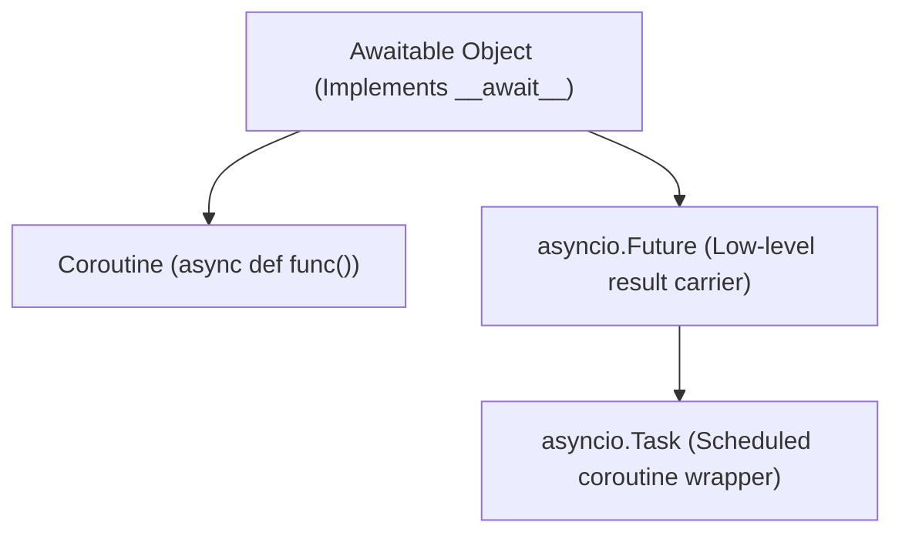

# AsyncIO Fundamentals: Coroutines, Event Loop, and the Await Protocol

Python’s **`asyncio` module** (PEP 342, PEP 492) delivers high-concurrency, single-threaded cooperative multitasking. Unlike operating system threads which are preempted unpredictably by the kernel scheduler, `asyncio` coroutines execute cooperatively on a single thread, yielding control voluntarily only at explicit **`await`** expression boundaries.

By eliminating OS thread stacks, kernel privilege boundaries, and synchronization locks on simple memory state, `asyncio` allows a single Python process to service 50,000 to 100,000+ concurrent network connections with minimal memory overhead.

---

## Table of Contents

1. [What & Why](#what--why)
2. [Core Concepts & Mental Model](#core-concepts--mental-model)
3. [The `__await__` Protocol: What Can Be Awaited?](#the-__await__-protocol-what-can-be-awaited)
4. [How It Works Internally: The Event Loop & I/O Multiplexing](#how-it-works-internally-the-event-loop--io-multiplexing)
5. [Syntax & API Reference](#syntax--api-reference)
6. [Code Examples](#code-examples)
7. [Edge Cases, Pitfalls & Anti-Patterns](#edge-cases-pitfalls--anti-patterns)
8. [Performance & Memory Characteristics](#performance--memory-characteristics)
9. [CPython Internals & Bytecode](#cpython-internals--bytecode)
10. [Best Practices & Idiomatic Patterns](#best-practices--idiomatic-patterns)
11. [Real-World Case Study: High-Concurrency Real-Time Financial Ticker Relay](#real-world-case-study-high-concurrency-real-time-financial-ticker-relay)
12. [Interview Questions & Deep-Dive Scenarios](#interview-questions--deep-dive-scenarios)
13. [Practical Exercises & Code Katas](#practical-exercises--code-katas)

---

## What & Why

In a traditional multi-threaded server:
- 10,000 connected clients require 10,000 operating system threads.
- 10,000 threads $\times$ 8 MB stack allocation $\approx$ **80 GB of virtual memory**.
- The CPU spends substantial time thrashing kernel thread schedulers and invalidating CPU caches.

`asyncio` changes the paradigm:
- A single OS thread runs an **event loop** listening to OS socket events via native multiplexers (`epoll` on Linux, `kqueue` on macOS, `IOCP` on Windows).
- Each connection is represented by a **coroutine frame** consuming only ~1 to 2 KB of heap RAM.
- 10,000 connections require **< 50 MB of RAM** and zero kernel context-switching overhead.

---

## Core Concepts & Mental Model

### The Cooperative Execution Flow

```mermaid
sequenceDiagram
    autonumber
    participant Loop as AsyncIO Event Loop
    participant CoroA as Coroutine A (Socket Read)
    participant CoroB as Coroutine B (JSON Parse)
    participant OS as OS Kernel (epoll/kqueue)

    Loop->>CoroA: Resumes Coroutine A
    CoroA->>OS: Initiates non-blocking socket read
    CoroA-->>Loop: 'await' yields control back to Loop
    Note over CoroA: Coroutine A paused; waits for OS socket ready
    
    Loop->>CoroB: Resumes Coroutine B
    CoroB->>CoroB: Performs compute work
    CoroB-->>Loop: 'await asyncio.sleep(0.01)' yields control
    
    OS-->>Loop: Socket readable event triggered!
    Loop->>CoroA: Resumes Coroutine A with incoming socket bytes!
```

---

## The `__await__` Protocol: What Can Be Awaited?

An expression `await obj` is syntactically valid if and only if `obj` is an **awaitable** object. Under PEP 492, an object is awaitable if it implements the `__await__()` method, which must return an iterator.

There are three primary categories of awaitables in Python:
1. **Coroutines**: An instance returned by invoking an `async def` function.
2. **Tasks (`asyncio.Task`)**: A subclass of `Future` that wraps a coroutine and schedules its execution on the event loop.
3. **Futures (`asyncio.Future`)**: A low-level object representing an eventual result produced by an asynchronous operation (e.g. callback-based I/O).



---

## How It Works Internally: The Event Loop & I/O Multiplexing

The event loop operates as an infinite state machine loop:
1. **Timer Evaluation**: Inspects scheduled timers (`call_later`, `call_at`) and moves expired callbacks to the ready queue.
2. **I/O Polling**: Calls the OS multiplexer (`selectors.select(timeout)`) with registered file descriptors.
3. **Task Execution**: Iterates through the FIFO ready queue, advancing each coroutine until it returns or hits another `await`.
4. **Repeat**: If no tasks are ready, the thread sleeps in the OS kernel until the next timer or I/O interrupt occurs.

---

## Syntax & API Reference

### 1. Modern Execution Entrypoint

```python
import asyncio

async def main() -> None:
    print("Application running")

# Canonical top-level entrypoint (Python 3.7+):
asyncio.run(main())
```

### 2. Timeouts with `asyncio.timeout` (Python 3.11+)

```python
# Modern clean context manager timeout:
try:
    async with asyncio.timeout(2.5):
        data = await fetch_remote_resource()
except TimeoutError:
    print("Operation exceeded 2.5s timeout")
```

### 3. Task Shielding Against Cancellation

```python
# Shields critical database write from being aborted if parent is cancelled:
await asyncio.shield(critical_database_commit())
```

---

## Code Examples

### Example 1: Coroutine Definition and Await Chaining

```python
import asyncio
import time

async def fetch_temperature(sensor_id: str) -> float:
    print(f"[Sensor {sensor_id}] Querying hardware...")
    # Non-blocking async sleep simulates I/O bus delay:
    await asyncio.sleep(0.02)
    return 23.5

async def aggregate_telemetry() -> dict[str, float]:
    # Awaiting sequential coroutines
    t1 = await fetch_temperature("TEMP_01")
    t2 = await fetch_temperature("TEMP_02")
    return {"TEMP_01": t1, "TEMP_02": t2}

async def main() -> None:
    t0 = time.perf_counter()
    results = await aggregate_telemetry()
    elapsed = (time.perf_counter() - t0) * 1000
    print(f"Telemetry collected in {elapsed:.1f}ms: {results}")

asyncio.run(main())
# Output:
# [Sensor TEMP_01] Querying hardware...
# [Sensor TEMP_02] Querying hardware...
# Telemetry collected in ...ms: {'TEMP_01': 23.5, 'TEMP_02': 23.5}
```

### Example 2: Modern Timeout Management with `asyncio.timeout` (Python 3.11+)

```python
import asyncio

async def slow_upstream_service() -> str:
    await asyncio.sleep(0.5)
    return "SUCCESS_DATA"

async def execute_query_with_sla() -> None:
    try:
        # Enforces a strict 0.05-second deadline:
        async with asyncio.timeout(0.05):
            res = await slow_upstream_service()
            print("Received:", res)
    except TimeoutError:
        print("[SLA BREACH] Upstream service failed to respond within 50ms!")

asyncio.run(execute_query_with_sla())
# Output:
# [SLA BREACH] Upstream service failed to respond within 50ms!
```

### Example 3: Task Cancellation and Cleanup Handling

When an async task is cancelled, an `asyncio.CancelledError` exception is injected into the suspended coroutine at its current `await` point:

```python
import asyncio

async def persistent_heartbeat() -> None:
    try:
        while True:
            print("[Heartbeat] Ping...")
            await asyncio.sleep(0.02)
    except asyncio.CancelledError:
        print("[Heartbeat] Cancellation signal received! Flushing state...")
        # Perform asynchronous or synchronous cleanup
        await asyncio.sleep(0.01)
        print("[Heartbeat] Cleanup complete. Re-raising CancelledError.")
        raise  # Must re-raise CancelledError to acknowledge cancellation!

async def main() -> None:
    task = asyncio.create_task(persistent_heartbeat())
    await asyncio.sleep(0.05)
    
    print("[Main] Cancelling heartbeat task...")
    task.cancel()
    
    try:
        await task
    except asyncio.CancelledError:
        print("[Main] Task acknowledged cancellation cleanly.")

asyncio.run(main())
# Output:
# [Heartbeat] Ping...
# [Heartbeat] Ping...
# [Heartbeat] Ping...
# [Main] Cancelling heartbeat task...
# [Heartbeat] Cancellation signal received! Flushing state...
# [Heartbeat] Cleanup complete. Re-raising CancelledError.
# [Main] Task acknowledged cancellation cleanly.
```

### Example 4: Custom Awaitable Class via the `__await__` Protocol

```python
import asyncio
from collections.abc import Generator
from typing import Any

class CountdownAwaitable:
    """Custom class implementing the low-level __await__ protocol."""
    
    def __init__(self, steps: int) -> None:
        self.steps = steps

    def __await__(self) -> Generator[Any, None, str]:
        for i in range(self.steps, 0, -1):
            print(f"Countdown: {i}...")
            # Yielding a Future or None suspends execution back to the loop:
            yield
        return "BLAST OFF!"

async def launch_rocket() -> None:
    countdown = CountdownAwaitable(3)
    result = await countdown
    print(result)

asyncio.run(launch_rocket())
# Output:
# Countdown: 3...
# Countdown: 2...
# Countdown: 1...
# BLAST OFF!
```

### Example 5: Non-Blocking Event Scheduling with `loop.call_later`

```python
import asyncio

def callback_heartbeat(message: str) -> None:
    print(f"[Callback] Triggered: {message}")

async def main() -> None:
    loop = asyncio.get_running_loop()
    
    # Schedule synchronous callbacks directly on the event loop:
    loop.call_later(0.02, callback_heartbeat, "Ping 1")
    loop.call_later(0.04, callback_heartbeat, "Ping 2")
    
    print("[Main] Callbacks registered. Waiting for loop ticks...")
    await asyncio.sleep(0.05)
    print("[Main] Done.")

asyncio.run(main())
# Output:
# [Main] Callbacks registered. Waiting for loop ticks...
# [Callback] Triggered: Ping 1
# [Callback] Triggered: Ping 2
# [Main] Done.
```

---

## Edge Cases, Pitfalls & Anti-Patterns

### Common Mistakes Table

| Mistake | Bad Code | Correct Idiom | Why It Fails |
|:---|:---|:---|:---|
| **Calling an async function without `await`** | `fetch_data()` | `await fetch_data()` or `create_task()` | Returns an unexecuted coroutine object; raises `RuntimeWarning: coroutine was never awaited`. |
| **Executing blocking synchronous code inside coroutine** | `time.sleep(2)` or `requests.get(url)` | `await asyncio.sleep(2)` or `asyncio.to_thread()` | Blocks the single thread running the event loop, freezing all other concurrent tasks! |
| **Swallowing `CancelledError` silently** | `except asyncio.CancelledError: pass` | Clean up and **re-raise** `CancelledError` | Breaks structured concurrency; task appears alive to parent monitors. |
| **Using `asyncio.get_event_loop()` in Python 3.10+** | `loop = asyncio.get_event_loop()` | `loop = asyncio.get_running_loop()` | Legacy method creates unintended loops and is deprecated in modern Python. |
| **Calling `asyncio.run()` inside an already-running loop** | Calling `asyncio.run()` in FastAPI or Jupyter | Use `await coro` or `create_task()` | Raises `RuntimeError: asyncio.run() cannot be called from a running event loop`. |
| **Creating background tasks without keeping references** | `asyncio.create_task(background_job())` | Store task reference in a `set` | CPython Garbage Collector can prematurely collect the task while running! |

---

## Performance & Memory Characteristics

### AsyncIO vs Threading Memory Footprint

| Metric | AsyncIO Coroutines | OS Threads (`threading`) |
|:---|:---|:---|
| **Memory per Unit** | **~1 - 2 KB** (Heap frame) | **~8 MB** (Virtual OS stack) |
| **10,000 Concurrent Units** | **~20 MB RAM** | **~80 GB Virtual RAM** (OOM Crash) |
| **Context Switch Cost** | **~50 - 100 ns** (Python user space) | **~1 - 3 µs** (Kernel privilege switch) |
| **Optimal Concurrency Range** | 1,000 to 100,000+ connections | 10 to 500 threads |

AsyncIO's context switch occurs entirely within the Python interpreter's runtime heap without invoking kernel interrupts, yielding **30x faster context-switching** than OS threads.

---

## CPython Internals & Bytecode

### How the Python Compiler Translates `await`

Let us inspect the bytecode of an asynchronous function using `dis`:

```python
import dis

async def fetch_number() -> int:
    await asyncio.sleep(0.01)
    return 42

print("Bytecode Disassembly of Coroutine:")
dis.dis(fetch_number)
```

Output:
```text
  1           0 RESUME                   0
  2           2 LOAD_GLOBAL              1 (asyncio)
              4 LOAD_ATTR                2 (sleep)
             14 LOAD_CONST               1 (0.01)
             16 CALL                     1
             24 GET_AWAITABLE            0
             26 LOAD_CONST               0 (None)
             28 SEND                     3
             30 YIELD_VALUE              0
             32 RESUME                   1
             ...
  3          42 LOAD_CONST               2 (42)
             44 RETURN_VALUE
```

Notice the critical instructions:
- **`GET_AWAITABLE`**: Checks if the object satisfies the awaitable protocol.
- **`SEND`** & **`YIELD_VALUE`**: Suspends the coroutine frame and yields execution control back to the event loop.
- **`RESUME`**: Wakes the coroutine up when the event loop resumes it with incoming data!

---

## Best Practices & Idiomatic Patterns

1. **Always Use `asyncio.run(main())` as the Top-Level Entrypoint**: Initializes a fresh event loop, executes the coroutine, cancels lingering tasks, and closes the loop cleanly.
2. **Never Call Blocking Functions on the Event Loop Thread**: If you must call synchronous libraries (e.g. `PIL`, `sqlite3`), offload them via `await asyncio.to_thread(func)`.
3. **Always Re-Raise `asyncio.CancelledError`**: Ensure proper cooperative task cancellation propagation.
4. **Prefer `async with asyncio.timeout(...)` (Python 3.11+)**: Safer and more readable than legacy `asyncio.wait_for`.

---

## Real-World Case Study: High-Concurrency Real-Time Financial Ticker Relay

Below is a production WebSocket-style market telemetry relay capable of multicasting live cryptocurrency ticks to thousands of subscribers over asynchronous queues:

```python
import asyncio
import time
import random
from dataclasses import dataclass

@dataclass(frozen=True)
class PriceTick:
    symbol: str
    price: float
    timestamp: float

class MarketDataRelay:
    """Async market data broadcaster relaying ticks to concurrent subscribers."""

    def __init__(self) -> None:
        self._subscribers: set[asyncio.Queue[PriceTick]] = set()
        self._running = False

    def subscribe(self) -> asyncio.Queue[PriceTick]:
        q: asyncio.Queue[PriceTick] = asyncio.Queue(maxsize=100)
        self._subscribers.add(q)
        return q

    def unsubscribe(self, q: asyncio.Queue[PriceTick]) -> None:
        self._subscribers.discard(q)

    async def broadcast_loop(self) -> None:
        self._running = True
        symbols = ["BTC-USD", "ETH-USD", "SOL-USD"]
        print("[Relay] Market broadcast engine started.")
        
        while self._running:
            # Simulate real-time market exchange tick arrival
            await asyncio.sleep(0.01)
            tick = PriceTick(
                symbol=random.choice(symbols),
                price=round(random.uniform(100.0, 60000.0), 2),
                timestamp=time.time()
            )
            
            # Fan out tick to all active subscriber queues:
            for q in list(self._subscribers):
                try:
                    q.put_nowait(tick)
                except asyncio.QueueFull:
                    # Drop slow consumer to protect memory
                    pass

    def stop(self) -> None:
        self._running = False

async def client_consumer(client_id: str, queue: asyncio.Queue[PriceTick], max_ticks: int) -> None:
    ticks_received = 0
    while ticks_received < max_ticks:
        # Non-blocking await on queue:
        tick = await queue.get()
        ticks_received += 1
        queue.task_done()
    print(f"[{client_id}] Successfully received {ticks_received} live ticks. Disconnecting.")

async def main() -> None:
    relay = MarketDataRelay()
    broadcaster_task = asyncio.create_task(relay.broadcast_loop())

    # Create 3 concurrent subscriber clients:
    q1 = relay.subscribe()
    q2 = relay.subscribe()
    q3 = relay.subscribe()

    await asyncio.gather(
        client_consumer("Client-Alpha", q1, max_ticks=3),
        client_consumer("Client-Beta", q2, max_ticks=3),
        client_consumer("Client-Gamma", q3, max_ticks=3),
    )

    relay.stop()
    broadcaster_task.cancel()
    try:
        await broadcaster_task
    except asyncio.CancelledError:
        pass
    print("[Main] Market relay simulation completed cleanly.")

asyncio.run(main())
# Output:
# [Relay] Market broadcast engine started.
# [Client-Alpha] Successfully received 3 live ticks. Disconnecting.
# [Client-Beta] Successfully received 3 live ticks. Disconnecting.
# [Client-Gamma] Successfully received 3 live ticks. Disconnecting.
# [Main] Market relay simulation completed cleanly.
```

---

## Interview Questions & Deep-Dive Scenarios

<details>
<summary>1. What is the fundamental difference between an `async def` coroutine and a standard generator?</summary>

Both rely on the Python frame evaluation mechanism to suspend and resume execution. However:
- A generator (`yield`) is designed to produce a stream of values lazily across iterative loops.
- A coroutine (`async def` / `await`) is designed to yield control back to an event loop while awaiting I/O operations, optionally returning a final return value via `StopIteration.value`.
Python internally enforces that `await` can only be called inside `async def` coroutines, and generators cannot be awaited directly without explicit wrappers.
</details>

<details>
<summary>2. Why does calling a coroutine function (e.g. `foo()`) not immediately execute its code?</summary>

Calling an `async def` function does not run the function body; instead, it compiles and returns an **unstarted coroutine object**. The code inside the function will only execute when the coroutine is explicitly scheduled on an active event loop using `await foo()`, `asyncio.create_task(foo())`, or `asyncio.run(foo())`.
</details>

<details>
<summary>3. What happens if you call `requests.get()` inside an `async def` function?</summary>

`requests.get()` is a synchronous, blocking network call. It blocks the operating system thread running the event loop. While that HTTP request is waiting for remote packets, the event loop cannot tick, meaning **every other concurrent coroutine, timer, WebSocket, and connection in the entire process is completely frozen** until `requests.get()` finishes.
</details>

<details>
<summary>4. How does `asyncio.to_thread()` solve the blocking synchronous call problem?</summary>

Introduced in Python 3.9, `asyncio.to_thread(func, *args)` offloads the blocking synchronous function to an internal background `ThreadPoolExecutor`. It returns a coroutine that can be awaited cleanly on the event loop, freeing the event loop thread to continue processing concurrent tasks while the blocking I/O completes in the background thread.
</details>

<details>
<summary>5. What is `asyncio.shield()` and what are its limitations?</summary>

`asyncio.shield(coro)` protects an awaitable from being cancelled when its parent task is cancelled. If the parent task receives a cancellation signal, the outer shield raises `CancelledError`, but the underlying shielded coroutine continues running to completion.
**Limitation**: If the shielded coroutine itself is cancelled directly (or the entire event loop shuts down), it will still be cancelled.
</details>

<details>
<summary>6. Why was `asyncio.get_event_loop()` deprecated in Python 3.10?</summary>

Historically, `asyncio.get_event_loop()` implicitly created a new event loop if none was set on the current thread, creating unpredictable behavior and silent leaks. In Python 3.10+, `asyncio.get_running_loop()` is the standard, strictly failing with a `RuntimeError` if called when no event loop is active.
</details>

<details>
<summary>7. What happens if a coroutine catches `asyncio.CancelledError` and refuses to re-raise it?</summary>

If a coroutine catches `CancelledError` and does not re-raise it (e.g. returns a normal value), the task signals to the event loop that it successfully completed instead of cancelling. While occasionally used for specific graceful recovery logic, doing this carelessly violates cooperative multitasking and prevents structured concurrency orchestrators from terminating tasks.
</details>

<details>
<summary>8. How does `asyncio.timeout` in Python 3.11 differ from `asyncio.wait_for`?</summary>

`asyncio.wait_for(coro, timeout)` always creates an intermediate wrapper `Task`, adding allocation overhead and occasionally creating subtle cancellation race conditions.
`asyncio.timeout(delay)` is an asynchronous context manager that integrates directly with the event loop's timer heap without wrapping the code block in an extra task, resulting in cleaner semantics and higher performance.
</details>

---

## Practical Exercises & Code Katas

### Exercise 1: Async Poller with Timeout
Implement an async function `poll_until_ready(check_fn, timeout_sec)` that polls every 0.05 seconds until `check_fn()` returns True or the timeout expires.

<details>
<summary>Solution</summary>

```python
import asyncio
from collections.abc import Callable

async def poll_until_ready(check_fn: Callable[[], bool], timeout_sec: float) -> bool:
    try:
        async with asyncio.timeout(timeout_sec):
            while not check_fn():
                await asyncio.sleep(0.02)
            return True
    except TimeoutError:
        return False

# Verification
ready = False
def mock_check() -> bool: return ready

async def trigger_ready():
    global ready
    await asyncio.sleep(0.04)
    ready = True

async def main():
    asyncio.create_task(trigger_ready())
    success = await poll_until_ready(mock_check, 0.1)
    print("Polled successfully?", success)

asyncio.run(main())
# Output: Polled successfully? True
```
</details>

### Exercise 2: Safe Async Blocking Wrapper
Write a generic decorator `@make_async` that converts any blocking synchronous function into an awaitable coroutine using `asyncio.to_thread`.

<details>
<summary>Solution</summary>

```python
import asyncio
from functools import wraps
from typing import Callable, Coroutine, Any

def make_async[**P, R](func: Callable[P, R]) -> Callable[P, Coroutine[Any, Any, R]]:
    @wraps(func)
    async def wrapper(*args: P.args, **kwargs: P.kwargs) -> R:
        return await asyncio.to_thread(func, *args, **kwargs)
    return wrapper

@make_async
def synchronous_hash(data: str) -> str:
    import time
    time.sleep(0.02)
    return f"HASH_{data}"

async def main():
    h = await synchronous_hash("payload_101")
    print("Computed hash asynchronously:", h)

asyncio.run(main())
```
</details>

### Exercise 3: Resilient Coroutine with Automatic Retry
Write an async function `fetch_with_retries(coro_fn, max_retries=3, delay=0.01)` that retries on exceptions up to `max_retries` times.

<details>
<summary>Solution</summary>

```python
import asyncio
from collections.abc import Callable, Coroutine

async def fetch_with_retries[T](
    coro_fn: Callable[[], Coroutine[object, object, T]],
    max_retries: int = 3,
    delay: float = 0.01
) -> T:
    attempts = 0
    while True:
        try:
            attempts += 1
            return await coro_fn()
        except Exception as exc:
            if attempts >= max_retries:
                raise
            print(f"[Retry {attempts}/{max_retries}] Caught: {exc}. Retrying...")
            await asyncio.sleep(delay)

count = 0
async def unstable_network():
    global count
    count += 1
    if count < 3:
        raise ConnectionError("Network blip")
    return "SUCCESS"

async def main():
    res = await fetch_with_retries(unstable_network)
    print("Final result:", res)

asyncio.run(main())
# Output:
# [Retry 1/3] Caught: Network blip. Retrying...
# [Retry 2/3] Caught: Network blip. Retrying...
# Final result: SUCCESS
```
</details>

### Exercise 4: Shielded Audit Logging
Demonstrate using `asyncio.shield()` so that when an outer operation times out, a critical database write operation completes uninterrupted.

<details>
<summary>Solution</summary>

```python
import asyncio

async def critical_audit_log(entry: str) -> None:
    print(f"[Audit] Saving: '{entry}'...")
    await asyncio.sleep(0.03)  # Takes 30ms
    print(f"[Audit] Saved '{entry}' successfully!")

async def outer_operation() -> None:
    try:
        async with asyncio.timeout(0.01):  # Fails after 10ms!
            # Shielding guarantees critical_audit_log completes even when outer times out:
            await asyncio.shield(critical_audit_log("User created"))
    except TimeoutError:
        print("[Outer] Operation timed out as expected.")

async def main():
    await outer_operation()
    # Allow event loop to let shielded background task conclude:
    await asyncio.sleep(0.04)

asyncio.run(main())
# Output:
# [Audit] Saving: 'User created'...
# [Outer] Operation timed out as expected.
# [Audit] Saved 'User created' successfully!
```
</details>

### Exercise 5: Periodic Async Ticker Task
Create a reusable async background ticker class that calls an async callback every $N$ milliseconds until stopped.

<details>
<summary>Solution</summary>

```python
import asyncio
from collections.abc import Callable, Coroutine

class AsyncTicker:
    def __init__(self, interval: float, callback: Callable[[], Coroutine[object, object, None]]) -> None:
        self.interval = interval
        self.callback = callback
        self._task: asyncio.Task | None = None

    def start(self) -> None:
        self._task = asyncio.create_task(self._run())

    async def _run(self) -> None:
        try:
            while True:
                await self.callback()
                await asyncio.sleep(self.interval)
        except asyncio.CancelledError:
            pass

    async def stop(self) -> None:
        if self._task:
            self._task.cancel()
            try:
                await self._task
            except asyncio.CancelledError:
                pass

async def main():
    ticks = 0
    async def on_tick():
        nonlocal ticks
        ticks += 1
        print(f"Tick #{ticks}")

    ticker = AsyncTicker(0.02, on_tick)
    ticker.start()
    await asyncio.sleep(0.07)
    await ticker.stop()
    print("Ticker stopped.")

asyncio.run(main())
```
</details>

### Exercise 6: Verifying Non-Blocking Concurrency
Verify that 5 concurrent 20ms sleeps execute in ~20ms total rather than 100ms using `asyncio.gather`.

<details>
<summary>Solution</summary>

```python
import asyncio
import time

async def worker(idx: int):
    await asyncio.sleep(0.02)
    return idx

async def main():
    t0 = time.perf_counter()
    results = await asyncio.gather(*(worker(i) for i in range(5)))
    elapsed = time.perf_counter() - t0
    print(f"5 tasks finished in {elapsed*1000:.1f}ms (Parallel verification passed!)")
    assert elapsed < 0.05

asyncio.run(main())
# Output: 5 tasks finished in ~20ms (Parallel verification passed!)
```
</details>
