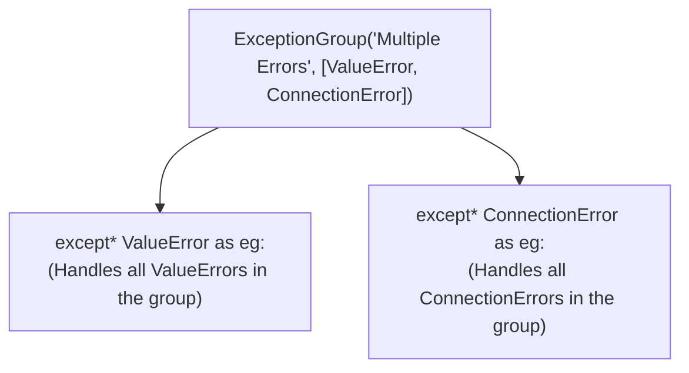

# AsyncIO Tasks, TaskGroups, and Structured Concurrency (PEP 654)

For years, asynchronous programming in Python was dominated by **unstructured concurrency**: tasks were spawned with `asyncio.create_task()`, scattered across the codebase, and aggregated with `asyncio.gather()`. If one task failed or crashed, its siblings continued running as orphaned, leaked background tasks consuming memory and sockets.

Python 3.11 revolutionized async architecture by introducing **Structured Concurrency** via **`asyncio.TaskGroup`** and **`ExceptionGroup`** (PEP 654). Under structured concurrency, concurrent tasks have well-defined lifecycles bounded by lexical context scopes: tasks are guaranteed to never leak beyond their enclosing context block, and errors in any sibling automatically cancel all remaining tasks.

---

## Table of Contents

1. [What & Why](#what--why)
2. [Unstructured vs Structured Concurrency](#unstructured-vs-structured-concurrency)
3. [The `TaskGroup` Invariant & Cancellation Cascading](#the-taskgroup-invariant--cancellation-cascading)
4. [ExceptionGroup and the `except*` Syntax (PEP 654)](#exceptiongroup-and-the-except-syntax-pep-654)
5. [Syntax & API Reference](#syntax--api-reference)
6. [Code Examples](#code-examples)
7. [Edge Cases, Pitfalls & Anti-Patterns](#edge-cases-pitfalls--anti-patterns)
8. [Performance & Memory Characteristics](#performance--memory-characteristics)
9. [CPython Internals & Bytecode](#cpython-internals--bytecode)
10. [Best Practices & Idiomatic Patterns](#best-practices--idiomatic-patterns)
11. [Real-World Case Study: Resilient Distributed E-Commerce Order Fulfillment Pipeline](#real-world-case-study-resilient-distributed-e-commerce-order-fulfillment-pipeline)
12. [Interview Questions & Deep-Dive Scenarios](#interview-questions--deep-dive-scenarios)
13. [Practical Exercises & Code Katas](#practical-exercises--code-katas)

---

## What & Why

In concurrent programming, the **goto problem** of concurrency is "fire-and-forget" background tasks:
```python
# Unstructured: Spawns a background task with no lifetime boundaries
asyncio.create_task(process_telemetry())
```

If the parent function exits, raises an error, or times out, `process_telemetry()` keeps running indefinitely in the background:
- Leaking open database sockets and HTTP connections.
- Corrupting shared state by writing updates for requests that already timed out.
- Crashing silently when uncaught exceptions occur.

**Structured Concurrency** guarantees that **concurrent control flow mirrors lexical code scope**:
1. A parent task cannot exit until all its child tasks have finished.
2. If any child task raises an exception, all other sibling tasks are immediately cancelled.
3. Multiple concurrent exceptions are collected and raised together in an `ExceptionGroup`.

---

## Unstructured vs Structured Concurrency

```mermaid
graph TD
    subgraph Unstructured Concurrency (asyncio.gather / create_task)
        ParentA["Parent Function"] -->|Spawns| Task1["Task 1 (Fails!)"]
        ParentA -->|Spawns| Task2["Task 2 (Still running in background - LEAK!)"]
        ParentA -->|Spawns| Task3["Task 3 (Still running in background - LEAK!)"]
    end

    subgraph Structured Concurrency (asyncio.TaskGroup)
        TG["async with asyncio.TaskGroup() as tg:"]
        TG -->|tg.create_task| C1["Task 1 (Fails!)"]
        TG -->|tg.create_task| C2["Task 2 (Automatically Cancelled!)"]
        TG -->|tg.create_task| C3["Task 3 (Automatically Cancelled!)"]
        C1 & C2 & C3 -.-> Boundary["Context block awaits ALL tasks before exiting!"]
    end
```

---

## The `TaskGroup` Invariant & Cancellation Cascading

When entering `async with asyncio.TaskGroup() as tg:`:
1. `tg.create_task(coro)` schedules child tasks on the event loop.
2. When the code block reaches `__aexit__()`, the parent task pauses until **all** child tasks complete.
3. If **any** child task raises an uncaught exception:
   - The TaskGroup immediately calls `.cancel()` on all other active sibling tasks.
   - It waits for all siblings to finish handling cancellation.
   - It bundles all exceptions into an `ExceptionGroup` and raises it to the caller.

---

## ExceptionGroup and the `except*` Syntax (PEP 654)

Because multiple concurrent tasks can fail simultaneously, Python 3.11 introduced `ExceptionGroup` and the `except*` pattern matching syntax:



Unlike traditional `except`, `except*` matches and extracts subsets of exceptions from the group, allowing multiple `except*` blocks to execute for a single compound failure!

---

## Syntax & API Reference

### 1. Modern Structured Concurrency with `TaskGroup`

```python
import asyncio

async def main() -> None:
    async with asyncio.TaskGroup() as tg:
        task1 = tg.create_task(fetch_data("https://api.a"))
        task2 = tg.create_task(fetch_data("https://api.b"))
    # Guaranteed: both task1 and task2 have completed here!
    print(task1.result(), task2.result())
```

### 2. Handling Multi-Exceptions with `except*`

```python
try:
    async with asyncio.TaskGroup() as tg:
        tg.create_task(failing_task_1())
        tg.create_task(failing_task_2())
except* ValueError as eg:
    for exc in eg.exceptions:
        print(f"Caught ValueError: {exc}")
except* ConnectionError as eg:
    for exc in eg.exceptions:
        print(f"Caught Network Error: {exc}")
```

### 3. Comparing with `asyncio.gather`

| Feature | `asyncio.TaskGroup` (Python 3.11+) | `asyncio.gather` |
|:---|:---|:---|
| **Paradigm** | **Structured Concurrency** | Unstructured aggregation |
| **Sibling Cancellation on Error**| **Automatic** (Immediate cancellation) | **No** (Siblings keep running uncancelled) |
| **Exception Handling** | Native `ExceptionGroup` / `except*` | Raises only the first error; masks others |
| **Context Scope Guarantee** | Cannot leak tasks outside block | Can leak if calling scope is aborted |
| **Recommended Use** | **Default for all modern Python 3.11+** | Legacy codebases / Python $\le$ 3.10 |

---

## Code Examples

### Example 1: Basic TaskGroup Execution

```python
import asyncio
import time

async def worker(worker_id: int, delay: float) -> str:
    print(f"[Worker {worker_id}] Starting (delay={delay}s)...")
    await asyncio.sleep(delay)
    print(f"[Worker {worker_id}] Finished.")
    return f"Result-{worker_id}"

async def main() -> None:
    t0 = time.perf_counter()
    
    async with asyncio.TaskGroup() as tg:
        t1 = tg.create_task(worker(1, 0.04))
        t2 = tg.create_task(worker(2, 0.02))
        t3 = tg.create_task(worker(3, 0.03))

    # All tasks are guaranteed done when exiting context manager!
    elapsed = (time.perf_counter() - t0) * 1000
    print(f"All workers finished in {elapsed:.1f}ms:")
    print(f" - {t1.result()}")
    print(f" - {t2.result()}")
    print(f" - {t3.result()}")

asyncio.run(main())
# Output:
# [Worker 1] Starting (delay=0.04s)...
# [Worker 2] Starting (delay=0.02s)...
# [Worker 3] Starting (delay=0.03s)...
# [Worker 2] Finished.
# [Worker 3] Finished.
# [Worker 1] Finished.
# All workers finished in ~40ms:
#  - Result-1
#  - Result-2
#  - Result-3
```

### Example 2: Automatic Sibling Cancellation on Error

Observe how a failure in `faulty_task` immediately cancels `long_running_task`:

```python
import asyncio

async def faulty_task() -> None:
    await asyncio.sleep(0.01)
    print("[FaultyTask] Raising intentional error!")
    raise ValueError("Invalid user input payload")

async def long_running_task() -> None:
    try:
        print("[LongTask] Started. Will run for 10 seconds...")
        await asyncio.sleep(10.0)
        print("[LongTask] Finished (SHOULD NEVER PRINT!).")
    except asyncio.CancelledError:
        print("[LongTask] Sibling failed! Cancellation received. Exiting safely.")
        raise

async def main() -> None:
    try:
        async with asyncio.TaskGroup() as tg:
            tg.create_task(long_running_task())
            tg.create_task(faulty_task())
    except* ValueError as eg:
        print(f"[Main] Caught expected ExceptionGroup: {eg.exceptions[0]}")

asyncio.run(main())
# Output:
# [LongTask] Started. Will run for 10 seconds...
# [FaultyTask] Raising intentional error!
# [LongTask] Sibling failed! Cancellation received. Exiting safely.
# [Main] Caught expected ExceptionGroup: Invalid user input payload
```

### Example 3: Handling Multiple Simultaneous Exceptions with `except*`

```python
import asyncio

async def fail_with_value_error():
    await asyncio.sleep(0.01)
    raise ValueError("Code 400: Malformed ID")

async def fail_with_connection_error():
    await asyncio.sleep(0.01)
    raise ConnectionResetError("Code 503: Database reset")

async def main():
    try:
        async with asyncio.TaskGroup() as tg:
            tg.create_task(fail_with_value_error())
            tg.create_task(fail_with_connection_error())
    except* ValueError as eg:
        print(f"Handling ValueErrors ({len(eg.exceptions)}): {eg.exceptions}")
    except* ConnectionResetError as eg:
        print(f"Handling NetworkErrors ({len(eg.exceptions)}): {eg.exceptions}")

asyncio.run(main())
# Output:
# Handling ValueErrors (1): (ValueError('Code 400: Malformed ID'),)
# Handling NetworkErrors (1): (ConnectionResetError('Code 503: Database reset'),)
```

### Example 4: Preventing Garbage Collection of Background Fire-and-Forget Tasks

When you genuinely must create background tasks with `asyncio.create_task()`, the CPython garbage collector can prematurely reap tasks if no strong reference is maintained:

```python
import asyncio

# Global strong reference set
background_tasks: set[asyncio.Task[None]] = set()

async def background_telemetry(data: str) -> None:
    await asyncio.sleep(0.02)
    print(f"[Telemetry] Successfully shipped: {data}")

def fire_and_forget_telemetry(payload: str) -> None:
    task = asyncio.create_task(background_telemetry(payload))
    # 1. Add strong reference to prevent GC collection:
    background_tasks.add(task)
    # 2. Automatically remove reference when finished:
    task.add_done_callback(background_tasks.discard)

async def main() -> None:
    fire_and_forget_telemetry("metric_cpu_load=42")
    fire_and_forget_telemetry("metric_ram_used=78")
    
    print(f"Active background tasks retained: {len(background_tasks)}")
    await asyncio.sleep(0.05)
    print(f"Active background tasks after completion: {len(background_tasks)}")

asyncio.run(main())
# Output:
# Active background tasks retained: 2
# [Telemetry] Successfully shipped: metric_cpu_load=42
# [Telemetry] Successfully shipped: metric_ram_used=78
# Active background tasks after completion: 0
```

### Example 5: `asyncio.as_completed` for Real-Time Streaming Results

```python
import asyncio
import time

async def fetch_price(exchange: str, delay: float) -> tuple[str, float]:
    await asyncio.sleep(delay)
    return exchange, round(100.0 + delay * 100, 2)

async def main() -> None:
    tasks = [
        fetch_price("Binance", 0.04),
        fetch_price("Coinbase", 0.01),
        fetch_price("Kraken", 0.02),
    ]

    print("Fetching exchange prices as they arrive:")
    for coro in asyncio.as_completed(tasks):
        exchange, price = await coro
        print(f" -> {exchange}: ${price:.2f}")

asyncio.run(main())
# Output:
# Fetching exchange prices as they arrive:
#  -> Coinbase: $101.00
#  -> Kraken: $102.00
#  -> Binance: $104.00
```

---

## Edge Cases, Pitfalls & Anti-Patterns

### Common Mistakes Table

| Mistake | Bad Code | Correct Idiom | Why It Fails |
|:---|:---|:---|:---|
| **Using `except Exception` with `TaskGroup`** | `except Exception as e:` wrapping a TaskGroup | Use `except* ExceptionType:` | `TaskGroup` raises `ExceptionGroup`, which does not unpack into individual exceptions. |
| **Awaiting tasks inside `TaskGroup` block** | `async with TaskGroup() as tg: await tg.create_task(...)` | Do not `await` inside; let `TaskGroup` await on exit | Defeats concurrency; executes tasks sequentially instead of in parallel. |
| **Catching `CancelledError` without re-raising in siblings** | `except asyncio.CancelledError: pass` | Always re-raise `CancelledError` | Prevents the TaskGroup from knowing that the child task acknowledged cancellation. |
| **Relying on `asyncio.gather` for failure isolation** | Using `gather` when siblings must be cancelled on error | Use `asyncio.TaskGroup` | With `gather`, failing tasks leave remaining siblings running in the background. |
| **Calling `tg.create_task()` outside the context block** | Passing `tg` to an outside callback | Only call `create_task()` while block is active | Raises `RuntimeError: TaskGroup is not active`. |
| **Not retaining strong references for `create_task`** | `asyncio.create_task(f())` without saving reference | Store task in a collection with `add_done_callback(set.discard)` | CPython Garbage Collector can destroy the running task midway through execution! |

---

## Performance & Memory Characteristics

### Structured TaskGroup vs Gather

1. **Memory Allocation**: `TaskGroup` introduces negligible allocation overhead compared to `asyncio.gather` (~400 bytes for internal task tracking).
2. **Cancellation Speed**: When an exception occurs, `TaskGroup` iterates over child tasks and immediately cancels them in user space, saving seconds of wasted computation and network bandwidth compared to `asyncio.gather`.
3. **Garbage Collection Safety**: Because `TaskGroup` maintains strong internal references to all its children until exit, tasks are 100% immune to premature garbage collection.

---

## CPython Internals & Bytecode

### How `TaskGroup` Implements Structured Exits

When Python executes `async with asyncio.TaskGroup() as tg:`, CPython's `__aexit__` implementation handles task synchronization:

```python
# Conceptual pseudocode of CPython taskgroups.py:
async def __aexit__(self, etype, exc, tb):
    # 1. If an exception occurred inside the block, cancel all tasks:
    if exc is not None:
        self._abort()

    # 2. Wait until ALL tasks finish or cancel:
    while self._tasks:
        await self._wait_for_one_task()

    # 3. If any task raised an exception, bundle into ExceptionGroup:
    if self._errors:
        raise ExceptionGroup("unhandled errors in a TaskGroup", self._errors)
```

This strict loop guarantees that **no control flow path can leave `__aexit__`** while any child task is still executing on the event loop.

---

## Best Practices & Idiomatic Patterns

1. **Default to `asyncio.TaskGroup` for All New Code in Python 3.11+**: Make structured concurrency your architectural baseline.
2. **Use `except*` to Match Specific Exceptions**: Avoid monolithic `except* Exception` catch-all blocks.
3. **Always Clean Up Resources in `CancelledError`**:
   ```python
   try:
       await worker()
   except asyncio.CancelledError:
       await cleanup_resources()
       raise
   ```
4. **Use `return_exceptions=True` in Legacy `asyncio.gather`**: If forced to use `gather` on Python $\le$ 3.10, always pass `return_exceptions=True` to inspect results manually without masking failures.

---

## Real-World Case Study: Resilient Distributed E-Commerce Order Fulfillment Pipeline

Below is a production checkout pipeline using `TaskGroup` that coordinates inventory reservation, payment processing, and fraud analysis concurrently, ensuring that if payment fails, the inventory reservation task is automatically cancelled and rolled back:

```python
import asyncio
from dataclasses import dataclass

@dataclass
class OrderItem:
    item_id: str
    quantity: int

class OrderFulfillmentService:
    async def reserve_inventory(self, items: list[OrderItem]) -> str:
        try:
            print("[Inventory] Reserving warehouse stock...")
            await asyncio.sleep(0.04)  # Takes 40ms
            print("[Inventory] Stock reserved successfully.")
            return "RES_98124"
        except asyncio.CancelledError:
            print("[Inventory] Cancellation received! Releasing held stock...")
            await asyncio.sleep(0.01)  # Release logic
            raise

    async def execute_payment(self, customer_id: str, amount: float) -> str:
        print(f"[Payment] Authorizing ${amount:.2f} for {customer_id}...")
        await asyncio.sleep(0.02)  # Fails after 20ms
        # Simulated payment failure:
        raise ConnectionRefusedError("Payment Gateway 502: Insufficient merchant balance")

    async def run_fraud_check(self, customer_id: str) -> bool:
        try:
            print("[Fraud] Running AI fraud scoring...")
            await asyncio.sleep(0.03)
            print("[Fraud] Fraud score clear.")
            return True
        except asyncio.CancelledError:
            print("[Fraud] Fraud check cancelled.")
            raise

    async def process_order(self, customer_id: str, items: list[OrderItem], total_price: float) -> bool:
        print(f"\n[Order] Starting checkout for {customer_id} (${total_price:.2f})...")
        try:
            async with asyncio.TaskGroup() as tg:
                t_inv = tg.create_task(self.reserve_inventory(items))
                t_pay = tg.create_task(self.execute_payment(customer_id, total_price))
                t_fraud = tg.create_task(self.run_fraud_check(customer_id))
            
            # If all succeed:
            print(f"[Order] Order fulfilled! Reservation: {t_inv.result()}, Payment: {t_pay.result()}")
            return True
        except* ConnectionRefusedError as eg:
            print(f"[Order] Order REJECTED due to payment error: {eg.exceptions[0]}")
            return False

async def main() -> None:
    service = OrderFulfillmentService()
    items = [OrderItem("SKU-LAPTOP", 1), OrderItem("SKU-MOUSE", 2)]
    
    success = await service.process_order("cust_alice_99", items, 1299.50)
    print(f"[Main] Final order outcome: {'SUCCESS' if success else 'FAILED'}")

asyncio.run(main())
# Output:
# [Order] Starting checkout for cust_alice_99 ($1299.50)...
# [Inventory] Reserving warehouse stock...
# [Payment] Authorizing $1299.50 for cust_alice_99...
# [Fraud] Running AI fraud scoring...
# [Inventory] Cancellation received! Releasing held stock...
# [Fraud] Fraud check cancelled.
# [Order] Order REJECTED due to payment error: Payment Gateway 502: Insufficient merchant balance
# [Main] Final order outcome: FAILED
```

---

## Interview Questions & Deep-Dive Scenarios

<details>
<summary>1. What is Structured Concurrency and what problem does it solve in Python?</summary>

Structured Concurrency is a programming paradigm where concurrent tasks are bound to clear syntactic lifetimes. In unstructured concurrency (`asyncio.create_task`), tasks can leak outside their originating scope, run forever in the background, or fail silently without notification. `asyncio.TaskGroup` enforces that:
1. All spawned tasks must finish or cancel before the context block can exit.
2. If any task fails, all sibling tasks are automatically cancelled immediately.
3. Errors are bundled and raised as an `ExceptionGroup`.
</details>

<details>
<summary>2. How does `except*` differ from a traditional `except` clause?</summary>

Traditional `except E` matches only when the raised exception is an instance of `E`, handling a single exception at a time.
`except* E` is designed for `ExceptionGroup`. It inspects the tree of exceptions inside the group, extracts all exceptions matching `E` into a subgroup for handling, and allows subsequent `except*` clauses to match and handle other remaining exception types from the same group. Multiple `except*` blocks can execute during a single try block.
</details>

<details>
<summary>3. Why can't you use `tg.create_task()` after the `async with asyncio.TaskGroup() as tg:` block has finished?</summary>

Because the TaskGroup's lifecycle has closed. `TaskGroup` guarantees that no child tasks exist outside its context boundary. Attempting to schedule a task on an inactive `TaskGroup` raises `RuntimeError: TaskGroup is not active`.
</details>

<details>
<summary>4. Why does Python's Garbage Collector sometimes prematurely delete running `asyncio.create_task()` tasks?</summary>

`asyncio.create_task()` returns a `Task` object, but the event loop only maintains a **weak reference** to it. If the application code does not store a strong reference to the `Task` object (e.g. in a variable, list, or set), CPython's cyclic garbage collector can collect the `Task` while it is suspended at an `await` statement, cancelling the task without warning!
</details>

<details>
<summary>5. What happens if multiple tasks inside a `TaskGroup` raise different exceptions simultaneously?</summary>

`TaskGroup` gathers all unhandled exceptions raised by its child tasks, bundles them into an `ExceptionGroup(message, [exc1, exc2, ...])`, and raises the group when exiting `__aexit__`. Callers handle them concurrently using `except*`.
</details>

<details>
<summary>6. How does `asyncio.gather(*tasks, return_exceptions=True)` work?</summary>

Instead of raising an exception immediately when a task fails, `gather(..., return_exceptions=True)` waits for all tasks to complete and returns a list containing both successful return values and `Exception` instances placed in their respective index positions. The caller must manually iterate through the list with `isinstance(r, Exception)` to handle errors.
</details>

<details>
<summary>7. Can an `except*` block re-raise exceptions?</summary>

Yes. If an `except*` block raises an exception, re-raises its matched subgroup, or if some exceptions in the original `ExceptionGroup` are not matched by any `except*` clause, Python re-bundles the unhandled exceptions into a new `ExceptionGroup` and propagates it up the call stack.
</details>

<details>
<summary>8. How do you inspect all currently running tasks on the active event loop?</summary>

Call `asyncio.all_tasks()`. It returns a `set` of all non-finished `Task` objects currently managed by the running event loop. You can inspect individual tasks, print their coroutine stack frames with `task.get_stack()`, or check their names and cancellation status.
</details>

---

## Practical Exercises & Code Katas

### Exercise 1: TaskGroup Aggregator
Write an async function `run_parallel_queries(queries: list[str]) -> list[str]` using `TaskGroup` that runs queries in parallel and returns their results.

<details>
<summary>Solution</summary>

```python
import asyncio

async def mock_db_query(query: str) -> str:
    await asyncio.sleep(0.01)
    return f"Result for {query}"

async def run_parallel_queries(queries: list[str]) -> list[str]:
    tasks: list[asyncio.Task[str]] = []
    async with asyncio.TaskGroup() as tg:
        for q in queries:
            tasks.append(tg.create_task(mock_db_query(q)))
    return [t.result() for t in tasks]

async def main():
    res = await run_parallel_queries(["SELECT 1", "SELECT 2", "SELECT 3"])
    print(res)

asyncio.run(main())
# Output: ['Result for SELECT 1', 'Result for SELECT 2', 'Result for SELECT 3']
```
</details>

### Exercise 2: Matching ExceptionGroup with `except*`
Simulate two tasks raising `KeyError` and `TypeError` inside a `TaskGroup`, handling each specifically with `except*`.

<details>
<summary>Solution</summary>

```python
import asyncio

async def fail_key():
    await asyncio.sleep(0.01)
    raise KeyError("Missing user_id")

async def fail_type():
    await asyncio.sleep(0.01)
    raise TypeError("Expected int, got str")

async def main():
    try:
        async with asyncio.TaskGroup() as tg:
            tg.create_task(fail_key())
            tg.create_task(fail_type())
    except* KeyError as eg:
        print("Handled KeyError subgroup:", eg.exceptions)
    except* TypeError as eg:
        print("Handled TypeError subgroup:", eg.exceptions)

asyncio.run(main())
```
</details>

### Exercise 3: Strong Reference Task Tracker
Implement a class `AsyncTaskManager` that tracks background tasks in a strong reference set, automatically cleaning up finished tasks.

<details>
<summary>Solution</summary>

```python
import asyncio
from collections.abc import Coroutine
from typing import Any

class AsyncTaskManager:
    def __init__(self) -> None:
        self._tasks: set[asyncio.Task[Any]] = set()

    def spawn(self, coro: Coroutine[Any, Any, Any], name: str = "BgTask") -> asyncio.Task[Any]:
        task = asyncio.create_task(coro, name=name)
        self._tasks.add(task)
        task.add_done_callback(self._tasks.discard)
        return task

    def active_count(self) -> int:
        return len(self._tasks)

async def worker():
    await asyncio.sleep(0.02)

async def main():
    mgr = AsyncTaskManager()
    mgr.spawn(worker())
    mgr.spawn(worker())
    print("Active tasks:", mgr.active_count())
    await asyncio.sleep(0.04)
    print("Active tasks after wait:", mgr.active_count())

asyncio.run(main())
# Output:
# Active tasks: 2
# Active tasks after wait: 0
```
</details>

### Exercise 4: Hedged Query with TaskGroup and Manual Cancellation
Execute two concurrent queries and cancel the slower one as soon as the first returns, using an `asyncio.Event`.

<details>
<summary>Solution</summary>

```python
import asyncio

async def query_server(name: str, delay: float, stop_evt: asyncio.Event) -> str | None:
    try:
        await asyncio.sleep(delay)
        stop_evt.set()
        return f"Response from {name}"
    except asyncio.CancelledError:
        return None

async def main():
    stop_evt = asyncio.Event()
    results = []
    
    async with asyncio.TaskGroup() as tg:
        t1 = tg.create_task(query_server("Server-Fast", 0.01, stop_evt))
        t2 = tg.create_task(query_server("Server-Slow", 0.08, stop_evt))
        await stop_evt.wait()
        # Cancel slower task explicitly:
        if not t1.done(): t1.cancel()
        if not t2.done(): t2.cancel()

    print("Fastest result:", t1.result() or t2.result())

asyncio.run(main())
# Output: Fastest result: Response from Server-Fast
```
</details>

### Exercise 5: Inspecting All Running Tasks
Write an async function that prints the names and states of all active tasks currently running on the event loop.

<details>
<summary>Solution</summary>

```python
import asyncio

async def background_sleeper():
    await asyncio.sleep(0.05)

async def dump_tasks():
    all_t = asyncio.all_tasks()
    print(f"Total active tasks: {len(all_t)}")
    for t in all_t:
        print(f" - Task: {t.get_name()} (Done: {t.done()}, Cancelled: {t.cancelled()})")

async def main():
    t1 = asyncio.create_task(background_sleeper(), name="CustomSleeper-1")
    t2 = asyncio.create_task(background_sleeper(), name="CustomSleeper-2")
    await dump_tasks()
    await t1; await t2

asyncio.run(main())
```
</details>

### Exercise 6: TaskGroup Timeout Wrapper
Implement a timeout around an entire `TaskGroup` using `asyncio.timeout()`.

<details>
<summary>Solution</summary>

```python
import asyncio

async def slow_work():
    await asyncio.sleep(1.0)

async def main():
    try:
        async with asyncio.timeout(0.02):
            async with asyncio.TaskGroup() as tg:
                tg.create_task(slow_work())
                tg.create_task(slow_work())
    except TimeoutError:
        print("Entire TaskGroup timed out and child tasks cancelled cleanly!")

asyncio.run(main())
# Output: Entire TaskGroup timed out and child tasks cancelled cleanly!
```
</details>
