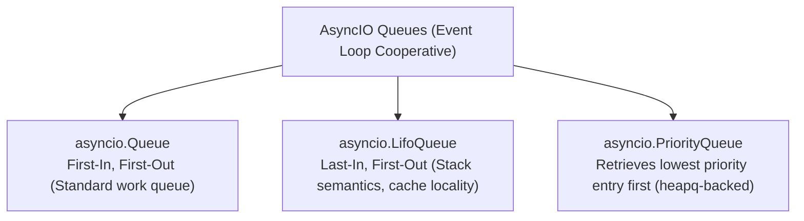

# AsyncIO Queues, Network Streams, and Flow Control

Asynchronous applications frequently interact with streaming data over network sockets or coordinate producer-consumer workloads across concurrent coroutines. Doing this naively leads to two catastrophic production failure modes:
1. **Memory Exhaustion (Lack of Backpressure)**: Fast producers overwhelm slow consumers, causing in-memory queues to balloon until the process crashes with Out-Of-Memory (OOM).
2. **Buffer Bloat & Packet Loss**: Senders flood TCP network sockets without awaiting socket buffer flushes, exhausting kernel send buffers.

Python’s **`asyncio.Queue`** and high-level **Network Streams (`StreamReader` / `StreamWriter`)** solve these problems with built-in cooperative flow control and backpressure mechanisms.

---

## Table of Contents

1. [What & Why](#what--why)
2. [Core Concepts & Mental Model](#core-concepts--mental-model)
3. [The Async Queue Family: Queue, PriorityQueue, LifoQueue](#the-async-queue-family-queue-priorityqueue-lifoqueue)
4. [How It Works Internally: TCP Streams & `writer.drain()` Backpressure](#how-it-works-internally-tcp-streams--writerdrain-backpressure)
5. [Syntax & API Reference](#syntax--api-reference)
6. [Code Examples](#code-examples)
7. [Edge Cases, Pitfalls & Anti-Patterns](#edge-cases-pitfalls--anti-patterns)
8. [Performance & Memory Characteristics](#performance--memory-characteristics)
9. [CPython Internals & Bytecode](#cpython-internals--bytecode)
10. [Best Practices & Idiomatic Patterns](#best-practices--idiomatic-patterns)
11. [Real-World Case Study: High-Throughput Asynchronous In-Memory Cache TCP Server](#real-world-case-study-high-throughput-asynchronous-in-memory-cache-tcp-server)
12. [Interview Questions & Deep-Dive Scenarios](#interview-questions--deep-dive-scenarios)
13. [Practical Exercises & Code Katas](#practical-exercises--code-katas)

---

## What & Why

In concurrent architectures:
- **`asyncio.Queue`**: Coordinates asynchronous coroutines within the same event loop. It provides non-blocking, awaitable `get()` and `put()` primitives with explicit capacity constraints (`maxsize`) that automatically throttle fast producers.
- **AsyncIO Streams**: An intuitive, socket-level networking abstraction over raw OS descriptors. Instead of wrestling with complex protocols and callbacks (`asyncio.Protocol`), streams allow writing network servers using simple `await reader.readline()` and `writer.write()` idioms.

Crucially, AsyncIO streams provide **backpressure enforcement via `await writer.drain()`**: pausing application code whenever the operating system's underlying TCP socket buffer is full.

---

## Core Concepts & Mental Model

### Backpressure in Async Queues

```mermaid
sequenceDiagram
    autonumber
    participant P as Fast Producer
    participant Q as asyncio.Queue(maxsize=2)
    participant C as Slow Consumer

    P->>Q: 1. await q.put(Item1) -> Enqueued
    P->>Q: 2. await q.put(Item2) -> Enqueued (QUEUE FULL!)
    P->>Q: 3. await q.put(Item3) -> BLOCKS Producer!
    Note over P: Producer suspended; prevents memory ballooning!
    
    C->>Q: 4. await q.get() -> Pops Item1
    Q-->>P: 5. Queue slot opened! Producer unblocks and enqueues Item3!
```

---

## The Async Queue Family: Queue, PriorityQueue, LifoQueue



### Queue Capabilities

| Queue Class | Ordering Strategy | Underlying Data Structure | Best Use Case |
|:---|:---|:---|:---|
| **`asyncio.Queue`** | FIFO (First In, First Out) | `collections.deque` | Standard worker pipelines |
| **`asyncio.LifoQueue`** | LIFO (Last In, First Out) | Python `list` | Depth-first processing, memory re-use |
| **`asyncio.PriorityQueue`**| Priority Order (Lowest first) | `heapq` | Urgent job queues, deadline scheduling |

---

## How It Works Internally: TCP Streams & `writer.drain()` Backpressure

When calling `writer.write(data)`:
1. Python writes the bytes into an in-memory buffer (`collections.deque` of byte chunks).
2. It attempts to flush these bytes into the OS kernel's TCP socket buffer.
3. If the network is congested or the remote receiver is slow, the kernel socket buffer fills up to its high-water mark (typically 64 KB).
4. Any further calls to `writer.write()` accumulate in Python's user-space RAM!
5. **Calling `await writer.drain()`** checks if the buffer exceeds the high-water mark. If so, it suspends the writing coroutine until the kernel transmits the data and drains the buffer below the low-water mark, restoring healthy network flow control.

```mermaid
sequenceDiagram
    autonumber
    participant App as Python Application
    participant Buffer as User-Space Writer Buffer
    participant Socket as OS Kernel TCP Buffer
    participant Remote as Remote Client

    App->>Buffer: writer.write(10MB) -> Appends to RAM
    App->>Buffer: await writer.drain()
    Buffer->>Socket: Socket buffer full (High-water mark exceeded)!
    Note over App: App coroutine suspended at await writer.drain()!
    Socket->>Remote: Sends TCP packets across wire
    Remote-->>Socket: TCP ACKs received; buffer drops below low-water mark
    Socket-->>Buffer: Drained event signaled!
    Buffer-->>App: writer.drain() resumes!
```

---

## Syntax & API Reference

### 1. Bounded Async Queue

```python
import asyncio

# maxsize=10 enforces backpressure
q: asyncio.Queue[str] = asyncio.Queue(maxsize=10)

await q.put("payload")       # Suspends if full
item = await q.get()        # Suspends if empty
q.task_done()               # Marks task finished
await q.join()              # Blocks until all items processed
```

### 2. High-Level TCP Server with Streams

```python
async def handle_client(reader: asyncio.StreamReader, writer: asyncio.StreamWriter) -> None:
    data = await reader.readline()
    writer.write(b"ACK\n")
    await writer.drain()  # Crucial flow control!
    writer.close()
    await writer.wait_closed()

server = await asyncio.start_server(handle_client, "127.0.0.1", 8888)
async with server:
    await server.serve_forever()
```

### 3. TCP Client with Streams

```python
reader, writer = await asyncio.open_connection("127.0.0.1", 8888)
writer.write(b"PING\n")
await writer.drain()
response = await reader.readline()
writer.close()
await writer.wait_closed()
```

---

## Code Examples

### Example 1: Robust Producer-Consumer Worker Pool with Backpressure

```python
import asyncio
import time

async def producer(q: asyncio.Queue[int], total_items: int) -> None:
    for i in range(total_items):
        await q.put(i)
        print(f"[Producer] Enqueued item {i} (Queue size: {q.qsize()})")
        await asyncio.sleep(0.01)

async def consumer(worker_id: int, q: asyncio.Queue[int]) -> None:
    while True:
        item = await q.get()
        print(f"  -> [Worker {worker_id}] Processing item {item}...")
        await asyncio.sleep(0.03)  # Slower than producer!
        q.task_done()

async def main() -> None:
    # maxsize=2 forces producer to pause when queue has 2 items:
    work_queue: asyncio.Queue[int] = asyncio.Queue(maxsize=2)

    # Start 2 concurrent consumers
    consumers = [
        asyncio.create_task(consumer(i, work_queue))
        for i in range(2)
    ]

    # Produce 5 items
    await producer(work_queue, 5)

    # Wait until all items are fully processed:
    await work_queue.join()
    print("[Main] All queue tasks marked done with task_done()!")

    # Cancel consumer background loops:
    for c in consumers: c.cancel()

asyncio.run(main())
# Output:
# [Producer] Enqueued item 0 (Queue size: 1)
# [Producer] Enqueued item 1 (Queue size: 2)
#   -> [Worker 0] Processing item 0...
#   -> [Worker 1] Processing item 1...
# [Producer] Enqueued item 2 (Queue size: 1)
# ...
# [Main] All queue tasks marked done with task_done()!
```

### Example 2: Priority Queue for Urgent Job Scheduling

```python
import asyncio
from dataclasses import dataclass, field

@dataclass(order=True)
class ScheduledJob:
    priority: int  # Lower number = higher priority
    task_name: str = field(compare=False)

async def main() -> None:
    pq: asyncio.PriorityQueue[ScheduledJob] = asyncio.PriorityQueue()

    # Enqueue mixed priority jobs:
    await pq.put(ScheduledJob(3, "Routine daily database backup"))
    await pq.put(ScheduledJob(1, "CRITICAL: Security vulnerability patch"))
    await pq.put(ScheduledJob(2, "Generate monthly customer invoices"))

    # Dequeue in priority order:
    print("Executing jobs by priority:")
    while not pq.empty():
        job = await pq.get()
        print(f" -> Priority {job.priority}: {job.task_name}")

asyncio.run(main())
# Output:
# Executing jobs by priority:
#  -> Priority 1: CRITICAL: Security vulnerability patch
#  -> Priority 2: Generate monthly customer invoices
#  -> Priority 3: Routine daily database backup
```

### Example 3: Full-Duplex Echo TCP Server with Streams

```python
import asyncio

async def handle_echo_connection(
    reader: asyncio.StreamReader,
    writer: asyncio.StreamWriter
) -> None:
    addr = writer.get_extra_info("peername")
    print(f"[Server] New connection from {addr}")

    try:
        while True:
            line = await reader.readline()
            if not line:
                # Client closed socket connection
                break
            
            message = line.decode("utf-8").strip()
            print(f"[Server] Received '{message}' from {addr}")
            
            response = f"ECHO: {message}\n".encode("utf-8")
            writer.write(response)
            # Flush socket buffer and enforce backpressure:
            await writer.drain()
    except ConnectionResetError:
        pass
    finally:
        print(f"[Server] Closing connection to {addr}")
        writer.close()
        await writer.wait_closed()

async def run_server() -> None:
    server = await asyncio.start_server(handle_echo_connection, "127.0.0.1", 9999)
    async with server:
        print("[Server] Echo server listening on 127.0.0.1:9999")
        await asyncio.sleep(0.05)  # Let server bind
        
        # Connect test client
        r, w = await asyncio.open_connection("127.0.0.1", 9999)
        w.write(b"Hello AsyncIO Streams!\n")
        await w.drain()
        
        reply = await r.readline()
        print(f"[Client] Server responded: {reply.decode().strip()}")
        
        w.close()
        await w.wait_closed()

asyncio.run(run_server())
# Output:
# [Server] Echo server listening on 127.0.0.1:9999
# [Server] New connection from ('127.0.0.1', ...)
# [Server] Received 'Hello AsyncIO Streams!' from ('127.0.0.1', ...)
# [Client] Server responded: ECHO: Hello AsyncIO Streams!
# [Server] Closing connection to ('127.0.0.1', ...)
```

### Example 4: Fixed-Size Binary Frame Extraction with `readexactly`

```python
import asyncio
import struct

async def stream_binary_packets():
    # Setup mock reader/writer pair
    reader = asyncio.StreamReader()
    
    # Simulate incoming binary stream: 4-byte length prefix + string payload
    payload1 = b"PACKET_ALPHA"
    packet1 = struct.pack("!I", len(payload1)) + payload1
    
    payload2 = b"PACKET_BETA_LONGER"
    packet2 = struct.pack("!I", len(payload2)) + payload2

    # Feed bytes into reader
    reader.feed_data(packet1 + packet2)
    reader.feed_eof()

    # Read exactly 4 bytes of header to determine payload size:
    while True:
        try:
            header = await reader.readexactly(4)
            length = struct.unpack("!I", header)[0]
            # Read exact packet payload:
            data = await reader.readexactly(length)
            print(f"Decoded packet (length {length}): {data.decode('utf-8')}")
        except asyncio.IncompleteReadError:
            break

asyncio.run(stream_binary_packets())
# Output:
# Decoded packet (length 12): PACKET_ALPHA
# Decoded packet (length 18): PACKET_BETA_LONGER
```

### Example 5: Custom LIFO Queue (Stack Semantics)

```python
import asyncio

async def main():
    lifo: asyncio.LifoQueue[str] = asyncio.LifoQueue()

    await lifo.put("First")
    await lifo.put("Second")
    await lifo.put("Third")

    print("Popping items from LifoQueue:")
    while not lifo.empty():
        print(" ->", await lifo.get())

asyncio.run(main())
# Output:
# Popping items from LifoQueue:
#  -> Third
#  -> Second
#  -> First
```

---

## Edge Cases, Pitfalls & Anti-Patterns

### Common Mistakes Table

| Mistake | Bad Code | Correct Idiom | Why It Fails |
|:---|:---|:---|:---|
| **Omitting `await writer.drain()`** | `writer.write(data)` without `await writer.drain()` | Always call `await writer.drain()` after writes | Bypasses TCP flow control; user-space memory balloons under network congestion. |
| **Forgetting `q.task_done()`** | Calling `q.get()` without calling `q.task_done()` | Call `q.task_done()` after each item processing | `await q.join()` blocks forever waiting for unfinished tasks. |
| **Unbounded Queue in Production** | `q = asyncio.Queue()` | `q = asyncio.Queue(maxsize=1000)` | Fast producers flood RAM indefinitely until OOM crash. |
| **Not calling `await writer.wait_closed()`** | Calling `writer.close()` without `await writer.wait_closed()` | Always pair `writer.close()` with `await writer.wait_closed()` | Socket descriptor closure may be delayed; resources leak. |
| **Using `queue.Queue` inside async coroutines** | `from queue import Queue; q = Queue()` | `from asyncio import Queue; q = Queue()` | Standard `queue.Queue` uses blocking OS locks, freezing the entire async event loop! |
| **Using `reader.read()` without byte limit** | `await reader.read()` | `await reader.read(4096)` or `readexactly()` | Reads entire socket stream until EOF, buffering potentially gigabytes in memory. |

---

## Performance & Memory Characteristics

### Queue Overhead Benchmark

- **Async Queue Overhead**: Calling `q.put()` and `q.get()` on an `asyncio.Queue` takes **~80 - 150 ns**. It is implemented using deque buffers and lightweight event loop callbacks.
- **Streams Buffer Memory**: By default, `StreamReader` uses a 64 KB buffer (`limit=64*1024`). If a client sends lines exceeding 64 KB, `readline()` raises `ValueError("Separator is not found, and chunk exceed the limit")`, protecting against denial-of-service memory exhaustion.

---

## CPython Internals & Bytecode

### How `writer.drain()` Suspends Execution

Inside CPython's `asyncio.streams`, `StreamWriter.drain()` inspects the underlying transport's buffer state:

```python
# Simplified snippet of CPython streams.py
async def drain(self):
    if self._transport.is_closing():
        return
    # If the transport buffer is above high-water mark:
    if self._transport.get_write_buffer_size() > self._transport._high_water:
        # Create a new future and wait for the transport's resume_writing callback:
        self._drain_waiter = self._loop.create_future()
        await self._drain_waiter
```

When the OS TCP socket transmits packets and buffer occupancy falls below the low-water mark, the CPython transport calls `resume_writing()`, resolving `self._drain_waiter` and unblocking the coroutine seamlessly!

---

## Best Practices & Idiomatic Patterns

1. **Always Set `maxsize` on Queues**: Enforces upstream backpressure throughout the processing pipeline.
2. **Always Call `await writer.drain()`**: Never treat `writer.write()` as fire-and-forget.
3. **Always Close Streams with `await writer.wait_closed()`**: Guarantees TLS session tears down and file descriptors are recycled.
4. **Pair `q.get()` with `q.task_done()`**: Enables clean pipeline completion verification with `await q.join()`.

---

## Real-World Case Study: High-Throughput Asynchronous In-Memory Cache TCP Server

Below is a production-grade, Redis-compatible asynchronous in-memory key-value server implementing `GET`, `SET`, and `DEL` commands over TCP streams with strict flow control:

```python
import asyncio
import time

class KeyValueStore:
    def __init__(self) -> None:
        self._store: dict[str, str] = {}

    def get(self, key: str) -> str | None:
        return self._store.get(key)

    def set(self, key: str, value: str) -> None:
        self._store[key] = value

    def delete(self, key: str) -> bool:
        return self._store.pop(key, None) is not None

class CacheTCPServer:
    def __init__(self, host: str = "127.0.0.1", port: int = 6389) -> None:
        self.host = host
        self.port = port
        self.kv = KeyValueStore()
        self._server: asyncio.Server | None = None

    async def handle_client(self, reader: asyncio.StreamReader, writer: asyncio.StreamWriter) -> None:
        client_addr = writer.get_extra_info("peername")
        print(f"[CacheServer] Client connected: {client_addr}")

        try:
            while True:
                # Read line command
                line = await reader.readline()
                if not line:
                    break
                
                command_str = line.decode("utf-8").strip()
                if not command_str:
                    continue

                parts = command_str.split(" ", 2)
                verb = parts[0].upper()

                if verb == "GET" and len(parts) >= 2:
                    val = self.kv.get(parts[1])
                    response = f"VALUE {val}\n" if val is not None else "NOT_FOUND\n"
                elif verb == "SET" and len(parts) >= 3:
                    self.kv.set(parts[1], parts[2])
                    response = "OK\n"
                elif verb == "DEL" and len(parts) >= 2:
                    deleted = self.kv.delete(parts[1])
                    response = "DELETED\n" if deleted else "NOT_FOUND\n"
                elif verb == "QUIT":
                    writer.write(b"BYE\n")
                    await writer.drain()
                    break
                else:
                    response = "ERR Unknown or malformed command\n"

                writer.write(response.encode("utf-8"))
                # Crucial backpressure check:
                await writer.drain()

        except ConnectionResetError:
            pass
        finally:
            print(f"[CacheServer] Client disconnected: {client_addr}")
            writer.close()
            await writer.wait_closed()

    async def start(self) -> None:
        self._server = await asyncio.start_server(self.handle_client, self.host, self.port)
        print(f"[CacheServer] Server running on {self.host}:{self.port}")

    async def stop(self) -> None:
        if self._server:
            self._server.close()
            await self._server.wait_closed()

# Verification Test Execution
async def test_server():
    server = CacheTCPServer()
    await server.start()

    # Simulate client interactions
    reader, writer = await asyncio.open_connection("127.0.0.1", 6389)
    
    # 1. SET key
    writer.write(b"SET user_99 Alice\n")
    await writer.drain()
    reply1 = await reader.readline()
    print("Client received:", reply1.decode().strip())

    # 2. GET key
    writer.write(b"GET user_99\n")
    await writer.drain()
    reply2 = await reader.readline()
    print("Client received:", reply2.decode().strip())

    # 3. Quit
    writer.write(b"QUIT\n")
    await writer.drain()
    reply3 = await reader.readline()
    print("Client received:", reply3.decode().strip())

    writer.close()
    await writer.wait_closed()
    await server.stop()

asyncio.run(test_server())
# Output:
# [CacheServer] Server running on 127.0.0.1:6389
# [CacheServer] Client connected: ('127.0.0.1', ...)
# Client received: OK
# Client received: VALUE Alice
# Client received: BYE
# [CacheServer] Client disconnected: ('127.0.0.1', ...)
```

---

## Interview Questions & Deep-Dive Scenarios

<details>
<summary>1. Why is `await writer.drain()` critical in AsyncIO network programming?</summary>

`writer.write(data)` does not immediately send data over the physical network; it buffers bytes in Python's memory and passes them to the operating system's TCP socket buffer. If network throughput drops or the receiver is slow, the socket buffer fills up. Without `await writer.drain()`, subsequent `write()` calls continue buffering gigabytes of data in process heap RAM, leading to memory bloat and eventual process crash. `drain()` suspends the writer until the socket buffer drops below its low-water mark.
</details>

<details>
<summary>2. What is the difference between `q.get()` and `q.get_nowait()`?</summary>

- `await q.get()`: An asynchronous coroutine that suspends execution if the queue is empty, resuming automatically when an item is pushed.
- `q.get_nowait()`: A synchronous method that attempts to retrieve an item immediately. If the queue is empty, it does not suspend; instead, it raises `asyncio.QueueEmpty`.
</details>

<details>
<summary>3. How does `await q.join()` coordinate with `q.task_done()`?</summary>

`asyncio.Queue` maintains an internal counter of unfinished tasks. Every `put()` increments this counter. Calling `q.task_done()` decrements this counter. `await q.join()` suspends the calling coroutine until the counter reaches zero, providing a clean synchronization point ensuring all queued items have completed processing.
</details>

<details>
<summary>4. Why should you avoid using standard `queue.Queue` inside `asyncio` code?</summary>

Standard `queue.Queue` is designed for multithreaded concurrency. Its `.get()` and `.put()` methods block the calling operating system thread using `threading.Lock` and `threading.Condition`. Calling `queue.Queue.get()` inside an async coroutine blocks the entire event loop thread, paralyzing all other concurrent coroutines. You must always use `asyncio.Queue`.
</details>

<details>
<summary>5. What happens if a client sends a line longer than the `limit` parameter in `StreamReader.readline()`?</summary>

By default, `StreamReader` sets `limit = 64 * 1024` (64 KB). If a line arrives that exceeds this limit without a newline separator `\n`, `readline()` raises a `ValueError("Separator is not found, and chunk exceed the limit")`, protecting the server against buffer-overflow denial-of-service attacks.
</details>

<details>
<summary>6. How does `asyncio.PriorityQueue` maintain item order?</summary>

`PriorityQueue` uses Python's standard `heapq` module under the hood. When items are added via `put()`, they are pushed into a binary min-heap. When `get()` is called, the element with the lowest priority value is popped in $O(\log N)$ time.
</details>

<details>
<summary>7. What is the difference between `reader.read(n)` and `reader.readexactly(n)`?</summary>

- `reader.read(n)`: Reads **up to** $n$ bytes. If fewer bytes are currently available in the socket buffer, it returns whatever is available immediately (even if only 1 byte).
- `reader.readexactly(n)`: Reads **exactly** $n$ bytes. It will suspend and wait across multiple incoming TCP packets until all $n$ bytes have arrived. If EOF is reached before $n$ bytes are read, it raises `asyncio.IncompleteReadError`.
</details>

<details>
<summary>8. How do you implement a graceful shutdown for an `asyncio.Queue` with multiple consumers?</summary>

Enqueue a sentinel value (such as `None`) once for each consumer worker. When a consumer receives `None`, it calls `task_done()` and breaks out of its processing loop.
</details>

---

## Practical Exercises & Code Katas

### Exercise 1: Multi-Worker Batch Queue Processor
Implement an async pipeline where 2 consumers process numbers from an `asyncio.Queue(maxsize=5)`, computing their cubes.

<details>
<summary>Solution</summary>

```python
import asyncio

async def worker(wid: int, q: asyncio.Queue[int], results: list[int]):
    while True:
        num = await q.get()
        results.append(num ** 3)
        q.task_done()

async def main():
    q: asyncio.Queue[int] = asyncio.Queue(maxsize=5)
    results: list[int] = []
    
    workers = [asyncio.create_task(worker(i, q, results)) for i in range(2)]
    
    for i in range(5):
        await q.put(i)
    
    await q.join()
    for w in workers: w.cancel()
    print("Computed cubes:", results)

asyncio.run(main())
# Output: Computed cubes: [0, 1, 8, 27, 64]
```
</details>

### Exercise 2: TCP Stream Ping-Pong Client
Write an async function `ping_server(host, port)` that connects to a TCP server, sends `PING\n`, verifies that `PONG\n` is returned, and closes the stream.

<details>
<summary>Solution</summary>

```python
import asyncio

async def ping_server(host: str, port: int) -> bool:
    reader, writer = await asyncio.open_connection(host, port)
    try:
        writer.write(b"PING\n")
        await writer.drain()
        reply = await reader.readline()
        return reply.strip() == b"PONG"
    finally:
        writer.close()
        await writer.wait_closed()
```
</details>

### Exercise 3: Throttling Ingestion with Queue Backpressure
Demonstrate that a producer with `maxsize=1` pauses when enqueuing to a slow consumer.

<details>
<summary>Solution</summary>

```python
import asyncio
import time

async def slow_consumer(q: asyncio.Queue[str]):
    await asyncio.sleep(0.04)
    item = await q.get()
    q.task_done()

async def main():
    q: asyncio.Queue[str] = asyncio.Queue(maxsize=1)
    asyncio.create_task(slow_consumer(q))
    
    t0 = time.perf_counter()
    await q.put("item1")
    # Second put will suspend until consumer gets item1:
    await q.put("item2")
    elapsed = time.perf_counter() - t0
    
    print(f"Second put completed after {elapsed*1000:.1f}ms (Backpressure confirmed!)")
    assert elapsed >= 0.03

asyncio.run(main())
```
</details>

### Exercise 4: Reading Fixed-Length Headers and Variable Payloads
Implement an async message decoder that reads a 2-byte unsigned short length prefix followed by string payload.

<details>
<summary>Solution</summary>

```python
import asyncio
import struct

async def decode_framed_message(reader: asyncio.StreamReader) -> str:
    header = await reader.readexactly(2)
    payload_len = struct.unpack("!H", header)[0]
    payload = await reader.readexactly(payload_len)
    return payload.decode("utf-8")

async def test_decoder():
    reader = asyncio.StreamReader()
    msg = "Status: Healthy"
    encoded = struct.pack("!H", len(msg)) + msg.encode("utf-8")
    reader.feed_data(encoded)
    reader.feed_eof()
    
    result = await decode_framed_message(reader)
    print("Decoded message:", result)

asyncio.run(test_decoder())
# Output: Decoded message: Status: Healthy
```
</details>

### Exercise 5: Bounded Async Stream Copy
Implement an async file/stream copy utility `stream_copy(reader, writer, buffer_size=4096)` that streams data with `await writer.drain()`.

<details>
<summary>Solution</summary>

```python
import asyncio

async def stream_copy(reader: asyncio.StreamReader, writer: asyncio.StreamWriter, buffer_size: int = 4096) -> int:
    total_bytes = 0
    while True:
        chunk = await reader.read(buffer_size)
        if not chunk:
            break
        writer.write(chunk)
        await writer.drain()
        total_bytes += len(chunk)
    return total_bytes
```
</details>

### Exercise 6: Priority Queue Deadline Schedular
Enqueue 3 jobs with deadline timestamps and consume them in order of earliest deadline.

<details>
<summary>Solution</summary>

```python
import asyncio
from dataclasses import dataclass

@dataclass(order=True)
class DeadlineTask:
    deadline_ts: float
    description: str

async def main():
    pq: asyncio.PriorityQueue[DeadlineTask] = asyncio.PriorityQueue()
    await pq.put(DeadlineTask(1710000050.0, "Task Far Future"))
    await pq.put(DeadlineTask(1710000010.0, "Task Immediate"))
    await pq.put(DeadlineTask(1710000030.0, "Task Near Future"))

    print("Tasks by earliest deadline:")
    while not pq.empty():
        t = await pq.get()
        print(f" -> {t.deadline_ts}: {t.description}")

asyncio.run(main())
# Output:
# Tasks by earliest deadline:
#  -> 1710000010.0: Task Immediate
#  -> 1710000030.0: Task Near Future
#  -> 1710000050.0: Task Far Future
```
</details>
