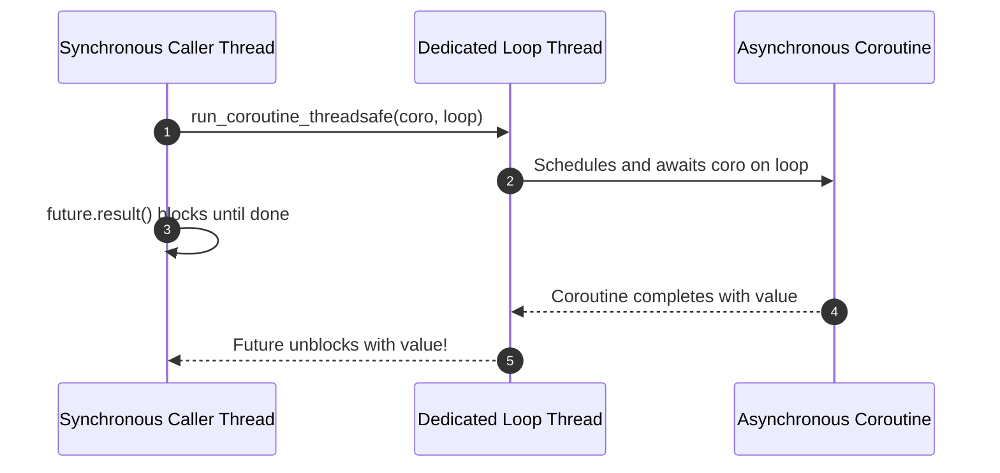

# Bridging the Sync/Async Divide: to_thread, run_coroutine_threadsafe, and Loop Hosting

One of the greatest architectural challenges in modern Python engineering is the **"Function Coloring Problem"** (popularized by Bob Nystrom). In Python, functions are split into two distinct colors: synchronous functions (`def`) and asynchronous coroutines (`async def`).
- Synchronous functions cannot directly call `await`.
- Asynchronous coroutines cannot invoke blocking synchronous calls without freezing the entire event loop.

Yet enterprise architectures almost never exist in a pure async vacuum: real-world applications must integrate synchronous database ORMs (SQLAlchemy, Django), CPU-heavy analytics libraries (NumPy, Pandas), legacy SDKs (Boto3), and GUI frameworks with high-throughput AsyncIO event loops.

This note provides the definitive engineering guide to safely, performantly bridging the sync/async divide.

---

## Table of Contents

1. [What & Why](#what--why)
2. [The Function Coloring Dilemma](#the-function-coloring-dilemma)
3. [Calling Synchronous Code from Async Contexts](#calling-synchronous-code-from-async-contexts)
4. [Calling Asynchronous Code from Synchronous Contexts](#calling-asynchronous-code-from-synchronous-contexts)
5. [Syntax & API Reference](#syntax--api-reference)
6. [Code Examples](#code-examples)
7. [Edge Cases, Pitfalls & Anti-Patterns](#edge-cases-pitfalls--anti-patterns)
8. [Performance & Memory Characteristics](#performance--memory-characteristics)
9. [CPython Internals & Bytecode](#cpython-internals--bytecode)
10. [Best Practices & Idiomatic Patterns](#best-practices--idiomatic-patterns)
11. [Real-World Case Study: Hybrid Synchronous Web Service with Background Async Real-Time Event Dispatcher](#real-world-case-study-hybrid-synchronous-web-service-with-background-async-real-time-event-dispatcher)
12. [Interview Questions & Deep-Dive Scenarios](#interview-questions--deep-dive-scenarios)
13. [Practical Exercises & Code Katas](#practical-exercises--code-katas)

---

## What & Why

Why do sync and async code conflict?
- **The Event Loop Constraint**: The `asyncio` event loop runs on a single thread. When a synchronous function executes a blocking operation (e.g. `time.sleep(5)` or a blocking socket read), the thread running the event loop is physically halted by the kernel.
- **The Call Stack Constraint**: An asynchronous function can only be executed by awaiting it or scheduling it on an active event loop. Calling `my_coro()` from normal synchronous code merely returns an inert coroutine object without executing any logic.

Bridging the divide correctly requires specialized adapters:
- **Async calling Sync**: Offload the blocking call to a thread pool with `asyncio.to_thread()` or `loop.run_in_executor()`.
- **Sync calling Async**: Dispatch the coroutine to a dedicated background event loop using `asyncio.run_coroutine_threadsafe()`.

---

## The Function Coloring Dilemma

```mermaid
graph TD
    subgraph Synchronous World (Red Functions)
        SyncFunc["def synchronous_function():\nBlocking I/O, no await keyword"]
    end

    subgraph Asynchronous World (Blue Functions)
        AsyncFunc["async def async_coroutine():\nNon-blocking I/O, requires await"]
    end

    SyncFunc -->|Bridge via asyncio.run_coroutine_threadsafe| AsyncFunc
    AsyncFunc -->|Bridge via asyncio.to_thread| SyncFunc
```

---

## Calling Synchronous Code from Async Contexts

When an async coroutine needs to call a blocking synchronous library, it must not execute it inline. Instead, it offloads the function to an OS thread:

```mermaid
sequenceDiagram
    autonumber
    participant Loop as Event Loop Thread
    participant Pool as ThreadPoolExecutor
    participant Target as Blocking Sync Library

    Loop->>Loop: Coroutine calls await asyncio.to_thread(sync_fn)
    Loop->>Pool: Schedules sync_fn on worker thread
    Note over Loop: Event loop immediately resumes other coroutines!
    Pool->>Target: Executes blocking syscalls (e.g. disk/db)
    Target-->>Pool: Returns result
    Pool-->>Loop: Resolves Future on event loop
    Loop->>Loop: Resumes calling coroutine with result!
```

---

## Calling Asynchronous Code from Synchronous Contexts

When a legacy synchronous codebase (e.g. standard Django views, Celery workers, or scripts) needs to execute an async service:
1. **Case A (No Active Event Loop)**: Use `asyncio.run(coro)` to spin up a transient loop, run the coroutine to completion, and tear down the loop.
2. **Case B (Active Event Loop in Background)**: Maintain a long-lived event loop running on a dedicated daemon thread and dispatch coroutines via `asyncio.run_coroutine_threadsafe(coro, loop)`.



---

## Syntax & API Reference

### 1. Offloading Sync to Thread (`asyncio.to_thread`)

```python
import asyncio

# In Python 3.9+: automatically propagates contextvars!
result = await asyncio.to_thread(blocking_sync_function, arg1, key=val)
```

### 2. Offloading to Custom Process Pool (`loop.run_in_executor`)

```python
loop = asyncio.get_running_loop()
result = await loop.run_in_executor(custom_process_pool, cpu_bound_func, arg)
```

### 3. Dispatching to Loop from Sync Thread (`run_coroutine_threadsafe`)

```python
from concurrent.futures import Future

# Thread-safe dispatch returning a concurrent.futures.Future:
future: Future = asyncio.run_coroutine_threadsafe(my_async_coro(), target_loop)
result = future.result(timeout=5.0)  # Synchronous block
```

---

## Code Examples

### Example 1: Offloading Blocking Synchronous I/O with `asyncio.to_thread`

```python
import asyncio
import time

def blocking_file_write(filename: str, content: str) -> int:
    print(f"[Thread Worker] Writing to {filename} (blocking)...")
    time.sleep(0.04)  # Simulate slow disk I/O
    return len(content)

async def main() -> None:
    t0 = time.perf_counter()

    # Launch two blocking writes concurrently via background threads:
    task1 = asyncio.to_thread(blocking_file_write, "audit1.log", "Event payload 1")
    task2 = asyncio.to_thread(blocking_file_write, "audit2.log", "Event payload 2")

    # Event loop remains responsive while threads write!
    bytes1, bytes2 = await asyncio.gather(task1, task2)
    
    elapsed = (time.perf_counter() - t0) * 1000
    print(f"Both blocking writes completed in {elapsed:.1f}ms (Total: {bytes1 + bytes2} bytes)")

asyncio.run(main())
# Output:
# [Thread Worker] Writing to audit1.log (blocking)...
# [Thread Worker] Writing to audit2.log (blocking)...
# Both blocking writes completed in ~40ms (Total: 30 bytes)
```

### Example 2: Dedicated Background Event Loop Hosting

Hosting a permanent event loop in a background thread to service synchronous callers:

```python
import asyncio
import threading
import time

class BackgroundAsyncRunner:
    """Manages an active asyncio event loop running on a dedicated daemon thread."""

    def __init__(self) -> None:
        self.loop = asyncio.new_event_loop()
        self.thread = threading.Thread(target=self._run_loop, daemon=True, name="AsyncLoopThread")
        self.thread.start()

    def _run_loop(self) -> None:
        asyncio.set_event_loop(self.loop)
        self.loop.run_forever()

    def run(self, coro, timeout: float = 5.0):
        """Synchronous method called from any thread to execute async coroutines."""
        future = asyncio.run_coroutine_threadsafe(coro, self.loop)
        return future.result(timeout=timeout)

    def stop(self) -> None:
        self.loop.call_soon_threadsafe(self.loop.stop)
        self.thread.join()

# Asynchronous service logic
async def async_calculate_hash(data: str) -> str:
    await asyncio.sleep(0.02)
    return f"HASH({data.upper()})"

# Synchronous application flow
runner = BackgroundAsyncRunner()

# Calling async code synchronously:
res1 = runner.run(async_calculate_hash("payload_a"))
res2 = runner.run(async_calculate_hash("payload_b"))

print("Result 1 from sync thread:", res1)
print("Result 2 from sync thread:", res2)

runner.stop()
# Output:
# Result 1 from sync thread: HASH(PAYLOAD_A)
# Result 2 from sync thread: HASH(PAYLOAD_B)
```

### Example 3: Context Variable Propagation Across Threads with `copy_context`

`asyncio.to_thread()` automatically captures and propagates `contextvars` to the worker thread:

```python
import asyncio
import contextvars

request_id_ctx = contextvars.ContextVar("request_id", default="DEFAULT_TRACE")

def sync_log_operation() -> str:
    # Worker thread correctly observes context variable set in calling coroutine!
    current_trace = request_id_ctx.get()
    return f"Log written under trace: {current_trace}"

async def handle_request(req_id: str) -> None:
    # Set context in current coroutine
    request_id_ctx.set(req_id)
    
    # asyncio.to_thread automatically propagates contextvars to background thread:
    result = await asyncio.to_thread(sync_log_operation)
    print(result)

async def main() -> None:
    await asyncio.gather(
        handle_request("REQ_001"),
        handle_request("REQ_002")
    )

asyncio.run(main())
# Output:
# Log written under trace: REQ_001
# Log written under trace: REQ_002
```

### Example 4: Converting Asynchronous Streams into Synchronous Iterables

```python
import asyncio
import threading
import queue

async def async_number_generator(n: int):
    for i in range(n):
        await asyncio.sleep(0.01)
        yield i

def sync_consume_async_gen(async_gen_factory, count: int):
    """Bridges an async generator to a synchronous generator using a thread queue."""
    q: queue.Queue = queue.Queue(maxsize=5)

    def loop_worker():
        async def producer():
            async for val in async_gen_factory(count):
                q.put(val)
            q.put(None)  # Sentinel
        asyncio.run(producer())

    t = threading.Thread(target=loop_worker, daemon=True)
    t.start()

    while True:
        item = q.get()
        if item is None:
            break
        yield item

# Synchronous consumer:
print("Consuming async stream in synchronous loop:")
for num in sync_consume_async_gen(async_number_generator, 4):
    print(f" -> Got number: {num}")
# Output:
# Consuming async stream in synchronous loop:
#  -> Got number: 0
#  -> Got number: 1
#  -> Got number: 2
#  -> Got number: 3
```

### Example 5: Why `nest_asyncio` is an Anti-Pattern

Many developers attempt to patch `RuntimeError: This event loop is already running` using `nest_asyncio.apply()`.
- **Why it is dangerous**: `nest_asyncio` monkey-patches CPython’s event loop and socket pollers to allow recursive loops.
- **Consequences**: Breaks cancellation cascading, corrupts task frame tracking, causes obscure re-entrancy race conditions, and prevents `TaskGroup` from guaranteeing structured exit boundaries.
- **The Correct Architecture**: Never nest event loops. Instead, await the coroutine or dispatch to a thread pool.

---

## Edge Cases, Pitfalls & Anti-Patterns

### Common Mistakes Table

| Mistake | Bad Code | Correct Idiom | Why It Fails |
|:---|:---|:---|:---|
| **Calling `asyncio.run()` inside an active loop** | Calling `asyncio.run()` in FastAPI/Tornado | `await coro` or `create_task()` | Raises `RuntimeError: asyncio.run() cannot be called from a running event loop`. |
| **Executing blocking calls inline** | `time.sleep(2)` inside `async def` | `await asyncio.to_thread(time.sleep, 2)` | Freezes the event loop thread, stopping all concurrent coroutines. |
| **Using `run_coroutine_threadsafe` without joining** | Dropping the returned Future | Call `future.result(timeout=...)` | Exceptions in the coroutine fail silently and unobserved. |
| **Sharing un-synchronized data between sync and async** | Mutating global list from both sync thread and async loop | Use `asyncio.Queue` or `loop.call_soon_threadsafe()` | Race conditions corrupt data; event loop is not thread-safe. |
| **Forgetting to set daemon on background loop thread** | `Thread(target=loop.run_forever)` | Set `daemon=True` | Python process hangs indefinitely on script exit. |
| **Using `nest_asyncio` to silence errors** | `import nest_asyncio; nest_asyncio.apply()` | Refactor code to proper async boundaries | Corrupts event loop invariants, timers, and structured concurrency. |

---

## Performance & Memory Characteristics

### Thread Dispatch Overhead

- **`asyncio.to_thread()`**: Incurs thread-pool scheduling overhead of **~5 to 15 µs** per call. Ideal for tasks taking $>1$ ms (disk, DB, network). For microsecond operations, inline execution is faster.
- **`run_coroutine_threadsafe()`**: Thread-safe event loop wake-up via OS pipe/eventfd costs **~10 to 25 µs**.

---

## CPython Internals & Bytecode

### How `run_coroutine_threadsafe` Wakes Up the Event Loop

When a synchronous thread calls `asyncio.run_coroutine_threadsafe(coro, loop)`:
1. It creates an `asyncio.Task` on the target loop and wraps it in a thread-safe `concurrent.futures.Future`.
2. It pushes the task to the loop's internal callback queue.
3. Because the event loop thread might be sleeping inside an OS `epoll_wait()` or `kevent()` syscall, the calling thread writes a single byte to an internal OS pipe/socket (`loop._write_to_self()`).
4. The OS multiplexer immediately wakes up the event loop thread, which executes the newly submitted coroutine!

---

## Best Practices & Idiomatic Patterns

1. **Prefer `asyncio.to_thread()` Over `run_in_executor()`**: It automatically handles `contextvars` propagation without manual boilerplate.
2. **Never Call Blocking SDKs on the Loop**: Wrap Boto3, legacy psycopg2, and file I/O with `to_thread`.
3. **Use a Single Background Loop Thread When Needed**: Do not spin up multiple loops per process; one dedicated async thread is sufficient for synchronous services.
4. **Always Pass Timeouts to `Future.result()`**: Prevent deadlocks if the background loop crashes.

---

## Real-World Case Study: Hybrid Synchronous Web Service with Background Async Real-Time Event Dispatcher

Below is an enterprise architecture pattern where a synchronous Flask/Django REST endpoint asynchronously dispatches notifications over an async WebSocket/HTTP pipeline without blocking the HTTP request handler:

```python
import asyncio
import threading
import time
from dataclasses import dataclass

@dataclass
class OutboundWebhook:
    url: str
    payload: dict[str, str]

class AsyncWebhookDispatcher:
    """Singleton background async service embedded in a synchronous application."""

    def __init__(self) -> None:
        self._loop = asyncio.new_event_loop()
        self._thread = threading.Thread(target=self._worker, daemon=True, name="WebhookLoop")
        self._thread.start()
        self._queue: asyncio.Queue[OutboundWebhook] | None = None

    def _worker(self) -> None:
        asyncio.set_event_loop(self._loop)
        self._loop.run_until_complete(self._run_async_pipeline())

    async def _run_async_pipeline(self) -> None:
        self._queue = asyncio.Queue()
        print("[AsyncWorker] Background async webhook engine active.")
        while True:
            webhook = await self._queue.get()
            # Non-blocking async HTTP post simulation:
            await asyncio.sleep(0.02)
            print(f"[AsyncWorker] Dispatched webhook to {webhook.url} (Payload: {webhook.payload})")
            self._queue.task_done()

    def dispatch_from_sync(self, url: str, payload: dict[str, str]) -> None:
        """Called by synchronous web controllers (e.g. Django/Flask views)."""
        async def _enqueue():
            if self._queue:
                await self._queue.put(OutboundWebhook(url, payload))
        
        # Thread-safe non-blocking submission to background event loop:
        asyncio.run_coroutine_threadsafe(_enqueue(), self._loop)

# Demonstration of Synchronous Web Controller
dispatcher = AsyncWebhookDispatcher()
time.sleep(0.02)  # Allow async worker initialization

def handle_sync_user_signup(user_id: str, email: str) -> dict[str, str]:
    t0 = time.perf_counter()
    print(f"[SyncView] Processing user signup: {user_id}...")
    
    # Synchronous DB save simulation
    time.sleep(0.01)
    
    # Fire-and-forget webhook dispatch into async world:
    dispatcher.dispatch_from_sync(
        url="https://hooks.slack.com/services/signup-alerts",
        payload={"event": "USER_CREATED", "user": user_id, "email": email}
    )
    
    elapsed = (time.perf_counter() - t0) * 1000
    print(f"[SyncView] HTTP 201 Created returned in {elapsed:.1f}ms")
    return {"status": "created", "user_id": user_id}

# Run 2 synchronous web requests:
handle_sync_user_signup("usr_101", "alice@example.com")
handle_sync_user_signup("usr_102", "bob@example.com")

time.sleep(0.06)  # Allow background async loop to flush
# Output:
# [AsyncWorker] Background async webhook engine active.
# [SyncView] Processing user signup: usr_101...
# [SyncView] HTTP 201 Created returned in ~10ms
# [SyncView] Processing user signup: usr_102...
# [SyncView] HTTP 201 Created returned in ~10ms
# [AsyncWorker] Dispatched webhook to https://hooks.slack.com/... (Payload: usr_101)
# [AsyncWorker] Dispatched webhook to https://hooks.slack.com/... (Payload: usr_102)
```

---

## Interview Questions & Deep-Dive Scenarios

<details>
<summary>1. What is the "Function Coloring Problem" in asynchronous programming?</summary>

Coined by Bob Nystrom, it describes how languages like Python split functions into two incompatible categories: synchronous ("red") and asynchronous ("blue"). Synchronous functions cannot call asynchronous coroutines without an event loop and cannot `await`. Asynchronous functions must be awaited everywhere up the call stack, forcing developers to "recolor" their entire call hierarchy from synchronous to asynchronous once an async function is introduced at the bottom.
</details>

<details>
<summary>2. Why does `asyncio.to_thread` capture and propagate `contextvars` while `loop.run_in_executor` does not?</summary>

`asyncio.to_thread(func)` internally calls `contextvars.copy_context().run(func)`. This automatically duplicates the calling coroutine's context variables (e.g. active trace IDs, user sessions) onto the worker thread. Low-level `loop.run_in_executor(None, func)` executes the function directly in the executor thread without capturing context, losing all `contextvars` unless manually wrapped.
</details>

<details>
<summary>3. What happens if you call `asyncio.run(coro)` inside an active asynchronous coroutine?</summary>

It raises `RuntimeError: asyncio.run() cannot be called from a running event loop`. `asyncio.run()` is strictly intended as the top-level entrypoint for a program. Inside a running coroutine, you should simply use `await coro` or `asyncio.create_task(coro)`.
</details>

<details>
<summary>4. What does `loop.call_soon_threadsafe()` do?</summary>

Because `asyncio.get_running_loop()` and its internal state are **not thread-safe**, calling standard event loop methods (like `loop.call_soon()`) from an external operating system thread can cause race conditions. `call_soon_threadsafe()` acquires an internal C-level lock, registers the callback on the loop's queue, and writes a byte to an internal wake-up pipe to force the event loop thread to process the callback immediately.
</details>

<details>
<summary>5. How can you test an asynchronous library from a synchronous test runner like unittest?</summary>

Use `asyncio.run(coro())` inside the test method:
```python
class TestAsyncService(unittest.TestCase):
    def test_fetch(self):
        result = asyncio.run(my_async_service.fetch())
        self.assertEqual(result, 200)
```
Alternatively, in modern `pytest`, use `pytest-asyncio` and mark tests with `@pytest.mark.asyncio`.
</details>

<details>
<summary>6. Why is `nest_asyncio` considered harmful in production codebases?</summary>

`nest_asyncio` monkey-patches the event loop to allow re-entrant calls to `run_until_complete()`. While convenient in Jupyter notebooks, it distorts task execution order, corrupts context variable scopes, breaks `TaskGroup` cancellation invariants, and leads to unpredictable deadlocks when third-party libraries expect standard event loop semantics.
</details>

<details>
<summary>7. How do you gracefully stop a background event loop running in a daemon thread?</summary>

1. Call `loop.call_soon_threadsafe(loop.stop)` from the controlling thread.
2. Call `thread.join()` to wait for the loop thread to terminate.
3. Clean up lingering tasks and call `loop.close()`.
</details>

<details>
<summary>8. What is the difference between `asyncio.Future` and `concurrent.futures.Future`?</summary>

- `asyncio.Future`: Designed for single-threaded cooperative multitasking. It implements the `__await__` protocol; calling `await fut` yields to the event loop. It is **not thread-safe**.
- `concurrent.futures.Future`: Designed for multi-threaded/multi-process concurrency. Calling `fut.result()` blocks the calling OS thread using OS synchronization locks. `run_coroutine_threadsafe()` bridges the two by returning a `concurrent.futures.Future` that tracks an `asyncio.Task`.
</details>

---

## Practical Exercises & Code Katas

### Exercise 1: Safe Synchronous Wrapper for Async Coroutine
Write a utility function `run_sync(coro)` that runs an async coroutine synchronously, raising an error if an event loop is already active.

<details>
<summary>Solution</summary>

```python
import asyncio

def run_sync[T](coro: asyncio.Future[T]) -> T:
    try:
        asyncio.get_running_loop()
        raise RuntimeError("run_sync cannot be called from inside a running event loop!")
    except RuntimeError as e:
        if "no running event loop" in str(e).lower():
            return asyncio.run(coro)
        raise

async def sample():
    await asyncio.sleep(0.01)
    return "SUCCESS"

print("Sync result:", run_sync(sample()))
# Output: Sync result: SUCCESS
```
</details>

### Exercise 2: Wrapping Blocking Disk File IO
Write an async function `async_read_file(path: str) -> str` that reads a file using synchronous `open()` without blocking the event loop.

<details>
<summary>Solution</summary>

```python
import asyncio

def _sync_read(path: str) -> str:
    with open(path, "r", encoding="utf-8") as f:
        return f.read()

async def async_read_file(path: str) -> str:
    return await asyncio.to_thread(_sync_read, path)

async def main():
    content = await async_read_file("01-threading-basics.md")
    print(f"Read {len(content)} characters asynchronously without blocking event loop!")

asyncio.run(main())
```
</details>

### Exercise 3: Thread-Safe Background Counter Increment
Increment an async in-memory counter from 3 independent operating system threads using `loop.call_soon_threadsafe`.

<details>
<summary>Solution</summary>

```python
import asyncio
import threading
import time

async_counter = 0

def increment():
    global async_counter
    async_counter += 1

def thread_worker(loop: asyncio.AbstractEventLoop):
    for _ in range(100):
        loop.call_soon_threadsafe(increment)

async def main():
    loop = asyncio.get_running_loop()
    threads = [threading.Thread(target=thread_worker, args=(loop,)) for _ in range(3)]
    for t in threads: t.start()
    for t in threads: t.join()
    
    # Allow event loop to process callbacks
    await asyncio.sleep(0.02)
    print("Final async counter:", async_counter)
    assert async_counter == 300

asyncio.run(main())
# Output: Final async counter: 300
```
</details>

### Exercise 4: Async Generator to Sync Queue Consumer
Create an async generator producing items every 10ms and consume them synchronously using a queue and thread.

<details>
<summary>Solution</summary>

```python
import asyncio
import threading
import queue

async def number_stream():
    for i in range(3):
        await asyncio.sleep(0.01)
        yield f"ITEM_{i}"

def sync_stream_reader():
    q: queue.Queue = queue.Queue()
    
    def worker():
        async def run():
            async for x in number_stream():
                q.put(x)
            q.put(None)
        asyncio.run(run())
        
    threading.Thread(target=worker, daemon=True).start()
    while True:
        val = q.get()
        if val is None: break
        print("Sync read:", val)

sync_stream_reader()
# Output:
# Sync read: ITEM_0
# Sync read: ITEM_1
# Sync read: ITEM_2
```
</details>

### Exercise 5: Offload CPU Matrix Multiplier from Async Endpoint
Implement an async endpoint `multiply_matrices(size)` that offloads heavy CPU matrix calculations to `ProcessPoolExecutor`.

<details>
<summary>Solution</summary>

```python
import asyncio
from concurrent.futures import ProcessPoolExecutor

def heavy_matrix_math(n: int) -> int:
    return sum(i * j for i in range(n) for j in range(n))

async def multiply_matrices(n: int, pool: ProcessPoolExecutor) -> int:
    loop = asyncio.get_running_loop()
    return await loop.run_in_executor(pool, heavy_matrix_math, n)

async def main():
    with ProcessPoolExecutor(max_workers=2) as pool:
        res = await multiply_matrices(1000, pool)
        print("Computed matrix sum:", res)

if __name__ == "__main__":
    asyncio.run(main())
```
</details>

### Exercise 6: Context Variable Preservation Across Sync Bridges
Verify that a `ContextVar` modified inside a coroutine retains its value when accessed by a synchronous function called via `asyncio.to_thread`.

<details>
<summary>Solution</summary>

```python
import asyncio
import contextvars

user_ctx = contextvars.ContextVar("user_ctx", default="GUEST")

def get_user_from_sync_thread() -> str:
    return user_ctx.get()

async def main():
    user_ctx.set("AUTHENTICATED_ADMIN")
    result = await asyncio.to_thread(get_user_from_sync_thread)
    print("User observed in thread:", result)
    assert result == "AUTHENTICATED_ADMIN"

asyncio.run(main())
# Output: User observed in thread: AUTHENTICATED_ADMIN
```
</details>
