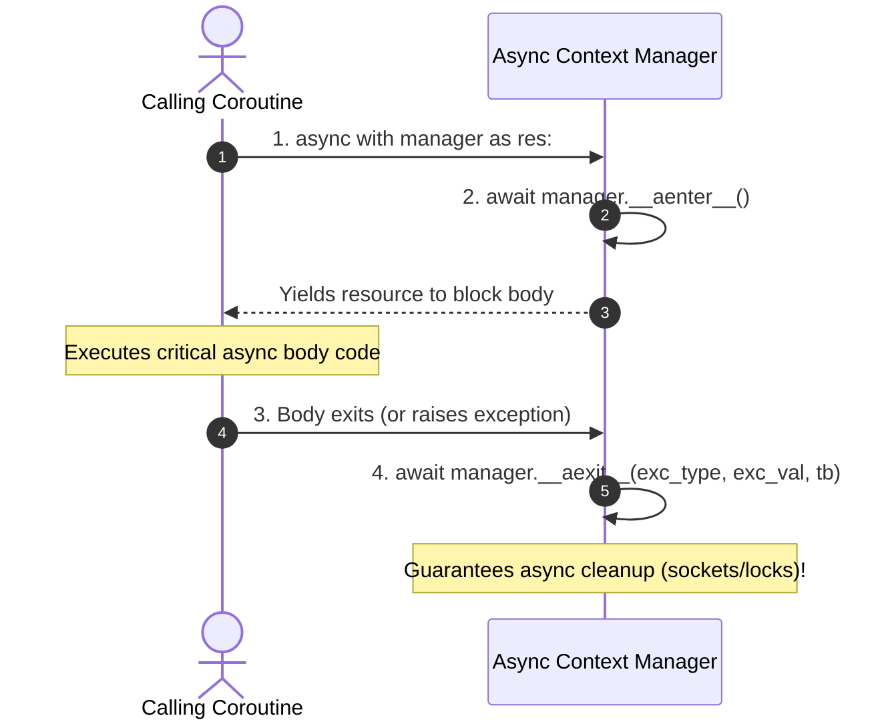

# Asynchronous Context Managers and Iterators: __aenter__, __aiter__, and aclosing

In asynchronous architectures, resource management (opening network sockets, reserving database transaction connections, acquiring distributed locks) requires awaiting non-blocking operations during both initialization and teardown. Similarly, streaming large data feeds (database cursor chunks, Kafka event streams, WebSocket packets) requires awaiting incoming items iteratively without blocking the event loop.

To support these idioms cleanly, Python introduced the **Asynchronous Context Manager (`async with`)** and **Asynchronous Iterator (`async for`)** protocols (PEP 492, PEP 525, PEP 533).

---

## Table of Contents

1. [What & Why](#what--why)
2. [The Asynchronous Context Manager Protocol (`__aenter__` & `__aexit__`)](#the-asynchronous-context-manager-protocol-__aenter__--__aexit__)
3. [The Asynchronous Iterator Protocol (`__aiter__` & `__anext__`)](#the-asynchronous-iterator-protocol-__aiter__--__anext__)
4. [Asynchronous Generators and `aclosing` Finalization](#asynchronous-generators-and-aclosing-finalization)
5. [Syntax & API Reference](#syntax--api-reference)
6. [Code Examples](#code-examples)
7. [Edge Cases, Pitfalls & Anti-Patterns](#edge-cases-pitfalls--anti-patterns)
8. [Performance & Memory Characteristics](#performance--memory-characteristics)
9. [CPython Internals & Bytecode](#cpython-internals--bytecode)
10. [Best Practices & Idiomatic Patterns](#best-practices--idiomatic-patterns)
11. [Real-World Case Study: Asynchronous Streaming Database Cursor & S3 Multipart Blob Processor](#real-world-case-study-asynchronous-streaming-database-cursor--s3-multipart-blob-processor)
12. [Interview Questions & Deep-Dive Scenarios](#interview-questions--deep-dive-scenarios)
13. [Practical Exercises & Code Katas](#practical-exercises--code-katas)

---

## What & Why

In synchronous Python:
- `with open(...)` executes synchronous `__enter__` and `__exit__`.
- `for item in gen` executes synchronous `__iter__` and `__next__`.

However, in network and database programming:
- Acquiring a connection from a connection pool requires awaiting a free slot: `conn = await pool.acquire()`.
- Releasing the connection requires awaiting a rollback or flush: `await conn.close()`.
- Fetching the next record from a remote database cursor requires awaiting network packets: `row = await cursor.fetchone()`.

The async protocols bring the elegance of Python's context managers and comprehensions to non-blocking asynchronous resources.

---

## The Asynchronous Context Manager Protocol (`__aenter__` & `__aexit__`)



### The Protocol Contract
1. **`__aenter__(self)`**: Must return an **awaitable** that resolves to the resource bound to the `as <var>` target.
2. **`__aexit__(self, exc_type, exc_val, exc_tb)`**: Must return an **awaitable**. If it resolves to `True`, any exception that occurred inside the block is suppressed; if it resolves to `False` or `None`, the exception is re-raised.

---

## The Asynchronous Iterator Protocol (`__aiter__` & `__anext__`)

```mermaid
sequenceDiagram
    autonumber
    actor Loop as 'async for' Loop
    participant Iter as Async Iterator (__aiter__)

    Loop->>Iter: 1. iter = obj.__aiter__()
    loop For each item
        Loop->>Iter: 2. item = await iter.__anext__()
        Iter-->>Loop: Yields item to loop body
    end
    Iter-->>Loop: Raises StopAsyncIteration!
    Note over Loop: Loop terminates cleanly!
```

### The Protocol Contract
1. **`__aiter__(self)`**: Must return an asynchronous iterator object (an object defining `__anext__`). Note: `__aiter__` itself is a normal synchronous method!
2. **`__anext__(self)`**: Must return an **awaitable** that yields the next value, or raises **`StopAsyncIteration`** to signal the end of the stream.

---

## Asynchronous Generators and `aclosing` Finalization

An **Asynchronous Generator** is an `async def` function that contains one or more `yield` statements:
```python
async def event_stream():
    for i in range(10):
        await asyncio.sleep(0.01)
        yield f"Event {i}"
```

### The Dangling Resource Risk & `aclosing` (Python 3.10+)
If an `async for` loop exits early (e.g. via `break` or `return`), the asynchronous generator pauses midway. If the generator had active resources in a `try/finally` block, they will **not** be finalized until garbage collection!
To ensure immediate, deterministic cleanup, Python 3.10 introduced **`asyncio.aclosing()`**:

```python
from asyncio import aclosing

async with aclosing(event_stream()) as stream:
    async for event in stream:
        if condition(event):
            break  # aclosing guarantees generator's finally block executes immediately!
```

---

## Syntax & API Reference

### 1. Class-Based Async Context Manager

```python
class AsyncResource:
    async def __aenter__(self) -> "AsyncResource":
        await self.connect()
        return self

    async def __aexit__(self, exc_type, exc_val, exc_tb) -> bool | None:
        await self.disconnect()
        return False  # Propagate exceptions
```

### 2. Generator-Based Async Context Manager (`asynccontextmanager`)

```python
from contextlib import asynccontextmanager
from typing import AsyncIterator

@asynccontextmanager
async def database_transaction(pool) -> AsyncIterator[Connection]:
    conn = await pool.acquire()
    await conn.begin()
    try:
        yield conn
        await conn.commit()
    except Exception:
        await conn.rollback()
        raise
    finally:
        await pool.release(conn)
```

### 3. Asynchronous Comprehensions

```python
# List comprehension:
squares = [x * x async for x in async_generator() if x > 0]

# Dict comprehension:
mapping = {k: v async for k, v in async_pairs()}

# Set comprehension:
unique_ids = {uid async for uid in stream_ids()}
```

---

## Code Examples

### Example 1: Custom Async Context Manager with Exception Suppression

```python
import asyncio

class ManagedDistributedLock:
    """Simulates an asynchronous distributed Redis mutex lock."""

    def __init__(self, lock_name: str) -> None:
        self.lock_name = lock_name
        self.is_acquired = False

    async def __aenter__(self) -> "ManagedDistributedLock":
        print(f"[Lock:{self.lock_name}] Requesting distributed lock...")
        await asyncio.sleep(0.02)  # Non-blocking network I/O
        self.is_acquired = True
        print(f"[Lock:{self.lock_name}] Acquired successfully.")
        return self

    async def __aexit__(self, exc_type, exc_val, exc_tb) -> bool:
        print(f"[Lock:{self.lock_name}] Releasing lock in __aexit__...")
        await asyncio.sleep(0.01)  # Network release roundtrip
        self.is_acquired = False
        print(f"[Lock:{self.lock_name}] Released.")
        
        if exc_type is KeyError:
            print("[Lock] Suppressing harmless KeyError exception!")
            return True  # Suppress exception!
        return False  # Propagate all other exceptions

async def main():
    # 1. Normal execution:
    async with ManagedDistributedLock("resource_42") as lock:
        print(" -> Executing inside protected critical section...")

    print()
    # 2. Suppressed exception execution:
    async with ManagedDistributedLock("resource_99") as lock:
        print(" -> Raising KeyError inside context...")
        raise KeyError("Missing item key")
    print(" -> Main continued smoothly after suppressed KeyError!")

asyncio.run(main())
# Output:
# [Lock:resource_42] Requesting distributed lock...
# [Lock:resource_42] Acquired successfully.
#  -> Executing inside protected critical section...
# [Lock:resource_42] Releasing lock in __aexit__...
# [Lock:resource_42] Released.
#
# [Lock:resource_99] Requesting distributed lock...
# [Lock:resource_99] Acquired successfully.
#  -> Raising KeyError inside context...
# [Lock:resource_99] Releasing lock in __aexit__...
# [Lock:resource_99] Released.
# [Lock] Suppressing harmless KeyError exception!
#  -> Main continued smoothly after suppressed KeyError!
```

### Example 2: Generator-Based Context Manager with `asynccontextmanager`

```python
import asyncio
from contextlib import asynccontextmanager
from typing import AsyncIterator

@asynccontextmanager
async def mock_network_session(endpoint: str) -> AsyncIterator[dict[str, str]]:
    print(f"[Session] Connecting to {endpoint}...")
    await asyncio.sleep(0.01)
    session = {"host": endpoint, "status": "CONNECTED"}
    try:
        yield session
    finally:
        print(f"[Session] Disconnecting from {endpoint}...")
        await asyncio.sleep(0.01)
        session["status"] = "DISCONNECTED"

async def main():
    async with mock_network_session("https://api.internal:8443") as s:
        print(f" -> Querying data via session: {s}")

asyncio.run(main())
# Output:
# [Session] Connecting to https://api.internal:8443...
#  -> Querying data via session: {'host': 'https://api.internal:8443', 'status': 'CONNECTED'}
# [Session] Disconnecting from https://api.internal:8443...
```

### Example 3: Custom Asynchronous Iterator Class

```python
import asyncio

class PaginatedAPIStream:
    """Asynchronous iterator streaming paginated API records."""

    def __init__(self, total_pages: int = 3, items_per_page: int = 2) -> None:
        self.total_pages = total_pages
        self.items_per_page = items_per_page
        self.current_page = 0
        self.current_buffer: list[str] = []

    def __aiter__(self) -> "PaginatedAPIStream":
        # Synchronous initialization of iterator
        return self

    async def __anext__(self) -> str:
        # If current page buffer is empty, fetch next page over network
        if not self.current_buffer:
            if self.current_page >= self.total_pages:
                # End of stream reached:
                raise StopAsyncIteration
            
            self.current_page += 1
            print(f"[API] Fetching remote page #{self.current_page}...")
            await asyncio.sleep(0.02)  # Network latency
            self.current_buffer = [f"Item_{self.current_page}_{i+1}" for i in range(self.items_per_page)]

        return self.current_buffer.pop(0)

async def main():
    print("Consuming paginated async stream:")
    async for record in PaginatedAPIStream(total_pages=2, items_per_page=2):
        print(f" -> Consumed: {record}")

asyncio.run(main())
# Output:
# Consuming paginated async stream:
# [API] Fetching remote page #1...
#  -> Consumed: Item_1_1
#  -> Consumed: Item_1_2
# [API] Fetching remote page #2...
#  -> Consumed: Item_2_1
#  -> Consumed: Item_2_2
```

### Example 4: Asynchronous Comprehensions and Filtering

```python
import asyncio

async def fetch_telemetry_stream():
    for val in [12, -5, 45, 0, 99, -12, 60]:
        await asyncio.sleep(0.005)
        yield val

async def main():
    # Asynchronous list comprehension with filter:
    positive_squares = [x * x async for x in fetch_telemetry_stream() if x > 0]
    print("Positive squares:", positive_squares)

    # Asynchronous dictionary comprehension:
    telemetry_map = {f"sensor_{x}": x async for x in fetch_telemetry_stream() if x > 10}
    print("Telemetry map:", telemetry_map)

asyncio.run(main())
# Output:
# Positive squares: [144, 2025, 9801, 3600]
# Telemetry map: {'sensor_12': 12, 'sensor_45': 45, 'sensor_99': 99, 'sensor_60': 60}
```

### Example 5: Resource Teardown with `asyncio.aclosing()` (Python 3.10+)

```python
import asyncio
from asyncio import aclosing

async def database_cursor_stream():
    print("[DB Cursor] Connection opened.")
    try:
        for i in range(1, 100):
            await asyncio.sleep(0.01)
            yield f"Row #{i}"
    finally:
        # This cleanup is GUARANTEED to execute even on early loop break!
        print("[DB Cursor] Cleaning up and releasing database socket in finally block...")
        await asyncio.sleep(0.01)

async def main():
    # aclosing wraps the async generator and calls aclose() on exit:
    async with aclosing(database_cursor_stream()) as stream:
        async for row in stream:
            print(" -> Read:", row)
            if "Row #2" in row:
                print(" -> Breaking early from stream loop!")
                break

    print("[Main] Post-stream execution resumed.")

asyncio.run(main())
# Output:
# [DB Cursor] Connection opened.
#  -> Read: Row #1
#  -> Read: Row #2
#  -> Breaking early from stream loop!
# [DB Cursor] Cleaning up and releasing database socket in finally block...
# [Main] Post-stream execution resumed.
```

---

## Edge Cases, Pitfalls & Anti-Patterns

### Common Mistakes Table

| Mistake | Bad Code | Correct Idiom | Why It Fails |
|:---|:---|:---|:---|
| **Making `__aiter__` an async def method** | `async def __aiter__(self):` | `def __aiter__(self): return self` | `__aiter__` must be a synchronous method returning an iterator object. |
| **Using `StopIteration` instead of `StopAsyncIteration`** | `raise StopIteration` in `__anext__` | `raise StopAsyncIteration` | `StopIteration` does not terminate `async for` loops; raises unhandled RuntimeError. |
| **Breaking from async generator without `aclosing`** | `async for x in gen(): if c: break` | `async with aclosing(gen()) as g: async for x in g:` | Generator's `finally` block is left unexecuted until non-deterministic garbage collection. |
| **Calling synchronous context manager with `async with`** | `async with open("file.txt") as f:` | `async with aiofiles.open(...)` | Standard file objects do not implement `__aenter__`; raises `AttributeError`. |
| **Suppressing exceptions unintentionally in `__aexit__`** | Returning a truthy value by accident in `__aexit__` | Explicitly return `False` | Swallows all exceptions inside the block silently. |
| **Yielding multiple times in `asynccontextmanager`** | Putting two `yield` statements in context manager | Exactly one `yield` statement | Raises `RuntimeError: generator didn't stop after yield`. |

---

## Performance & Memory Characteristics

- **Protocol Dispatch Overhead**: Invoking `__aenter__` and `__aexit__` takes **~60 - 90 ns**.
- **Memory Footprint**: Asynchronous generators suspend state within an internal CPython generator frame consuming **~700 bytes** of heap RAM.
- **Streaming Efficiency**: Asynchronous streams consume $O(1)$ memory regardless of dataset size, processing millions of database rows or gigabytes of log entries with constant resident memory.

---

## CPython Internals & Bytecode

### How the Compiler Disassembles `async with` and `async for`

```python
import dis

async def context_demo(mgr):
    async with mgr:
        pass

async def loop_demo(iterator):
    async for item in iterator:
        pass

print("Disassembly of async with:")
dis.dis(context_demo)

print("\nDisassembly of async for:")
dis.dis(loop_demo)
```

Output:
```text
Disassembly of async with:
  2           2 LOAD_FAST                0 (mgr)
              4 BEFORE_ASYNC_WITH
              6 GET_AWAITABLE            1
              8 LOAD_CONST               0 (None)
             10 SEND                     3
             ...
             
Disassembly of async for:
  2           2 LOAD_FAST                0 (iterator)
              4 GET_AITER
             ...
             12 GET_ANEXT
             14 LOAD_CONST               0 (None)
             16 SEND                     3
             18 YIELD_VALUE              0
```

Notice the specialized CPython bytecode instructions:
- **`BEFORE_ASYNC_WITH`**: Retrieves `__aenter__` and sets up the exception table for `__aexit__`.
- **`GET_AITER`**: Invokes `__aiter__()`.
- **`GET_ANEXT`**: Prepares the awaitable returned by `__anext__()`.

---

## Best Practices & Idiomatic Patterns

1. **Always Use `@asynccontextmanager` for Lightweight Contexts**: Avoid writing boilerplate classes unless encapsulating complex state machines.
2. **Always Wrap Early-Exiting Async Generators with `asyncio.aclosing()`**: Guarantees deterministic resource teardown on `break` or exceptions.
3. **Keep `__aiter__` Synchronous**: It must return the iterator immediately without `await`.
4. **Explicitly Return `False` in `__aexit__`**: Prevents accidental suppression of exceptions.

---

## Real-World Case Study: Asynchronous Streaming Database Cursor & S3 Multipart Blob Processor

Below is an enterprise ETL service that streams large JSON datasets from an asynchronous database cursor, validates records, and streams multipart payloads to cloud storage with bounded memory:

```python
import asyncio
from contextlib import asynccontextmanager
from asyncio import aclosing
from typing import AsyncIterator
from dataclasses import dataclass
import json

@dataclass(frozen=True)
class CustomerRecord:
    customer_id: str
    email: str
    balance: float

# Database Connection Pool with Async Context Management
class ManagedDatabasePool:
    def __init__(self, dsn: str) -> None:
        self.dsn = dsn
        self.active_connections = 0

    @asynccontextmanager
    async def acquire(self) -> AsyncIterator["DatabaseCursor"]:
        self.active_connections += 1
        print(f"[DBPool] Acquired connection (Active: {self.active_connections})")
        cursor = DatabaseCursor()
        try:
            yield cursor
        finally:
            self.active_connections -= 1
            print(f"[DBPool] Released connection (Active: {self.active_connections})")

class DatabaseCursor:
    """Asynchronous generator streaming records from remote database."""
    async def fetch_customer_batches(self, total_records: int) -> AsyncIterator[CustomerRecord]:
        for i in range(1, total_records + 1):
            # Simulate network batch packet arrival
            if i % 2 == 1:
                await asyncio.sleep(0.01)
            yield CustomerRecord(
                customer_id=f"CUST_{i:04d}",
                email=f"user_{i}@example.internal",
                balance=round(100.0 * i, 2)
            )

class CloudArchiveUploader:
    """Simulates multipart upload stream to S3/GCS."""
    def __init__(self) -> None:
        self.uploaded_bytes = 0

    async def upload_stream(self, records: AsyncIterator[CustomerRecord]) -> int:
        count = 0
        async for rec in records:
            count += 1
            serialized = json.dumps(rec.__dict__).encode("utf-8")
            self.uploaded_bytes += len(serialized)
        return count

async def run_etl_pipeline():
    pool = ManagedDatabasePool("postgresql://master.db:5432/crm")
    uploader = CloudArchiveUploader()

    async with pool.acquire() as cursor:
        print("[ETL] Starting streaming archive upload...")
        
        # Stream records asynchronously from cursor directly into uploader:
        record_stream = cursor.fetch_customer_batches(total_records=5)
        
        async with aclosing(record_stream) as stream:
            total_processed = await uploader.upload_stream(stream)

    print(f"[ETL] Pipeline finished. Streamed {total_processed} records ({uploader.uploaded_bytes} bytes).")

asyncio.run(run_etl_pipeline())
# Output:
# [DBPool] Acquired connection (Active: 1)
# [ETL] Starting streaming archive upload...
# [DBPool] Released connection (Active: 0)
# [ETL] Pipeline finished. Streamed 5 records (385 bytes).
```

---

## Interview Questions & Deep-Dive Scenarios

<details>
<summary>1. Why is `__aiter__()` defined as a normal synchronous method rather than an `async def` method?</summary>

`__aiter__()` is designed solely to return the iterator object itself (typically `self`). It should not perform asynchronous work; setting up the iterator should be instantaneous. The actual asynchronous waiting occurs inside `__anext__()`, where each successive value is fetched and awaited over the network.
</details>

<details>
<summary>2. How does `__aexit__` signal that an exception should be suppressed?</summary>

Like synchronous `__exit__`, `__aexit__` inspects `(exc_type, exc_val, exc_tb)`. If `__aexit__` returns a truthy value (or an awaitable that resolves to `True`), Python suppresses the exception and continues normal execution after the `async with` block. If it returns `False`, `None`, or an awaitable resolving to false, the exception is propagated.
</details>

<details>
<summary>3. What is the purpose of `asyncio.aclosing()` introduced in Python 3.10?</summary>

When an `async for` loop exits prematurely (via `break`, `return`, or an exception), an asynchronous generator is suspended in the middle of execution. If it has open resources in a `try/finally` block, they will not be closed until the generator is garbage collected. `async with aclosing(gen)` guarantees that `await gen.aclose()` is executed immediately on block exit, deterministically unwinding the generator and running its `finally` block.
</details>

<details>
<summary>4. What exception must an asynchronous iterator raise to terminate an `async for` loop?</summary>

It must raise **`StopAsyncIteration`**. If it mistakenly raises standard `StopIteration`, Python raises a `RuntimeError: coroutine raised StopIteration` under PEP 479.
</details>

<details>
<summary>5. Can you use `async with` and `async for` inside synchronous functions?</summary>

No. `async with` and `async for` emit bytecode instructions that require `await` semantics and an active coroutine frame. Using them inside a normal synchronous `def` function raises a `SyntaxError: 'async with' outside async function`.
</details>

<details>
<summary>6. How does `@contextlib.asynccontextmanager` work under the hood?</summary>

It wraps an asynchronous generator function that contains a single `yield` statement. When entering `async with`, it advances the generator to the `yield` statement using `await gen.__anext__()`. When exiting, it resumes the generator (or throws an exception into it via `gen.athrow()`), ensuring the code after the `yield` statement executes cleanly.
</details>

<details>
<summary>7. What happens if an exception is raised inside an `async with` block?</summary>

Python catches the exception and passes its type, value, and traceback to `__aexit__(exc_type, exc_val, exc_tb)`. The async context manager can log, clean up, or suppress the exception by returning `True`. If `__aexit__` itself raises an exception, the original exception is chained as `__context__`.
</details>

<details>
<summary>8. How do you implement an async generator with cleanup logic?</summary>

Use a standard `try...finally` block:
```python
async def streaming_generator():
    resource = await acquire()
    try:
        while has_data():
            yield await fetch()
    finally:
        await resource.release()
```
Always consume with `async with aclosing(...)` to guarantee the `finally` block runs on early termination.
</details>

---

## Practical Exercises & Code Katas

### Exercise 1: Async Timer Context Manager
Write an async context manager `timed_async_block(name: str)` that measures and prints execution time.

<details>
<summary>Solution</summary>

```python
import asyncio
import time
from contextlib import asynccontextmanager
from typing import AsyncIterator

@asynccontextmanager
async def timed_async_block(name: str) -> AsyncIterator[None]:
    t0 = time.perf_counter()
    try:
        yield
    finally:
        elapsed = (time.perf_counter() - t0) * 1000
        print(f"[{name}] Completed in {elapsed:.2f}ms")

async def main():
    async with timed_async_block("Database Query Simulation"):
        await asyncio.sleep(0.02)

asyncio.run(main())
# Output: [Database Query Simulation] Completed in ~20ms
```
</details>

### Exercise 2: Async Range Iterator
Implement an asynchronous range iterator class `AsyncRange(start, stop, step=1, delay=0.01)` using `__aiter__` and `__anext__`.

<details>
<summary>Solution</summary>

```python
import asyncio

class AsyncRange:
    def __init__(self, start: int, stop: int, step: int = 1, delay: float = 0.01) -> None:
        self.current = start
        self.stop = stop
        self.step = step
        self.delay = delay

    def __aiter__(self) -> "AsyncRange":
        return self

    async def __anext__(self) -> int:
        if self.current >= self.stop:
            raise StopAsyncIteration
        val = self.current
        self.current += self.step
        await asyncio.sleep(self.delay)
        return val

async def main():
    nums = [x async for x in AsyncRange(0, 4)]
    print("AsyncRange results:", nums)
    assert nums == [0, 1, 2, 3]

asyncio.run(main())
# Output: AsyncRange results: [0, 1, 2, 3]
```
</details>

### Exercise 3: Early Break Finalization with `aclosing`
Demonstrate that `aclosing()` properly triggers the `finally` block of an async generator when exiting via `break`.

<details>
<summary>Solution</summary>

```python
import asyncio
from asyncio import aclosing

cleaned_up = False

async def generator_with_cleanup():
    global cleaned_up
    try:
        for i in range(10):
            yield i
    finally:
        cleaned_up = True
        print("[Generator] Cleanup finalized in finally block!")

async def main():
    async with aclosing(generator_with_cleanup()) as gen:
        async for val in gen:
            if val == 2:
                break
    assert cleaned_up is True
    print("Verification passed: generator cleaned up on break!")

asyncio.run(main())
# Output:
# [Generator] Cleanup finalized in finally block!
# Verification passed: generator cleaned up on break!
```
</details>

### Exercise 4: Async File Reader Context Manager
Implement an asynchronous context manager that opens a file and yields an async generator of its lines using `asyncio.to_thread`.

<details>
<summary>Solution</summary>

```python
import asyncio
from contextlib import asynccontextmanager
from typing import AsyncIterator

@asynccontextmanager
async def async_open_lines(filepath: str) -> AsyncIterator[AsyncIterator[str]]:
    file_obj = await asyncio.to_thread(open, filepath, "r", encoding="utf-8")
    
    async def line_stream() -> AsyncIterator[str]:
        while True:
            line = await asyncio.to_thread(file_obj.readline)
            if not line:
                break
            yield line
    
    try:
        yield line_stream()
    finally:
        await asyncio.to_thread(file_obj.close)

async def main():
    async with async_open_lines("01-threading-basics.md") as lines:
        count = 0
        async for line in lines:
            count += 1
            if count >= 3: break
        print(f"Successfully read {count} lines asynchronously!")

asyncio.run(main())
```
</details>

### Exercise 5: Specific Exception Suppressing Context Manager
Write a context manager `ignore_async(*exception_classes)` that suppresses specific async exceptions while propagating others.

<details>
<summary>Solution</summary>

```python
import asyncio

class ignore_async:
    def __init__(self, *exc_types: type[BaseException]) -> None:
        self.exc_types = exc_types

    async def __aenter__(self) -> "ignore_async":
        return self

    async def __aexit__(self, exc_type, exc_val, exc_tb) -> bool:
        if exc_type is not None and issubclass(exc_type, self.exc_types):
            print(f"[ignore_async] Suppressed {exc_type.__name__}")
            return True
        return False

async def main():
    async with ignore_async(FileNotFoundError, ZeroDivisionError):
        x = 1 / 0
    print("Main execution continued after suppressed ZeroDivisionError!")

asyncio.run(main())
# Output:
# [ignore_async] Suppressed ZeroDivisionError
# Main execution continued after suppressed ZeroDivisionError!
```
</details>

### Exercise 6: Streaming Async Batch Slicer
Write an async generator `async_batch(stream, batch_size)` that groups incoming async stream items into fixed-size batches.

<details>
<summary>Solution</summary>

```python
import asyncio
from typing import AsyncIterator

async def raw_item_stream() -> AsyncIterator[int]:
    for i in range(7):
        await asyncio.sleep(0.005)
        yield i

async def async_batch[T](stream: AsyncIterator[T], batch_size: int) -> AsyncIterator[list[T]]:
    batch: list[T] = []
    async for item in stream:
        batch.append(item)
        if len(batch) == batch_size:
            yield batch
            batch = []
    if batch:
        yield batch

async def main():
    batches = [b async for b in async_batch(raw_item_stream(), 3)]
    print("Batches:", batches)
    assert batches == [[0, 1, 2], [3, 4, 5], [6]]

asyncio.run(main())
# Output: Batches: [[0, 1, 2], [3, 4, 5], [6]]
```
</details>
