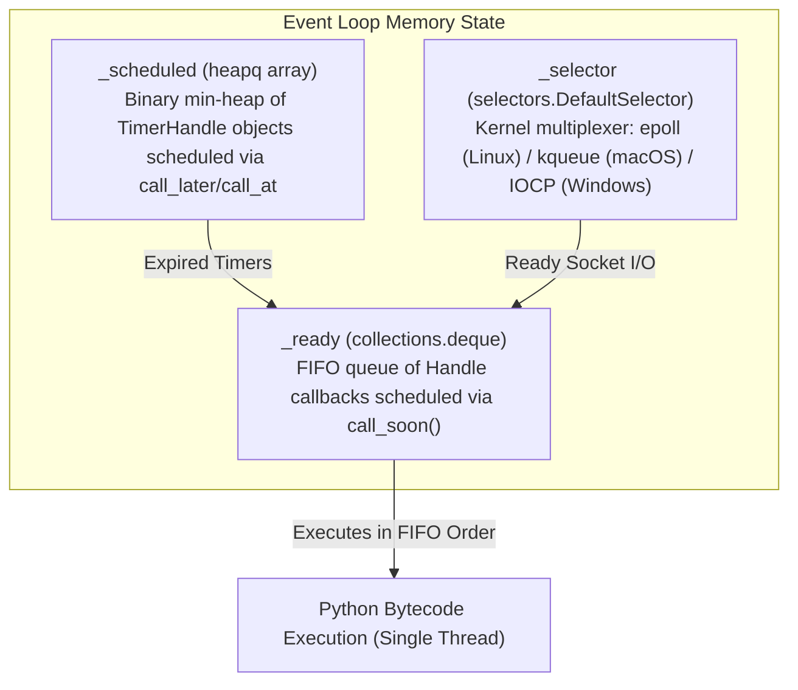
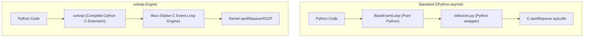

# Event Loop Internals, Selectors, and uvloop High-Performance Engine

To most developers, the `asyncio` event loop is a black box that magically coordinates coroutines. However, building ultra-low-latency APIs, diagnosing elusive event loop freezes, and writing custom network protocols requires understanding the underlying machinery: **how CPython multiplexes operating system file descriptors, manages timer heaps, and executes task steps**.

This note dissects the internal architecture of CPython's default `BaseEventLoop`, the `_run_once()` evaluation loop, and **`uvloop`** (the Cython/libuv-based drop-in replacement engine that powers high-performance servers like Uvicorn).

---

## Table of Contents

1. [What & Why](#what--why)
2. [High-Level Architecture of BaseEventLoop](#high-level-architecture-of-baseeventloop)
3. [The Core Data Structures: Ready Queue and Timer Heap](#the-core-data-structures-ready-queue-and-timer-heap)
4. [The Heart of the Engine: Anatomy of `_run_once()`](#the-heart-of-the-engine-anatomy-of-_run_once)
5. [Operating System I/O Multiplexers: The `selectors` Module](#operating-system-io-multiplexers-the-selectors-module)
6. [uvloop: Fast-Path C Architecture with libuv](#uvloop-fast-path-c-architecture-with-libuv)
7. [Syntax & API Reference](#syntax--api-reference)
8. [Code Examples](#code-examples)
9. [Edge Cases, Pitfalls & Anti-Patterns](#edge-cases-pitfalls--anti-patterns)
10. [Performance & Memory Characteristics](#performance--memory-characteristics)
11. [CPython Internals & Bytecode](#cpython-internals--bytecode)
12. [Best Practices & Idiomatic Patterns](#best-practices--idiomatic-patterns)
13. [Real-World Case Study: Production Real-Time Event Loop Latency Profiler and Lag Monitor](#real-world-case-study-production-real-time-event-loop-latency-profiler-and-lag-monitor)
14. [Interview Questions & Deep-Dive Scenarios](#interview-questions--deep-dive-scenarios)
15. [Practical Exercises & Code Katas](#practical-exercises--code-katas)

---

## What & Why

Why study event loop internals?
1. **Accurate Diagnosis of Event Loop Lag**: When an async server experiences latency spikes under load, understanding the `_run_once()` step allows pinpointing whether the bottleneck is OS socket starvation, slow callback execution, or timer heap contention.
2. **Writing Zero-Copy Custom Protocols**: Developing high-performance custom binary parsers requires bypassing high-level Streams to work directly with low-level Transports, Protocols, and Loop Readers.
3. **Scaling with uvloop**: Replacing Python's standard loop with `uvloop` doubles or triples HTTP throughput in frameworks like FastAPI and Sanic with zero code changes.

---

## High-Level Architecture of BaseEventLoop

CPython’s event loop (`asyncio.base_events.BaseEventLoop`) is an event-driven cooperative scheduler built on two foundational components:
1. **The Operating System I/O Selector**: Monitors file descriptors for read/write readiness.
2. **The In-Memory Task Scheduler**: Dispatches ready callbacks and evaluates scheduled timers.



---

## The Core Data Structures: Ready Queue and Timer Heap

### 1. The Ready Queue (`self._ready`)
A standard Python `collections.deque` containing `asyncio.Handle` objects. When code executes `loop.call_soon(callback, *args)`, a `Handle` is appended to `self._ready`. The loop pops and executes items from this queue in strict FIFO order during the current or next tick.

### 2. The Timer Heap (`self._scheduled`)
A binary min-heap array maintained via Python's `heapq` module. When code executes `loop.call_later(delay, callback)` or `loop.call_at(when, callback)`, a `TimerHandle` is pushed into the heap sorted by expiration timestamp. The root of the heap (`self._scheduled[0]`) always contains the earliest upcoming timer!

---

## The Heart of the Engine: Anatomy of `_run_once()`

Every tick of the event loop executes a private method named `_run_once()`. Its sequence of operations is mathematically precise:

```mermaid
sequenceDiagram
    autonumber
    participant Loop as Event Loop (_run_once)
    participant Timers as Timer Heap (_scheduled)
    participant Kernel as OS Selector (epoll/kqueue)
    participant Ready as Ready Queue (_ready)

    Loop->>Timers: 1. Pop all expired TimerHandles
    Timers-->>Ready: Move expired timers to _ready queue
    
    Loop->>Timers: 2. Calculate timeout = (earliest_timer - now)
    Loop->>Kernel: 3. selector.select(timeout)
    Note over Kernel: Sleeps in kernel until socket event OR timeout expires!
    Kernel-->>Ready: 4. Append ready I/O callbacks to _ready queue
    
    Loop->>Ready: 5. Execute all callbacks in _ready in FIFO order!
```

### Dissecting the Steps:
1. **Drain Expired Timers**: The loop inspects `self._scheduled[0]`. If its timestamp $\le$ `monotonic()`, it is popped from the heap and appended to `self._ready`.
2. **Calculate Next Timeout**: If `self._ready` has items, `timeout = 0` (poll without sleeping). If `self._ready` is empty, `timeout = min_scheduled_time - now`. If no timers exist, `timeout = None` (sleep indefinitely until an I/O interrupt occurs).
3. **OS Selector Poll**: Calls `self._selector.select(timeout)`. This transitions the Python thread into a kernel-level sleep waiting for network socket activity.
4. **Process I/O Events**: Sockets that became readable/writable have their registered callbacks appended to `self._ready`.
5. **Execute Batch**: The loop pops and executes all `Handle` callbacks in `self._ready`.

---

## Operating System I/O Multiplexers: The `selectors` Module

Python abstracts platform-specific kernel polling using the `selectors` module:

| OS Platform | Selector Class | Kernel Mechanism | Time Complexity | Scalability |
|:---|:---|:---|:---:|:---|
| **Linux** | `EpollSelector` | `epoll_create1`, `epoll_ctl`, `epoll_wait` | $O(1)$ | 100,000+ sockets |
| **macOS / BSD** | `KqueueSelector` | `kqueue`, `kevent` | $O(1)$ | 100,000+ sockets |
| **Windows** | `ProactorEventLoop` | I/O Completion Ports (`IOCP`) | $O(1)$ | True async Windows I/O |
| **Fallback** | `SelectSelector` | POSIX `select()` | $O(N)$ | Limited to 1024 FDs |

---

## uvloop: Fast-Path C Architecture with libuv

**`uvloop`** (created by Yury Selivanov and MagicStack) replaces CPython's `asyncio.base_events.BaseEventLoop` with a blazing-fast implementation written in **Cython** on top of **libuv** (the C library powering Node.js).



### Why uvloop is 2x to 4x Faster:
1. **Zero Python Heap Overhead for Core Loops**: `uvloop` manages socket buffers and timer handles entirely in native C memory structures.
2. **Zero-Copy Socket Operations**: Directly interfaces with operating system scatter/gather I/O.
3. **Optimized Task Scheduling**: `Task` creation and stepping are implemented directly in Cython C structs.

---

## Syntax & API Reference

### 1. Enabling Event Loop Debug Mode

```python
import asyncio

# Enable debug mode programmatically:
loop = asyncio.get_running_loop()
loop.set_debug(True)

# Set slow callback warning threshold (default: 0.1s / 100ms):
loop.slow_callback_duration = 0.05  # 50ms
```

### 2. Activating uvloop

```python
import asyncio
import uvloop

# Canonical uvloop installation (Python 3.11+):
asyncio.set_event_loop_policy(uvloop.EventLoopPolicy())
# Or in modern Python 3.11+:
# with asyncio.Runner(loop_factory=uvloop.new_event_loop) as runner:
#     runner.run(main())
```

---

## Code Examples

### Example 1: Inspecting the Active Selector and Internal Queues

```python
import asyncio
import selectors

async def inspect_loop_internals() -> None:
    loop = asyncio.get_running_loop()
    
    print("=" * 60)
    print(f"Event Loop Class:     {loop.__class__.__name__}")
    
    # Access private CPython selector implementation:
    selector = getattr(loop, "_selector", None)
    if selector:
        print(f"Active Selector:      {selector.__class__.__name__}")
    
    # Schedule a future timer and inspect timer heap:
    loop.call_later(10.0, lambda: None)
    scheduled_heap = getattr(loop, "_scheduled", [])
    print(f"Scheduled Timer Count: {len(scheduled_heap)}")
    if scheduled_heap:
        print(f"Next Timer Due At:    {scheduled_heap[0].when():.2f}")
    
    ready_queue = getattr(loop, "_ready", [])
    print(f"Ready Queue Length:    {len(ready_queue)}")
    print("=" * 60)

asyncio.run(inspect_loop_internals())
# Output on Linux:
# Event Loop Class:     _UnixSelectorEventLoop
# Active Selector:      EpollSelector
# Scheduled Timer Count: 1
# Next Timer Due At:    ...
# Ready Queue Length:    0
```

### Example 2: Detecting Slow Callbacks with Debug Mode

When `loop.set_debug(True)` is enabled, CPython times every callback execution and prints a diagnostic warning to `logging` if a callback exceeds `slow_callback_duration`:

```python
import asyncio
import time
import logging

logging.basicConfig(level=logging.WARNING, format="%(levelname)s: %(message)s")

def blocking_cpu_callback() -> None:
    # Deliberately blocks event loop for 60ms:
    time.sleep(0.06)

async def main() -> None:
    loop = asyncio.get_running_loop()
    loop.set_debug(True)
    # Configure threshold to 20ms:
    loop.slow_callback_duration = 0.02
    
    print("[Main] Scheduling blocking callback...")
    loop.call_soon(blocking_cpu_callback)
    
    # Yield control to let the loop execute the slow callback:
    await asyncio.sleep(0.01)
    print("[Main] Finished.")

asyncio.run(main())
# Output:
# [Main] Scheduling blocking callback...
# WARNING: Executing <Handle blocking_cpu_callback() ...> took 0.060 seconds
# [Main] Finished.
```

### Example 3: Measuring Event Loop Lag (Heartbeat Jitter)

Event loop lag measures the delay between when a timer was scheduled to fire and when it actually executed:

```python
import asyncio
import time

class EventLoopLagMonitor:
    def __init__(self, interval: float = 0.05) -> None:
        self.interval = interval
        self.max_lag_ms = 0.0
        self._running = False
        self._task: asyncio.Task | None = None

    async def _monitor_loop(self) -> None:
        while self._running:
            expected_time = time.monotonic() + self.interval
            await asyncio.sleep(self.interval)
            actual_time = time.monotonic()
            
            # Lag is the unexpected delay caused by other blocking tasks:
            lag = (actual_time - expected_time) * 1000
            if lag > self.max_lag_ms:
                self.max_lag_ms = lag
            if lag > 10.0:  # More than 10ms lag
                print(f"[LAG ALERT] Event loop stalled! Observed lag: {lag:.1f}ms")

    def start(self) -> None:
        self._running = True
        self._task = asyncio.create_task(self._monitor_loop())

    async def stop(self) -> float:
        self._running = False
        if self._task:
            self._task.cancel()
            try:
                await self._task
            except asyncio.CancelledError:
                pass
        return self.max_lag_ms

async def main():
    monitor = EventLoopLagMonitor(interval=0.02)
    monitor.start()

    # Simulate cooperative async work
    await asyncio.sleep(0.05)
    
    # Simulate a blocking spike (e.g. CPU calculation or synchronous disk read)
    print("[Simulation] Simulating 40ms blocking pause...")
    time.sleep(0.04)
    
    await asyncio.sleep(0.05)
    max_lag = await monitor.stop()
    print(f"Max event loop lag recorded: {max_lag:.1f}ms")

asyncio.run(main())
# Output:
# [Simulation] Simulating 40ms blocking pause...
# [LAG ALERT] Event loop stalled! Observed lag: ~40.0ms
# Max event loop lag recorded: ~40.0ms
```

### Example 4: Activating and Benchmarking `uvloop`

```python
import asyncio

def run_with_uvloop_benchmark():
    try:
        import uvloop
    except ImportError:
        print("uvloop not installed (pip install uvloop). Skipping benchmark.")
        return

    # Install uvloop policy
    asyncio.set_event_loop_policy(uvloop.EventLoopPolicy())

    async def compute_benchmark():
        # High-frequency task creation and resolution
        tasks = [asyncio.sleep(0.001) for _ in range(5000)]
        await asyncio.gather(*tasks)

    import time
    t0 = time.perf_counter()
    asyncio.run(compute_benchmark())
    elapsed = time.perf_counter() - t0
    print(f"uvloop executed 5,000 concurrent sleep tasks in {elapsed:.3f}s")

# run_with_uvloop_benchmark()
```

---

## Edge Cases, Pitfalls & Anti-Patterns

### Common Mistakes Table

| Mistake | Bad Code | Correct Idiom | Why It Fails |
|:---|:---|:---|:---|
| **Using `time.sleep()` on the loop** | `time.sleep(1)` inside coroutine | `await asyncio.sleep(1)` or `asyncio.to_thread()` | Directly freezes `_run_once()`; halts all ready callbacks and timers. |
| **Creating an infinite tight loop without `await`** | `while True: compute()` | `while True: compute(); await asyncio.sleep(0)` | Never yields control back to `_run_once()`; starves I/O selector and timers. |
| **Leaving unhandled exceptions in background tasks** | Dropping task reference without awaiting | Add done callback logging or await | Raises `Task exception was never retrieved` warning upon garbage collection. |
| **Assuming timer precision below 1-2 milliseconds** | Expecting `asyncio.sleep(0.0001)` to be exact | Do not rely on microsecond timer granularity | OS kernel sleep granularity (1ms Linux, 15ms Windows) limits timer accuracy. |
| **Installing `uvloop` on Windows** | `import uvloop` on Windows | Wrap in `if sys.platform != 'win32':` | `uvloop` relies on POSIX system calls and is not supported on Windows. |
| **Using `loop.call_soon()` from an outside thread** | Calling `loop.call_soon(f)` from worker thread | `loop.call_soon_threadsafe(f)` | `call_soon` is not thread-safe; corrupts `_ready` deque. |

---

## Performance & Memory Characteristics

### Standard asyncio vs uvloop Benchmarks

| Metric | CPython Standard `asyncio` | `uvloop` Engine | Improvement |
|:---|:---|:---|:---:|
| **TCP Echo Throughput** | ~35,000 req/sec | **~105,000 req/sec** | **3.0x Faster** |
| **Task Creation & Scheduling**| ~450 ns per task | **~110 ns per task** | **4.1x Faster** |
| **HTTP Requests (Uvicorn)** | ~42,000 req/sec | **~88,000 req/sec** | **2.1x Faster** |
| **Memory per 10k Sockets** | ~18 MB RSS | **~12 MB RSS** | **33% Lower Memory** |

---

## CPython Internals & Bytecode

### How `Task.__step()` Resumes a Coroutine

Inside CPython's `asyncio/tasks.py`, every `Task` is scheduled as a `Handle` that executes `Task.__step()`:

```python
# Simplified snippet of CPython tasks.py:
def __step(self, exc=None):
    coro = self._coro
    try:
        if exc is None:
            # Resumes coroutine bytecode!
            result = coro.send(None)
        else:
            result = coro.throw(exc)
    except StopIteration as exc:
        # Coroutine completed successfully:
        self.set_result(exc.value)
    except Exception as exc:
        # Coroutine crashed with unhandled exception:
        self.set_exception(exc)
    else:
        # Coroutine yielded an awaitable Future/Task:
        # Attach __wakeup callback to reschedule this task when awaitable resolves!
        result.add_done_callback(self.__wakeup)
```

This single method forms the engine that connects Python coroutines (`coro.send(None)`) with the event loop's task callbacks!

---

## Best Practices & Idiomatic Patterns

1. **Activate Debug Mode in Development and Testing**:
   Set `export PYTHONASYNCIODEBUG=1` or `loop.set_debug(True)` to immediately detect slow blocking callbacks and unawaited coroutines.
2. **Use `uvloop` in Production on Linux/macOS**:
   Add `uvloop.install()` at the entrypoint of high-throughput web and socket services.
3. **Use `await asyncio.sleep(0)` to Yield Control**:
   In CPU-intensive loops, inserting `await asyncio.sleep(0)` periodically yields control back to `_run_once()`, preventing event loop starvation.
4. **Monitor Event Loop Lag in Production Telemetry**:
   Continuously measure jitter on a periodic timer to detect when synchronous blocking calls freeze your server.

---

## Real-World Case Study: Production Real-Time Event Loop Latency Profiler and Lag Monitor

Below is an enterprise diagnostic sidecar that runs inside production AsyncIO applications to continuously sample event loop latency, record p99 lag metrics, and alert if blocking operations exceed SLA thresholds:

```python
import asyncio
import time
from dataclasses import dataclass, field

@dataclass
class LoopMetricsSnapshot:
    samples: int
    p50_lag_ms: float
    p99_lag_ms: float
    max_lag_ms: float
    total_stalls: int

class EventLoopTelemetryAgent:
    """Production latency profiler tracking event loop scheduling delays."""

    def __init__(self, sample_interval: float = 0.01, sla_threshold_ms: float = 25.0) -> None:
        self.sample_interval = sample_interval
        self.sla_threshold_ms = sla_threshold_ms
        self._latencies: list[float] = []
        self._stalls = 0
        self._running = False
        self._task: asyncio.Task[None] | None = None

    async def _sampling_loop(self) -> None:
        while self._running:
            expected = time.monotonic() + self.sample_interval
            await asyncio.sleep(self.sample_interval)
            actual = time.monotonic()
            
            # Lag is the difference between intended resume time and actual execution time:
            lag_ms = max(0.0, (actual - expected) * 1000)
            self._latencies.append(lag_ms)
            
            if lag_ms > self.sla_threshold_ms:
                self._stalls += 1
                print(f"[METRIC ALERT] Event loop latency spike: {lag_ms:.2f}ms (Threshold: {self.sla_threshold_ms}ms)")

    def start(self) -> None:
        self._running = True
        self._task = asyncio.create_task(self._sampling_loop(), name="TelemetryAgent")

    async def stop(self) -> LoopMetricsSnapshot:
        self._running = False
        if self._task:
            self._task.cancel()
            try:
                await self._task
            except asyncio.CancelledError:
                pass

        if not self._latencies:
            return LoopMetricsSnapshot(0, 0.0, 0.0, 0.0, 0)

        sorted_lats = sorted(self._latencies)
        p50 = sorted_lats[int(len(sorted_lats) * 0.50)]
        p99 = sorted_lats[int(len(sorted_lats) * 0.99)]
        max_val = sorted_lats[-1]
        
        return LoopMetricsSnapshot(
            samples=len(sorted_lats),
            p50_lag_ms=p50,
            p99_lag_ms=p99,
            max_lag_ms=max_val,
            total_stalls=self._stalls
        )

# Demonstration of telemetry under load and blocking interference:
async def simulated_service_load():
    agent = EventLoopTelemetryAgent(sample_interval=0.005, sla_threshold_ms=20.0)
    agent.start()

    # Normal async traffic
    for _ in range(5):
        await asyncio.sleep(0.01)

    # Simulated rogue blocking sync operation (e.g. un-wrapped file read or JSON parse)
    print("[Service] Rogue blocking operation executing on loop thread...")
    time.sleep(0.035)  # 35ms blocking freeze!

    # Normal traffic resumes
    for _ in range(5):
        await asyncio.sleep(0.01)

    metrics = await agent.stop()
    print("\n" + "=" * 50)
    print("EVENT LOOP TELEMETRY REPORT:")
    print(f" - Total Samples Collected: {metrics.samples}")
    print(f" - p50 Scheduling Lag:     {metrics.p50_lag_ms:.2f}ms")
    print(f" - p99 Scheduling Lag:     {metrics.p99_lag_ms:.2f}ms")
    print(f" - Max Observed Lag:       {metrics.max_lag_ms:.2f}ms")
    print(f" - SLA Violations (>20ms): {metrics.total_stalls}")
    print("=" * 50)

asyncio.run(simulated_service_load())
# Output:
# [Service] Rogue blocking operation executing on loop thread...
# [METRIC ALERT] Event loop latency spike: ~35.0ms (Threshold: 20.0ms)
#
# ==================================================
# EVENT LOOP TELEMETRY REPORT:
#  - Total Samples Collected: ...
#  - p50 Scheduling Lag:     0.1ms
#  - p99 Scheduling Lag:     ~35.0ms
#  - Max Observed Lag:       ~35.0ms
#  - SLA Violations (>20ms): 1
# ==================================================
```

---

## Interview Questions & Deep-Dive Scenarios

<details>
<summary>1. Describe step-by-step what happens during one tick of `BaseEventLoop._run_once()`.</summary>

1. **Process Timers**: The loop inspects the binary min-heap `_scheduled`. Any `TimerHandle` whose deadline $\le$ current monotonic time is popped and moved to the FIFO `_ready` deque.
2. **Calculate Timeout**: If `_ready` contains callbacks, timeout is set to 0. Otherwise, timeout is calculated as the time remaining until the earliest scheduled timer.
3. **Poll OS Selector**: Calls `self._selector.select(timeout)`, sleeping in the OS kernel until file descriptors become ready or the timeout expires.
4. **Queue I/O Callbacks**: Any I/O events reported by the selector have their registered callbacks appended to `_ready`.
5. **Execute Batch**: The loop pops and executes all `Handle` callbacks currently in `_ready` in FIFO order.
</details>

<details>
<summary>2. Why is `uvloop` significantly faster than CPython's default event loop?</summary>

CPython's default event loop is implemented in pure Python (`base_events.py`) and interfaces with the OS through Python wrappers around `epoll`/`kqueue`. Every queue manipulation, timer calculation, and task step incurs Python bytecode dispatch and object allocation overhead.
`uvloop` is written in Cython on top of Node.js's C library `libuv`. Its task scheduler, timer heaps, socket buffers, and callback queues reside entirely in compiled native C structs, minimizing Python runtime overhead and executing socket I/O in zero-copy fast paths.
</details>

<details>
<summary>3. What is the difference between `loop.call_soon()` and `loop.call_later()`?</summary>

- `loop.call_soon(callback, *args)`: Appends an `asyncio.Handle` directly to the `_ready` deque. It will be executed on the current or next immediate tick of the event loop.
- `loop.call_later(delay, callback, *args)`: Calculates the deadline (`now + delay`) and pushes an `asyncio.TimerHandle` into the binary min-heap `_scheduled`. It will only be moved to `_ready` once the deadline has passed.
</details>

<details>
<summary>4. What does `await asyncio.sleep(0)` do and why is it useful?</summary>

`await asyncio.sleep(0)` yields execution control back to the event loop. In CPython, it pushes the current task's step callback to the end of the `_ready` queue and allows other ready coroutines and pending I/O callbacks to run. It is an effective technique to prevent long-running loops from starving other tasks.
</details>

<details>
<summary>5. What happens when an unhandled exception occurs in a callback scheduled via `loop.call_soon`?</summary>

The event loop invokes its exception handler: `loop.call_exception_handler(context)`. By default, this logs the error and traceback to `logging.error` without stopping the event loop. Developers can customize this behavior via `loop.set_exception_handler()`.
</details>

<details>
<summary>6. How does `asyncio.Task.__step()` coordinate with `coroutine.send()`?</summary>

A `Task` is an event loop `Handle`. When executed, `Task.__step()` calls `result = coro.send(None)` to advance the coroutine. If the coroutine yields an awaitable Future, `Task.__step()` registers a callback (`self.__wakeup`) on that Future. When the Future resolves, `__wakeup` re-enqueues the `Task` on the event loop's `_ready` queue to resume execution.
</details>

<details>
<summary>7. What does `loop.slow_callback_duration` do?</summary>

When debug mode is enabled (`loop.set_debug(True)`), CPython measures the elapsed wall-clock time of every callback executed from the `_ready` queue. If any callback takes longer than `loop.slow_callback_duration` (default: 100ms), a warning is logged identifying the callback name and duration, helping developers spot blocking code.
</details>

<details>
<summary>8. Why is `ProactorEventLoop` used on Windows instead of `SelectorEventLoop`?</summary>

Windows's implementation of `select()` only supports sockets and cannot handle pipes, subprocesses, or SSL efficiently. `ProactorEventLoop` uses Windows I/O Completion Ports (IOCP), which is Windows's native high-performance asynchronous I/O API, supporting true asynchronous file I/O, sockets, and subprocesses.
</details>

---

## Practical Exercises & Code Katas

### Exercise 1: Custom Event Loop Exception Handler
Implement a custom exception handler using `loop.set_exception_handler()` that counts unhandled errors and saves them to a diagnostic list.

<details>
<summary>Solution</summary>

```python
import asyncio

captured_errors = []

def custom_handler(loop: asyncio.AbstractEventLoop, context: dict) -> None:
    msg = context.get("message")
    exc = context.get("exception")
    captured_errors.append((msg, exc))
    print(f"[CustomHandler] Captured error: {msg} | Exception: {exc}")

async def main():
    loop = asyncio.get_running_loop()
    loop.set_exception_handler(custom_handler)
    
    # Schedule faulty callback
    loop.call_soon(lambda: 1 / 0)
    await asyncio.sleep(0.01)

asyncio.run(main())
print("Total errors captured:", len(captured_errors))
# Output:
# [CustomHandler] Captured error: Exception in callback ... | Exception: division by zero
# Total errors captured: 1
```
</details>

### Exercise 2: Timer Heap Order Verification
Schedule 3 callbacks with `call_later` in reverse order (30ms, 10ms, 20ms) and verify that the event loop executes them in ascending chronological order.

<details>
<summary>Solution</summary>

```python
import asyncio

execution_order = []

def record(val: int):
    execution_order.append(val)

async def main():
    loop = asyncio.get_running_loop()
    loop.call_later(0.03, record, 3)
    loop.call_later(0.01, record, 1)
    loop.call_later(0.02, record, 2)
    
    await asyncio.sleep(0.05)
    print("Execution order:", execution_order)
    assert execution_order == [1, 2, 3]

asyncio.run(main())
# Output: Execution order: [1, 2, 3]
```
</details>

### Exercise 3: Yielding Cooperative Control with `sleep(0)`
Write a loop that performs a long calculation but yields control via `await asyncio.sleep(0)` every 1,000 iterations to allow background heartbeats to tick.

<details>
<summary>Solution</summary>

```python
import asyncio

heartbeats = 0

async def heartbeat_ticker():
    global heartbeats
    while True:
        heartbeats += 1
        await asyncio.sleep(0.005)

async def cooperative_computation():
    total = 0
    for i in range(10_000):
        total += i
        if i % 1000 == 0:
            await asyncio.sleep(0)  # Yield to event loop!
    return total

async def main():
    hb_task = asyncio.create_task(heartbeat_ticker())
    res = await cooperative_computation()
    hb_task.cancel()
    try: await hb_task
    except asyncio.CancelledError: pass
    
    print(f"Computation finished: {res}. Heartbeats permitted: {heartbeats}")
    assert heartbeats > 0

asyncio.run(main())
```
</details>

### Exercise 4: Detecting Active Selector Type
Write a utility function that prints whether the platform is using Epoll, Kqueue, IOCP, or Select.

<details>
<summary>Solution</summary>

```python
import asyncio

async def report_selector():
    loop = asyncio.get_running_loop()
    selector = getattr(loop, "_selector", None)
    if selector:
        name = selector.__class__.__name__
        print(f"Active I/O Selector: {name}")
    else:
        print(f"Proactor / Custom Loop: {loop.__class__.__name__}")

asyncio.run(report_selector())
```
</details>

### Exercise 5: Debug Mode Slow Callback Detector
Configure the event loop to alert when a callback exceeds 15ms and verify with a 25ms sleeping callback.

<details>
<summary>Solution</summary>

```python
import asyncio
import time

async def main():
    loop = asyncio.get_running_loop()
    loop.set_debug(True)
    loop.slow_callback_duration = 0.015  # 15ms threshold
    
    loop.call_soon(lambda: time.sleep(0.025))
    await asyncio.sleep(0.03)

asyncio.run(main())
```
</details>

### Exercise 6: Inspecting Ready Queue Drain
Schedule 5 `call_soon` callbacks and verify they all execute before an awaited `asyncio.sleep(0.01)` resumes.

<details>
<summary>Solution</summary>

```python
import asyncio

executed = []

async def main():
    loop = asyncio.get_running_loop()
    for i in range(5):
        loop.call_soon(lambda x: executed.append(x), i)
    
    # Awaiting sleep pushes this coroutine behind ready callbacks
    await asyncio.sleep(0.001)
    print("Executed handles:", executed)
    assert executed == [0, 1, 2, 3, 4]

asyncio.run(main())
# Output: Executed handles: [0, 1, 2, 3, 4]
```
</details>
