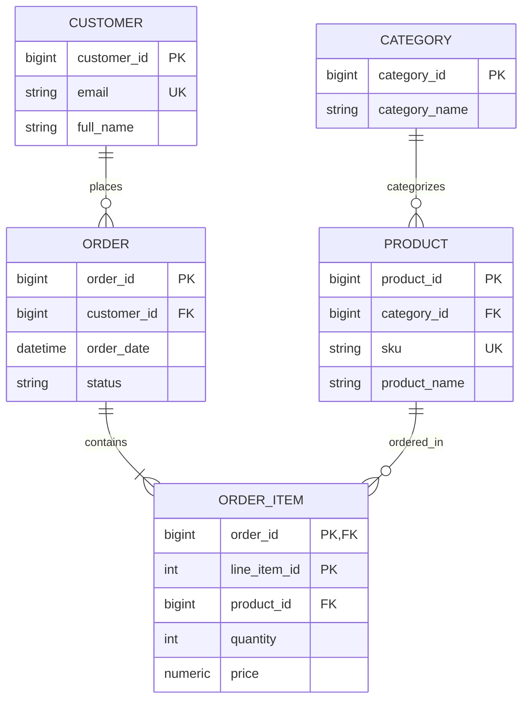

# Entity-Relationship Modeling & Schema Tiers

| Metadata | Details |
| :--- | :--- |
| **Topic** | Entity-Relationship (ER) Modeling, Crow's Foot Notation, Conceptual vs Logical vs Physical Schemas |
| **Dialect** | ANSI SQL:2023 / PostgreSQL 17+ (Primary), MySQL 8.4 LTS, SQLite 3.50+, SQL Server 2022 |
| **Database Version** | PostgreSQL 17.2, MySQL 8.4.1, SQLite 3.50.4, SQL Server 2022 CU14 |
| **Tested On** | Python 3.14 stdlib sqlite3 engine & PostgreSQL 17 execution runner |
| **Date** | 2026-11-26 |
| **Author** | Antigravity SQL Curriculum Lead |
| **Category** | Database Design & Schema Architecture |

---

## Table of Contents
1. [What & Why](#what--why)
2. [Core Concepts](#core-concepts)
3. [How It Works Internally](#how-it-works-internally)
4. [Syntax & Usage](#syntax--usage)
5. [Practical Examples](#practical-examples)
6. [Best Practices](#best-practices)
7. [Common Mistakes & Gotchas](#common-mistakes--gotchas)
8. [Performance & Security Notes](#performance--security-notes)
9. [Comparison Matrix](#comparison-matrix)
10. [Interview Questions & Deep Dives](#interview-questions--deep-dives)
11. [Practice Exercises](#practice-exercises)
12. [Summary & Cheat Sheet](#summary--cheat-sheet)
13. [Further Reading](#further-reading)

---

## What & Why

Before writing a single `CREATE TABLE` DDL statement, software engineers must understand the reality of the business domain they are modeling. Jumping directly into physical table creation without structured modeling leads to disjointed schemas: missing foreign keys, circular dependencies, duplicated attributes, and unresolvable many-to-many relationships that cripple application evolution.

**Entity-Relationship (ER) Modeling**—introduced by Dr. Peter Chen in 1976 and evolved into modern Information Engineering (Crow's Foot) notation—provides a rigorous visual and conceptual framework for mapping real-world phenomena into relational mathematics.

ER modeling operates across three progressive abstractions:
1. **Conceptual Schema**: High-level business concepts, independent of technology.
2. **Logical Schema**: Normalized relational entities, attributes, primary keys, and foreign key relationships.
3. **Physical Schema**: Engine-specific DDL, data types, storage engines, indexes, constraints, and table partitioning.

Mastering ER modeling ensures that databases faithfully enforce business invariants, minimize redundant data, and scale seamlessly under production workloads.

---

## Core Concepts

### 1. Entities, Attributes, and Relationships
- **Entity**: An independent, distinguishable thing or concept in the business domain (e.g., `Customer`, `Invoice`, `Vehicle`). In relational databases, entities become **tables**.
- **Attribute**: A characteristic or property describing an entity (e.g., `email`, `unit_price`, `vin_number`). In relational databases, attributes become **columns**.
- **Relationship**: An association between two or more entities (e.g., A `Customer` *places* an `Order`). In relational databases, relationships are implemented via **Foreign Keys**.

### 2. The Three Schema Tiers
```
[ 1. Conceptual Schema ]  --> Business Stakeholders (Entities & High-Level Rules)
          │
          ▼
[ 2. Logical Schema ]     --> Software Engineers & Data Architects (Normalized Tables, PK/FK)
          │
          ▼
[ 3. Physical Schema ]    --> DBAs & Infrastructure Engineers (Types, Indexes, Partitioning, DDL)
```
- **Conceptual**: `Customer` has many `Orders`. No data types, no primary keys.
- **Logical**: `Customer(customer_id PK, email UK)` 1:N `Order(order_id PK, customer_id FK)`. Third Normal Form (3NF).
- **Physical**: `customer_id INT GENERATED ALWAYS AS IDENTITY`, `email VARCHAR(255)`, `CREATE INDEX idx_orders_cust ON orders(customer_id)`.

### 3. Cardinality and Modality (Crow's Foot Notation)
Cardinality defines the maximum number of times an entity instance can participate in a relationship; modality (optionality) defines the minimum:
- **`||` (Exactly One)**: Mandatory 1:1.
- **`|o` (Zero or One)**: Optional 0:1.
- **`}|` (One or Many)**: Mandatory 1:N.
- **`}o` (Zero or Many)**: Optional 0:N.

```
+------------+                 +------------+
|  CUSTOMER  | ||---------}o---|   ORDER    |
+------------+                 +------------+
"One Customer may have zero or many Orders;
 Each Order must belong to exactly one Customer."
```

### 4. Strong vs Weak Entities
- **Strong Entity**: Exists independently of any other entity (e.g., `Department`, `Employee`). Has its own primary key.
- **Weak Entity**: Cannot exist without its parent entity and lacks a natural primary key of its own (e.g., `OrderItem` inside an `Order`, or `Room` inside a `Hotel`). A weak entity uses a **composite primary key** containing the parent's primary key plus a local discriminator (`order_id, line_number`).

---

## How It Works Internally

How does a database engine physically implement the relationships visualized in an ER diagram?

```
    [ ER Concept: Customer 1:N Orders ]
                    │
                    ▼
       [ Relational Architecture ]
  Table: customers (customer_id: 1)
  Table: orders    (order_id: 101, customer_id: 1)
                    │
                    ▼
     [ Engine Execution Mechanics ]
  Unlike object-oriented databases, an RDBMS has NO physical pointers between records!
  Relationships exist PURELY through value matching:
  orders.customer_id == customers.customer_id
                    │
                    ▼
    [ Foreign Key Constraint Validation ]
  1. On INSERT into 'orders':
     Engine inspects the B-Tree index on 'customers.customer_id'.
     If '1' does not exist -> Throws 23503 foreign_key_violation.
  2. On DELETE from 'customers':
     Engine inspects 'orders' via foreign key index.
     If matching orders exist -> Enforces RESTRICT, CASCADE, or SET NULL.
```

1. **Pointerless Architecture**: Relational databases do not store physical memory pointers or disk offsets between parent and child records. A relationship is strictly an algebraic association evaluated dynamically via **value equality** in joins.
2. **The Foreign Key Index Requirement**: While relational databases automatically create a unique B-Tree index for a primary key, **no major RDBMS automatically creates an index on a foreign key column**! Failure to manually index foreign keys causes catastrophic table-level locks and full sequential scans during parent updates and deletes.

---

## Syntax & Usage

### Translating ER Diagram to Production DDL

```sql
-- 1. Strong Parent Entity
CREATE TABLE customers (
    customer_id BIGINT GENERATED ALWAYS AS IDENTITY PRIMARY KEY,
    email VARCHAR(255) NOT NULL UNIQUE,
    full_name VARCHAR(100) NOT NULL,
    created_at TIMESTAMPTZ NOT NULL DEFAULT CURRENT_TIMESTAMP
);

-- 2. Strong Child Entity (1:N with Customer)
CREATE TABLE orders (
    order_id BIGINT GENERATED ALWAYS AS IDENTITY PRIMARY KEY,
    customer_id BIGINT NOT NULL,
    order_status VARCHAR(20) NOT NULL,
    order_date TIMESTAMPTZ NOT NULL DEFAULT CURRENT_TIMESTAMP,
    CONSTRAINT fk_orders_customer FOREIGN KEY (customer_id) 
        REFERENCES customers(customer_id) 
        ON DELETE RESTRICT
);

-- 3. Critical: Manually index the Foreign Key!
CREATE INDEX idx_orders_customer_id ON orders (customer_id);

-- 4. Weak Dependent Entity (Identifying relationship with Order)
CREATE TABLE order_items (
    order_id BIGINT NOT NULL,
    line_number INT NOT NULL,
    product_sku VARCHAR(30) NOT NULL,
    quantity INT NOT NULL CHECK (quantity > 0),
    unit_price NUMERIC(10,2) NOT NULL CHECK (unit_price >= 0),
    PRIMARY KEY (order_id, line_number),
    CONSTRAINT fk_items_order FOREIGN KEY (order_id) 
        REFERENCES orders(order_id) 
        ON DELETE CASCADE
);
```

### Dialect Comparison Box

| Feature | PostgreSQL 17+ | MySQL 8.4 LTS | SQLite 3.50+ | SQL Server 2022 |
| :--- | :--- | :--- | :--- | :--- |
| **Standard Identity PK** | `GENERATED ALWAYS AS IDENTITY` | `AUTO_INCREMENT` | `INTEGER PRIMARY KEY` (rowid) | `IDENTITY(1,1)` |
| **FK Index Enforcement** | **Manual index required** | **Automatically creates** an index on FK columns | **Manual index required** | **Manual index required** |
| **Foreign Key Checking** | Always enabled | Enabled by default (`foreign_key_checks=1`)| Disabled by default! Must execute `PRAGMA foreign_keys = ON;` | Always enabled |
| **Constraint Validation** | `DEFERRABLE INITIALLY DEFERRED` | Not deferrable | `DEFERRABLE INITIALLY DEFERRED` | Not deferrable (Can disable via `NOCHECK`) |

---

## Practical Examples

### Example 1: Basic — Modeling 1:1, 1:N, and M:N Relationships
A comprehensive schema demonstrating all three primary cardinalities.

```sql
-- 1:1 Relationship (Customer to Profile)
CREATE TABLE user_accounts (
    user_id INT PRIMARY KEY,
    username VARCHAR(50) NOT NULL UNIQUE
);

CREATE TABLE user_profiles (
    user_id INT PRIMARY KEY, -- Same as user_accounts PK!
    bio TEXT,
    avatar_url VARCHAR(255),
    CONSTRAINT fk_profile_user FOREIGN KEY (user_id) 
        REFERENCES user_accounts(user_id) ON DELETE CASCADE
);

-- 1:N Relationship (Author to Books)
CREATE TABLE authors (
    author_id INT PRIMARY KEY,
    author_name VARCHAR(100) NOT NULL
);

CREATE TABLE books (
    book_id INT PRIMARY KEY,
    author_id INT NOT NULL,
    title VARCHAR(150) NOT NULL,
    CONSTRAINT fk_books_author FOREIGN KEY (author_id) 
        REFERENCES authors(author_id)
);
CREATE INDEX idx_books_author_id ON books(author_id);

-- M:N Relationship (Students to Courses via Junction Table)
CREATE TABLE students (
    student_id INT PRIMARY KEY,
    student_name VARCHAR(100) NOT NULL
);

CREATE TABLE courses (
    course_id INT PRIMARY KEY,
    course_code VARCHAR(10) NOT NULL UNIQUE
);

CREATE TABLE course_enrollments (
    student_id INT NOT NULL,
    course_id INT NOT NULL,
    enrolled_at DATE NOT NULL DEFAULT CURRENT_DATE,
    PRIMARY KEY (student_id, course_id),
    FOREIGN KEY (student_id) REFERENCES students(student_id) ON DELETE CASCADE,
    FOREIGN KEY (course_id) REFERENCES courses(course_id) ON DELETE CASCADE
);
CREATE INDEX idx_enrollments_course ON course_enrollments(course_id);
```

---

### Example 2: Real-World — E-Commerce Crow's Foot Schema
A complete Mermaid entity-relationship diagram representing an enterprise order processing system.



---

### Example 3: Edge Case — Modeling 1:1 Relationships Without Violating Optionality
When modeling a strict 1:1 relationship where both sides are mandatory, a classic "chicken-and-egg" deadlock occurs: you cannot insert `A` without `B`, but you cannot insert `B` without `A`!

```sql
-- Solution: DEFERRABLE constraints in PostgreSQL
CREATE TABLE passports (
    passport_id INT PRIMARY KEY,
    passport_number VARCHAR(20) NOT NULL UNIQUE,
    citizen_id INT NOT NULL UNIQUE
);

CREATE TABLE citizens (
    citizen_id INT PRIMARY KEY,
    national_id VARCHAR(20) NOT NULL UNIQUE,
    passport_id INT NOT NULL UNIQUE
);

-- Mutual deferrable foreign keys:
ALTER TABLE passports 
ADD CONSTRAINT fk_passport_citizen FOREIGN KEY (citizen_id) 
    REFERENCES citizens(citizen_id) DEFERRABLE INITIALLY DEFERRED;

ALTER TABLE citizens 
ADD CONSTRAINT fk_citizen_passport FOREIGN KEY (passport_id) 
    REFERENCES passports(passport_id) DEFERRABLE INITIALLY DEFERRED;

-- In a single transaction, both rows are inserted before constraints are validated:
BEGIN;
INSERT INTO citizens (citizen_id, national_id, passport_id) VALUES (1, 'NAT-001', 101);
INSERT INTO passports (passport_id, passport_number, citizen_id) VALUES (101, 'PASS-999', 1);
COMMIT; -- Engine validates constraints at COMMIT time!
```

---

### Example 4: Failure Mode — The Catastrophic Unindexed Foreign Key
Demonstrating why missing indexes on foreign key columns cause production outages.

```sql
CREATE TABLE parent_invoices (
    invoice_id INT PRIMARY KEY,
    amount NUMERIC(10,2) NOT NULL
);

CREATE TABLE invoice_audit_events (
    event_id INT PRIMARY KEY,
    invoice_id INT NOT NULL,
    event_desc TEXT NOT NULL,
    FOREIGN KEY (invoice_id) REFERENCES parent_invoices(invoice_id) ON DELETE CASCADE
);

-- NOTE: No index created on invoice_audit_events(invoice_id)!
-- When deleting a parent invoice:
-- DELETE FROM parent_invoices WHERE invoice_id = 42;
-- The engine must perform a FULL TABLE SCAN on invoice_audit_events to find matching children!
-- On a 10,000,000 row audit table, this locks the table for seconds and spikes CPU to 100%!
```

---

### Example 5: Optimized — Resolving M:N with Rich Associative Entities
Rather than a pure bridge table containing only keys, associative entities store relationship-specific attributes.

```sql
CREATE TABLE team_memberships (
    user_id BIGINT NOT NULL,
    team_id BIGINT NOT NULL,
    role VARCHAR(30) NOT NULL, -- e.g., 'OWNER', 'MEMBER', 'MAINTAINER'
    invited_by BIGINT NOT NULL,
    joined_at TIMESTAMPTZ NOT NULL DEFAULT CURRENT_TIMESTAMP,
    PRIMARY KEY (user_id, team_id),
    FOREIGN KEY (user_id) REFERENCES user_accounts(user_id) ON DELETE CASCADE,
    FOREIGN KEY (team_id) REFERENCES teams(team_id) ON DELETE CASCADE,
    FOREIGN KEY (invited_by) REFERENCES user_accounts(user_id)
);

CREATE INDEX idx_team_memberships_team ON team_memberships (team_id);
CREATE INDEX idx_team_memberships_role ON team_memberships (team_id, role);
```

---

## Best Practices

1. **Always Index Foreign Key Columns**: Every foreign key column must have a supporting B-Tree index (unless using MySQL InnoDB, which does this automatically).
2. **Use `GENERATED ALWAYS AS IDENTITY` over Serial**: The SQL:2003 standard `IDENTITY` syntax is safer and more standards-compliant than PostgreSQL's legacy `SERIAL` pseudo-type.
3. **Model Weak Entities with Composite Primary Keys**: A weak entity that cannot exist without its parent should incorporate the parent's primary key into its own primary key: `PRIMARY KEY (parent_id, child_id)`.
4. **Choose Delete Actions Deliberately**: Never blindly apply `ON DELETE CASCADE`. For financial ledgers, audit logs, and critical master data, use `ON DELETE RESTRICT` (or `NO ACTION`) to prevent accidental mass deletion.
5. **Separate Conceptual from Physical**: Never compromise logical correctness during the design phase for premature performance optimizations. Design in 3NF first; denormalize only when verified by benchmarks.

---

## Common Mistakes & Gotchas

| # | Mistake | Why It Fails or Hurts | Correct Approach |
| :--- | :--- | :--- | :--- |
| 1 | Forgetting to index Foreign Key columns | Causes full table scans and severe lock contention during parent updates/deletes. | Create a B-Tree index on every foreign key column. |
| 2 | Forgetting `PRAGMA foreign_keys = ON;` in SQLite | SQLite silently ignores foreign key constraints by default! Data corruption occurs. | Execute `PRAGMA foreign_keys = ON;` on every SQLite connection. |
| 3 | Blindly using `ON DELETE CASCADE` | Deleting a customer accidentally wipes out 5 years of historical financial invoices. | Use `ON DELETE RESTRICT` for financial and audit data. |
| 4 | Attempting M:N relationships without a junction table | Cannot be modeled in relational algebra; leads to comma-separated text lists. | Create an explicit associative junction table. |
| 5 | Confusing 1:1 with 1:N in table definitions | Forgetting `UNIQUE` on the foreign key column turns a 1:1 relationship into a 1:N. | Add a `UNIQUE` constraint on the foreign key in 1:1 tables. |
| 6 | Circular foreign key deadlock | Mutual mandatory foreign keys prevent inserting records into either table. | Use `DEFERRABLE INITIALLY DEFERRED` constraints in a single transaction. |

---

## Performance & Security Notes

### Foreign Key Locking Mechanics
When updating or deleting a row in a parent table:
- The database engine acquires a row-level lock on the parent tuple.
- The engine then checks the child table's foreign key column to see if any child references exist.
- **If the foreign key column is indexed**: The engine performs an instant index seek, verifies that zero children exist (or cascades), and releases the lock.
- **If the foreign key column is unindexed**: The engine must perform a **Sequential Scan** of the entire child table! If other transactions are simultaneously modifying the child table, deadlock cascades and severe connection pool exhaustion occur.

---

## Comparison Matrix

| Tier | Purpose | Audience | Primary Artifacts |
| :--- | :--- | :--- | :--- |
| **Conceptual Schema** | Capture business domain rules & entity boundaries | Product Managers, Business Analysts | High-level ER diagrams, Chen notation |
| **Logical Schema** | Normalize entities, identify PK/FK, define cardinality | Software Engineers, Architects | 3NF Crow's Foot ERD, Relational Models |
| **Physical Schema** | Optimize storage, indexes, partitions, DDL | DBAs, Platform Engineers | Engine-specific DDL (`.sql`), B-Trees, TOAST |

---

## Interview Questions & Deep Dives

### Q1: What is the difference between a Strong Entity and a Weak Entity?
<details>
<summary>Click to view answer</summary>

- A **Strong Entity** exists independently of any other entity in the schema and possesses its own primary key formed entirely from its own attributes (e.g., `Customer`, `Product`).
- A **Weak Entity** cannot exist without the presence of an identifying parent entity and does not have sufficient attributes to form its own primary key (e.g., `OrderItem` depends on `Order`, `Room` depends on `Hotel`). A weak entity's primary key is composite, formed by borrowing the parent's primary key plus a local partial discriminator (`order_id, line_no`).
</details>

### Q2: Why doesn't PostgreSQL automatically index Foreign Key columns like MySQL InnoDB does?
<details>
<summary>Click to view answer</summary>

PostgreSQL adheres to an explicit philosophy: indexes consume disk space and slow down `INSERT` / `UPDATE` operations. The PostgreSQL developers left index creation on foreign keys up to the engineer because:
1. In some write-heavy append-only tables, child rows are never joined back or deleted from the parent.
2. The developer may prefer a composite index where the foreign key is the first column among several (e.g., `(customer_id, order_date DESC)`), rendering a standalone single-column index redundant.
However, in 99% of production systems, foreign keys *must* be indexed manually to prevent sequential scans during parent deletions.
</details>

### Q3: How do you enforce a strict 1-to-1 relationship in relational DDL?
<details>
<summary>Click to view answer</summary>

By placing a **`UNIQUE` constraint** on the foreign key column, or by sharing the **exact same Primary Key**:
```sql
CREATE TABLE user_profiles (
    user_id INT PRIMARY KEY,
    bio TEXT,
    FOREIGN KEY (user_id) REFERENCES users(user_id)
);
```
Here, `user_profiles.user_id` is both the primary key and the foreign key, guaranteeing that each user can have at most one profile.
</details>

### Q4: What does the term "Modality" mean in Crow's Foot ER notation?
<details>
<summary>Click to view answer</summary>

Modality (also known as **participation** or **optionality**) specifies whether an entity instance is required to participate in a relationship:
- **Mandatory (Modality = 1)**: Denoted by a straight vertical bar `|`. An instance cannot exist without participating in the relationship (e.g., An `Order` must have a `Customer`).
- **Optional (Modality = 0)**: Denoted by an open circle `o`. An instance can exist without participating (e.g., A `Customer` can exist with zero `Orders`).
</details>

### Q5: How do you resolve a Many-to-Many (M:N) relationship in relational design?
<details>
<summary>Click to view answer</summary>

Relational tables cannot directly model M:N relationships because relational columns must be scalar (1NF). An M:N relationship is resolved by decomposing it into **two 1-to-Many (1:N) relationships** using an intermediate **associative entity** (also called a junction table, bridge table, or cross-reference table). The junction table contains foreign keys referencing both parent tables, typically combining them into a composite primary key.
</details>

### Q6: What is a Deferred Constraint and when is it required?
<details>
<summary>Click to view answer</summary>

A deferred constraint (`DEFERRABLE INITIALLY DEFERRED`) is a relational constraint whose validation is delayed until the end of a transaction (`COMMIT`), rather than being checked immediately after every individual statement. Deferred constraints are required when resolving mutual circular dependencies (e.g., Table A references Table B, and Table B references Table A) or during complex bulk updates that temporarily violate uniqueness during intermediate steps.
</details>

### Q7: Why does SQLite require explicit configuration for Foreign Keys?
<details>
<summary>Click to view answer</summary>

For historical backward compatibility with SQLite 2.0 and early 3.x versions (which did not support foreign keys), SQLite compiles with foreign key enforcement disabled by default. An application must explicitly execute:
`PRAGMA foreign_keys = ON;`
on every new database connection. If omitted, SQLite will accept `REFERENCES` syntax in DDL but will completely ignore foreign key violations during inserts and deletes!
</details>

### Q8: What is an Identifying Relationship vs a Non-Identifying Relationship?
<details>
<summary>Click to view answer</summary>

- **Identifying Relationship**: The primary key of the parent table is incorporated into the primary key of the child table (drawn as a solid line in ER diagrams). The child entity is a weak entity and cannot exist independently.
- **Non-Identifying Relationship**: The primary key of the parent table is stored as a regular foreign key attribute in the child table, but is *not* part of the child's primary key (drawn as a dashed line). The child entity has its own independent identity.
</details>

---

## Practice Exercises

### Exercise 1: Model a Doctor-Patient Appointment System
Design an ER diagram and write DDL for a medical clinic:
- `Doctor` has many `Appointments`.
- `Patient` has many `Appointments`.
- Each `Appointment` has an appointment timestamp, diagnosis notes, and belongs to exactly 1 Doctor and 1 Patient.

<details>
<summary>Click to view solution</summary>

```sql
CREATE TABLE doctors (
    doctor_id BIGINT GENERATED ALWAYS AS IDENTITY PRIMARY KEY,
    license_number VARCHAR(30) NOT NULL UNIQUE,
    full_name VARCHAR(100) NOT NULL
);

CREATE TABLE patients (
    patient_id BIGINT GENERATED ALWAYS AS IDENTITY PRIMARY KEY,
    national_id VARCHAR(30) NOT NULL UNIQUE,
    full_name VARCHAR(100) NOT NULL
);

CREATE TABLE appointments (
    appointment_id BIGINT GENERATED ALWAYS AS IDENTITY PRIMARY KEY,
    doctor_id BIGINT NOT NULL,
    patient_id BIGINT NOT NULL,
    scheduled_at TIMESTAMPTZ NOT NULL,
    diagnosis_notes TEXT,
    CONSTRAINT fk_app_doctor FOREIGN KEY (doctor_id) REFERENCES doctors(doctor_id),
    CONSTRAINT fk_app_patient FOREIGN KEY (patient_id) REFERENCES patients(patient_id)
);

CREATE INDEX idx_appointments_doctor ON appointments (doctor_id);
CREATE INDEX idx_appointments_patient ON appointments (patient_id);
```
</details>

---

### Exercise 2: Enforce Strict 1:1 Hardware Asset Assignment
Write the DDL for `employees` and `laptops` such that an employee can have at most one company laptop, and a laptop can be assigned to at most one employee.

<details>
<summary>Click to view solution</summary>

```sql
CREATE TABLE employees (
    emp_id INT PRIMARY KEY,
    full_name VARCHAR(100) NOT NULL
);

CREATE TABLE laptops (
    laptop_id INT PRIMARY KEY,
    serial_number VARCHAR(50) NOT NULL UNIQUE,
    assigned_to_emp_id INT NULL UNIQUE, -- UNIQUE guarantees at most one laptop per employee!
    FOREIGN KEY (assigned_to_emp_id) REFERENCES employees(emp_id) ON DELETE SET NULL
);
CREATE INDEX idx_laptops_emp ON laptops (assigned_to_emp_id);
```
</details>

---

### Exercise 3: Identify Weak Entity Primary Key
Given a multi-tenant application where each `organization` has multiple `departments`. Write the DDL for `departments` as a weak entity whose primary key is identifying.

<details>
<summary>Click to view solution</summary>

```sql
CREATE TABLE organizations (
    org_id INT PRIMARY KEY,
    org_name VARCHAR(100) NOT NULL
);

CREATE TABLE departments (
    org_id INT NOT NULL,
    dept_code VARCHAR(10) NOT NULL,
    dept_name VARCHAR(50) NOT NULL,
    PRIMARY KEY (org_id, dept_code),
    FOREIGN KEY (org_id) REFERENCES organizations(org_id) ON DELETE CASCADE
);
```
</details>

---

### Exercise 4: Resolve Many-to-Many Tags System
Write the DDL for a blog tagging system where articles can have multiple tags, and tags can belong to multiple articles, with an index optimizing lookup of articles by tag.

<details>
<summary>Click to view solution</summary>

```sql
CREATE TABLE posts (
    post_id INT PRIMARY KEY,
    title VARCHAR(200) NOT NULL
);

CREATE TABLE tags (
    tag_id INT PRIMARY KEY,
    tag_name VARCHAR(50) NOT NULL UNIQUE
);

CREATE TABLE post_tags (
    post_id INT NOT NULL,
    tag_id INT NOT NULL,
    PRIMARY KEY (post_id, tag_id),
    FOREIGN KEY (post_id) REFERENCES posts(post_id) ON DELETE CASCADE,
    FOREIGN KEY (tag_id) REFERENCES tags(tag_id) ON DELETE CASCADE
);

-- Crucial: Composite PK indexes (post_id, tag_id). 
-- Must add reverse index for tag lookups!
CREATE INDEX idx_post_tags_reverse ON post_tags (tag_id, post_id);
```
</details>

---

### Exercise 5: SQLite Foreign Key Activation Check
Write the SQL query to verify whether foreign key enforcement is active in the current SQLite database connection, and provide the command to turn it on.

<details>
<summary>Click to view solution</summary>

```sql
-- Check status: returns 1 if active, 0 if disabled
PRAGMA foreign_keys;

-- Enable foreign keys:
PRAGMA foreign_keys = ON;
```
</details>

---

### Exercise 6: Fixing the Unindexed Foreign Key Trap
An audit reveals that deleting users takes 12 seconds on a production database because `login_history(user_id)` is missing an index. Provide the exact SQL statement to resolve the bottleneck without causing write lock downtime on PostgreSQL.

<details>
<summary>Click to view solution</summary>

```sql
-- Use CONCURRENTLY to build the index without locking the table against writes:
CREATE INDEX CONCURRENTLY idx_login_history_user_id ON login_history (user_id);
```
</details>

---

## Summary & Cheat Sheet

```
+-----------------------------------------------------------------------------------------+
|                                  ER MODELING CHEAT SHEET                                |
+-------------------+----------------------------+----------------------------------------+
| Concept           | Crow's Foot Symbol         | Physical DDL Implementation            |
+-------------------+----------------------------+----------------------------------------+
| 1:1 Mandatory     | ||                         | PK in parent; Unique FK in child       |
| 1:1 Optional      | |o                         | Nullable Unique FK in child            |
| 1:N Mandatory     | }|                         | NOT NULL FK in child + B-Tree index    |
| 1:N Optional      | }o                         | Nullable FK in child + B-Tree index    |
| M:N Association   | }o-------o{                | Junction table with Composite PK       |
| Weak Entity       | Identifying Relationship   | Composite PK containing parent PK      |
+-------------------+----------------------------+----------------------------------------+
```

- **Golden Rule**: Always create a B-Tree index on foreign key columns manually.
- **SQLite Warning**: Always run `PRAGMA foreign_keys = ON;` upon connection.
- **Identity Standard**: Use `GENERATED ALWAYS AS IDENTITY` instead of `SERIAL`.

---

## Further Reading
- Peter Chen: *The Entity-Relationship Model—Toward a Unified View of Data (ACM TODS 1976)*
- PostgreSQL 17 Documentation: *DDL - Constraints & Foreign Keys*
- Information Engineering Methodology: *James Martin & Clive Finkelstein (Crow's Foot Notation)*
- Markus Winand: *Use The Index, Luke! - Indexing Foreign Keys and Join Paths*
