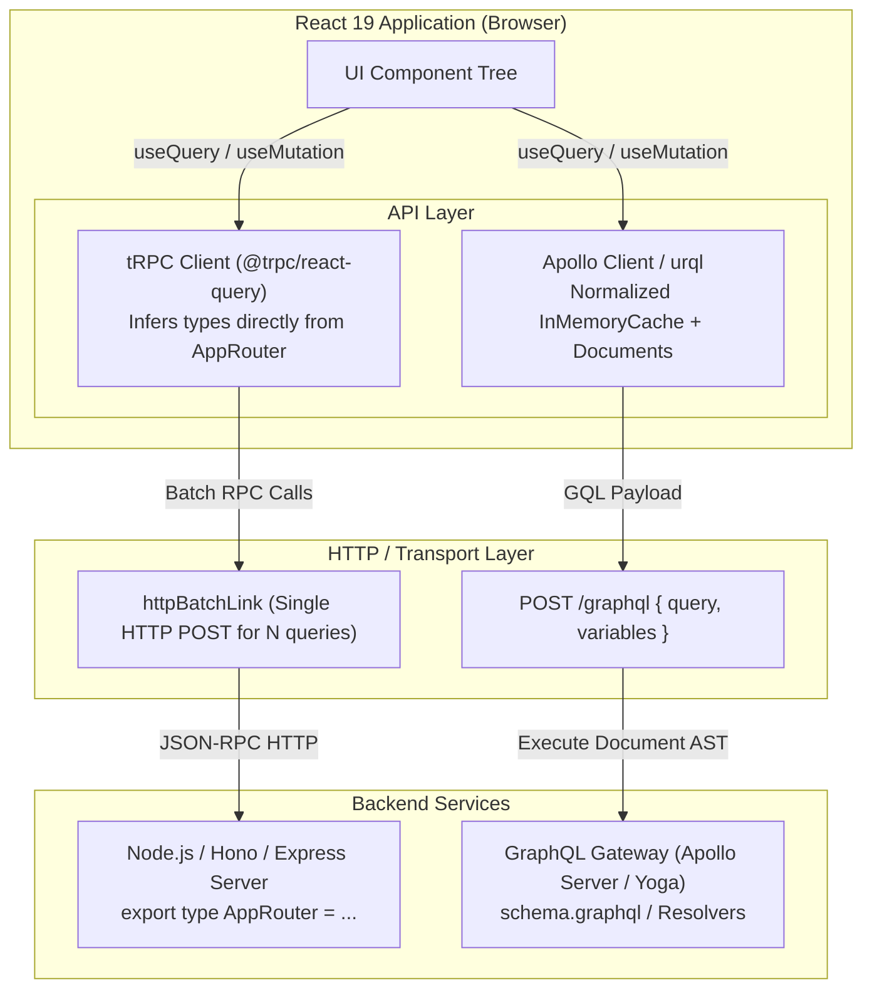

# 07 — GraphQL & tRPC Clients in React

## Metadata
- **React Version**: 19.0.0+
- **Prerequisites**: [00-fetch.md](./00-fetch.md), [02-api-client.md](./02-api-client.md), TypeScript 5.5+
- **Difficulty**: Advanced
- **Estimated Read Time**: 28 minutes
- **Tags**: `graphql`, `trpc`, `apollo-client`, `urql`, `tanstack-query`, `type-safety`, `api-integration`

---

## Architecture Diagram

The diagram below illustrates how client-side React communicates with backend APIs using GraphQL (schema-defined document queries over HTTP) versus tRPC (end-to-end TypeScript RPC without code generation or schema compilation).



---

## Concept Overview

When applications scale beyond simple REST endpoints, development teams face two major challenges:
1. **Over-fetching & Under-fetching**: REST endpoints frequently deliver bloated payloads with unwanted relational fields or require multiple waterfall requests.
2. **Type Drift**: Backend API responses fall out of sync with frontend TypeScript interfaces, leading to silent runtime crashes (`TypeError: Cannot read properties of undefined`).

Two dominant paradigms solve these challenges in React:
- **GraphQL (Apollo Client / urql)**: An open standard and declarative query language where the client requests the exact shape of data it requires. Backends expose a strict schema (SDL), and client libraries compile documents or parse ASTs, managing a normalized relational cache (`InMemoryCache`). Ideal for multi-client ecosystems (iOS, Android, Web, Third Parties).
- **tRPC**: A lightweight remote procedure call library designed specifically for fullstack TypeScript monorepos (e.g., Turborepo, Nx). Instead of runtime schemas, code generation, or GraphQL AST parsing, tRPC exports the TypeScript type signature of the server router directly to the React client. The client imports **only types** (`import type { AppRouter }`), granting 100% autocompletion, type checking, and instant refactoring with zero runtime schema overhead.

### Feature Comparison

| Dimension | GraphQL (Apollo Client v3.12+) | tRPC (v11+) |
| :--- | :--- | :--- |
| **Language Target** | Agnostic (Polyglot backends & clients) | Pure TypeScript (Node, Bun, Deno to TS Client) |
| **Code Generation** | Required for type safety (GraphQL Code Generator) | None (Native TS inference via `AppRouter`) |
| **Over-the-Wire Format**| GraphQL Query AST / JSON POST | JSON-RPC / Standard HTTP GET/POST |
| **Caching Mechanism**| Normalized Entity Cache (`__typename` + `id`) | Server-state caching via TanStack Query v5 |
| **Request Batching** | Requires query batching links or DataLoader | Built-in `httpBatchLink` |
| **Bundle Footprint** | ~35KB+ (Apollo Client) / ~12KB (urql) | ~8KB (tRPC client wraps TanStack Query) |
| **Best Used For** | Public APIs, multi-platform mobile+web apps | Internal TypeScript monorepos & fullstack apps |

---

## Practical Implementation

### Example 1: Setting Up tRPC Client with React 19 & TanStack Query v5

tRPC v11 integrates natively with `@tanstack/react-query`, providing type-safe hooks for queries, mutations, and cache management.

```tsx
// src/lib/trpc.ts
import { createTRPCReact } from '@trpc/react-query';
import { QueryClient, QueryClientProvider } from '@tanstack/react-query';
import { httpBatchLink } from '@trpc/client';
import React, { useState } from 'react';
// IMPORT ONLY TYPE: Zero server code leaked to client bundle
import type { AppRouter } from '../../../backend/src/router';

export const trpc = createTRPCReact<AppRouter>();

export function TRPCProvider({ children }: { children: React.ReactNode }) {
  const [queryClient] = useState(
    () =>
      new QueryClient({
        defaultOptions: {
          queries: {
            staleTime: 1000 * 60 * 5, // 5 minutes
            retry: 1,
            refetchOnWindowFocus: false,
          },
        },
      })
  );

  const [trpcClient] = useState(() =>
    trpc.createClient({
      links: [
        httpBatchLink({
          url: 'http://localhost:4000/trpc',
          headers() {
            const token = localStorage.getItem('auth_token');
            return token ? { Authorization: `Bearer ${token}` } : {};
          },
        }),
      ],
    })
  );

  return (
    <trpc.Provider client={trpcClient} queryClient={queryClient}>
      <QueryClientProvider client={queryClient}>
        {children}
      </QueryClientProvider>
    </trpc.Provider>
  );
}
```

*Expected Verification Output:*
```text
[tRPC Provider] Initialized QueryClient and tRPC client.
Network requests to /trpc/posts.list,posts.byId batched into single HTTP POST /trpc/posts.list,posts.byId.
```

---

### Example 2: Type-Safe Query and Mutation with Optimistic UI in tRPC

This component queries a list of users, executes an update mutation, and applies an optimistic UI update directly to the cache.

```tsx
// src/components/UserProfileManager.tsx
import React, { useState } from 'react';
import { trpc } from '../lib/trpc';

export function UserProfileManager({ userId }: { userId: string }) {
  const [newName, setNewName] = useState('');
  const utils = trpc.useUtils();

  // 100% strictly typed input and output
  const userQuery = trpc.user.byId.useQuery({ id: userId });

  const updateMutation = trpc.user.updateName.useMutation({
    onMutate: async (variables) => {
      // Cancel outgoing refetches so they don't overwrite optimistic update
      await utils.user.byId.cancel({ id: userId });

      // Snapshot previous value
      const previousUser = utils.user.byId.getData({ id: userId });

      // Optimistically update cache
      if (previousUser) {
        utils.user.byId.setData({ id: userId }, {
          ...previousUser,
          name: variables.name,
        });
      }

      return { previousUser };
    },
    onError: (_err, _variables, context) => {
      // Rollback on failure
      if (context?.previousUser) {
        utils.user.byId.setData({ id: userId }, context.previousUser);
      }
    },
    onSettled: () => {
      // Always invalidate after error or success to guarantee sync
      utils.user.byId.invalidate({ id: userId });
    },
  });

  if (userQuery.isLoading) return <div>Loading user profile...</div>;
  if (userQuery.isError) return <div>Error: {userQuery.error.message}</div>;

  const user = userQuery.data;

  return (
    <div className="p-4 border rounded shadow-sm max-w-md">
      <h2 className="text-xl font-bold">User Details</h2>
      <p>ID: {user?.id}</p>
      <p>Name: <span className="font-semibold text-blue-600">{user?.name}</span></p>
      <p>Email: {user?.email}</p>

      <form
        onSubmit={(e) => {
          e.preventDefault();
          if (!newName.trim()) return;
          updateMutation.mutate({ id: userId, name: newName });
          setNewName('');
        }}
        className="mt-4 flex gap-2"
      >
        <input
          type="text"
          value={newName}
          onChange={(e) => setNewName(e.target.value)}
          placeholder="New Name"
          className="border p-2 rounded flex-1"
        />
        <button
          type="submit"
          disabled={updateMutation.isPending}
          className="bg-blue-600 text-white px-4 py-2 rounded disabled:opacity-50"
        >
          {updateMutation.isPending ? 'Updating...' : 'Save'}
        </button>
      </form>
    </div>
  );
}
```

*Expected Verification Output:*
```text
Render: User Details displayed (Name: Alice, Email: alice@example.com).
Submit "Alicia":
  - onMutate fired -> Cache immediately reflects Name: Alicia.
  - POST /trpc/user.updateName -> 200 OK.
  - onSettled -> Invalidation confirms Name: Alicia.
```

---

### Example 3: Apollo Client Setup with Normalized `InMemoryCache`

For GraphQL backends, Apollo Client v3.12 provides document parsing and automatic entity normalization using `__typename` and `id`.

```tsx
// src/lib/apollo.ts
import { ApolloClient, InMemoryCache, createHttpLink, ApolloProvider } from '@apollo/client';
import { setContext } from '@apollo/client/link/context';
import React from 'react';

const httpLink = createHttpLink({
  uri: 'https://api.example.com/graphql',
});

const authLink = setContext((_, { headers }) => {
  const token = localStorage.getItem('token');
  return {
    headers: {
      ...headers,
      authorization: token ? `Bearer ${token}` : '',
    },
  };
});

export const apolloClient = new ApolloClient({
  link: authLink.concat(httpLink),
  cache: new InMemoryCache({
    typePolicies: {
      Query: {
        fields: {
          projectList: {
            // Merging paginated cursor data in Apollo cache
            keyArgs: false,
            merge(existing = [], incoming) {
              return [...existing, ...incoming];
            },
          },
        },
      },
    },
  }),
});

export function GraphQLProvider({ children }: { children: React.ReactNode }) {
  return <ApolloProvider client={apolloClient}>{children}</ApolloProvider>;
}
```

*Expected Verification Output:*
```text
[Apollo Client] Initialized with InMemoryCache typePolicies for Query.projectList.
Requests automatically inject Authorization header via authLink middleware.
```

---

### Example 4: GraphQL Query, Mutation, and Normalized Cache Updates

```tsx
// src/components/ProjectList.tsx
import React from 'react';
import { gql, useQuery, useMutation } from '@apollo/client';

export const GET_PROJECTS = gql`
  query GetProjects {
    projects {
      id
      title
      status
      updatedAt
    }
  }
`;

export const ARCHIVE_PROJECT = gql`
  mutation ArchiveProject($id: ID!) {
    archiveProject(id: $id) {
      id
      status
      updatedAt
    }
  }
`;

interface Project {
  id: string;
  title: string;
  status: 'ACTIVE' | 'ARCHIVED';
  updatedAt: string;
}

export function ProjectList() {
  const { data, loading, error } = useQuery<{ projects: Project[] }>(GET_PROJECTS);

  const [archiveProject, { loading: archiving }] = useMutation(ARCHIVE_PROJECT, {
    // Apollo automatically updates cache because mutation returns { id, status, updatedAt }
    // matching an existing entity in InMemoryCache with key Project:<id>
    optimisticResponse: (variables) => ({
      archiveProject: {
        __typename: 'Project',
        id: variables.id,
        status: 'ARCHIVED',
        updatedAt: new Date().toISOString(),
      },
    }),
  });

  if (loading) return <p>Loading projects...</p>;
  if (error) return <p className="text-red-500">GraphQL Error: {error.message}</p>;

  return (
    <div className="space-y-3">
      <h2 className="text-xl font-bold">Projects</h2>
      {data?.projects.map((project) => (
        <div key={project.id} className="flex justify-between items-center p-3 border rounded">
          <div>
            <p className="font-semibold">{project.title}</p>
            <span className={`text-xs px-2 py-0.5 rounded ${
              project.status === 'ACTIVE' ? 'bg-green-100 text-green-800' : 'bg-gray-100 text-gray-800'
            }`}>
              {project.status}
            </span>
          </div>
          {project.status === 'ACTIVE' && (
            <button
              onClick={() => archiveProject({ variables: { id: project.id } })}
              disabled={archiving}
              className="text-sm bg-amber-600 text-white px-3 py-1 rounded hover:bg-amber-700"
            >
              Archive
            </button>
          )}
        </div>
      ))}
    </div>
  );
}
```

*Expected Verification Output:*
```text
Click "Archive" on Project:123:
  - Optimistic response immediately transitions UI status badge from ACTIVE to ARCHIVED.
  - GraphQL Network mutation completes; cache updates Normalized entity Project:123 without refetching GET_PROJECTS.
```

---

### Example 5: Hybrid Architectural Pattern: Aggregating tRPC and Third-Party GraphQL

In real-world enterprise architectures, applications often query internal microservices via tRPC while interacting with third-party partners (e.g., Shopify, GitHub) via GraphQL.

```tsx
// src/components/DeveloperDashboard.tsx
import React from 'react';
import { trpc } from '../lib/trpc';
import { gql, useQuery } from '@apollo/client';

const GET_GITHUB_REPO_STATS = gql`
  query GetRepoStats($owner: String!, $repo: String!) {
    repository(owner: $owner, name: $repo) {
      stargazerCount
      openIssues: issues(states: OPEN) {
        totalCount
      }
    }
  }
`;

export function DeveloperDashboard({ repoOwner, repoName }: { repoOwner: string; repoName: string }) {
  // 1. Internal microservice call (tRPC)
  const internalUser = trpc.developer.getWorkspaceSummary.useQuery();

  // 2. External GraphQL API call (Apollo)
  const githubQuery = useQuery(GET_GITHUB_REPO_STATS, {
    variables: { owner: repoOwner, repo: repoName },
  });

  return (
    <div className="grid grid-cols-2 gap-4 p-6 border rounded-lg bg-gray-50">
      <div className="bg-white p-4 rounded shadow-sm">
        <h3 className="font-semibold text-gray-700">Internal Billing & Team</h3>
        {internalUser.isLoading ? (
          <p>Loading workspace...</p>
        ) : (
          <div>
            <p>Team: {internalUser.data?.teamName}</p>
            <p>Seats: {internalUser.data?.activeSeats} / {internalUser.data?.maxSeats}</p>
          </div>
        )}
      </div>

      <div className="bg-white p-4 rounded shadow-sm">
        <h3 className="font-semibold text-gray-700">External GitHub Stats</h3>
        {githubQuery.loading ? (
          <p>Fetching repository statistics...</p>
        ) : (
          <div>
            <p>Stars: {githubQuery.data?.repository?.stargazerCount}</p>
            <p>Open Issues: {githubQuery.data?.repository?.openIssues?.totalCount}</p>
          </div>
        )}
      </div>
    </div>
  );
}
```

*Expected Verification Output:*
```text
Internal data stream from /trpc endpoint resolves in parallel with external GraphQL request.
Both providers operate concurrently without namespace collisions.
```

---

## Mental Model & Analogies

### The REST vs GraphQL vs tRPC Analogy

- **REST** is like a **vending machine**. You press button `B4` (endpoint `/api/users/123`), and a fixed box drops into the tray. Even if you only wanted a stick of gum inside the box, you must accept the entire assortment, cardboard packaging, and promotional flyers.
- **GraphQL** is like a **custom deli counter**. You hand the chef an itemized checklist (`{ user { name email } }`). The chef prepares exactly what you checked off and nothing else, returning it on a single customized tray.
- **tRPC** is like **direct inter-process function invocation across the table**. You don't write an order form or translate languages; your TypeScript compiler guarantees at build time that calling `api.user.byId({ id })` conforms to the exact function arguments and return types of the backend handler.

---

## Under the Hood / Internal Mechanics

### 1. How tRPC Achieves Zero-Bundle Type Safety

When you write:
```ts
import type { AppRouter } from '../server/router';
export const trpc = createTRPCReact<AppRouter>();
```
The TypeScript compiler completely erases `import type` during compilation (`tsc` or Vite). **Zero bytes of backend code** (no database clients, Prisma engines, or server routers) are bundled into client JS. The proxy object returned by `createTRPCReact` uses JavaScript `Proxy` to intercept property accesses (e.g., `trpc.user.byId.useQuery`) and convert them dynamically to URL paths:
```text
Path accessed: trpc.user.byId.useQuery({ id: "1" })
Interception:
  Path segment 1: 'user'
  Path segment 2: 'byId'
  HTTP Query: GET /trpc/user.byId?batch=1&input=%7B%22id%22%3A%221%22%7D
```

### 2. Apollo Normalized Cache Mechanics

Apollo Client breaks down GraphQL responses into discrete entities:
1. Every object with `__typename` and `id` (or `_id`) is extracted from nested responses.
2. The entity is indexed as a flat record in memory: `Record<"Project:123", { id: "123", title: "Alpha", status: "ACTIVE" }>`.
3. If two different queries (`GetProjects` and `GetRecentActivity`) return the same `Project:123`, both point to the same reference in `InMemoryCache`.
4. Updating `Project:123` via a mutation immediately triggers re-renders across all active React components observing any query containing that project.

---

## Common Pitfalls & Anti-Patterns

| Anti-Pattern | Why It Breaks | Recommended Solution |
| :--- | :--- | :--- |
| **Importing Runtime Code from Backend in tRPC** | Bundles server dependencies (Prisma, bcrypt, Node fs) into browser code, crashing the build. | Always use `import type { AppRouter }`. Never import variables or schemas directly from server files. |
| **Omitting `id` and `__typename` in GraphQL queries** | Prevents Apollo from identifying entities, causing cache misses, silent UI de-syncs, and redundant refetches. | Always include `id` and ensure `__typename` is not disabled in your GraphQL query documents. |
| **Manual `refetchQueries` on Every Mutation** | Causes network flooding, renders optimistic UI useless, and produces screen flickers. | Rely on Apollo's normalized cache updates or tRPC's `utils.invalidate` / optimistic `setData`. |
| **Creating `new QueryClient()` Inside Component Body** | Recreates the query cache on every parent re-render, wiping all cached state and re-triggering requests. | Wrap initialization in `useState(() => new QueryClient())` or declare outside component. |
| **Unbounded Batching in `httpBatchLink`** | A single slow database query stalls all other batched requests in the same HTTP payload. | Set `maxURLLength` or use `splitLink` to route fast queries separately from heavy analytics. |
| **Neglecting tRPC Server Error Formatting** | Client receives opaque 500 errors without actionable validation messages. | Use `errorFormatter` in tRPC server config to expose Zod validation issues formatted for form display. |

---

## Performance & Optimization

### Request Batching with `httpBatchLink`

If three sibling components render simultaneously:
```tsx
function Header() { const user = trpc.auth.me.useQuery(); ... }
function Notifications() { const count = trpc.notifications.unread.useQuery(); ... }
function Activity() { const recent = trpc.audit.recent.useQuery(); ... }
```
Without batching, the browser dispatches three HTTP requests in parallel, exhausting browser connection limits. `httpBatchLink` collects all procedure calls occurring in the same microtask tick and emits a single HTTP request:
```http
POST /trpc/auth.me,notifications.unread,audit.recent?batch=1
Content-Type: application/json

{"0":{},"1":{},"2":{}}
```

---

## Edge Cases & Debugging

### Type Drift in tRPC Monorepos
- **Symptom**: Client build succeeds locally, but fails on CI, or displays outdated autocomplete.
- **Root Cause**: The backend project was rebuilt, but client TypeScript language server has cached older project references.
- **Remedy**: In VS Code, run `TypeScript: Restart TS Server`. Ensure `tsconfig.json` contains `"references": [{ "path": "../backend" }]` when using TypeScript project references.

---

## Ecosystem & Alternative Approaches

- **urql**: A lightweight, highly modular alternative to Apollo Client by Formidable Labs (~12KB). Great for apps needing GraphQL without Apollo's cache complexity.
- **GraphQL Code Generator (`@graphql-codegen/cli`)**: The industry standard tool for generating typed React hooks from `.graphql` files when using Apollo Client or TanStack Query.
- **OpenAPI / Orval**: When working with REST APIs, tools like Orval parse OpenAPI (Swagger) specs and generate typed TanStack Query hooks, providing a tRPC-like developer experience over REST.

---

## Exercises & Challenges

<details>
<summary><strong>Exercise 1: Implement an Optimistic Reaction Toggle with Apollo Client</strong></summary>

**Challenge**: Write a mutation hook that increments the `likeCount` of a post optimistically when clicked, reverting if the network call fails.

```tsx
import { gql, useMutation } from '@apollo/client';

const TOGGLE_LIKE = gql`
  mutation ToggleLike($postId: ID!) {
    toggleLike(postId: $postId) {
      id
      likeCount
      hasLiked
    }
  }
`;

export function useOptimisticLike(postId: string, currentLikes: number, currentLiked: boolean) {
  return useMutation(TOGGLE_LIKE, {
    variables: { postId },
    optimisticResponse: {
      toggleLike: {
        __typename: 'Post',
        id: postId,
        likeCount: currentLiked ? currentLikes - 1 : currentLikes + 1,
        hasLiked: !currentLiked,
      },
    },
  });
}
```
</details>

<details>
<summary><strong>Exercise 2: Dynamic Split Link for Heavy vs Fast tRPC Calls</strong></summary>

**Challenge**: Configure tRPC links such that file uploads and streaming procedures bypass the batch link and use standard HTTP links.

```ts
import { httpBatchLink, httpLink, splitLink } from '@trpc/client';

export const trpcClientLinks = [
  splitLink({
    condition: (op) => op.context.skipBatch === true || op.type === 'subscription',
    true: httpLink({ url: 'http://localhost:4000/trpc' }),
    false: httpBatchLink({ url: 'http://localhost:4000/trpc' }),
  }),
];
```
</details>

---

## Frequently Asked Interview Questions

<details>
<summary><strong>1. Why would an engineering team choose tRPC over GraphQL in a React application?</strong></summary>

Teams choose tRPC when they have a fullstack TypeScript application (frontend and backend both in TypeScript) and do not need to support external third-party public consumers or non-TypeScript mobile clients. 
tRPC eliminates schema definition files, build-time code generation, and GraphQL AST parsing overhead. Changing a server return type instantly propagates through TypeScript autocomplete to the React UI without running code generators.
</details>

<details>
<summary><strong>2. How does Apollo Client's `InMemoryCache` handle entity normalization?</strong></summary>

Apollo inspects each returned GraphQL object for `__typename` and a unique identifier (by default `id` or `_id`). It serializes the entity into a key formatted as `${__typename}:${id}` and stores it in a flat, normalized dictionary. Any future query or mutation that returns data for that key updates the centralized record, causing all React components querying that entity to re-render automatically.
</details>

<details>
<summary><strong>3. What security risk arises from importing server router types in tRPC, and how is it prevented?</strong></summary>

If an engineer uses `import { AppRouter }` instead of `import type { AppRouter }`, the bundler attempts to package the runtime server code, which can leak server configuration, database connections, or proprietary business logic into client bundles. The mitigation is strict enforcement of `import type` via the ESLint rule `@typescript-eslint/consistent-type-imports` with `"prefer": "type-imports"`.
</details>

<details>
<summary><strong>4. How does request batching work in tRPC's `httpBatchLink`?</strong></summary>

`httpBatchLink` schedules outgoing requests inside a microtask queue tick (`Promise.resolve()`). All procedures invoked within that synchronous execution cycle are bundled into a single HTTP POST request with a comma-delimited path (e.g. `/trpc/procA,procB`) and an array/object payload. The server parses each procedure, executes them concurrently, and responds with a matching batched array of responses.
</details>

<details>
<summary><strong>5. Can tRPC be used with React Server Components (RSC)?</strong></summary>

Yes. In React Server Components, tRPC procedures can be called directly as server-side functions using tRPC caller callers (`createCallerFactory`) without making an HTTP round-trip, executing directly against your database or business logic, while client components continue using `@trpc/react-query`.
</details>

<details>
<summary><strong>6. What happens if a GraphQL mutation returns only a partial subset of fields?</strong></summary>

Apollo's normalized cache merges the returned subset with the existing cached entity. Fields omitted from the mutation payload remain unchanged in the cache. However, if the mutation fails to return the `id` field, Apollo cannot identify which entity to update, and the cache will not update automatically.
</details>

<details>
<summary><strong>7. How do you handle pagination with Apollo Client?</strong></summary>

Apollo provides `typePolicies` inside `InMemoryCache` configuration. For a paginated field (e.g. `feed`), developers configure a `merge` function and specify `keyArgs: false` (or specify filtering arguments). When `fetchMore` is invoked by the component, Apollo executes the `merge` function, appending incoming items to existing items in the cache.
</details>

<details>
<summary><strong>8. What is the difference between `@trpc/client` and `@trpc/react-query`?</strong></summary>

`@trpc/client` is the core vanilla TypeScript client that executes RPC calls via configured links. `@trpc/react-query` is a wrapper layer that binds `@trpc/client` directly to `@tanstack/react-query`, transforming procedure calls into reactive React hooks (`useQuery`, `useMutation`, `useInfiniteQuery`) with automated cache invalidation and lifecycle management.
</details>

---

## References & Further Reading

- [tRPC Official Documentation](https://trpc.io/docs/client/react)
- [Apollo Client v3 Documentation](https://www.apollographql.com/docs/react/)
- [urql Documentation - Formidable Labs](https://commerce.nearform.com/open-source/urql/)
- [GraphQL Code Generator Official Guide](https://the-guild.dev/graphql/codegen)
- [TanStack Query v5 Integration with tRPC](https://trpc.io/docs/client/react/tanstack-react-query)
