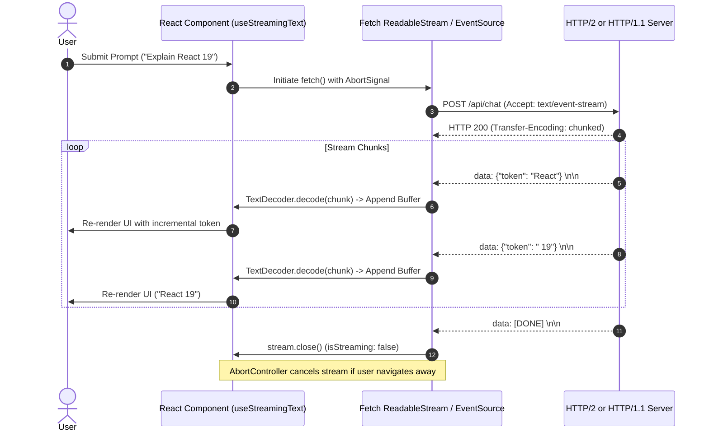

# 08 — Server-Sent Events (SSE) & Streaming in React

## Metadata
- **React Version**: 19.0.0+
- **Prerequisites**: [00-fetch.md](./00-fetch.md), [06-realtime-communication.md](./06-realtime-communication.md), JavaScript Streams API
- **Difficulty**: Advanced
- **Estimated Read Time**: 27 minutes
- **Tags**: `sse`, `server-sent-events`, `streaming`, `fetch-streams`, `llm-streaming`, `readablestream`, `react-19`

---

## Architecture Diagram

The diagram below details the architecture of HTTP streaming and Server-Sent Events (SSE) in a React application, illustrating chunk-by-chunk decoding, buffer parsing, backpressure handling, and component state updates.



---

## Concept Overview

Traditional HTTP communication operates on a **request-response cycle**: the client sends a request and waits until the server finishes computing the entire payload before receiving the response. For real-time telemetry, live notifications, and Generative AI (LLM) responses, this model causes unacceptable latency.

Two primary mechanisms enable server-to-client streaming over standard HTTP:
1. **Server-Sent Events (SSE)**: A standardized W3C specification (`EventSource`) using a persistent unidirectional HTTP connection with MIME type `text/event-stream`. The server sends text blocks delimited by double newlines (`\n\n`). It features native browser reconnection, event IDs, and custom event names.
2. **Fetch with `ReadableStream`**: Modern standard fetch allows accessing `response.body` as a `ReadableStream<Uint8Array>`. Unlike `EventSource` (which is restricted to GET requests and cannot send custom authorization headers in older browser APIs), streaming fetch supports POST payloads (essential for sending large prompts to AI endpoints) and custom request headers.

### Comparison: SSE (`EventSource`) vs `fetch` Streaming vs WebSockets

| Feature | `EventSource` (SSE) | `fetch` Streaming (`ReadableStream`) | WebSockets |
| :--- | :--- | :--- | :--- |
| **Direction** | Server-to-Client only | Server-to-Client (via response body) | Full Duplex (Bi-directional) |
| **Protocol** | HTTP/1.1 or HTTP/2 | HTTP/1.1 or HTTP/2 | `ws://` / `wss://` TCP socket |
| **HTTP Method**| GET only | GET, POST, PUT, etc. | Protocol Upgrade handshake |
| **Custom Headers**| No (Native `EventSource` lacks header config)| Yes (Full `fetch` header control) | Yes (during handshake) |
| **Auto-Reconnect**| Built-in (Automatic with last-event-id) | Manual (Custom retry logic) | Manual (Custom heartbeat/reconnect) |
| **Firewall / Proxy**| Traverses HTTP proxies seamlessly | Traverses HTTP proxies seamlessly | May be blocked by strict enterprise proxies |
| **Primary Use**| Live stock feeds, notification tickers | AI token streaming (OpenAI/Anthropic) | Real-time gaming, collaborative canvas |

---

## Practical Implementation

### Example 1: Robust Custom Hook for LLM Token Streaming via `fetch`

This hook handles POSTing prompt payloads, streaming token chunks with `TextDecoder`, and canceling on component unmount via `AbortController`.

```tsx
// src/hooks/useLLMStream.ts
import { useState, useCallback, useRef, useEffect } from 'react';

interface UseLLMStreamOptions {
  endpoint: string;
  onError?: (err: Error) => void;
  onFinish?: (fullText: string) => void;
}

export function useLLMStream({ endpoint, onError, onFinish }: UseLLMStreamOptions) {
  const [content, setContent] = useState('');
  const [isStreaming, setIsStreaming] = useState(false);
  const abortControllerRef = useRef<AbortController | null>(null);

  // Clean up on unmount
  useEffect(() => {
    return () => {
      abortControllerRef.current?.abort();
    };
  }, []);

  const startStream = useCallback(
    async (prompt: string) => {
      // Cancel any ongoing stream
      abortControllerRef.current?.abort();
      const controller = new AbortController();
      abortControllerRef.current = controller;

      setContent('');
      setIsStreaming(true);

      try {
        const response = await fetch(endpoint, {
          method: 'POST',
          headers: {
            'Content-Type': 'application/json',
            Accept: 'text/event-stream',
          },
          body: JSON.stringify({ prompt }),
          signal: controller.signal,
        });

        if (!response.ok || !response.body) {
          throw new Error(`HTTP ${response.status}: Failed to establish stream`);
        }

        const reader = response.body.getReader();
        const decoder = new TextDecoder('utf-8');
        let accumulatedText = '';

        while (true) {
          const { done, value } = await reader.read();
          if (done) break;

          const chunk = decoder.decode(value, { stream: true });
          // Split on SSE message delimiter
          const lines = chunk.split('\n');

          for (const line of lines) {
            const trimmed = line.trim();
            if (trimmed.startsWith('data: ')) {
              const payload = trimmed.replace('data: ', '');
              if (payload === '[DONE]') {
                break;
              }
              try {
                const parsed = JSON.parse(payload);
                const token = parsed.delta || parsed.token || '';
                accumulatedText += token;
                setContent(accumulatedText);
              } catch {
                // If chunk is raw text rather than JSON
                accumulatedText += payload;
                setContent(accumulatedText);
              }
            }
          }
        }

        onFinish?.(accumulatedText);
      } catch (err: unknown) {
        if (err instanceof Error && err.name === 'AbortError') {
          // Normal cancellation, do not trigger error callback
          return;
        }
        const error = err instanceof Error ? err : new Error(String(err));
        onError?.(error);
      } finally {
        setIsStreaming(false);
        abortControllerRef.current = null;
      }
    },
    [endpoint, onError, onFinish]
  );

  const stopStream = useCallback(() => {
    abortControllerRef.current?.abort();
    setIsStreaming(false);
  }, []);

  return { content, isStreaming, startStream, stopStream };
}
```

*Expected Verification Output:*
```text
Calling startStream("Explain React 19"):
  - isStreaming becomes true.
  - content updates incrementally: "React", "React 19", "React 19 introduces Actions...".
  - stream concludes -> isStreaming becomes false, onFinish fired.
```

---

### Example 2: Interactive AI Chat Box with Streaming Markdown Output

```tsx
// src/components/AIChatBox.tsx
import React, { useState } from 'react';
import { useLLMStream } from '../hooks/useLLMStream';

export function AIChatBox() {
  const [input, setInput] = useState('');
  const { content, isStreaming, startStream, stopStream } = useLLMStream({
    endpoint: '/api/generate',
    onError: (err) => alert(`Stream failed: ${err.message}`),
  });

  const handleSubmit = (e: React.FormEvent) => {
    e.preventDefault();
    if (!input.trim() || isStreaming) return;
    startStream(input);
  };

  return (
    <div className="w-full max-w-xl mx-auto p-4 border rounded-xl shadow-lg bg-white">
      <h3 className="text-lg font-bold text-gray-800 mb-3">AI Assistant (Streaming)</h3>

      <div className="min-h-48 max-h-96 overflow-y-auto p-3 bg-gray-50 rounded border mb-4 whitespace-pre-wrap font-sans text-sm text-gray-800">
        {content || <span className="text-gray-400 italic">Responses will stream here...</span>}
        {isStreaming && <span className="inline-block w-2 h-4 ml-1 bg-blue-500 animate-pulse" />}
      </div>

      <form onSubmit={handleSubmit} className="flex gap-2">
        <input
          type="text"
          value={input}
          onChange={(e) => setInput(e.target.value)}
          placeholder="Ask a technical question..."
          className="flex-1 border px-3 py-2 rounded focus:ring-2 focus:ring-blue-500"
          disabled={isStreaming}
        />

        {isStreaming ? (
          <button
            type="button"
            onClick={stopStream}
            className="bg-red-600 text-white px-4 py-2 rounded font-medium hover:bg-red-700"
          >
            Stop
          </button>
        ) : (
          <button
            type="submit"
            className="bg-blue-600 text-white px-4 py-2 rounded font-medium hover:bg-blue-700"
          >
            Generate
          </button>
        )}
      </form>
    </div>
  );
}
```

*Expected Verification Output:*
```text
Render: AI Assistant prompt box with blinking streaming cursor during active generation.
User clicks "Stop":
  - AbortSignal triggered immediately.
  - isStreaming flips to false, halting further token ingestion.
```

---

### Example 3: Live Server-Sent Events Hook with Reconnect and Heartbeat

Consuming standard SSE endpoints (e.g., live stock prices or notification streams) using native `EventSource`.

```tsx
// src/hooks/useServerSentEvents.ts
import { useEffect, useState, useRef, useCallback } from 'react';

interface SSEOptions<T> {
  url: string;
  eventName?: string;
  initialData: T;
}

export function useServerSentEvents<T>({ url, eventName = 'message', initialData }: SSEOptions<T>) {
  const [data, setData] = useState<T>(initialData);
  const [isConnected, setIsConnected] = useState(false);
  const [error, setError] = useState<Event | null>(null);
  const eventSourceRef = useRef<EventSource | null>(null);

  const connect = useCallback(() => {
    if (eventSourceRef.current) {
      eventSourceRef.current.close();
    }

    const es = new EventSource(url, { withCredentials: true });
    eventSourceRef.current = es;

    es.onopen = () => {
      setIsConnected(true);
      setError(null);
    };

    const handleMessage = (event: MessageEvent) => {
      try {
        const parsed = JSON.parse(event.data);
        setData(parsed);
      } catch {
        setData(event.data as unknown as T);
      }
    };

    if (eventName === 'message') {
      es.onmessage = handleMessage;
    } else {
      es.addEventListener(eventName, handleMessage);
    }

    es.onerror = (err) => {
      setIsConnected(false);
      setError(err);
      // Browser automatically attempts reconnect for EventSource
    };
  }, [url, eventName]);

  useEffect(() => {
    connect();

    return () => {
      if (eventSourceRef.current) {
        eventSourceRef.current.close();
        eventSourceRef.current = null;
      }
    };
  }, [connect]);

  return { data, isConnected, error };
}
```

*Expected Verification Output:*
```text
[SSE Connection] EventSource opened to /api/live-metrics.
isConnected: true.
Incoming SSE payloads update state synchronously without polling overhead.
```

---

### Example 4: Parsing Streaming NDJSON (Newline Delimited JSON)

Many backend streaming endpoints return NDJSON (one valid JSON object per line) rather than the `data: ...` SSE format.

```tsx
// src/utils/ndjsonStream.ts
export async function* parseNDJSONStream<T>(response: Response): AsyncGenerator<T> {
  if (!response.body) throw new Error('Response body is null');

  const reader = response.body.getReader();
  const decoder = new TextDecoder('utf-8');
  let buffer = '';

  try {
    while (true) {
      const { done, value } = await reader.read();
      if (done) break;

      buffer += decoder.decode(value, { stream: true });
      const lines = buffer.split('\n');

      // Keep the last incomplete fragment in buffer
      buffer = lines.pop() || '';

      for (const line of lines) {
        const trimmed = line.trim();
        if (trimmed) {
          yield JSON.parse(trimmed) as T;
        }
      }
    }

    // Process remainder if present
    if (buffer.trim()) {
      yield JSON.parse(buffer.trim()) as T;
    }
  } finally {
    reader.releaseLock();
  }
}
```

*Expected Verification Output:*
```text
Receives partial network chunk {"id":1}\n{"id":2
Yields object 1. Buffer retains "{"id":2".
Next chunk delivers "}\n". Yields object 2 cleanly without SyntaxError.
```

---

### Example 5: High-Frequency Stream Batching with `requestAnimationFrame`

If a server streams 100+ events per second (e.g., telemetry or financial ticks), triggering `setState` on every chunk causes catastrophic UI lag and dropped frames. This example batches incoming tokens via `requestAnimationFrame`.

```tsx
// src/hooks/useBatchedStream.ts
import { useState, useRef, useEffect, useCallback } from 'react';

export function useBatchedStream() {
  const [renderedTokens, setRenderedTokens] = useState<string[]>([]);
  const pendingBufferRef = useRef<string[]>([]);
  const rafIdRef = useRef<number | null>(null);

  const scheduleFlush = useCallback(() => {
    if (rafIdRef.current !== null) return; // Flush already queued

    rafIdRef.current = requestAnimationFrame(() => {
      rafIdRef.current = null;
      if (pendingBufferRef.current.length > 0) {
        const toAppend = [...pendingBufferRef.current];
        pendingBufferRef.current = [];
        setRenderedTokens((prev) => [...prev, ...toAppend]);
      }
    });
  }, []);

  const pushToken = useCallback((token: string) => {
    pendingBufferRef.current.push(token);
    scheduleFlush();
  }, [scheduleFlush]);

  useEffect(() => {
    return () => {
      if (rafIdRef.current !== null) {
        cancelAnimationFrame(rafIdRef.current);
      }
    };
  }, []);

  return { renderedTokens, pushToken };
}
```

*Expected Verification Output:*
```text
Stream receives 500 incoming tokens across 16ms window:
Tokens accumulated in pendingBufferRef; single setState dispatched at 60fps refresh boundary.
Zero dropped frames; perfectly smooth scrolling.
```

---

## Mental Model & Analogies

### The Letter vs The Conveyor Belt

- **Standard HTTP Request**: Sending a letter via postal mail. You write your message, mail it, and wait days for a sealed envelope containing the complete reply.
- **WebSocket**: A two-way phone call. Both parties talk and listen simultaneously across an open line.
- **Server-Sent Events / Stream**: A **factory conveyor belt**. The server places finished parts (tokens or event objects) onto the belt one by one. You stand at the end of the belt, picking up and processing each part the instant it arrives, without waiting for the factory to manufacture the entire order.

---

## Under the Hood / Internal Mechanics

### 1. `TextDecoder` and Incomplete UTF-8 Sequences

A UTF-8 character can span between 1 and 4 bytes (e.g., emojis such as 🚀 take 4 bytes: `0xF0 0x9F 0x9A 0x80`). When data arrives over the network, a TCP packet boundary might split a multibyte character in half:
- Chunk 1: `[0xF0, 0x9F]`
- Chunk 2: `[0x9A, 0x80]`

If you do not pass `{ stream: true }` to `decoder.decode(chunk, { stream: true })`, the decoder treats Chunk 1 as malformed bytes and inserts the replacement character `` (`U+FFFD`). Passing `{ stream: true }` instructs `TextDecoder` to retain incomplete byte sequences in an internal buffer until the subsequent chunk arrives.

### 2. HTTP/1.1 vs HTTP/2 Multiplexing in SSE

Under **HTTP/1.1**, browsers enforce a hard limit of **6 concurrent persistent connections per domain**. If an application opens 6 `EventSource` connections (e.g. across browser tabs), the 7th tab hangs indefinitely, blocking all standard HTTP requests (`fetch`, images, scripts).
Under **HTTP/2**, all streams are multiplexed over a single TCP connection, allowing hundreds of simultaneous SSE or fetch streams without exhausting domain connection limits.

---

## Common Pitfalls & Anti-Patterns

| Anti-Pattern | Why It Breaks | Recommended Solution |
| :--- | :--- | :--- |
| **Missing `{ stream: true }` in `TextDecoder`** | Multibyte Unicode characters (emojis, CJK text) get corrupted with `` when split across chunks. | Always call `decoder.decode(value, { stream: true })`. |
| **Omitting `AbortController` in Streaming `fetch`** | Unmounting the component leaves the stream running in background memory, leaking bandwidth and CPU. | Store `AbortController` in a `ref` and call `.abort()` inside the `useEffect` cleanup return. |
| **Direct `setState` on 200Hz Telemetry Stream** | Triggers hundreds of React re-renders per second, starving the browser main thread and dropping frames. | Batch incoming stream events with `requestAnimationFrame` or throttle with a time buffer. |
| **Using Native `EventSource` for Authenticated POSTs**| Native `EventSource` cannot send custom `Authorization: Bearer <token>` headers or POST bodies. | Use standard `fetch` with `ReadableStream` or libraries like `@microsoft/fetch-event-source`. |
| **Not Handling Split SSE Lines Across Packets** | Assuming every `read()` yields complete `data: {...}\n\n` blocks causes `JSON.parse` syntax crashes. | Maintain a line buffer and only parse lines when a newline `\n` delimiter is confirmed. |
| **Exhausting Connections on HTTP/1.1** | Opening persistent SSE tabs consumes the browser's 6-connection per-host limit, stalling regular page loads. | Ensure server operates on HTTP/2 or HTTP/3; close idle connections when tab is hidden. |

---

## Performance & Optimization

### Controlling Render Frequency with Throttled State

When streaming 50 tokens per second from an LLM:
```tsx
// Bad: 50 React state dispatches per second
while (true) {
  const { done, value } = await reader.read();
  setText(prev => prev + chunk);
}

// Good: Accumulate locally and throttle UI updates to 60fps
let localText = '';
let lastUpdate = performance.now();

while (true) {
  const { done, value } = await reader.read();
  if (done) break;
  localText += decoder.decode(value, { stream: true });
  
  if (performance.now() - lastUpdate > 32) { // ~30fps
    setText(localText);
    lastUpdate = performance.now();
  }
}
setText(localText); // Final sync
```

---

## Edge Cases & Debugging

### Proxies Buffering Stream Output (Nginx / Cloudflare)
- **Symptom**: Streaming text does not appear progressively. Instead, the UI hangs for 10 seconds and then suddenly renders all 500 tokens in one burst.
- **Root Cause**: An intermediate reverse proxy (e.g. Nginx or Cloudflare) is buffering responses until a threshold (e.g. 4KB) is reached.
- **Remedy**: Configure server response headers:
  ```http
  Content-Type: text/event-stream
  Cache-Control: no-cache, no-transform
  Connection: keep-alive
  X-Accel-Buffering: no
  ```
  `X-Accel-Buffering: no` instructs Nginx to immediately disable response buffering.

---

## Ecosystem & Alternative Approaches

- **`@microsoft/fetch-event-source`**: A lightweight library implementing SSE via the Fetch API, adding support for custom headers, POST bodies, and automatic reconnection.
- **Vercel AI SDK (`ai/react`)**: High-level hooks (`useChat`, `useCompletion`) engineered specifically for AI streaming with OpenAI, Anthropic, and LangChain backends.
- **WebStreams API Polyfill**: For older Safari environments that lack full `ReadableStream` async iteration.

---

## Exercises & Challenges

<details>
<summary><strong>Exercise 1: Implement an SSE Reconnect Loop with Exponential Backoff</strong></summary>

**Challenge**: Write a custom reconnection handler that backs off exponentially (1s, 2s, 4s, 8s, max 30s) when an SSE connection drops.

```ts
export function createResilientSSE(url: string, onMessage: (data: string) => void) {
  let retryDelay = 1000;
  let es: EventSource | null = null;
  let isClosed = false;

  function connect() {
    if (isClosed) return;
    es = new EventSource(url);

    es.onopen = () => {
      retryDelay = 1000; // Reset on success
    };

    es.onmessage = (event) => onMessage(event.data);

    es.onerror = () => {
      es?.close();
      if (!isClosed) {
        setTimeout(connect, retryDelay);
        retryDelay = Math.min(retryDelay * 2, 30000);
      }
    };
  }

  connect();

  return () => {
    isClosed = true;
    es?.close();
  };
}
```
</details>

<details>
<summary><strong>Exercise 2: Auto-Scrolling Chat Container During Streaming</strong></summary>

**Challenge**: Ensure a chat window auto-scrolls to the bottom during streaming only if the user is already near the bottom, preserving scroll position if the user scrolled up to read history.

```tsx
import React, { useRef, useEffect } from 'react';

export function StreamingChatView({ text }: { text: string }) {
  const containerRef = useRef<HTMLDivElement>(null);
  const isScrolledToBottomRef = useRef(true);

  const handleScroll = () => {
    if (!containerRef.current) return;
    const { scrollTop, scrollHeight, clientHeight } = containerRef.current;
    isScrolledToBottomRef.current = scrollHeight - (scrollTop + clientHeight) < 50;
  };

  useEffect(() => {
    if (isScrolledToBottomRef.current && containerRef.current) {
      containerRef.current.scrollTop = containerRef.current.scrollHeight;
    }
  }, [text]);

  return (
    <div ref={containerRef} onScroll={handleScroll} className="h-64 overflow-y-auto border p-4">
      {text}
    </div>
  );
}
```
</details>

---

## Frequently Asked Interview Questions

<details>
<summary><strong>1. Why is `fetch` with `ReadableStream` favored over native `EventSource` for Generative AI streaming?</strong></summary>

Native `EventSource` only supports GET requests and does not allow setting custom HTTP request bodies or custom headers in vanilla browser APIs. Large prompts (often tens of thousands of tokens) must be sent via HTTP POST with `Content-Type: application/json` and authorization headers. `fetch` with `ReadableStream` allows POST bodies while streaming responses chunk-by-chunk.
</details>

<details>
<summary><strong>2. How does Server-Sent Events handle connection failures and message ordering?</strong></summary>

SSE has built-in reconnection logic. When the connection drops, the browser automatically attempts to reconnect. Servers can send an `id: <messageId>` field with each event. On reconnect, the browser transmits a `Last-Event-ID` request header containing the last received ID, enabling the server to replay missed events.
</details>

<details>
<summary><strong>3. What happens if you do not cancel a streaming fetch request when a component unmounts?</strong></summary>

The browser continues reading the incoming TCP stream in background memory, wasting server CPU, client network bandwidth, and memory buffers. Furthermore, if the resolution callback attempts to update state on an unmounted component, React issues memory leak warnings or causes subtle background bugs.
</details>

<details>
<summary><strong>4. How does HTTP/2 solve the persistent connection limit problem of SSE?</strong></summary>

Under HTTP/1.1, browsers enforce a hard limit of 6 TCP connections per domain. SSE connections hold a connection open permanently, so opening 6 browser tabs consumes all connections, hanging the application. HTTP/2 multiplexes hundreds of logical request/response streams over a single shared TCP connection, completely removing the 6-connection bottleneck.
</details>

<details>
<summary><strong>5. Why is `{ stream: true }` critical when using `TextDecoder` on streaming chunks?</strong></summary>

Network packet boundaries do not align with character boundaries. Multibyte UTF-8 characters (e.g. emojis or multi-byte letters) can be split across two consecutive chunks. `{ stream: true }` instructs `TextDecoder` to hold partial byte sequences in memory until the next chunk arrives, preventing corruption with the Unicode replacement character ``.
</details>

<details>
<summary><strong>6. What is the difference between WebSockets and SSE, and when should you prefer SSE?</strong></summary>

WebSockets provide full-duplex bi-directional communication over a raw TCP socket, whereas SSE is strictly server-to-client unidirectional communication over standard HTTP. Prefer SSE when data only flows from server to client (e.g., live dashboards, financial quotes, LLM outputs) because SSE runs over standard HTTP/2, requires no special proxy configuration, supports automatic reconnection out of the box, and uses less battery/CPU on mobile devices.
</details>

<details>
<summary><strong>7. How do reverse proxies like Nginx affect HTTP streaming, and how do you fix it?</strong></summary>

By default, reverse proxies buffer upstream HTTP responses until a internal buffer limit (e.g. 4KB) is reached before flushing to the client. This breaks streaming by converting smooth real-time token delivery into delayed batch bursts. To disable buffering in Nginx, the backend must emit the header `X-Accel-Buffering: no` and specify `Cache-Control: no-cache`.
</details>

<details>
<summary><strong>8. How can you prevent high-frequency stream events from locking up React's rendering thread?</strong></summary>

Dispatching `setState` on every incoming chunk (e.g., 200 times/second) saturates React's work loop and causes severe UI jank. You resolve this by buffering incoming tokens into a mutable `ref` or queue and scheduling state flushes on browser animation frames using `requestAnimationFrame`, limiting UI reconciliations to 60fps.
</details>

---

## References & Further Reading

- [MDN Web Docs: Streams API](https://developer.mozilla.org/en-US/docs/Web/API/Streams_API)
- [MDN Web Docs: Server-sent events](https://developer.mozilla.org/en-US/docs/Web/API/Server-sent_events)
- [Microsoft Fetch Event Source Library](https://github.com/Azure/fetch-event-source)
- [Vercel AI SDK Core Documentation](https://sdk.vercel.ai/docs)
- [WHATWG Streams Standard Specification](https://streams.spec.whatwg.org/)
