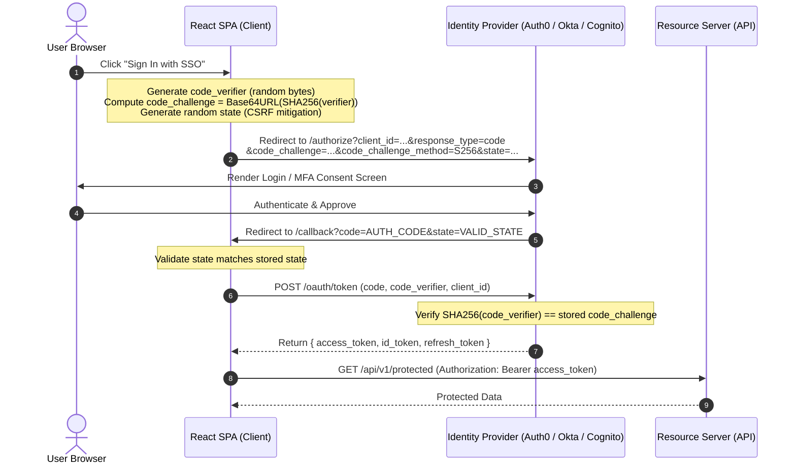

# 09 — OAuth 2.0 & OIDC Flows for React SPAs

## Metadata
- **React Version**: 19.0.0+
- **Prerequisites**: [03-authentication.md](./03-authentication.md), [04-refresh-token-flow.md](./04-refresh-token-flow.md), Web Crypto API
- **Difficulty**: Advanced
- **Estimated Read Time**: 30 minutes
- **Tags**: `oauth2`, `oidc`, `pkce`, `auth`, `security`, `bff`, `tokens`

---

## Architecture Diagram

The diagram below details the OAuth 2.0 Authorization Code Flow with Proof Key for Code Exchange (PKCE) designed for Single Page Applications (RFC 7636 and OAuth 2.0 Security BCP).



---

## Concept Overview

Single Page Applications (SPAs) run entirely inside the end-user's browser. In the OAuth 2.0 security model, an SPA is categorized as a **Public Client**—it cannot securely hold a static `client_secret` because any secret compiled into client JavaScript or inspectable via browser developer tools is compromised.

Historically, SPAs utilized the **Implicit Grant Flow**, where the authorization server returned the `access_token` directly in the URL hash fragment (`#access_token=...`). The OAuth 2.0 Security Best Current Practice (BCP) has formally **deprecated the Implicit Grant** due to token leakage in browser history, referrer headers, and access logs.

The modern industry standard for SPAs is the **Authorization Code Flow with PKCE (Proof Key for Code Exchange)**.

### Core OIDC & PKCE Primitives

1. **`code_verifier`**: A cryptographically random string (43 to 128 characters) generated by the browser using the Web Crypto API (`window.crypto.getRandomValues`).
2. **`code_challenge`**: The Base64URL-encoded SHA-256 hash of the `code_verifier`. Sent during the initial redirect to the Identity Provider (IdP).
3. **`state`**: A high-entropy random string generated per session, verified upon return to protect against Cross-Site Request Forgery (CSRF).
4. **`id_token` vs `access_token`**: 
   - `id_token` (OIDC): Intended for the **React client** to parse user profile attributes (name, email, avatar).
   - `access_token` (OAuth 2.0): An opaque or signed bearer token intended exclusively for **Resource APIs**.

---

## Practical Implementation

### Example 1: Cryptographic PKCE Generation using Web Crypto API

This utility generates RFC 7636 compliant `code_verifier` and `code_challenge` strings without external cryptographic dependencies.

```ts
// src/utils/pkce.ts

// Generates a cryptographically secure random string of given length
export function generateRandomString(length = 64): string {
  const charset = 'ABCDEFGHIJKLMNOPQRSTUVWXYZabcdefghijklmnopqrstuvwxyz0123456789-._~';
  const values = new Uint8Array(length);
  crypto.getRandomValues(values);
  return Array.from(values)
    .map((x) => charset[x % charset.length])
    .join('');
}

// Converts an ArrayBuffer to a Base64-URL-encoded string
function base64UrlEncode(buffer: ArrayBuffer): string {
  const bytes = new Uint8Array(buffer);
  let binary = '';
  for (let i = 0; i < bytes.byteLength; i++) {
    binary += String.fromCharCode(bytes[i]);
  }
  return btoa(binary)
    .replace(/\+/g, '-')
    .replace(/\//g, '_')
    .replace(/=+$/, '');
}

// Computes SHA-256 hash and encodes in Base64URL format
export async function generateCodeChallenge(verifier: string): Promise<string> {
  const encoder = new TextEncoder();
  const data = encoder.encode(verifier);
  const digest = await crypto.subtle.digest('SHA-256', data);
  return base64UrlEncode(digest);
}
```

*Expected Verification Output:*
```text
generateRandomString(64) -> "a9Z_kL18v-w091x..." (high-entropy URL-safe characters)
generateCodeChallenge(verifier) -> "E9Melhoa2OwvFrEMTJguCHAo6KuY2Vu..." (valid SHA-256 Base64URL)
```

---

### Example 2: Initiating Login and Redirecting to the Identity Provider

```ts
// src/services/authService.ts
import { generateRandomString, generateCodeChallenge } from '../utils/pkce';

const OAUTH_CONFIG = {
  clientId: 'react-enterprise-app',
  authorizeEndpoint: 'https://auth.company.com/oauth2/authorize',
  tokenEndpoint: 'https://auth.company.com/oauth2/token',
  redirectUri: `${window.location.origin}/auth/callback`,
  scope: 'openid profile email offline_access',
};

export async function redirectToLogin(): Promise<void> {
  const verifier = generateRandomString(96);
  const state = generateRandomString(32);
  const challenge = await generateCodeChallenge(verifier);

  // Store verifier and state in sessionStorage (cleared when browser session ends)
  sessionStorage.setItem('pkce_verifier', verifier);
  sessionStorage.setItem('oauth_state', state);

  const params = new URLSearchParams({
    response_type: 'code',
    client_id: OAUTH_CONFIG.clientId,
    redirect_uri: OAUTH_CONFIG.redirectUri,
    scope: OAUTH_CONFIG.scope,
    code_challenge: challenge,
    code_challenge_method: 'S256',
    state: state,
  });

  window.location.assign(`${OAUTH_CONFIG.authorizeEndpoint}?${params.toString()}`);
}
```

*Expected Verification Output:*
```text
Redirects browser to https://auth.company.com/oauth2/authorize?response_type=code&client_id=...&code_challenge=...&code_challenge_method=S256
```

---

### Example 3: Handling the OAuth Callback and Token Exchange

```tsx
// src/pages/AuthCallback.tsx
import React, { useEffect, useState } from 'react';
import { useNavigate, useSearchParams } from 'react-router-dom';

interface TokenResponse {
  access_token: string;
  id_token: string;
  refresh_token?: string;
  expires_in: number;
}

export function AuthCallback() {
  const [searchParams] = useSearchParams();
  const navigate = useNavigate();
  const [error, setError] = useState<string | null>(null);

  useEffect(() => {
    async function exchangeCode() {
      const code = searchParams.get('code');
      const state = searchParams.get('state');
      const errorParam = searchParams.get('error');

      if (errorParam) {
        setError(`OAuth Error: ${searchParams.get('error_description') || errorParam}`);
        return;
      }

      const storedState = sessionStorage.getItem('oauth_state');
      const verifier = sessionStorage.getItem('pkce_verifier');

      // Security check: Mitigate CSRF
      if (!state || state !== storedState) {
        setError('Security validation failed: State parameter mismatch.');
        return;
      }

      if (!code || !verifier) {
        setError('Invalid callback parameters: missing code or verifier.');
        return;
      }

      try {
        const response = await fetch('https://auth.company.com/oauth2/token', {
          method: 'POST',
          headers: { 'Content-Type': 'application/x-www-form-urlencoded' },
          body: new URLSearchParams({
            grant_type: 'authorization_code',
            client_id: 'react-enterprise-app',
            code,
            redirect_uri: `${window.location.origin}/auth/callback`,
            code_verifier: verifier,
          }),
        });

        if (!response.ok) {
          throw new Error(`Token exchange failed: HTTP ${response.status}`);
        }

        const tokens: TokenResponse = await response.json();

        // Clean up temporary PKCE keys
        sessionStorage.removeItem('pkce_verifier');
        sessionStorage.removeItem('oauth_state');

        // Store tokens securely (in memory via custom event or secure storage)
        window.dispatchEvent(new CustomEvent('auth:login_success', { detail: tokens }));
        navigate('/dashboard', { replace: true });
      } catch (err: unknown) {
        setError(err instanceof Error ? err.message : 'Unknown authentication failure');
      }
    }

    exchangeCode();
  }, [searchParams, navigate]);

  if (error) {
    return (
      <div className="p-8 max-w-md mx-auto text-center">
        <h2 className="text-xl font-bold text-red-600 mb-2">Authentication Failed</h2>
        <p className="text-sm text-gray-700 mb-4">{error}</p>
        <button
          onClick={() => navigate('/login')}
          className="bg-blue-600 text-white px-4 py-2 rounded"
        >
          Return to Sign In
        </button>
      </div>
    );
  }

  return (
    <div className="flex flex-col items-center justify-center min-h-screen">
      <div className="w-8 h-8 border-4 border-blue-600 border-t-transparent rounded-full animate-spin mb-4" />
      <p className="text-gray-600">Completing secure sign-in...</p>
    </div>
  );
}
```

*Expected Verification Output:*
```text
Browser arrives at /auth/callback?code=xyz&state=123.
State verified against sessionStorage -> POST /oauth2/token with code_verifier.
Tokens received -> Dispatches auth:login_success -> Redirects to /dashboard.
```

---

### Example 4: React `AuthProvider` with In-Memory Access Tokens

Storing access tokens in JavaScript memory instead of `localStorage` protects against persistent XSS token exfiltration.

```tsx
// src/context/AuthContext.tsx
import React, { createContext, useContext, useState, useEffect, useCallback } from 'react';

interface UserProfile {
  sub: string;
  name: string;
  email: string;
}

interface AuthContextType {
  accessToken: string | null;
  user: UserProfile | null;
  isAuthenticated: boolean;
  logout: () => void;
}

const AuthContext = createContext<AuthContextType | null>(null);

// Parses unverified JWT claims on client side for display
function parseJwt(token: string): Record<string, unknown> {
  const base64Url = token.split('.')[1];
  const base64 = base64Url.replace(/-/g, '+').replace(/_/g, '/');
  const jsonPayload = decodeURIComponent(
    window
      .atob(base64)
      .split('')
      .map((c) => '%' + ('00' + c.charCodeAt(0).toString(16)).slice(-2))
      .join('')
  );
  return JSON.parse(jsonPayload);
}

export function AuthProvider({ children }: { children: React.ReactNode }) {
  // Access token held strictly in memory
  const [accessToken, setAccessToken] = useState<string | null>(null);
  const [user, setUser] = useState<UserProfile | null>(null);

  const logout = useCallback(() => {
    setAccessToken(null);
    setUser(null);
    sessionStorage.clear();
    window.location.assign('https://auth.company.com/logout');
  }, []);

  useEffect(() => {
    const handleLogin = (e: Event) => {
      const customEvent = e as CustomEvent<{ access_token: string; id_token: string }>;
      const { access_token, id_token } = customEvent.detail;
      setAccessToken(access_token);
      
      const claims = parseJwt(id_token) as unknown as UserProfile;
      setUser(claims);
    };

    window.addEventListener('auth:login_success', handleLogin);
    return () => window.removeEventListener('auth:login_success', handleLogin);
  }, []);

  return (
    <AuthContext.Provider
      value={{
        accessToken,
        user,
        isAuthenticated: !!accessToken,
        logout,
      }}
    >
      {children}
    </AuthContext.Provider>
  );
}

export function useAuth(): AuthContextType {
  const ctx = useContext(AuthContext);
  if (!ctx) throw new Error('useAuth must be used inside AuthProvider');
  return ctx;
}
```

*Expected Verification Output:*
```text
Tokens received: access_token stored in memory; user profile decoded from id_token.
localStorage inspection confirms: ZERO tokens stored in persistent client storage.
```

---

### Example 5: Axios Interceptor with Refresh Token Rotation & Concurrency Locking

When the in-memory access token expires, multiple parallel API requests simultaneously fail with 401. This interceptor uses a mutex lock to refresh the token once and replay all queued requests.

```ts
// src/api/axiosClient.ts
import axios from 'axios';

export const apiClient = axios.create({
  baseURL: 'https://api.company.com',
});

let isRefreshing = false;
let failedQueue: Array<{
  resolve: (token: string) => void;
  reject: (error: unknown) => void;
}> = [];

function processQueue(error: unknown, token: string | null = null) {
  failedQueue.forEach((promise) => {
    if (error) {
      promise.reject(error);
    } else if (token) {
      promise.resolve(token);
    }
  });
  failedQueue = [];
}

apiClient.interceptors.response.use(
  (response) => response,
  async (error) => {
    const originalRequest = error.config;

    if (error.response?.status === 401 && !originalRequest._retry) {
      if (isRefreshing) {
        return new Promise((resolve, reject) => {
          failedQueue.push({ resolve, reject });
        })
          .then((token) => {
            originalRequest.headers.Authorization = `Bearer ${token}`;
            return apiClient(originalRequest);
          })
          .catch((err) => Promise.reject(err));
      }

      originalRequest._retry = true;
      isRefreshing = true;

      try {
        // Attempt token refresh (using HttpOnly cookie or refreshToken)
        const refreshResponse = await axios.post(
          'https://auth.company.com/oauth2/token',
          { grant_type: 'refresh_token' },
          { withCredentials: true }
        );

        const newAccessToken = refreshResponse.data.access_token;
        originalRequest.headers.Authorization = `Bearer ${newAccessToken}`;
        processQueue(null, newAccessToken);

        return apiClient(originalRequest);
      } catch (refreshErr) {
        processQueue(refreshErr, null);
        // Force re-login if refresh token is revoked or expired
        window.location.assign('/login');
        return Promise.reject(refreshErr);
      } finally {
        isRefreshing = false;
      }
    }

    return Promise.reject(error);
  }
);
```

*Expected Verification Output:*
```text
3 simultaneous requests return 401:
  - First request locks isRefreshing = true and dispatches /oauth2/token.
  - Remaining 2 requests queue into failedQueue.
  - Refresh succeeds -> New token distributed to all 3 requests -> All complete successfully.
```

---

## Mental Model & Analogies

### The Valet Key and the Handshake Code

Imagine parking your car with a valet:
- If you hand the valet your **master key** (`client_secret`), they can unlock your glove box, clone your key, and steal your car. An SPA must never possess the master key.
- Instead, with **PKCE**, your phone generates a secret passcode (`code_verifier`) and shows the valet a hashed fingerprint (`code_challenge`).
- The authorization office gives the driver a temporary voucher (`auth_code`).
- When the driver hands the voucher back to the office along with the original passcode, the office hashes it. Because the hash matches the fingerprint, the office knows the person presenting the voucher is the identical browser that requested it—even if an attacker intercepted the voucher along the road!

---

## Under the Hood / Internal Mechanics

### 1. Proof Key for Code Exchange (RFC 7636) Mechanics

PKCE prevents the **Authorization Code Interception Attack**:
1. On mobile and desktop OSs, malicious applications can register custom URI schemes (e.g., `myapp://callback`) to intercept incoming authorization codes.
2. In an SPA, rogue extensions or malicious browser tabs could potentially intercept redirect queries.
3. Because the authorization code exchange requires the plain-text `code_verifier`, an attacker holding only the intercepted authorization code cannot exchange it for tokens without knowing the original random string stored securely inside the authentic client's memory.

### 2. Backend-for-Frontend (BFF) Pattern

The current security consensus among OWASP and OAuth Working Groups is that purely client-side token storage in SPAs is inherently vulnerable to cross-site scripting (XSS).
The **BFF (Backend-for-Frontend)** architecture resolves this:
- The React SPA talks exclusively to a lightweight server proxy (e.g., Next.js Route Handlers, Express, or Envoy gateway).
- The BFF handles the OAuth 2.0 PKCE flow on the server and stores the tokens in encrypted, `HttpOnly`, `SameSite=Strict`, `Secure` cookies.
- JavaScript running in the browser **never has access to raw tokens**, completely insulating the application from token exfiltration via XSS.

---

## Common Pitfalls & Anti-Patterns

| Anti-Pattern | Why It Breaks | Recommended Solution |
| :--- | :--- | :--- |
| **Storing Tokens in `localStorage`** | Any third-party script, malicious NPM package, or XSS flaw can read `localStorage.getItem('token')` and exfiltrate credentials. | Store access tokens in React memory or adopt a Backend-for-Frontend (BFF) with `HttpOnly` cookies. |
| **Using `code_challenge_method: "plain"`** | Transmits the unhashed verifier, defeating the purpose of PKCE if authorization request URLs are logged. | Always use `code_challenge_method: "S256"` (SHA-256). |
| **Omitting the `state` Parameter** | Exposes the application to login CSRF attacks where an attacker tricks a user into authenticating into the attacker's account. | Generate a random `state` string, store it in `sessionStorage`, and verify strict equality in the callback handler. |
| **Using OAuth 2.0 Implicit Flow** | Access tokens are exposed in URL hash fragments, browser history, and proxy access logs. | Migrate immediately to Authorization Code Flow with PKCE. |
| **Parsing `id_token` on Client for Authorization** | Client-side JWT decoding (`atob`) does not verify the cryptographic signature; an attacker can tamper with claims. | APIs must cryptographically verify JWT signatures using the IdP's JWKS endpoint (`/.well-known/jwks.json`). |
| **Concurrent Refresh Storms** | Multiple expired API requests trigger simultaneous refresh calls, triggering token reuse alarms at the IdP. | Implement a request queue mutex lock around token refresh routines. |

---

## Performance & Optimization

### Silent Authentication via Token Refresh

Instead of forcing users through visible redirects every time their 15-minute access token expires, use silent token refresh:
- When using refresh tokens, dispatch a background POST request to the token endpoint before the access token expires:
  ```ts
  const refreshBufferMs = 60 * 1000; // Refresh 1 minute before expiry
  const timeoutId = setTimeout(() => {
    refreshAccessToken();
  }, (expiresIn * 1000) - refreshBufferMs);
  ```

---

## Edge Cases & Debugging

### Refresh Token Rotation (RTR) Reuse Detection
- **Mechanism**: Modern IdPs issue a new refresh token every time one is used. If an attacker and a legitimate client attempt to use the same refresh token, the IdP detects token reuse.
- **Consequence**: The IdP immediately revokes the entire token family, invalidating all sessions for that user.
- **Frontend Symptom**: Users randomly get kicked out of the app when navigating tabs quickly.
- **Fix**: Ensure your React application synchronizes token refreshes across multiple browser tabs using `BroadcastChannel` or a shared Web Worker.

---

## Ecosystem & Alternative Approaches

- **`oidc-client-ts` / `react-oidc-context`**: The battle-tested, standard TypeScript library for managing OIDC authentication states in React.
- **Auth0 React SDK (`@auth0/auth0-react`)**: High-level wrapper automating PKCE, Web Workers for token caching, and protected route wrappers.
- **NextAuth.js / Auth.js**: Fullstack authentication library that implements the Backend-for-Frontend (BFF) pattern automatically.

---

## Exercises & Challenges

<details>
<summary><strong>Exercise 1: Multi-Tab Token Synchronization with BroadcastChannel</strong></summary>

**Challenge**: Synchronize token invalidation across all open browser tabs so logging out in one tab immediately logs out all other tabs.

```ts
export function initAuthSync(onLogout: () => void) {
  const channel = new BroadcastChannel('auth_sync_channel');

  channel.onmessage = (event) => {
    if (event.data?.type === 'LOGOUT') {
      onLogout();
    }
  };

  return {
    notifyLogout: () => {
      channel.postMessage({ type: 'LOGOUT' });
    },
    close: () => channel.close(),
  };
}
```
</details>

<details>
<summary><strong>Exercise 2: Type-Safe Route Guard with Role Verification</strong></summary>

**Challenge**: Create a `<ProtectedRoute>` wrapper that inspects decoded OIDC claims and redirects unauthorized users to an `/unauthorized` view.

```tsx
import React from 'react';
import { Navigate, Outlet } from 'react-router-dom';
import { useAuth } from '../context/AuthContext';

interface ProtectedRouteProps {
  requiredRole?: string;
}

export function ProtectedRoute({ requiredRole }: ProtectedRouteProps) {
  const { isAuthenticated, user } = useAuth();

  if (!isAuthenticated) {
    return <Navigate to="/login" replace />;
  }

  const userRoles = (user as unknown as { roles?: string[] })?.roles || [];
  if (requiredRole && !userRoles.includes(requiredRole)) {
    return <Navigate to="/unauthorized" replace />;
  }

  return <Outlet />;
}
```
</details>

---

## Frequently Asked Interview Questions

<details>
<summary><strong>1. Why is the Implicit Grant flow deprecated in modern OAuth 2.0 specifications?</strong></summary>

The Implicit Grant returns access tokens directly in the URL hash fragment (`#access_token=...`). This exposes tokens to multiple threat vectors: browser history leakage, logging by web analytics or reverse proxies via `Referer` headers, and token interception by malicious browser extensions. Authorization Code Flow with PKCE eliminates these vulnerabilities by returning a temporary one-time authorization code that must be exchanged via a secure backchannel POST request.
</details>

<details>
<summary><strong>2. How does PKCE (Proof Key for Code Exchange) protect public clients from code interception?</strong></summary>

The client generates a high-entropy secret string (`code_verifier`) and sends its cryptographic hash (`code_challenge`) during the initial redirect. When the client receives the authorization code, it submits the code along with the raw `code_verifier`. The authorization server hashes the verifier using SHA-256 and compares it to the previously received challenge. If an attacker intercepted the authorization code, they cannot exchange it because they cannot reverse the SHA-256 hash to obtain the `code_verifier`.
</details>

<details>
<summary><strong>3. What is the difference between an ID Token and an Access Token in OpenID Connect?</strong></summary>

An **ID Token** is a signed JWT intended solely for consumption by the **client application**. It contains assertions about the user's identity (such as user ID, name, email, authentication time) used to populate the UI. 
An **Access Token** is intended for the **Resource Server (API)**. The client does not need to understand or parse the access token; it simply attaches it as an HTTP Bearer header to authorize API calls.
</details>

<details>
<summary><strong>4. Why is storing JWTs in `localStorage` considered a security risk?</strong></summary>

`localStorage` has no access restrictions against JavaScript running within the same origin. Any Cross-Site Scripting (XSS) vulnerability—whether introduced through unsanitized input, an insecure third-party analytics script, or a compromised NPM dependency—can read `localStorage` and transmit the stored tokens to an attacker's command-and-control server.
</details>

<details>
<summary><strong>5. What is the Backend-for-Frontend (BFF) pattern, and why is it recommended for SPAs?</strong></summary>

In the BFF pattern, an intermediate backend server sits between the React SPA and downstream microservices. The BFF handles the OAuth exchange, securely holds client credentials, and sets the returned tokens in `HttpOnly`, `SameSite=Strict`, `Secure` cookies. The browser never accesses the raw tokens, rendering client-side XSS token exfiltration impossible.
</details>

<details>
<summary><strong>6. What is Refresh Token Rotation (RTR), and how does it detect token theft?</strong></summary>

Under Refresh Token Rotation, the authorization server invalidates the refresh token every time it is used and issues a brand-new refresh token alongside the new access token. If an attacker stole a refresh token and uses it after the legitimate client has already rotated it, the server detects that an invalidated token is being reused. The server immediately revokes the entire token family, terminating all sessions for that user.
</details>

<details>
<summary><strong>7. How does the `state` parameter prevent CSRF attacks in OAuth 2.0?</strong></summary>

Before redirecting to the IdP, the client generates a cryptographically random `state` string and stores it in session storage. The IdP echoes this exact string back in the redirect callback query params. If an attacker tricks a user's browser into visiting a malicious authorization callback URL (e.g. carrying the attacker's authorization code), the browser will detect that the `state` in the URL does not match the `state` in session storage, immediately aborting the exchange.
</details>

<details>
<summary><strong>8. What is the purpose of the `offline_access` scope in OIDC?</strong></summary>

In OpenID Connect, requesting the `offline_access` scope requests a **Refresh Token** from the authorization server. This allows the client application to obtain new access tokens on behalf of the user even when the user is not actively interacting with the identity provider's login interface.
</details>

---

## References & Further Reading

- [RFC 7636: Proof Key for Code Exchange by OAuth Public Clients](https://datatracker.ietf.org/doc/html/rfc7636)
- [OAuth 2.0 Security Best Current Practice (IETF Draft)](https://datatracker.ietf.org/doc/html/draft-ietf-oauth-security-topics)
- [OWASP Single Page Application Security Cheat Sheet](https://cheatsheetseries.owasp.org/cheatsheets/Single_Page_Application_Security_Cheat_Sheet.html)
- [Auth0: Authorization Code Flow with PKCE](https://auth0.com/docs/get-started/authentication-and-authorization-flow/authorization-code-flow-with-pkce)
- [IETF RFC 8252: OAuth 2.0 for Native and Public Apps](https://datatracker.ietf.org/doc/html/rfc8252)
