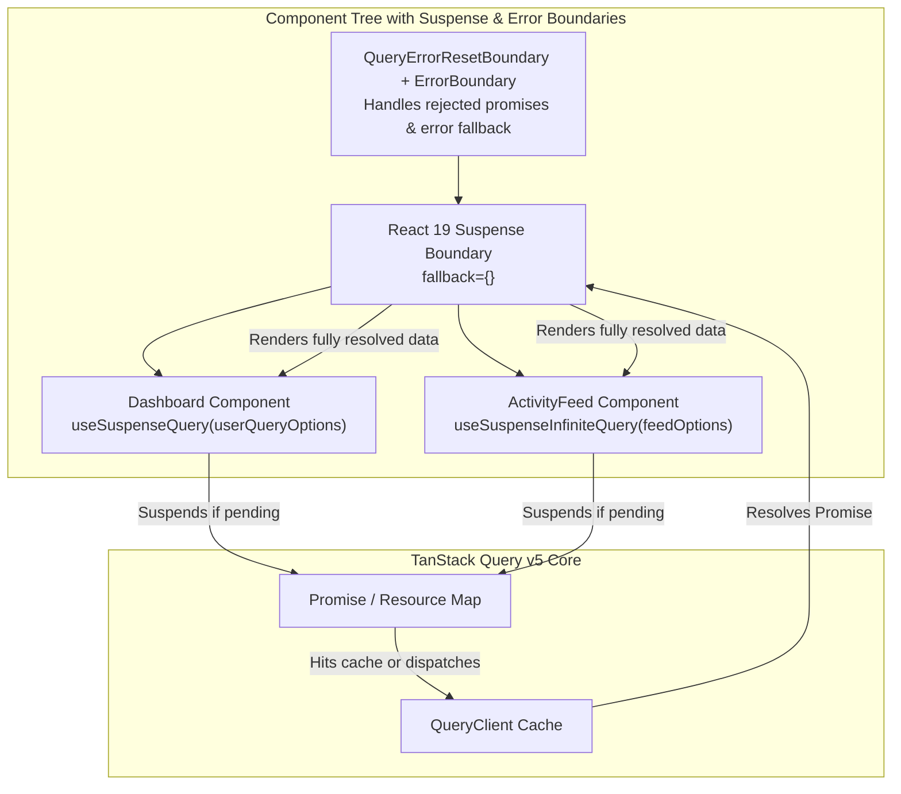

# 08 — TanStack Query v5 & React 19 Suspense

## Metadata
- **React Version**: 19.0.0+
- **Prerequisites**: [03-tanstack-query.md](./03-tanstack-query.md), [04-caching-and-synchronization.md](./04-caching-and-synchronization.md), React Suspense
- **Difficulty**: Advanced
- **Estimated Read Time**: 28 minutes
- **Tags**: `tanstack-query`, `react-query-v5`, `suspense`, `useSuspenseQuery`, `react-19`, `query-keys`

---

## Architecture Diagram

The diagram below illustrates the Suspense-first data fetching paradigm introduced in TanStack Query v5, showing how `useSuspenseQuery` suspends the component tree, delegates loading states to `<Suspense>` boundaries, and delegates error recovery to `<QueryErrorResetBoundary>` or `<ErrorBoundary>`.



---

## Concept Overview

Prior to TanStack Query v5, enabling Suspense required passing an untyped `{ suspense: true }` option to `useQuery`. This configuration had severe limitations:
1. **Type Insecurity**: TypeScript still typed `data` as `TData | undefined` because the standard `useQuery` hook must account for the initial loading phase.
2. **Behavioral Inconsistencies**: Polling, retries, and conditional fetching (`enabled: false`) conflicted unpredictably with Suspense's promise-throwing mechanism.

TanStack Query v5 introduced dedicated, type-safe Suspense hooks:
- **`useSuspenseQuery`**: Guaranteed non-undefined `data`. It suspends the component until data is cached or resolved.
- **`useSuspenseInfiniteQuery`**: Suspense-driven cursor and page pagination.
- **`useSuspenseQueries`**: Parallel suspense data fetching for multiple independent query keys.

### Key Architectural Differences in v5

| Feature | Standard `useQuery` | `useSuspenseQuery` (v5) |
| :--- | :--- | :--- |
| **`data` Type** | `TData \| undefined` (must check `isPending`) | `TData` (guaranteed defined at render time) |
| **Loading State Handling**| In-component (`if (isPending) return <Spinner />`) | Declarative `<Suspense fallback={<Skeleton />}>` |
| **Error Handling** | In-component (`if (isError) return <Alert />`) | `<ErrorBoundary>` or `<QueryErrorResetBoundary>` |
| **Conditional Fetching** | Supported via `enabled: boolean` | Not supported (use separate suspended child components) |
| **`placeholderData`** | Supported (`keepPreviousData`) | Deprecated in suspense; replaced with React `startTransition` |

---

## Practical Implementation

### Example 1: The Canonical Query Key Factory Pattern

TanStack Query keys must be arrays. Using loose strings (`['user', id]`) across large teams leads to inconsistent invalidation. A Query Key Factory guarantees type-safe keys and options.

```ts
// src/queries/userQueries.ts
import { queryOptions } from '@tanstack/react-query';

export interface User {
  id: string;
  name: string;
  email: string;
  role: 'admin' | 'member';
}

// 1. Centralized Query Key Factory
export const userKeys = {
  all: ['users'] as const,
  lists: () => [...userKeys.all, 'list'] as const,
  list: (filters: Record<string, unknown>) => [...userKeys.lists(), filters] as const,
  details: () => [...userKeys.all, 'detail'] as const,
  detail: (id: string) => [...userKeys.details(), id] as const,
};

// 2. Reusable, type-safe query options
export const userQueryOptions = {
  detail: (id: string) =>
    queryOptions({
      queryKey: userKeys.detail(id),
      queryFn: async (): Promise<User> => {
        const res = await fetch(`/api/users/${id}`);
        if (!res.ok) throw new Error(`User ${id} not found`);
        return res.json();
      },
      staleTime: 1000 * 60 * 5, // 5 minutes
    }),
  list: (role?: string) =>
    queryOptions({
      queryKey: userKeys.list({ role }),
      queryFn: async (): Promise<User[]> => {
        const url = role ? `/api/users?role=${role}` : '/api/users';
        const res = await fetch(url);
        if (!res.ok) throw new Error('Failed to fetch users');
        return res.json();
      },
      staleTime: 1000 * 60 * 2,
    }),
};
```

*Expected Verification Output:*
```text
userKeys.detail('42') -> ['users', 'detail', '42']
Types enforce strict queryOption contracts across loaders, hooks, and prefetchers.
```

---

### Example 2: Component Implementation with `useSuspenseQuery`

Notice that `data` requires no null checks (`user.name` is directly accessible).

```tsx
// src/components/UserProfile.tsx
import React from 'react';
import { useSuspenseQuery } from '@tanstack/react-query';
import { userQueryOptions } from '../queries/userQueries';

export function UserProfile({ userId }: { userId: string }) {
  // data is strictly `User`, NEVER `undefined`!
  const { data: user } = useSuspenseQuery(userQueryOptions.detail(userId));

  return (
    <div className="p-6 bg-white rounded-lg shadow-md border border-gray-100">
      <h2 className="text-2xl font-bold text-gray-800">{user.name}</h2>
      <p className="text-gray-600">{user.email}</p>
      <span className="inline-block mt-2 px-2 py-1 text-xs font-semibold rounded bg-blue-100 text-blue-800">
        Role: {user.role.toUpperCase()}
      </span>
    </div>
  );
}
```

*Expected Verification Output:*
```text
Component tree suspends if cache entry ['users', 'detail', 'userId'] is pending.
Renders clean HTML without ternary loading spinners or null guards.
```

---

### Example 3: Wrapping with Suspense and `QueryErrorResetBoundary`

When an error occurs inside a Suspense component, the nearest Error Boundary catches it. TanStack Query provides `QueryErrorResetBoundary` so the user can retry the failed query from the error UI.

```tsx
// src/components/UserProfileContainer.tsx
import React, { Suspense } from 'react';
import { QueryErrorResetBoundary } from '@tanstack/react-query';
import { ErrorBoundary } from 'react-error-boundary';
import { UserProfile } from './UserProfile';

function UserSkeleton() {
  return (
    <div className="p-6 bg-gray-50 rounded-lg animate-pulse border">
      <div className="h-6 w-48 bg-gray-300 rounded mb-3" />
      <div className="h-4 w-32 bg-gray-200 rounded mb-2" />
      <div className="h-4 w-16 bg-gray-200 rounded" />
    </div>
  );
}

export function UserProfileContainer({ userId }: { userId: string }) {
  return (
    <QueryErrorResetBoundary>
      {({ reset }) => (
        <ErrorBoundary
          onReset={reset}
          fallbackRender={({ error, resetErrorBoundary }) => (
            <div className="p-4 bg-red-50 border border-red-200 rounded text-red-800">
              <h3 className="font-bold">Failed to load user profile</h3>
              <p className="text-sm my-2">{error.message}</p>
              <button
                onClick={() => resetErrorBoundary()}
                className="px-3 py-1 bg-red-600 text-white rounded text-sm hover:bg-red-700"
              >
                Retry Request
              </button>
            </div>
          )}
        >
          <Suspense fallback={<UserSkeleton />}>
            <UserProfile userId={userId} />
          </Suspense>
        </ErrorBoundary>
      )}
    </QueryErrorResetBoundary>
  );
}
```

*Expected Verification Output:*
```text
Initial fetch pending -> UserSkeleton rendered in DOM.
Fetch fails -> ErrorBoundary catches error, renders retry UI.
Clicking "Retry Request" calls reset(), evicts failed query state, and retries.
Fetch succeeds -> UserProfile renders with guaranteed non-null User object.
```

---

### Example 4: Paginated Infinite Scroll with `useSuspenseInfiniteQuery`

```tsx
// src/components/SuspendedActivityFeed.tsx
import React from 'react';
import { useSuspenseInfiniteQuery } from '@tanstack/react-query';

interface FeedResponse {
  items: Array<{ id: string; message: string; timestamp: string }>;
  nextCursor?: string;
}

export function SuspendedActivityFeed() {
  const {
    data,
    fetchNextPage,
    hasNextPage,
    isFetchingNextPage,
  } = useSuspenseInfiniteQuery({
    queryKey: ['activityFeed'],
    queryFn: async ({ pageParam }): Promise<FeedResponse> => {
      const url = pageParam ? `/api/feed?cursor=${pageParam}` : '/api/feed';
      const res = await fetch(url);
      if (!res.ok) throw new Error('Failed to fetch activity feed');
      return res.json();
    },
    initialPageParam: undefined as string | undefined,
    getNextPageParam: (lastPage) => lastPage.nextCursor,
  });

  return (
    <div className="space-y-4">
      <h3 className="text-lg font-bold">Activity Feed</h3>
      <div className="divide-y border rounded">
        {data.pages.flatMap((page) => page.items).map((item) => (
          <div key={item.id} className="p-3">
            <p className="font-medium text-gray-800">{item.message}</p>
            <span className="text-xs text-gray-400">{item.timestamp}</span>
          </div>
        ))}
      </div>

      {hasNextPage && (
        <button
          onClick={() => fetchNextPage()}
          disabled={isFetchingNextPage}
          className="w-full py-2 bg-gray-100 hover:bg-gray-200 text-gray-800 rounded font-medium disabled:opacity-50"
        >
          {isFetchingNextPage ? 'Loading more items...' : 'Load More'}
        </button>
      )}
    </div>
  );
}
```

*Expected Verification Output:*
```text
Initial page suspends at outer boundary.
Subsequent page loads via fetchNextPage() update smoothly without re-triggering Suspense fallback.
```

---

### Example 5: Non-Blocking Tab Transitions with React 19 `startTransition`

When switching filters or tabs in a Suspense-enabled interface, you want to keep the current view visible while the next query fetches in the background, rather than flashing the skeleton fallback. In TanStack Query v5, this is achieved natively with React's `startTransition`.

```tsx
// src/components/FilteredUserDirectory.tsx
import React, { useState, useTransition, Suspense } from 'react';
import { useSuspenseQuery } from '@tanstack/react-query';
import { userQueryOptions } from '../queries/userQueries';

function UserList({ role }: { role: string }) {
  const { data: users } = useSuspenseQuery(userQueryOptions.list(role));

  return (
    <ul className="mt-4 space-y-2">
      {users.map((u) => (
        <li key={u.id} className="p-2 border rounded bg-white">
          {u.name} — <span className="text-gray-500">{u.role}</span>
        </li>
      ))}
    </ul>
  );
}

export function FilteredUserDirectory() {
  const [selectedRole, setSelectedRole] = useState('all');
  const [isPending, startTransition] = useTransition();

  const handleSelectRole = (newRole: string) => {
    // startTransition tells React to keep the current tab UI alive
    // while the new tab suspends in the background!
    startTransition(() => {
      setSelectedRole(newRole);
    });
  };

  return (
    <div className="p-6">
      <div className="flex gap-2">
        {['all', 'admin', 'member'].map((role) => (
          <button
            key={role}
            onClick={() => handleSelectRole(role)}
            className={`px-4 py-2 rounded text-sm font-semibold capitalize ${
              selectedRole === role
                ? 'bg-blue-600 text-white'
                : 'bg-gray-200 text-gray-700 hover:bg-gray-300'
            }`}
          >
            {role}
          </button>
        ))}
        {isPending && <span className="text-xs text-blue-500 self-center">Updating...</span>}
      </div>

      <div className={isPending ? 'opacity-60 transition-opacity' : 'opacity-100'}>
        <Suspense fallback={<div className="p-4 text-gray-400">Loading directory...</div>}>
          <UserList role={selectedRole === 'all' ? '' : selectedRole} />
        </Suspense>
      </div>
    </div>
  );
}
```

*Expected Verification Output:*
```text
Clicking "admin" tab:
  - React wraps the suspension in a transition.
  - The previous "all" list stays visible (dimmed to 60% opacity) while "admin" query loads.
  - Zero layout flash or skeleton jump.
```

---

## Mental Model & Analogies

### The Restaurant Order vs The Self-Service Buffet

- **Classic `useQuery`** is a **restaurant order**: You sit at your table, place your order, and you must check your watch every 30 seconds (`if (isLoading) return <WaitingSpinner />`). If the waiter drops your plate, you must personally handle the apology (`if (isError) return <ErrorMessage />`).
- **`useSuspenseQuery`** is a **reserved VIP Banquet**: You never sit at the dining table until the food is already plated. While the chefs are cooking, you are kept comfortably in the reception lounge (`<Suspense fallback={<Lounge />} />`). By the time you enter the dining room, your food is guaranteed to be on the table (`data: TData` is never undefined).

---

## Under the Hood / Internal Mechanics

### How `useSuspenseQuery` Interacts with React's Fiber Reconciler

1. When `useSuspenseQuery` executes, it checks the internal `QueryCache`.
2. If the query status is `success` and not stale, it synchronously returns `data`.
3. If the query is pending or fetching for the first time:
   - It throws an ongoing JavaScript `Promise` up the component tree.
   - React's Fiber reconciler catches the thrown Promise, halts rendering the component subtree, and mounts the nearest `<Suspense fallback={...}>` parent.
   - When TanStack Query's network fetch resolves, it calls `resolve()` on the thrown promise.
   - React detects the resolution and re-renders the suspended component from the top.

---

## Common Pitfalls & Anti-Patterns

| Anti-Pattern | Why It Breaks | Recommended Solution |
| :--- | :--- | :--- |
| **Passing `enabled: false` to `useSuspenseQuery`** | Not supported. Suspending queries cannot be conditionally disabled without causing infinite suspension loops. | Mount the query component conditionally with standard JSX (`{isOpen && <ChildQueryComponent />}`). |
| **Inline Query Key Literals (`['users', id]`)** | Hardcoded keys produce typo bugs and missed invalidations across different files. | Always utilize the Query Key Factory pattern (`userKeys.detail(id)`). |
| **Missing `<ErrorBoundary>` around Suspended Tree** | A failed query throws an unhandled rejection, crashing the entire React application root. | Always pair `<Suspense>` with `<QueryErrorResetBoundary>` and an `<ErrorBoundary>`. |
| **Using `placeholderData: keepPreviousData` with Suspense**| Deprecated in v5 for suspense hooks; leads to stale closure bugs. | Wrap state changes in React's native `useTransition` / `startTransition`. |
| **Destructuring `isLoading` from `useSuspenseQuery`** | `isLoading` does not exist on `useSuspenseQuery` return type; it always suspends instead. | Use `isFetching` or `isRefetching` to track background updates. |
| **Creating `queryOptions` without `queryOptions()` helper** | Misses TypeScript inference of `queryFn` return types and query key schemas. | Wrap all options objects in the `queryOptions()` helper function. |

---

## Performance & Optimization

### Parallel Fetching with `useSuspenseQueries`

Avoid sequential waterfalls in sibling components by batching independent requests:

```tsx
import { useSuspenseQueries } from '@tanstack/react-query';
import { userQueryOptions } from '../queries/userQueries';
import { projectQueryOptions } from '../queries/projectQueries';

export function TeamOverview({ userId, projectId }: { userId: string; projectId: string }) {
  // Dispatches both requests concurrently; suspends until BOTH resolve
  const [userResult, projectResult] = useSuspenseQueries({
    queries: [
      userQueryOptions.detail(userId),
      projectQueryOptions.detail(projectId),
    ],
  });

  return (
    <div>
      <h3>{userResult.data.name}</h3>
      <p>{projectResult.data.title}</p>
    </div>
  );
}
```

---

## Edge Cases & Debugging

### Infinite Loop on 404 in Suspense
- **Symptom**: Page spins endlessly or crashes the browser tab when an API returns 404.
- **Root Cause**: The error boundary resets the query immediately without handling the 404 condition, re-triggering the suspense query instantly.
- **Remedy**: Configure `retry: (failureCount, error) => error.status !== 404 && failureCount < 3` inside your query options to prevent retrying permanent 404s.

---

## Ecosystem & Alternative Approaches

- **SWR (`useSWR` with `{ suspense: true }`)**: Vercel's lightweight data fetching library. Good for simple use cases, but lacks v5's Query Key Factories and fine-grained mutation caching.
- **React 19 `use(promise)`**: React's native hook for unwrapping promises inside components. While powerful, `use()` provides no built-in caching, background refetching, garbage collection, or deduplication—making TanStack Query essential for enterprise apps.

---

## Exercises & Challenges

<details>
<summary><strong>Exercise 1: Implement Prefetching on Hover with `queryOptions`</strong></summary>

**Challenge**: Write a link component that prefetches user details into the `queryClient` cache when hovered, making navigation instantaneous.

```tsx
import React from 'react';
import { useQueryClient } from '@tanstack/react-query';
import { userQueryOptions } from '../queries/userQueries';

export function UserHoverCard({ userId, name }: { userId: string; name: string }) {
  const queryClient = useQueryClient();

  const handleMouseEnter = () => {
    queryClient.prefetchQuery(userQueryOptions.detail(userId));
  };

  return (
    <a
      href={`/users/${userId}`}
      onMouseEnter={handleMouseEnter}
      className="text-blue-600 hover:underline"
    >
      {name}
    </a>
  );
}
```
</details>

<details>
<summary><strong>Exercise 2: Type-Safe Dynamic Query Selection</strong></summary>

**Challenge**: Use the `select` option with `useSuspenseQuery` to extract and memoize only the user's initials, typed strictly as `string`.

```tsx
import { useSuspenseQuery } from '@tanstack/react-query';
import { userQueryOptions } from '../queries/userQueries';

export function UserInitials({ userId }: { userId: string }) {
  const { data: initials } = useSuspenseQuery({
    ...userQueryOptions.detail(userId),
    select: (user): string =>
      user.name
        .split(' ')
        .map((n) => n[0])
        .join('')
        .toUpperCase(),
  });

  return <div className="w-10 h-10 rounded-full bg-blue-600 text-white flex items-center justify-center font-bold">{initials}</div>;
}
```
</details>

---

## Frequently Asked Interview Questions

<details>
<summary><strong>1. Why is `data` guaranteed to never be `undefined` in `useSuspenseQuery`?</strong></summary>

In standard `useQuery`, the hook renders through all phases of the fetch lifecycle (`isPending`, `isSuccess`, `isError`). During the `isPending` phase, `data` is `undefined`. 
In contrast, `useSuspenseQuery` throws a Promise during the pending phase, delegating rendering to an ancestor `<Suspense>` boundary. The component containing `useSuspenseQuery` does not render until the Promise has resolved and data is written into the cache. Therefore, when the component finally renders, `data` is guaranteed to be present and typed strictly as `TData`.
</details>

<details>
<summary><strong>2. How do you conditionally fetch data with `useSuspenseQuery` if `enabled` is unsupported?</strong></summary>

In TanStack Query v5, `enabled` is removed from `useSuspenseQuery` because suspending queries conditionally violates React's Suspense mental model. To conditionally fetch, you either split the conditional logic into separate child components (rendering `<UserDetail userId={id} />` only when `id` is present) or fall back to standard `useQuery({ ...options, enabled: !!id })`.
</details>

<details>
<summary><strong>3. What role does `QueryErrorResetBoundary` play in Suspense applications?</strong></summary>

When a query fails inside a Suspense component, it throws an error caught by the nearest Error Boundary. However, simply clicking "Retry" in the Error Boundary would cause the component to re-mount and read the same failed query from the cache, triggering an instant re-error. `QueryErrorResetBoundary` clears the failed state of the queries inside that boundary, instructing TanStack Query to perform a fresh network request when the Error Boundary resets.
</details>

<details>
<summary><strong>4. How should pagination transitions be handled with `useSuspenseQuery` in React 19?</strong></summary>

In v5, `placeholderData: keepPreviousData` is deprecated for suspense queries. Instead, page transitions should be wrapped in React's native `useTransition` or `startTransition`. When the page state updates inside a transition, React keeps the previous page mounted and interactive while the next suspended page query loads concurrently in the background.
</details>

<details>
<summary><strong>5. What is the Query Key Factory pattern, and why is it recommended for enterprise codebases?</strong></summary>

The Query Key Factory pattern is a centralized object structure that manages query keys and `queryOptions` functions in a single location. It prevents duplicate query keys, avoids hardcoded strings across files, enforces strict type checking on parameters, and provides a clear API for cache invalidation (e.g., `queryClient.invalidateQueries({ queryKey: userKeys.lists() })`).
</details>

<details>
<summary><strong>6. What is the difference between `useSuspenseQuery` and React 19's native `use(promise)`?</strong></summary>

React 19's `use(promise)` hook unwraps promises inside components and triggers Suspense. However, `use()` does not provide client caching, background refetching, window focus synchronization, garbage collection, query deduplication, or mutation invalidation. `useSuspenseQuery` utilizes TanStack Query's robust server-state engine while integrating seamlessly with React's Suspense protocol.
</details>

<details>
<summary><strong>7. How does TanStack Query v5 manage memory and garbage collection with `gcTime`?</strong></summary>

In v5, `cacheTime` was renamed to `gcTime` (Garbage Collection Time) to avoid confusion with `staleTime`. While `staleTime` determines when a query is considered fresh and does not need refetching, `gcTime` defines how long an inactive query (one with zero active component subscribers) remains in memory before being purged from the cache. The default `gcTime` is 5 minutes.
</details>

<details>
<summary><strong>8. Can you perform parallel fetches with `useSuspenseQuery` without introducing waterfalls?</strong></summary>

If you place two `useSuspenseQuery` calls inside the same component, the second query will not initiate until the first query resolves and un-suspends, causing an unintended network waterfall. To execute parallel suspense fetches without waterfalls, you must use the `useSuspenseQueries` hook, which dispatches all queries simultaneously before suspending.
</details>

---

## References & Further Reading

- [TanStack Query v5 Official Guide: Suspense](https://tanstack.com/query/v5/docs/framework/react/guides/suspense)
- [TanStack Query v5: Migrating to v5](https://tanstack.com/query/v5/docs/framework/react/guides/migrating-to-v5)
- [Query Key Factories Pattern - TkDodo's Blog](https://tkdodo.eu/blog/effective-react-query-keys)
- [React 19 Documentation: Suspense](https://react.dev/reference/react/Suspense)
- [React Error Boundary Documentation](https://github.com/bvaughn/react-error-boundary)
