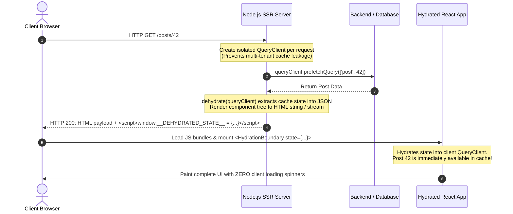

# 09 — SSR Hydration & Prefetching in TanStack Query

## Metadata
- **React Version**: 19.0.0+
- **Prerequisites**: [03-tanstack-query.md](./03-tanstack-query.md), [08-tanstack-query-v5-suspense.md](./08-tanstack-query-v5-suspense.md), SSR Fundamentals
- **Difficulty**: Advanced
- **Estimated Read Time**: 29 minutes
- **Tags**: `ssr`, `hydration`, `dehydrate`, `HydrationBoundary`, `tanstack-query`, `prefetching`, `streaming-ssr`

---

## Architecture Diagram

The diagram below details how server-side rendering, data prefetching, cache dehydration, serialization over the wire, and client-side hydration operate with TanStack Query v5 and React 19.



---

## Concept Overview

When server rendering React applications, components often require server data to produce meaningful HTML for search engines (SEO) and fast First Contentful Paint (FCP). 

If a component uses TanStack Query without SSR prefetching:
1. The server renders the component in its initial loading state (spinners or empty skeletons).
2. The browser downloads the HTML and displays the skeleton.
3. The client-side JavaScript boots up, executes `useQuery`, and dispatches a second network request from the browser to fetch the actual data.
4. The user experiences a jarring flash of loading states and layout shifts.

To eliminate this duplicate round-trip and provide instant content, TanStack Query provides the **Dehydration / Hydration Protocol**:
- **Server**: Prefetch data into a dedicated `QueryClient`, call `dehydrate(queryClient)` to extract a serialized snapshot of successful query results, and embed the snapshot into the HTML document.
- **Client**: Pass the dehydrated state into `<HydrationBoundary state={dehydratedState}>`. When components execute `useQuery` or `useSuspenseQuery`, they read the prefetched data synchronously from the local cache on the very first render pass—triggering zero client network requests.

---

## Practical Implementation

### Example 1: Server-Side Query Execution and Dehydration (Express / Node SSR)

Creating an isolated, request-scoped `QueryClient` guarantees that user data is never leaked between concurrent visitor requests.

```tsx
// server/renderPage.tsx
import React from 'react';
import { renderToString } from 'react-dom/server';
import { QueryClient, dehydrate, HydrationBoundary, QueryClientProvider } from '@tanstack/react-query';
import { App } from '../src/App';
import { postQueryOptions } from '../src/queries/postQueries';

export async function handleRequest(req: any, res: any) {
  const postId = req.params.id;

  // 1. IMPORTANT: Always create a new QueryClient per request
  const queryClient = new QueryClient({
    defaultOptions: {
      queries: {
        staleTime: 1000 * 60, // Consider fresh for 1 minute
      },
    },
  });

  try {
    // 2. Prefetch data on the server
    await queryClient.prefetchQuery(postQueryOptions.detail(postId));

    // 3. Dehydrate the cache into serializable JSON
    const dehydratedState = dehydrate(queryClient);

    // 4. Render React tree to string
    const appHtml = renderToString(
      <QueryClientProvider client={queryClient}>
        <HydrationBoundary state={dehydratedState}>
          <App postId={postId} />
        </HydrationBoundary>
      </QueryClientProvider>
    );

    // 5. Send HTML with embedded dehydrated state
    res.send(`
      <!DOCTYPE html>
      <html lang="en">
        <head>
          <title>SSR Post Details</title>
        </head>
        <body>
          <div id="root">${appHtml}</div>
          <script>
            window.__REACT_QUERY_DEHYDRATED_STATE__ = ${JSON.stringify(dehydratedState)};
          </script>
          <script type="module" src="/src/main.tsx"></script>
        </body>
      </html>
    `);
  } finally {
    // 6. Clear cache to free memory
    queryClient.clear();
  }
}
```

*Expected Verification Output:*
```text
Server fetches post data in 45ms.
HTML sent over the wire contains full semantic <article> content (zero spinners).
Window.__REACT_QUERY_DEHYDRATED_STATE__ contains { queries: [{ queryKey: ['post', '42'], state: {...} }] }.
```

---

### Example 2: Client-Side Hydration Setup

On the client, the application initializes a single persistent `QueryClient` and restores server state via `HydrationBoundary`.

```tsx
// src/main.tsx
import React, { useState } from 'react';
import { createRoot } from 'react-dom/client';
import { QueryClient, QueryClientProvider, HydrationBoundary } from '@tanstack/react-query';
import { App } from './App';

declare global {
  interface Window {
    __REACT_QUERY_DEHYDRATED_STATE__?: unknown;
  }
}

function Root() {
  // Client-side QueryClient persists across component lifetime
  const [queryClient] = useState(
    () =>
      new QueryClient({
        defaultOptions: {
          queries: {
            staleTime: 1000 * 60 * 5,
            refetchOnWindowFocus: false,
          },
        },
      })
  );

  return (
    <QueryClientProvider client={queryClient}>
      <HydrationBoundary state={window.__REACT_QUERY_DEHYDRATED_STATE__}>
        <App postId="42" />
      </HydrationBoundary>
    </QueryClientProvider>
  );
}

const container = document.getElementById('root')!;
createRoot(container).hydrate(<Root />);
```

*Expected Verification Output:*
```text
Browser boot: React hydrates DOM without mismatches.
Network Tab: ZERO fetch requests to /api/posts/42 dispatched during page load.
```

---

### Example 3: Consuming the Prefetched Query in Components

The consumer component does not need to know whether its data was prefetched on the server or fetched client-side. The standard `useQuery` or `useSuspenseQuery` hook accesses the cache immediately.

```tsx
// src/components/PostDetailView.tsx
import React from 'react';
import { useQuery } from '@tanstack/react-query';
import { postQueryOptions } from '../queries/postQueries';

export function PostDetailView({ postId }: { postId: string }) {
  const { data: post, isLoading, isFetching } = useQuery(postQueryOptions.detail(postId));

  // During SSR and initial client hydration, isLoading is immediately FALSE!
  if (isLoading) return <div>Loading post...</div>;
  if (!post) return <div>Post not found.</div>;

  return (
    <article className="max-w-2xl mx-auto p-6 bg-white shadow rounded">
      <h1 className="text-3xl font-bold text-gray-900 mb-4">{post.title}</h1>
      <p className="text-gray-700 leading-relaxed">{post.content}</p>
      {isFetching && (
        <span className="text-xs text-blue-500 mt-4 block">Background revalidating...</span>
      )}
    </article>
  );
}
```

*Expected Verification Output:*
```text
Component renders instantly on client.
post is defined synchronously; no loading placeholder flickers on initial paint.
```

---

### Example 4: Intelligent Route Prefetching on Link Hover

To deliver instantaneous client transitions, prefetch queries into the `queryClient` cache as soon as the user hovers over a navigation link.

```tsx
// src/components/PrefetchLink.tsx
import React from 'react';
import { Link, LinkProps } from 'react-router-dom';
import { useQueryClient } from '@tanstack/react-query';
import { postQueryOptions } from '../queries/postQueries';

interface PrefetchLinkProps extends LinkProps {
  postId: string;
}

export function PrefetchLink({ postId, children, ...props }: PrefetchLinkProps) {
  const queryClient = useQueryClient();

  const handlePrefetch = () => {
    // Prefetch query into cache if not already cached and fresh
    queryClient.prefetchQuery(postQueryOptions.detail(postId));
  };

  return (
    <Link
      {...props}
      onMouseEnter={handlePrefetch}
      onFocus={handlePrefetch} // Accessibility: prefetch on keyboard tab focus
    >
      {children}
    </Link>
  );
}
```

*Expected Verification Output:*
```text
User hovers mouse over <PrefetchLink postId="108">.
queryClient executes background fetch.
By the time user clicks (150-300ms later), query state is already cached -> Instant navigation!
```

---

### Example 5: Streaming SSR with React 19 `renderToPipeableStream` and Suspense

In modern React 19 architectures, streaming SSR streams HTML chunks as they resolve, combining React Suspense with TanStack Query.

```tsx
// server/streamHandler.tsx
import React from 'react';
import { renderToPipeableStream } from 'react-dom/server';
import { QueryClient, QueryClientProvider } from '@tanstack/react-query';
import { App } from '../src/App';

export function handleStreamingRequest(req: any, res: any) {
  const queryClient = new QueryClient();

  let didError = false;

  const stream = renderToPipeableStream(
    <QueryClientProvider client={queryClient}>
      <App />
    </QueryClientProvider>,
    {
      onShellReady() {
        // If an error occurred in the shell layout, send 500
        res.statusCode = didError ? 500 : 200;
        res.setHeader('Content-Type', 'text/html');
        stream.pipe(res);
      },
      onShellError(err) {
        // Fallback for fatal shell errors
        res.statusCode = 500;
        res.send('<!doctype html><p>Loading failed.</p>');
      },
      onError(err) {
        didError = true;
        console.error('Streaming SSR Error:', err);
      },
    }
  );
}
```

*Expected Verification Output:*
```text
Shell HTML (navigation, header) streams immediately to client in <10ms.
Suspended data components stream in as TanStack queries resolve over the wire.
```

---

## Mental Model & Analogies

### The Frozen Dinner Meal Prep

- **Client-Side Data Fetching**: Arriving home with an empty refrigerator, ordering groceries online, and waiting 45 minutes for delivery while staring at an empty plate.
- **SSR Dehydration & Hydration**: A **chef-prepared meal kit**.
  - On the server, the chef prepares the meal and flash-freezes it (`dehydrate`).
  - The frozen meal is delivered directly to your doorstep inside the box (the HTML document).
  - You place it in the microwave (`HydrationBoundary`), and within seconds, you are eating hot food (`hydrated cache`) without waiting for a grocery delivery truck.

---

## Under the Hood / Internal Mechanics

### 1. What `dehydrate()` Actually Serializes

`dehydrate(queryClient)` does not serialize the entire `QueryClient` instance (which contains function references, event emitters, and circular links). Instead, it traverses the `QueryCache` and generates a clean, plain JSON object:
```json
{
  "mutations": [],
  "queries": [
    {
      "queryKey": ["post", "42"],
      "queryHash": "[\"post\",\"42\"]",
      "state": {
        "data": { "id": "42", "title": "React 19 Architecture" },
        "dataUpdateCount": 1,
        "dataUpdatedAt": 1718000000000,
        "error": null,
        "errorUpdateCount": 0,
        "errorUpdatedAt": 0,
        "fetchFailureCount": 0,
        "fetchMeta": null,
        "isInvalidated": false,
        "status": "success"
      }
    }
  ]
}
```
Only queries with `status === 'success'` are included by default. Pending or failed queries are omitted unless custom filter options (`shouldDehydrateQuery`) are specified.

### 2. Multi-Tenant Memory Isolation

In client-side applications, having a global `const queryClient = new QueryClient()` singleton is standard practice because each user runs their own browser session.
**On a Node.js server, a global singleton causes catastrophic data leakage**: User A querying their private banking account would write sensitive account records into the shared singleton cache. User B visiting the website 100ms later would be served User A's cached banking data from memory! **Always instantiate a fresh `new QueryClient()` per server request.**

---

## Common Pitfalls & Anti-Patterns

| Anti-Pattern | Why It Breaks | Recommended Solution |
| :--- | :--- | :--- |
| **Global `QueryClient` Singleton on Server** | Cross-request data leakage between different users; security vulnerability. | Instantiate a new `QueryClient` inside the request handler function for every incoming request. |
| **Client-Side `new QueryClient()` Inside Component Body**| Recreates the entire cache on every parent re-render, dropping all cached server state. | Wrap in `useState(() => new QueryClient())` or declare as module singleton on client only. |
| **Omitting `JSON.stringify` Sanitization on Injected State** | Injected `<script>` tags can be exploited for Cross-Site Scripting (XSS). | Serialize dehydrated state using `serialize-javascript` to escape `<script>` tags safely. |
| **Prefetching with Short or Default `staleTime: 0`** | The client immediately considers the hydrated state stale and dispatches duplicate fetches. | Set a reasonable `staleTime` (e.g. 1 to 5 minutes) on both server and client query defaults. |
| **Dehydrating Failed or Pending Queries** | Injects broken or incomplete query states into client hydration, triggering immediate client error crashes. | Default `shouldDehydrateQuery` filters for `status === 'success'`. Do not override without purpose. |
| **Hydration Mismatch on Date/Timestamp Formatting** | Server formats timestamp in UTC; client formats in local timezone, triggering React hydration warnings. | Format dates in an effect or render ISO strings identically during SSR and hydration. |

---

## Performance & Optimization

### Selective Dehydration with `shouldDehydrateQuery`

In high-throughput SSR applications, serializing huge query caches into the HTML payload bloats document size, degrading network delivery times. Dehydrate only queries necessary for the initial viewport:

```ts
const dehydratedState = dehydrate(queryClient, {
  shouldDehydrateQuery: (query) => {
    // Only dehydrate critical above-the-fold queries
    return query.queryKey[0] === 'post' && query.state.status === 'success';
  },
});
```

---

## Edge Cases & Debugging

### Hydration Error: "Text content does not match server-rendered HTML"
- **Symptom**: React logs warning: `Hydration failed because the initial UI does not match what was rendered on the server`.
- **Root Cause**: The client-side `QueryClient` initialized with empty state before `HydrationBoundary` restored the dehydrated state, or client `staleTime: 0` caused an immediate background refetch that altered data before first paint.
- **Remedy**: Ensure `HydrationBoundary` wraps the component tree and set `staleTime: 1000 * 60` so data remains stable during the hydration tick.

---

## Ecosystem & Alternative Approaches

- **Next.js App Router**: Next.js automatically handles server components (RSC) and caching. When using TanStack Query inside Next.js Client Components, `<HydrationBoundary>` works seamlessly across server actions and loaders.
- **Remix / React Router v7 Framework Mode**: Loaders run on the server and pass data directly through `useLoaderData`, which can be injected into TanStack Query using `initialData` or `<HydrationBoundary>`.

---

## Exercises & Challenges

<details>
<summary><strong>Exercise 1: Safe XSS-Proof Script Injection for Dehydrated State</strong></summary>

**Challenge**: Write a helper function that safely serializes the dehydrated state object, preventing `</script>` tag injection attacks.

```ts
export function serializeDehydratedState(state: unknown): string {
  // Escapes forward slashes and HTML brackets to prevent XSS script breakouts
  return JSON.stringify(state)
    .replace(/</g, '\\u003c')
    .replace(/>/g, '\\u003e')
    .replace(/\//g, '\\u002f');
}
```
</details>

<details>
<summary><strong>Exercise 2: Router Loader Prefetching Integration</strong></summary>

**Challenge**: Integrate TanStack Query prefetching into a React Router v7 loader so data begins fetching the instant a route is matched.

```ts
import { QueryClient } from '@tanstack/react-query';
import { postQueryOptions } from '../queries/postQueries';

export const postDetailLoader = (queryClient: QueryClient) => async ({ params }: any) => {
  const { id } = params;
  // Ensure query is loaded or fetching before route component renders
  return queryClient.ensureQueryData(postQueryOptions.detail(id));
};
```
</details>

---

## Frequently Asked Interview Questions

<details>
<summary><strong>1. Why is it dangerous to use a global `QueryClient` singleton on an SSR server?</strong></summary>

A Node.js server handles multiple concurrent requests in the same process memory space. If a global singleton `QueryClient` is used, all requests share the same cache. This causes severe security risks where private user data (such as profile details or billing records) is cached and inadvertently leaked to subsequent unrelated user requests. Always create a new `QueryClient` per request.
</details>

<details>
<summary><strong>2. How does `HydrationBoundary` prevent duplicate client-side network requests?</strong></summary>

`HydrationBoundary` takes the serialized state produced by `dehydrate()` on the server and writes it directly into the client-side `QueryClient` cache during initial mount. When child components execute `useQuery` or `useSuspenseQuery`, TanStack Query finds the data already present in cache with valid timestamps, returning it immediately without making an HTTP request.
</details>

<details>
<summary><strong>3. What is the role of `staleTime` during SSR hydration?</strong></summary>

By default, `staleTime` is `0`, meaning queries are instantly considered stale. If `staleTime` remains `0` on the client, the client will immediately trigger a background network refetch the moment the component mounts, defeating the purpose of SSR caching. Configuring a non-zero `staleTime` (e.g. 1 minute) ensures the hydrated data is treated as fresh, preventing immediate duplicate network calls.
</details>

<details>
<summary><strong>4. What is the difference between `prefetchQuery` and `ensureQueryData`?</strong></summary>

`prefetchQuery` initiates a fetch and returns a Promise that resolves to `void`. It catches errors internally so a failed prefetch does not reject the promise. 
`ensureQueryData` checks the cache first; if fresh data exists, it returns the cached data immediately. If not, it executes the fetch and returns the data, throwing an error if the request fails.
</details>

<details>
<summary><strong>5. How do you prevent XSS vulnerabilities when injecting dehydrated state into the DOM?</strong></summary>

If an API response contains the substring `</script><script>malicious()</script>`, standard `JSON.stringify` will close the HTML `<script>` block and execute the malicious script. To prevent this, developers must serialize state using tools like `serialize-javascript` or escape characters (`<`, `>`, `/`) with their Unicode equivalents (`\\u003c`, etc.).
</details>

<details>
<summary><strong>6. Can you prefetch infinite queries during SSR?</strong></summary>

Yes. TanStack Query provides `queryClient.prefetchInfiniteQuery()`. It fetches the first page of data and stores it in the dehydrated state under the pages array format (`pages: [...]`, `pageParams: [...]`), allowing `useInfiniteQuery` to hydrate the initial page seamlessly.
</details>

<details>
<summary><strong>7. How does React 19's streaming SSR work with TanStack Query?</strong></summary>

In streaming SSR (`renderToPipeableStream`), components wrapped in `<Suspense>` yield HTML as soon as their underlying promises resolve. With TanStack Query, the server begins fetching the query, renders the suspended fallback in the initial shell, and when the query resolves, streams the rendered HTML chunk and inline hydration script to the client in the same HTTP connection.
</details>

<details>
<summary><strong>8. Why does `dehydrate()` only include successful queries by default?</strong></summary>

Dehydrating failed or pending queries would serialize errors or unfulfilled promises into the client HTML. When hydrated, the client would instantly enter an error state or display stale errors that might have been transient on the server. Omitting them allows the client to retry those queries fresh in the browser environment.
</details>

---

## References & Further Reading

- [TanStack Query v5 SSR & Hydration Guide](https://tanstack.com/query/v5/docs/framework/react/guides/ssr)
- [React 19 Server DOM APIs: renderToPipeableStream](https://react.dev/reference/react-dom/server/renderToPipeableStream)
- [TkDodo's Blog: React Query and TypeScript](https://tkdodo.eu/blog/react-query-and-typescript)
- [OWASP Cross-Site Scripting (XSS) Prevention Cheat Sheet](https://cheatsheetseries.owasp.org/cheatsheets/Cross_Site_Scripting_Prevention_Cheat_Sheet.html)
- [Serialize Javascript GitHub Repository](https://github.com/yahoo/serialize-javascript)
