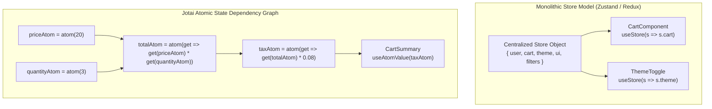

# 05 — Jotai & Atomic State Management in React

## Metadata
- **React Version**: 19.0.0+
- **Prerequisites**: [00-choosing-state-management.md](./00-choosing-state-management.md), [01-context-patterns-and-performance.md](./01-context-patterns-and-performance.md), React Hooks
- **Difficulty**: Intermediate / Advanced
- **Estimated Read Time**: 27 minutes
- **Tags**: `jotai`, `atomic-state`, `atoms`, `recoil`, `fine-grained-reactivity`, `state-management`

---

## Architecture Diagram

The diagram below contrasts a monolithic global store (where components subscribe to slices via selectors) with Jotai's bottom-up atomic architecture (where small, independent atom primitives compose into a dependency graph).



---

## Concept Overview

Traditional state management tools (Redux, Zustand) follow a **top-down monolithic store** model. State is defined inside a centralized repository, and components subscribe to specific branches using selector functions.

Jotai (Japanese for *state*) adopts a **bottom-up atomic architecture** inspired by Recoil:
1. **Atoms as State Definitions**: An atom is not a state holder; it is an immutable definition/config object created outside React via `atom(initialValue)`.
2. **Bottom-Up Composition**: Atoms can read from and write to other atoms, forming a reactive dependency graph (directed acyclic graph or DAG).
3. **No Top-Level Provider Required**: By default, Jotai uses an implicit root store (`getDefaultStore()`). Components consume atoms via `useAtom(myAtom)` without wrapping the entire application in `<Provider>`.
4. **Zero-Selector Re-render Optimization**: Components only re-render if the specific atoms they read produce new values. If `atomA` changes, components subscribed only to `atomB` never re-render.

### Core Differences: Zustand vs Jotai

| Dimension | Zustand (Monolithic) | Jotai (Atomic) |
| :--- | :--- | :--- |
| **Mental Model** | Single store with actions | Decentralized graph of atomic units |
| **State Declaration**| `create((set) => ({ count: 0, inc: () => ... }))` | `export const countAtom = atom(0)` |
| **Selector Syntax** | Required (`useStore((s) => s.count)`) | Inherent per atom (`useAtomValue(countAtom)`) |
| **Derived State** | In-store getters or custom selectors | Read-only derived atoms (`atom(get => ...)`) |
| **Async State** | Handled inside action functions | Async atoms natively integrate with Suspense |
| **Scoping** | Global singleton (Context needed for per-tree instances) | Native `<Provider>` allows scoping atom subtrees |

---

## Practical Implementation

### Example 1: Primitive and Read-Only Derived Atoms

```tsx
// src/atoms/counterAtoms.ts
import { atom } from 'jotai';

// 1. Primitive atom
export const countAtom = atom(0);

// 2. Read-only derived atom (computed reactively)
export const doubleCountAtom = atom((get) => get(countAtom) * 2);

// 3. Derived boolean atom
export const isEvenAtom = atom((get) => get(countAtom) % 2 === 0);
```

```tsx
// src/components/CounterView.tsx
import React from 'react';
import { useAtom, useAtomValue } from 'jotai';
import { countAtom, doubleCountAtom, isEvenAtom } from '../atoms/counterAtoms';

export function CounterDisplay() {
  const count = useAtomValue(countAtom);
  const double = useAtomValue(doubleCountAtom);
  const isEven = useAtomValue(isEvenAtom);

  return (
    <div className="p-4 border rounded shadow-sm bg-white space-y-2">
      <p className="text-xl font-bold">Count: {count}</p>
      <p className="text-gray-600">Double: {double}</p>
      <p className="text-sm font-semibold text-blue-600">
        Status: {isEven ? 'Even Number' : 'Odd Number'}
      </p>
    </div>
  );
}

export function CounterControls() {
  const [, setCount] = useAtom(countAtom);

  return (
    <div className="flex gap-2 mt-2">
      <button
        onClick={() => setCount((c) => c + 1)}
        className="px-4 py-2 bg-blue-600 text-white rounded font-medium hover:bg-blue-700"
      >
        Increment
      </button>
      <button
        onClick={() => setCount((c) => c - 1)}
        className="px-4 py-2 bg-gray-200 text-gray-800 rounded font-medium hover:bg-gray-300"
      >
        Decrement
      </button>
    </div>
  );
}
```

*Expected Verification Output:*
```text
Clicking "Increment":
  - countAtom updates to 1.
  - doubleCountAtom recomputes to 2.
  - isEvenAtom recomputes to false.
  - CounterControls DOES NOT re-render (only calls setCount updater).
```

---

### Example 2: Write-Only and Action Atoms

Atoms can encapsulate side-effects, validation, and multi-atom orchestrations without exposing raw setters.

```tsx
// src/atoms/cartAtoms.ts
import { atom } from 'jotai';

export interface CartItem {
  id: string;
  name: string;
  price: number;
}

export const cartItemsAtom = atom<CartItem[]>([]);

// Write-only action atom for adding items
export const addItemActionAtom = atom(
  null, // First argument null signifies write-only
  (get, set, newItem: CartItem) => {
    const currentItems = get(cartItemsAtom);
    set(cartItemsAtom, [...currentItems, newItem]);
  }
);

// Write-only action atom for clearing the cart
export const clearCartActionAtom = atom(null, (_get, set) => {
  set(cartItemsAtom, []);
});

// Read-only derived atom for total cost
export const cartTotalAtom = atom((get) => {
  const items = get(cartItemsAtom);
  return items.reduce((sum, item) => sum + item.price, 0);
});
```

*Expected Verification Output:*
```text
Dispatching addItemActionAtom:
  - Appends item immutably to cartItemsAtom.
  - cartTotalAtom updates automatically.
```

---

### Example 3: Async Atoms with React 19 Suspense

Jotai async atoms return Promises. When read by `useAtomValue`, they natively suspend the component until the promise resolves.

```tsx
// src/atoms/userAtoms.ts
import { atom } from 'jotai';

export interface UserProfile {
  id: string;
  username: string;
  email: string;
}

export const selectedUserIdAtom = atom<string>('user-1');

// Async derived atom: automatically re-fetches when selectedUserIdAtom changes
export const userProfileAtom = atom(async (get): Promise<UserProfile> => {
  const userId = get(selectedUserIdAtom);
  const response = await fetch(`https://jsonplaceholder.typicode.com/users/1`);
  if (!response.ok) throw new Error('Failed to load user profile');
  return response.json();
});
```

```tsx
// src/components/AsyncUserProfile.tsx
import React, { Suspense } from 'react';
import { useAtomValue } from 'jotai';
import { userProfileAtom } from '../atoms/userAtoms';

function UserContent() {
  // Automatically suspends if promise is pending!
  const user = useAtomValue(userProfileAtom);

  return (
    <div className="p-4 bg-white border rounded">
      <h3 className="font-bold text-lg">{user.username}</h3>
      <p className="text-gray-600">{user.email}</p>
    </div>
  );
}

export function AsyncUserProfile() {
  return (
    <Suspense fallback={<div className="p-4 animate-pulse">Loading profile...</div>}>
      <UserContent />
    </Suspense>
  );
}
```

*Expected Verification Output:*
```text
Component suspends cleanly inside Suspense boundary.
Displays fallback until fetch completes -> Seamlessly renders user data.
```

---

### Example 4: Parametric State with `atomFamily`

`atomFamily` from `jotai/utils` memoizes parameterized atoms (e.g. per-row or per-card state) to prevent redundant atom allocations.

```tsx
// src/atoms/todoFamily.ts
import { atom } from 'jotai';
import { atomFamily } from 'jotai/utils';

export interface TodoItem {
  id: string;
  text: string;
  completed: boolean;
}

// Parametric atom family indexed by ID
export const todoItemFamily = atomFamily((id: string) =>
  atom<TodoItem>({
    id,
    text: `Todo item ${id}`,
    completed: false,
  })
);
```

```tsx
// src/components/TodoRow.tsx
import React from 'react';
import { useAtom } from 'jotai';
import { todoItemFamily } from '../atoms/todoFamily';

export function TodoRow({ todoId }: { todoId: string }) {
  // Subscribes ONLY to the atom for this specific todoId!
  const [todo, setTodo] = useAtom(todoItemFamily(todoId));

  const toggle = () => {
    setTodo((prev) => ({ ...prev, completed: !prev.completed }));
  };

  return (
    <div className="flex items-center gap-3 p-2 border-b">
      <input type="checkbox" checked={todo.completed} onChange={toggle} />
      <span className={todo.completed ? 'line-through text-gray-400' : 'text-gray-800'}>
        {todo.text}
      </span>
    </div>
  );
}
```

*Expected Verification Output:*
```text
Toggling checkbox on TodoRow 1:
  - Updates only todoItemFamily('1').
  - TodoRow 2 and TodoRow 3 NEVER re-render!
```

---

### Example 5: Scoped Subtrees with Jotai `<Provider>`

While Jotai operates provider-less by default, wrapping a component subtree in `<Provider>` isolates atom state locally (e.g., duplicate modal dialogs or isolated tab instances).

```tsx
// src/components/MultiWorkspaceView.tsx
import React from 'react';
import { Provider } from 'jotai';
import { CounterDisplay, CounterControls } from './CounterView';

export function MultiWorkspaceView() {
  return (
    <div className="grid grid-cols-2 gap-6 p-6">
      {/* Workspace A: Isolated store instance */}
      <Provider>
        <div className="p-4 border-2 border-blue-500 rounded">
          <h2 className="font-bold text-blue-700 mb-2">Workspace Alpha</h2>
          <CounterDisplay />
          <CounterControls />
        </div>
      </Provider>

      {/* Workspace B: Isolated store instance */}
      <Provider>
        <div className="p-4 border-2 border-green-500 rounded">
          <h2 className="font-bold text-green-700 mb-2">Workspace Beta</h2>
          <CounterDisplay />
          <CounterControls />
        </div>
      </Provider>
    </div>
  );
}
```

*Expected Verification Output:*
```text
Incrementing Workspace Alpha increments count in Alpha to 1.
Workspace Beta remains at 0. Both subtrees operate independently using the same atom definitions!
```

---

## Mental Model & Analogies

### The Spreadsheet Formula Cell Analogy

Think of Jotai as a **Microsoft Excel Spreadsheet**:
- A primitive atom `countAtom = atom(10)` is cell `A1 = 10`.
- A derived atom `taxAtom = atom(get => get(countAtom) * 0.1)` is cell `B1 = A1 * 0.1`.
- If you edit cell `A1`, Excel does not recalculate the whole spreadsheet; it traces the dependency graph and recalculates only dependent cells (`B1`).
- React components are users observing individual cells. If cell `C5` changes, the user watching `B1` is never notified.

---

## Under the Hood / Internal Mechanics

### 1. WeakMap-Based Storage

Atoms are lightweight config objects (`{ init, read, write }`). The actual runtime values are stored inside an internal store object using a JavaScript `WeakMap<Atom, AtomState>`.
- If an atom definition is garbage collected, its state and subscriptions inside the WeakMap are automatically purged, preventing memory leaks.
- When an atom's value changes, Jotai traverses its topological dependency graph to identify which derived atoms are dirty and marks their dependent React Fiber nodes for re-render.

---

## Common Pitfalls & Anti-Patterns

| Anti-Pattern | Why It Breaks | Recommended Solution |
| :--- | :--- | :--- |
| **Defining `atom()` Inside a Component Body** | Re-allocates a brand-new atom reference on every render pass, resetting state. | Always define atoms outside component bodies in module scope. |
| **Using `useAtom` when only Reading Data** | Triggers component re-renders even when the component only needed the setter or only read values. | Use `useAtomValue(atom)` for read-only and `useSetAtom(atom)` for write-only. |
| **Mutating Object State Inside Atoms Directly** | Violates immutability; Jotai cannot detect shallow equality changes, skipping updates. | Always return new object/array copies (`{ ...prev, key: value }`). |
| **Circular Atom Dependencies** | `atomA` reads `atomB` which reads `atomA`, causing an infinite calculation loop. | Keep the atom dependency graph strictly acyclic (DAG). |
| **Neglecting `atomFamily.remove(key)` on Dynamic Lists**| Parametric atoms accumulate in memory forever even after items are deleted. | Call `todoItemFamily.remove(id)` when deleting entities. |
| **Using Jotai as a Server-State Query Cache** | Lacks built-in cache deduplication, window focus refetching, and background retries. | Use TanStack Query for server state; keep Jotai for client-only reactive state. |

---

## Performance & Optimization

### Fine-Grained Atom Splitting

Instead of one monolithic atom:
```ts
// Bad: Updating theme re-renders components that only care about sidebar
const uiSettingsAtom = atom({ theme: 'dark', isSidebarOpen: false });

// Good: Separate atoms guarantee zero wasted re-renders
const themeAtom = atom<'light' | 'dark'>('dark');
const sidebarOpenAtom = atom<boolean>(false);
```

---

## Edge Cases & Debugging

### Debugging with Redux DevTools
Jotai includes native Redux DevTools integration for inspecting atom changes:
```ts
import { useAtomDevtools } from 'jotai-devtools';
import { countAtom } from './counterAtoms';

export function DevToolsContainer() {
  useAtomDevtools(countAtom, { name: 'countAtom' });
  return null;
}
```

---

## Ecosystem & Alternative Approaches

- **Zustand**: Best when you prefer a centralized store with unified actions and middleware.
- **Recoil**: The original atomic library created by Meta. Recoil is largely inactive, and the community has overwhelmingly migrated to Jotai.
- **Valtio**: Proxy-based state management by the same author (Daishi Kato), using mutable syntax (`state.count++`) transformed into immutable updates.

---

## Exercises & Challenges

<details>
<summary><strong>Exercise 1: Persist Atom to `localStorage` with `atomWithStorage`</strong></summary>

**Challenge**: Create an atom that synchronizes automatically with `localStorage`.

```ts
import { atomWithStorage } from 'jotai/utils';

// Automatically loads from localStorage on boot and syncs writes across tabs
export const themePreferenceAtom = atomWithStorage<'light' | 'dark'>('app_theme', 'light');
```
</details>

<details>
<summary><strong>Exercise 2: Debounced Search Input Atom</strong></summary>

**Challenge**: Create an atom that stores raw input immediately, but exposes a derived debounced search query.

```ts
import { atom } from 'jotai';

export const rawSearchInputAtom = atom('');
export const debouncedSearchAtom = atom('');

export const updateSearchActionAtom = atom(
  null,
  (_get, set, text: string) => {
    set(rawSearchInputAtom, text);
  }
);
```
</details>

---

## Frequently Asked Interview Questions

<details>
<summary><strong>1. What is the fundamental difference between Zustand and Jotai?</strong></summary>

Zustand uses a centralized, top-down monolithic store pattern where components use selector functions to extract slices of state. Jotai uses a decentralized, bottom-up atomic model where state consists of small independent units (`atoms`) that compose into a dependency graph. Jotai requires no selectors for re-render optimization—subscribing to an atom only re-renders the component when that specific atom updates.
</details>

<details>
<summary><strong>2. Why can Jotai be used without wrapping the React application in a `<Provider>`?</strong></summary>

By default, Jotai binds atoms to an implicit global default store (`getDefaultStore()`). Unless developers explicitly wrap a subtree in `<Provider>` to scope or isolate state, all `useAtom` calls across the component tree communicate with this shared default store.
</details>

<details>
<summary><strong>3. How does Jotai handle asynchronous operations?</strong></summary>

Jotai supports async atoms natively. If a derived atom's read function returns a `Promise`, Jotai integrates directly with React Suspense. When a component reads the atom via `useAtomValue`, the component suspends until the promise resolves, rendering fallback UI at the nearest `<Suspense>` boundary.
</details>

<details>
<summary><strong>4. Why must atoms be defined outside React component bodies?</strong></summary>

Atoms are config objects containing identity references. If declared inside a component function, a new atom object with a new memory reference is instantiated on every render, resetting its stored state and detaching previous subscriptions.
</details>

<details>
<summary><strong>5. What is the purpose of `atomFamily` in Jotai?</strong></summary>

`atomFamily` creates a memoized lookup table of atoms indexed by an argument (such as an entity ID). It enables fine-grained per-item reactivity in lists, ensuring that updating an item in row 5 only re-renders row 5, without re-rendering the parent list or sibling rows.
</details>

<details>
<summary><strong>6. How does Jotai prevent memory leaks when dynamically creating atoms?</strong></summary>

Jotai uses JavaScript `WeakMap` objects internally to associate atom definitions with runtime states. When an atom is no longer referenced anywhere in code, it is eligible for garbage collection, and its associated state in the store is reclaimed automatically.
</details>

<details>
<summary><strong>7. When should you use `useSetAtom` instead of `useAtom`?</strong></summary>

When a component only triggers an action or updates an atom's value (such as a submit button or reset toggle) and never reads the value itself, using `useSetAtom` returns only the setter function. This guarantees the component will **never re-render** when the atom's value changes.
</details>

<details>
<summary><strong>8. Can Jotai replace TanStack Query for server data fetching?</strong></summary>

No. While Jotai can perform async fetches, it lacks dedicated server-state capabilities like background window-focus revalidation, automatic retry backoffs, mutation rollbacks, request deduplication, and stale-time garbage collection. The standard enterprise architecture pairs TanStack Query for server state with Jotai for client UI state.
</details>

---

## References & Further Reading

- [Jotai Official Documentation](https://jotai.org/)
- [Jotai GitHub Repository](https://github.com/pmndrs/jotai)
- [Daishi Kato's Blog: How Jotai Works Internally](https://blog.axlight.com/)
- [Jotai DevTools Documentation](https://jotai.org/docs/extensions/devtools)
- [React 19 Suspense Specification](https://react.dev/reference/react/Suspense)
