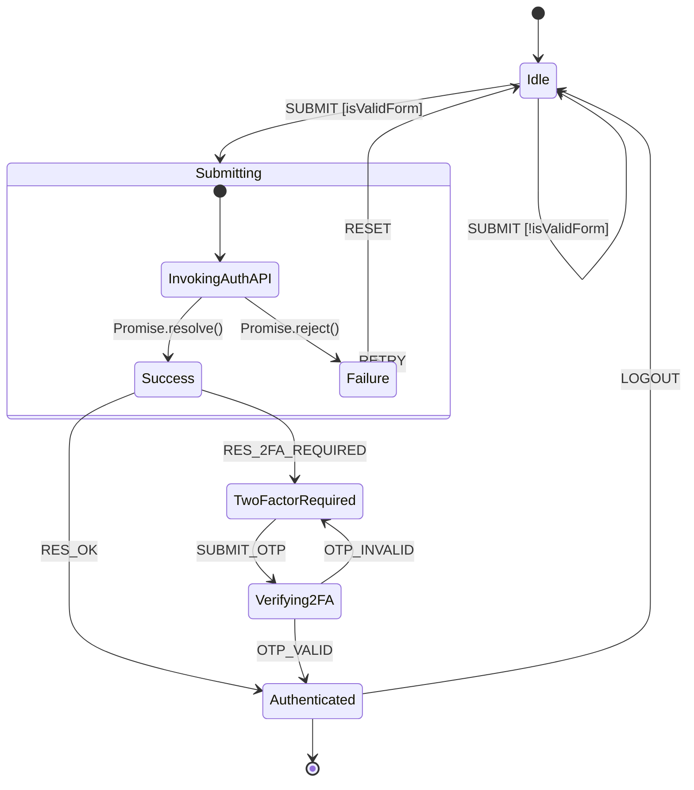

# 06 — State Machines & Statecharts with XState v5

## Metadata
- **React Version**: 19.0.0+
- **Prerequisites**: [00-choosing-state-management.md](./00-choosing-state-management.md), [02-reducer-and-context-pattern.md](./02-reducer-and-context-pattern.md)
- **Difficulty**: Advanced
- **Estimated Read Time**: 29 minutes
- **Tags**: `xstate`, `state-machines`, `statecharts`, `actor-model`, `finite-state-machines`, `react-19`

---

## Architecture Diagram

The statechart diagram below represents an authentication and onboarding workflow modeled as a Finite State Machine (FSM), illustrating finite states, transitions triggered by events, and guard conditions preventing impossible states.



---

## Concept Overview

Most UI bugs in complex enterprise applications do not stem from rendering errors—they stem from **impossible states**.
Consider standard boolean flags in a form or checkout component:
```ts
const [isLoading, setIsLoading] = useState(false);
const [isSuccess, setIsSuccess] = useState(false);
const [isError, setIsError] = useState(false);
```
With 3 boolean variables, there are $2^3 = 8$ possible combinations. It is mathematically possible to reach:
```ts
{ isLoading: true, isSuccess: true, isError: true } // IMPOSSIBLE & NONSENSICAL!
```
A **Finite State Machine (FSM)** mathematically constrains the system:
1. **Finite States**: The system exists in exactly **one** state at any given moment (`idle`, `loading`, `success`, `error`). It is physically impossible to be in `loading` and `success` simultaneously.
2. **Explicit Events**: State transitions can only occur when a defined event is dispatched (`SUBMIT`, `RESOLVE`, `REJECT`).
3. **Guards**: Transitions only proceed if boolean guard conditions pass.
4. **Context (Extended State)**: Quantitative data (user inputs, error messages, counters) lives in `context`, decoupled from the qualitative finite state.

In **XState v5**, state machines are modeled using the **Actor Model**, where machines run as autonomous actors communicating via message-passing events.

---

## Practical Implementation

### Example 1: Defining a Machine with XState v5 `setup()` and `createMachine()`

XState v5 uses the type-safe `setup()` builder to define types, actions, and guards before compiling the machine.

```ts
// src/machines/toggleMachine.ts
import { setup } from 'xstate';

export const toggleMachine = setup({
  types: {
    context: {} as { count: number },
    events: {} as { type: 'TOGGLE' } | { type: 'RESET' },
  },
  actions: {
    incrementCount: ({ context }) => {
      console.log('Toggled! Previous count:', context.count);
    },
  },
}).createMachine({
  id: 'toggle',
  initial: 'inactive',
  context: {
    count: 0,
  },
  states: {
    inactive: {
      on: {
        TOGGLE: {
          target: 'active',
          actions: ['incrementCount', ({ context }) => ({ count: context.count + 1 })],
        },
      },
    },
    active: {
      on: {
        TOGGLE: {
          target: 'inactive',
        },
        RESET: {
          target: 'inactive',
          actions: ({ context }) => ({ count: 0 }),
        },
      },
    },
  },
});
```

*Expected Verification Output:*
```text
Machine initializes in 'inactive' state with context { count: 0 }.
Sending TOGGLE event transitions state to 'active' and increments count to 1.
```

---

### Example 2: Consuming the Machine in React with `useActor`

```tsx
// src/components/ToggleSwitch.tsx
import React from 'react';
import { useActor } from '@xstate/react';
import { toggleMachine } from '../machines/toggleMachine';

export function ToggleSwitch() {
  const [snapshot, send] = useActor(toggleMachine);

  const isActive = snapshot.matches('active');
  const count = snapshot.context.count;

  return (
    <div className="p-6 border rounded-lg max-w-sm bg-white shadow-sm space-y-4">
      <div className="flex items-center justify-between">
        <span className="font-semibold text-gray-700">System Status:</span>
        <span className={`px-2 py-1 text-xs rounded font-bold ${
          isActive ? 'bg-green-100 text-green-800' : 'bg-gray-100 text-gray-800'
        }`}>
          {snapshot.value.toString().toUpperCase()}
        </span>
      </div>

      <p className="text-sm text-gray-500">Toggle count: {count}</p>

      <div className="flex gap-2">
        <button
          onClick={() => send({ type: 'TOGGLE' })}
          className="flex-1 py-2 px-4 bg-blue-600 text-white rounded font-medium hover:bg-blue-700"
        >
          {isActive ? 'Turn Off' : 'Turn On'}
        </button>
        <button
          onClick={() => send({ type: 'RESET' })}
          className="py-2 px-4 bg-gray-200 text-gray-700 rounded font-medium hover:bg-gray-300"
        >
          Reset
        </button>
      </div>
    </div>
  );
}
```

*Expected Verification Output:*
```text
Render: System Status: INACTIVE (count 0).
Click "Turn On": Transitions to ACTIVE (count 1). Button label changes to "Turn Off".
Click "Reset": Returns to INACTIVE (count 0).
```

---

### Example 3: Re-render Optimization with `useSelector`

In complex machines with extensive context, subscribing to the entire snapshot causes re-renders on every event. `useSelector` subscribes only to specific derived slices.

```tsx
// src/components/CountBadge.tsx
import React from 'react';
import { useSelector } from '@xstate/react';
import type { ActorRefFrom } from 'xstate';
import type { toggleMachine } from '../machines/toggleMachine';

interface CountBadgeProps {
  actorRef: ActorRefFrom<typeof toggleMachine>;
}

export function CountBadge({ actorRef }: CountBadgeProps) {
  // Component re-renders ONLY when count changes!
  const count = useSelector(actorRef, (snapshot) => snapshot.context.count);

  return (
    <span className="inline-flex items-center px-2.5 py-0.5 rounded-full text-xs font-medium bg-blue-100 text-blue-800">
      Count: {count}
    </span>
  );
}
```

*Expected Verification Output:*
```text
Toggling between active/inactive without changing count causes ZERO re-renders in CountBadge.
```

---

### Example 4: Asynchronous Service Machine (Payment Checkout Flow)

This machine invokes an asynchronous promise, handling retry limits, validation guards, and error recovery.

```ts
// src/machines/checkoutMachine.ts
import { setup, fromPromise, assign } from 'xstate';

interface CheckoutContext {
  cartId: string;
  errorMessage: string | null;
  retries: number;
}

export const checkoutMachine = setup({
  types: {
    context: {} as CheckoutContext,
    events: {} as { type: 'SUBMIT' } | { type: 'RETRY' } | { type: 'CANCEL' },
  },
  actors: {
    processPayment: fromPromise(async ({ input }: { input: { cartId: string } }) => {
      const res = await fetch(`/api/checkout/${input.cartId}`, { method: 'POST' });
      if (!res.ok) throw new Error('Payment declined by payment gateway');
      return res.json();
    }),
  },
  guards: {
    canRetry: ({ context }) => context.retries < 3,
  },
}).createMachine({
  id: 'checkout',
  initial: 'idle',
  context: {
    cartId: 'cart_9982',
    errorMessage: null,
    retries: 0,
  },
  states: {
    idle: {
      on: {
        SUBMIT: 'processing',
      },
    },
    processing: {
      invoke: {
        id: 'paymentService',
        src: 'processPayment',
        input: ({ context }) => ({ cartId: context.cartId }),
        onDone: {
          target: 'success',
        },
        onError: {
          target: 'failure',
          actions: assign({
            errorMessage: ({ event }) => (event.error as Error).message,
            retries: ({ context }) => context.retries + 1,
          }),
        },
      },
    },
    failure: {
      on: {
        RETRY: {
          guard: 'canRetry',
          target: 'processing',
        },
        CANCEL: 'idle',
      },
    },
    success: {
      type: 'final',
    },
  },
});
```

*Expected Verification Output:*
```text
Sending SUBMIT:
  - Enters 'processing', invokes 'processPayment'.
  - If network rejects -> Enters 'failure', retries increments to 1.
  - Sending RETRY -> guard 'canRetry' evaluates (1 < 3) -> Re-enters 'processing'.
  - On 3rd failure -> guard fails; RETRY button disabled in UI.
```

---

### Example 5: Multi-Step Wizard with History and Guarded Next

```tsx
// src/components/WizardContainer.tsx
import React from 'react';
import { useActor } from '@xstate/react';
import { setup, assign } from 'xstate';

const wizardMachine = setup({
  types: {
    context: {} as { step1Valid: boolean; step2Valid: boolean },
    events: {} as
      | { type: 'NEXT' }
      | { type: 'PREV' }
      | { type: 'SET_VALID'; step: 1 | 2; valid: boolean },
  },
  guards: {
    isStep1Complete: ({ context }) => context.step1Valid,
    isStep2Complete: ({ context }) => context.step2Valid,
  },
}).createMachine({
  id: 'wizard',
  initial: 'step1',
  context: { step1Valid: false, step2Valid: false },
  states: {
    step1: {
      on: {
        NEXT: { guard: 'isStep1Complete', target: 'step2' },
        SET_VALID: {
          actions: assign({ step1Valid: ({ event }) => event.valid }),
        },
      },
    },
    step2: {
      on: {
        PREV: 'step1',
        NEXT: { guard: 'isStep2Complete', target: 'step3' },
        SET_VALID: {
          actions: assign({ step2Valid: ({ event }) => event.valid }),
        },
      },
    },
    step3: {
      on: {
        PREV: 'step2',
      },
    },
  },
});

export function WizardContainer() {
  const [snapshot, send] = useActor(wizardMachine);

  return (
    <div className="p-6 max-w-md mx-auto border rounded shadow bg-white">
      <div className="flex justify-between border-b pb-3 mb-4">
        {['step1', 'step2', 'step3'].map((step, idx) => (
          <span
            key={step}
            className={`font-semibold text-sm ${
              snapshot.matches(step) ? 'text-blue-600 underline' : 'text-gray-400'
            }`}
          >
            Step {idx + 1}
          </span>
        ))}
      </div>

      {snapshot.matches('step1') && (
        <div>
          <h4 className="font-bold mb-2">Step 1: Account Information</h4>
          <label className="flex items-center gap-2 mb-4">
            <input
              type="checkbox"
              checked={snapshot.context.step1Valid}
              onChange={(e) => send({ type: 'SET_VALID', step: 1, valid: e.target.checked })}
            />
            <span>I accept terms and conditions</span>
          </label>
        </div>
      )}

      {snapshot.matches('step2') && (
        <div>
          <h4 className="font-bold mb-2">Step 2: Payment Method</h4>
          <label className="flex items-center gap-2 mb-4">
            <input
              type="checkbox"
              checked={snapshot.context.step2Valid}
              onChange={(e) => send({ type: 'SET_VALID', step: 2, valid: e.target.checked })}
            />
            <span>Card verified</span>
          </label>
        </div>
      )}

      {snapshot.matches('step3') && (
        <div>
          <h4 className="font-bold text-green-600">Step 3: Confirmation & Complete</h4>
          <p className="text-sm text-gray-600">Your configuration is ready to submit.</p>
        </div>
      )}

      <div className="flex justify-between mt-6">
        {!snapshot.matches('step1') && (
          <button
            onClick={() => send({ type: 'PREV' })}
            className="px-4 py-1.5 border rounded text-sm hover:bg-gray-50"
          >
            Back
          </button>
        )}
        {!snapshot.matches('step3') && (
          <button
            onClick={() => send({ type: 'NEXT' })}
            className="ml-auto px-4 py-1.5 bg-blue-600 text-white rounded text-sm disabled:opacity-50"
          >
            Continue
          </button>
        )}
      </div>
    </div>
  );
}
```

*Expected Verification Output:*
```text
Clicking "Continue" on Step 1 while checkbox is unchecked: Nothing happens (guard blocks transition).
Checking box and clicking "Continue": Transitions cleanly to Step 2.
Clicking "Back" on Step 2 returns to Step 1 without data loss.
```

---

## Mental Model & Analogies

### The Subway Turnstile

Consider a subway turnstile:
- It has two finite states: **Locked** and **Unlocked**.
- Inserting a coin transitions it from **Locked -> Unlocked**.
- Pushing the turnstile transitions it from **Unlocked -> Locked**.
- What happens if you push a Locked turnstile? Nothing happens.
- What happens if you insert a coin into an Unlocked turnstile? The coin is either rejected or ignored.
- **You cannot push your way into the subway when it is locked, and you cannot unlock it without a coin.** An XState machine guarantees that events that are illegal in the current state are physically ignored.

---

## Under the Hood / Internal Mechanics

### 1. Pure State Transition Functions

Under the hood, an XState machine is a mathematical pure reducer function:
```text
(currentState, event) => nextState
```
Given the same state and event, it **always** produces the exact same next state without side-effects. Actions and actor invocations are registered as pure descriptors (effects) that the XState interpreter executes during transition commit.

### 2. Statecharts vs Basic State Machines

Traditional state machines suffer from **state explosion**: adding 3 independent modes to a 4-step wizard requires $3 \times 4 = 12$ separate states.
**Statecharts** (invented by David Harel in 1987) solve this with:
- **Hierarchical (Nested) States**: A state can contain child states.
- **Parallel (Orthogonal) States**: Multiple sub-machines run concurrently within the same parent state.
- **History States**: Remembers the last active child state when leaving and returning to a compound state.

---

## Common Pitfalls & Anti-Patterns

| Anti-Pattern | Why It Breaks | Recommended Solution |
| :--- | :--- | :--- |
| **Storing Finite State as Booleans in `context`** | Defeats the state machine by recreating impossible states inside context. | Model qualitative modes (`idle`, `loading`, `error`) as machine states, not context booleans. |
| **Executing Side-Effects Directly in React Callbacks**| Bypasses the machine, causing state de-synchronization. | Dispatch an event (`send({ type: 'EVENT' })`) and declare side-effects in machine `actions` or `actors`. |
| **Subscribing to Entire Snapshot in High-Frequency UI** | Causes components to re-render on every minor context update. | Use `useSelector(actorRef, selector)` to isolate subscriptions. |
| **Over-Engineering Trivial Form Inputs** | Modeling every single text input character keystroke as an FSM state creates bloated machines. | Use standard React Hook Form or local `useState` for transient keystrokes; use XState for high-level workflow orchestration. |
| **Mutating Context In-Place** | Breaks transition determinism and time-travel debugging. | Always use `assign({})` with pure functional return values. |
| **Re-instantiating `createMachine` inside Components** | Recompiles the machine on every render, resetting state. | Define machines in separate `.ts` files outside component scope. |

---

## Performance & Optimization

### Actor Spawning for Dynamic Collections

In large applications with hundreds of active entities (e.g. chat rooms, game sprites), instead of one giant machine, spawn child actors dynamically using `spawnChild`:
```ts
const parentMachine = setup({
  actors: { todoMachine },
}).createMachine({
  // spawns child actor per item on demand
});
```

---

## Edge Cases & Debugging

### Visualizing Machines with Stately Inspector
XState provides visual inspection tools to debug live state transitions:
```ts
import { createBrowserInspector } from '@statelyai/inspect';

const inspector = createBrowserInspector({
  autoStart: process.env.NODE_ENV === 'development',
});

// Pass inspector to useActor / createActor
```

---

## Ecosystem & Alternative Approaches

- **Robot**: A tiny (1KB) functional finite state machine library for simpler use cases.
- **Zustand**: Best for general global data storage that does not require formal statechart verification.
- **XState Stately Studio**: Visual web-based IDE that exports machines directly to TypeScript code.

---

## Exercises & Challenges

<details>
<summary><strong>Exercise 1: Implement a Debounced Search Machine with XState</strong></summary>

**Challenge**: Create an XState machine that delays transitioning from `typing` to `searching` by 500ms using built-in delayed transitions (`after: 500`).

```ts
import { setup } from 'xstate';

export const searchMachine = setup({
  types: {
    events: {} as { type: 'TYPE'; query: string },
    context: {} as { query: string },
  },
}).createMachine({
  id: 'search',
  initial: 'idle',
  context: { query: '' },
  states: {
    idle: {
      on: { TYPE: { target: 'typing' } },
    },
    typing: {
      on: { TYPE: { target: 'typing' } },
      after: {
        500: 'searching', // Automatically fires after 500ms inactivity
      },
    },
    searching: {
      // executes search API
    },
  },
});
```
</details>

<details>
<summary><strong>Exercise 2: Type-Safe Event Discrimination</strong></summary>

**Challenge**: Strictly type an event with a required payload and assert its presence inside an assign action.

```ts
import { setup, assign } from 'xstate';

export const uploadMachine = setup({
  types: {
    context: {} as { file: File | null },
    events: {} as { type: 'UPLOAD'; file: File },
  },
}).createMachine({
  id: 'upload',
  initial: 'idle',
  context: { file: null },
  states: {
    idle: {
      on: {
        UPLOAD: {
          target: 'uploading',
          actions: assign({ file: ({ event }) => event.file }),
        },
      },
    },
    uploading: {},
  },
});
```
</details>

---

## Frequently Asked Interview Questions

<details>
<summary><strong>1. What problem does a Finite State Machine solve in frontend architecture?</strong></summary>

FSMs eliminate "impossible states" caused by uncoordinated boolean flags (e.g. `isLoading: true && isSuccess: true`). By constraining the application to exactly one finite state at a time and defining explicit legal transitions for each event, FSMs make state transitions deterministic, testable, and mathematically verifiable.
</details>

<details>
<summary><strong>2. What is the difference between a Finite State Machine and a Statechart?</strong></summary>

A Finite State Machine is a simple model of finite states and transitions. A **Statechart** extends FSMs with:
1. **Hierarchy (Nested States)**: Substates inherit transitions from parent states.
2. **Orthogonality (Parallel States)**: Independent machines execute concurrently.
3. **History**: Remembering previous substates.
4. **Extended State (Context)**: Storing non-finite quantitative data (strings, numbers, objects).
</details>

<details>
<summary><strong>3. How does XState v5 handle asynchronous operations?</strong></summary>

XState v5 uses the **Actor Model**. Asynchronous operations (Promises, Observables, Event Streams) are declared as actors using `fromPromise()` or `fromObservable()`. Inside a state, the machine invokes the actor using `invoke: { src: 'actorName', onDone: 'nextState', onError: 'errorState' }`.
</details>

<details>
<summary><strong>4. Why should you use `useSelector` instead of `useActor` in performance-sensitive components?</strong></summary>

`useActor` subscribes the component to the entire machine snapshot. Any transition or context update causes the component to re-render. `useSelector` takes a selector function and performs shallow comparison, re-rendering the component **only** when the specific selected value changes.
</details>

<details>
<summary><strong>5. What is the role of `guards` in XState?</strong></summary>

Guards are boolean conditional functions evaluated before a transition executes. If a guard evaluates to `false`, the transition is rejected, and the machine remains in its current state. They prevent illegal transitions (e.g., preventing a checkout transition if `cartTotal <= 0`).
</details>

<details>
<summary><strong>6. How does XState support testing?</strong></summary>

Because machines are pure state transition functions, developers can test transitions synchronously without mounting React components or simulating DOM events (`machine.transition('idle', { type: 'SUBMIT' })`). Furthermore, XState's `@xstate/test` can automatically generate model-based test paths covering 100% of state permutations.
</details>

<details>
<summary><strong>7. When is XState overkill for a React application?</strong></summary>

XState adds architectural overhead and steep learning curves. It is overkill for simple CRUD forms, basic toggle flags, static presentation pages, or standard server-state fetching (which is better handled by TanStack Query). It excels in complex multi-step wizards, authentication flows, audio/video players, and intricate drag-and-drop workflows.
</details>

<details>
<summary><strong>8. What is the difference between actions and actors in XState v5?</strong></summary>

**Actions** are fire-and-forget, synchronous side-effects that execute during a transition (e.g., logging, assigning context, triggering an alert). 
**Actors** are independent, long-running processes that receive and send events over time (e.g., network promises, WebSocket listeners, child state machines).
</details>

---

## References & Further Reading

- [XState v5 Official Documentation](https://stately.ai/docs/xstate)
- [Stately Studio Visual Machine Builder](https://stately.ai/studio)
- [David Harel: Statecharts - A Visual Formalism for Complex Systems (1987)](https://www.sciencedirect.com/science/article/pii/0167642387900359)
- [Actor Model Architecture in XState](https://stately.ai/docs/actors)
- [TkDodo: Finite State Machines in React](https://tkdodo.eu/blog/finite-state-machines)
