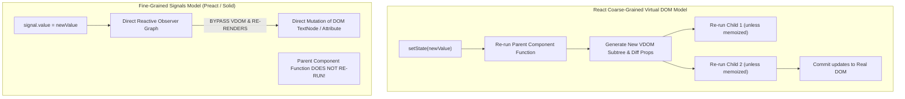

# 07 — Signals vs. React State: Architectural Comparison

## Metadata
- **React Version**: 19.0.0+
- **Prerequisites**: [00-choosing-state-management.md](./00-choosing-state-management.md), [02-render-phases-render-vs-commit.md](../02-state-and-rendering/08-render-phases-render-vs-commit.md)
- **Difficulty**: Advanced
- **Estimated Read Time**: 29 minutes
- **Tags**: `signals`, `fine-grained-reactivity`, `virtual-dom`, `preact-signals`, `react-state`, `react-compiler`

---

## Architecture Diagram

The diagram below compares how state changes propagate through a component tree in **React's Virtual DOM Model** (top-down component function re-execution) versus a **Fine-Grained Signals Model** (direct text node / property mutation bypassing component re-renders).



---

## Concept Overview

Across modern frontend engineering, two contrasting reactive execution models exist:
1. **Coarse-Grained Virtual DOM (React)**: React components are pure functions of props and state ($UI = f(state)$). When state changes, React re-executes the component function from top to bottom, produces a new Virtual DOM tree, diffs it against the previous tree (reconciliation), and commits minimal changes to the real DOM.
2. **Fine-Grained Reactivity (Signals — Preact, Solid.js, Angular, Vue, Svelte 5 Runes)**: State is held in a reactive wrapper (`signal`). When a signal changes, it notifies only the exact DOM nodes or effects that read its value. **The enclosing component function does not re-render.**

### Why Didn't the React Team Adopt Signals?

While Signals offer extreme micro-benchmark performance, the React Core Team consciously chose **not** to adopt Signals as the primary paradigm. Their rationale:
- **Component Mental Model**: React's philosophy is declarative snapshot rendering ($UI = f(data)$). Component functions are expected to run consistently as a unit.
- **Concurrent React Compatibility**: Features like `useTransition`, Time Slicing, Suspense, and selective hydration require React to pause, abort, or throw away renders. Mutating DOM nodes directly via signals outside React's Fiber scheduler can lead to visual tearing and desynchronization during concurrent rendering.
- **The React Compiler Solution**: Instead of forcing developers into a new reactivity paradigm with `.value` wrappers, the React Compiler automatically memoizes components and hooks at build time, eliminating unnecessary VDOM diffing while preserving React's idiomatic mental model.

---

## Practical Implementation

### Example 1: Pure React State (Coarse-Grained Component Re-execution)

In idiomatic React, updating count re-executes the entire `Parent` function and re-evaluates all JSX.

```tsx
// src/components/ReactCounter.tsx
import React, { useState } from 'react';

export function ReactCounter() {
  const [count, setCount] = useState(0);

  console.log('[React VDOM] Component function executed!');

  return (
    <div className="p-4 border rounded shadow-sm">
      <h3 className="font-bold">React VDOM Counter</h3>
      <p className="my-2">Current count: <span className="font-mono text-blue-600">{count}</span></p>
      <button
        onClick={() => setCount((c) => c + 1)}
        className="px-3 py-1 bg-blue-600 text-white rounded hover:bg-blue-700"
      >
        Increment
      </button>
    </div>
  );
}
```

*Expected Verification Output:*
```text
Click "Increment":
  - Log: "[React VDOM] Component function executed!"
  - The entire function body runs, producing new VDOM elements.
```

---

### Example 2: Using Preact Signals in React (`@preact/signals-react`)

With `@preact/signals-react`, passing a signal directly into JSX allows Preact to patch the real DOM text node directly without re-running the component function!

```tsx
// src/components/SignalCounter.tsx
import React from 'react';
import { signal } from '@preact/signals-react';

// Signal declared outside or in ref
export const globalCount = signal(0);

export function SignalCounter() {
  console.log('[Signals] Component function executed!');

  return (
    <div className="p-4 border rounded shadow-sm">
      <h3 className="font-bold">Preact Signals in React</h3>
      {/* Passing signal directly into JSX: Text node binds directly to signal */}
      <p className="my-2">
        Current count: <span className="font-mono text-green-600">{globalCount}</span>
      </p>
      <button
        onClick={() => {
          globalCount.value++;
        }}
        className="px-3 py-1 bg-green-600 text-white rounded hover:bg-green-700"
      >
        Increment Signal
      </button>
    </div>
  );
}
```

*Expected Verification Output:*
```text
Initial Mount:
  - Log: "[Signals] Component function executed!"
Click "Increment Signal":
  - Real DOM text node updates from 0 -> 1 -> 2.
  - ZERO subsequent component executions! The console log NEVER fires again!
```

---

### Example 3: Computed Signals vs React `useMemo`

Signals track their dependencies automatically without explicit dependency arrays.

```tsx
// src/signals/cartSignals.ts
import { signal, computed } from '@preact/signals-react';

export const items = signal([
  { id: 1, name: 'Mechanical Keyboard', price: 120, qty: 1 },
  { id: 2, name: 'Ergonomic Mouse', price: 80, qty: 2 },
]);

// Computed signal: Lazily evaluated and automatically memoized
export const subtotal = computed(() => {
  console.log('[Signals] Recomputing subtotal...');
  return items.value.reduce((acc, item) => acc + item.price * item.qty, 0);
});

export const tax = computed(() => {
  return subtotal.value * 0.08;
});
```

*Expected Verification Output:*
```text
subtotal is computed only when items.value changes.
Reading tax reuses cached subtotal.value without re-traversing the items array.
```

---

### Example 4: The TC39 Signals Proposal Standard Syntax

The TC39 JavaScript standards committee is standardizing Signals into the ECMAScript language specification (`proposal-signals`).

```ts
// Example of the emerging TC39 Signal API (Stage 2)
import { Signal } from 'signal-polyfill';

// 1. Primitive state cell
const count = new Signal.State(0);

// 2. Computed formula cell
const isEven = new Signal.Computed(() => count.get() % 2 === 0);

// 3. Watcher for side-effects
const watcher = new Signal.subtle.Watcher(() => {
  console.log('Signal changed! New value:', count.get(), 'Is even:', isEven.get());
});

watcher.watch(count);

count.set(1); // Logs: "Signal changed! New value: 1 Is even: false"
count.set(2); // Logs: "Signal changed! New value: 2 Is even: true"
```

*Expected Verification Output:*
```text
Evaluates fine-grained dependency graph natively in JS engine without framework abstraction.
```

---

### Example 5: High-Frequency Animation / Canvas with Signals vs React State

In a high-frequency telemetry ticker or 60fps cursor follower, React's standard `setState` causes severe frame drops. Signals update the DOM at 60fps with zero overhead.

```tsx
// src/components/CursorTracker.tsx
import React, { useEffect } from 'react';
import { signal } from '@preact/signals-react';

const mouseX = signal(0);
const mouseY = signal(0);

export function CursorTracker() {
  useEffect(() => {
    const handleMove = (e: MouseEvent) => {
      // Direct signal updates at 120Hz
      mouseX.value = e.clientX;
      mouseY.value = e.clientY;
    };

    window.addEventListener('mousemove', handleMove);
    return () => window.removeEventListener('mousemove', handleMove);
  }, []);

  console.log('[CursorTracker] Component render!');

  return (
    <div className="p-4 border rounded">
      <h4 className="font-semibold text-gray-700">Real-time Coordinates</h4>
      <p className="font-mono text-sm">
        X: {mouseX} | Y: {mouseY}
      </p>
    </div>
  );
}
```

*Expected Verification Output:*
```text
Moving mouse across screen:
  - Text updates coordinates instantly at 60fps.
  - Component renders exactly ONCE during mount. Zero GC pressure from VDOM churn.
```

---

## Architectural Comparison Matrix

| Feature | React 19 (`useState`) | Preact Signals | Jotai (Atoms) | Zustand (Stores) |
| :--- | :--- | :--- | :--- | :--- |
| **Granularity** | Coarse (Component) | Ultra-fine (DOM node) | Medium (Component via atom) | Medium (Component via slice) |
| **Re-render Scope** | Entire component function | Only bound DOM node | Only subscribed component | Only subscribed component |
| **Mental Model** | $UI = f(state)$ | Reactive cell graph | Directed acyclic graph | Centralized store |
| **Concurrent React Safe**| 100% Native support | Can tear without wrappers | 100% Native support | 100% via `useSyncExternalStore` |
| **Memoization** | React Compiler / `useMemo` | Inherent in `computed()` | Inherent in derived atoms | Selectors (`shallow`) |
| **Ecosystem Alignment** | Official Core React | Community extension | Native React ecosystem | Native React ecosystem |

---

## Mental Model & Analogies

### The Newspaper Reprint vs The Live Scoreboard

- **React Virtual DOM** is a **newspaper printing press**: When a score changes in the 85th minute of a soccer match, the press halts, reformulates the entire front page layout, prints a brand-new edition, and delivers the new paper to your doorstep.
- **Signals** are an **electronic digital scoreboard**: When a team scores, a tiny electrical pulse travels down a dedicated wire directly to the specific digit LED on the board, flipping `1` to `2`. The stadium walls, field, and rest of the scoreboard remain completely untouched.

---

## Under the Hood / Internal Mechanics

### How Preact Signals Intercept React JSX

When `@preact/signals-react` is installed:
1. It patches `React.createElement` / JSX runtime (`react/jsx-runtime`).
2. When you write `<p>{countSignal}</p>`, the runtime detects that the child expression is an instance of `Signal`.
3. Instead of converting the signal to a string during render, it wraps the text node in a micro-subscriber component or attaches a direct DOM mutation subscription.
4. When `countSignal.value++` executes, the subscription executes `domTextNode.data = newValue`, bypassing React's `reconcileChildren` and Fiber commit phases entirely.

---

## Common Pitfalls & Anti-Patterns

| Anti-Pattern | Why It Breaks | Recommended Solution |
| :--- | :--- | :--- |
| **Reading `.value` in Component Body Without Tracking**| Bypasses fine-grained DOM bindings and causes stale closure renders. | Pass the bare signal directly into JSX (`<span>{mySignal}</span>`). |
| **Using Signals in Concurrent Suspense Trees** | Direct DOM mutations bypass React's Fiber work loop, causing UI tearing during transitions. | Use standard React state or Jotai for concurrent workflows. |
| **Mutating Array Signals In-Place (`arr.push()`)** | Signals use reference equality (`Object.is`); mutating internals does not trigger observers. | Always assign a new array reference (`signal.value = [...signal.value, newItem]`). |
| **Over-using Signals for Complex UI Orchestration** | Signal dependency graphs can become tangled "spaghetti reactivity" that is difficult to trace. | Use XState or structured Redux/Zustand stores for complex state machines. |
| **Ignoring the React 19 Compiler** | Adding external signal libraries introduces bundle size and complexity that the React Compiler already solves. | Evaluate React Compiler auto-memoization before introducing signal abstractions. |
| **Mixing Signal Subscriptions with Server Components** | Signals depend on client-side browser reactivity and crash in React Server Components (RSC). | Keep signals strictly inside `'use client'` components. |

---

## Performance & Optimization

### When to Prefer Signals vs React State

- **Use Signals when**:
  - Building high-frequency data grids (updating 1,000 cells at 60Hz).
  - Audio visualizers, live IoT sensor dashboards, or game HUD overlays.
  - Micro-controllers or low-end mobile devices where VDOM reconciliation overhead is prohibitive.
- **Use Standard React State when**:
  - Building typical business, SaaS, and e-commerce applications.
  - Heavily utilizing React Server Components, Suspense, and Transitions.
  - Relying on automated React Compiler optimization.

---

## Edge Cases & Debugging

### UI Tearing in React Transitions
- **Symptom**: During a `startTransition`, a signal-bound header updates immediately to the new page's state, while the page body remains suspended on the old view.
- **Root Cause**: Signals mutate DOM nodes synchronously, bypassing React's transition priority queue.
- **Remedy**: Synchronize signals with React's transition engine or use `useSyncExternalStore`.

---

## Ecosystem & Alternative Approaches

- **Solid.js**: The premier signals-based UI framework. Solid completely abandons the Virtual DOM, compiling JSX directly into real DOM creation statements.
- **Preact**: Full alternative to React (~3KB) with first-class signals support.
- **Svelte 5 (Runes)**: Svelte's new reactive primitives (`$state`, `$derived`, `$effect`), closely resembling Signals.

---

## Exercises & Challenges

<details>
<summary><strong>Exercise 1: Convert a React `useMemo` Calculation to a Signal `computed`</strong></summary>

**Challenge**: Refactor a filtered list calculation from `useMemo` to a computed signal.

```ts
import { signal, computed } from '@preact/signals-react';

export const filterQuery = signal('');
export const rawUsers = signal(['Alice', 'Bob', 'Charlie', 'David']);

// Computed signal automatically updates when either filterQuery or rawUsers changes
export const filteredUsers = computed(() => {
  const query = filterQuery.value.toLowerCase();
  return rawUsers.value.filter((u) => u.toLowerCase().includes(query));
});
```
</details>

<details>
<summary><strong>Exercise 2: Create a Custom Hook Bridging Signals to React State</strong></summary>

**Challenge**: Write a hook `useSignalValue(signal)` that subscribes to a signal using `useSyncExternalStore` for 100% concurrent React safety.

```ts
import { useSyncExternalStore } from 'react';
import type { Signal } from '@preact/signals-react';

export function useSignalValue<T>(s: Signal<T>): T {
  return useSyncExternalStore(
    (callback) => s.subscribe(callback),
    () => s.value,
    () => s.value
  );
}
```
</details>

---

## Frequently Asked Interview Questions

<details>
<summary><strong>1. Why didn't React adopt Signals natively like Preact, Solid, and Angular?</strong></summary>

React prioritized declarative snapshot rendering ($UI = f(data)$) and its Concurrent Architecture (Transitions, Suspense, Time Slicing). Signals achieve performance by bypassing component functions and directly mutating DOM nodes. In a concurrent environment, direct DOM mutations lead to visual tearing and state desynchronization. React solved re-render performance through the **React Compiler**, which automates memoization at compile time without altering React's functional paradigm.
</details>

<details>
<summary><strong>2. How do Signals achieve fine-grained reactivity?</strong></summary>

Signals establish an automatic dependency graph using an observer pattern. When a computed signal or DOM text node reads a signal's `.value`, the signal registers that consumer as a subscriber. When the signal's value changes, it directly notifies only those specific subscribers, bypassing parent component re-renders and Virtual DOM reconciliation.
</details>

<details>
<summary><strong>3. What is the difference between Jotai atoms and Signals?</strong></summary>

While both follow a bottom-up graph architecture, Jotai atoms are **component-level** reactive primitives: updating an atom re-runs the specific React component function subscribed to it. Signals are **node-level** reactive primitives: updating a signal can mutate a specific DOM node or property without re-executing the enclosing React component function.
</details>

<details>
<summary><strong>4. What is "UI Tearing" and how do Signals risk causing it in React?</strong></summary>

Tearing occurs when different parts of the UI display data from different points in time for the same state update. In Concurrent React, React can pause a low-priority render to keep the UI responsive. Because signals update outside React's Fiber scheduler, a synchronous signal update can paint immediately to a DOM node while React is mid-render, resulting in a fractured, inconsistent visual state.
</details>

<details>
<summary><strong>5. What is the status of the TC39 Signals Proposal?</strong></summary>

The TC39 Signals Proposal is currently at **Stage 2** in the ECMAScript standardization process. Champions from Preact, Solid, Angular, and Vue are collaborating to standardize `Signal.State` and `Signal.Computed` as native JavaScript engine primitives, enabling cross-framework interoperability.
</details>

<details>
<summary><strong>6. Can Signals be used inside React Server Components?</strong></summary>

No. Signals are dynamic, client-side reactive constructs designed to track mutations and update live DOM nodes in browser runtimes. React Server Components execute once on the server and stream static HTML/Flight representation; they do not have live state or DOM subscriptions.
</details>

<details>
<summary><strong>7. How does the React Compiler compare to Signals in addressing unnecessary re-renders?</strong></summary>

Both aim to eliminate wasted computations:
- **Signals** change the runtime model so that component functions don't run on state changes.
- **The React Compiler** keeps the component runtime model unchanged, but automatically injects memoization caches (HIR SSA slots) so that unchanged component subtrees and props are skipped during reconciliation.
</details>

<details>
<summary><strong>8. When is it genuinely advantageous to use `@preact/signals-react` in a React application?</strong></summary>

Signals provide massive advantages in high-frequency, low-latency UI scenarios—such as real-time financial trading tickers, collaborative canvas coordinates, audio synthesis visualizers, or massive data grids updating hundreds of times per second—where the overhead of generating Virtual DOM trees on every tick exhausts the browser's main thread.
</details>

---

## References & Further Reading

- [Preact Signals Documentation](https://preactjs.com/guide/v10/signals/)
- [TC39 Signals Proposal GitHub](https://github.com/tc39/proposal-signals)
- [Ryan Carniato: A Hands-on Introduction to Fine-Grained Reactivity](https://dev.to/ryansolid/a-hands-on-introduction-to-fine-grained-reactivity-3ndf)
- [Dan Abramov: React without memo (React Compiler Analysis)](https://overreacted.io/)
- [Solid.js Reactivity Documentation](https://www.solidjs.com/tutorial/introduction_signals)
