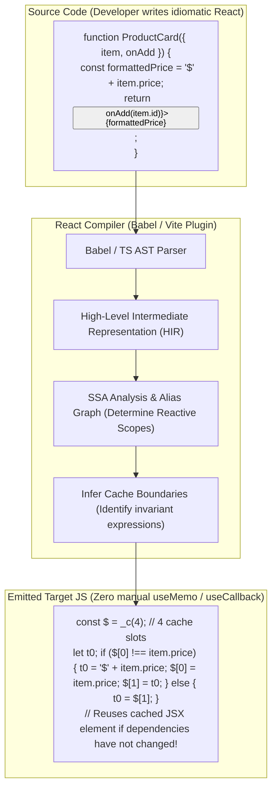

# 07 — The React Compiler in Practice

## Metadata
- **React Version**: 19.0.0+ (Compiler v1.0.0-rc+)
- **Prerequisites**: [01-rendering-performance.md](./01-rendering-performance.md), [02-memoization.md](./02-memoization.md), JavaScript AST
- **Difficulty**: Advanced
- **Estimated Read Time**: 28 minutes
- **Tags**: `react-compiler`, `react-forget`, `memoization`, `auto-memoize`, `eslint-plugin-react-compiler`, `performance`

---

## Architecture Diagram

The diagram below details the pipeline of the React Compiler: transforming standard idiomatic React TypeScript/JSX into High-level Intermediate Representation (HIR), applying Static Single Assignment (SSA) dataflow analysis to discover reactive scopes, and emitting fine-grained memoization slots (`_c()`) directly into the production JS bundle.



---

## Concept Overview

For over a decade, React developers have spent countless engineering hours manually auditing render trees and sprinkling `useMemo`, `useCallback`, and `React.memo` across components to prevent unnecessary re-renders.
Manual memoization has proven fragile and error-prone:
1. **Developer Overhead**: Mental energy spent managing dependency arrays instead of shipping business features.
2. **Fragile Invalidation**: A single unmemoized prop or inline object literal passed from an ancestor invalidates all downstream `memo` wrappers.
3. **Code Clutter**: Codebases become bloated with defensive boilerplate.

The **React Compiler** (formerly known as *React Forget*) is an optimizing build-time compiler created by the React Core Team. It understands the rules of React and JavaScript semantics. It automatically analyzes your component and hook code, identifies expressions that depend on reactive values (props, state, hook returns), and injects fine-grained memoization cache slots (`_c()`) into the compiled JavaScript.

### Core Philosophy: "Write Normal JavaScript"

With the React Compiler active:
- You write natural, idiomatic JavaScript without `useMemo`, `useCallback`, or `React.memo`.
- Objects, arrays, callbacks, and JSX elements are automatically memoized at the statement level.
- If you still have manual `useMemo` or `useCallback` in legacy code, the compiler safely preserves or optimizes them without breaking changes.

---

## Practical Implementation

### Example 1: Vite Configuration with `@react-compiler/vite-plugin`

Enabling the React Compiler in a modern Vite 6 / React 19 project.

```ts
// vite.config.ts
import { defineConfig } from 'vite';
import react from '@vitejs/plugin-react';

const ReactCompilerConfig = {
  target: '19', // Targets React 19 memoization runtime
};

export default defineConfig({
  plugins: [
    react({
      babel: {
        plugins: [['babel-plugin-react-compiler', ReactCompilerConfig]],
      },
    }),
  ],
});
```

*Expected Verification Output:*
```text
[Vite] Babel plugin initialized: babel-plugin-react-compiler active.
JSX modules automatically transformed with memoization cache slots during build and HMR.
```

---

### Example 2: Configuring Strict ESLint Verification

The React Compiler requires code to strictly adhere to the **Rules of React** (immutability, no mutations during render, idempotent component functions). The official ESLint plugin catches violations before compilation.

```json
// eslint.config.js (ESLint 9 Flat Config)
import reactCompiler from 'eslint-plugin-react-compiler';

export default [
  {
    plugins: {
      'react-compiler': reactCompiler,
    },
    rules: {
      'react-compiler/react-compiler': 'error',
    },
  },
];
```

*Expected Verification Output:*
```text
ESLint immediately flags any code that mutates props or reads external global variables during render:
Error: Mutating a value after it has been passed to JSX or returned from a hook is prohibited.
```

---

### Example 3: Before and After Compiler Transformation

Look at the natural code you write vs the code the compiler generates behind the scenes.

**Source Code (What you write):**
```tsx
// src/components/OrderSummary.tsx
import React from 'react';

interface OrderItem {
  id: string;
  name: string;
  price: number;
}

export function OrderSummary({ items, discount }: { items: OrderItem[]; discount: number }) {
  // Expensive calculation without manual useMemo!
  const subtotal = items.reduce((acc, item) => acc + item.price, 0);
  const total = subtotal - discount;

  const handleCheckout = () => {
    console.log('Checking out total:', total);
  };

  return (
    <div className="p-4 border rounded">
      <h3>Order Total: ${total}</h3>
      <button onClick={handleCheckout} className="btn-primary">
        Pay Now
      </button>
    </div>
  );
}
```

**Compiled Output (What the browser executes):**
```js
function OrderSummary(t0) {
  const $ = _c(7); // Allocates 7 cache slots in the Fiber node
  const { items, discount } = t0;
  
  let t1;
  if ($[0] !== items) {
    t1 = items.reduce((acc, item) => acc + item.price, 0);
    $[0] = items;
    $[1] = t1;
  } else {
    t1 = $[1];
  }
  const subtotal = t1;

  let t2;
  if ($[2] !== subtotal || $[3] !== discount) {
    t2 = subtotal - discount;
    $[2] = subtotal;
    $[3] = discount;
    $[4] = t2;
  } else {
    t2 = $[4];
  }
  const total = t2;

  // handleCheckout and JSX element subtrees are similarly cached in $[5] and $[6]!
  return ...;
}
```

*Expected Verification Output:*
```text
If parent re-renders with unchanged items and discount:
  - items.reduce is NOT executed.
  - Button onClick handler identity is preserved.
  - Return JSX object is reused by reference, skipping VDOM reconciliation entirely!
```

---

### Example 4: Opting Out with the `"use no memo"` Directive

If you have a dynamic component or legacy code that intentionally breaks standard purity rules, you can selectively opt it out using the `"use no memo"` directive.

```tsx
// src/components/LegacyCanvasRenderer.tsx
import React, { useRef, useEffect } from 'react';

export function LegacyCanvasRenderer({ data }: { data: number[] }) {
  "use no memo"; // Instructs the React Compiler to skip this entire function

  const canvasRef = useRef<HTMLCanvasElement>(null);

  useEffect(() => {
    // Non-standard imperative drawing logic
    const ctx = canvasRef.current?.getContext('2d');
    if (!ctx) return;
    ctx.clearRect(0, 0, 300, 150);
    ctx.fillRect(0, 0, data.length * 10, 50);
  }, [data]);

  return <canvas ref={canvasRef} width={300} height={150} />;
}
```

*Expected Verification Output:*
```text
React Compiler skips AST transformation for LegacyCanvasRenderer.
Normal React execution applied without caching slots.
```

---

### Example 5: Debugging De-optimizations with React DevTools

In React DevTools (v5.0+), components optimized by the React Compiler display a distinctive **"Memo ✨"** badge next to their name in the component inspector tree.

```tsx
// src/components/CompilerDiagnosticView.tsx
import React, { useState } from 'react';

function HeavyChild({ label, multiplier }: { label: string; multiplier: number }) {
  console.log('[HeavyChild] Computed calculation executed!');
  const calculatedValue = Array.from({ length: 1000 }).reduce(
    (sum: number) => sum + multiplier,
    0
  );

  return (
    <div className="p-2 border bg-gray-50 my-2">
      <span>{label}: <strong>{calculatedValue}</strong></span>
    </div>
  );
}

export function CompilerDiagnosticView() {
  const [ticker, setTicker] = useState(0);

  return (
    <div className="p-6 max-w-md mx-auto border rounded">
      <h2 className="font-bold text-lg mb-4">Compiler Optimization Test</h2>
      <p>Parent Ticker: {ticker}</p>
      
      <button
        onClick={() => setTicker((t) => t + 1)}
        className="px-4 py-2 bg-blue-600 text-white rounded text-sm hover:bg-blue-700"
      >
        Re-render Parent
      </button>

      {/* Compiler automatically memoizes this JSX element and props */}
      <HeavyChild label="Static Calculation" multiplier={5} />
    </div>
  );
}
```

*Expected Verification Output:*
```text
Click "Re-render Parent" 5 times:
  - Parent Ticker updates: 1, 2, 3, 4, 5.
  - Notice console: "[HeavyChild] Computed calculation executed!" DOES NOT LOG after initial mount!
  - React Compiler detected invariant props { label: "Static Calculation", multiplier: 5 } and cached the JSX!
```

---

## Mental Model & Analogies

### The Personal Secretary vs The Forgetful Developer

- **Manual Memoization (`useMemo`, `useCallback`)** is like a **busy developer carrying a paper checklist**:
  - Every time you speak, you must remember to check your clipboard: *"Did I mention the word 'user'? Let me add user to my dependency list. Did I include the callback? Oh no, I forgot the callback, now my list has a stale closure!"*
- **The React Compiler** is a **hyper-intelligent personal secretary**:
  - You speak normally and write ordinary code.
  - The secretary listens, instantly detects which numbers actually changed, pulls previous answers from a filing cabinet when inputs are identical, and delivers the finished document without you ever writing a single checklist.

---

## Under the Hood / Internal Mechanics

### 1. High-level Intermediate Representation (HIR)

The React Compiler does not manipulate raw JavaScript AST. Instead, it converts code into **HIR (High-level Intermediate Representation)**:
1. Converts nested expressions and control flow (if/else, loops, switch) into basic blocks and a Control Flow Graph (CFG).
2. Converts variables into **Static Single Assignment (SSA)** form, where every variable is assigned exactly once (`const x_0 = ..., const x_1 = ...`).
3. Tracks object mutability through an **Alias Graph** to determine whether an object is modified after creation.
4. Groups interdependent statements into **Reactive Scopes**.
5. Allocates array indices in an internal cache vector (`_c(size)`) attached directly to the React Fiber node.

---

## Common Pitfalls & Anti-Patterns

| Anti-Pattern | Why It Breaks | Recommended Solution |
| :--- | :--- | :--- |
| **Mutating Props or State In-Place** | Violates compiler alias analysis; compiler aborts optimization ("Bailout"). | Always treat props and state as strictly immutable. |
| **Reading/Writing Global Variables During Render**| Unpredictable side effects violate pure function assumptions. | Move side effects into `useEffect` or event handlers. |
| **Calling Hooks Conditionally** | Breaks React's rules of hooks; compiler generates build error. | Always call hooks unconditionally at the top level of the component. |
| **Relying on Object Mutation for Optimization**| Mutating an object prevents the compiler from detecting changed dependencies. | Return fresh copies (`{ ...prev, prop: val }`). |
| **Ignoring `eslint-plugin-react-compiler` Warnings**| Silent compilation bailouts revert your components to slow unmemoized execution. | Enable the compiler ESLint plugin and treat all violations as CI build errors. |
| **Overusing `"use no memo"` Everywhere** | Defeats the purpose of the compiler, reintroducing render bottlenecks. | Fix the underlying violation rather than disabling the compiler. |

---

## Performance & Optimization

### Measuring Compiler Impact with React Profiler

Before and after enabling the compiler:
1. Open Chrome DevTools -> **Profiler** tab.
2. Record user interactions (e.g., typing into a form or toggling a list filter).
3. Inspect **"Did not render"** nodes: components that previously rendered due to parent state updates will now display *"Did not render (props did not change)"* automatically.

---

## Edge Cases & Debugging

### Compiler Bailouts (De-optimizations)
- **Symptom**: A component is unexpectedly re-rendering despite invariant props.
- **Root Cause**: The compiler encountered an unsupported pattern (such as `arguments`, `eval`, or dynamic `window` mutations during render) and safely bailed out, falling back to standard uncompiled execution.
- **Verification**: Run `npx react-compiler-healthcheck` in your project root to scan your codebase for bailouts.

---

## Ecosystem & Alternative Approaches

- **Manual `useMemo` / `useCallback`**: The legacy standard. Still valid for projects not yet on React 19 or legacy tooling.
- **Million.js**: A Virtual DOM replacement for React that optimizes block reconciliation. Focuses on diffing speed rather than reactive scope memoization.
- **Signals**: Fine-grained reactivity (Preact / Solid) that mutates DOM nodes directly rather than auto-memoizing VDOM trees.

---

## Exercises & Challenges

<details>
<summary><strong>Exercise 1: Refactor Manual `useCallback` to Natural Idiomatic Code</strong></summary>

**Challenge**: Take a component littered with defensive `useCallback` and `useMemo` and refactor it into clean, idiomatic React suitable for the compiler.

```tsx
// Before (Defensive Boilerplate)
export function UserCard({ user, onSelect }: any) {
  const fullName = useMemo(() => `${user.firstName} ${user.lastName}`, [user.firstName, user.lastName]);
  const handleClick = useCallback(() => onSelect(user.id), [onSelect, user.id]);
  return <div onClick={handleClick}>{fullName}</div>;
}

// After (Idiomatic, Clean React optimized automatically by Compiler)
export function UserCardClean({ user, onSelect }: { user: { id: string; firstName: string; lastName: string }; onSelect: (id: string) => void }) {
  const fullName = `${user.firstName} ${user.lastName}`;
  return (
    <div onClick={() => onSelect(user.id)} className="p-3 border rounded cursor-pointer">
      {fullName}
    </div>
  );
}
```
</details>

<details>
<summary><strong>Exercise 2: Identifying and Fixing a Mutating Render Violation</strong></summary>

**Challenge**: Identify the violation in the code below and fix it so the compiler can optimize it.

```tsx
// Violation: Mutating an array during render
export function TagList({ tags }: { tags: string[] }) {
  tags.sort(); // ERROR: Mutating prop in place!
  return <div>{tags.join(', ')}</div>;
}

// Fix: Create a shallow copy before sorting
export function TagListFixed({ tags }: { tags: string[] }) {
  const sortedTags = [...tags].sort(); // Clean, pure transformation
  return <div>{sortedTags.join(', ')}</div>;
}
```
</details>

---

## Frequently Asked Interview Questions

<details>
<summary><strong>1. What is the React Compiler and what primary problem does it solve?</strong></summary>

The React Compiler is a build-time optimizing compiler created by Meta that automatically memoizes values, functions, and JSX elements inside React components and hooks. It solves the performance bottleneck of unnecessary re-renders without requiring developers to manually write and maintain fragile `useMemo`, `useCallback`, and `React.memo` calls.
</details>

<details>
<summary><strong>2. How does the React Compiler differ from manual `useMemo` and `React.memo`?</strong></summary>

Manual memoization operates at coarse component boundaries: `React.memo` wraps an entire component, and `useMemo` wraps explicit expressions with manually declared dependency arrays that easily fall out of date. 
The React Compiler operates at the **statement level** using High-level Intermediate Representation (HIR) and SSA analysis, caching individual variables, callbacks, and sub-elements independently into cache slots (`_c()`) based on fine-grained reactive scopes.
</details>

<details>
<summary><strong>3. Does the React Compiler break existing `useMemo` or `useCallback` hooks?</strong></summary>

No. The React Compiler is 100% backward-compatible. If existing components contain manual `useMemo` or `useCallback` calls, the compiler treats them as valid reactive code, either preserving their semantics or optimizing them further. Developers do not need to rewrite existing code to adopt the compiler.
</details>

<details>
<summary><strong>4. What are the prerequisites for a codebase to use the React Compiler?</strong></summary>

1. React 19 (or React 18 with the React Compiler runtime package).
2. Adherence to the **Rules of React** (components must be pure, idempotent, and never mutate props or existing state during render).
3. The official ESLint plugin `eslint-plugin-react-compiler` enabled to catch code violations.
</details>

<details>
<summary><strong>5. What is a "Compiler Bailout" and how do you detect it?</strong></summary>

A bailout occurs when the compiler encounters code that violates JavaScript purity or uses language features it cannot safely analyze (e.g. mutating variables across scopes or using `eval`). Instead of failing the build, the compiler safely skips optimizing that specific function and falls back to standard execution. Bailouts can be detected using the React Compiler healthcheck CLI tool (`npx react-compiler-healthcheck`) and React DevTools.
</details>

<details>
<summary><strong>6. How does the compiler handle callbacks passed as props to child components?</strong></summary>

The compiler automatically memoizes function definitions based on the variables they close over. If an inline callback `() => handleClick(id)` only closes over `id`, the callback's reference identity is preserved across renders as long as `id` remains unchanged, preventing child components from re-rendering due to new function references.
</details>

<details>
<summary><strong>7. How do you opt out a specific component from the React Compiler?</strong></summary>

You add the `"use no memo";` directive as the first statement inside the component or hook function body. This instructs the compiler to completely bypass AST transformation for that function.
</details>

<details>
<summary><strong>8. Does the React Compiler replace the need for virtualization in long lists?</strong></summary>

No. The React Compiler eliminates unnecessary re-renders of existing DOM elements, but it does not reduce the sheer quantity of DOM nodes when rendering 10,000 list items. Virtualization (e.g. TanStack Virtual) is still required to ensure only the visible slice of items is mounted in the DOM.
</details>

---

## References & Further Reading

- [Official React Compiler Documentation](https://react.dev/learn/react-compiler)
- [React Compiler GitHub Working Group & Discussions](https://github.com/reactwg/react-compiler)
- [Understanding the React Compiler - Joe Savona & Sathya Gunasekaran (React Conf 2024)](https://www.youtube.com/watch?v=qOQWTOqMB98)
- [Rules of React Specification](https://react.dev/reference/rules)
- [Babel Plugin React Compiler Package](https://www.npmjs.com/package/babel-plugin-react-compiler)
