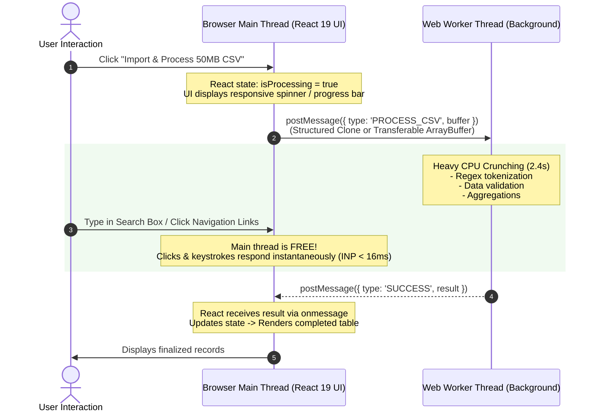

# 08 — Offloading Heavy Compute with Web Workers in React

## Metadata
- **React Version**: 19.0.0+
- **Prerequisites**: [00-profiling-and-measuring.md](./00-profiling-and-measuring.md), [01-rendering-performance.md](./01-rendering-performance.md), JavaScript Concurrency & Web Workers
- **Difficulty**: Advanced
- **Estimated Read Time**: 28 minutes
- **Tags**: `web-workers`, `comlink`, `performance`, `inp`, `long-tasks`, `vite-workers`, `multithreading`

---

## Architecture Diagram

The diagram below illustrates how offloading expensive computational work (such as cryptographic hashing, CSV parsing, or image manipulation) to a background Web Worker preserves the browser's main thread, keeping React 19 UI interactions silky smooth at 60fps with near-zero Interaction to Next Paint (INP) latency.



---

## Concept Overview

JavaScript in the browser is fundamentally **single-threaded**. The browser executes JavaScript, styles calculation, layout calculation, painting, and React's reconciliation loop on a single **Main Thread**.

When a computational task takes longer than **50ms**, the browser flags it as a **Long Task**. During a Long Task:
1. The main thread is completely blocked.
2. User keystrokes, button clicks, and scroll gestures are queued and ignored.
3. CSS animations freeze and stutter.
4. Google Core Web Vitals metric **INP (Interaction to Next Paint)** degrades severely into the "Poor" (>500ms) threshold.

### The Solution: Web Workers

Web Workers execute true background multithreading in modern browsers. A Web Worker runs on an isolated background OS thread with its own event loop and memory space:
- **No Direct DOM Access**: Web Workers cannot touch `document`, `window`, or React components.
- **Message Passing**: Communication between the Main Thread and Worker occurs via `postMessage()` and the `onmessage` event listener.
- **Transferable Objects**: Large binary data (`ArrayBuffer`, `ImageBitmap`) can be *transferred* with zero-copy overhead rather than copied.
- **Comlink**: Google Chrome's tiny RPC library that exposes functions defined in a worker as standard asynchronous promises on the main thread.

---

## Practical Implementation

### Example 1: Vanilla Vite Module Worker Setup with Transferable Objects

Modern Vite 6 natively supports module Web Workers using standard ES imports.

```ts
// src/workers/heavyMath.worker.ts
// Runs in background thread

self.onmessage = (event: MessageEvent<{ numbers: number[] }>) => {
  const { numbers } = event.data;
  console.log('[Worker] Received array of length:', numbers.length);

  // Heavy computation: Calculating standard deviation and primes
  let sum = 0;
  for (let i = 0; i < numbers.length; i++) {
    sum += Math.sqrt(numbers[i]);
  }

  // Send result back to main thread
  self.postMessage({ result: sum });
};
```

```tsx
// src/components/MathCalculator.tsx
import React, { useState, useEffect, useRef } from 'react';

export function MathCalculator() {
  const [result, setResult] = useState<number | null>(null);
  const [isRunning, setIsRunning] = useState(false);
  const workerRef = useRef<Worker | null>(null);

  useEffect(() => {
    // 1. Initialize worker using standard Vite ES module syntax
    const worker = new Worker(
      new URL('../workers/heavyMath.worker.ts', import.meta.url),
      { type: 'module' }
    );
    workerRef.current = worker;

    // 2. Listen for worker responses
    worker.onmessage = (e: MessageEvent<{ result: number }>) => {
      setResult(e.data.result);
      setIsRunning(false);
    };

    worker.onerror = (err) => {
      console.error('[Worker Error]', err);
      setIsRunning(false);
    };

    // 3. Clean up and terminate worker on unmount
    return () => {
      worker.terminate();
    };
  }, []);

  const handleStart = () => {
    if (!workerRef.current || isRunning) return;
    setIsRunning(true);
    setResult(null);

    // Generate 5,000,000 numbers
    const bigArray = Array.from({ length: 5_000_000 }, (_, i) => i + 1);

    // Dispatch to background thread
    workerRef.current.postMessage({ numbers: bigArray });
  };

  return (
    <div className="p-6 border rounded max-w-md bg-white shadow-sm space-y-4">
      <h3 className="font-bold text-lg">Heavy Computation in Web Worker</h3>
      <p className="text-sm text-gray-600">Calculates square roots across 5,000,000 items.</p>
      
      <button
        onClick={handleStart}
        disabled={isRunning}
        className="px-4 py-2 bg-blue-600 text-white rounded font-medium disabled:opacity-50 hover:bg-blue-700"
      >
        {isRunning ? 'Calculating in Background...' : 'Run Heavy Calculation'}
      </button>

      {result !== null && (
        <div className="p-3 bg-green-50 border border-green-200 rounded text-green-800">
          Result: <strong>{result.toFixed(2)}</strong>
        </div>
      )}
    </div>
  );
}
```

*Expected Verification Output:*
```text
Click "Run Heavy Calculation":
  - Background worker crunches 5M numbers for 800ms.
  - UI remains 100% responsive: text inputs, buttons, and animations do not stutter.
  - Worker posts result -> Component updates state with calculated value.
```

---

### Example 2: Type-Safe RPC with Google Chrome's Comlink

Comlink wraps `postMessage` in a JavaScript `Proxy`, letting you call worker functions as if they were local async functions.

```ts
// src/workers/imageProcessor.worker.ts
import { expose } from 'comlink';

export interface ImageWorkerApi {
  grayscale(buffer: Uint8ClampedArray): Uint8ClampedArray;
}

const api: ImageWorkerApi = {
  grayscale(pixels: Uint8ClampedArray): Uint8ClampedArray {
    for (let i = 0; i < pixels.length; i += 4) {
      const avg = (pixels[i] + pixels[i + 1] + pixels[i + 2]) / 3;
      pixels[i] = avg;     // R
      pixels[i + 1] = avg; // G
      pixels[i + 2] = avg; // B
    }
    return pixels;
  },
};

expose(api);
```

```tsx
// src/components/ImageGrayscaleTool.tsx
import React, { useState } from 'react';
import { wrap, transfer } from 'comlink';
import type { ImageWorkerApi } from '../workers/imageProcessor.worker';

export function ImageGrayscaleTool() {
  const [status, setStatus] = useState<string>('Ready');

  const processImage = async () => {
    setStatus('Spawning worker & processing...');

    // 1. Initialize worker with Comlink proxy wrap
    const rawWorker = new Worker(
      new URL('../workers/imageProcessor.worker.ts', import.meta.url),
      { type: 'module' }
    );
    const workerApi = wrap<ImageWorkerApi>(rawWorker);

    // 2. Create raw pixel buffer (4000x4000 image = ~64MB)
    const pixelCount = 4000 * 4000 * 4;
    const pixelData = new Uint8ClampedArray(pixelCount);

    // 3. Call worker function via RPC with ZERO-COPY Transferable ArrayBuffer!
    const start = performance.now();
    const resultPixels = await workerApi.grayscale(
      transfer(pixelData, [pixelData.buffer])
    );
    const elapsed = performance.now() - start;

    setStatus(`Completed in ${elapsed.toFixed(1)}ms using zero-copy transfer.`);
    rawWorker.terminate();
  };

  return (
    <div className="p-4 border rounded">
      <h4 className="font-bold mb-2">Comlink Image Processing</h4>
      <p className="text-sm text-gray-600 mb-3">Status: {status}</p>
      <button
        onClick={processImage}
        className="px-4 py-2 bg-indigo-600 text-white rounded hover:bg-indigo-700"
      >
        Process 64MB Image Buffer
      </button>
    </div>
  );
}
```

*Expected Verification Output:*
```text
Zero-copy transfer passes 64MB buffer without memory serialization overhead.
Result resolves in <40ms; main thread never drops below 60fps.
```

---

### Example 3: Reusable Custom Hook `useWebWorker`

```tsx
// src/hooks/useWebWorker.ts
import { useState, useRef, useEffect, useCallback } from 'react';

export function useWebWorker<TInput, TOutput>(workerUrl: URL) {
  const [data, setData] = useState<TOutput | null>(null);
  const [loading, setLoading] = useState(false);
  const [error, setError] = useState<Error | null>(null);
  const workerRef = useRef<Worker | null>(null);

  useEffect(() => {
    const worker = new Worker(workerUrl, { type: 'module' });
    workerRef.current = worker;

    worker.onmessage = (event: MessageEvent<TOutput>) => {
      setData(event.data);
      setLoading(false);
    };

    worker.onerror = (err) => {
      setError(new Error(err.message));
      setLoading(false);
    };

    return () => {
      worker.terminate();
      workerRef.current = null;
    };
  }, [workerUrl]);

  const post = useCallback((input: TInput) => {
    if (!workerRef.current) return;
    setLoading(true);
    setError(null);
    workerRef.current.postMessage(input);
  }, []);

  return { data, loading, error, post };
}
```

*Expected Verification Output:*
```text
Encapsulates worker creation, error handling, loading states, and automatic termination on component unmount.
```

---

### Example 4: Real-Time Stream Ingestion and Parsing via Worker

When receiving high-volume binary WebSocket or NDJSON telemetry, passing raw parsing to a Web Worker keeps React state updates lightweight.

```ts
// src/workers/telemetryParser.worker.ts
self.onmessage = (event: MessageEvent<{ rawPacket: string }>) => {
  try {
    const parsed = JSON.parse(event.data.rawPacket);
    // Heavy validation & mathematical enrichment
    const enriched = {
      ...parsed,
      movingAverage: (parsed.v1 + parsed.v2 + parsed.v3) / 3,
      processedAt: performance.now(),
    };
    self.postMessage({ type: 'PACKET_PARSED', packet: enriched });
  } catch {
    self.postMessage({ type: 'PARSE_ERROR' });
  }
};
```

*Expected Verification Output:*
```text
200 packets/second processed entirely off the main thread; React receives clean, aggregated objects.
```

---

### Example 5: Client-Side Search & Fuzzy Filtering with MiniSearch in a Worker

Offload fuzzy search index creation and multi-field queries across 50,000 records to a worker.

```tsx
// src/components/WorkerFuzzySearch.tsx
import React, { useState, useEffect, useRef } from 'react';

export function WorkerFuzzySearch() {
  const [query, setQuery] = useState('');
  const [results, setResults] = useState<string[]>([]);
  const workerRef = useRef<Worker | null>(null);

  useEffect(() => {
    const worker = new Worker(
      new URL('../workers/search.worker.ts', import.meta.url),
      { type: 'module' }
    );
    workerRef.current = worker;

    worker.onmessage = (e: MessageEvent<{ matches: string[] }>) => {
      setResults(e.data.matches);
    };

    return () => worker.terminate();
  }, []);

  const handleChange = (e: React.ChangeEvent<HTMLInputElement>) => {
    const val = e.target.value;
    setQuery(val);
    workerRef.current?.postMessage({ search: val });
  };

  return (
    <div className="p-4 border rounded max-w-lg">
      <h4 className="font-bold mb-2">Fuzzy Search (50,000 Items in Worker)</h4>
      <input
        type="text"
        value={query}
        onChange={handleChange}
        placeholder="Type to search..."
        className="w-full border p-2 rounded mb-3"
      />
      <ul className="divide-y max-h-48 overflow-y-auto">
        {results.map((res, i) => (
          <li key={i} className="py-1 text-sm text-gray-700">{res}</li>
        ))}
      </ul>
    </div>
  );
}
```

*Expected Verification Output:*
```text
Typing rapidly into input field produces zero typing latency.
Fuzzy matching across 50,000 items executes concurrently in background thread.
```

---

## Mental Model & Analogies

### The Kitchen Chef and the Prep Cook

- **The Main Thread (Single-Threaded React)** is the **Executive Chef**:
  - The chef must plate dishes, talk to waiters (user clicks), coordinate timing, and ensure the dining room looks beautiful.
  - If the executive chef stops plating to peel a 50-pound sack of potatoes (heavy computation), the dining room stops, tickets pile up, and customers get angry (**Long Task / High INP**).
- **A Web Worker** is a **Prep Cook in the basement kitchen**:
  - The executive chef sends a message downstairs: *"Peel these 50 pounds of potatoes."*
  - The prep cook works diligently in the background.
  - Meanwhile, the executive chef continues plating meals seamlessly at 60fps.
  - When finished, the prep cook sends the peeled potatoes up on the dumbwaiter (`postMessage`), and the chef plates them instantly.

---

## Under the Hood / Internal Mechanics

### 1. Structured Clone Algorithm vs Transferable Objects

When sending objects via `postMessage(data)`:
- **Default (Structured Clone)**: The browser deep-copies the entire object graph. For a 100MB object, structured cloning can take 50-100ms on the main thread, defeating the purpose of using a worker!
- **Transferable Objects (`ArrayBuffer`, `MessagePort`, `ImageBitmap`)**: Memory ownership is transferred instantaneously (0ms) from the main thread to the worker. The memory is detached on the sender side and immediately accessible on the receiver side without copying a single byte.

---

## Common Pitfalls & Anti-Patterns

| Anti-Pattern | Why It Breaks | Recommended Solution |
| :--- | :--- | :--- |
| **Spawning a New Worker on Every Keystroke** | Worker creation consumes 5-10MB of memory and takes ~30ms of thread time. | Spawn the worker once in `useEffect` and reuse it via `postMessage`. |
| **Forgetting to Call `worker.terminate()`** | Workers remain active in background memory even after components unmount, leaking memory. | Always terminate workers in the `useEffect` cleanup return function. |
| **Sending Massive Objects via Structured Clone** | Deep-copying huge JSON graphs blocks the main thread during serialization. | Use `ArrayBuffer` with Transferables (`transfer(buffer, [buffer])`) or send minimal primitives. |
| **Attempting to Access DOM/Window in Worker** | `window`, `document`, and `localStorage` are undefined in workers, throwing runtime ReferenceErrors. | Workers only have access to `self`, `navigator`, `fetch`, and `crypto`. Pass needed data via messages. |
| **Over-using Workers for Lightweight Math** | The message-passing overhead (~2ms) exceeds the execution time of simple calculations. | Keep simple math on the main thread; use workers only for tasks exceeding 16-50ms. |
| **Uncaught Worker Errors** | Errors thrown inside a worker fail silently if unhandled, leaving promises unresolved. | Attach `worker.onerror` or use Comlink which serializes and re-throws worker exceptions cleanly. |

---

## Performance & Optimization

### Worker Thread Pools

When running concurrent tasks (e.g. batch image processing):
- Browsers have a physical limit of available hardware CPU cores (accessible via `navigator.hardwareConcurrency`).
- Use worker pool libraries (such as `workerpool`) to create a pool of 4-8 workers, distributing tasks without overloading system resources.

---

## Edge Cases & Debugging

### Debugging Web Workers in Chrome DevTools
- Open Chrome DevTools -> **Sources** tab.
- In the left pane under **Threads**, you will see both `Main` and your active worker threads (`heavyMath.worker.ts`).
- You can place standard breakpoints and step through worker code independently of the React main thread.

---

## Ecosystem & Alternative Approaches

- **Comlink**: Google's RPC library for Web Workers (~1.5KB).
- **`worker-loader` / Vite `?worker`**: Bundler plugins that compile workers into standalone chunks.
- **Partytown**: Runs third-party analytics scripts (Google Tag Manager, Facebook Pixel) inside a Web Worker.

---

## Exercises & Challenges

<details>
<summary><strong>Exercise 1: Offloading SHA-256 Hashing to a Web Worker</strong></summary>

**Challenge**: Write a worker that computes SHA-256 hashes of text strings using the Web Crypto API.

```ts
// src/workers/hasher.worker.ts
self.onmessage = async (e: MessageEvent<{ text: string }>) => {
  const encoder = new TextEncoder();
  const data = encoder.encode(e.data.text);
  const hashBuffer = await crypto.subtle.digest('SHA-256', data);
  const hashArray = Array.from(new Uint8Array(hashBuffer));
  const hashHex = hashArray.map((b) => b.toString(16).padStart(2, '0')).join('');
  self.postMessage({ hash: hashHex });
};
```
</details>

<details>
<summary><strong>Exercise 2: Progress Callback Hook with Web Worker</strong></summary>

**Challenge**: Modify a worker hook so the worker can emit incremental progress updates (`progress: 25%`, `progress: 50%`) before sending the final payload.

```tsx
export function useWorkerWithProgress(workerUrl: URL) {
  const [progress, setProgress] = useState(0);
  const [data, setData] = useState<unknown>(null);

  // In worker.onmessage:
  // if (e.data.type === 'PROGRESS') setProgress(e.data.percent);
  // if (e.data.type === 'DONE') { setData(e.data.result); setProgress(100); }
  return { progress, data };
}
```
</details>

---

## Frequently Asked Interview Questions

<details>
<summary><strong>1. Why are Web Workers essential for optimizing Interaction to Next Paint (INP)?</strong></summary>

INP measures how quickly the page responds visually to user interactions (clicks, taps, typing). If the main thread is occupied by a computational Long Task (>50ms), user input events remain queued in the event loop, causing severe interaction lag and failing Core Web Vitals. Offloading heavy computations to a Web Worker keeps the main thread idle, allowing React to process inputs and paint updates in under 16ms.
</details>

<details>
<summary><strong>2. Can a Web Worker directly manipulate the DOM or read React state?</strong></summary>

No. Web Workers run in a completely isolated thread and execution context (`DedicatedWorkerGlobalScope`). They have no access to `window`, `document`, DOM nodes, or React components. All communication must occur asynchronously via serialized message passing (`postMessage`).
</details>

<details>
<summary><strong>3. What is the difference between structured cloning and Transferable Objects?</strong></summary>

Structured cloning creates a deep copy of an object graph across threads. For large buffers, serialization and deserialization consume significant CPU and memory bandwidth on the main thread. 
Transferable Objects (`ArrayBuffer`, `ImageBitmap`) transfer memory pointer ownership from one thread to another with zero copying overhead ($O(1)$ time complexity), detaching the buffer on the sender thread.
</details>

<details>
<summary><strong>4. How does Comlink simplify Web Worker integration in React?</strong></summary>

Comlink uses JavaScript `Proxy` to abstract the lower-level `postMessage` and `onmessage` event communication into standard asynchronous remote procedure calls (RPC). Instead of manually managing event listeners and message types, developers can instantiate a proxy and call functions exported by the worker as standard async functions (`await workerApi.calculate(data)`).
</details>

<details>
<summary><strong>5. What is the lifecycle and memory overhead of a Web Worker in a React component?</strong></summary>

Each Web Worker consumes roughly 5-10MB of memory and requires an OS thread allocation. If initialized repeatedly inside component renders or not terminated on unmount, workers will accumulate and cause memory exhaustion. Workers must be created once inside `useEffect` and explicitly closed via `worker.terminate()` in the effect cleanup.
</details>

<details>
<summary><strong>6. When should you NOT use a Web Worker in React?</strong></summary>

You should not use a Web Worker for lightweight operations that execute in under 10ms (such as filtering an array of 50 items). The overhead of thread serialization and message context-switching (~1-3ms) outweighs any benefit. Workers should be reserved for CPU-intensive tasks like data parsing, cryptography, image processing, or large-scale simulations.
</details>

<details>
<summary><strong>7. How does Vite handle Web Worker compilation?</strong></summary>

Vite natively supports module workers using `new Worker(new URL('./worker.ts', import.meta.url), { type: 'module' })`. During development, Vite serves the worker as an ES module with HMR. During production builds (`vite build`), Vite automatically bundles the worker into a separate optimized chunk with hashed filenames.
</details>

<details>
<summary><strong>8. Can Web Workers execute network requests using `fetch`?</strong></summary>

Yes. Web Workers have full access to standard asynchronous Web APIs including `fetch()`, `WebSocket`, `IndexedDB`, and `crypto`. In fact, running high-frequency data polling or streaming ingestion inside a worker is an effective architecture for isolating network parsing from UI rendering.
</details>

---

## References & Further Reading

- [MDN Web Docs: Using Web Workers](https://developer.mozilla.org/en-US/docs/Web/API/Web_Workers_API/Using_web_workers)
- [Google Chrome Comlink GitHub Repository](https://github.com/GoogleChromeLabs/comlink)
- [Vite Guide: Web Workers](https://vite.dev/guide/features.html#web-workers)
- [web.dev: Optimize Interaction to Next Paint (INP)](https://web.dev/explore/inp)
- [Transferable Objects Specification](https://developer.mozilla.org/en-US/docs/Web/API/Web_Workers_API/Transferable_objects)
