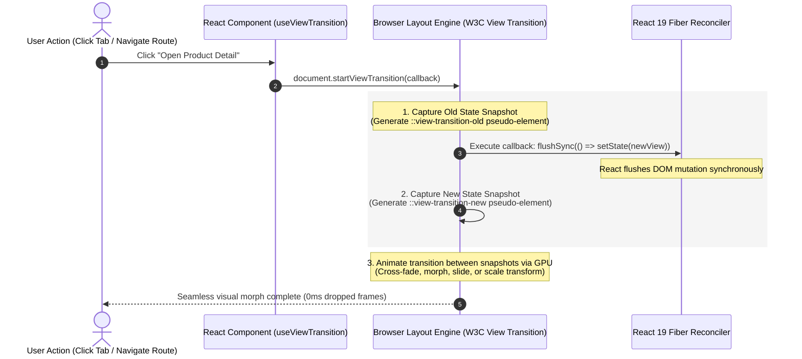

# 08 — The View Transitions API in React 19

## Metadata
- **React Version**: 19.0.0+
- **Prerequisites**: [01-transitions.md](./01-transitions.md), [00-concurrent-rendering.md](./00-concurrent-rendering.md), Modern CSS Animations
- **Difficulty**: Intermediate / Advanced
- **Estimated Read Time**: 27 minutes
- **Tags**: `view-transitions`, `document-startViewTransition`, `react-19`, `animations`, `routing`, `morphing`

---

## Architecture Diagram

The sequence diagram below illustrates how React 19 integrates with the browser's native View Transitions API, capturing pseudo-element snapshots (`::view-transition-old` and `::view-transition-new`) while React flushes state updates synchronously within the transition callback.



---

## Concept Overview

Historically, animating transitions between different page layouts or routing views in Single Page Applications required complex JavaScript animation libraries (such as Framer Motion) that mounted both old and new component trees simultaneously into the DOM, measured their bounding boxes via `getBoundingClientRect()`, and animated absolute coordinates. This approach:
1. Bloated bundle sizes by 30-50KB.
2. Suffered from layout thrashing and dropped frames during heavy DOM operations.
3. Frequently broke accessible semantic layouts.

The **View Transitions API** is a W3C web standard that delegates visual transitions to the **browser's native GPU compositor**.
- The browser takes a visual snapshot of the old DOM (`::view-transition-old(root)`).
- The developer updates the DOM to the new state (e.g. updating React state).
- The browser takes a visual snapshot of the new DOM (`::view-transition-new(root)`).
- The browser GPU automatically executes a smooth cross-fade or hardware-accelerated morph between the two states.

In **React 19**, integrating with `document.startViewTransition` combined with `flushSync` or React Router v7's built-in `<Link viewTransition>` brings app-like navigation and shared element transitions to the web without complex animation dependencies.

---

## Practical Implementation

### Example 1: Basic View Transition Wrapper Hook

This custom hook checks for browser support, falling back to immediate state execution in unsupported environments.

```tsx
// src/hooks/useViewTransition.ts
import { useCallback } from 'react';
import { flushSync } from 'react-dom';

export function useViewTransition() {
  const startTransition = useCallback((updateFn: () => void) => {
    // 1. Check if browser supports View Transitions API
    if (!document.startViewTransition) {
      updateFn();
      return;
    }

    // 2. Wrap state update inside document.startViewTransition with flushSync
    document.startViewTransition(() => {
      flushSync(() => {
        updateFn();
      });
    });
  }, []);

  return { startTransition };
}
```

*Expected Verification Output:*
```text
Calling startTransition(() => setTab('settings')):
  - Browser takes snapshot of current tab.
  - flushSync synchronously applies 'settings' DOM mutation.
  - Browser executes smooth GPU cross-fade transition.
```

---

### Example 2: Shared Element Morphing (Hero Image to Thumbnail)

By assigning matching CSS `view-transition-name` properties to related elements across different views, the browser morphs their position, size, and aspect ratio smoothly.

```css
/* src/styles/view-transitions.css */

/* Named transition for the product image */
.product-hero-image {
  view-transition-name: product-hero-image;
}

/* Customizing the animation timing */
::view-transition-old(product-hero-image),
::view-transition-new(product-hero-image) {
  animation-duration: 350ms;
  animation-timing-function: cubic-bezier(0.4, 0, 0.2, 1);
}
```

```tsx
// src/components/ProductCatalog.tsx
import React, { useState } from 'react';
import { useViewTransition } from '../hooks/useViewTransition';

interface Product {
  id: string;
  name: string;
  image: string;
  description: string;
}

const PRODUCTS: Product[] = [
  {
    id: 'prod-1',
    name: 'Wireless Noise-Canceling Headphones',
    image: 'https://images.unsplash.com/photo-1505740420928-5e560c06d30e?w=400',
    description: 'High-fidelity audio with active noise cancellation and 40h battery life.',
  },
];

export function ProductCatalog() {
  const [selectedProduct, setSelectedProduct] = useState<Product | null>(null);
  const { startTransition } = useViewTransition();

  const handleSelect = (product: Product | null) => {
    startTransition(() => {
      setSelectedProduct(product);
    });
  };

  if (selectedProduct) {
    return (
      <div className="p-8 max-w-xl mx-auto border rounded-xl shadow-lg bg-white">
        <button
          onClick={() => handleSelect(null)}
          className="mb-4 text-blue-600 hover:underline font-medium"
        >
          &larr; Back to Catalog
        </button>
        {/* Same view-transition-name causes hero morph! */}
        
        <h2 className="text-2xl font-bold">{selectedProduct.name}</h2>
        <p className="text-gray-600 mt-2">{selectedProduct.description}</p>
      </div>
    );
  }

  return (
    <div className="p-8 max-w-4xl mx-auto">
      <h2 className="text-2xl font-bold mb-6">Product Catalog</h2>
      <div className="grid grid-cols-2 gap-6">
        {PRODUCTS.map((prod) => (
          <div
            key={prod.id}
            onClick={() => handleSelect(prod)}
            className="p-4 border rounded-lg cursor-pointer hover:shadow-md transition-shadow bg-white"
          >
            {/* Same view-transition-name binds thumbnail to hero image */}
            
            <h3 className="font-semibold">{prod.name}</h3>
          </div>
        ))}
      </div>
    </div>
  );
}
```

*Expected Verification Output:*
```text
Clicking thumbnail:
  - Browser recognizes matching view-transition-name: product-hero-image.
  - Image smoothly animates from 160px thumbnail into 288px hero image.
  - Zero layout flickering.
```

---

### Example 3: View Transitions in React Router v7

React Router v7 natively supports the View Transitions API through the `<Link viewTransition>` prop and `useViewTransitionState()`.

```tsx
// src/components/NavBar.tsx
import React from 'react';
import { NavLink } from 'react-router-dom';

export function NavigationBar() {
  return (
    <nav className="flex gap-4 p-4 border-b bg-gray-50">
      <NavLink
        to="/dashboard"
        viewTransition // Enables native View Transition for route change!
        className={({ isActive }) =>
          `px-3 py-1.5 rounded text-sm font-semibold ${
            isActive ? 'bg-blue-600 text-white' : 'text-gray-700 hover:bg-gray-200'
          }`
        }
      >
        Dashboard
      </NavLink>

      <NavLink
        to="/analytics"
        viewTransition
        className={({ isActive }) =>
          `px-3 py-1.5 rounded text-sm font-semibold ${
            isActive ? 'bg-blue-600 text-white' : 'text-gray-700 hover:bg-gray-200'
          }`
        }
      >
        Analytics
      </NavLink>
    </nav>
  );
}
```

*Expected Verification Output:*
```text
Clicking "Analytics":
  - React Router intercepts navigation.
  - Browser wraps page swap in document.startViewTransition.
  - Dashboard fades out as Analytics fades in smoothly.
```

---

### Example 4: List Item Reordering with Dynamic Transition Names

When reordering or filtering lists, dynamically assigning unique transition names allows individual items to slide smoothly into their new positions.

```tsx
// src/components/SortableTagList.tsx
import React, { useState } from 'react';
import { useViewTransition } from '../hooks/useViewTransition';

export function SortableTagList() {
  const [tags, setTags] = useState(['React', 'TypeScript', 'Vite', 'Tailwind', 'Zustand']);
  const { startTransition } = useViewTransition();

  const shuffle = () => {
    startTransition(() => {
      setTags((prev) => [...prev].sort(() => Math.random() - 0.5));
    });
  };

  return (
    <div className="p-6 border rounded max-w-md bg-white">
      <div className="flex justify-between items-center mb-4">
        <h3 className="font-bold">Ecosystem Tags</h3>
        <button
          onClick={shuffle}
          className="text-xs bg-gray-100 hover:bg-gray-200 px-3 py-1 rounded font-semibold"
        >
          Shuffle Positions
        </button>
      </div>

      <div className="flex flex-wrap gap-2">
        {tags.map((tag) => (
          <span
            key={tag}
            style={{ viewTransitionName: `tag-${tag.toLowerCase()}` }}
            className="px-3 py-1 bg-blue-100 text-blue-800 rounded-full text-sm font-medium"
          >
            {tag}
          </span>
        ))}
      </div>
    </div>
  );
}
```

*Expected Verification Output:*
```text
Click "Shuffle Positions":
  - Each tag animates smoothly from its old coordinate to its new coordinate.
  - Zero manual FLIP math required.
```

---

### Example 5: Custom Directional Slide Animation via CSS Classes

Controlling slide direction (left vs right) during navigation transitions.

```css
/* src/styles/slide-transition.css */
html.slide-forward::view-transition-old(root) {
  animation: slide-out-left 300ms ease both;
}
html.slide-forward::view-transition-new(root) {
  animation: slide-in-right 300ms ease both;
}

@keyframes slide-out-left {
  to { transform: translateX(-100%); opacity: 0; }
}
@keyframes slide-in-right {
  from { transform: translateX(100%); opacity: 0; }
}
```

```tsx
// src/components/SlideTransitionContainer.tsx
import React, { useState } from 'react';

export function SlideTransitionContainer() {
  const [step, setStep] = useState(1);

  const goToNextStep = () => {
    if (!document.startViewTransition) {
      setStep((s) => s + 1);
      return;
    }

    // Set class on documentElement before transition begins
    document.documentElement.classList.add('slide-forward');

    const transition = document.startViewTransition(() => {
      setStep((s) => s + 1);
    });

    transition.finished.finally(() => {
      document.documentElement.classList.remove('slide-forward');
    });
  };

  return (
    <div className="p-6 border rounded max-w-sm">
      <h3 className="text-xl font-bold">Step {step} of 3</h3>
      <p className="my-4 text-gray-600">Slide transition controlled via document CSS classes.</p>
      {step < 3 && (
        <button
          onClick={goToNextStep}
          className="px-4 py-2 bg-blue-600 text-white rounded font-medium hover:bg-blue-700"
        >
          Next Step &rarr;
        </button>
      )}
    </div>
  );
}
```

*Expected Verification Output:*
```text
Click "Next Step":
  - Current step slides out to the left.
  - New step slides in from the right.
  - Classes cleaned up automatically on transition completion.
```

---

## Mental Model & Analogies

### The Video Cross-Fade

Think of the View Transitions API as a **film editor's video cross-dissolve**:
- In the old days (manual React animation), the actor had to perform their exit while the next actor entered the stage simultaneously in the same room.
- With the View Transitions API, the editor takes a still photo of Scene 1, cuts the tape, takes a still photo of Scene 2, and lets the hardware projector smoothly dissolve between the two frames while the stage crew sets up behind the scenes.

---

## Under the Hood / Internal Mechanics

### 1. Pseudo-Element Tree Structure

When `document.startViewTransition()` runs, the browser creates a temporary pseudo-element tree at the top of the DOM:
```text
::view-transition
  └─ ::view-transition-group(root)
       └─ ::view-transition-image-pair(root)
            ├─ ::view-transition-old(root)   (Rendered snapshot of OLD DOM)
            └─ ::view-transition-new(root)   (Live snapshot of NEW DOM)
```
If you declare named elements (`view-transition-name: hero`), the browser spawns an independent `::view-transition-group(hero)` branch, calculating width, height, and transform matrix deltas between snapshots.

### 2. Why `flushSync` is Required

React 19 batches state updates asynchronously by default. The browser expects the callback passed to `document.startViewTransition(callback)` to produce DOM mutations **before** returning a resolved Promise:
```ts
document.startViewTransition(() => {
  // MUST force React to apply DOM changes synchronously!
  flushSync(() => {
    setState(newState);
  });
});
```
If you update state without `flushSync`, React might commit the state changes *after* the browser captures the "new" snapshot, capturing identical snapshots and breaking the transition.

---

## Common Pitfalls & Anti-Patterns

| Anti-Pattern | Why It Breaks | Recommended Solution |
| :--- | :--- | :--- |
| **Updating State Asynchronously without `flushSync`**| Browser captures new snapshot before React renders DOM mutations; animation fails. | Always wrap synchronous React state updates in `flushSync()`. |
| **Duplicate `view-transition-name` on the Same Page** | The browser aborts the entire view transition if multiple elements share the same transition name simultaneously. | Ensure names are unique per page (`viewTransitionName: 'item-' + id`). |
| **Neglecting Feature Detection** | Crashes on older browsers (e.g. Safari < 18 or older Firefox) with `TypeError: undefined is not a function`. | Always check `if (!document.startViewTransition) { update(); return; }`. |
| **Overly Long Transition Durations (>500ms)** | Freezes pointer events on pseudo-elements, making the UI feel sluggish. | Keep transitions between 150ms and 300ms. |
| **Animating Elements with Different Aspect Ratios** | Unconstrained morphing can warp or stretch text and images unnaturally. | Set `object-fit: cover` and customize `::view-transition-old` / `new` aspect ratios. |
| **Ignoring `prefers-reduced-motion`** | Violates WCAG accessibility standards for users with vestibular disorders. | Add `@media (prefers-reduced-motion: reduce) { ::view-transition-group(*) { animation-duration: 0.01ms; } }`. |

---

## Performance & Optimization

### Hardware-Accelerated Transforms

The View Transitions API is executed on the browser's **GPU compositor thread**. Because transitions operate on captured raster images (bitmaps) rather than recalculating CSS layouts:
- Frame rates remain pegged at 60fps / 120fps even on complex DOM trees.
- Zero JavaScript main-thread CPU is consumed during the animation duration.

---

## Edge Cases & Debugging

### Inspecting View Transitions in Chrome DevTools
- Open Chrome DevTools -> Press `Esc` to open Drawer -> Select **Animations** tab.
- Click the **Pause** icon.
- Trigger a View Transition: Chrome will capture the pseudo-element animation, allowing you to scrub the timeline frame-by-frame and inspect `::view-transition-old` and `::view-transition-new`.

---

## Ecosystem & Alternative Approaches

- **Framer Motion (`layoutId`)**: The established standard for JavaScript shared element transitions. Heavier bundle (~35KB), but works identically across all legacy browsers.
- **React Router v7 / Remix**: Native `<Link viewTransition>` integration.
- **Astro / Nuxt**: Frameworks with built-in multi-page View Transition support.

---

## Exercises & Challenges

<details>
<summary><strong>Exercise 1: Accessible View Transitions with Reduced Motion</strong></summary>

**Challenge**: Write CSS that disables View Transitions when the user has enabled the `prefers-reduced-motion` accessibility setting.

```css
@media (prefers-reduced-motion: reduce) {
  ::view-transition-group(*),
  ::view-transition-old(*),
  ::view-transition-new(*) {
    animation: none !important;
  }
}
```
</details>

<details>
<summary><strong>Exercise 2: Morphing Modal Dialog with Dynamic Transition Names</strong></summary>

**Challenge**: Animate a card expanding into a full-screen modal by dynamically applying a `view-transition-name` only to the active card.

```tsx
import React, { useState } from 'react';
import { useViewTransition } from '../hooks/useViewTransition';

export function ExpandableCard({ id, title }: { id: string; title: string }) {
  const [isOpen, setIsOpen] = useState(false);
  const { startTransition } = useViewTransition();

  const toggle = () => {
    startTransition(() => {
      setIsOpen((prev) => !prev);
    });
  };

  return (
    <div
      onClick={toggle}
      style={{ viewTransitionName: isOpen ? 'active-dialog' : undefined }}
      className={isOpen ? 'fixed inset-10 bg-white p-8 z-50 shadow-2xl' : 'p-4 border bg-white'}
    >
      <h3>{title}</h3>
      {isOpen && <p className="mt-4">Expanded modal content...</p>}
    </div>
  );
}
```
</details>

---

## Frequently Asked Interview Questions

<details>
<summary><strong>1. What is the View Transitions API and how does it improve SPA animations?</strong></summary>

The View Transitions API is a native browser specification that enables seamless visual transitions between different DOM states or pages. Unlike traditional JavaScript animation libraries (which require dual-mounting component trees and calculating manual FLIP transforms), the View Transitions API delegates snapshotting and cross-fading to the browser's GPU compositor, delivering 60fps animations with zero bundle overhead and no layout thrashing.
</details>

<details>
<summary><strong>2. Why is `flushSync` necessary when calling `document.startViewTransition` in React 19?</strong></summary>

React 19 batches state updates asynchronously. The View Transitions API requires the callback to perform all DOM modifications before the Promise resolves so it can capture the "new" snapshot. Wrapping the state update in `flushSync` forces React to immediately flush the DOM mutation to the screen synchronously before the browser captures the subsequent frame.
</details>

<details>
<summary><strong>3. What happens if multiple elements on the same page have the same `view-transition-name`?</strong></summary>

The browser considers duplicate `view-transition-name` values an invalid state. When `document.startViewTransition()` is called, if two visible elements share the exact same transition name, the browser immediately skips the transition entirely and applies the DOM change instantly without animation.
</details>

<details>
<summary><strong>4. How do you support browsers that lack View Transitions API support?</strong></summary>

Graceful degradation is straightforward: check for the existence of `document.startViewTransition`. If undefined, execute the state update callback directly:
```ts
if (!document.startViewTransition) {
  updateFn();
} else {
  document.startViewTransition(() => flushSync(updateFn));
}
```
</details>

<details>
<summary><strong>5. How does React Router v7 integrate with View Transitions?</strong></summary>

React Router v7 supports the `<Link viewTransition>` prop and `useViewTransitionState()`. When a user clicks a view-transition link, the router automatically wraps the route swap in `document.startViewTransition`, applying default cross-fades or user-defined shared element morphs between pages.
</details>

<details>
<summary><strong>6. What are `::view-transition-old` and `::view-transition-new` pseudo-elements?</strong></summary>

`::view-transition-old` is a pseudo-element representing a static raster snapshot of the DOM element *before* the state change. 
`::view-transition-new` is a pseudo-element representing the live snapshot of the element *after* the state change. Developers can style both pseudo-elements using CSS animations (e.g. keyframe fades, slides, or transforms).
</details>

<details>
<summary><strong>7. How do you handle accessibility for users with motion sensitivity?</strong></summary>

You must respect the user's OS-level accessibility preferences by adding a media query for `@media (prefers-reduced-motion: reduce)` that overrides `animation-duration: 0s` on `::view-transition-group(*)`, disabling motion transitions while preserving functional state updates.
</details>

<details>
<summary><strong>8. When should you still use Framer Motion instead of the View Transitions API?</strong></summary>

Framer Motion is still preferable when you need complex gesture-driven physics (drag-to-dismiss, spring simulations), strict cross-browser consistency in older browsers, SVG path morphing, or fine-grained keyframe velocity controls that the CSS View Transitions API cannot express.
</details>

---

## References & Further Reading

- [W3C View Transitions API Specification](https://www.w3.org/TR/css-view-transitions-1/)
- [MDN Web Docs: View Transitions API](https://developer.mozilla.org/en-US/docs/Web/API/View_Transitions_API)
- [Chrome for Developers: Smooth transitions with the View Transitions API](https://developer.chrome.com/docs/web-platform/view-transitions/)
- [React Router v7: View Transitions Guide](https://reactrouter.com/)
- [WCAG 2.2 Guideline 2.3: Motion and Vestibular Safety](https://www.w3.org/WAI/WCAG22/Understanding/animation-from-interactions.html)
