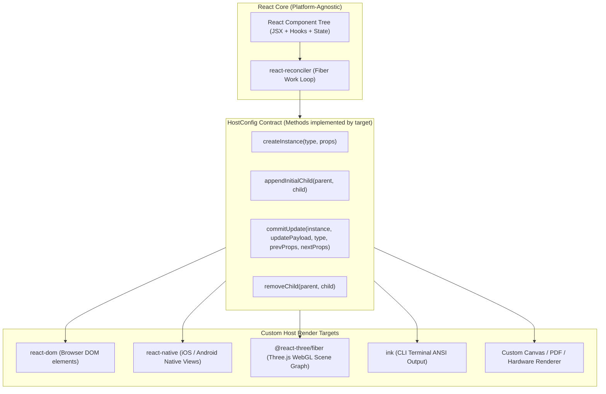

# 04 — Custom Renderers with `react-reconciler`

## Metadata
- **React Version**: 19.0.0+
- **Prerequisites**: [00-render-phases-render-vs-commit.md](../02-state-and-rendering/08-render-phases-render-vs-commit.md), React Fiber Internals
- **Difficulty**: Expert
- **Estimated Read Time**: 30 minutes
- **Tags**: `react-reconciler`, `custom-renderer`, `hostconfig`, `canvas-renderer`, `terminal-renderer`, `internals`

---

## Architecture Diagram

The diagram below illustrates the decoupling of React's core reconciler (`react-reconciler`) from host rendering targets (DOM, Native, Canvas, Terminal, Hardware/IoT).



---

## Concept Overview

One of React's most powerful architectural insights is that **React is not a DOM library**. React is a declarative reconciliation and scheduling engine.

React divides its execution into two distinct layers:
1. **The Reconciler (`react-reconciler`)**: Manages the Fiber tree, schedules priority lanes, processes state transitions, coordinates hooks, and calculates minimal diffs. It has zero knowledge of HTML, CSS, or browser windows.
2. **The Renderer (Host Target)**: Translates the reconciler's diff instructions into physical host mutations.
   - `react-dom`: Mutates HTML `<div>`, `<span>`, `<input>` nodes.
   - `react-native`: Mutates iOS `UIView` and Android `ViewGroup` objects.
   - `react-three-fiber`: Mutates Three.js 3D meshes, lights, and camera graphs.
   - `ink`: Mutates ANSI text blocks in terminal command-line interfaces.
   - `@react-pdf/renderer`: Mutates PDF layout vectors and text blocks.

By implementing the **`HostConfig`** contract provided by `react-reconciler`, developers can bring React's declarative component model to **any custom rendering target imaginable**: custom 2D canvas engines, smart home IoT displays, game engines, or desktop GUIs.

---

## Practical Implementation

### Example 1: Implementing a Complete 2D Canvas Custom Renderer

This working example implements a custom renderer that renders React JSX (`<circle>`, `<rect>`, `<text>`) onto an HTML5 Canvas context.

```ts
// src/renderer/canvasRenderer.ts
import Reconciler from 'react-reconciler';
import { DefaultEventPriority } from 'react-reconciler/constants';

// Define host node types
export interface CanvasNode {
  type: string;
  props: Record<string, any>;
  children: CanvasNode[];
  parent: CanvasNode | null;
}

export interface CanvasRootNode {
  type: 'ROOT';
  ctx: CanvasRenderingContext2D;
  children: CanvasNode[];
}

// Implement the HostConfig specification
const hostConfig: Reconciler.HostConfig<
  string, // Type
  Record<string, any>, // Props
  CanvasRootNode, // Container
  CanvasNode, // Instance
  CanvasNode, // TextInstance
  any, any, any, any, any, any, any, any
> = {
  supportsMutation: true,
  supportsPersistence: false,

  createInstance(type, props) {
    return {
      type,
      props,
      children: [],
      parent: null,
    };
  },

  createTextInstance(text) {
    return {
      type: 'TEXT',
      props: { text },
      children: [],
      parent: null,
    };
  },

  appendInitialChild(parent, child) {
    child.parent = parent;
    parent.children.push(child);
  },

  appendChild(parent, child) {
    child.parent = parent;
    parent.children.push(child);
  },

  appendChildToContainer(container, child) {
    container.children.push(child);
  },

  removeChild(parent, child) {
    const index = parent.children.indexOf(child);
    if (index !== -1) {
      parent.children.splice(index, 1);
    }
  },

  removeChildFromContainer(container, child) {
    const index = container.children.indexOf(child);
    if (index !== -1) {
      container.children.splice(index, 1);
    }
  },

  commitUpdate(instance, _updatePayload, _type, _prevProps, nextProps) {
    instance.props = nextProps;
  },

  clearContainer(container) {
    container.children = [];
  },

  finalizeInitialChildren() {
    return false;
  },
  prepareForCommit() {
    return null;
  },
  resetAfterCommit(container) {
    // Redraw the entire canvas after reconciliation commit phase!
    drawCanvas(container);
  },
  getRootHostContext() {
    return {};
  },
  getChildHostContext() {
    return {};
  },
  shouldSetTextContent() {
    return false;
  },
  getCurrentEventPriority() {
    return DefaultEventPriority;
  },
  getInstanceFromNode() {
    return null;
  },
  beforeActiveInstanceBlur() {},
  afterActiveInstanceBlur() {},
  preparePortalMount() {},
  scheduleTimeout: setTimeout,
  cancelTimeout: clearTimeout,
  noTimeout: -1,
  isPrimary: true,
  supportsHydration: false,
};

// 2. Instantiate Reconciler
export const CanvasReconciler = Reconciler(hostConfig);

// 3. Recursive Canvas Draw function
export function drawCanvas(root: CanvasRootNode) {
  const { ctx } = root;
  ctx.clearRect(0, 0, ctx.canvas.width, ctx.canvas.height);

  function drawNode(node: CanvasNode) {
    ctx.save();
    if (node.type === 'rect') {
      const { x = 0, y = 0, w = 50, h = 50, fill = 'black' } = node.props;
      ctx.fillStyle = fill;
      ctx.fillRect(x, y, w, h);
    } else if (node.type === 'circle') {
      const { x = 50, y = 50, r = 25, fill = 'red' } = node.props;
      ctx.beginPath();
      ctx.arc(x, y, r, 0, Math.PI * 2);
      ctx.fillStyle = fill;
      ctx.fill();
    } else if (node.type === 'text') {
      const { x = 10, y = 20, text = '', fill = 'black', font = '16px sans-serif' } = node.props;
      ctx.fillStyle = fill;
      ctx.font = font;
      ctx.fillText(text, x, y);
    }

    node.children.forEach(drawNode);
    ctx.restore();
  }

  root.children.forEach(drawNode);
}
```

*Expected Verification Output:*
```text
CanvasReconciler initialized with supportsMutation: true.
HostConfig exposes createInstance, commitUpdate, and resetAfterCommit.
```

---

### Example 2: Creating a Public `render()` Entry Point for the Canvas Target

```tsx
// src/renderer/index.ts
import React from 'react';
import { CanvasReconciler, CanvasRootNode, drawCanvas } from './canvasRenderer';

export function renderToCanvas(element: React.ReactNode, canvas: HTMLCanvasElement) {
  const ctx = canvas.getContext('2d');
  if (!ctx) throw new Error('Could not get 2D context from canvas');

  const container: CanvasRootNode = {
    type: 'ROOT',
    ctx,
    children: [],
  };

  // Create Fiber root container
  const root = CanvasReconciler.createContainer(
    container,
    0, // ConcurrentRoot tag
    null,
    false,
    null,
    '',
    (err) => console.error(err),
    null
  );

  // Update container with React tree
  CanvasReconciler.updateContainer(element, root, null, () => {
    drawCanvas(container);
  });

  return {
    unmount: () => {
      CanvasReconciler.updateContainer(null, root, null, () => {
        ctx.clearRect(0, 0, canvas.width, canvas.height);
      });
    },
  };
}
```

*Expected Verification Output:*
```text
renderToCanvas mounts React tree into Fiber container.
Returns unmount function that safely tears down Fiber nodes.
```

---

### Example 3: Consuming Custom JSX Elements with Standard React Hooks

Notice that custom elements (`<rect>`, `<circle>`, `<text>`) can use standard React 19 `useState` and `useEffect`!

```tsx
// src/components/CanvasApp.tsx
import React, { useState, useEffect } from 'react';

// Custom JSX Intrinsic Elements typing
declare global {
  namespace JSX {
    interface IntrinsicElements {
      rect: { x: number; y: number; w: number; h: number; fill: string };
      circle: { x: number; y: number; r: number; fill: string };
      text: { x: number; y: number; text: string; fill?: string; font?: string };
    }
  }
}

export function CanvasApp() {
  const [posX, setPosX] = useState(20);
  const [color, setColor] = useState('blue');

  // React state drives canvas animation!
  useEffect(() => {
    const interval = setInterval(() => {
      setPosX((x) => (x > 300 ? 20 : x + 5));
    }, 16);
    return () => clearInterval(interval);
  }, []);

  return (
    <>
      <rect x={10} y={10} w={380} h={180} fill="#f0f4f8" />
      <text x={20} y={35} text="Declarative React Canvas Renderer" fill="#1e293b" />
      <circle x={posX} y={100} r={30} fill={color} />
      <rect x={posX + 50} y={80} w={40} h={40} fill="amber" />
    </>
  );
}
```

*Expected Verification Output:*
```text
State updates drive Fiber reconciliation -> commitUpdate updates node props -> resetAfterCommit redraws canvas context.
Circle moves smoothly across HTML5 Canvas without touching browser DOM elements!
```

---

### Example 4: Mounting the Canvas App Inside a Standard React DOM Application

A custom renderer can be hosted inside a regular React DOM web application via a standard `<canvas>` ref.

```tsx
// src/components/CanvasHost.tsx
import React, { useRef, useEffect } from 'react';
import { renderToCanvas } from '../renderer';
import { CanvasApp } from './CanvasApp';

export function CanvasHost() {
  const canvasRef = useRef<HTMLCanvasElement>(null);

  useEffect(() => {
    if (!canvasRef.current) return;

    // Mount custom reconciler into canvas element
    const instance = renderToCanvas(<CanvasApp />, canvasRef.current);

    return () => {
      instance.unmount();
    };
  }, []);

  return (
    <div className="p-6 border rounded-lg bg-white shadow-sm">
      <h3 className="text-lg font-bold mb-3">Custom Canvas Renderer Host</h3>
      <canvas
        ref={canvasRef}
        width={400}
        height={200}
        className="border border-gray-300 rounded shadow-inner"
      />
    </div>
  );
}
```

*Expected Verification Output:*
```text
CanvasHost mounts in browser DOM; inner CanvasApp executes through CanvasReconciler.
Clean teardown on unmount without memory leaks.
```

---

### Example 5: Handling Events in a Custom Renderer

Forwarding pointer events from host elements to custom reconciler instances.

```ts
// src/renderer/events.ts
import type { CanvasRootNode, CanvasNode } from './canvasRenderer';

export function attachCanvasEventBridge(canvas: HTMLCanvasElement, root: CanvasRootNode) {
  canvas.addEventListener('click', (e) => {
    const rect = canvas.getBoundingClientRect();
    const clickX = e.clientX - rect.left;
    const clickY = e.clientY - rect.top;

    // Hit test elements in reverse order (top to bottom)
    for (let i = root.children.length - 1; i >= 0; i--) {
      const child = root.children[i];
      if (child.type === 'circle') {
        const { x, y, r, onClick } = child.props;
        const dist = Math.hypot(clickX - x, clickY - y);
        if (dist <= r && onClick) {
          onClick();
          break;
        }
      }
    }
  });
}
```

*Expected Verification Output:*
```text
Clicking within circle coordinates on canvas triggers child.props.onClick().
React state updates -> Re-renders circle with new color.
```

---

## Mental Model & Analogies

### The Architect and the Contractors

- **`react-reconciler`** is the **General Architect**:
  - The architect designs the house layout, calculates the blueprints, and marks revisions when requirements change.
  - The architect does not lay bricks, pour concrete, or cut glass.
- **The Renderer (`HostConfig`)** is the **Specialist Contractor**:
  - If building on land, the contractor lays bricks (`react-dom`).
  - If building a submarine, the contractor welds steel plates (`react-three-fiber`).
  - If building in outer space, the contractor weaves carbon fiber (`ink` for terminals).
  - The architect gives the same structural blueprints to all contractors; each contractor translates them into their own material medium.

---

## Under the Hood / Internal Mechanics

### Mutation vs Persistence Mode in HostConfig

React Reconciler supports two primary architectural modes:
1. **Mutation Mode (`supportsMutation: true`)**:
   - The host tree is mutable (e.g., standard browser DOM, Canvas nodes).
   - React invokes `appendChild()`, `removeChild()`, and `commitUpdate()` to alter existing nodes in place.
2. **Persistence Mode (`supportsPersistence: true`)**:
   - The host tree is immutable (e.g., persistent data structures or immutable GUI frameworks).
   - Instead of mutating existing nodes, React calls `cloneInstance()`, producing a brand-new tree snapshot and swapping the root pointer atomically.

---

## Common Pitfalls & Anti-Patterns

| Anti-Pattern | Why It Breaks | Recommended Solution |
| :--- | :--- | :--- |
| **Directly Mutating Canvas During `createInstance`**| Violates React render-phase purity; runs multiple times during speculative concurrent renders. | Defer all host drawing to `resetAfterCommit()` or the commit phase. |
| **Omitting Cleanup in `clearContainer`** | Previous nodes linger in memory after remounting or fast refresh. | Ensure `container.children = []` and wipe host display contexts. |
| **Synchronous Redrawing on Every Child Append** | Causes severe frame lag when mounting trees with thousands of nodes. | Batch draws in `resetAfterCommit`, which fires once after the entire tree diff finishes. |
| **Hardcoding HTML DOM Assumptions** | Calling `document.createElement` inside custom reconciler logic breaks in non-browser environments (Node.js, React Native). | Keep HostConfig pure and platform-specific. |
| **Missing `getCurrentEventPriority`** | Concurrent React scheduler cannot prioritize urgent user inputs over background updates. | Return `DefaultEventPriority` or inspect active event type. |
| **Failing to Tear Down Event Listeners** | Attaching listeners without removing them causes detached canvas element leaks. | Always return an unmount / cleanup handler from custom render functions. |

---

## Performance & Optimization

### Batching Updates in `prepareForCommit` and `resetAfterCommit`

Never trigger expensive host operations during `commitUpdate`. Instead, accumulate dirty bounding boxes during `commitUpdate` and flush a single redraw during `resetAfterCommit`:
```ts
prepareForCommit(container) {
  container.dirty = false;
  return null;
},
commitUpdate(instance, payload) {
  instance.container.dirty = true;
},
resetAfterCommit(container) {
  if (container.dirty) {
    drawCanvas(container);
  }
}
```

---

## Edge Cases & Debugging

### Debugging with React DevTools in Custom Renderers
To connect your custom renderer to React DevTools:
```ts
CanvasReconciler.injectIntoDevTools({
  bundleType: process.env.NODE_ENV === 'production' ? 0 : 1,
  version: '19.0.0',
  rendererPackageName: 'react-canvas-renderer',
});
```
This enables the full React DevTools component tree inspector for your custom canvas elements.

---

## Ecosystem & Alternative Approaches

- **React Three Fiber (`@react-three/fiber`)**: The most popular custom reconciler in production, rendering declarative Three.js 3D scenes.
- **Ink (`vadimdemedes/ink`)**: React reconciler for interactive command-line terminal applications.
- **React PDF (`@react-pdf/renderer`)**: Generates print-ready vector PDF documents from React components.

---

## Exercises & Challenges

<details>
<summary><strong>Exercise 1: Implement a Path/Line Primitive for Canvas</strong></summary>

**Challenge**: Extend the custom renderer to support a `<line x1={0} y1={0} x2={100} y2={100} stroke="blue" />` primitive.

```ts
// In drawNode inside drawCanvas:
if (node.type === 'line') {
  const { x1 = 0, y1 = 0, x2 = 100, y2 = 100, stroke = 'black', lineWidth = 2 } = node.props;
  ctx.beginPath();
  ctx.moveTo(x1, y1);
  ctx.lineTo(x2, y2);
  ctx.strokeStyle = stroke;
  ctx.lineWidth = lineWidth;
  ctx.stroke();
}
```
</details>

<details>
<summary><strong>Exercise 2: Terminal ANSI Custom Renderer Skeleton</strong></summary>

**Challenge**: Configure a minimal HostConfig for outputting text lines to Node.js `process.stdout`.

```ts
const terminalHostConfig = {
  supportsMutation: true,
  createInstance: (type: string, props: any) => ({ type, props, children: [] }),
  createTextInstance: (text: string) => ({ type: 'TEXT', text }),
  resetAfterCommit: (container: any) => {
    console.clear();
    container.children.forEach((c: any) => console.log(c.props?.text || c.text));
  },
  // ... other mandatory stubs
};
```
</details>

---

## Frequently Asked Interview Questions

<details>
<summary><strong>1. What is the fundamental architecture of `react-reconciler`?</strong></summary>

`react-reconciler` contains the platform-agnostic core of React. It manages Fiber trees, hooks, state updates, priority lanes, and reconciliation diff algorithms. It communicates with host rendering targets through an injected `HostConfig` object, which defines how to create, append, update, and remove physical host nodes (such as DOM nodes, native views, or 3D meshes).
</details>

<details>
<summary><strong>2. What is the difference between Mutation Mode and Persistence Mode in HostConfig?</strong></summary>

**Mutation Mode** (`supportsMutation: true`) is designed for mutable target environments like the DOM or HTML5 Canvas, where existing nodes are updated in place via `commitUpdate` and `appendChild`. 
**Persistence Mode** (`supportsPersistence: true`) is designed for immutable target environments, where nodes are cloned on every update (`cloneInstance`), producing a brand-new tree and atomically replacing the root container reference.
</details>

<details>
<summary><strong>3. Can you use standard React hooks (`useState`, `useEffect`) in a custom renderer?</strong></summary>

Yes! Hooks are completely managed by the Fiber reconciler. Custom renderers have full access to `useState`, `useEffect`, `useReducer`, `useMemo`, `useRef`, and `useTransition`. The host target only dictates how JSX primitives (`<mesh>`, `<rect>`, `<view>`) are materialized.
</details>

<details>
<summary><strong>4. Why should drawing operations be deferred to `resetAfterCommit` instead of running inside `createInstance`?</strong></summary>

`createInstance` runs during React's **render phase**. In Concurrent React, the render phase can be paused, restarted, or completely discarded if a higher-priority update arrives. Drawing to a canvas during `createInstance` results in wasted computations and duplicated visual artifacts. Deferring drawing to `resetAfterCommit` guarantees that drawing executes only once during the committed phase.
</details>

<details>
<summary><strong>5. How do custom renderers handle user input and event dispatching?</strong></summary>

Because non-DOM targets lack native browser bubbling, the renderer must implement an event bridge. For example, in a Canvas renderer, a click listener on the canvas element performs geometric hit-testing against the positions of rendered child nodes and invokes corresponding callback props (`onClick`, `onHover`).
</details>

<details>
<summary><strong>6. What is the purpose of `prepareForCommit` and `resetAfterCommit`?</strong></summary>

`prepareForCommit` is called right before React applies mutations to the host tree, allowing the renderer to prepare (e.g. disabling screen updates, caching canvas state). `resetAfterCommit` is called immediately after all mutations have been applied, allowing the renderer to execute a unified re-paint, release locks, or restore focus.
</details>

<details>
<summary><strong>7. How does `@react-three/fiber` leverage `react-reconciler`?</strong></summary>

`@react-three/fiber` maps React components directly to Three.js scene graph objects (e.g. `<mesh>` maps to `new THREE.Mesh()`, `<boxGeometry>` to `new THREE.BoxGeometry()`). When React state updates, the reconciler updates Three.js object properties without touching the DOM, rendering directly to WebGL.
</details>

<details>
<summary><strong>8. How do you inject a custom renderer into React DevTools?</strong></summary>

`react-reconciler` exposes an `injectIntoDevTools()` method. By calling this method with your renderer's name, version, and bundle type, React DevTools can detect your custom Fiber container and display your custom JSX components in the browser inspector.
</details>

---

## References & Further Reading

- [react-reconciler Official GitHub Package](https://github.com/facebook/react/tree/main/packages/react-reconciler)
- [Building a Custom React Renderer - Sophie Alpert](https://www.youtube.com/watch?v=CGpMlWVcHok)
- [React Three Fiber Architecture](https://r3f.docs.pmnd.rs/getting-started/introduction)
- [Ink: React for Interactive CLI Apps](https://github.com/vadimdemedes/ink)
- [Making a Custom React Renderer Guide (Dan Abramov)](https://github.com/agentcooper/react-reconciler-example)
